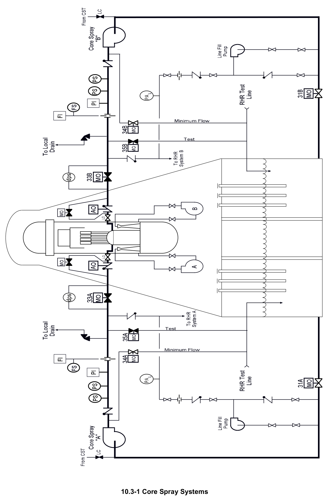
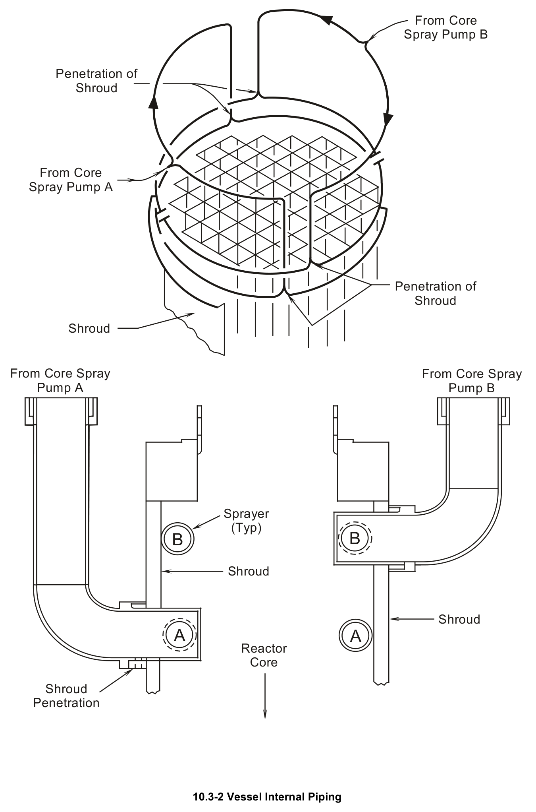

# 10.3 Core Spray

> Source: `10.3_Core_Spray.pdf` (14 pages)
> GE (BWR) Systems Technology Manual — USNRC HRTD, Rev 09/11

---
<!-- p.1 -->
#### General Electric Systems Technology Manual
#### Chapter 10.3
#### Core Spray System
<!-- p.3 -->
TABLE OF CONTENTS

10.3 CORE SPRAY SYSTEM ........................................................................................ 1

10.3.1 Introduction .................................................................................................... 1

10.3.2 Component Description .................................................................................. 2

10.3.2.1 Suction Path ......................................................................................... 2

10.3.2.2 Core Spray Pumps ............................................................................... 3

10.3.2.3 Discharge Path ..................................................................................... 3

10.3.2.4 Core Spray Sparger .............................................................................. 3

10.3.2.5 Line Fill ................................................................................................. 3

10.3.2.6 Motor Operated Valves ......................................................................... 4

10.3.3 System Features and Interfaces .................................................................... 4

10.3.3.1 Normal Operation ................................................................................. 4

10.3.3.2 Automatic Initiation ............................................................................... 4

10.3.3.3 Manual Override Features .................................................................... 5

10.3.3.4 System Testing ..................................................................................... 5

10.3.3.5 System Interlocks ................................................................................. 5

10.3.3.6 CS System Leak Detection ................................................................... 5

10.3.3.7 System Interfaces ................................................................................. 6

10.3.4 Summary ........................................................................................................ 7

Rev 09/11 10.3-i USNRC HRTD

<!-- p.4 -->
#### LIST OF FIGURES
10.3-1 Core Spray Systems 10.3-2 Vessel Internal Piping 10.3-3 Core Spray System Pipe Break Detection Instrumentation

Rev 09/11 10.3-ii USNRC HRTD

<!-- p.5 -->
### 10.3 CORE SPRAY SYSTEM
Learning Objectives:

1. Recognize the purpose of the Core Spray (CS) System.

2. Recognize the purpose, function and operation of the following Core Spray system major components:
a. Pump Discharge Valve b. Pump c. Sparger d. Minimum flow valve e. Full flow test valve f. Line fill pump

3. Recognize the following flowpaths of the Core Spray system:
a. Suction Path b. Discharge Path c. Line Fill d. Flow testing

4. Recognize the plant parameters which will cause Core Spray system automatic initiation.

5. Recognize the system’s normal standby alignment and how the system will respond to an initiation signal.

6. Recognize how the Core Spray system interfaces with the following systems:
a. Reactor Vessel System (Section 2.1)
b. Reactor Vessel Instrumentation System (Section 3.1)
c. Automatic Depressurization System (Section 10.2)
d. Primary Containment System (Section 4.1)
e. Residual Heat Removal System (Section 10.4)

#### 10.3.1 Introduction
The purpose of the Core Spray (CS) System is to provide low pressure makeup water to the reactor vessel for core cooling under Loss Of Coolant Accident (LOCA) conditions.

The functional classification of the Core Spray System is that of a safety related system.
Its regulatory classification is an engineered safety feature system.

The CS System (Figure 10.3-1) consists of two separate and independent 100% capacity subsystems capable of delivering 4725 gpm at 274 psig discharge pressure.
Each loop contains the following components: one low pressure pump, minimum flow

Rev 09/11 10.3-1 USNRC HRTD

<!-- p.6 -->
line, test line, spray sparger, and the associated motor operated valves and instrumentation necessary to perform its purpose.

The CS System delivers water from the suppression pool into the reactor vessel through spray nozzles mounted on spargers located directly above the fuel assemblies (Figure 10.3-2). Core cooling is accomplished by spraying water on top of the fuel assemblies.
The water runs down the sides of fuel pins providing a heat sink for the heat radiated from the fuel rods. The heat removed by water evaporation within the fuel assemblies also provides some convection cooling.

The CS System will automatically initiate upon receipt of either a Level 1 reactor vessel water level signal or a high drywell pressure.

The system is provided with the means to periodically test the operational capability to the system. A minimum flow line is also provided to create a flow path to remove pump heat under situations where the discharge and test valves are closed. The motor operated valves automatically line up for the emergency mode of operation upon a system initiation when in the test mode.

The line fill system pumps maintain the CS and the same division of RHR filled with water from the suction of the pumps to the closed injection isolation valve. This is done to reduce the water hammer hydraulic effect and decrease the delay time from initiation signal to actual water flow into the reactor vessel.

#### 10.3.2 Component Description
The major components of the Core Spray System are discussed in the paragraphs that follow.

##### 10.3.2.1 Suction Path
The normal water supply for the CS System is provided by the suppression pool through a suction strainer into a 14 inch line with a motor operated suction valve to the suction of the pump. The suction valves have no automatic features, and are normally open. If the valve is not full open, a Core Spray pump trip signal is generated.

When the reactor is shutdown, the core spray pump suction path can be manually transferred from the suppression pool to the Condensate Storage Tank (CST). With clean water from the CST, a test can be conducted in which water can be sprayed on top of the core. This testing verifies the integrity of the spray pattern and removes any high level radioactive corrosion products from the spray spargers.

Rev 09/11 10.3-2 USNRC HRTD

<!-- p.7 -->
##### 10.3.2.2 Core Spray Pumps
There is a total of two pumps in the CS System; one for each loop. Each pump is 100% capacity and powered by an independent power source. Each pump is a single stage centrifugal pump designed to deliver 4725 gpm at a reactor vessel pressure 274 psi greater than suppression pool pressure. Power to the pump motors is supplied from the 4160 Emergency Distribution System.

##### 10.3.2.3 Discharge Path
The main discharge path for the pumps goes through a discharge check valve, flow element and then to the discharge valves located just outside the primary containment.
It then passes through penetrations in the containment drywell walls.

Inside the primary containment, each discharge line has an air operated testable check valve to prevent reverse flow in the CS System. The testable feature, which proves the valves operability, incorporates an air operator mounted on the valve. In addition, a motor operated bypass valve is provided to equalize around the air operated check valve prior to check valve opening.

Downstream of the check valve is a manual isolation valve which isolates the discharge header so that maintenance can be accomplished. It also allows for independent hydrostatic testing of the discharge line and reactor vessel. A limit switch on this manual isolation valve provides an indication in the control room when the valve is full open. The discharge lines enter the reactor vessel approximately 180º apart. Once inside the reactor vessel, each line tees and is routed 90º horizontally. Each line is then directed downward along the vessel wall and then inward where it penetrates the shroud just above the core outlet plenum. After entering the shroud each line again tees to form two semicircular spray headers (spargers), shown in Figure 10.3-2, and described below.

##### 10.3.2.4 Core Spray Sparger
The core spray sparger configuration is shown in Figure 10.3-2. There are two 100% capacity core spray spargers provided within the reactor pressure vessel. Sparger B is located directly above sparger A within the upper shroud area above the reactor core.
Each sparger is manufactured in two sections. Each sparger header contains orificed nozzles that are designed to insure adequate coverage of the reactor core with water spray during a LOCA.

##### 10.3.2.5 Line Fill
The purpose of the line fill is to maintain the core spray and RHR system full of water, from the pump discharge check valves to the normally closed valve in the injection path.
With the system being maintained full of water, the probability of water hammer on

Rev 09/11 10.3-3 USNRC HRTD

<!-- p.8 -->
system initiation is greatly reduced. The line fill pump supplies a Residual Heat Removal system loop and one CS system loop with 15 gpm at 55 psig.

##### 10.3.2.6 Motor Operated Valves
Each motor operated valve in the CS System, is powered from the same electrical division power that supplies power to the pumps (i.e.: System I from division I, System II from division II). All motor operated valves in both systems I and II can be operated from the control room.

#### 10.3.3 System Features and Interfaces
A short discussion of the system features and interface this system has with other plant systems is given in the paragraphs which follow.

##### 10.3.3.1 Normal Operation
During normal plant operation, the CS System is in a standby status as indicated on Figure 10.3-1, ready for automatic initiation when required.

##### 10.3.3.2 Automatic Initiation
The Core Spray System will automatically align valves and start pumps upon receiving either of the two initiation signals: Level 1 reactor vessel water level or high drywell pressure.

The operation of the system in response to an initiation signal is as follows:

• The test line motor operated valves are closed and interlocked closed.
• If normal AC power is available the CS pumps will start after a seven second time delay to prevent overloading the AC power system.
• When reactor vessel pressure decreases below 465 psig, the injection valves receive a permissive to open signal.

Actual injection into the reactor vessel will begin when reactor pressure is reduced to less than pump shutoff head (approximately 333 psig) at the pump discharge.

When injection flow reaches 650 gpm the minimum flow valve is signaled to close. Flow will reach 4725 gpm when reactor pressure decreases to less than 274 psig above suppression pool pressure. The restricting orifice in the injection line prevents the CS pump from going into runout as the reactor further depressurizes.

In addition to the CS system’s pumps and valves, other systems respond to input from the CS system’s logic initiation. The following also occur:

Rev 09/11 10.3-4 USNRC HRTD

<!-- p.9 -->
• all three Emergency Diesel Generators will start,
• Reactor Building Service Water valves will realign to split the service water system into two separate redundant loops,
• the Reactor Building Closed Loop Cooling Water system’s non-safety related loops will isolate.

The system’s manual initiation response is identical to that of an automatic initiation.

##### 10.3.3.3 Manual Override Features
With the system in operation following an automatic initiation, the operator, using procedures and his judgment, can override some of the automatic functions by turning the pump control switch to the off position or by throttling the discharge valve. Either of these actions produces the appropriate indication and alarms to inform the operator of his actions. Once the system is shutdown, by closing a discharge valve or stopping the pump(s), the system will not automatically restart unless the initiation logic is manually reset

##### 10.3.3.4 System Testing
During plant operation, periodic testing of the core spray pumps and valves are required to ensure the system will perform as designed. Surveillance testing of the core spray pumps is accomplished by recirculating the suppression pool water, via the test return line, to ensure required flow rates are obtainable. Surveillance testing of the motor operated valves is accomplished by cycling the valves and timing the stroke time, when required.

##### 10.3.3.5 System Interlocks
The minimum flow valves automatically open on low flow (<650 gpm) and automatically close when flow exceeds 650 gpm. The test valves receive a continuous close signal whenever there is an initiation signal present. Discharge valves receive open signals on system automatic initiation when reactor pressure is less than 465 psig. Once open following system automatic initiation, the inboard discharge valves can be throttled to adjust system flow.

##### 10.3.3.6 CS System Leak Detection
A detection system is provided to continuously confirm the integrity of the core spray piping between the inside of the reactor vessel and the core shroud.

A differential pressure switch measures the pressure difference between the CS piping outside the reactor vessel (high side of D/P cell) and the Standby Liquid penetration just above the core plate (low side of D/P cell). This D/P is indicative of the differences in water density between the inside of the vessel (~545ºF) and the reference leg in the

Rev 09/11 10.3-5 USNRC HRTD

<!-- p.10 -->
drywell (~125ºF). The D/P is 0 psi when the reactor vessel is cool and increases to about 3.5 psi at normal operating temperatures.

Figure 10.3-3 shows a typical configuration of the CS sparger leak detection system.
During normal operation there is a 7 psi D/P across the moisture separators and an additional 7” D/P across the steam dryers. A break in the Core Spray piping between the reactor vessel wall and where the core spray piping penetrates the core shroud will cause the sensed pressure on the reference leg (high side of D/P cell) to drop by approximately 7.25 psi. This will reverse the measured pressures. The control room annunciator for Core Spray System (A/B) RPV Header Differential Pressure Low alarms at 0.7 psid and decreasing which indicates a possible pipe rupture outside the shroud.
This annunciator is an expected alarm during shutdown and cooled down conditions.

##### 10.3.3.7 System Interfaces
A short discussion of interfaces this system has with other plant systems is given in the paragraphs which follow:

Reactor Vessel System (Section 2.1)

The CS System injection piping penetrates the reactor vessel and core shroud. The core spray spargers are mounted inside the core shroud.

Emergency AC Power System (Section 9.2)

The CS System receives reliable electrical power for system operation from the Emergency AC Power System. The Emergency Diesel Generators receive start signals from the CS system logic.

Automatic Depressurization System (Section 10.2)

The Automatic Depressurization System rapidly lowers reactor vessel pressure to allow the Core Spray and RHR systems to inject into the reactor.

Primary Containment System (Section 4.1)

The suppression pool, which is part of the Primary Containment System, is the normal suction for the core spray system. Additionally, the CS minimum flow lines and full flow test lines are connected to the suppression pool.

Reactor Building Service Water System (Section 11.2)

The RBSW System receives LOCA logic signals from the CS system logic.

Rev 09/11 10.3-6 USNRC HRTD

<!-- p.11 -->
#### 10.3.4 Summary
The purpose of the Core Spray System is to provide protection to the core in the case of a large break in the nuclear system in which the high pressure coolant injection systems are all unable to maintain the reactor pressure vessel water level. The Core Spray System will also provide protection to the core in the case of a small break in the nuclear system in which high pressure injection systems are all unable to maintain the reactor pressure vessel water level. During a small break scenario the Automatic Depressurization System will depressurize the reactor pressure vessel and allow Core Spray system to inject into the core.

Rev 09/11 10.3-7 USNRC HRTD

<!-- p.12 -->

*figure on PDF page 12*

[Vector original (SVG, lossless): fig_page-12_2.svg](../figures/fig_page-12_2.svg)

<!-- p.13 -->

*figure on PDF page 13*

[Vector original (SVG, lossless): fig_page-13_2.svg](../figures/fig_page-13_2.svg)

<!-- labels/text on this figure page -->
From Core Spray Pump B
Penetration of Shroud
From Core Spray Pump A
Penetration of Shroud
Shroud
From Core Spray From Core Spray Pump A Pump B
Sprayer
(Typ)
B B
Shroud
Shroud A A Reactor Core
Shroud Penetration
10.3-2 Vessel Internal Piping

<!-- p.14 -->
5 DRYWELL STEAM DRYER

WATER LEVEL 4

MO MO 7"

5

PS 3 POS

PAH

2

ABOVE CORE dpA* PLATE PRESSURE

1 LOW HIGH dpis

STANDBY LIQUID CONTROL

* NOTE: dpA ALARMS ON DECREASING DIFFERENTIAL PRESSURE

10.3-3 Core Spray System Pipe Break Detection Instrumentation

