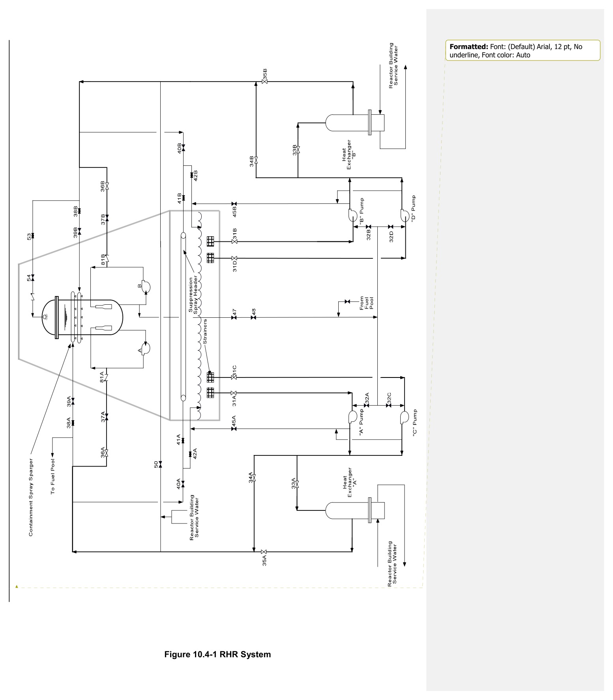
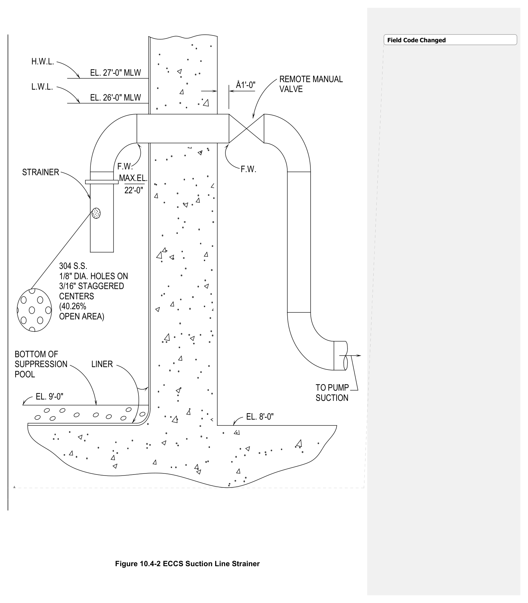
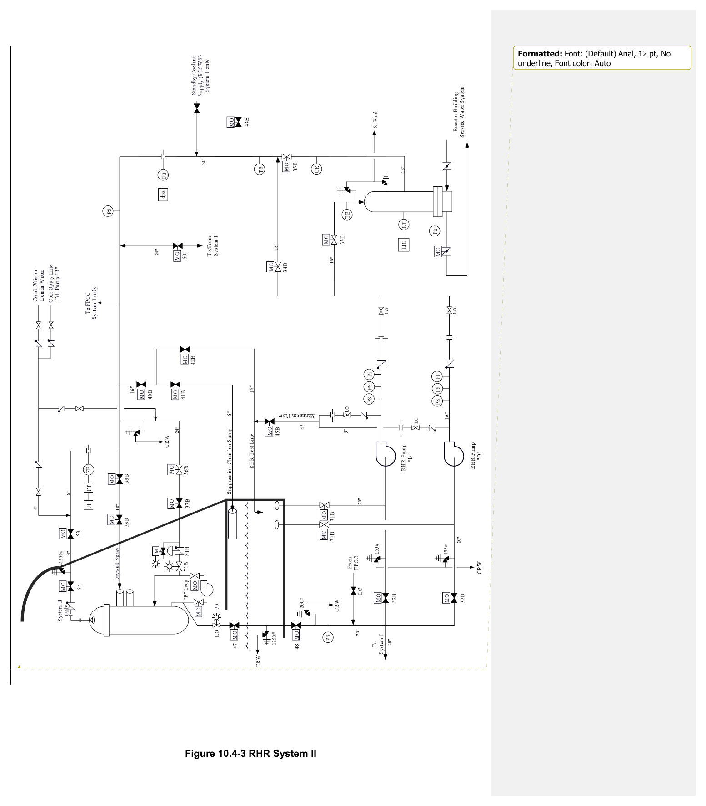
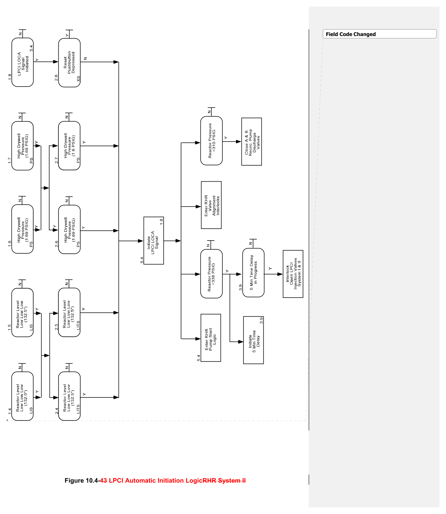

# 10.4 RHR

> Source: `10.4_RHR.pdf` (27 pages)
> GE (BWR) Systems Technology Manual — USNRC HRTD, Rev 09/11

---
<!-- p.1 -->
Style Definition: TOC 2: Indent: Left: 0.25", Tab stops: 0.88", Left + Not at 1"

Field Code Changed

#### General Electric Systems Technology Manual
#### Chapter 10.4
#### Residual Heat Removal System
<!-- p.3 -->
TABLE OF CONTENTS

10.4 RESIDUAL HEAT REMOVAL SYSTEM ................................................................. 1

10.4.1 Introduction ................................................................................................... 2

10.4.2 Component Description ................................................................................ 4

10.4.2.1 Suction Strainers ................................................................................... 4

10.4.2.2 RHR Pumps .......................................................................................... 4

10.4.2.3 RHR Heat Exchangers .......................................................................... 5

10.4.2.4 Motor Operated Valves ......................................................................... 5

10.4.2.5 Testable Check Valves .......................................................................... 7

10.4.2.6 Containment Spray Spargers ................................................................ 7

10.4.2.7 Line Fill .................................................................................................. 7

10.4.3 System Features and Interfaces ................................................................... 8

10.4.3.1 Normal Operation .................................................................................. 8

10.4.3.2 Infrequent Operation ............................................................................. 8

10.4.3.3 Emergency Operation ......................................................................... 10

10.4.3.4 System Interlocks ................................................................................ 13

10.4.3.5 System Automatic Isolation During Shutdown Cooling Operations ..... 13

10.4.3.6 System Interfaces ................................................................................ 14

10.4.4 Summary .................................................................................................... 15

Rev 00912/11 10.4-i USNRC HRTD

<!-- p.4 -->
#### LIST OF FIGURES
10.4-1 RHR System 10.4-2 ECCS Suction Line Strainer 10.4-3 RHR System II 10.4-4 LPCI Automatic Initiation Logic Formatted: Indent: Left: 0", First line: 0"

Rev 009/11 10.4-ii USNRC HRTD

<!-- p.5 -->
### 10.4 RESIDUAL HEAT REMOVAL SYSTEM
Field Code Changed

Learning Objectives:

1. Recognize the purposes of the residual heat removal (RHR) system.

2. Recognize the purpose, function and operation of the following major system components:
a. Suppression pool and shutdown cooling suction valves b. RHR pumps c. Minimum flow valve d. RHR heat exchanger e. DW and SP spray valves and spargers f. Full flow test valve g. Head spray valves and nozzle h. RHR injection valves

3. Recognize the purpose, operation and flow path for each of the following RHR system modes of operation:
a. Low pressure coolant injection (LPCI)
b. Drywell and suppression pool spray c. Suppression pool cooling d. Shutdown cooling (SDC) and head spray e. Standby coolant supply mode f. Fuel pool cooling assist g. Testing h. Line fill

4. Recognize the plant parameters which will cause LPCI system automatic initiation.

5. Recognize the system’s normal standby alignment and how the system will respond to a LPCI initiation signal while in the normal standby alignment or while operating in DW spray, SP spray and/or SP cooling modes.

6. Recognize how the Residual Heat Removal system interfaces with:
a. Reactor Recirculation System (Section 2.4)
b. Primary Containment System (Section 4.1)
c. Nuclear Steam Supply Shutoff System (Section 4.4)
d. Reactor Vessel System (Section 2.1)
e. Automatic Depressurization System (Section 10.2)
f. Core Spray System (Section 10.3)
g. Reactor Building Closed Cooling Water System (Section 11.3)
h. Reactor Building Service Water System (Section 11.2)
i. Fuel Pool Cooling and Clean Up System (Section 11.7)
j. Reactor Vessel Instrumentation System (Section 3.1)

Rev 009/11 10.4-1 USNRC HRTD

<!-- p.6 -->
#### 10.4.1 Introduction
The residual heat removal RHR system is a versatile high capacity low pressure system that can be used for cooling and/or inventory control. The RHR System, (Figures 10.4-1 & 10.4-3) has six operational modes. The functional classification of the RHR System is that of a safety related system. Its regulatory classification is an Engineered Safety Feature System.

The RHR System consists of two separate and independent piping loops designated System I and System II. Each loop contains:
• two pumps
• one heat exchanger
• associated piping, valves, and instrumentation.

The purposes of the RHR system modes are as follows:
• The low pressure coolant injection (LPCI) mode automatically initiates to restore and maintain reactor water level following a loss of coolant accident (LOCA).
• The containment spray mode is employed following a LOCA and has two purposes.
One purpose is to condense steam for primary containment pressure reduction. The second purpose is to reduce airborne activity in the primary containment following a LOCA.
• The suppression pool cooling mode removes heat from the suppression pool.
• The shutdown cooling and head spray mode remove decay heat from the reactor core following a reactor shutdown and remove residual heat from upper reactor vessel internals during a cooldown.
• The standby coolant supply mode provides a means of flooding the primary containment.
• The fuel pool cooling assist mode provides fuel pool cooling when the capacity of the fuel pool cooling and cleanup (FPCC) system is not adequate.

The LPCI mode (Figure 10.4-1) is the foundation core cooling function of the RHR system design. The normal RHR valve lineup configuration is the standby LPCI configuration. The LPCI mode operates automatically to restore and maintain the reactor vessel coolant inventory. The design goal is to preclude fuel clad temperatures in excess of 2200ºF during a LOCA. Limiting fuel clad temperature will also limit any subsequent energy release due to a metal-water reaction. During LPCI operation the RHR pumps take water from the suppression pool and discharge to the reactor vessel via the recirculation system's discharge piping. The required flow for LPCI can be met if 2 of the 4 pumps are injecting after the design base LOCA.

The containment spray and suppression pool cooling modes of the RHR system (Figure 10.4-1) are placed in operation by manual operator action. Containment spray is used to condense steam and reduce airborne activity in the primary containment following a LOCA. The RHR pumps take a suction from the suppression pool and discharge water

Rev 009/11 10.4-2 USNRC HRTD

<!-- p.7 -->
to the RHR heat exchangers. The RHR heat exchangers remove the heat from the suppression pool water and transfer it to the reactor building service water system
(RBSW). The cooled suppression pool water is then sprayed into rings in the drywell and/or the suppression pool air space to condense steam.

Suppression pool cooling is used to maintain suppression pool temperature within specified limits during normal plant operating conditions. This limits the water temperature to <170ºF following a LOCA. Water is pumped through the RHR heat exchanger to transfertransferring heat from the suppression pool water to the RBSW system. The cooled water is then returned to the suppression pool. Promptly cooling the suppression pool is an essential element in avoiding core damage following a design basis accident (DBA) LOCA. Maintaining the suppression pool temperature low during plant operation provides a greater margin for the suppression pool to absorb the energy in the reactor.

The shutdown cooling and head spray modes are used during normal reactor shutdown and cooldown operations. Reactor coolant temperature/pressure is decreased to below the pressure ratings of the RHR system piping by the main steam system. The RHR system is then placed in the shutdown cooling mode of operation. The head spray portion of shutdown cooling is used intermittently to cool the upper vessel internals.
These larger components are sprayed to assist in there cooldown. Shutdown cooling and head spray can only take a suction from the "B" recirculation loop suction piping.
The water is then cooled by the RHR heat exchanger. This cooled reactor water is then discharged back to either the "A" or "B" recirculation loop discharge line. This mode is capable of completing the cooldown to 125ºF in less than 20 hours. It can maintain the water temperature below 125ºF to accommodate refueling operation.

The standby coolant supply mode provides an unlimited supply of water for flooding the primary containment if required for post LOCA recovery operations. Containment flooding is accomplished by connecting the designated reactor building service water
(RBSW) pump to the RHR System. Water is pumped into the reactor vessel and eventually spills out the break, filling the entire containment to a level above the reactor core.

The FPCC assist mode of the RHR system is used to augment the fuel pool cooling and cleanup (FPCC) system. The RHR heat exchangers provide extra cooling capacity for spent fuel in the event that the FPCC system is inadequate. The flowpath is only available for the system I RHR loop. A suction is taken by the RHR pumps from the FPCC suction piping. The spent fuel pool water is cooled by the RHR heat exchanger.
The cooled spent fuel pool water is then returned to the FPCC system piping.

Rev 009/11 10.4-3 USNRC HRTD

<!-- p.8 -->
System II (Figure 10.4-3) can be used for any mode of RHR operation except for the fuel pool cooling assist and standby cooling modes. System I can be used for any mode of RHR operation except for reactor vessel head spray.

#### 10.4.2 Component Description
The components of this system are discussed in the paragraphs that follow, as Field Code Changed illustrated Figures 10.4-1 & 10.4-3.
Field Code Changed

##### 10.4.2.1 Suction Strainers
Each RHR pump is normally aligned to take suction from the suppression pool.
Field Code Changed Strainers located in the suction path from the suppression pool are designed to prevent foreign objects from entering the pump suction. Suppression pool water quality is monitored and in some measure controlled. However, debris resulting from accident conditions can enter the suppression pool. The strainer shown in Figure 10.4-2 utilizes a perforated pipe to prevent the introduction of foreign matter. Many other strainer designs are found among domestic BWRs. All suction strainers are designed such that the RHR net positive suction head is maintained during a design basis accident

The effective surface area of the strainer will be reduced from blockage as the strainer removes foreign objects from the suction flow path. Adequate net positive suction
(NPSH) for the RHR pumps should be maintained with the unblocked surface area under accident conditions. Adequate NPSH is maintained with 50% strainer blockage.

Each strainer is located at least 5 feet below the high water level of the suppression pool. This location reduces the possibility of entrainment of small particles that tend to float on the pool surface. The heavier objects will tend to accumulate on the bottom of the pool and due to their size and weight should not be entrained in the suction flow path.

##### 10.4.2.2 RHR Pumps
The four vertically mounted RHR pumps are motor driven centrifugal pumps. Each has Field Code Changed a design flow rate of 10,000 gpm against 136 psig reactor pressure. Pump shutoff head Field Code Changed is 238 psig. The pumps are sized on the basis of the flow required during the LPCI Field Code Changed mode of operation. An orifice is installed on the discharge of each pump to prevent Field Code Changed runout conditions.

The pumps are designed to transport water ranging in temperature from 40ºF to 350ºF.
Each pump has mechanical seals to prevent leakage of water along the shaft. The seals are cooled by water from the pump discharge. Before cooling the mechanical seals, the water flows through a centrifugal separator and seal water cooler. The separator removes heavier than water solids. The seal water cooler is a small heat exchanger supplied with cooling water by the reactor building closed loop cooling water

Rev 009/11 10.4-4 USNRC HRTD

<!-- p.9 -->
(RBCLCW) system. A shaft bushing is designed to limit shaft leakage in the event of mechanical seal failure.

Each RHR pump is driven by an 1800 rpm induction motor rated at 2000 hp. The motors are powered from the 4160V emergency power system as follows
• RHR pump A from Division I
• RHR pump B from Division II
• RHR pumps C and D from Division III

During emergency conditions the RHR pump starts are sequenced to prevent overloading the emergency busses. The pump motors are designed to allow starting the pump with its discharge path open.

##### 10.4.2.3 RHR Heat Exchangers
The RHR heat exchangers have a vertical U-tube design. They are sized to fully Field Code Changed accommodate the highest postulated heat removal duty in the SDC mode of operation: Field Code Changed
• cooling the reactor from 1025 psig (about 450oF) to 125ºF in 20 hours Field Code Changed
• holding the reactor temperature at 125ºF with a maximum service water temperature of 80ºF

The shell and tube sides are provided with drain connections. The shell side is provided with a vent to remove noncondensible gases. A relief valve on the shell side protects the shell side from over pressurization. The tube side is protected by a relief valve that prevents over pressurization should the service water supply be isolated during RHR operation.

##### 10.4.2.4 Motor Operated Valves
Each motor operated valve (MOV) in the RHR system is operated by a 480 VAC motor Field Code Changed
(Figure 10.4-01 and 10.4-03):
Field Code Changed
• RHR System I MOVs are powered from the Division I 480 VAC MCC.
• RHR System II MOVs are powered from the Division II 480VAC MCC.

The suppression pool pump suction valves (MOV-031A, B, C, and D) are 20 inch gate valves. They are normally open. However, they are designed to have a minimum opening time of 90 seconds under LOCA conditions.

RHR pump minimum flow valves (MOV-45A and B) are 4 inch gate valves designed to operate against a differential pressure of 500 psid. These valves open to provide a discharge flow path for the RHR pumps under low flow conditions. The open minimum flow paths provide short-term cooling flow through the pumps. This will prevent damage, due to insufficient pump flow for pump cooling, when the RHR pump discharge valves are shut.

Rev 009/11 10.4-5 USNRC HRTD

<!-- p.10 -->
Each loop minimum flow valve automatically opens if the following conditions are met:
• one or both of the RHR pumps in that loop running
• low loop flow
• a time delay of 10 seconds

The valves will automatically close when flow increases above the setpoint. The valve will reopen if all three of the above conditions are met during RHR operation.

Each RHR system has a set of LPCI injection valves. The outboard injection valves
(MOV-36A and B) are normally open 24 inch angle globe valves. The inboard injection valves (MOV-37A and B) are normally shut 24 inch gate valves. The injection valves receive automatic signals to open under LOCA conditions provided that reactor pressure is less than 338 psig. The outboard injection valve cannot be closed for 5 minutes after 338 psig is reached with an active LOCA signal. The injection lines are not rated for operating reactor pressure. RHR pump discharge head is 238 psig. Under LOCA conditions the injection valves open at 338 psig to prevent delayed injection due to valve stroke time. A testable check valve in each injection line remains shut until the RHR discharge head is above reactor pressure.

Shutdown cooling suction isolation valves (MOV-47 and 48) are 20 inch gate valves.
The nuclear steam supply shutoff system (NSSSS) provides signals to isolate these valves. Each valve is capable of closing within 33 seconds.

The Drywell Spray valves (MOV-38A, B and 39A, B) are 10 inch gate valves. These valves automatically close on a LPCI signal. They can be overridden open for containment spray operation as discussed in section 10.4-3.3.3

The Suppression Chamber Spray valves MOV-40A and B are 16 inch gate valves while the MOV-41A and B are 6 inch gate valves. These valves automatically close on a LPCI signal. They can be overridden open for containment spray operation as discussed in section 10.4-3.3.3

The RHR test line valves (MOV-42A, B) are 4 inch gate valves. These valves automatically close on a LPCI initiation signal. This realigns the system from the Test mode of operation to the LPCI mode. They can be overridden open for containment spray operation as discussed in section 10.4-3.3.3

The Head Spray valves (MOV-53, 54) are 4 inch gate valves. The nuclear steam supply shutoff system (NSSSS) provides signals to isolate these valves.

The RHR heat exchanger inlet and outlet valves (MOV-33A, B and 35A, B) are 16 inch gate valves. These are maintained open in the standby line up.

Rev 009/11 10.4-6 USNRC HRTD

<!-- p.11 -->
The RHR Heat Exchanger Bypass valve (MOV-34A, B) is an 18 inch gate valve. This valve is normally open in the standby line up. It will open on receipt of a LPCI initiation signal and cannot be closed for 3 minutes

The RHR Cross Header Shutoff valve (MOV-50) is a 20 inch normally locked closed deenergized gate valve. It is maintained this way to ensure a single mechanical failure in one loop will not affect the other loop.

##### 10.4.2.5 Testable Check Valves
Air operated check valves are provided in each LPCI injection line downstream of the Field Code Changed injection valves. They prevent leakage from the reactor pressure vessel into the RHR Field Code Changed System when the LPCI injection valves are open. The check valves are located inside Field Code Changed the drywell and are not accessible during plant operation. The air actuators are provided to exercise the discs and ensure they are free to operate. The air actuators are not capable of closing the check valves. The actuators do not interfere with the check valve operation during LPCI injection.

##### 10.4.2.6 Containment Spray Spargers
The containment spray spargers consist of 4 rings of pipe (manifolds) with spray Field Code Changed nozzles:
• two routed around the upper portion of the drywell
• two routed around the upper portion of the suppression chamber

Each RHR system supplies one of the drywell and one of the suppression chamber spargers. This ensures containment spray capability even with a failure of one RHR system. Each sparger ring provides at least 90% coverage of the protected area.

##### 10.4.2.7 Line Fill
Two line fill subsystems are shared by the RHR and Core Spray (CS) systems. The line fill pumps are arranged in divisions. Division I line fill pump supplies Core Spray system I (Loop A) and RHR system I. The divisions II line fill pump supplies Core Spray system II (Loop B) and RHR system II. The line fill subsystems maintain the LPCI and CS injection lines full of water. Full injection lines should prevent water hammer if low pressure ECCS systems are initiated during LOCA conditions. Each line fill sub-system has one line fill pump that keeps the associated LPCI and CS injection line water pressurized to approximately 50 psig. The condensate transfer system provides a back-up source of line fill.

Rev 009/11 10.4-7 USNRC HRTD

<!-- p.12 -->
#### 10.4.3 System Features and Interfaces
Field Code Changed

A short discussion of system features and interfaces this system has with other plant Field Code Changed systems is given in the paragraphs which follow.

##### 10.4.3.1 Normal Operation
During normal plant operation the RHR System is aligned in the standby LPCI status. Field Code Changed The RHR heat exchanger inlet, outlet, and bypass valves are fully open. The Field Code Changed suppression pool suction valve for each pump is open. Each RHR system is maintain Field Code Changed pressurized and full by its respective keep fill pump. LPCI injection valves MOV-36A and MOV-36B are open. LPCI injection valves MOV-37A and MOV-37B are shut. The SDC suction valve and all other valves in the various system flow paths are closed.
This standby line-up requires only the RHR pumps to start and the MOV-37A and MOV- 37B valves to open to establish LPCI injection.

##### 10.4.3.2 Infrequent Operation
Infrequent operation of the RHR System consists of operation in any of the following Field Code Changed modes:
• suppression pool cooling
• shutdown cooling and head spray
• system testing
• fuel pool cooling assist

###### 10.4.3.2.1 Suppression Pool Cooling Mode
Suppression pool cooling is required to maintain the suppression pool water temperature within technical specification limits. Cooling is usually required for the following:
• RCIC turbine operation
• HPCI turbine operation
• Safety/relief valve testing or leakage

High surrounding environment temperatures during warm weather may also require suppression pool cooling. The suppression pool is maintained at relatively low temperatures. This will assure that LOCA steam is fully condensed in the suppression chamber. By fully condensing the LOCA steam an over-pressure condition that could challenge the containment integrity is prevented.

The flow path (Figure 10.4-1 and 10.4-3) is from the suppression pool through the RHR pumps. From the pumps flow is directed to the RHR heat exchangers. Flow from the RHR heat exchangers is directed to the RHR test line back to the suppression pool.

Rev 009/11 10.4-8 USNRC HRTD

<!-- p.13 -->
###### 10.4.3.2.2 Shutdown Cooling and Head Spray Mode
The shutdown cooling and head spray mode of the RHR system is used to complete the reactor cooldown process. Steam bypass or safety relief valves lower reactor pressure to within the capability of the RHR system. Either RHR system I or system II may be taken out of its LPCI standby lineup when reactor pressure is less than 125 psig.
System II is preferred for the shutdown cooling lineup because of its connection to the head spray line.

Prior to operating in the shutdown cooling and head spray mode, the system piping is flushed with reactor quality water. This is done to replace the high conductivity suppression pool water and prevent a vessel conductivity transient. The flow path for shutdown cooling starts from the suction side of the 'B' reactor recirculation pump. Flow is then through the RHR pumps and the RHR heat exchanger. Flow is returned to the vessel via the LPCI injection valves into the recirculation loop "A" or "B" discharge piping. Cooling water is supplied to the RHR heat exchanger by the RBSW system.
Cooldown rate is adjusted using the RHR Heat exchanger bypass valve. Opening this valve decreases the cooldown rate by bypassing flow around the RHR heat exchanger.
Closing the valve forces more water through the RHR heat exchanger, increasing the cooldown rate.

The head spray line is used to divert approximately 500 gpm flow into the reactor vessel head region. The spray helps to promote a more uniform cooling of the reactor vessel head and mounting flange.

###### 10.4.3.2.3 System Testing
During plant operation, periodic testing of the RHR pumps and valves is required to ensure the system will perform as designed. Periodic surveillance testing checks for maximum obtainable flow rate and pump shutoff head. Flow rates are measured both through the heat exchangers and through the heat exchanger bypass valves.

Testing of the drywell spray requires elbow spool pieces be installed from the plant air system to the containment spray line. Actual water flow test is not performed due to the possibility of damaging equipment in the drywell. This test verifies flow through each spray nozzle.

Proper operation of the motor operated valves is verified during plant operation by cycling the valves through one cycle and timing them when required by technical specifications. Isolation valve leakage rates are tested per 10CFR50 Appendix J, the Local Leak Rate Testing program.

Rev 009/11 10.4-9 USNRC HRTD

<!-- p.14 -->
###### 10.4.3.2.4 Fuel Pool Cooling Assist
The decay heat load on the FPCC System could be above its capacity when the entire reactor core is off loaded into the spent fuel pool. RHR System I may be aligned to supplement the FPCC system in the fuel pool cooling assist mode. The normal suppression pool suction valves are closed and the suction valves from the FPCC system are opened. The flow path is then to the RHR pumps, through the heat exchanger, and back into the FPCC system.

##### 10.4.3.3 Emergency Operation
Emergency operation of the RHR System consists of operation in ether of the following Field Code Changed modes:
• low pressure coolant injection (LPCI)
• containment spray
• standby coolant supply mode.

###### 10.4.3.3.1 Low Pressure Coolant Injection Mode
The LPCI mode of the RHR system comprises one of the ECCS systems. The LPCI mode is automatically initiated by a low reactor water level and/or a high drywell pressure. The LPCI mode of both RHR systems is initiated automatically by a one-outof-two-twice logic for either:
• low reactor water level (Level 1 at -132.5")
• high drywell pressure (+1.69 psig)

Each of the initiating signals is sensed by four independent detectors. These detectors are arranged in a one-out-of-two twice logic, as shown in Figure 10.4-4. The LPCI mode can also be manually initiated with arm and depress control switches in the control room. Once an initiation signal is received by the LPCI control circuitry, the signal is sealed in until manually reset.

In the LPCI mode the RHR pumps take suction from the suppression pool. The LPCI injection valves receive an open signal when reactor pressure drops to 338 psig. The check valves open when RHR pump discharge pressure is greater than reactor pressure, allowing flow to the reactor vessel. If reactor pressure is above the pump shutoff head, the minimum flow valves will open. This will allow sufficient flow to the suppression pool to cool the pumps. Water from the suppression pool is pumped into the reactor and eventually spills from the LOCA piping break. Leakage from the LOCA break is returned to the suppression pool completing a closed loop for post accident cooling.

Rev 009/11 10.4-10 USNRC HRTD

<!-- p.15 -->
The overall operating sequence for LPCI following the receipt of an initiation signal is as follows:

1. With normal AC power RHR pumps A, B, and C start in 2 seconds followed by D in 7 seconds. RHR pump C and D both receive their power from Bus 103. By starting one pump at a time the high starting currents will not overload the bus. The LPCI initiation signal white light illuminates and is sealed in.

2. The valves in the suction paths (MOV-31A, B, C, and D) to the suppression chamber are normally maintained open. Therefore no automatic action is required to line up the RHR pump suction.

3. Containment Spray and Test isolation valves (MOV-38A, B), (MOV-39A, B), (MOV- 40A, B), (MOV-41A, B),and (MOV-42A, B) all close to align the discharge flowpath for LPCI operation

4. Minimum flow valves (MOV45A, B) will open with low flow and will close as LPCI injection flow exceeds 2300 gpm.

5. The heat exchanger bypass valve (MOV-34A, B) opens and cannot be closed for 3 minutes

6. When reactor pressure has dropped to <338 psig, both LPCI injection valves automatically open. This allows the LPCI pumps to inject water into the vessel when the reactor pressure drops below the pump shutoff head (238 psig). The outboard injection valve cannot be closed for 5 minutes after 338 psig is reached with an active LOCA signal.

7. When reactor pressure has dropped to <310 psig, the recirculation pump discharge valves in both recirculation loops close.

8. The LPCI system then delivers water to the reactor vessel via the recirculation loops to provide core cooling by flooding.

The RHR System will not automatically realign to the LPCI lineup while in either the:
• shutdown cooling and head spray mode, or the
• supplemental fuel pool cooling mode

The operator must secure the operation in progress and realign the RHR pump's suction to the suppression pool.

###### 10.4.3.3.2 Manual Override Features
With the system in operation following an automatic initiation, the operator can override some of the automatic functions. The RHR pumps can be stopped and only the

Rev 009/11 10.4-11 USNRC HRTD

<!-- p.16 -->
outboard injection valves (MOV-36A, B) can be closed or throttled after a 5 minute time delay. This 5 minute timer starts when the low pressure permissive signal (338 psig) is received.

###### 10.4.3.3.3 Containment Spray (DW/SC) Mode
The containment spray lineup must be manually initiated by the control room operator.
Emergency operating procedures (EOPs) may require the initiation of suppression chamber spray and/or drywell spray. Initiating containment spray will condense and cool steam in the drywell/suppression chamber to rapidly lower containment pressure.

The suppression chamber spray lineup must be manually initiated by the control room operator. If the Emergency Operating Procedures require suppression chamber spray and RHR is not needed to maintain adequate core cooling, the following actions are performed:

• Place Containment Spray Valve manual Override key-lock switch in the "MAN OVRD" position.
• Place the Containment Spray Valve Accident control switch to the "MAN" position and hold until the white override light illuminates.
• Open suppression chamber spray header isolation valve (MOV-40A, B).
• Throttle open suppression chamber header isolation valve (MOV-41A, B).

The drywell spray lineup must be manually initiated by the control room operator. If the Emergency Operating Procedures require drywell spray and RHR is not needed to maintain adequate core cooling, the following actions are performed:

• Place Containment Spray Valve manual Override key-lock switch in the "MAN OVRD" position.
• Place the Containment Spray Valve Accident control switch to the "MAN" position and hold until the white override light illuminates.
• Open containment spray header isolation valve (MOV-38A, B).
• Open containment header isolation valve (MOV-39A, B).

###### 10.4.3.3.4 Standby Coolant Supply Mode
Following a LOCA it may be necessary to flood the entire containment to a level above the top of the active fuel to facilitate removal of fuel from the reactor. Should this become necessary, the reactor building service water (RBSW) system can be connected to the RHR system. This is done by opening normally locked closed motor operated valves.

The flow path for containment flooding is from the reactor building service water pump into the outlet piping of the RHR System I heat exchanger (FigureIGURE 10.4-1). Once

Rev 009/11 10.4-12 USNRC HRTD

<!-- p.17 -->
in the RHR System, flow can then be routed to the suppression pool, reactor vessel, or containment spray headers.

##### 10.4.3.4 System Interlocks
To prevent inadvertent draining of the reactor vessel, the shutdown cooling suction Field Code Changed valves (MOV-32A, B, C, D) are interlocked with the suppression pool suction valves
(MOV-31A, B, C, D). If the suppression pool suction valve is not fully closed, the shutdown cooling suction valve to that pump cannot be opened. The reverse is true, if the shutdown cooling suction valve for that loop is not fully closed, the suppression pool suction valve cannot be opened.

Each RHR pump controller is interlocked with all the shutdown cooling and suppression pool valves which can isolate the suction path for that pump. All the valves in at least one flow path must be fully open before that RHR pump can be started. If operating, an RHR pump will trip if valves in its suction path are moved out of the fully open position.

The LPCI injection valves (MOV-36A, B and MOV-37A, B) cannot be opened unless reactor pressure is less that 338 psig or one of the two valves is closed. The outboard LPCI injection valve is interlocked fully open for five minutes after LPCI initiation (upon reaching the low pressure permissive of 338 psig.)

The test line isolation valves (MOV-42A, B) and containment spray valves (MOV-38A, B 39A, B, MOV-40A, B, and MOV41A, B) are interlocked closed on a LPCI initiation.
These valves can be opened if adequate core cooling exists and the LPCI initiation signal is bypassed with the containment spray valve override switches.

##### 10.4.3.5 System Automatic Isolation During Shutdown Cooling Operations
When system isolation is required, the nuclear steam supply shutoff system (NSSSS or Field Code Changed NS4) provides signals to automatically close the following valves when reactor pressure >125 psig or RPV level < 12.5” (Level 3):

• shutdown cooling suction inboard and outboard isolation valves
• head spray inboard and outboard isolation valves
• LPCI inboard injection valve (if in shutdown cooling mode). The inboard injection valve logic uses shutdown cooling isolation valve positions (MOV-47 and 48) to determine if shutdown cooling is established.
• Formatted: Indent: Left: 0.25", No bullets or numbering

• shutdown cooling suction inboard and outboard isolation valves Formatted: Indent: Left: 0.25", No bullets or numbering
• head spray inboard and outboard isolation valves

Rev 009/11 10.4-13 USNRC HRTD

<!-- p.18 -->
##### 10.4.3.6 System Interfaces
Field Code Changed

A short discussion of interfaces this system has with other plant systems is given in the Field Code Changed following paragraphs.

Recirculation system (Section 2.4)

The shutdown cooling and head spray mode suction is taken on the suction of the "B" recirculation loop. LPCI injection is into the discharge of both recirculation loops. Upon a LPCI initiation signal the recirculation pump discharge valves automatically shut at a reactor pressure of <310 psig.

Primary Containment system (Section 4.1)

The RHR System's normal suction path is from the suppression pool. RHR flow can be returned to the suppression pool from the following lines:
• pump minimum flow
• suppression chamber spray
• test return

Redundant drywell spray spargers are supplied from the RHR system.

The standby coolant supply mode allows flooding the entire containment to an elevation above the core to allow fuel removal following a LOCA.

Nuclear Steam Supply Shutoff system (Section 4.4)

The NSSSS sends isolation signals to various RHR valves as part of its Group 2 and Group 5 isolation logic.

Emergency AC Power system (Section 9.2)

The emergency AC power system provides a reliable power source for RHR System operation.

Core Spray system (Section 10.2)

The Core Spray (CS) system shares a line fill pump with the RHR system. CS loop A shares a line fill pump with RHR system I. CS loop B shares a line fill pump with RHR system II.

Rev 009/11 10.4-14 USNRC HRTD

<!-- p.19 -->
Automatic Depressurization System (Section 10.2)

The ADS receives an open permissive signal when RHR pump discharge pressure is >125 psig.

Reactor Building Closed Loop Cooling Water System (Section 11.3)

The RBCLCW system provides cooling water to the RHR pump seals.

Reactor Building Service Water System (Section 11.4)

The RBSW system supplies cooling water for the RHR heat exchanger and can be used to flood containment via RHR lines in the RHR standby coolant supply mode.

Fuel Pool Cooling and Cleanup System (Section 11.5)

System II of the RHR system may be used to assist in fuel pool cooling.

#### 10.4.4 Summary
The RHR System consists of two separate and independent piping loops designated System I and System II. Each loop contains:
• two pumps
• one heat exchanger
• Associated piping, valves, and instrumentation.

The purposes of the RHR system modes are as follows:
• The low pressure coolant injection (LPCI) mode automatically initiates to restore and maintain reactor water level following a loss of coolant accident (LOCA).
• The containment spray mode is employed following a LOCA and has two purposes.
One purpose is to condense steam for primary containment pressure reduction. The second purpose is to reduce airborne activity in the primary containment following a LOCA.
• The suppression pool cooling mode removes heat from the suppression pool.
• The shutdown cooling and head spray mode remove decay heat from the reactor core following a reactor shutdown and remove residual heat from upper reactor vessel internals during a cooldown.
• The standby coolant supply mode provides a means of flooding the primary containment.
• The fuel pool cooling assist mode provides fuel pool cooling when the capacity of the fuel pool cooling and cleanup (FPCC) system is not adequate.

Rev 009/11 10.4-15 USNRC HRTD

<!-- p.21 -->
#### Figure 10.4-1

*RHR System*

[Vector original (SVG, lossless): fig_10.4-1.svg](../figures/fig_10.4-1.svg)

<!-- labels/text on this figure page -->
Formatted: Font: (Default) Arial, 12 pt, No underline, Font color: Auto
Figure 10.4-1 RHR System

<!-- p.23 -->
#### Figure 10.4-2

*ECCS Suction Line Strainer*

[Vector original (SVG, lossless): fig_10.4-2.svg](../figures/fig_10.4-2.svg)

<!-- labels/text on this figure page -->
Field Code Changed
H.W.L.
EL. 27'-0" MLW REMOTE MANUAL Å1'-0" L.W.L.
VALVE EL. 26'-0" MLW
F.W.
F.W.
STRAINER MAX.EL.
22'-0"
304 S.S.
1/8" DIA. HOLES ON 3/16" STAGGERED CENTERS
(40.26% OPEN AREA)
BOTTOM OF LINER SUPPRESSION POOL TO PUMP EL. 9'-0" SUCTION
EL. 8'-0"
Figure 10.4-2 ECCS Suction Line Strainer

<!-- p.25 -->
#### Figure 10.4-3

*RHR System II*

[Vector original (SVG, lossless): fig_10.4-3.svg](../figures/fig_10.4-3.svg)

<!-- labels/text on this figure page -->
Formatted: Font: (Default) Arial, 12 pt, No underline, Font color: Auto
Figure 10.4-3 RHR System II

<!-- p.27 -->
#### Figure 10.4-43

*LPCI Automatic Initiation LogicRHR System II*

[Vector original (SVG, lossless): fig_10.4-43.svg](../figures/fig_10.4-43.svg)

