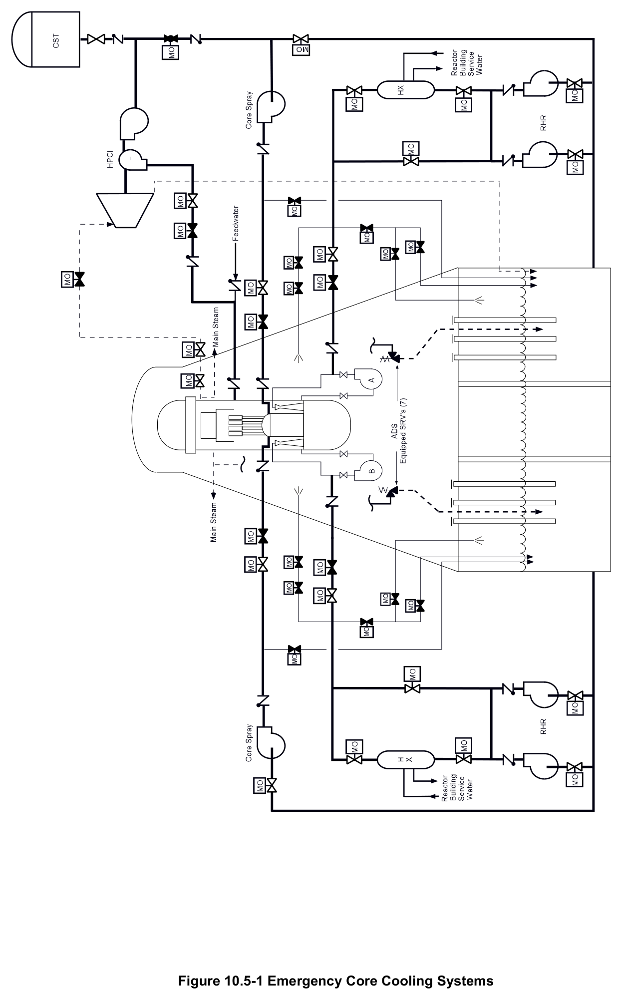
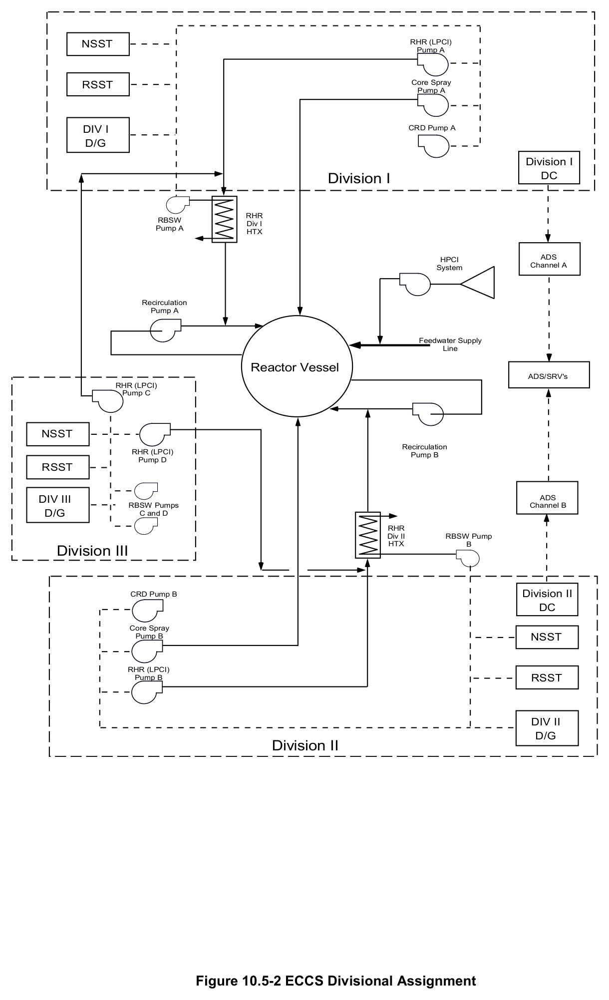
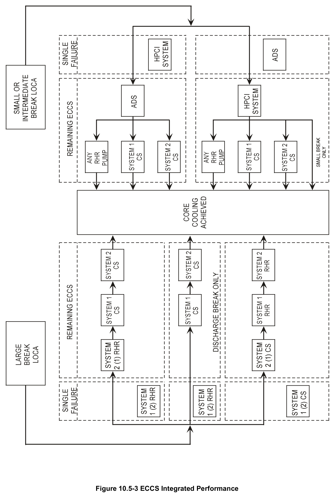

# 10.5 ECCS Wrapup

> Source: `10.5_ECCS_Wrapup.pdf` (18 pages)
> GE (BWR) Systems Technology Manual — USNRC HRTD, Rev 09/11

---
<!-- p.1 -->
#### General Electric Systems Technology Manual
#### Chapter 10.5
#### ECCS Wrapup
<!-- p.3 -->
TABLE OF CONTENTS

10.5 ECCS WRAPUP ..................................................................................................... 1

10.5.1 Introduction ................................................................................................... 1

10.5.2 ECCS Acceptance Criteria............................................................................ 1

10.5.2.1 Peak Cladding Temperature ................................................................ 2

10.5.2.2 Maximum Cladding Oxidation .............................................................. 2

10.5.2.3 Maximum Hydrogen Generation .......................................................... 3

10.5.2.4 Coolable Geometry ............................................................................. 3

10.5.2.5 Long Term Cooling .............................................................................. 3

10.5.3 Design Basis ................................................................................................. 3

10.5.4 ECCS Network .............................................................................................. 4

10.5.5 ECCS Initiation Signals ................................................................................. 4

10.5.6 Performance Analysis ................................................................................... 5

10.5.7 DBA-LOCA ................................................................................................... 6

10.5.8 Integrated ECCS Performance ..................................................................... 6

10.5.9 Steam Line Breaks ....................................................................................... 6

LIST OF TABLES

10.5-1 Operational Sequence of Emergency Core Cooling Systems ............................. 7

10.5-2 Single Failure Evaluation .................................................................................... 9

Rev 09/11 10.5-i USNRC HRTD

<!-- p.4 -->
#### LIST OF FIGURES
10.5-1 Emergency Core Cooling Systems 10.5-2 ECCS Divisional Assignment 10.5-3 ECCS Integrated Performance

Rev 09/11 10.5-ii USNRC HRTD

<!-- p.5 -->
### 10.5 ECCS WRAPUP
Learning Objectives:

1. Recognize the integrated ECCS response to small, intermediate, and large break Loss Of Coolant Accidents (LOCAs).

2. Recognize the ECCS acceptance criteria.

3. Recognize the plant conditions that will cause each ECCS system to initiate.

#### 10.5.1 Introduction
The purpose of the Emergency Core Cooling Systems (ECCS) is to provide core cooling under LOCA conditions to limit fuel cladding damage and therefore limit the release of radioactive materials to the environment.

The ECCS, shown in Figure 10.5-1, consists of two high pressure systems and two low pressure systems. The high pressure systems are the High Pressure Coolant Injection
(HPCI) System and the Automatic Depressurization System (ADS). The low pressure systems are the Low Pressure Coolant Injection (LPCI) mode of the Residual Heat Removal (RHR) System and the Core Spray (CS) System.

#### 10.5.2 ECCS Acceptance Criteria
Emergency core cooling systems are designed to prevent melting and fragmentation of the cladding for any LOCA within the design basis spectrum. The objectives of these systems are to keep the cladding and fuel from distorting to a degree that subsequent cooling would be ineffective. Satisfying these criteria does allow for the tolerance of cladding perforation. Even though the cooling equipment is successful in keeping cladding temperature below the 2200ºF limit, a small percentage of the fuel may perforate. However, the occurrence of even a large number of perforations does not prevent effective core cooling.

Cladding is perforated when the gas pressure within the rod exceeds the pressure the cladding can withstand for that particular cladding temperature. A perforation is considered local, in that, if a given fuel rod perforates at a particular location the perforation will be on the order of an inch or less in axial length. The perforation usually occurs, and is localized, at a weak point along the fuel rod length, probably at one of the following points:
• a cladding flaw,
• a pellet chip
• or an area with slightly increased cladding oxidation.

Rev 09/11 10.5-1 USNRC HRTD

<!-- p.6 -->
Such weak points are randomly distributed among the fuel rods within the fuel assembly.

The ECCS acceptance criteria for light water reactors, which are listed in 10 CFR 50.46, are discussed in the following paragraphs.

##### 10.5.2.1 Peak Cladding Temperature
The calculated maximum fuel cladding temperature shall not exceed 2200ºF.
Reflooding or spraying of water on the fuel rods must stop the heatup and reduce clad temperature before 2200ºF is reached. The zircalloy cladding at temperatures in excess of 2,000ºF reacts with water to form zirconium oxide and hydrogen gas. The actual threshold of this reaction is about 1800ºF, but between 1800ºF and 2200ºF the reaction is slow. As temperatures increase the reaction rate increases.

This metal-water reaction is exothermic and at temperatures >2200ºF the reaction becomes self-sustaining and dominates core heat up. This reaction, producing free hydrogen gas, could cause an explosive mixture within the containment.

The 2200ºF criteria is also imposed because zircalloy when heated to >2200ºF and then rapidly quenched may thermally fracture with consequent loss of core geometry. This effect is due to the fact that the oxidation from the above reaction causes zirconium to become very brittle.

##### 10.5.2.2 Maximum Cladding Oxidation
The calculated total oxidation of the cladding shall not exceed 0.17 times the total cladding thickness before oxidation. As used in this sense total oxidation means the total thickness of cladding metal that would be locally converted to oxide if all the oxygen absorbed by and reacted with cladding locally were converted to stoichiometric zirconium dioxide. If cladding rupture is calculated to occur, the inside surface of the cladding shall be included in the oxidation, beginning at the calculated time of rupture.

Cladding thickness before oxidation means the thickness of the outside of the cladding, after any calculated rupture or swelling has occurred but before significant oxidation.
Where the calculated conditions of transient pressure and temperature lead to a prediction of cladding swelling, with or without cladding rupture, the un-oxidized cladding thickness shall be defined as the cladding cross sectional area. This cross sectional area is taken at a horizontal plane, at the elevation of the rupture or at the elevation of the highest cladding temperature if no rupture is calculated to occur, divided by the average circumference at that elevation. For ruptured cladding, the circumference does not include the rupture opening.

Rev 09/11 10.5-2 USNRC HRTD

<!-- p.7 -->
##### 10.5.2.3 Maximum Hydrogen Generation
The calculated total amount of hydrogen generated from the chemical reaction of the cladding with water or steam shall not exceed 0.01 times the hypothetical amount that would be generated if all the metal in the cladding surrounding the fuel, excluding the cladding surrounding the plenum volume, were to react. This limits the impact of free hydrogen to the reactor and/or the containment (possible explosive atmosphere) during a LOCA.

##### 10.5.2.4 Coolable Geometry
Calculated changes in core geometry shall be such that the core remains amenable to cooling.

##### 10.5.2.5 Long Term Cooling
After any calculated successful initial operation of the ECCS, the calculated core temperature shall be maintained at an acceptably low value and decay heat shall be removed for the extended period of time required by the long lived radioactivity remaining in the core.

#### 10.5.3 Design Basis
The ECCS is designed to provide protection against postulated LOCAs caused by ruptures in primary system piping. In addition to satisfying the ECCS acceptance criteria mentioned in paragraph 10.5.2 above, the ECCS is designed to meet the following requirements:

1. Protection is provided for any primary line break up to and including the double ended break of the largest line.

2. Two independent phenomenological cooling methods (flooding and spraying) are provided to cool the core.

3. One high pressure cooling system is provided which is capable of maintaining water level above the top of the core and preventing ADS actuation for small line breaks.

4. No operator action is required until 10 minutes after an accident to allow for operator assessment and decision.

5. A sufficient water source and necessary piping, pumps, and other hardware are provided so that the containment and reactor vessel core can be flooded for possible core heat removal following a loss of coolant accident.

Rev 09/11 10.5-3 USNRC HRTD

<!-- p.8 -->
6. In the event of a break in a pipe that is part of the reactor coolant pressure boundary, no single active component failure shall prevent automatic initiation and successful operation of less than the minimum number of ECCSs required to mitigate the consequences of the accident.

7. Long term (10 minutes following the initiation signal) cooling requirements call for the removal of decay heat via the Reactor Building Service Water System. In addition to the break which initiated the loss of coolant event, the system is able to sustain one failure, either active or passive, and still have at least one low pressure ECCS pump operating with one heat exchanger and 100% service water flow.

8. Off site power is the preferred source of power for the ECCS network, and every reasonable precaution is made to ensure its high availability. However, on-site emergency power is provided with sufficient diversity and capacity so that all the above requirements can be met even if off-site power is not available.

9. Non-ECCSs interfacing with the ECCS power supply buses shall automatically be shed and/or be inhibited from the buses when a LOCA signal exists and off site AC power is not available.

10. All active components shall be testable during normal operation of the nuclear system.

11. The components of the emergency core cooling systems within the reactor vessel shall be designed to withstand the transient mechanical loadings during a LOCA so that the required standby coolant flow is not restricted.

#### 10.5.4 ECCS Network
The ECCS network is shown in Figure 10.5-2. During normal operation, power to the CS and RHR Systems' components is supplied by the Normal AC Power System.
During loss of power conditions, these loads are supplied by Emergency AC Power System. The ADS and HPCI System utilize DC power provided by the DC Electrical System (Section 9.4).

#### 10.5.5 ECCS Initiation Signals
Level 1 reactor water level or high drywell pressure are conditions which indicate that a LOCA is in progress.

The Level 2 reactor water level initiation setpoint is set low enough to allow the HPCI system to recover level in the case of small line breaks or loss of reactor feedwater.
This prevents unnecessary initiation of the low pressure ECCSs. The Level 1 reactor water level initial setpoint is high enough to allow start up of the low pressure ECCS in sufficient time to re-flood the reactor vessel. Reflooding occurs before fuel cladding

Rev 09/11 10.5-4 USNRC HRTD

<!-- p.9 -->
temperatures reach 2200ºF following a Design Basis Accident-Loss Of Coolant Accident
(DBA-LOCA).

The high drywell pressure initiation setpoint is high enough to prevent inadvertent initiation due to normal fluctuations in drywell pressure. It is also low enough to ensure earliest practical cooling to the core in the event of a leak increasing pressure in the drywell. High drywell pressure sends a signal to the initiation logic of all ECCSs.

#### 10.5.6 Performance Analysis
The manner in which the ECCSs operate to protect the core is a function of the rate at which coolant is lost from the break in the nuclear system process barrier. The HPCI System is designed to operate while the nuclear system is at high pressure. The CS System and LPCI mode of the RHR System are designed for operation at low pressures. If the break in the nuclear system boundary is of such a size that the loss of coolant exceeds the capacity of the HPCI System, nuclear system pressure drops. It will drop at a rate fast enough for the CS System and LPCI mode to add coolant to the reactor vessel in time to cool the core.

Automatic depressurization is provided to reduce nuclear system pressure if a break has occurred and the HPCI System is inoperable or incapable of restoring level. Rapid depressurization of the nuclear system is desirable to permit flow from the CS System and LPCI to enter the vessel, so that the temperature rise in the core is limited.

If the HPCI System has the capacity to make up for the coolant loss from the nuclear system, flow from the low pressure portion of the ECCS is not required for core protection. When nuclear system pressure has decreased below approximately 100 psig, the HPCI turbine steam stop valve shuts due to low steam supply pressure. The low pressure systems would then be available to control vessel inventory.

Adequate Net Positive Suction Head (NPSH) is provided for the ECCS throughout the LOCA under the most severe case of power availability and equipment failure.
Therefore, proper operation of the ECCS is assured.

The redundant features of the ECCS are described in Table 10.5-2 and shown on Figure 10.5-3. Capability for cooling exists over the entire spectrum of break sizes even with concurrent loss of normal auxiliary power and a single active component failure within the ECCS network.

Rev 09/11 10.5-5 USNRC HRTD

<!-- p.10 -->
#### 10.5.7 DBA-LOCA
A DBA is a hypothesized accident, the characteristics and consequences of which are utilized in the design of those systems and components pertinent to preservation of radioactive material barriers and the restriction of radioactive material release from the barriers.

The assumptions for the DBA-LOCA are that:

1. The break is assumed to have an effective break size equal to 2/3 of a double ended rupture of a recirculation pump discharge line. This is the largest diameter pipe connected to the reactor pressure vessel. The calculated flow area for this break is
1.3 ft2. This location effectively disables the RHR division for that Recirculation loop.

2. The reactor is assumed to be operating at 105% of rated steam flow, 105% thermal power, 1055 psia pressure in the vessel steam dome, and reactor water level at the minimum allowed low water level setpoint (this corresponds to +12.5 inches, the low water level scram setpoint) at the time of the rupture.

3. Worst case fuel parameters such as peaking factors, steady state minimum critical power ratios, average and peak linear heat generation rates, and decay heat history are assumed at the time of the rupture.

4. Loss of all off site electrical power sources and all site auxiliary power (turbine generator trip) is assumed at the time of the rupture.

5. A most limiting single component failure is assumed to occur at the time of the rupture. This has been analyzed to be failure of the LPCI injection valve to open for the RHR division on the intact recirculation system.

#### 10.5.8 Integrated ECCS Performance
The performance of the ECCS as an integrated package is evaluated by determining what is functional after a postulated LOCA (concurrent with loss of off site power) and a single failure of an active ECCS related component (Table 10.5-2). The remaining ECCS and components must meet the 10 CFR requirements over the entire spectrum of LOCAs. The integrated performance for small, intermediate, and large sized breaks is shown in Figure 10.5-3. Table 10.5-1 gives the sequence of the ECCS actions in the case of a DBA-LOCA. This LOCA is a double ended circumferential recirculation line break, concurrent with a loss of off site power.

#### 10.5.9 Steam Line Breaks
Discussion and illustration of the ECCS performance capability has purposely been directed toward the liquid breaks below the core. In general, the ECCS design criterion

Rev 09/11 10.5-6 USNRC HRTD

<!-- p.11 -->
for limiting cladding temperatures to less than 2200ºF is more easily satisfied for steam breaks than for liquid breaks, because the reactor primary system depressurizes more rapidly with less mass loss. Thus the ECCS performance for a given break size improves with increasing steam quality of the break flow.

The most severe steam pipe break would be one which occurs inside the drywell, upstream of the flow restrictors. Although the isolation valves would close within 3-5 seconds (10.5 seconds is assumed in the evaluation), a break in this location would permit the pressure vessel to continue to depressurize to the drywell. As serious as this accident could be, it does not result in thermal hydraulic consequences as severe as the rupture of coolant recirculation piping.

Rev 09/11 10.5-7 USNRC HRTD

<!-- p.12 -->
Rev 09/11 10.5-8 USNRC HRTD

<!-- p.13 -->
#### Table 10.5-1 Operational Sequence of Emergency
#### Core Cooling Systems
Time Event
(secs)

0 Design basis Loss of Coolant Accident starts; normal auxiliary power lost.

Drywell high pressure and reactor water Level 3 is reached. All diesel 0 generators start; reactor scram; HPCI, CS, LPCI signaled to start on high drywell pressure.

Reactor water Level 2 is reached. Reactor Recirculation pumps trip. HPCI 3 receives second signal to start.

Reactor water Level 1 is reached. MSIVs close, second signal to start LPCI and 6-8 CS; ADS sequence begins.

EDGs ready for loading. 480v Emergency Switchboards energized. All 4 RHR 13 pumps start in LPCI mode.

14 Fuel completely steam blanketed.

20 Signal for both CS pumps to start.

22 RPV reaches 465# and 338#, signals the CS and LPCI injection valves to open.

26 RPV pressure at 310# signals the Recirc discharge valves begin to close.

HPCI injection valve open and pump at design flow, which completes HPCI 30 startup.

One RHR (LPCI) pump injection valve is open. (Worst case failure is failure of 46 the injection valve on the intact Recirc loop.) CS pumps at rated flow, LPCI and CS injection valves open, which completes the LPCI and CS startup.

62 Recirc line valves fully closed.

108 Water level restored to above top of active fuel.

Rev 09/11 10.5-9 USNRC HRTD

<!-- p.14 -->
Rev 09/11 10.5-10 USNRC HRTD

<!-- p.15 -->
#### Table 10.5-2 Single Failure Evaluation
Suction Break Remaining Discharge Break Remaining Assumed Failure Systems Systems

LPCI All ADS, HPCI, 2 CS, All ADS, HPCI, 2 CS Injection Valve 2 LPCI (1 loop)

All ADS, 2 CS, 4 LPCI All ADS, 2 CS, 2 LPCI HPCI
(2 loops)
(1 loop)

All ADS, HPCI, 1 CS, All ADS, HPCI, 1 CS, A or B EDG

## 3 LPCI (2 loops)
## 1 LPCI (1 loop)
All ADS, HPCI, 2 CS, All ADS, HPCI, 2 CS, C EDG

## 2 LPCI (2 loops)
## 1 LPCI (1 loop)
All ADS, minus one valve, All ADS, minus one valve, One ADS Valve HPCI, 2 CS, HPCI, 2 CS, 2 LPCI (1 loop)

## 4 LPCI (2 loops)
Rev 09/11 10.5-11 USNRC HRTD

<!-- p.16 -->
#### Figure 10.5-1

*Emergency Core Cooling Systems*

[Vector original (SVG, lossless): fig_10.5-1.svg](../figures/fig_10.5-1.svg)

<!-- p.17 -->
#### Figure 10.5-2

*ECCS Divisional Assignment*

[Vector original (SVG, lossless): fig_10.5-2.svg](../figures/fig_10.5-2.svg)

<!-- labels/text on this figure page -->
NSST RHR (LPCI)
Pump A
Core Spray RSST Pump A
DIV I CRD Pump A D/G
Division I DC Division I
RHR RBSW Div I Pump A HTX
ADS HPCI System Channel A
Recirculation Pump A
Feedwater Supply Line
Reactor Vessel ADS/SRV's RHR (LPCI)
Pump C
NSST Recirculation RHR (LPCI)
Pump B Pump D RSST
DIV III ADS RBSW Pumps Channel B D/G C and D
RHR Div II RBSW Pump HTX B Division III
Division II CRD Pump B DC
Core Spray NSST Pump B
RHR (LPCI)
RSST Pump B
DIV II D/G Division II
Figure 10.5-2 ECCS Divisional Assignment

<!-- p.18 -->
#### Figure 10.5-3

*ECCS Integrated Performance*

[Vector original (SVG, lossless): fig_10.5-3.svg](../figures/fig_10.5-3.svg)

