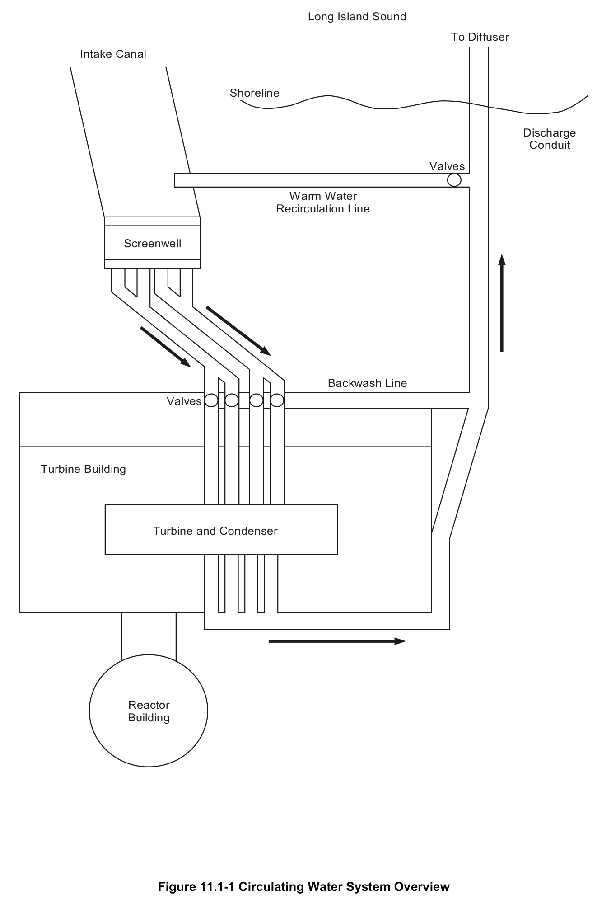
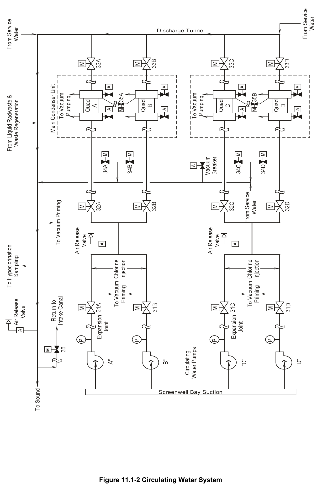

# 11.1 Circulating Water

> Source: `11.1_Circulating_Water.pdf` (10 pages)
> GE (BWR) Systems Technology Manual — USNRC HRTD, Rev 09/11

---
<!-- p.1 -->
#### General Electric Systems Technology Manual
#### Chapter 11.1
#### Circulating Water System
<!-- p.3 -->
TABLE OF CONTENTS

11.1 CIRCULATING WATER SYSTEM .......................................................................... 1

11.1.1 Introduction .................................................................................................... 1

11.1.2 System Description ........................................................................................ 1

11.1.3 Component Description .................................................................................. 2

11.1.3.1 Circulating Water Pumps ...................................................................... 2

11.1.3.2 Traveling Screens ................................................................................. 2

11.1.3.3 Screenwash Pumps .............................................................................. 2

11.1.4 System Features and Interfaces .................................................................... 3

11.1.4.1 Normal Operation ................................................................................. 3

11.1.4.5 System Interfaces ................................................................................. 3

11.1.5 Summary ........................................................................................................ 4

Rev 09/11 11.1-i USNRC HRTD

<!-- p.4 -->
#### LIST OF FIGURES
11.1-1 Circulating Water System Overview 11.1-2 Circulating Water System

Rev 09/11 11.1-ii USNRC HRTD

<!-- p.5 -->
### 11.1 CIRCULATING WATER SYSTEM
Learning Objectives:

1. Recognize the purpose of the Circulating Water System.

2. Recognize the purpose, function and operation of the following circulating water system major components:
a. circulating water pumps b. traveling screens c. screenwash pumps

3. Recognize the flow paths of the circulating water system during normal operation.

4. Recognize how the circulating water system interfaces with the following systems:
a. Condensate And Feedwater System (Section 2.6)
b. Reactor Building Service Water System (Section 11.2)
c. Turbine Building Service Water System (Section 11.4)
d. Liquid Radwaste System (Section 8.2)

#### 11.1.1 Introduction
The purpose of the circulating water system is to provide cooling water for the main condenser. Water from the Long Island Sound is pumped through tubes in the main condenser to remove the heat of vaporization from steam exiting the main turbine. The heated circulating water is returned to Long Island Sound.

#### 11.1.2 System Description
The circulating water system uses four 25 percent capacity pumps to deliver 573,600 gallons per minute of water drawn from the Long Island Sound to the main condenser.
The water makes a single pass through tubes inside the main condensers and is discharged back into the Long Island Sound approximately 20°F warmer.

Traveling screens located at the screenwell bays prevent large debris from fouling the circulating water system. Screenwash pumps provide spray water to prevent debris accumulation on the traveling screens.

Rev 09/11 11.1-1 USNRC HRTD

<!-- p.6 -->
#### 11.1.3 Component Description
The major circulating water system components are shown in Figures 11.1-1 and 11.1-2 and discussed in the following sections.

##### 11.1.3.1 Circulating Water Pumps
The circulating water pumps are motor-driven, vertical, one-stage, single-suction, openimpeller units. Each pump is designed to provide total head of 34.2 feet at 143,400 gpm. Each pump is driven by a vertical, squirrel cage, induction motor rated for 1,500 hp supplied by 4,160 volt ac power.

The circulating pumps take suction from the intake canal through separate screenwell bays with individual traveling screens. Each pump discharges through an expansion joint and a discharge isolation valves (MOV-031A, B, C, and D). The discharge isolation valves are interlocked with their respective pumps to partially open prior to the pump start and close when the pump stops. The closed discharge isolation valves prevent backflow through idle pumps. Each discharge valve is powered from a different electrical source than its associated pump to ensure valve operability in the event of a pump trip due to loss of electrical power.

##### 11.1.3.2 Traveling Screens
Each circulating water pump has its own traveling screen. The traveling screens prevent large objects in the water from fouling the circulating water pump impellers and from blocking flow through the condenser tubes.

A traveling screen consists of metal mesh frames linked together and looped around two rollers. Electric motors move the traveling screens vertically, perpendicular to the incoming water flow.

The traveling screens can be controlled from four position handswitches in the main control room: OFF, SLOW, AUTO, and FAST. In AUTO mode, the traveling screens will run in slow speed until the differential water level exceeds 8 inches, at which point they will shift to fast speed.

A circulating water pump will automatically trip if the differential water level across its associated traveling screen exceeds 30 inches.

##### 11.1.3.3 Screenwash Pumps
Two 100 percent capacity screenwash pumps spray water on the traveling screens to remove debris. Administrative controls do not allow the traveling screens to be operated without spray water to prevent foreign material from entering the circulating water pumps. Trash rakes are provided to remove large debris from the traveling screens.

Rev 09/11 11.1-2 USNRC HRTD

<!-- p.7 -->
#### 11.1.4 System Features and Interfaces
A short discussion of system features and interfaces this system has with other plant systems is given in the paragraphs which follow.

##### 11.1.4.1 Normal Operation
During plant power generation at any power level, the normal configuration of the circulating water system is four circulating water pumps in operation supplying all four quadrants of the main condenser. The warmed water is returned via the discharge tunnel to the Long Island Sound. The traveling screens will be operating with one screenwash pump either running or available for automatic operation.

When the circulating water inlet temperature drops below 34°F, administrative controls direct the operator to establish warm water recirculation to prevent ice blockage of the traveling screens. Warm water recirculation should only be established when all four circulating water pumps are operating and a liquid radioactive discharge is not in progress. The warm water recirculation line isolation valve (MOV-036) is opened to divert a portion of the circulating water flow from the discharge tunnel back to the intake canal.

One main condenser quadrant at a time can be backwashed to remove accumulated debris from the inlet side tubesheet. The operator initiates the backwashing sequences using a pushbutton in the control room. If condenser quadrant A were being backwashed, the sequence closes MOV-032A to isolate the normal inlet flow path and opens MOV-034A to provide a path for backflow through condenser quadrant A to reach the discharge tunnel. The end of the sequence repositions these valves to restore the normal system flow path. Because backwashing temporarily reduces condenser performance, the reactor power level will likely be reduced to sustain an acceptable condenser vacuum pressure during backwashing.

##### 11.1.4.5 System Interfaces
The interfaces this system has with other plant systems are discussed in the paragraphs which follow.

Condensate and Feedwater System (Section 2.6)

The circulating water system sends cooling water from Long Island Sound through tubes within the condensers of the condensate and feedwater system to condense the steam collected from the main turbine exhaust.

Rev 09/11 11.1-3 USNRC HRTD

<!-- p.8 -->
Reactor Building Service Water System (Section 11.3)

The reactor building service water system returns flow to the Long Island Sound via a connection to the circulating water system.

Turbine Building Service Water System (Section 11.4)

The turbine building service water system returns flow to the Long Island Sound via a connection to the circulating water system.

Liquid Radwaste System (Section 8.2)

Water discharged from the liquid radwaste system is routed to the circulating water system’s discharge tunnel for dilution prior to release into the Long Island Sound.

#### 11.1.5 Summary
Classification: Power Generation System

Purpose: The purpose of the circulating water system is to provide cooling water for the main condenser.

Components: Pumps, Motors, Vacuum Priming Unit

System Interfaces: Condensate and Feedwater System, Reactor Building and Turbine Building Service Water Systems, Liquid Radwaste System

Rev 09/11 11.1-4 USNRC HRTD

<!-- p.9 -->
#### Figure 11.1-1

*Circulating Water System Overview*

[Vector original (SVG, lossless): fig_11.1-1.svg](../figures/fig_11.1-1.svg)

<!-- labels/text on this figure page -->
Long Island Sound
To Diffuser Intake Canal
Shoreline
Discharge Conduit
Valves
Warm Water Recirculation Line
Screenwell
Backwash Line Valves
Turbine Building
Turbine and Condenser
Reactor Building
Figure 11.1-1 Circulating Water System Overview

<!-- p.10 -->
#### Figure 11.1-2

*Circulating Water System*

[Vector original (SVG, lossless): fig_11.1-2.svg](../figures/fig_11.1-2.svg)

