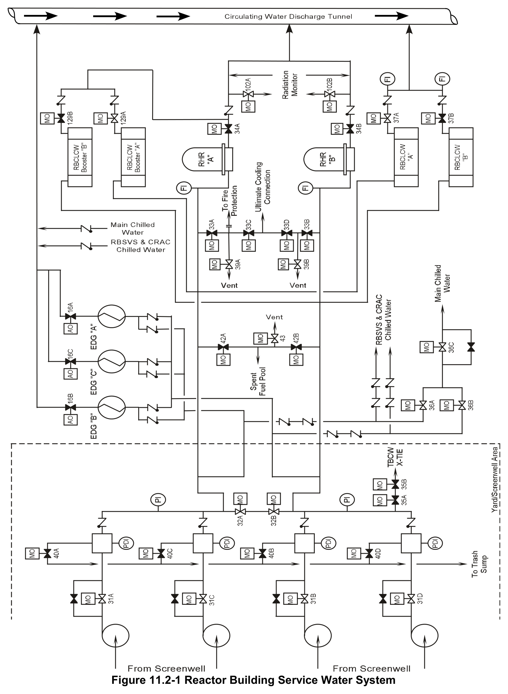

# 11.2 RB Service Water

> Source: `11.2_RB_Service_Water.pdf` (13 pages)
> GE (BWR) Systems Technology Manual — USNRC HRTD, Rev 09/11

---
<!-- p.1 -->
#### General Electric Systems Technology Manual
#### Chapter 11.2
#### Reactor Building Service Water System
<!-- p.3 -->
TABLE OF CONTENTS

11.2 REACTOR BUILDING SERVICE WATER SYSTEM ............................................. 1

11.2.1 Introduction ...................................................................................................... 1

11.2.2 System Description .......................................................................................... 2

11.2.3 Component Description ................................................................................... 3

11.2.3.1 RBSW Pumps and Valves ........................................................................ 3

11.2.3.2 RBSW Strainers ........................................................................................ 3

11.2.4 System Features and Interfaces ...................................................................... 3

11.2.4.1 Normal Operation ..................................................................................... 3

11.2.4.2 Loss of Preferred Power ........................................................................... 3

11.2.4.3 Loss of Coolant Accident .......................................................................... 4

11.2.4.4 Loss of Station Air System ........................................................................ 5

11.2.4.5 System Interfaces ..................................................................................... 5

11.2.5 Summary ......................................................................................................... 6

LIST OF TABLES

11.2-1 Reactor Building Service Water System ............................................................. 7

Rev 09/11 11.2-i USNRC HRTD

<!-- p.4 -->
#### LIST OF FIGURES
11.2-1 Reactor Building Service Water System

Rev 09/11 11.2-ii USNRC HRTD

<!-- p.5 -->
### 11.2 REACTOR BUILDING SERVICE WATER SYSTEM
Learning Objectives:

1. Recognize the purposes of the Reactor Building Service Water (RBSW) system.

2. Recognize the purpose, function and operation of the following reactor building service water system major components:
a. RBSW pumps b. Strainers c. RHR heat exchangers d. RHR heat exchanger outlet valves e. Diesel generator heat exchanger outlet valves

3. Recognize the following RBSW flowpaths:
a. Normal operation b. Loss of coolant accident (LOCA) conditions

4. Recognize how the system responds to the following:
a. Loss of coolant accident (LOCA)
b. Loss of preferred power c. Loss of service and instrument air (SIA)

5. Recognize how the Reactor Building Service Water system interfaces with the following systems:
a. Emergency AC Power System (Section 9.2)
b. Service and Instrument Air System (Section 11.6)
c. Circulating Water System (Section 11.1)
d. Reactor Building Closed Loop Cooling Water System (Section 11.3)
e. Turbine Building Service Water System (Section 11.4)
f. Residual Heat Removal (RHR) System (Section 10.4)

#### 11.2.1 Introduction
The purposes of the reactor building service water (RBSW) system are to:
• transfer heat from the reactor building components to the Long Island Sound
• provide an emergency source of cooling water to the reactor vessel and spent fuel pool.

During normal operations the RBSW system (Figure 11.2-1) takes sea water from the screenwells, pumps it through equipment coolers and heat exchangers and then returns the water to Long Island Sound. The return flow is monitored for radiation. The RBSW system provides the means to transfer heat from the reactor to the ultimate heat sink.
The RBSW system supplies cooling water to safety-related equipment in the reactor building using two independent flow paths. Under emergency conditions the RBSW can

Rev 09/11 11.2-1 USNRC HRTD

<!-- p.6 -->
be used as a high capacity flooding source for the reactor or the spent fuel pool. The RBSW is classified as an engineered safety feature system.

The RBSW system normally provides cooling water to:
• Emergency diesel generators (EDGs)
• Reactor building closed loop cooling water (RBCLCW) heat exchangers and booster heat exchangers
• Residual heat removal (RHR) heat exchangers
• Reactor building normal ventilation system (RBNVS) coolers and chiller condensers
• Reactor building standby ventilation system (RBSVS) coolers and chiller condensers
• Control room air conditioning (CRAC) chiller condensers

Under abnormal or emergency conditions the RBSW system can provide cooling water to the:
• Reactor pressure vessel via connection to the RHR system
• Spent fuel pool via the spent fuel pool cooling and cleanup system
• Fire protection system
• Turbine building closed loop cooling water (TBCLCW) system

#### 11.2.2 System Description
The RBSW system (Figure 11.2-1) is divided into two loops which supply redundant safety related components. In the event of a single active RBSW component failure, one loop of safety-related equipment should continue to be cooled.

Four RBSW pumps take suction from the screenwell. Each pump shares a screenwell with a circulating water pump. All four pump discharge lines combine in a common header. Two normally open divisional isolation valves (MOV-32A and B) are located in the common discharge line. Table 11.2-1 list the heat loads on the individual RBSW loops.

The return water from each of the RBSW loads is returned to the circulating water system discharge tunnel. A radiation monitor draws a RBSW sample off of each RHR heat exchanger outlet and returns the sample to the same piping. The radiation monitor will detect leakage of radioactive materials into the RBSW process stream and indicate the high radiation condition in the main control room. If RBSW system water is injected directly to the reactor pressure vessel or the spent fuel pool, it will be retained in the reactor building.

Rev 09/11 11.2-2 USNRC HRTD

<!-- p.7 -->
#### 11.2.3 Component Description
The major components of the Reactor Building Service Water system are described in the paragraphs that follow.

##### 11.2.3.1 RBSW Pumps and Valves
The RBSW system water pumps are vertically mounted, two stage, centrifugal pumps, rated at 8600 gpm each at approximately 70 psig discharge. The pumps are driven by a 450 Hp, 4160 VAC, 3 phase, induction, electric motor.

Each pump discharges through a motor operated discharge valve (MOV-31A, B, C, and D), which is open 25º when in the “closed” position. A bypass butterfly valve around the discharge valve is normally closed.

##### 11.2.3.2 RBSW Strainers
Each RBSW pump has its own discharge strainer. The strainers are self cleaning, electric motor driven, and automatically backwash to the trash sump.

#### 11.2.4 System Features and Interfaces
A short discussion of system features and interfaces this system has with other plant systems is given in the paragraphs which follow.

##### 11.2.4.1 Normal Operation
The RBSW system is divided into redundant normally cross-connected loops. RBSW pumps “A” and “C” and attendant piping and valves are organized into one loop.
Similarly RBSW pumps “B” and “D” and attendant piping and valves are organized into a second loop. In normal operation only one RBSW pump in each loop is running. Each RBSW loop supplies cooling water to:
• One RBCLCW booster heat exchanger
• One RBCLCW heat exchanger
• One RBSVS and CRAC chilled water condenser
• RBNVS chilled water condensers

Return water from the system is directed to the circulating water discharge tunnel and out to the Long Island Sound.

##### 11.2.4.2 Loss of Preferred Power
Following a loss of preferred power (LOPP), each RBSW pump can be restarted from an emergency diesel generator (EDG). RBSW pump “A” is powered from the EDG “A” bus. RBSW pump “B” is powered from the EDG “B” bus. RBSW pumps “C” and “D” are

Rev 09/11 11.2-3 USNRC HRTD

<!-- p.8 -->
powered from the EDG “C” bus. To prevent EDG 103 overload when it automatically repowers an RBSW pump, only one of the “C” and “D” pumps will automatically start. A control room switch will bypass the automatic starting of the selected pump.

On a loss of preferred power all running RBSW pumps will trip. After the emergency diesel generators have restored power to the emergency buses, the following events automatically occur:

1. The discharge valves of any previously operating RBSW pump will shut
2. When the associated discharge valve is shut, each RBSW pump that has its control switch in AUTO will start. The exception to this is that whichever of the “C” and “D” RBSW pumps selected for bypass will not automatically start. The RBSW pumps that automatically start will be re-energized:
a. 7 seconds following bus re-energization, if no LOCA exists OR b. 12 seconds following bus re-energization, if a LOCA signal does exist
3. The pump discharge valve opens 20 seconds after the associated RBSW pump starts.
4. Emergency diesel engine cooler outlet isolation valves (AOV-16A, B, and C) open for each operating diesel engine.
5. RBSW to TBSW cross connect is isolated, if open, by shutting MOV-35A and B.
6. The RBNVS chilled water system is isolated (MOV-36A, B, and C close).
7. RHR heat exchanger service water flow is isolated if in service (MOV-34A and B close).
8. Both RBCLCW heat exchanger outlet valves (MOV-37A and B) open.
9. RBSW splits into two redundant loops (MOV-32A and B close).

Following realignment of the motor operated valves to their proper LOCA/LOOP position, each loop of RBSW is expected to supply the following components:

1. One RBCLCW heat exchanger (Automatic).
2. Two RBSVS and CRAC chilled water condensers (Automatic).
3. The cooler associated with each operating emergency diesel engine (Automatic).
4. One RBCLCW booster heat exchanger (only if lined up by operator).
5. One RHR heat exchanger (only if lined up by the operator).

##### 11.2.4.3 Loss of Coolant Accident
Upon a receipt of a LOCA signal, the following automatic actions occur:

• If RBSW and TBSW are cross connected, TBSW is isolated by shutting MOV-35A and B.
• The RBNVS chilled water system is isolated from RBSW (MOV-36A, B, and C close).
• RBCLCW booster heat exchanger service water flow is isolated (MOV-129 A and B close).

Rev 09/11 11.2-4 USNRC HRTD

<!-- p.9 -->
• RHR heat exchanger service water flow is isolated (MOV-34 A and B close).
• Service water is admitted to both RBCLCW heat exchanger (MOV-37 A and B open), if closed.
• RBSW splits into two redundant loops (MOV-32 A and B close).
• Each non-operating RBSW pump with its control switch in AUTO, except the bypassed C or D RBSW pump, will start 12 seconds after the initiation of the LOCA signal.

##### 11.2.4.4 Loss of Station Air System
Upon loss of station air system the emergency diesel engine cooler outlet isolation valves (AOV-16 A, B, and C) fail open. With the engine coolers supplied with cooling water, an additional RBSW pump may have to be started to prevent the operating pumps from tripping on over current.

##### 11.2.4.5 System Interfaces
The interfaces this system has with other plant systems are discussed in the paragraphs which follow.

4160V Emergency Distribution System (Section 9.2)

The RBSW pumps and motor operated valves receive power from the Emergency Power System, and the RBSW supplies cooling water to the Emergency Diesel Generator Engines.

Service & Instrument Air System (Section 11.6)

The emergency diesel engine outlet valves (AOV-16A, B, and C) receive motive air from the Station Air System.

Circulating Water System (Section 11.1)

The Circulating Water System shares the screenwell suction pits with the RBSW. The Circulating Water System also provides a discharge path for return water of the RBSW to the Long Island Sound.

Reactor Building Closed Loop Cooling Water (RBCLCW) System (Section 11.3)

The RBSW system supplies cooling water to the RBCLCW heat exchangers and booster heat exchangers.

Rev 09/11 11.2-5 USNRC HRTD

<!-- p.10 -->
Turbine Building Service Water System (TBSW) System (Section 11.5)

The RBSW system can be cross-connected to the TBSW system. However, under emergency conditions the TBSW will be automatically isolated from the RBSW system.

Residual Heat Removal (RHR) System (Section 10.4)

The RBSW system supplies cooling water to the RHR heat exchangers. The RBSW system can flood the reactor pressure vessel (RPV) by connection to the RHR system.

Reactor Building Normal Ventilation System (RBNVS) (Section 4.2)

The RBSW system provides cooling to RBNVS coolers and chillers.

Reactor Building Standby Ventilation System (RBSVS) (Section 4.3)

The RBSW system provides cooling to RBSVS coolers and chillers. when the RBSVS is actuated.

Fuel Pool Cooling and Cleanup System (Section 11.7)

The RBSW provides a means to flood the spent fuel pool via connection to the fuel pool cooling and cleanup system.

Radiation Monitoring

Water returning from the RBSW system is monitored for radiation.

#### 11.2.5 Summary
The RBSW system takes sea water from the screenwells, pumps it through equipment coolers and heat exchangers and then returns the water to Long Island Sound. The return flow is monitored for radiation. The RBSW system provides the means to transfer heat from the reactor to the ultimate heat sink. The RBSW system supplies cooling water to safety-related equipment in the reactor building using two independent flow paths. Under emergency conditions the RBSW can be used as a high capacity flooding source for the reactor or the spent fuel pool. The RBSW is classified as an engineered safety feature system.

Rev 09/11 11.2-6 USNRC HRTD

<!-- p.11 -->
#### Table 11.2-1 RBSW Load List
Reactor Building Service Water Loop "A"

• RHR A heat exchanger
• RBCLCW A heat exchanger
• RBCLCW A booster heater exchanger
• Emergency diesel engine A, B, and C coolers
• RBSVS and CRAC chilled water system A
• RBNVS chilled water system
• Emergency water supply to the reactor vessel
• Emergency water supply to the spent fuel pool

Reactor Building Service Water Loop "B"

• RHR B heat exchanger
• RBCLCW B heat exchanger
• RBCLCW B booster heater exchanger
• Emergency diesel engine A, B, and C coolers
• RBSVS and CRAC chilled water system B
• RBNVS chilled water system
• Emergency water supply to the reactor vessel
• Emergency water supply to the spent fuel pool
• RBSW/TBSW cross connect.

Rev 09/11 11.2-7 USNRC HRTD

<!-- p.12 -->
Rev 09/11 11.2-8 USNRC HRTD

<!-- p.13 -->
#### Figure 11.2-1

*Reactor Building Service Water System*

[Vector original (SVG, lossless): fig_11.2-1.svg](../figures/fig_11.2-1.svg)

