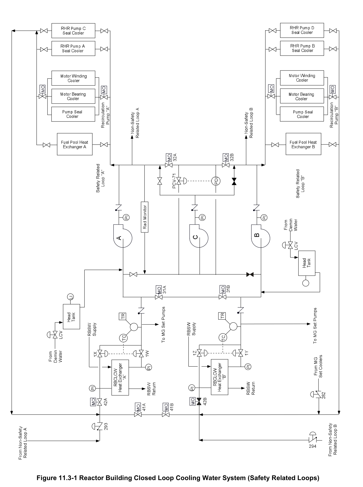
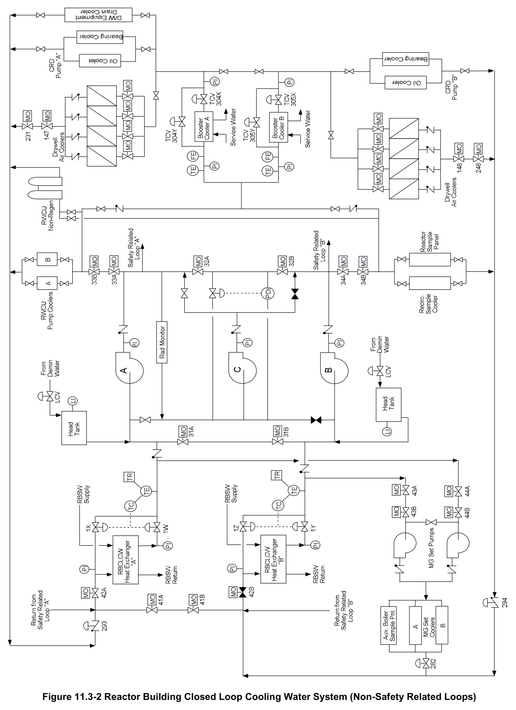

# 11.3 RB Closed Loop

> Source: `11.3_RB_Closed_Loop.pdf` (19 pages)
> GE (BWR) Systems Technology Manual — USNRC HRTD, Rev 09/11

---
<!-- p.1 -->
#### General Electric Systems Technology Manual
#### Chapter 11.3
#### Reactor Building Closed Loop Cooling Water System
<!-- p.3 -->
TABLE OF CONTENTS

11.3 REACTOR BUILDING CLOSED LOOP COOLING WATER SYSTEM .................. 1

11.3.1 Introduction .................................................................................................... 1

11.3.2 System Description ........................................................................................ 2

11.3.3 Flow Paths ..................................................................................................... 2

11.3.3.1 Safety-Related Flow Path ...................................................................... 2

11.3.3.2 Nonsafety-Related Flow Path ................................................................ 3

11.3.3.3 Split System Operation .......................................................................... 3

11.3.4 Component Description .................................................................................. 3

11.3.4.1 Pumps .................................................................................................... 3

11.3.4.2 Recirculation Pump M/G Set Cooling Water Pumps .............................. 3

11.3.4.3 Heat Exchangers.................................................................................... 4

11.3.4.4 Head Tanks ............................................................................................ 4

11.3.4.5 Radiation Monitor ................................................................................... 4

11.3.4.6 Pressure Control Valve .......................................................................... 5

11.3.4.7 Booster Heat Exchangers ...................................................................... 5

11.3.4.8 Valves .................................................................................................... 5

11.3.5 System Features and Interfaces .................................................................... 7

11.3.5.1 Normal Operation ................................................................................... 7

11.3.5.2 Loss of Preferred Power ........................................................................ 7

11.3.5.3 Loss of Coolant Accident ....................................................................... 8

11.3.5.4 Loss of Station Instrument Air (SIA) system ........................................... 8

11.3.5.5 System Interfaces .................................................................................. 9

11.3.6 Summary ........................................................................................................ 9

LIST OF TABLES

11.3-1 RBCLCW Load List ........................................................................................... 11

Rev 09/11 11.3-i USNRC HRTD

<!-- p.4 -->
#### LIST OF FIGURES
11.3-1 RBCLCW Safety Related Loops 11.3-2 RBCLCW Non-Safety Related Loops

Rev 09/11 11.3-ii USNRC HRTD

<!-- p.5 -->
### 11.3 REACTOR BUILDING CLOSED LOOP COOLING WATER SYSTEM
Learning Objectives:

1. Recognize the purposes of the Reactor Building Closed Loop Cooling Water
(RBCLCW) system.

2. Recognize the function and operation of the following RBCLCW equipment:
a. Pumps b. Recirculation Pump M/G Set Cooling Water Pumps c. Heat Exchangers d. Head Tanks e. Radiation Monitor f. Isolation Valves g. Booster Heat Exchangers

3. Recognize the following flow paths:
a. Safety-related component cooling b. Non-Safety related component cooling c. Split System Operation

4. Recognize the plant conditions that will cause the RBCLCW system to reconfigure for post-accident operation.

5. Recognize how the system responds to:
a. Loss of Preferred Power b. Loss Of Coolant Accident (LOCA)
c. Loss of Station and Instrument Air (SIA) system

6. Recognize how the RBCLCW system interfaces with the following systems:
a. Reactor Building Service Water System (Section 11.2)
b. Station and Instrument Air System (Section 11.6)

#### 11.3.1 Introduction
The purposes of the Reactor Building Closed Loop Cooling Water (RBCLCW) System are to:
• Transfer heat from the components cooled by RBCLCW to the reactor building service water (RBSW) system via heat exchangers
• Provide cooling water to reactor auxiliary equipment and other miscellaneous reactor building equipment during normal operation
• Provide nuclear safety related systems with a redundant means of cooling during an accident condition in order to accomplish and maintain a safe shutdown.

Rev 09/11 11.3-1 USNRC HRTD

<!-- p.6 -->
#### 11.3.2 System Description
The reactor building closed loop cooling water (RBCLCW) system is a redundant, closed loop system providing nuclear safety and nuclear non-safety related equipment with a reliable source of cooling water. The system is divided into four loops. Two loops cool safety related components (Figure 11.3-1). The remaining two loops cool nonsafety related components (Figure 11.3-2). Loads on the safety related loops are redundant to ensure that at least one half of the nuclear safety related components served by RBCLCW are supplied in the event of a single RBCLCW component failure.
Since the safety related components are themselves redundant, sufficient equipment to establish and maintain a safe shutdown should remain operable. A list of system or components cooled can be found in Table 11.3-1.

Accident conditions will result in the isolation of the RBCLCW loops. Nonsafety related heat loads will be entirely isolated from RBCLCW. The two safety-related loops will be split into separate redundant cooling flowpaths.

The accident signals that automatically reconfigure the RBCLCW system are:
• High drywell pressure
• Reactor water level 1

#### 11.3.3 Flow Paths
The RBCLCW system has two separate cooling loops for safety-related equipment and two separate cooling loops for nonsafety-related equipment.
During normal conditions the system operates with:
• All loops cross connected
• Two main RBCLCW pumps operating
• One recirculation pump M/G set fluid coupling cooler cooling water pump operating
• One RBCLCW heat exchanger in service
• One RBCLCW booster heat exchanger in service.

##### 11.3.3.1 Safety-Related Flow Path
The safety related loops (Figure 11.3-1) return to the inlet of an RBCLCW heat exchanger. The two heat exchangers can be cross connected on both the inlet and outlet sides. The two heat exchangers discharge to a common suction header supplying the three RBCLCW pumps. Two elevated RBCLCW head tanks connect to the common pump suction header to provide a surge reservoir and ensure that sufficient Net Positive Suction Head (NPSH) is available to the pumps. Cooling water is pumped to safety-related loads and then returns to the heat exchanger inlet.

Rev 09/11 11.3-2 USNRC HRTD

<!-- p.7 -->
##### 11.3.3.2 Nonsafety-Related Flow Path
Loads on the non-safety related loops (Figure 11.3-2) supply auxiliary components that are not required to operate during accident conditions. Some of the nonsafety-related loads receive cooling flow directly from the RBCLCW pump discharge header. Others are supplied by intermediate heat exchangers referred to as either the booster heat exchangers or booster coolers. The reactor recirculation pump M/G set fluid coupling cooling water pumps take suction from the RBCLCW heat exchanger outlet line and then direct cooling flow to the recirculation MG set coolers. All nonsafety-related flow paths return to the RBCLCW heat exchanger inlet.

The two non-safety related loops automatically isolate from the safety-related loops during a LOCA.

##### 11.3.3.3 Split System Operation
Under accident conditions, nonsafety-related cooling loads are isolated from the RBCLCW system. The safety-related loops are isolated from each other and each supplies cooling to a separate and redundant group of equipment.

#### 11.3.4 Component Description
The major components of the Reactor Building Closed Loop Cooling Water system are described in the paragraphs that follow.

##### 11.3.4.1 Pumps
The RBCLCW circulating water pumps (Figures 11.3-1 and 11.3-2) are 50% capacity each. The pumps are double suction, single stage centrifugal pumps. They are rated at 1600 gpm flow. These pumps provide the motive force to circulate RBCLCW throughout the system. They draw suction from a common header and similarly discharge to a common discharge header.

##### 11.3.4.2 Recirculation Pump M/G Set Cooling Water Pumps
The RBCLCW heat exchanger outlet lines provide suction to two 100% capacity recirculation pump M/G set fluid coupling cooling water pumps (Figure 11.3-2). These pumps supply cooling water to the recirculation pump M/G set fluid coupling coolers The Recirculation pump MG set fluid coupling cooling water circulating pumps are rated at 1600 gpm flow. The return line from the recirculation pump M/G set fluid coupling coolers ties into the common inlet to the RBCLCW heat exchangers. The operating pump automatically trips on low suction pressure at 10 psig.

Rev 09/11 11.3-3 USNRC HRTD

<!-- p.8 -->
##### 11.3.4.3 Heat Exchangers
The RBCLCW heat exchangers (Figures 11.3-1 and 11.3-2) are single pass, counter flow, shell and tube type. The reactor building service water (RBSW) system supplies the shell side at a pressure less than RBCLCW system pressure. Each heat exchanger is 100% capacity. Temperature control valves in the bypass line and outlet line modulate to maintain return water to the common pump suction header at 91ºF.
Raising bypass flow raises the outlet temperature, conversely reducing bypass flow will lower the outlet temperature.

The heat exchangers supply cooling water to the following safety related loads:
• Fuel pool cooling heat exchangers
• RHR pump seal coolers
• Recirculation pump coolers ƒ Pump seal coolers ƒ Motor bearing coolers ƒ Motor winding coolers

Additionally the heat exchangers supply cooling water to the following: nonsafety related loads:
• Reactor recirculating water pump M/G set coolers
• Auxiliary boiler sample cooler
• Reactor water recirculation sample panel and cooler
• RWCU non-regenerative heat exchangers
• RWCU pump coolers

Table 11.3-1 lists all of the RBCLCW loads

##### 11.3.4.4 Head Tanks
The elevated RBCLCW head tanks (Figures 11.3-1 and 11.3-2) are designed to provide a system surge volume and satisfy pump NPSH requirements. Each loop of safetyrelated cooling has one head tank. Makeup water is automatically provided by the demineralized water system. Level control valves LCV-011 A/B maintain their respective tank level automatically.

##### 11.3.4.5 Radiation Monitor
The inlet to the radiation monitor (Figures 11.3-1 and 11.3-2) is located on the common pump discharge header. The monitor is designed to detect the inleakage of radioactive contaminants due to the failure of a cooler served by the system. The outlet of the radiation monitor is returned to the common pump suction header.

Rev 09/11 11.3-4 USNRC HRTD

<!-- p.9 -->
##### 11.3.4.6 Pressure Control Valve
The pressure control valve (PCV-71) connects across the common pump suction header and the common pump discharge header to maintain differential pressure across the system loads at about 70 psid (Figure 11.3-1). A constant differential pressure helps ensure that individual coolers can be valved in and out of service without affecting the remainder of the loads.

During one and two pump operation discharge header pressure is normally 65-68 psig and the pressure control valve is closed. If pump discharge to suction differential pressure rises above 70 psid, then PCV-71 will open to direct water from the discharge header to the suction header to lower the differential pressure.

##### 11.3.4.7 Booster Heat Exchangers
The RBCLCW booster heat exchangers (Figure 11.3-2) are each 100% capacity and provide additional cooling for:
• Drywell air unit coolers
• CRD pump gear oil coolers
• CRD pump bearing coolers
• Drywell equipment drain coolers

Outlet temperature is primarily controlled by regulating bypass flow. The temperature control valves in the bypass and outlet lines modulate to maintain a constant supply temperature. Table 11.3-1 lists all of the RBCLCW loads.

The booster heat exchangers are cooled by the reactor building service water (RBSW)
system.

##### 11.3.4.8 Valves
The RBCLCW system (Figures 11.3-1 and 11.3-2) employs isolation valves to preferentially supply safety-related loads under accident conditions. The system also employs temperature control valves to ensure the heat loads are properly cooled.

###### 11.3.4.8.1 Pump Discharge Header Isolation Valves
The common RBCLCW pump discharge header contains two normally open isolation valves (MOV-32 A/B) that automatically close during an accident to split the system into two independent loops.

Rev 09/11 11.3-5 USNRC HRTD

<!-- p.10 -->
###### 11.3.4.8.2 Pump Suction Header Isolation Valves
The common pump suction line contains two normally open isolation valves (MOV-31 A/B) that close during an accident to split the two safety related headers into independent loops.

###### 11.3.4.8.3 Nonsafety-Related Loop Isolation Valves
The non-safety related loops (Figure 11.3-2) each contain two normally open isolation valves. Nonsafety-related loop A includes MOV-33 A/B. Nonsafety-related loop B includes MOV-34 A/B). These isolation valves automatically close during an accident.

At the operators discretion, the recirculation pump coolers in each safety related loop may be isolated by closing motor-operated isolation valves.

The two non-safety related loop return lines tie into their respective safety related loop return lines. Air operated check valves (AOV-282, AOV-293 and 294) automatically close during an accident to isolate the non-safety related loops.

###### 11.3.4.8.4 RBCLCW Heat Exchanger Valves
Temperature control valves in each heat exchanger outlet (TCV-1 W/Y) and each heat exchanger bypass (TCV-1 X/Z) automatically modulate to maintain a constant pump suction water temperature of 91º.

The two safety related loop return lines supply both RBCLCW heat exchangers. Each heat exchanger inlet line is provided with an isolation valve (MOV-42 A/B) that automatically opens during an accident to insure that each heat exchanger is in service.
The two heat exchangers inlet lines are cross connected through two normally open isolation valves (MOV-41 A/B). These isolation valves automatically close during an accident to split the two safety related loops into totally independent flow paths. During an accident, both inlet valves are open and both cross connect valves are closed.

###### 11.3.4.8.5 Recirculation pump M/G set fluid coupling cooling water pumps
Valves

Four normally open isolation valves MOV-43A/B and MOV-44 A/B automatically close during an accident to isolate the recirculation pump M/G set fluid coupling coolers from the two safety related RBCLCW loops. An air operated check valve (AOV-282) in the return line automatically closes during an accident to isolate the return line from the safety related loops.

Rev 09/11 11.3-6 USNRC HRTD

<!-- p.11 -->
###### 11.3.4.8.6 Booster Heat Exchanger (Cooler) Valves
Booster heat exchanger outlet temperature is controlled by modulating the heat exchangers bypass valves (TCV-304Y / TCV-305Y) and / or the heat exchanger outlet valves (TCV-304X / TCV-305X).

#### 11.3.5 System Features and Interfaces
System operation and interrelations between this system and other plant systems are discussed in the paragraphs that follow.

##### 11.3.5.1 Normal Operation
Two of the three RBCLCW pumps will take suction from the common suction header and discharge to the common discharge header. The third pump is in standby, available to automatically start when an operating pump trips. PCV-71 maintains a constant differential pressure of about 70 psid across the system loads. Both head tanks connect to the common pump suction line to provide a surge volume and ensure sufficient pump NPSH is available.

The RWCU non-regenerative heat exchangers (NRHX) will be supplied by one nonsafety related loop. Cooling flow to the NRHX is established with manually operated valves.

Normally only one RBCLCW heat exchanger will be in service. Both of the two safety related loop return lines will supply the one in-service RBCLCW heat exchanger. The two RBCLCW heat exchangers inlet lines will be cross connected through two normally open isolation valves (MOV-41 A/B). The in-service heat exchanger inlet valve (MOV- 42A/B) will be open.

The temperature control valves for the in-service heat exchanger will modulate to maintain a constant pump suction water temperature of 91º:
• in-service heat exchanger outlet valves TCV-1 W/Y
• in-service heat exchanger bypass valves TCV-1 X/Z

Normally one recirculation pump M/G set fluid coupling cooling water pump is in operation.

##### 11.3.5.2 Loss of Preferred Power
The RBCLCW system pumps are powered from the emergency AC power buses. If the emergency bus should experience a loss of normal power the pumps will stop and the motor operated valves will remain in their current position.

Rev 09/11 11.3-7 USNRC HRTD

<!-- p.12 -->
After the emergency buses have been re-energized the following should occur:
• RBCLCW pumps A and B will automatically start. Pump C cannot be started for a period of ten minutes following the restoration of power to the emergency buses. If the C pump must be started, the operators are directed to wait ten minutes and then:
ƒ place the control switch in PULL-TO-LOCK ƒ and then place the control switch in AUTO-AFTER-START
• The RBCLCW heat exchanger inlet valves (MOV-42A/B) automatically open if not already open.

##### 11.3.5.3 Loss of Coolant Accident
One of the purposes of the RBCLCW system is to provide nuclear safety related systems with redundant paths of cooling water during a LOCA. When the system receives either a high drywell pressure or reactor water level 1 LOCA signal, the following actions will occur:
• RBCLCW pump discharge cross connect valves (MOV-32 A/B) close
• Non-safety related loops A and B isolation valves (MOV-33 A/B & MOV-34 A/B)
close
• Nonsafety-related return isolation check valves (AOV-282, 293, and 294) close
• Heat exchanger inlet and outlet cross connect valves (MOV-41 A/B & MOV-31 A/B)
close
• Recirculation pump M/G set fluid coupling cooler cooling water pump suction valves
(MOV-43 A/B & MOV-44 A/B) close, which causes the pumps to trip on low suction pressure.
• Heat exchanger bypass line temperature control valves (TCV-1 X/Z) close
• Heat exchanger inlet and outlet valves (MOV-42 A/B & TCV-1 W/Y) open

##### 11.3.5.4 Loss of Station Instrument Air (SIA) system
The RBCLCW system can sustain a loss of station air and still perform its intended function. The following actions take place on a loss of service air:
• Heat exchanger and booster heat exchanger outlet temperature control valves
(TCV-1W, TCV-1Y, TCV-304X and 305X) fail open
• Heat exchanger and booster heat exchanger bypass temperature control valves
(TCV-1X, TCV-1Z, TCV-304Y and 305Y) fail closed
• The head tanks level control valves (LCV-011 A /B) fail open
• Pump pressure control valve (PCV-71) fails closed

In order to optimize the system performance after a loss of station air, manual operator action is required. The head tank level control valves have to be isolated and tank level must be maintained by manual bypass valve operation. Likewise, manual control of heat exchanger and booster heat exchanger outlet temperatures is required.

Rev 09/11 11.3-8 USNRC HRTD

<!-- p.13 -->
##### 11.3.5.5 System Interfaces
A short discussion of interfaces this system has with other plant systems is given in the paragraphs which follow.

Emergency AC Power System (Section 9.2)

The RBCLCW pumps and motor operated valves receive power from the Emergency Power System.

Station & Instrument Air System (Section 11.6)

The heat exchangers temperature control valves and the head tank makeup valves receive motive air from the service and instrument air (SIA) system.

Reactor Building Service Water System (Section 11.2)

The reactor building service water (RBSW) system is the heat sink for the RBCLCW system.

Demineralized Water System

The demineralized water system provides make-up water to the RBCLCW system via automatic level control valves to the head tanks.

Heat Load Systems

The systems cooled by the RBCLCW system are listed in Table 11.3-1.

#### 11.3.6 Summary
The purposes of the Reactor Building Closed Loop Cooling Water (RBCLCW) System are to:
• Transfer heat from the components cooled by RBCLCW to the Reactor Building Service Water System via heat exchangers
• Provide cooling water to reactor auxiliary equipment and other miscellaneous reactor building equipment during normal operation
• Provide nuclear safety related systems with a redundant means of cooling during an accident condition in order to accomplish and maintain a safe shutdown.

RBCLCW is a redundant, closed loop system providing safety and non-safety related equipment with a reliable source of cooling water. The system is divided into four loops.
Two loops cool safety related components (Figure 11.3-1). The remaining two loops cool non-safety related components (Figure 11.3-2). Loads on the safety related loops

Rev 09/11 11.3-9 USNRC HRTD

<!-- p.14 -->
are redundant to ensure that at least one half of the nuclear safety related components served by RBCLCW are supplied in the event of a single RBCLCW component failure.
Since the safety related components are themselves redundant, sufficient equipment to establish and maintain a safe shutdown should remain operable. A list of system or components cooled by the RBCLCW system can be found in Table 11.3-1.

Accident conditions will result in the isolation of the RBCLCW loops. Nonsafety related heat loads will be isolated from RBCLCW entirely. The two safety-related loops will be split into separate redundant cooling flowpaths.

The accident signals that automatically reconfigure the RBCLCW system are:
• High drywell pressure
• Reactor water level 1

RBCLCW is a safety-related system.

Rev 09/11 11.3-10 USNRC HRTD

<!-- p.15 -->
#### Table 11.3-1 RBCLCW Load List
Safety Related Loop "A" Split System Alignment
• Fuel Pool Cooling Heat Exchanger A
• RHR Pump A & C Seal Coolers
• Recirculation Pump A Seal Coolers
• Recirculation Pump A Bearing Cooler
• Recirculation Pump A Motor Winding Coolers Safety Related Loop "B" Split System Alignment
• Fuel Pool Cooling Heat exchanger B
• RHR Pump B & D Seal Coolers
• Recirculation Pump B Seal Coolers
• Recirculation Pump B Bearing Cooler
• Recirculation Pump B Motor Winding Coolers Common Nonsafety Related Loads
• Reactor Recirculating Water Pump M/G Set Coolers
• Auxiliary Boiler Sample Panel Cooler
• Reactor Water Recirculation Sample Panel and Cooler
• RWCU Non-Regenerative Heat Exchangers
• RWCU Pump Coolers Non-Safety Related Loop "A" Split System Alignment
• Booster Heat Exchanger A o Drywell air unit coolers o CRD pump A oil cooler.
o CRD pump A bearing cooler.
o Drywell equipment drain cooler Non-Safety Related Loop "B" Split System Alignment
• Booster Heat Exchanger B o Drywell air unit coolers o CRD pump B oil cooler o CRD pump B bearing cooler

Note: The RBCLCW system is normally cross-connected such that any RBCLCW pump and heat exchanger can supply all system heat loads. The table identifies what loops would supply cooling to the heat loads if the system was split into two loops. The common nonsafety-related loads would be supplied by either nonsafety-related loop as selected by the operator. Under accident conditions all nonsafety-related loads will automatically be isolated.

Rev 09/11 11.3-11 USNRC HRTD

<!-- p.16 -->
Rev 12/10 11.3-12 USNRC HRTD

<!-- p.17 -->
#### Figure 11.3-1

*Reactor Building Closed Loop Cooling Water System (Safety Related Loops)*

[Vector original (SVG, lossless): fig_11.3-1.svg](../figures/fig_11.3-1.svg)

<!-- labels/text on this figure page -->
Figure 11.3-1 Reactor Building Closed Loop Cooling Water System (Safety Related Loops)

<!-- p.19 -->
#### Figure 11.3-2

*Reactor Building Closed Loop Cooling Water System (Non-Safety Related Loops)*

[Vector original (SVG, lossless): fig_11.3-2.svg](../figures/fig_11.3-2.svg)

<!-- labels/text on this figure page -->
Figure 11.3-2 Reactor Building Closed Loop Cooling Water System (Non-Safety Related Loops)

