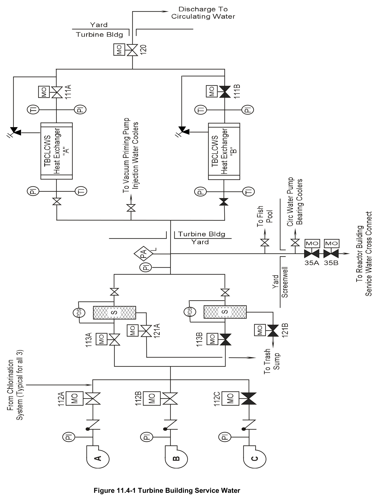

# 11.4 Turbine Service Water

> Source: `11.4_Turbine_Service_Water.pdf` (9 pages)
> GE (BWR) Systems Technology Manual — USNRC HRTD, Rev 09/11

---
<!-- p.1 -->
#### General Electric Systems Technology Manual
#### Chapter 11.4
#### Turbine Building Service Water System
<!-- p.3 -->
TABLE OF CONTENTS

11.4 TURBINE BUILDING SERVICE WATER SYSTEM .............................................. 1

11.4.1 Introduction ...................................................................................................... 1

11.4.2 System Description .......................................................................................... 1

11.4.3 Component Description ................................................................................... 2

11.4.3.1 TBSW Pumps .......................................................................................... 2

11.4.3.2 TBSW Strainers ....................................................................................... 2

11.4.4 System Features and Interfaces ...................................................................... 3

11.4.4.1 Normal Operations .................................................................................. 3

11.4.4.2 System Isolations .................................................................................... 3

11.4.4.3 System Interfaces .................................................................................... 3

11.4.5 Summary ......................................................................................................... 4

Rev09/11 11.4-i USNRC HRTD

<!-- p.4 -->
#### LIST OF FIGURES
11.4-1 Turbine Building Service Water System

Rev 09/11 11.4-ii USNRC HRTD

<!-- p.5 -->
### 11.4 TURBINE BUILDING SERVICE WATER SYSTEM
Learning Objectives:

1. Recognize the purpose of the Turbine Building Service Water (TBSW) System.

2. Recognize the purpose, function and operation of the following turbine building service water system major components:
a. TBSW pumps b. strainers

3. Recognize the flow path of the turbine building service water system during normal operation.

4. Recognize the plant conditions that automatically isolate the TBSW system from the reactor building service water system.

5. Recognize how the Turbine Building Service Water system interfaces with the following:
a. Circulating Water System (Section 11.1)
b. Turbine Building Closed Loop Cooling Water System (Section 11.5)
a. Reactor Building Service Water System (Section 11.2)

#### 11.4.1 Introduction
The purpose of the Turbine Building Service Water System is to transfer heat from nonsafety related components to the Long Island Sound. The major components of the TBSW system are shown in Figure 11.4-1.

#### 11.4.2 System Description
Three TBSW system pumps take water from the screenwell. Normally two of the three pumps are running, discharging into a common header. The TBSW flow passes through a self-cleaning strainer. The TBSW supplies cooling water to the TBCLCW system heat exchangers and other equipment.

The design water requirements on the TBSW system is a total of 16,937 gpm as follows:
• 16,000 gpm to the TBCLCW system heat exchanger
• 420 gpm to a TBSW strainer (during backwashing only)
• 300 gpm to the circulating water system’s vacuum priming pump seal water coolers
• 185 gpm to the fish retention pond (periodic operation only)
• 32 gpm to the circulating water pump bearing coolers

Rev 09/11 11.4-1 USNRC HRTD

<!-- p.6 -->
These requirements are based on design maximum temperature (77°F) of Long Island Sound and maximum heat loads from components.

The TBSW supply to the TBCLCW heat exchangers is controlled by isolation motor operated valves (MOV-111A and B) on the outlet of the heat exchangers (Figure 11.4- 1). The outlets of the two TBCLCW heat exchangers combine in a single return line containing a motor operated isolation valve (MOV-120). The TBSW is returned to Long Island Sound via the circulating water discharge canal.

The TBSW supply for the fish retention pond is only used when sampling of fish and marine life is needed. The TBSW flow rate transports biological matter collected on the traveling screens at the screenwash bays to the fish retention pond. The operator manually establishes and terminates this flow pathway.

Nearly 95% of the TBSW system flow is dedicated to cooling the TBCLCW heat exchangers. The TBCLCW system uses clean water to cool plant components and TBSW uses sea water as the heat sink for the TBCLCW system. This arrangement allows cooling of plant equipment with clean instead of corrosive sea water. In the event a leak develops in any cooler or component supplied by the TBCLCW system, the potentially radioactively contaminated water will remain in the closed loop TBCLCW system instead of being released to the Long Island Sound as would happen if the cooler or component were cooled directly by TBSW.

#### 11.4.3 Component Description
The major components of the Turbine Building Service Water system are described in the following sections.

##### 11.4.3.1 TBSW Pumps
The TBSW pumps are vertically mounted, centrifugal, rated at 8,000 gpm at a discharge pressure of 50 psig. The pumps are driven by a 350 Hp, 4160 VAC, 3 phase, induction motor. Two pumps are needed to deliver system design flow rate under maximum heat load conditions.

##### 11.4.3.2 TBSW Strainers
Two 100 percent capacity, rotary type, self-cleaning strainers are provided on the discharge side of the TBSW pumps. The strainers are arranged in parallel with one strainer normally in-service with the other bypassed. Each strainer backwashes to the trash sump.

Rev 09/11 11.4-2 USNRC HRTD

<!-- p.7 -->
#### 11.4.4 System Features and Interfaces
System operation and interrelations between this system and other plant systems are discussed in the paragraphs that follow.

##### 11.4.4.1 Normal Operations
During normal operations the TBSW system has two pumps operating supplying service water to the components cooled by the system. The third pump is normally aligned for standby operation.

##### 11.4.4.2 System Isolations
In event of a Loss Of Coolant Accident (*LOCA) signal or a low voltage condition on an emergency bus, the normally locked closed, motor operated isolation valves (MOV- 035A&B) in the cross-connect line between TBSW and RBSW loop B receive an automatic close signal. Under design basis LOCA and Loss Of Offsite Power (LOOP)
conditions, the RBSW provides cooling for safety-related components. The crossconnect enables the TBSW system to provide flow through the RBSW when absolutely necessary. The normally locked closed valves protect against the diverting of RBSW flow when the RBSW pumps are available. Two valves in series are provided to meet the single failure criterion.

One of the motor operated isolation valves (MOV-035B) is provided on the remote shut down panel. In the event of a shut down from outside the main control room, the operator can close MOV-035B, if necessary, before starting RBSW to supply cooling flow to the residual heat removal system heat exchanger for shutdown cooling or suppression pool cooling.

##### 11.4.4.3 System Interfaces
A short discussion of interfaces this system has with other plant systems is given in the following sections.

Circulating Water System (Section 11.1)

The Circulating Water System (CWS) shares the screenwell suction pits with the TBSW.
The CWS also provides a discharge path for return water of the TBSW to the Long Island Sound. TBSW provides cooling water to the circulating water pump bearing coolers and the vacuum priming pump seal coolers.

Reactor Building Service Water System (Section 11.2)

A pipe cross-connects the TBSW system and loop B of the RBSW system. There are two normally-closed, motor operated valves in this line.

Rev 09/11 11.4-3 USNRC HRTD

<!-- p.8 -->
Turbine Building Closed Loop Cooling Water System (Section 11.5)

The TBSW system provides cooling water flow to the TBCLCW system heat exchangers.

#### 11.4.5 Summary
Classification: Power Generation system.

Purpose: To transfer heat from non-safety related components to the Long Island Sound.

Components: Pumps, Strainers, Pipes, and Valves

System Interfaces: Circulating water system, reactor building service water system, and turbine building closed loop cooling water system.

Rev 09/11 11.4-4 USNRC HRTD

<!-- p.9 -->
#### Figure 11.4-1

*Turbine Building Service Water*

[Vector original (SVG, lossless): fig_11.4-1.svg](../figures/fig_11.4-1.svg)

