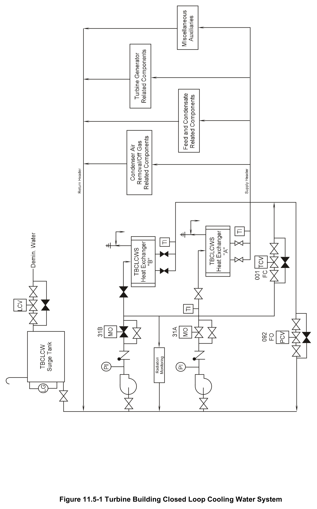

# 11.5 TB Closed Loop

> Source: `11.5_TB_Closed_Loop.pdf` (13 pages)
> GE (BWR) Systems Technology Manual — USNRC HRTD, Rev 09/11

---
<!-- p.1 -->
#### General Electric Systems Technology Manual
#### Chapter 11.5
#### Turbine Building Closed Loop Cooling Water System
<!-- p.3 -->
TABLE OF CONTENTS

11.5 TURBINE BUILDING CLOSED LOOP COOLING WATER SYSTEM .................. 1

11.5.1 Introduction ...................................................................................................... 1

11.5.2 System Description .......................................................................................... 1

11.5.3 Component Description ................................................................................... 2

11.5.3.1 Pumps ..................................................................................................... 2

11.5.3.2 Surge Tank .............................................................................................. 2

11.5.3.3 Heat Exchangers ..................................................................................... 2

11.5.3.4 Pressure Control Valve............................................................................ 2

11.5.3.5 Temperature Control Valve ..................................................................... 3

11.3.3.6 Radiation Monitor .................................................................................... 3

11.5.4 System Features and Interfaces ...................................................................... 3

11.5.4.1 Normal Operation .................................................................................... 3

11.5.4.2 System Interfaces .................................................................................... 4

11.5.5 Summary ......................................................................................................... 4

LIST OF TABLES

11.5-1 TBCLCW Load List ............................................................................................... 7

Rev 09/11 11.5-i USNRC HRTD

<!-- p.4 -->
#### LIST OF FIGURES
11.5-1 Turbine Building Closed Loop Cooling Water System

Rev 09/11 11.5-ii USNRC HRTD

<!-- p.5 -->
### 11.5 TURBINE BUILDING CLOSED LOOP COOLING WATER SYSTEM
Learning Objectives:

1. Recognize the purpose of the Turbine Building Closed Loop Cooling Water
(TBCLCW) System.

2. Recognize the purpose, function and operation of the following major components:
a. pumps b. surge tank c. heat exchangers d. radiation monitor e. temperature control valve

3. Recognize the flow path of the TBCLCW system during normal operation.

4. Recognize how the Turbine Building Closed Loop Cooling Water system interfaces with the following systems:
a. Condensate and Feedwater System (Section 2.6)
b. Offgas System (Section 8.1)
c. Turbine Building Service Water System (Section 11.4)

#### 11.5.1 Introduction
The purpose of the turbine building closed loop cooling water (TBCLCW) system is to transfer heat from non-safety related components in the turbine building, radwaste building, and office and service building to the turbine building service water system.
The major components of the TBCLCW system are shown in Figure 11.5-1. The major components cooled by the TBCLCW system are listed in Table 11.5-1.

#### 11.5.2 System Description
The TBCLCW is a closed loop piping system consisting of two full-capacity centrifugal pumps, two full-capacity heat exchangers, a surge tank, two motor-operated pump discharge isolation valves and automatic temperature and pressure control valves. The system is shown in Figure 11.5-1. The piping loop is routed throughout the turbine, office, service, and radwaste buildings, providing cooling water to the components listed in Table 11.5-1.

Rev 09/11 11.5-1 USNRC HRTD

<!-- p.6 -->
#### 11.5.3 Component Description
The major components of the TBCLCW system are described in the following sections.

##### 11.5.3.1 Pumps
The TBCLCW pumps are single stage, double suction horizontally mounted pumps, rated at 17,800 gpm @ 85 psig. Both sleeve and thrust bearings are of the oil lubricated ball bearing type using a splash type oil lubrication system. No external oil cooling system is required. The pumps are driven by 1,000 hp, 4,160 VAC, 3 phase, 60Hz, 129 amp squirrel cage induction motors. Each pump is designed for 100 percent of the TBCLCW system flow requirements.

Each TBCLCW pump has a 30-inch diameter butterfly type discharge valve. Interlocks are provided that ensure the associated pump is running prior to the valve’s opening.

##### 11.5.3.2 Surge Tank
The fiberglass TBCLCW surge tank has a 1,680 gallon capacity. It is located above the TBCLCW pump suction manifold to:
• minimize pressure surges
• permit thermal expansion of loop water
• provide a low pressure inlet for makeup water
• ensure the minimum NPSH for the system pumps
• provide a method for detecting and measuring leakage

Makeup water to the TBCLCW surge tank is automatically supplied from the demineralized water system through a level control valve.

##### 11.5.3.3 Heat Exchangers
The TBCLCW system has two horizontally-mounted, cylindrically shaped, 48 feet long, 51 inch diameter single-pass, single-shell heat exchangers. TBSW system water flows through the tubes and TBCLCW system water flows on the shell side. Each heat exchanger is designed to handle the entire TBCLCW system heat load.

##### 11.5.3.4 Pressure Control Valve
Pressure transients within the TBCLCW system caused by placing loads in and out of service are automatically compensated for by pressure control valve PCV-092 (Figure 11.5-1). This valve is located in the recirculation line connecting the TBCLCW heat exchanger discharge manifold to the TBCLCW pump common suction header.
Increasing system pressure causes the pressure control valve to open, permitting more flow to bypass the TBCLCW pumps to restore the desired system pressure. Conversely,

Rev 09/11 11.5-2 USNRC HRTD

<!-- p.7 -->
decreasing system pressure causes the pressure control valve to close, forcing more flow through the TBCLCW pumps to recover to the desired system pressure.

##### 11.5.3.5 Temperature Control Valve
A heat exchanger bypass line containing automatic temperature control valve (TCV- 001) is provided from the pump discharge header to the cooling water heat exchanger discharge header. TBCLCW heat exchanger discharge temperature is maintained at a constant 95ºF by modulation of bypass flow around the heat exchanger. When temperature rises above 95ºF, TCV-001 closes to force more flow through the heat exchanger. When temperature drops below 95ºF, TCV-001 opens to allow more flow to bypass the heat exchanger.

Many systems regulate the TBCLCW cooling flow rate through their equipment using temperature control valves that hold system temperatures within the normal control band. Table 11.5-1 lists equipment cooled by TBCLCW and where applicable lists the TCV setpoints for the equipment.

##### 11.5.3.6 Radiation Monitor
A small amount of flow from common TBCLCW pump discharge line is routed through a radiation monitor and returned to the pump suction line. The monitor is designed to detect the inleakage of radioactive contaminants due to the failure of a cooler served by the system.

#### 11.5.4 System Features and Interfaces
System operation and interrelations between this system and other plant systems are discussed in the paragraphs that follow.

##### 11.5.4.1 Normal Operation
During normal full-power operation there is one TBCLCW pump and one TBCLCW heat exchanger in service (Figure 11.5-1). The standby TBCLCW pump automatically starts if the running pump trips. The standby heat exchanger has no automatic functions. The TBCLCW temperature control valve modulates the flow through the heat exchangers to keep system temperature within the normal band. Some of the heat loads on the TBCLCW system also use temperature control valves to maintain their component temperatures in their normal bands.

TBCLCW is a closed system. The operating TBCLCW pump provides the motive force to circulate water through the system. Flow is directed from the pump discharge through a discharge valve. This flow then diverges with some flow going through the heat exchanger and the remainder bypassing the heat exchanger via the TCV. The amount of bypass flow is modulated by the TCV to regulate TBCLCW system temperature. The

Rev 09/11 11.5-3 USNRC HRTD

<!-- p.8 -->
one TCV bypasses flow to both heat exchangers. Flow from the heat exchanger and the TCV bypass flow converge into a supply header. The supply header directs flow through the various parallel groups of heat loads (Table 11.5-1). After cooling the heat loads the system flow is returned to TBCLCW pump suction.

The surge tank on the pump suction header helps to maintain a constant system pressure and allows for periodic automatic water addition to the nominally closed system.

##### 11.5.4.2 System Interfaces
A short discussion of interfaces this system has with other plant systems is given in the following sections.

Condensate and Feedwater System (Section 2.6)

The TBCLCW system supplies cooling water to the condensate pump motor bearings, the condensate booster pump lube oil coolers, and the feedwater pump turbine lube oil coolers.

Offgas System (Section 8.1)

The TBCLCW system supplies cooling water to the de-superheater condenser and drain cooler and to the condenser air removal pump lube oil and sealing water coolers.

The design pressure of the TBCLCW system is 15 pounds per square inch higher than the design pressure of the offgas system. This precludes in-leakage of potentially radioactively contaminated water into the TBCLCW system from offgas system equipment.

Turbine Building Service Water System (Section 11.4)

The turbine building service water system cools the TBCLCW system heat exchangers.

The design pressure of the TBCLCW system is 15 pounds per square inch higher than the design pressure of the TBSW system. This precludes in-leakage of TBSW system water that could cause fouling and/or degradation of stainless steel components in the TBCLCW system.

#### 11.5.5 Summary
Classification: Power Generation system.

Purpose - To transfer heat from the turbine building components to the Turbine Building Service Water system.

Rev 09/11 11.5-4 USNRC HRTD

<!-- p.9 -->
Components: Pumps, Pipes, and Valves

System Interfaces: Normal Power System, Turbine Building Service Water system.

Rev 09/11 11.5-5 USNRC HRTD

<!-- p.10 -->
Rev 09/11 11.5-6 USNRC HRTD

<!-- p.11 -->
#### Table 11.5-1 TBCLCW Load List
Turbine Building

Station air compressors Condensate pump motor bearings

Condensate booster pump Condenser air removal pump lube oil lube oil coolers (120°F)
coolers

Condenser air removal pump Generator stator cooling unit sealing water cooler

Exciter alternator cooler Generator leads cooler

Main turbine lube oil coolers (110°F) Feedwater pump turbine lube oil coolers (120°F)

Sample system coolers Offgas glycol skid freon condensers

Hydrogen coolers (100°F)
Offgas loop seal cooling jackets

Offgas de-superheater condensers Low conductivity drain tank coolers

Offgas drain coolers Electro-hydraulic control coolers (115°F)

Radwaste Building

Waste evaporator (120°F)
Regenerant evaporator (120°F)

Sample system coolers Radwaste vent glycol chillers

Office and Service Building

Air conditioning condenser

Rev 09/11 11.5-7 USNRC HRTD

<!-- p.13 -->
#### Figure 11.5-1

*Turbine Building Closed Loop Cooling Water System*

[Vector original (SVG, lossless): fig_11.5-1.svg](../figures/fig_11.5-1.svg)

