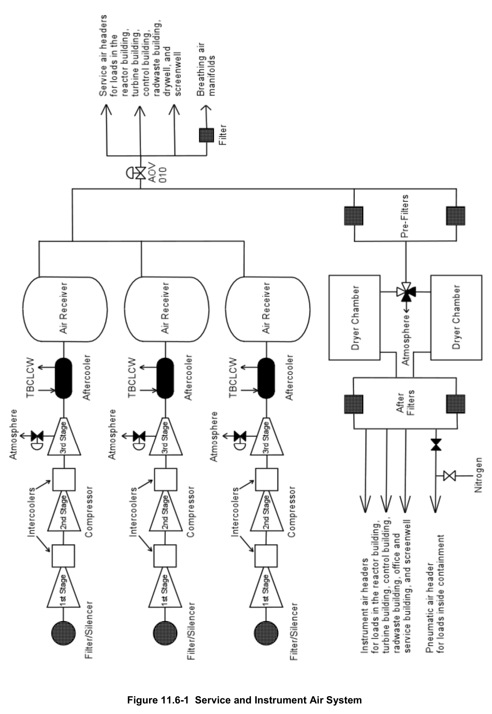

# 11.6 Service Instrument Air

> Source: `11.6_Service_Instrument_Air.pdf` (13 pages)
> GE (BWR) Systems Technology Manual — USNRC HRTD, Rev 09/11

---
<!-- p.1 -->
#### General Electric Systems Technology Manual
#### Chapter 11.6
#### Service and Instrument Air Systems
<!-- p.3 -->
TABLE OF CONTENTS

11.6 SERVICE AND INSTRUMENT AIR SYSTEM ........................................................ 1

11.6.1 Introduction ........................................................................................................ 1

11.6.2 System Description ............................................................................................ 1

11.6.3 Component Description ..................................................................................... 2

11.6.3.1 Air Compressors ........................................................................................ 2

11.6.3.2 Air Receivers ............................................................................................. 3

11.6.3.3 Instrument Air Dryer .................................................................................. 3

11.6.3.4 Service Air Header Isolation Valve (AOV-010) .......................................... 3

11.6.4 System Features and Interfaces ........................................................................ 3

11.6.4.1 System Operation ...................................................................................... 4

11.6.4.2 System Interfaces ...................................................................................... 4

11.6.5 Summary ........................................................................................................... 5

LIST OF TABLES

11.6-1 Service and Instrument Air System Design Loads ................................................ 7

Rev 09/11 11-6-i USNRC HRTD

<!-- p.4 -->
#### LIST OF FIGURES
11.6-1 Service and Instrument Air System

Rev 09/11 11-6-ii USNRC HRTD

<!-- p.5 -->
### 11.6 SERVICE AND INSTRUMENT AIR SYSTEM
Learning Objectives:

1. Recognize the purpose of the Service and Instrument Air System.

2. Recognize the purpose, function and operation of the following major components:
a. air compressors b. air receivers c. instrument air dryer d. service air header isolation valve

3. Recognize the normal flow path of the service and instrument air system.

4. Recognize the response of the following components to a loss of instrument air:
a. Main steam isolation valves b. Minimum flow valves for pumps in the condensate and feedwater system c. Control rods d. Feedwater heater extraction steam and drain valves

5. Recognize how the Service and Instrument Air system interfaces with the following systems:
a. Turbine Building Closed Loop Cooling Water System (Section 11.5)
b. Primary Containment System (Section 4.1)

#### 11.6.1 Introduction
The purpose of the service and instrument air system is to provide a continuous supply of compressed air of suitable quality and pressure for instruments, controls, and station use. Representative loads are listed in Table 11.6-1.

The functional classification of the service and instrument air system is that of a power generation system, although some components are safety related.

#### 11.6.2 System Description
Three centrifugal air compressors, one continuously operating with two normally in standby, maintain approximately 125 psig pressure. If system air header pressure drops, one of the standby air compressors automatically starts. If the air header pressure continues to drop, the second standby air compressor automatically starts.

A connection off the common header opens when system pressure exceeds 95 psig to supply clean, oil-free service air to components throughout the plant. Should system

Rev 09/11 11-6-1 USNRC HRTD

<!-- p.6 -->
pressure drop below 95 psig, an automatic isolation valve closes to shed these service air loads to preserve supply for the instrument air loads. The service air header also supplies breathing air stations.

In parallel with the service air connection, an instrument air dryer removes moisture from the process flow. The instrument air system then supplies clean, dry, oil-free air for components throughout the plant.

The instrument air system, using nitrogen supplied from the primary containment inerting system, supplies pneumatically controlled components, such as the safety relief valves and inboard main steam isolation valves, inside the drywell.

#### 11.6.3 Component Description
The major components of the service and instrument air system are described in the following sections and shown in Figure 11.6-1.

##### 11.6.3.1 Air Compressors
Each of the three motor-driven, centrifugal, three-stage, water-cooled, oil-lubricated air compressors is rated at 1,353 standard cubic feet per minute (scfm) flow at 125 psig.
The air compressors are located in the turbine building. An inlet filter/silencer removes particles and routes the air through a baffle to reduce noise.

Air leaves the first stage compressor at 20 psig and 280ºF and enters an intercooler where it is cooled to 105ºF by the Turbine Building Closed Loop Cooling Water
(TBCLCW) System.

Air leaves the second stage compressor at 60 psig and 280ºF and enters another intercooler where it is cooled to 105ºF by the TBCLCW system.

Air leaves the third stage compressor at 125 psig and 283ºF and enters an after-cooler where it is cooled to 97ºF by the TBCLCW system. Moisture separators are connected to the after-cooler outlets to remove condensation from the compressed air flow.

Each third stage compressor has a discharge pressure control valve that automatically opens at approximately 125 psig to prevent over pressurizing the system. The discharge pressure control valve automatically closes at approximately 119 psig to restore system pressure.

Rev 09/11 11-6-2 USNRC HRTD

<!-- p.7 -->
An air compressor will automatically trip on any of the following conditions:
• High temperature (125ºF) at the outlet of intercooler No. 1
• High temperature (125ºF) at the outlet of intercooler No. 2
• Low lube oil pressure (20 psig)
• High lube oil temperature (140ºF)
• High vibration (0.32 to 0.48 inches per second)
• Under voltage (70 percent of normal)

##### 11.6.3.2 Air Receivers
The exhaust from each air compressor is collected in an air receiver. Each air receiver is a carbon steel tank 72 inches in diameter and 192 inches long for a storage volume of 400 cubic feet. Each tank has a safety relief valve for protection against overpressure.
A level switch and solenoid drain valve automatically drains water from the tank.

##### 11.6.3.3 Instrument Air Dryer
The instrument air dryer is designed to provide 450 scfm of clean, dry air at 125 psig.
The instrument air dryer has two tower-type dryer chambers each filled with 285 pounds of silica gel. Each unit is equipped with a 15 kilowatt internal heater. The process flow passes through one of the dryer chambers. The second chamber is off-line with its heater energized to reactivate the desiccant. Controls automatically swap between chambers every four hours.

Two 110 percent capacity pre-filters are installed in parallel upstream of the instrument air dryer. The filter cartridges are designed to remove water droplets and particles sized one micron and larger.

Two 100 percent capacity after filters are installed in parallel downstream of the instrument air dryer. The filter cartridges are designed to remove water droplets and particles sized one micron and larger.

##### 11.6.3.4 Service Air Header Isolation Valve (AOV-010)
The service air header isolation valve (AOV-010 on Figure 11-6-1) opens when instrument air header pressure is above 95 psig and closes when instrument air header pressure drops below 95 psig. This valve opens to supply service air loads only when adequate instrument air supply is available.

#### 11.6.4 System Features and Interfaces
System operation and interrelations between this system and other plant systems are discussed in the following paragraphs.

Rev 09/11 11.6-3 USNRC HRTD

<!-- p.8 -->
##### 11.6.4.1 System Operation
During normal operation, one of the three air compressors is operating continuously.
The running air compressor cycles between unload (3rd stage compressor discharge pressure control valve venting flow) and load phases (discharge pressure control valve closed).

One of the two standby air compressors is selected as the primary backup with the other being the secondary backup. If the air header pressure drops to 110 psig, the primary backup air compressor automatically starts. If the air header pressure drops to 105 psig, the secondary backup air compressor starts. If the air header pressure drops to 95 psig, the service air header isolation valve (AOV-010) automatically closes.

Once started either manually or automatically, an air compressor remains running until manually shut off or tripped by one of the conditions discussed in Section 11.6.3.1.

The instrument air system uses nitrogen supplied by the primary containment inerting system to provide pneumatic control of certain components, like the safety relief valves and the inboard main steam isolation valves. This arrangement prevents instrument air system leaks inside the drywell from increasing the oxygen concentration of the inerted atmosphere for protection against hydrogen ignitions in event of an accident.

The service and instrument air system is not required to operate to mitigate any design bases accident. If the service and instrument air system stops operating, the fail-safe mode of air-operated valves, such as the scram inlet and outlet valves in the control rod drive system and the outboard main steam isolation valves in the main steam system, will eventually lead to an automatic reactor scram as air header pressure decays.

##### 11.6.4.2 System Interfaces
The service and instrument air system interfaces with various other plant systems as described in the following paragraphs.

Turbine Building Closed Loop Cooling Water System (Section 11.5)

The turbine building closed loop cooling water system supplies the service and instrument air system with cooling water for compressor intercoolers and after-cooler.

Primary Containment Inerting System (Section 4.1)

The primary containment inerting system can supply nitrogen to the portion of the instrument air system that supplies components within the drywell.

Rev 09/11 11-6-4 USNRC HRTD

<!-- p.9 -->
#### 11.6.5 Summary
Classification - Power generation system

Purpose - To provide a continuous supply of compressed air of suitable quality and pressure for instruments, controls, and station use.

Components – Air compressors, air receivers, instrument air dryer, and service air header isolation valve

System Interrelations – Turbine Building Closed Loop Cooling Water System, Primary Containment Inerting System

Rev 09/11 11.6-5 USNRC HRTD

<!-- p.10 -->
Rev 09/11 11-6-6 USNRC HRTD

<!-- p.11 -->
TABLE 11.6-1 Service and Instrument Air System Design Loads

Continuous Loads Design Flow, scfm Make-up demineralizer 5 Condensate demineralizers 5 Extraction steam non-return valves 30 Control rod drive system scram inlet and outlet valves
1.1 Balance of plant (instrument air)
300 Balance of plant (service air)
300 Outboard main steam isolation valve 30 Screenwell Differential Bubblers 0.5 Standby liquid control tank level instrument <2.0 scfh

Intermittent Demands Make-up demineralizer 148 (20 minutes)
Condensate demineralizer 300 (25 minutes)
Radwaste filters (2)
900 each (60 minutes)
Reactor water cleanup filter demineralizer 126 (20 minutes)
Tank sparging 227 (60 minutes)

Startup and Shutdown Loads Fuel preparation machine 180 Main steam isolation valves 4,000 (3 seconds)
Extraction steam valves 2,254 Head stud tension assembly 80 (12 minutes)

Rev 09/11 11.6-7 USNRC HRTD

<!-- p.13 -->
#### Figure 11.6-1

*Service and Instrument Air System*

