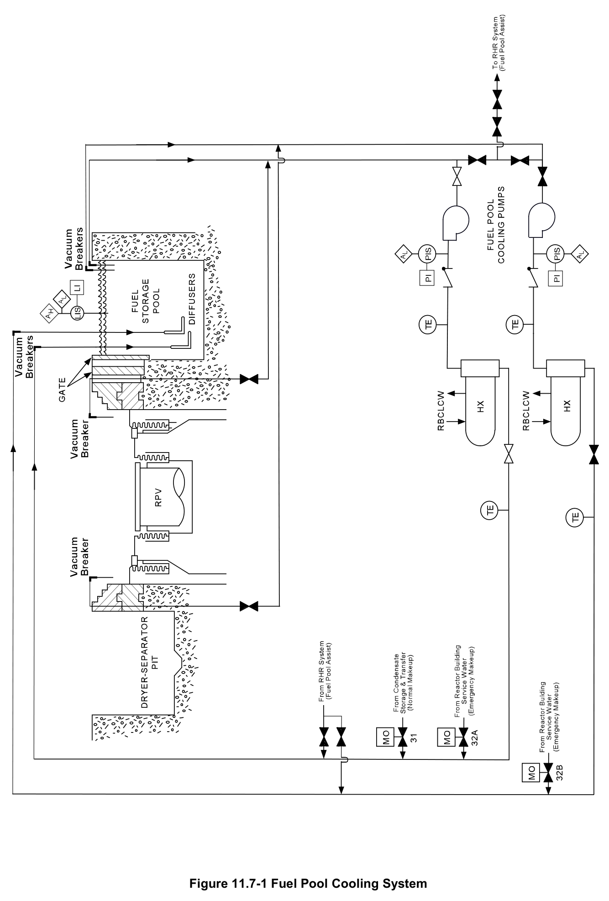
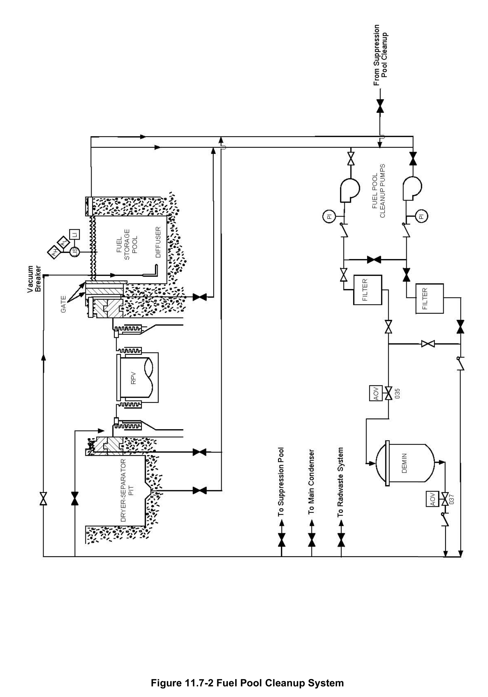
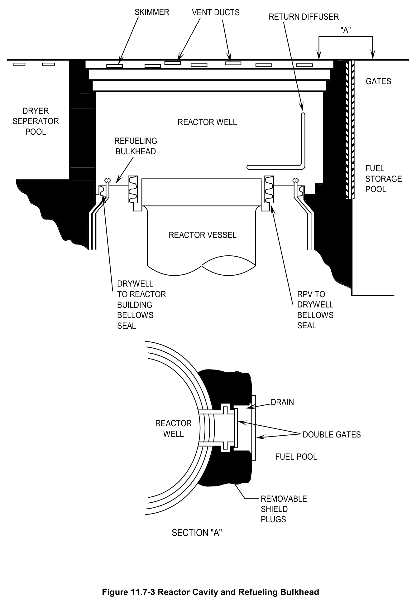
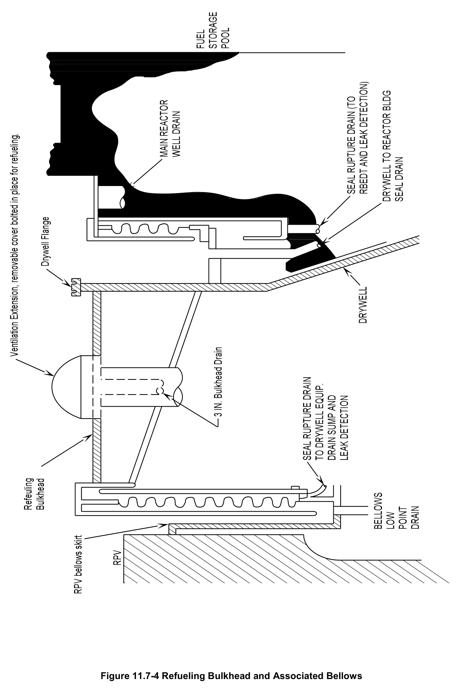
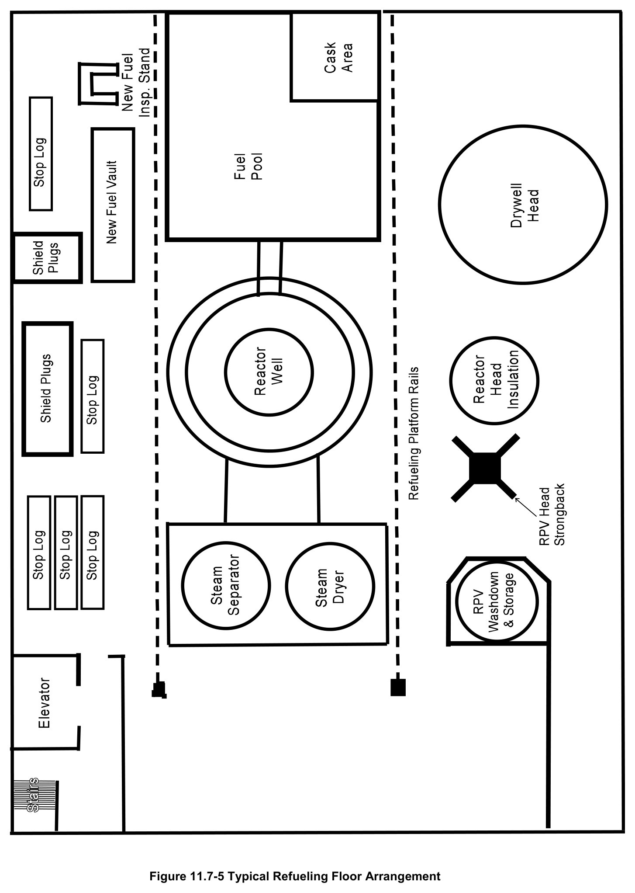
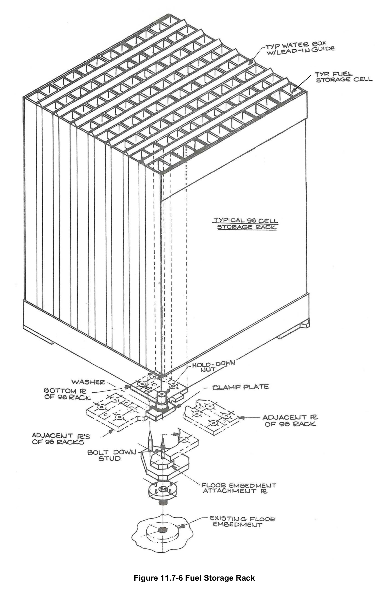

# 11.7 Fuel Pool Cooling

> Source: `11.7_Fuel_Pool_Cooling.pdf` (25 pages)
> GE (BWR) Systems Technology Manual — USNRC HRTD, Rev 09/11

---
<!-- p.1 -->
#### General Electric Systems Technology Manual
#### Chapter 11.7
#### Fuel Pool Cooling and Cleanup System
<!-- p.3 -->
TABLE OF CONTENTS

11.7 FUEL POOL COOLING AND CLEANUP SYSTEM .............................................. 1

11.7.1 Introduction ....................................................................................................... 1

11.7.2 Component Description .................................................................................... 3

11.7.2.1 Fuel Storage Pool ..................................................................................... 3

11.7.2.2 Fuel Storage Racks .................................................................................. 4

11.7.2.3 Fuel Pool Cooling Pumps ......................................................................... 4

11.7.2.4 Fuel Pool Cleanup Pumps ........................................................................ 5

11.7.2.5 Heat Exchangers ...................................................................................... 5

11.7.2.6 Filters ........................................................................................................ 5

11.7.2.7 Demineralizer ........................................................................................... 5

11.7.2.8 Diffusers ................................................................................................... 6

11.7.2.9 Pool Gates ................................................................................................ 6

11.7.2.10 Reactor Well ........................................................................................... 6

11.7.2.11 Dryer/Separator Storage Pit .................................................................... 7

11.7.3 System Features and Interfaces ....................................................................... 7

11.7.3.1 System Operational Summary .................................................................. 7

11.7.3.2 System Interlocks ..................................................................................... 9

11.7.3.3 Pool Ventilation ........................................................................................ 9

11.7.3.4 System Interfaces ..................................................................................... 9

11.7.4 Summary ........................................................................................................ 10

Rev 09/11 11.7-i USNRC HRTD

<!-- p.4 -->
#### LIST OF FIGURES
11.7-1 Fuel Pool Cooling System 11.7-2 Fuel Pool Cleanup System 11.7-3 Reactor Cavity and Refueling Bulkhead 11.7-4 Refueling Bulkhead and Associated Bellows 11.7-5 Typical Refueling Floor Arrangement 11.7-6 Fuel Storage Rack

Rev 09/11 11.7-ii USNRC HRTD

<!-- p.5 -->
### 11.7 FUEL POOL COOLING AND CLEANUP SYSTEM
Learning Objectives:

1. Recognize the purposes of the Fuel Pool Cooling and Cleanup System.

2. Recognize the purpose, function and operation of the following major components:
a. fuel storage pool b. fuel storage racks c. fuel pool cooling pumps d. fuel pool cleanup pumps e. heat exchangers f. filters g. demineralizer h. diffusers i. pool gates j. reactor well k. dryer/separator storage pit

3. Describe the following flow paths of the fuel pool cooling and cleanup system:
a. normal (non-refueling) operation b. refueling operation c. normal and emergency makeup d. letdown

4. Recognize the design features of the fuel pool cooling and cleanup system which prevent inadvertently lowering the water level in the fuel storage pool.

5. Recognize how the Fuel Pool Cooling and Cleanup system interfaces with the following systems:
a. Residual Heat Removal (RHR) System (Section 10.4)
b. Reactor Vessel System (Section 2.1)
c. Condensate and Feedwater System (Section 2.6)
d. Reactor Building Closed Loop Cooling Water System (Section 11.3)
a. Reactor Building Service Water System (Section 11.2)

#### 11.7.1 Introduction
Nuclear power plants are on 18 to 24 month operating cycles. At the end of an operating cycle, a nuclear power reactor is shut down for refueling. One-quarter to onethird of the fuel bundles in the reactor core are permanently discharged as spent fuel.
New fuel bundles are loaded into the core as replacements. Spent fuel bundles continue to produce heat and radiation as unstable fission byproducts decay.

Rev 09/11 11.7-1 USNRC HRTD

<!-- p.6 -->
The Fuel Pool Cooling and Cleanup (FPCC) System maintains the fuel storage pool and separator storage pool at an acceptable temperature. The FPCC system also removes dissolved and suspended solids. Removal of these solids is required to maintain the pools within acceptable activity limits. It also maintains the necessary water quality and clarity to store, transfer, and service the reactor internals and fuel bundles. The fuel storage racks maintain fuel bundles in a subcritical configuration. The fuel storage racks may hold new fuel bundles waiting to be placed into the reactor core as well as spent fuel bundles.

The functional classification of the FPCC system is that of a safety related system.

The purposes of the FPCC system are:
• To remove decay heat released from spent fuel bundles.
• To maintain water quality for refueling activities and storage of spent fuel bundles.
• To provide shielding to reduce radiation levels on the refueling floor.
• To maintain fuel bundles in a subcritical configuration.

The FPCC system consists of:
• pumps
• heat exchangers
• filters
• demineralizer
• diffusers
• storage pools

At the BWR reference plant for this course (Shoreham), the fuel pool cooling system was physically separate from the fuel pool cleanup system. This arrangement is atypical. The most common BWR configuration features a combined fuel pool cooling and cleanup system. The same pumps send water through the heat exchangers and filter/demineralizers. The text in this chapter details the reference plant’s configuration.
What is being done and why it is being done is directly transferrable to other BWR designs. The precise mechanics of how it is being done may differ at non-reference BWR plants.

The fuel pool cooling system (Figure 11.7-1) is a closed loop system. It removes water from the fuel storage pool via suction lines. The water then passes through a heat exchanger and returns to the fuel storage pool via diffusers. Heat from the fuel storage pool’s water is transferred to the RBCLCW system.

The fuel pool cooling system is designed to maintain the fuel storage pool water temperature below 125°F for the following concurrent loads:
• decay heat generated by 25 percent of a reactor core 6 months after shutdown
• decay heat generated by 25 percent of a reactor core 12 days after shutdown

Rev 09/11 11.7-2 USNRC HRTD

<!-- p.7 -->
The fuel pool assist mode of the RHR system supplements the fuel pool cooling system when higher heat loads are offloaded into the fuel storage pool.

The fuel pool cleanup system (Figure 11.7-2) is a closed loop system. It removes water from the fuel storage pool via overflow through weirs. The water then passes through a filter and a demineralizer to remove particulates and dissolved ions. The treated water returns through diffusers to the fuel storage pool. The condensate and feedwater system is used to fill and drain the reactor well and dryer/separator storage pool during refueling outages.

#### 11.7.2 Component Description
The major components of the FPCC system are described in the following paragraphs and shown in Figures 11.7-1 through 11.7-5.

##### 11.7.2.1 Fuel Storage Pool
The fuel storage pool (Figures 11.7-1, 11.7-2 and 11.7-5) provides for storage and cooling of spent fuel, used control rods, and other irradiated components. The pool is constructed of reinforced concrete with a stainless steel liner. The reinforced concrete provides structural support for the following weights:
• the fuel storage pool water
• the storage racks
• the fuel bundles

The stainless steel liner minimizes leakage of water from the pool. The pool is 38' long, 31 ½ ' wide and 38' 9" deep. The normal water level of 37’ 9” from the pool’s bottom provides a capacity of 385,000 gallons.

The fuel storage pool is located within the reactor building and normally accessed via the refuel floor (Figure 11.7-5). The fuel storage pool and refuel floor are housed within the secondary containment.

One corner of the fuel storage pool is reinforced to accommodate a fuel cask. A fuel cask is made from concrete and steel. Spent fuel bundles are loaded into fuel casks for onsite storage or transportation offsite.

Two fuel preparation machines are attached to the fuel storage pool walls. These are used for installing or removing channels from fuel bundles and for fuel bundle inspections.

Two gates are normally installed to isolate the fuel storage pool from the reactor well.

All piping entering the fuel storage pool penetrates the pool’s walls about one foot below the normal water level. The only exception to this is a drain line between the two pool

Rev 09/11 11.7-3 USNRC HRTD

<!-- p.8 -->
gates. The return piping, which extends deep into the fuel storage pool, has anti-siphon devices (vacuum breakers). These prevent water from being inadvertently siphoned from the pool. This prevents a pipe rupture from draining water from the fuel storage pool and uncovering spent fuel bundles in the storage racks. There are no fuel pool connections which can allow pool drainage below the bottom of the fuel transfer canal from the reactor well.

Water in the fuel storage pool performs two important functions. One function is to absorb decay heat being produced by spent fuel bundles. This heat is then transferred to the RBCLCW system via the fuel pool cooling heat exchangers. The second function is to shield workers from the radiation. This radiation comes from the spent fuel bundles and other irradiated components in the fuel storage pool.

##### 11.7.2.2 Fuel Storage Racks
Spent fuel bundles are stored in the fuel storage racks (Figure 11.7-6). A rack, sometimes called a module, is an assembly of receptor tubes. Each receptor tube holds one fuel bundle. The rack maintains the bottom of the receptor tubes a few inches off the floor of the fuel storage pool. The tops of the receptor tubes are open.
This allows water to enter receptor tubes by natural circulation to cool spent fuel bundles.

Each rectangular receptor tube features outer and inner sheets of stainless steel sandwiched around aluminum-clad boron (B4C dispersal in aluminum). The boron acts as a poison to absorb neutrons and prevent a nuclear chain reaction. Adjacent tubes are welded together to form a stiff honeycomb structure. Except for the boron and aluminum, all structural material used in the fuel storage racks is stainless steel. The boron in the high density fuel storage racks provides the required margin against criticality.

##### 11.7.2.3 Fuel Pool Cooling Pumps
The fuel pool cooling pumps (Figure 11.7-1) provide forced circulation of water for fuel pool cooling. The water is drawn from the fuel storage pool through the fuel pool cooling heat exchangers and back to the pool via diffusers. Each of the two pumps is a 100 percent capacity, 700 gpm centrifugal pump. The pumps are either controlled from a local control panel near the pumps or from the radwaste control panel.

One pump is normally running to send water through a single heat exchanger. To handle the maximum normal heat load during and shortly after refueling outages, both pumps and heat exchangers are in service.

Interconnections permit the fuel pool assist mode of the RHR system to supplement or replace the fuel pool cooling system. The suction connection point is upstream of the

Rev 09/11 11.7-4 USNRC HRTD

<!-- p.9 -->
fuel pool cooling pumps. The discharge connection point is downstream of the fuel pool cooling heat exchangers.

##### 11.7.2.4 Fuel Pool Cleanup Pumps
The fuel pool cleanup pumps (Figure 11.7-2) provide forced circulation of water for fuel pool cleaning. The water is drawn from the fuel storage pool through the filters, the demineralizer and back to the pool via diffusers. Each of the two pumps is a 100 percent capacity, 250 gpm centrifugal pump. The pumps are controlled from a local panel near the pumps.

##### 11.7.2.5 Heat Exchangers
The heat exchangers, located downstream of the fuel pool cooling pumps, transfer heat to the RBCLCW system (Figure 11.7-1). The fuel storage pool water flows through the tubes of the single shell horizontal heat exchanger. RBCLCW flows through the shell side of the heat exchanger.

Only one heat exchanger is normally in service. During and shortly after refueling outages system heat loads on the FPCC system are high. Both heat exchangers are placed in service to maintain the water temperature below 110°F.

The fuel pool assist mode of the RHR system may be used to supplement or replace the fuel pool cooling heat exchangers.

##### 11.7.2.6 Filters
Two filters (Figure 11.7-2) each with a design maximum flow rate of 300 gpm remove particles sized five microns and larger. Each filter provides filtration of one fuel storage pool water volume per day.

##### 11.7.2.7 Demineralizer
A single mixed bed resin demineralizer (Figure 11.7-2) removes suspended solids by filtration and dissolved solids by ion exchange. The demineralizer maintains the clarity and purity of the fuel storage pool water within acceptable limits. The demineralizer treats one complete fuel storage pool water volume change per day.

The demineralizer is designed for a maximum flow rate of 300 gpm. A bypass line around the demineralizer handles higher flow rates when both fuel pool cleanup pumps are in service.

Rev 09/11 11.7-5 USNRC HRTD

<!-- p.10 -->
##### 11.7.2.8 Diffusers
Diffusers are used to reduce the velocity of water returning to the reactor well and fuel storage pool (Figures 11.7-1 and 11.7-2). The diffusers distribute the returning water with as little turbulence as possible. The diffusers are located at the opposite end of the fuel storage pool from the fuel pool cooling suction piping. This arrangement promotes uniform cooling of pool water. The diffuser piping incorporates anti-siphon lines
(vacuum breakers). These prevent water from being siphoned out of the pool and uncovering the spent fuel bundles.

##### 11.7.2.9 Pool Gates
Two gates (Figures 11.7-1 through 11.7-5) allow the reactor well and dryer-separator pit to be drained while maintaining water level in the fuel storage pool. These gates are constructed of stainless steel and have rubber gaskets. The area between the reactor well and fuel storage pool gates is normally drained. This area is lined up to a flow indicating switch that detects leakage past the fuel storage pool gate.

##### 11.7.2.10 Reactor Well
The reactor well (Figure 11.7-1), sometimes called the reactor cavity, provides a floodable volume for the underwater fuel movement. Once flooded it allows fuel to be maintained underwater during movement between the reactor core and the fuel storage pool. Its walls are made from reinforced concrete with a stainless steel liner. Its floor, called the refueling bulkhead, is a flat circumferential stainless steel plate. This plate is rigidly fixed at its outer edge to the drywell structure.

During normal plant operation the reactor well is dry and filled with three layers of concrete shield plugs. These plugs reduce the radiation levels on the refuel floor.
Removable gates are installed in the openings between the reactor well and the fuel storage pool. Removable gates are also installed between the reactor well and the dryer-separator pit.

During refueling operation the concrete shield plugs above the reactor well are removed and replaced by water. The refueling bulkhead and two bellows seals (Figures 11.7-3 and 11.7-4) provide a watertight barrier. This prevents the water filling the reactor well from spilling into the drywell.

The reactor pressure vessel (RPV) to drywell bellows seal accommodates the differential expansion between the reactor vessel and the drywell. This expansion occurs during reactor heatup and cooldown. This seal is a cylindrical, one piece stainless steel bellows. One end is welded to a special skirt provided on the reactor vessel; the other end is welded to the refueling bulkhead. Any leakage past the seals is detected by a flow indicating switch which alarms in the control room.

Rev 09/11 11.7-6 USNRC HRTD

<!-- p.11 -->
The drywell to reactor building bellows seal accommodates the differential expansion between the drywell and reactor building concrete. This expansion occurs during plant heatup and cooldown. Its construction is similar to the RPV to drywell bellows seal.

##### 11.7.2.11 Dryer/Separator Storage Pit
The dryer-separator storage pit (Figures 11.7-1, 11.7-2, 11.7-3 and 11.7-5) holds the steam dryer and steam separator underwater during a refueling outage. The pit is constructed of reinforced concrete with a stainless steel liner. The area between the stainless steel liner and concrete liner drains to the reactor building equipment drain sump through "tell-tale" sight glasses.

There is a water spray system installed around the upper edges of the dryer separator pit. Several hours typically elapse between removal of the steam dryer and the time that the separator is ready to be lifted. During this time, the steam dryer could dry out and any attached particulate matter could become airborne radioactivity. This might require personnel to wear respiratory equipment. The spray spargers, connected by hose to the demineralized water transfer system, can be used to keep the steam dryer wet.

#### 11.7.3 System Features and Interfaces
System operation and interrelations between this system and other plant systems are discussed in the following paragraphs.

##### 11.7.3.1 System Operational Summary
###### 11.7.3.1.1 Normal (Non-Refueling) Operation
During normal operation, the fuel storage pool is filled with water and the dryerseparator pit and reactor well are drained. One fuel pool cooling pump is normally running with one heat exchanger in service. During a refueling outage, the second fuel pool cooling pump and heat exchanger may be placed in service. This is to handle the decay heat load from recently discharged spent fuel bundles.

###### 11.7.3.1.2 Refueling
In preparation for refueling the following components are removed:
• the reactor well shield plugs
• the drywell head
• the reactor vessel head insulation
• reactor vessel head spray line
• and the water level column lines

Rev 09/11 11.7-7 USNRC HRTD

<!-- p.12 -->
After the reactor vessel head is removed, the steam dryer is moved to the dryerseparator storage pit. Using the dryer/separator pit spray, the dryer can be kept wetted.
Figure 11.7-5 shows typical storage locations for large components temporarily removed during refueling.

The gate to the dryer separator pit is removed. The gate on the reactor well side of the fuel storage pool is removed (Figure 11.7-3). The reactor well is then filled with water.
This water is usually transferred from the main condenser hotwell using a condensate pump through the feedwater spargers into the open reactor vessel. The control rod drive system can be used for lower volume makeup flow. The steam separator assembly is then transferred to dryer separator pit. The gate on the fuel storage pool side is removed. This is done to make the fuel storage pool, reactor well and dryer separator pit one volume of water.

The fuel pool cooling system can take suction from the reactor well and the fuel storage pool, with all return flow entering the fuel storage pool. With the pool gates removed, some of the cooled pool water passes through the open transfer canal into the reactor well.

The fuel pool assist mode of RHR is available in the event the fuel pool cooling system cannot maintain water temperature within specified limits. A connection upstream of the fuel pool cooling pumps can be opened to send water to the RHR system. A connection to the fuel pool cooling system return line to the fuel storage pool can be opened to receive water from the RHR system (Figure 11.7-1).

###### 11.7.3.1.3 Normal and Emergency Makeup
Periodic makeup to the fuel storage pool is needed to compensate for evaporation of water. Normal makeup is automatically provided by the condensate storage and transfer system via a connection to the fuel pool cooling system. This connection is downstream of the heat exchangers (Figure 11.7-1). When the water level in the fuel storage pool drops two inches below normal, MOV-31 automatically opens. This admits makeup water from the condensate storage and transfer system. When level in the fuel storage pool returns to normal, MOV-31 automatically closes to terminate makeup flow.

Emergency makeup to the fuel storage pool can be provided by the reactor building service water system. This water is supplied from Long Island Sound via connections to the fuel pool cooling system downstream of the heat exchangers (Figure 11.7-1).
Alternatively, the RHR system can transfer water from the suppression pool to the fuel storage pool via the RHR fuel pool assist connections (Figure 11.7-1).

###### 11.7.3.1.4 Letdown
The fuel pool cleanup system can be used to control water level when the reactor well, dryer separator pit, and fuel storage pool form one large inter-connected volume. For

Rev 09/11 11.7-8 USNRC HRTD

<!-- p.13 -->
example, operation of the control rod drive system in this configuration adds about 47 gallons per minute to the reactor well volume. The fuel pool cleanup system (Figure 11.7-2) has connections downstream of the demineralizer to allow water to be rejected to any of the following:
• the main condenser
• the radwaste system
• the suppression pool

These connections are also used toward the end of a refueling outage to drain the dryer separator pit and the reactor well, after the pool gates have been re-installed.

##### 11.7.3.2 System Interlocks
As described in section 11.7.3.1, motor-operated valve MOV-31 (Figure 11.7-1)
automatically opens and closes providing normal makeup flow for the fuel storage pool.

##### 11.7.3.3 Pool Ventilation
Ventilation ducts are located around the perimeter of the pool at an elevation just above the skimmer weirs. Supply ducts are located on one side of the pool while exhaust ducts are located on the opposite side. This configuration “sweeps” air from directly over the surface of the pool. This is done to keep the airborne radiation levels for personnel on the fuel handling platform to a minimum. It also helps to keep the refueling floor at an acceptable relative humidity level.

##### 11.7.3.4 System Interfaces
A short discussion of interfaces this system has with other plant systems are given in the paragraphs that follow:

Condensate and Feedwater System (Section 2.6)

Makeup water to the pools is supplied by the condensate storage and transfer system from the condensate storage tank. Water to fill the reactor well and dryer separator pit during refueling is provided from the main condenser by the condensate and feedwater system. Following refueling, the main condenser receives water drained from the reactor well and dryer separator pit.

Secondary Containment System (Section 4.2)

The reactor building ventilation system is used to draw off air from the top of the pool.
This air exhausts to the reactor building exhaust stack or to the Reactor Building Standby Ventilation System.

Rev 09/11 11.7-9 USNRC HRTD

<!-- p.14 -->
Residual Heat Removal System (Section 10.4)

The Residual Heat Removal System can be used to supplement or replace the fuel pool cooling system. The RHR system can also provide emergency makeup to the fuel storage pool, transferring water from the suppression pool.

Reactor Building Closed Loop Cooling Water System (Section 11.3)

The Reactor Building Closed Loop Cooling Water System provides the cooling water for the fuel pool cooling system heat exchangers.

Reactor Building Service Water System (Section 11.2)

The Reactor Building Service Water System provides emergency makeup to the fuel storage pool via connections to fuel pool cooling system piping.

#### 11.7.4 Summary
The fuel pool cooling and cleanup (FPCC) system:

• removes decay heat released from spent fuel bundles,
• maintains water quality for refueling activities and spent fuel storage,
• provides shielding to reduce radiation levels on the refueling floor, and
• maintains fuel bundles in a subcritical configuration.

Two fuel pool cooling pumps and heat exchangers, backed by the fuel pool assist mode of the RHR system, handle the decay heat loads from spent fuel. A fuel pool cleanup pump, two filters, and a demineralizer maintain quality of the water in the fuel storage pool. The fuel storage pool is designed to prevent a ruptured pipe or siphoning action from draining the pool excessively. The minimum pool water level provides shielding for radiation protection of workers on the refueling floor. The fuel storage racks use a neutron poison, boron, to maintain fuel bundles in a subcritical configuration.

Rev 09/11 11.7-10 USNRC HRTD

<!-- p.15 -->
#### Figure 11.7-1

*Fuel Pool Cooling System*

[Vector original (SVG, lossless): fig_11.7-1.svg](../figures/fig_11.7-1.svg)

<!-- p.17 -->
#### Figure 11.7-2

*Fuel Pool Cleanup System*

<!-- p.19 -->
#### Figure 11.7-3

*Reactor Cavity and Refueling Bulkhead*

[Vector original (SVG, lossless): fig_11.7-3.svg](../figures/fig_11.7-3.svg)

<!-- labels/text on this figure page -->
SKIMMER VENT DUCTS RETURN DIFFUSER "A"
GATES
DRYER SEPERATOR REACTOR WELL POOL REFUELING BULKHEAD
FUEL STORAGE POOL
REACTOR VESSEL
DRYWELL RPV TO TO REACTOR DRYWELL BUILDING BELLOWS BELLOWS SEAL SEAL
DRAIN
REACTOR WELL DOUBLE GATES
FUEL POOL
REMOVABLE SHIELD PLUGS SECTION "A"
Figure 11.7-3 Reactor Cavity and Refueling Bulkhead

<!-- p.21 -->
#### Figure 11.7-4

*Refueling Bulkhead and Associated Bellows*

[Vector original (SVG, lossless): fig_11.7-4.svg](../figures/fig_11.7-4.svg)

<!-- p.23 -->
#### Figure 11.7-5

*Typical Refueling Floor Arrangement*

[Vector original (SVG, lossless): fig_11.7-5.svg](../figures/fig_11.7-5.svg)

<!-- p.25 -->
#### Figure 11.7-6

*Fuel Storage Rack*

