# 0.1 NUREG-0544 Abbreviations ML17004A106

> Pages 15–71 of `ML20057E160.pdf`
> Westinghouse Technology Systems Manual — USNRC HRTD (PWR)

---
<!-- p.15 -->
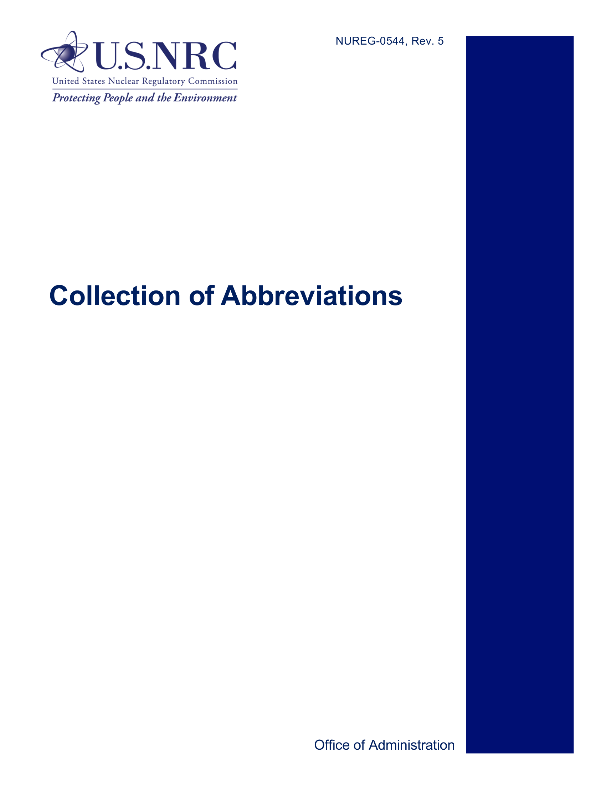

*figure on PDF page 15*

<!-- p.17 -->
NUREG-0544, REV. 5

#### Collection of Abbreviations
Manuscript Completed: November 2016 Date Published: December 2016

Prepared by:
C. Hsu

Office of Administration

<!-- p.19 -->
#### ABSTRACT
The U.S. Nuclear Regulatory Commission (NRC) has compiled this list of abbreviations commonly used by the agency staff, the regulatory community, and the nuclear industry. To create this list, the NRC staff sought to identify abbreviations that are so commonly used that some staff may not first define the term before using it either in writing or in speaking. This list of abbreviations is descriptive rather than prescriptive. In other words, this NUREG does not recommend one abbreviation to the exclusion of others. Nor does this NUREG intend to capture every abbreviation ever used in an NRC document. The audience of this NUREG is the public, stakeholders, industry, and NRC employees. The goal of this NUREG is to improve communication with and within the NRC.

iii

<!-- p.21 -->
TABLE OF CONTENTS

ABSTRACT ............................................................................................................................... iii

PREFACE ................................................................................................................................. vii

ACKNOWLEDGMENT .............................................................................................................. ix

1 INTRODUCTION TO ABBREVIATIONS .............................................................................. 1

1.1 Definitions ............................................................................................................................1

1.2 Why Use Abbreviations? .....................................................................................................1

1.3 How To Use Abbreviations ..................................................................................................2

2 ACRONYMS AND INITIALISMS .......................................................................................... 5

2.1 How To Use Acronyms and Initialisms ................................................................................5

3 PLAIN LANGUAGE AND ABBREVIATIONS ....................................................................... 7

3.1 What Is Plain Language? .....................................................................................................7

3.2 Plain Language: It’s the Law ................................................................................................7

3.3 Plain Language Resources and Guidance ..........................................................................8

3.4 Plain Language Means Fewer Abbreviations ......................................................................8

4 LIST OF COMMONLY USED ABBREVIATIONS AT THE NRC ..........................................11

5 BIBLIOGRAPHY..................................................................................................................37

5.1 NRC Guidance...................................................................................................................37

5.2 Other Guidance .................................................................................................................37

v

<!-- p.23 -->
#### PREFACE
The U.S. Nuclear Regulatory Commission (NRC) publishes this list of abbreviations to help NRC staff, industry, stakeholders, and members of the public understand the many abbreviations used in NRC materials and presentations.

In an ideal environment, the NRC would not require a reference book of abbreviations. All NRC documents would minimize the use of abbreviations, and no NRC staff member would use an abbreviation in writing or speaking without defining it first and then redefining it often. However, the NRC regulates a highly technical and scientific industry. Abbreviations are commonly used to condense long and awkward organizational names, computer code names, nuclear power plant systems and parts, and many other scientific and technical terms.

Even outside of technical fields, abbreviations arise naturally in language. So naturally, in fact, that sometimes the abbreviated form of the term overtakes the original term. For example, laser originally stood for light amplification by stimulated emission of radiation and scuba for selfcontained underwater breathing apparatus.

Other abbreviated terms never need a definition. For example, no one would schedule a meeting for 3 post meridium (p.m.). Within the relatively small and specialized world of nuclear regulation, it is both natural and efficient for writers and speakers to use abbreviations that most of their peers will understand. When everyone in a field says HLW and understands it to mean high-level waste, it can feel just as unnecessary to define HLW as it would be to define p.m. or laser.

The reason that this NUREG is necessary is that not all users of NRC documents work in the nuclear industry. The NRC’s mission is to protect public health and safety, promote the common defense and security, and protect the environment. To achieve this mission, the NRC must communicate regularly with diverse audiences such as Congress, other Federal agencies, State and local governments, Tribal Governments, foreign governments, international regulatory bodies, concerned citizens, stakeholders, and the general public. In addition, the NRC’s Strategic Plan describes openness as one of two cross-cutting strategies for achieving its goals. The agency’s activities to achieve openness include, “Enhance the readability of NRC materials intended for the general public,” and “Expand the use of plain language…in communicating technical information.”

For a general audience, a document with many abbreviations can be very difficult or nearly impossible to understand. NRC writers should keep the least technical audience member in mind when choosing to use abbreviations. Even within the agency, technical staff members have different areas of specialization. A resident inspector, a seismic expert, a financial assurance analyst, and an emergency response specialist will each have a different set of abbreviations that he or she considers to be commonly used. This revision of NUREG-0544 acknowledges that abbreviations must be used, but it also points out that overuse of abbreviations can impede communication. For this reason, this revision includes a new section on plain language principles and how to minimize abbreviations. This revision also greatly reduces the number of abbreviations presented. The previous revision of this NUREG contained over 8,000 abbreviations. This revision is streamlined to just over 1,000 abbreviations. The working group reduced the number of abbreviations by deleting outdated terms and focusing on abbreviations that are so commonly used that NRC staff might not define them before use.

The list of abbreviations in this NUREG is descriptive rather than prescriptive. No one abbreviation is recommended to the exclusion of another because the same abbreviation may, with equal validity, apply to two or more terms. This list includes major NRC program and staff offices,

vii

<!-- p.24 -->
advisory groups, panels, and boards but not NRC divisions and branches. These can be found on the NRC’s organization and functions Web page. Some abbreviations for organizations that no longer exist are included as historical references. This list does not include most chemical elements, computer codes, and units of measurement. Many of these abbreviations appear in readily accessible sources such as dictionaries, the U.S. Government Printing Office Style Manual, and other manuals.

viii

<!-- p.25 -->
#### ACKNOWLEDGMENT
This NUREG is the product of collaboration among staff from different organizations. Kimberly Ferrell, Chief of the Publications Branch in the Office of Administration, contributed the leadership and management of this revision. The Office of the Executive Director for Operations supported the streamlined direction of this revision. Finally, this revision would not be possible without the thoughtful contributions made by the NUREG-0544, Revision 5, working group, listed below.

NUREG-0544, Revision 5, Working Group

Office of Administration Jay Dougherty Office of Administration Caroline Hsu Office of Administration Angella Love Blair Office of the Chief Human Capital Officer Tracy Scott Office of the Chief Information Officer Mike King Office of Congressional Affairs Amy Powell Office of the Executive Director for Operations Glenn Ellmers Office of the General Counsel Jeremy Suttenberg Office of International Programs Stephen Dembeck Office of International Programs Janice Owens Office of New Reactors Robert Jasinski Office of Nuclear Material Safety and Safeguards Norma Garcia-Santos Office of Nuclear Material Safety and Safeguards Patricia Tressler Office of Nuclear Reactor Regulation Jeff Whited Japan Lessons-Learned Division Kirk Foggie (OIP)
Office of Nuclear Regulatory Research Joseph Zabel Office of Public Affairs Maureen Conley Office of Small Business and Civil Rights Tira Patterson Region I Diane Screnci Region I Neil Sheehan

ix

<!-- p.27 -->
## 1 INTRODUCTION TO ABBREVIATIONS
Abbreviations are everywhere in modern language. You will find them used in casual conversation, e-mails, text messages, social media, postal addresses, company names, formal letters, legal documents, and scientific and technical reports. An abbreviation is any shortened form of a word or term. Acronyms and initialisms are simply two different types of abbreviations.
The difference between an acronym and an initialism is explained below:

### 1.1 Definitions
Abbreviation: Any shortened form of a word or group of words used in place of the whole.

• Acronym: A type of abbreviation formed from the first letters of a group of words.
Acronyms are pronounceable. Some examples include:

o ANSI: American National Standards Institute o LOCA: loss-of-coolant accident o IKEA: Ingvar Kamprad Elmtaryd Agunnaryd (Ingvar Kamprad is the furniture store founder’s name. Elmtaryd is the farm where he grew up and Agunnaryd is his home town.)
o NASA: National Aeronautics and Space Administration o ASAP: as soon as possible

• Initialism: A type of abbreviation formed from initial letters of a group of words. Each letter is pronounced separately.

o EPZ: emergency planning zone o NRC: U.S. Nuclear Regulatory Commission o SGTS: standby gas treatment system o EPA: U.S. Environmental Protection Agency o CNN: Cable News Network

### 1.2 Why Use Abbreviations?
We use abbreviations for many reasons. The most common reason is to shorten a long or unwieldy term, particularly if it is used several times. Abbreviations usually make communication easier for the speaker but not for the reader or the intended audience who may not know the abbreviation.

Technology also drives the creation and use of abbreviations. Text messaging limits the writer to 160 characters, and Twitter limits tweets further to just 140 characters. The need to type quickly when instant messaging or communicating on the Internet also introduced many new abbreviations that have spilled out into everyday language. For example, lol started out as a way to write “laugh out loud” in electronic communications, but now some people will say lol in speech instead of actually laughing. New abbreviations can crop up very quickly and enter everyday speech.

Abbreviations also serve another function—they help to create a common language used by an in-group. The group could be a subculture, interest group, age group, social group, or in the case of the NRC, a professional group.

1

<!-- p.28 -->
### 1.3 How To Use Abbreviations
Use as few abbreviations as possible in both speaking and writing. The more abbreviations you use, the harder it will be for your audience to understand you. When choosing to use abbreviations, think of the least specialized audience member for your document. If you are writing a status report for your branch, you can assume most of your audience understands the same common abbreviations that you do. The same status report going to the Office of the Executive Director for Operations will likely be read by people with many different specializations.
In that case, you should use far fewer abbreviations. If you are writing a report to Congress or a document for a public meeting, almost all of your common abbreviations may be unfamiliar to the primary audience. In that case, use almost no abbreviations.

Chapters 9 and 10 of the U.S. Government Printing Office Style Manual
(https://www.gpo.gov/fdsys/pkg/GPO-STYLEMANUAL-2008/pdf/GPO-STYLEMANUAL- 2008.pdf) present a comprehensive list of abbreviations and guidance for their use. Follow the guidance in Chapter 9 and 10 of the U.S. Government Printing Office Style Manual and rules 1 through 12 below unless publication requirements for a particular document dictate otherwise. For example, to publish an article in a journal, you may need to follow the publisher’s in-house style.
Some of the guidance below is excerpted from NUREG-1379, “NRC Editorial Style Guide.”

1. Avoid using abbreviations whenever possible. Some exceptions include very common abbreviations like Mr., Ms., a.m., and p.m.

2. If you must use an abbreviation, always define it the first time you use it.
• The safety evaluation report (SER) is a high priority. Staff estimates it will have a first draft of the SER completed by January.

3. Once you have defined an abbreviation, you can still go back to using the full term or switch back and forth between the abbreviation and the full term. You may choose to do this for several reasons:
• To make the document easier for the reader to understand on first reading.
• To remind the reader of what the abbreviation stands for, especially if it was first defined several paragraphs or pages back.
• To avoid using back-to-back abbreviations or several abbreviations in one sentence.

4. If you are writing a long document, redefine the abbreviation in each new chapter. For a set of documents such as correspondence or a paper with enclosures, redefine the abbreviation in each new enclosure.

5. Do not use back-to-back abbreviations or several abbreviations in one sentence. This is true even if you have already used and defined the abbreviation earlier in the document.
• Instead of—NRC asked the ACRS to review the HLW SER.
• Write—The agency asked the ACRS to review the safety evaluation report on high-level waste.
• Or write—NRC asked the Committee to review the SER on high-level waste.

2

<!-- p.29 -->
6. Use the same form of an abbreviation for both the singular and plural forms of a unit of measure.
• 1 m
• 3 m
• 1 kg
• 5 kg

7. Omit internal and terminal punctuation unless its omission would cause confusion.
• 1 in. (Period avoids confusion with the word “in”.)
• 5 cm

8. Use abbreviations for units of measure only if they are used with numbers.
• 200 r/min (but—The test would determine the number of revolutions per minute.)
• Most U.S. nuclear power plants have a 10-mile radius plume exposure pathway emergency planning zone. (but—Most U.S. nuclear power plants use miles, not kilometers, to express the radius of their emergency planning zones.)

9. State the term from which an abbreviation not commonly known is formed, followed by its abbreviation in parentheses. Redefine abbreviations in every new chapter or major section.
• iodine–131 metaiodobenzylguanidine (I–131 MIBG)
• 60 indicated horsepower (ihp)
• electromotive force (emf or EMF)
• Office of Nuclear Regulatory Research (RES)

10. Use periods in abbreviations for foreign phrases. (Et is Latin for “and”; therefore, it is not an abbreviation and does not take a period.)
• et al. (for et alii, meaning “and others”)
• e.g. (exempli gratia, meaning “for example”)
• i.e. (id est, meaning “that is”)
• et seq. (for et sequentes, meaning “and the following”)

11. The abbreviations e.g. and i.e. (followed by a comma) should be used only inside parentheses. Otherwise, write out the English equivalents. Do not italicize e.g. and i.e.
• Today we received specific instructions for preparing the report (i.e., its due date, contents, and format).
• Today we received specific instructions for preparing the report, that is, its due date, contents, and format.

12. Use the U.S. Postal Service two-letter State and Province abbreviations in any address or capitalized geographic term.
• Prince George’s County, MD
• Atlanta, GA
• but—deciduous forests of Wisconsin; black sand beaches in Hawaii

3

<!-- p.31 -->
## 2 ACRONYMS AND INITIALISMS
As mentioned in the previous section, acronyms and initialisms are two types of abbreviations. An acronym is a pronounceable term formed from the initial letters of a compound expression
(e.g., LOCA for loss-of-coolant accident). An initialism is formed from the initial letters of a term and the initial letters are pronounced as separate letters. (e.g., NRC for the U.S. Nuclear Regulatory Commission).

Most acronyms are capitalized except for certain well-known acronyms that are lower case by convention. Some of the guidance below is excerpted from NUREG-1379, “NRC Editorial Style Guide.”

### 2.1 How To Use Acronyms and Initialisms
1. Use an acronym or initialism if the term it represents will be used more than several times in a document. The first time a term is used, state the words from which the acronym is formed, followed by the acronym in parentheses. In a lengthy document, restate the term followed by its acronym at the beginning of each chapter or major section. However, keep in mind that excess acronyms and abbreviations can make an otherwise well-written document difficult to understand. When writing for a lay audience, or even a technical audience that does not share your specialty, use acronyms sparingly and carefully. You may sometimes need to redefine an acronym, offer a brief explanation of the acronym, or use a synonym instead. Always avoid stringing several acronyms together in a single sentence. Do not include acronyms in headings and titles.
• The Resource Advisory Council (RAC) has reviewed this plan. The RAC advised the staff to revise three sections.
• The Resource Advisory Council has reviewed this plan. The council advised the staff to revise three sections.

2. Although an acronym or initialism is capitalized, do not capitalize the term it represents unless the term would ordinarily be capitalized.
• Office of the General Counsel (OGC)
• technical specification (TS)
• crack opening displacement (COD)

3. To form the plural for most acronyms and initialisms, add a lower case s without an apostrophe.
• 12 NPPs
• five RGs
• two NUREGs

5

<!-- p.32 -->
4. To form the possessive of an acronym or initialism, use an apostrophe plus s, just as you would for a normal word.
• EDO’s report
• IAEA’s May conference
• RES’s funding (also—funding from RES; RES funding)
• O3’s chemical instability (also—ozone’s chemical instability; the chemical instability of O3)

5. To decide whether a or an should precede an acronym or initialism, pronounce the first syllable of the acronym. “A” should precede a consonant sound; “an” should precede a vowel sound.
• an ACRS meeting (“ay” is a vowel sound)
• an AEC report (“ay” is a vowel sound)
• a FEMA decision (“fee” is a consonant sound)
• an NRC office (“en” is a vowel sound)
• a LOCA occurred (“low” is a consonant sound)

6

<!-- p.33 -->
## 3 PLAIN LANGUAGE AND ABBREVIATIONS
If you can’t explain something simply, you don’t understand it well. Most of the fundamental ideas of science are essentially simple, and may, as a rule, be expressed in a language comprehensible to everyone. Everything should be as simple as it can be, yet no simpler.
-Albert Einstein

### 3.1 What Is Plain Language?
Even though the NRC regulates a highly technical area and produces complex documents, the agency strives to use plain language. What is plain language exactly? Although there are many definitions, plain language is direct communication that focuses on making information easily understandable to a given audience.

The NRC regularly communicates with its own staff, the public, stakeholders, industry, other government agencies, the legislative and executive branches, international regulatory bodies, and representatives of foreign governments. The NRC relies on plain language to support its mission in many ways:

• NRC resident inspectors at nuclear power plants depend on clearly written inspection manuals to conduct the inspections that ensure safety for people and the environment.
• Nuclear power plant operators must follow safety guidelines to quickly identify and respond to emergencies.
• The Commission relies on NRC staff reports, safety evaluations, and licensing reviews to make decisions that affect the nuclear industry and public safety.
• Licensees must understand NRC regulations in order to comply with them.
• NRC staff uses plain language to explain regulatory requirements to applicants, certificate holders, licensees, and other government agencies.

With such a diverse audience and important mission, plain language makes sense for the NRC.

### 3.2 Plain Language: It’s the Law
When the President signed The Plain Writing Act of 2010, using plain language became the law.
This act requires Federal agencies to produce “clear Government communication that the public can understand and use." Executive Order 13563, “Improving Regulation and Regulatory Review,” also addresses plain language. It states, “Our regulatory system must...ensure that regulations are accessible, consistent, written in plain language, and easy to understand.”

7

<!-- p.34 -->
#### Figure 1

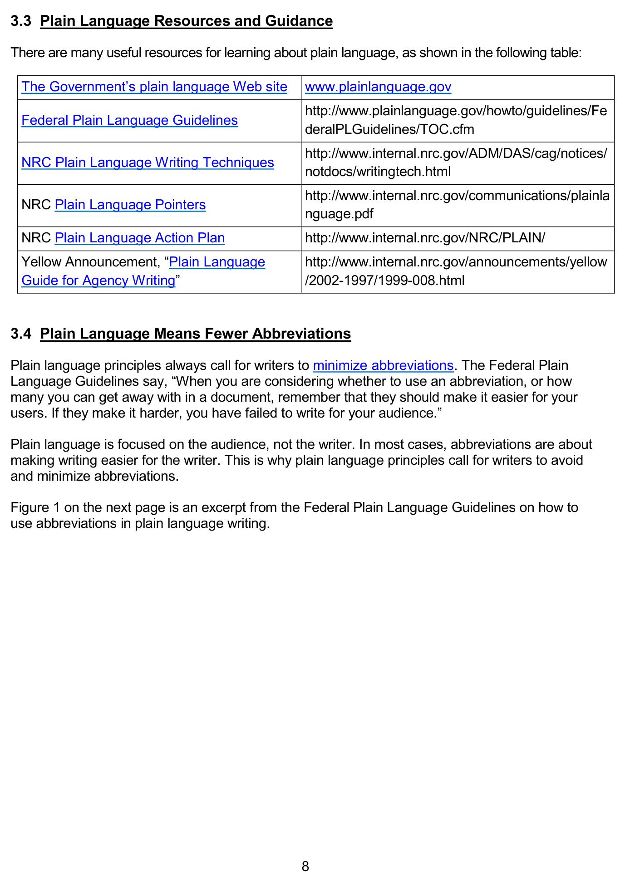

*on the next page is an excerpt from the Federal Plain Language Guidelines on how to use abbreviations in plain language writing.*

[Vector original (SVG, lossless): fig_1.svg](../figures/fig_1.svg)

<!-- labels/text on this figure page -->
3.3 Plain Language Resources and Guidance
There are many useful resources for learning about plain language, as shown in the following table:
The Government’s plain language Web site www.plainlanguage.gov http://www.plainlanguage.gov/howto/guidelines/Fe Federal Plain Language Guidelines deralPLGuidelines/TOC.cfm http://www.internal.nrc.gov/ADM/DAS/cag/notices/ NRC Plain Language Writing Techniques notdocs/writingtech.html http://www.internal.nrc.gov/communications/plainla NRC Plain Language Pointers nguage.pdf NRC Plain Language Action Plan http://www.internal.nrc.gov/NRC/PLAIN/ Yellow Announcement, “Plain Language http://www.internal.nrc.gov/announcements/yellow Guide for Agency Writing” /2002-1997/1999-008.html
3.4 Plain Language Means Fewer Abbreviations
Plain language principles always call for writers to minimize abbreviations. The Federal Plain Language Guidelines say, “When you are considering whether to use an abbreviation, or how many you can get away with in a document, remember that they should make it easier for your users. If they make it harder, you have failed to write for your audience.”
Plain language is focused on the audience, not the writer. In most cases, abbreviations are about making writing easier for the writer. This is why plain language principles call for writers to avoid and minimize abbreviations.
Figure 1 on the next page is an excerpt from the Federal Plain Language Guidelines on how to use abbreviations in plain language writing.
8

<!-- p.35 -->
#### Figure 1

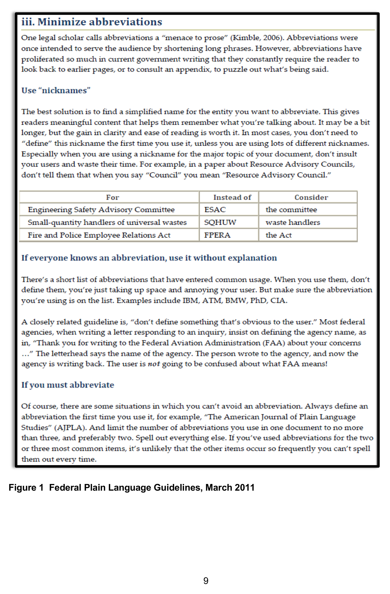

*Federal Plain Language Guidelines, March 2011*

<!-- p.37 -->
## 4 LIST OF COMMONLY USED
#### ABBREVIATIONS AT THE NRC
#### Abbreviation Full Term
## 10 CFR Title 10 of the Code of Federal Regulations
3WFN Three White Flint North 8(a)
8(a) Business Development Program AASG Association of American State Geologists ABWR advanced boiling-water reactor AC alternating current ACC additional Commission comments ACHP Advisory Council on Historic Preservation ACI American Concrete Institute ACL alternate concentration limit ACMUI Advisory Committee on the Medical Use of Isotopes ACQC American Society for Quality Control ACRS Advisory Committee on Reactor Safeguards ACUS Administrative Conference of the United States ADAMS Agencywide Documents Access and Management System ADE annual dose equivalent ADM Office of Administration ADR alternative dispute resolution ADS-IDAC Accident Dynamics Simulator Using Information, Decision, and Action in a Crew Context A-E architect-engineer AEA Atomic Energy Act of 1954, as amended AEC Atomic Energy Commission AERB Atomic Energy Regulatory Board AFOE annual frequency of exceedance AFR away from reactor AIC Akaike information criterion AISC American Institute of Steel Construction ALARA as low as is reasonably achievable (radiation exposure)
ALI annual limit on intake AM Atlantic Margin AMP aging management program AMR analysis model report ANL Argonne National Laboratory ANPR/ANPRM advanced notice of proposed rulemaking ANS American Nuclear Society

11

<!-- p.38 -->
ANS-8 American Nuclear Society Standards Subcommittee 8 ANSI American National Standards Institute ANSS U.S. Advanced National Seismic System AO abnormal occurrence AO approving official AOO anticipated operational occurrence AOR analysis of record AP1000 Advanced Passive 1000 Megawatt (Westinghouse pressurized-water reactor)
APC action plan committee APEX Advanced Power Extraction API application programming interface API American Petroleum Institute APM available physical margin APP advanced procurement plan APSR axial power shaping rod APWR advanced pressurized-water reactor AR advanced reactor ARAR applicable or relevant and appropriate requirement ARB Allegation Review Board ARRP Advanced Reactor Research Program ARS Agricultural Research Service ARTIST Aerosol Trapping in Steam Generator AS Agreement State ASC Administrative Services Center ASCE American Society of Civil Engineers ASCII American Standard Code for Information Interchange ASD allowable stress design ASEP Accident Sequence Evaluation Program ASER annual site environmental report ASLBP Atomic Safety and Licensing Board Panel ASME American Society of Mechanical Engineers ASNT American Society for Nondestructive Testing ASP accident sequence precursor ASR alkali silica reaction ASTM American Society for Testing and Materials ATF Bureau of Alcohol, Tobacco, and Firearms ATWS anticipated transient without scram AVLIS advanced vapor laser isotope separation AWS American Welding Society AWWA American Water Works Association B&PV Boiler and Pressure Vessel (ASME Code)

12

<!-- p.39 -->
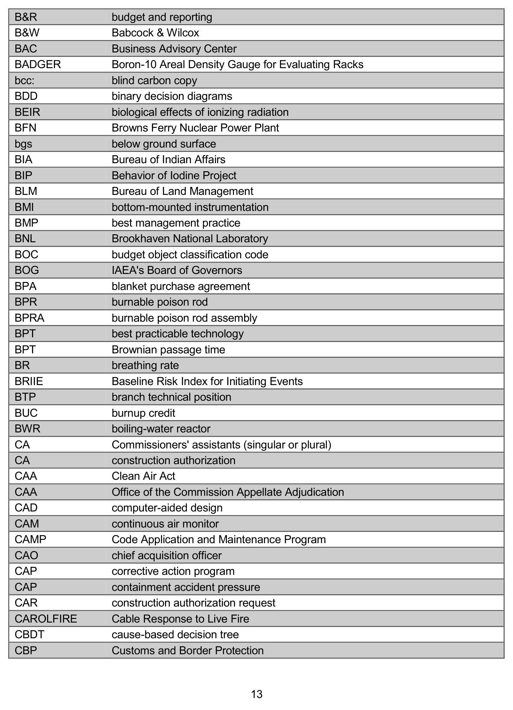

*figure on PDF page 39*

[Vector original (SVG, lossless): fig_page-39.svg](../figures/fig_page-39.svg)

<!-- labels/text on this figure page -->
B&R budget and reporting B&W Babcock & Wilcox BAC Business Advisory Center BADGER Boron-10 Areal Density Gauge for Evaluating Racks bcc:
blind carbon copy BDD binary decision diagrams BEIR biological effects of ionizing radiation BFN Browns Ferry Nuclear Power Plant bgs below ground surface BIA Bureau of Indian Affairs BIP Behavior of Iodine Project BLM Bureau of Land Management BMI bottom-mounted instrumentation BMP best management practice BNL Brookhaven National Laboratory BOC budget object classification code BOG IAEA's Board of Governors BPA blanket purchase agreement BPR burnable poison rod BPRA burnable poison rod assembly BPT best practicable technology BPT Brownian passage time BR breathing rate BRIIE Baseline Risk Index for Initiating Events BTP branch technical position BUC burnup credit BWR boiling-water reactor CA Commissioners' assistants (singular or plural)
CA construction authorization CAA Clean Air Act CAA Office of the Commission Appellate Adjudication CAD computer-aided design CAM continuous air monitor CAMP Code Application and Maintenance Program CAO chief acquisition officer CAP corrective action program CAP containment accident pressure CAR construction authorization request CAROLFIRE Cable Response to Live Fire CBDT cause-based decision tree CBP Customs and Border Protection
13

<!-- p.40 -->
CBR center, body, and range cc:
carbon copy CCDP conditional core damage probability CCF common-cause failure CCI core-concrete interaction CDA critical digital asset CDC Centers for Disease Control and Prevention CDE committed dose equivalent CDF core damage frequency CE combustion engineering CEA control element assembly CEDE committed effective dose equivalent CENA central and eastern North America CEQ Council on Environmental Quality CER cumulative effects of regulation CERCLA Comprehensive Environmental Response, Compensation, and Liability Act CFAST Consolidated Fire Growth and Smoke Transport Model CFD computational fluid dynamics CFE cost-free expert CFFA Catalogue of Federal Finance Assistance CFO Chief Financial Officer CFR Code of Federal Regulations CH contact-handled CHCO Chief Human Capital Officer CHF critical heat flux CHRISTI-FIRE Cable Heat Release, Ignition, and Spread in Tray Installations During Fire CI confidence interval CIO Chief Information Officer CIPAC Critical Infrastructure Partnership Advisory Council CJIS Criminal Justice Information Services CLASSI continuum linear analysis of soil-structure interaction CLIN contract line item number CMT centroid moment tensor CNWRA Center for Nuclear Waste Regulatory Analyses CO contracting officer COB close of business CoC certificate of compliance COCORP Consortium for Continental Reflection Profiling COI conflict of interest COL combined license (combined construction and operating license)
COLA combined license application

14

<!-- p.41 -->
ComMIT community model interface for tsunami COMP composite prior, composite superdomain CONOPS concepts of operations COOP continuity of operations COP community of practice COP containment overpressure COR contracting officer's representative COSMOS Consortium of Organizations for Strong-Motion Observation Systems CP computerized procedure CP construction permit CP-ECR Cathcart-Pawel Equivalent Cladding Reacted CPFF cost plus fixed fee CPIC Capital Planning and Investment Control CPLD complex programmable logic device cpm counts per minute CPR common prioritization of rulemaking CPR cardiopulmonary resucitation CPT cone penetration test CR continuing resolution CR control room CRA Congressional Review Act CRADA cooperative research and development agreement CRCPD Conference of Radiation Control Program Directors CRDM control rod drive mechanism CRGR Committee to Review Generic Requirements CRPPH Committee on Radiation Protection and Public Health CRR cyclic resistance ratio CRT crew response tree CS contract specialist CSARP Cooperative Severe Accident Research Program CSAU Code Scaling, Applicability, and Uncertainty CsCI cesium chloride CSDRS certified seismic design response spectra CSFM commercial spent fuel management C-SGTR consequential steam generator tube rupture CSI criticality safety index CSM conceptual site model CSO Computer Security Office (functions are now part of the Office of the Chief Information Officer)
CSR cyclic stress ratio CTBT Comprehensive Test Ban Treaty

15

<!-- p.42 -->
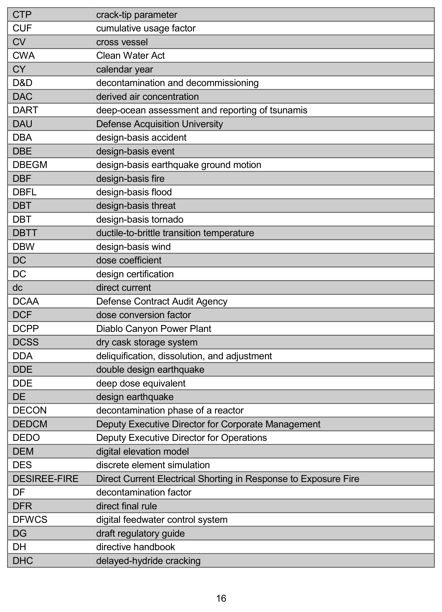

*figure on PDF page 42*

[Vector original (SVG, lossless): fig_page-42.svg](../figures/fig_page-42.svg)

<!-- labels/text on this figure page -->
CTP crack-tip parameter CUF cumulative usage factor CV cross vessel CWA Clean Water Act CY calendar year D&D decontamination and decommissioning DAC derived air concentration DART deep-ocean assessment and reporting of tsunamis DAU Defense Acquisition University DBA design-basis accident DBE design-basis event DBEGM design-basis earthquake ground motion DBF design-basis fire DBFL design-basis flood DBT design-basis threat DBT design-basis tornado DBTT ductile-to-brittle transition temperature DBW design-basis wind DC dose coefficient DC design certification dc direct current DCAA Defense Contract Audit Agency DCF dose conversion factor DCPP Diablo Canyon Power Plant DCSS dry cask storage system DDA deliquification, dissolution, and adjustment DDE double design earthquake DDE deep dose equivalent DE design earthquake DECON decontamination phase of a reactor DEDCM Deputy Executive Director for Corporate Management DEDO Deputy Executive Director for Operations DEM digital elevation model DES discrete element simulation DESIREE-FIRE Direct Current Electrical Shorting in Response to Exposure Fire DF decontamination factor DFR direct final rule DFWCS digital feedwater control system DG draft regulatory guide DH directive handbook DHC delayed-hydride cracking
16

<!-- p.43 -->
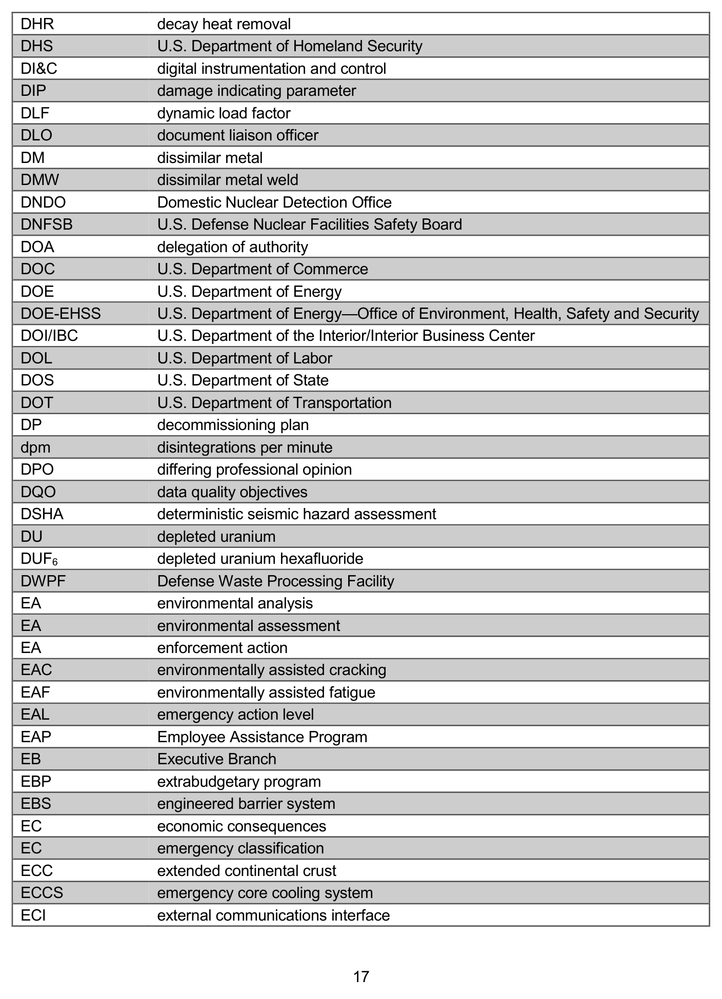

*figure on PDF page 43*

[Vector original (SVG, lossless): fig_page-43.svg](../figures/fig_page-43.svg)

<!-- labels/text on this figure page -->
DHR decay heat removal DHS U.S. Department of Homeland Security DI&C digital instrumentation and control DIP damage indicating parameter DLF dynamic load factor DLO document liaison officer DM dissimilar metal DMW dissimilar metal weld DNDO Domestic Nuclear Detection Office DNFSB U.S. Defense Nuclear Facilities Safety Board DOA delegation of authority DOC U.S. Department of Commerce DOE U.S. Department of Energy DOE-EHSS U.S. Department of Energy—Office of Environment, Health, Safety and Security DOI/IBC U.S. Department of the Interior/Interior Business Center DOL U.S. Department of Labor DOS U.S. Department of State DOT U.S. Department of Transportation DP decommissioning plan dpm disintegrations per minute DPO differing professional opinion DQO data quality objectives DSHA deterministic seismic hazard assessment DU depleted uranium DUF6 depleted uranium hexafluoride DWPF Defense Waste Processing Facility EA environmental analysis EA environmental assessment EA enforcement action EAC environmentally assisted cracking EAF environmentally assisted fatigue EAL emergency action level EAP Employee Assistance Program EB Executive Branch EBP extrabudgetary program EBS engineered barrier system EC economic consequences EC emergency classification ECC extended continental crust ECCS emergency core cooling system ECI external communications interface
17

<!-- p.44 -->
ECL emergency classification level ECMA East Coast magnetic anomaly ECR equivalent cladding reacted ECTM Eastern Canada Telemetered Network EDSB economically disadvantaged small business EDEGM elastic design earthquake ground motion EDGM elastic design ground motion EDMG extensive damage mitigation guidelines EDO Executive Director for Operations EDS energy dispersive spectroscopy EDWOSB economically disadvantaged woman-owned small business EEO equal employment opportunity EERI Earthquake Engineering Research Institute EGOE Expert Group on Occupational Exposure EHS environment, health, and safety EHSM environment, health, and safety manager EHSS Office of Environment, Health, Safety and Security (DOE)
EIA Energy Information Administration EIS environmental impact statement EIT electronic and information technology EJ environmental justice (per Executive Order 12898, "Federal Actions to Address Environmental Justice in Minority Populations and Low-Income Populations)
EJS environmental justice statement ELECTRA-FIRE Electrical Cable Test Results and Analysis during Fire Exposure EMDC Eastern Management Development Center ENA eastern North America ENDF evaluated nuclear data file EnPA Energy Policy Act of 1992 ENTOMB entombment (of a shutdown reactor)
EO executive order eOPF electronic official personnel folder EOP emergency operating procedure EP emergency preparedness/planning EPA U.S. Environmental Protection Agency EPAct Energy Policy Act of 2005 EPCRA Emergency Planning and Community Right-to-Know Act EPICUR Experimental Program for Iodine Chemistry Under Irradiation EPIX Equipment Performance and Information Exchange System EPR U.S. Evolutionary Power Reactor EPRI Electric Power Research Institute EPRI-SOG Electric Power Research Institute--Seismic Owners Group

18

<!-- p.45 -->
EPU extended power uprates EPZ emergency planning zone EQ environmental qualification ER environmental report ERDA Energy Research and Development Administration E-RIDS Electronic Regulatory Information Distribution System ERO emergency response organization ESA Endangered Species Act of 1973, as amended ESBWR economic simplified boiling-water reactor (GE-Hitachi design)
ESF engineered safety feature ESP early site permit ESRI Environmental Systems Research Institute EST extended storage and transportation ET evapotranspiration EWC enterprisewide contract EXAFS Extended X-Ray Absorption Fine Structure FAC Federal Acquisition Certification FACA Federal Advisory Committee Act FAC-C Federal Acquisition Certification in Contracting FAC-COR Federal Acquisition Certification-Contracting Officer's Representative FAC-P/PM Federal Acquisition Certification for Program and Project Management FAI Federal Acquisition Institute FAIMIS Financial Accounting and Integrated Management Information System FAITAS Federal Acquisition Institute Training Application System FAM financial assurance mechanism FAQ frequently asked question FAR Federal Acquisition Regulation FAST Free and Secure Trade Program FBI Federal Bureau of Investigation FBO Federal Business Opportunities (FedBizOpps)
FCF fuel cycle facility FCO funds certifying official FCOP Fuel Cycle Oversight Process FDA U.S. Food and Drug Administration FDC future disposal cell FDS fire dynamics simulator FDT fire dynamics tools FE finite element FEA finite element analysis FedBizOpps Federal Business Opportunities FEI Federal Executive Institute (OPM-Charlottsville, VA)

19

<!-- p.46 -->
FEIS final environmental impact statement FEMA Federal Emergency Management Agency FEMP Federal Emergency Management Program FEP features, events, and processes FERC Federal Energy Regulatory Commission FFA Federal Facility Agreements FFP firm fixed price FFRDC Federally funded research and development center FFT fast Fourier transform FG fuel grade FGDC Federal Geographic Data Committee FGR fission gas release FIN financial identification number FIRS foundation input response spectra FISMA Federal Information Security Management Act FOIA Freedom of Information Act FONSI finding of no significant impact FOSID frequency of onset of significant inelastic deformation FPP fire protection program FR Federal Register FR final rule FRN Federal Register notice FSAR final safety analysis report FSEIS final supplemental environmental impact statement FSME Office of Federal and State Materials and Environmental Management Programs (now part of the Office of Nuclear Material Safety and Safeguards)
FSRP Facilities Standard Review Plan FTE full-time equivalent FTF F-Area Tank Farm or F-Tank Farm FTP file transfer protocol FUSRAP Formerly Utilized Sites Remedial Action Program FWS U.S. Fish and Wildlife Service FY fiscal year FYI for your information g gravitational unit G&A general and administrative (expenses)
G8 Group of Eight GA General Atomics GAO U.S. Government Accountability Office GC Gulf Coast GCC Government Coordinating Council

20

<!-- p.47 -->
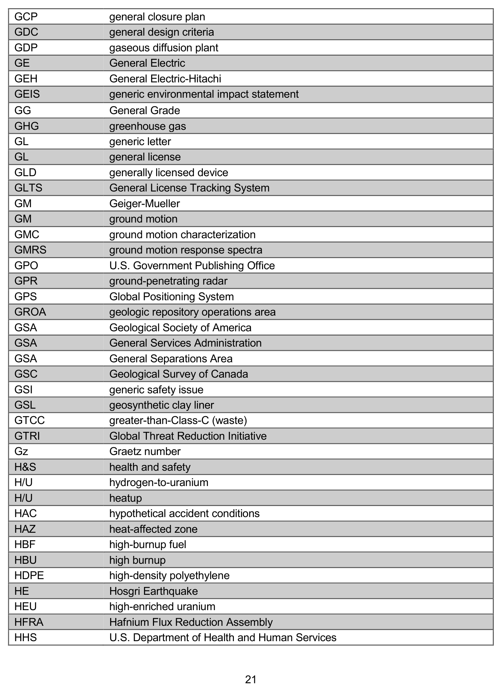

*figure on PDF page 47*

[Vector original (SVG, lossless): fig_page-47.svg](../figures/fig_page-47.svg)

<!-- labels/text on this figure page -->
GCP general closure plan GDC general design criteria GDP gaseous diffusion plant GE General Electric GEH General Electric-Hitachi GEIS generic environmental impact statement GG General Grade GHG greenhouse gas GL generic letter GL general license GLD generally licensed device GLTS General License Tracking System GM Geiger-Mueller GM ground motion GMC ground motion characterization GMRS ground motion response spectra GPO U.S. Government Publishing Office GPR ground-penetrating radar GPS Global Positioning System GROA geologic repository operations area GSA Geological Society of America GSA General Services Administration GSA General Separations Area GSC Geological Survey of Canada GSI generic safety issue GSL geosynthetic clay liner GTCC greater-than-Class-C (waste)
GTRI Global Threat Reduction Initiative Gz Graetz number H&S health and safety H/U hydrogen-to-uranium H/U heatup HAC hypothetical accident conditions HAZ heat-affected zone HBF high-burnup fuel HBU high burnup HDPE high-density polyethylene HE Hosgri Earthquake HEU high-enriched uranium HFRA Hafnium Flux Reduction Assembly HHS U.S. Department of Health and Human Services
21

<!-- p.48 -->
HID hazard input document HLW high-level waste (radioactive)
HM heavy metal HME hazardous materials enforcement HNA high-nickel alloy HOO headquarters operations officer HPIC high-pressure ionization chamber HPS Health Physics Society HPSSC Health Physics Society Standards Committee HPT health physics technician HQ headquarters HRMS Human Resources Management System HRQC Highway Route Controlled Quantity HRR highly radioactive radionuclide HSK Swiss Federal Nuclear Safety Inspectorate HSPD Homeland Security Presidential Directive HSSM Highway Security-Sensitive Material HTF H-Area Tank Farm or H-Tank Farm HTGR high-temperature gas-cooled reactor HUBZone historically underutilized business zone HV high velocity HVAC heating, ventilation, and air conditioning HWFP hazardous waste facility permit I&C instrumentation and controls IA Interagency Agreement IAEA International Atomic Energy Agency IASPEI International Association of Seismology and Physics of the Earth's Interior IBC international building code IBR incorporation by reference IC increased controls ICC International Code Council ICE Immigration and Customs Enforcement ICRP International Commission on Radiological Protection ICRU International Commission on Radiation Units and Measurements ICT information and communication technology ICWG International Council Working Group IDC indefinite delivery contract IDIQ indefinite delivery/indefinite quantity IDLH immediately dangerous to life and health IDS intrusion detection system IEEE Institute of Electrical and Electronics Engineers

22

<!-- p.49 -->
IERP independent external review panel IFNEC International Framework for Nuclear Energy Cooperation IGCE independent Government cost estimate IMPEP Integrated Materials Performance Evaluation Program IN information notice IND improvised nuclear device INES International Nuclear Event Scale INL Idaho National Laboratory INRA International Nuclear Regulators Association IP inspection procedure IPA Intergovernmental Personnel Act IPAC Intergovernmental Payment and Collection System IPPAS International Physical Protection Advisory Service IPT integrated project team IRIS Incorporated Research Institutions for Seismology IROFS item(s) relied-on for safety IRRS Integrated Regulatory Review Service ISA integrated safety analysis iSALE Impact Simplified Arbitrary Lagrangian-Eulerian ISC International Seismological Centre ISFSI independent spent fuel storage installation ISG interim staff guidance ISL in situ leach ISMP Integrated Source Management Portfolio ISR in situ recovery ISRS in-structure response spectra ISSO information system security officer IT information technology ITC informed technical community ITDB Illicit Trafficking Database ITWI important to waste isolation IX ion exchange J&A justification and approval JEAC Japan Electric Association Code JEAG Japan Electric Association Guide JFD joint frequency distribution JISAO Joint Institute for the Study of the Atmosphere and Ocean JLD Japan Lessons-Learned Project Directorate JMA Japan Meteorological Agency JNES Japan Nuclear Energy Safety JOFOC justification for other than full and open competition

23

<!-- p.50 -->
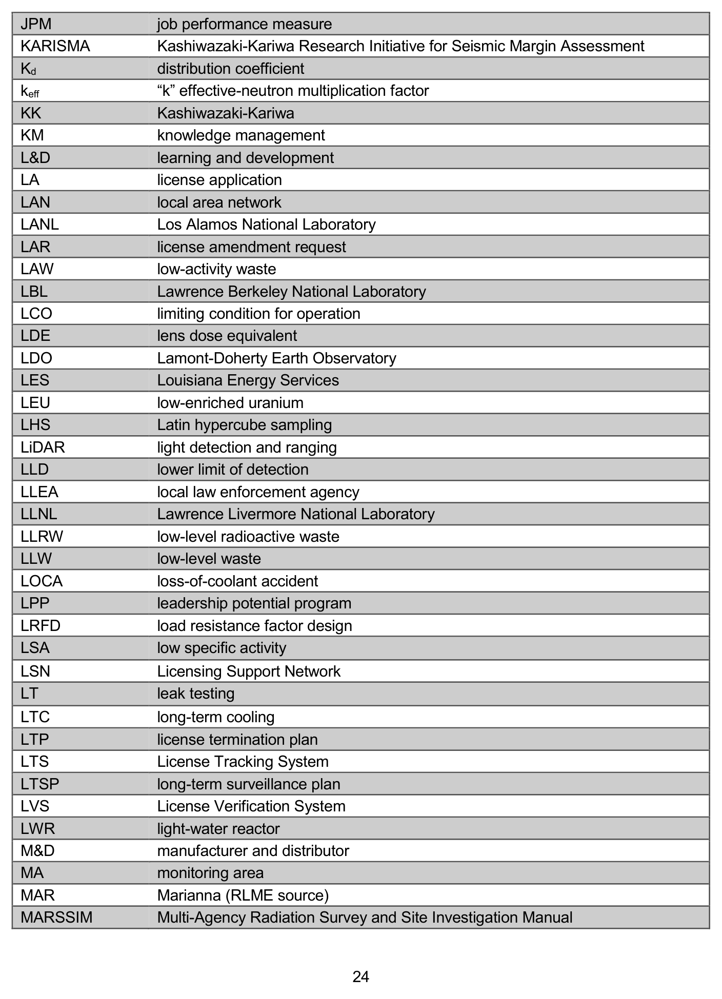

*figure on PDF page 50*

[Vector original (SVG, lossless): fig_page-50.svg](../figures/fig_page-50.svg)

<!-- labels/text on this figure page -->
JPM job performance measure KARISMA Kashiwazaki-Kariwa Research Initiative for Seismic Margin Assessment Kd distribution coefficient keff “k” effective-neutron multiplication factor KK Kashiwazaki-Kariwa KM knowledge management L&D learning and development LA license application LAN local area network LANL Los Alamos National Laboratory LAR license amendment request LAW low-activity waste LBL Lawrence Berkeley National Laboratory LCO limiting condition for operation LDE lens dose equivalent LDO Lamont-Doherty Earth Observatory LES Louisiana Energy Services LEU low-enriched uranium LHS Latin hypercube sampling LiDAR light detection and ranging LLD lower limit of detection LLEA local law enforcement agency LLNL Lawrence Livermore National Laboratory LLRW low-level radioactive waste LLW low-level waste LOCA loss-of-coolant accident LPP leadership potential program LRFD load resistance factor design LSA low specific activity LSN Licensing Support Network LT leak testing LTC long-term cooling LTP license termination plan LTS License Tracking System LTSP long-term surveillance plan LVS License Verification System LWR light-water reactor M&D manufacturer and distributor MA monitoring area MAR Marianna (RLME source)
MARSSIM Multi-Agency Radiation Survey and Site Investigation Manual
24

<!-- p.51 -->
MBES multibeam echo sounding MCC moisture characteristic curve MCE maximum credible earthquake MCEER Multi-Disciplinary Center for Earthquake Engineering Research MCL maximum containment level MCMC Markov chain Monte Carlo MD management directive MDC minimum detectable contamination MECE mutually exclusive and collectively exhaustive MESE Mesozoic and younger extended crust METI Ministry of Economy, Trade, and Industry (Japan)
MF monitoring factor MFFF mixed-oxide fuel fabrication facility MIC microbially influenced corrosion MIDC midcontinent MIL military MIT mechanical integrity testing MLSR monthly letter status report MML master materials license MNOP maximum normal operating pressure MOA memorandum of agreement MofS margin of safety MOST Method of Splitting Tsunami MOU memorandum of understanding MOX mixed oxide MPC multipurpose cask MRB Management Review Board MRS monitored retrievable storage MSD Mitigating Strategies Directorate MSDS material safety data sheet MSL mean sea level MT magnetic particle examination NA or na not applicable (also n/a or N/A)
NAC National Agency Check NAGRA Nationale Genossenschaft für die Lagerung radioaktiver Abfälle (Switzerland National Cooperative for the Disposal of Radioactive Waste)
NAICS North American Industry Classification System NAS National Academy of Sciences NCAI National Congress of American Indians NCDC National Climatic Data Center NCOE Niigataken Chuetsu-Oki earthquake

25

<!-- p.52 -->
NCRP National Council on Radiation Protection and Measurements NCT normal conditions of transport NCTR NOAA (National Oceanic and Atmospheric Administration) Center for Tsunami Research NDAA National Defense Authorization Act NDE nondestructive examination NDT nil-ductility transition NDT nondestructive test NE Office of Nuclear Energy (U.S. Department of Energy)
NEA Nuclear Energy Agency (Organisation for Economic Co-operation and Development)
NEAT NRC's Enterprise Acquisition Toolset NEDB National Earthquake Database NEES network for earthquake engineering simulation NEHRP National Earthquake Hazards Reduction Program NEI Nuclear Energy Institute NEIC National Earthquake Information Center NELAC National Environmental Laboratory Accreditation Conference NEPA National Environmental Policy Act of 1969, as amended NERHC New England Radiological Health Compact NERI Nuclear Energy Research Initiative NESHAP National Emissions Standard for Hazardous Air Pollutants NEUP Nuclear Energy University Program NFH nonfuel hardware NFPA National Fire Protection Association NFS Nuclear Fuel Services NGA National Governors Association NGA next generation attenuation relationship NHPA National Historic Preservation Act of 1966, as amended NICEE National Information Centre of Earthquake Engineering NISA Nuclear and Industrial Safety Agency (Japan)
NIST National Institute of Standards and Technology NLO no legal objection NLT no later than NMA National Mining Association NMED Nuclear Material Events Database NMMSS Nuclear Materials Management & Safeguards System NMP National Materials Program NMSS Office of Nuclear Material Safety and Safeguards NNSA National Nuclear Security Administration NOAA National Oceanic and Atmospheric Administration

26

<!-- p.53 -->
NOED notice of enforcement discretion NORM naturally occurring radioactive materials NORM/NARM naturally occurring or accelerator-produced radioactive materials NOV notice of violation NPDES National Pollutant Discharge Elimination System NPH natural phenomena hazards NPL National Priorities List for CERCLA NPO noncompliant performance objective NPP nuclear power plant NPSH net positive suction head NQA nuclear quality assurance NRC U.S. Nuclear Regulatory Commission NRO Office of New Reactors NRPB National Radiation Protection Board NRR Office of Nuclear Reactor Regulation NSA neutron source assembly NSC Nuclear Safety Commission (Japan)
NSC National Safety Council NSHMP National Seismic Hazard Mapping Project NSIR Office of Nuclear Security and Incident Response NSSS nuclear steam supply system NSTS National Source Tracking System NTAS National Threat Advisory System NTEU National Treasury Employees Union NTIS National Technical Information Service NUREG U.S. Nuclear Regulatory Commission technical report designation NUREG/BR NUREG brochure NUREG/CP conference proceedings NUREG NUREG/CR contractor-prepared NUREG NUREG/IA international agreement NUREG NUREG/KM knowledge management NUREG NVLAP National Voluntary Laboratory Accreditation NWPA Nuclear Waste Policy Act of 1982 NWPAA Nuclear Waste Policy Amendments Act of 1987 NWS National Weather Service NWTRB Nuclear Waste Technical Review Board OAS Organization of Agreement States OBE operating-basis earthquake OCA Office of Congressional Affairs OCFO Office of the Chief Financial Officer OCHCO Office of the Chief Human Capital Officer

27

<!-- p.54 -->
OCIO Office of the Chief Information Officer OCOI organizational conflict of interest OCRWM Office of Civilian Radioactive Waste Management (DOE)
OD Office Director OD organizational development OE Office of Enforcement OECD Organisation for Economic Co-operation and Development OEDO Office of the Executive Director for Operations OEL occupational exposure limit OFA optimized fuel assembly OFPP Office of Federal Procurement Policy OFR Office of the Federal Register OGC Office of the General Counsel OI Office of Investigations OIG Office of the Inspector General OIP Office of International Programs OIS Office of Information Services (functions now in the Office of the Chief Information Officer)
OL operating license OMB Office of Management and Budget OPA Office of Public Affairs OpenSees open system for earthquake engineering simulation OPM U.S. Office of Personnel Management ORNL Oak Ridge National Laboratory ORR operational readiness review OSHA Occupational Safety and Health Administration OSL optically stimulated luminescence OSRP Offsite Source Recovery Project OUO official use only OWFN One White Flint North P&ID piping and instrumentation diagrams P5 permanent five members of United Nations Security Council PA performance assessment PAG protective action guide PARS Publicly Available Records System (ADAMS)
PASSCAL program for array seismic studies of the continental lithosphere PBPM planning, budgeting, and performance management PCSA preclosure safety analysis PCT peak cladding temperature PDF Portable Document Format PDR Public Document Room (NRC)

28

<!-- p.55 -->
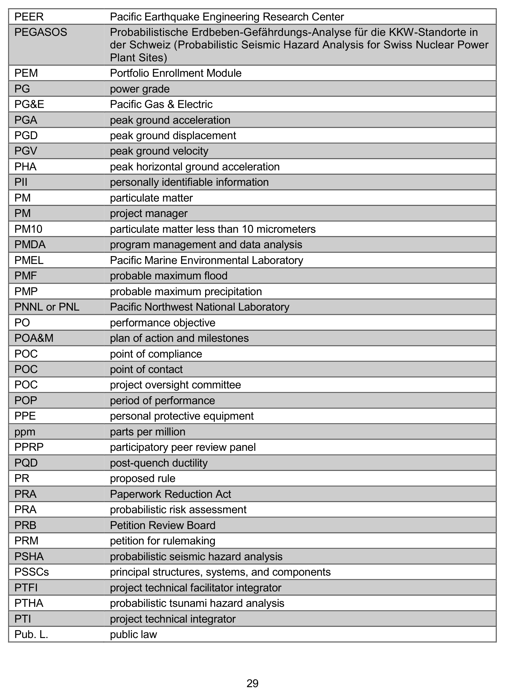

*figure on PDF page 55*

[Vector original (SVG, lossless): fig_page-55.svg](../figures/fig_page-55.svg)

<!-- labels/text on this figure page -->
PEER Pacific Earthquake Engineering Research Center PEGASOS Probabilistische Erdbeben-Gefährdungs-Analyse für die KKW-Standorte in der Schweiz (Probabilistic Seismic Hazard Analysis for Swiss Nuclear Power Plant Sites)
PEM Portfolio Enrollment Module PG power grade PG&E Pacific Gas & Electric PGA peak ground acceleration PGD peak ground displacement PGV peak ground velocity PHA peak horizontal ground acceleration PII personally identifiable information PM particulate matter PM project manager PM10 particulate matter less than 10 micrometers PMDA program management and data analysis PMEL Pacific Marine Environmental Laboratory PMF probable maximum flood PMP probable maximum precipitation PNNL or PNL Pacific Northwest National Laboratory PO performance objective POA&M plan of action and milestones POC point of compliance POC point of contact POC project oversight committee POP period of performance PPE personal protective equipment ppm parts per million PPRP participatory peer review panel PQD post-quench ductility PR proposed rule PRA Paperwork Reduction Act PRA probabilistic risk assessment PRB Petition Review Board PRM petition for rulemaking PSHA probabilistic seismic hazard analysis PSSCs principal structures, systems, and components PTFI project technical facilitator integrator PTHA probabilistic tsunami hazard analysis PTI project technical integrator Pub. L. public law
29

<!-- p.56 -->
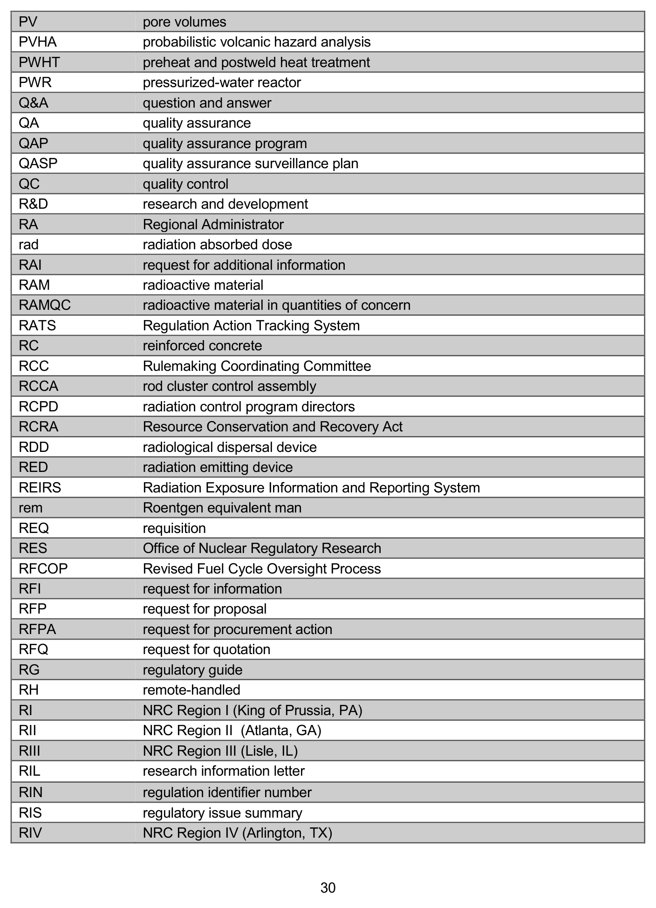

*figure on PDF page 56*

[Vector original (SVG, lossless): fig_page-56.svg](../figures/fig_page-56.svg)

<!-- labels/text on this figure page -->
PV pore volumes PVHA probabilistic volcanic hazard analysis PWHT preheat and postweld heat treatment PWR pressurized-water reactor Q&A question and answer QA quality assurance QAP quality assurance program QASP quality assurance surveillance plan QC quality control R&D research and development RA Regional Administrator rad radiation absorbed dose RAI request for additional information RAM radioactive material RAMQC radioactive material in quantities of concern RATS Regulation Action Tracking System RC reinforced concrete RCC Rulemaking Coordinating Committee RCCA rod cluster control assembly RCPD radiation control program directors RCRA Resource Conservation and Recovery Act RDD radiological dispersal device RED radiation emitting device REIRS Radiation Exposure Information and Reporting System rem Roentgen equivalent man REQ requisition RES Office of Nuclear Regulatory Research RFCOP Revised Fuel Cycle Oversight Process RFI request for information RFP request for proposal RFPA request for procurement action RFQ request for quotation RG regulatory guide RH remote-handled RI NRC Region I (King of Prussia, PA)
RII NRC Region II (Atlanta, GA)
RIII NRC Region III (Lisle, IL)
RIL research information letter RIN regulation identifier number RIS regulatory issue summary RIV NRC Region IV (Arlington, TX)
30

<!-- p.57 -->
RLME repeated large-magnitude earthquake RLO records liaison officer RMEI reasonably maximally exposed individual RO reverse osmosis RO reviewing official ROD record of decision ROP Reactor Oversight Process RSAO regional State agreements officer RSI request for supplemental information RSICC Radiation Safety Information Computational Center RSLO regional State liaison officer RSO radiation safety officer RT radiographic examination RTS Reciprocity Tracking System RVT random vibration theory RWP radiation work permit SA spectral acceleration SA security advisory (generic communications)
SAIC Science Applications International Corporation SAMGs severe accident management guidelines SAR safety analysis report SASSI system for analysis of soil-structure interaction SASW spectral analysis of surface waves SB small business SBA Small Business Administration SBCR Office of Small Business and Civil Rights SC seismic category SCATR Source Collection and Threat Reduction (Program)
SCC stress corrosion cracking SCC Standing Committee for Compatibility SCEC Southern California Earthquake Center SCML south-central magnetic lineament SCO surface contaminated object SCR stable continental region SD spectral displacement SDC seismic design category SDE shallow (skin) dose equivalent SDF Saltstone Disposal Facility SDMP site decommissioning management plan SDVOB service-disabled veteran-owned business SECY Office of the Secretary

31

<!-- p.58 -->
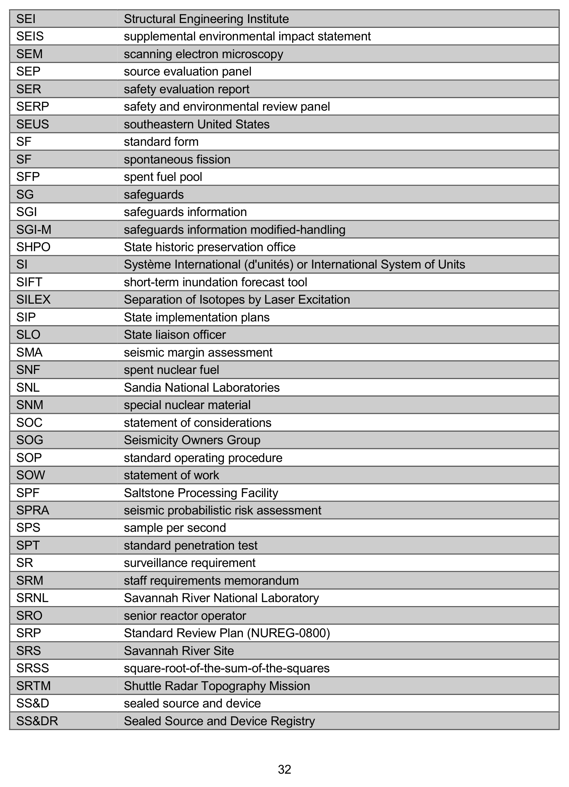

*figure on PDF page 58*

[Vector original (SVG, lossless): fig_page-58.svg](../figures/fig_page-58.svg)

<!-- labels/text on this figure page -->
SEI Structural Engineering Institute SEIS supplemental environmental impact statement SEM scanning electron microscopy SEP source evaluation panel SER safety evaluation report SERP safety and environmental review panel SEUS southeastern United States SF standard form SF spontaneous fission SFP spent fuel pool SG safeguards SGI safeguards information SGI-M safeguards information modified-handling SHPO State historic preservation office SI Système International (d'unités) or International System of Units SIFT short-term inundation forecast tool SILEX Separation of Isotopes by Laser Excitation SIP State implementation plans SLO State liaison officer SMA seismic margin assessment SNF spent nuclear fuel SNL Sandia National Laboratories SNM special nuclear material SOC statement of considerations SOG Seismicity Owners Group SOP standard operating procedure SOW statement of work SPF Saltstone Processing Facility SPRA seismic probabilistic risk assessment SPS sample per second SPT standard penetration test SR surveillance requirement SRM staff requirements memorandum SRNL Savannah River National Laboratory SRO senior reactor operator SRP Standard Review Plan (NUREG-0800)
SRS Savannah River Site SRSS square-root-of-the-sum-of-the-squares SRTM Shuttle Radar Topography Mission SS&D sealed source and device SS&DR Sealed Source and Device Registry
32

<!-- p.59 -->
SSA Seismological Society of America SSAB site-specific advisory board SSC seismic source characterization SSCs structures, systems, and components SSE safe shutdown earthquake SSG strategic sourcing group SSHAC Senior Seismic Hazard Analysis Committee SSJ sole-source justification SSNM strategic special nuclear material SSRCR Suggested State Regulations for the Control of Radiation STAQS Strategic Acquisition System Stat.
statute STPNOC South Texas Project Nuclear Operating Company SUNSI sensitive unclassified nonsafeguards information SUSN Southeastern United States Network SWPF Salt Waste Processing Facility SwRI Southwest Research Institute SWU separative work unit T&R trustworthiness and reliability TA technical assistant TAC technical accountability code TAC technical assignment control (number)
TAD transportation, aging, and disposal TAR technical assistance request TCN transaction control number TDI technically defensible interpretations TEDE total effective dose equivalent TEM transmission electron microscopy TENORM technologically enhanced naturally occurring radioactive material TEPCO Tokyo Electric Power Company TER technical evaluation report TFI technical facilitator integrator TG technical guide TI temporary instruction TI Transport Index TI technical integrator TLD thermoluminescent dosimeter TMI Three Mile Island TOC table of contents TODE total organ dose equivalent TPA Total-System Performance Assessment (NRC)

33

<!-- p.60 -->
TR technical report TR topical report TRU transuranic TS technical specification(s)
TSA Transportation Security Administration TSAR topical safety analysis report TSC technical support center TSP Thrift Savings Plan TSPA Total System Performance Assessment TWA time-weighted average TWFN Two White Flint North TWIC transportation worker identification credentials U&Th uranium and thorium U.S.C.
United States Code UBC Uniform Building Code UCERF uniform California earthquake rupture forecast UCL upper control limit UF6 uranium hexafluoride UFD used nuclear fuel disposal UFSAR updated final safety analysis report UHS uniform hazard spectrum UIC Underground Injection Control UK United Kingdom UMTRCA Uranium Mill Tailings Radiation Control Act U-nat natural uranium UNAVCO University NAVSTAR Consortium UNSCEAR United Nations Scientific Committee on the Effects of Atomic Radiation UO2 uranium dioxide UPS uninterruptible power supply URL underground research laboratory USACE U.S. Army Corps of Engineers USCS Unified Soil Classification System USDA U.S. Department of Agriculture USEC United States Enrichment Corporation USGS U.S. Geological Survey USMA United States Military Academy (West Point, NY)
USMMA United States Merchant Marine Academy (Kings Point, NY)
USN United States Navy USNA United States Naval Academy USNSN U.S. National Seismograph Network USQ Unreviewed Safety Question. For the FSRP, as defined at 10 CFR 72.48

34

<!-- p.61 -->
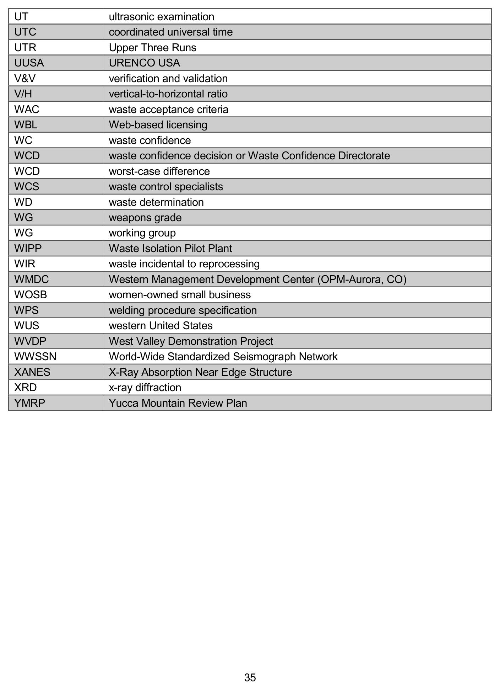

*figure on PDF page 61*

[Vector original (SVG, lossless): fig_page-61.svg](../figures/fig_page-61.svg)

<!-- labels/text on this figure page -->
UT ultrasonic examination UTC coordinated universal time UTR Upper Three Runs UUSA URENCO USA V&V verification and validation V/H vertical-to-horizontal ratio WAC waste acceptance criteria WBL Web-based licensing WC waste confidence WCD waste confidence decision or Waste Confidence Directorate WCD worst-case difference WCS waste control specialists WD waste determination WG weapons grade WG working group WIPP Waste Isolation Pilot Plant WIR waste incidental to reprocessing WMDC Western Management Development Center (OPM-Aurora, CO)
WOSB women-owned small business WPS welding procedure specification WUS western United States WVDP West Valley Demonstration Project WWSSN World-Wide Standardized Seismograph Network XANES X-Ray Absorption Near Edge Structure XRD x-ray diffraction YMRP Yucca Mountain Review Plan
35

<!-- p.63 -->
## 5 BIBLIOGRAPHY
### 5.1 NRC Guidance
U.S. Nuclear Regulatory Commission, “NRC Editorial Style Guide,” NUREG–1379, Rev. 2, May 2009.

U.S. Nuclear Regulatory Commission, “Strategic Plan Fiscal Years 2014-2018,” NUREG-1614, Vol. 6, August 2014.

### 5.2 Other Guidance
The Associated Press Stylebook and Briefing on Media Law, 46th Edition, Basic Books, New York, NY, 2015.

The Chicago Manual of Style, 16th Edition, The University of Chicago Press, Chicago, IL and London, 2010.

The Plain Language Action and Information Network (PLAIN), Website, www.plainlanguage.gov
(accessed May 2016).

The Plain Language Action and Information Network, “Federal Plain Language Guidelines,” Revision 1, http://www.plainlanguage.gov/howto/guidelines/FederalPLGuidelines/FederalPLGuidelines.pdf, March 2011.

U.S. Government Publishing Office, U.S. Government Printing Office Style Manual, U.S.
Government Publishing Office, Washington, DC, 2008.

37

<!-- p.67 -->
NUREG-0544, Rev. 5

Collection of Abbreviations December 2016

Caroline Hsu

Division of Administrative Services Office of Administration U.S. Nuclear Regulatory Commission Washington, DC 20555-0001

Division of Administrative Services Office of Administration U.S. Nuclear Regulatory Commission Washington, DC 20555-0001

C. Hsu

The U.S. Nuclear Regulatory Commission (NRC) has compiled this list of abbreviations commonly used by the agency staff, the regulatory community, and the nuclear industry. To create this list, the NRC staff sought to identify abbreviations that are so commonly used that some staff may not first define the term before using it either in writing or in speaking. This list of abbreviations is descriptive rather than prescriptive. In other words, this NUREG does not recommend one abbreviation to the exclusion of others. Nor does this NUREG intend to capture every abbreviation ever used in an NRC document. The audience of this NUREG is the public, stakeholders, industry, and NRC employees. The goal of this NUREG is to improve communication with and within the NRC.

Abbreviations Writing Plain Language Descriptive Acronyms Technical editing

<!-- p.71 -->
NUREG-0544, Rev. 5

Collection of Abbreviations

