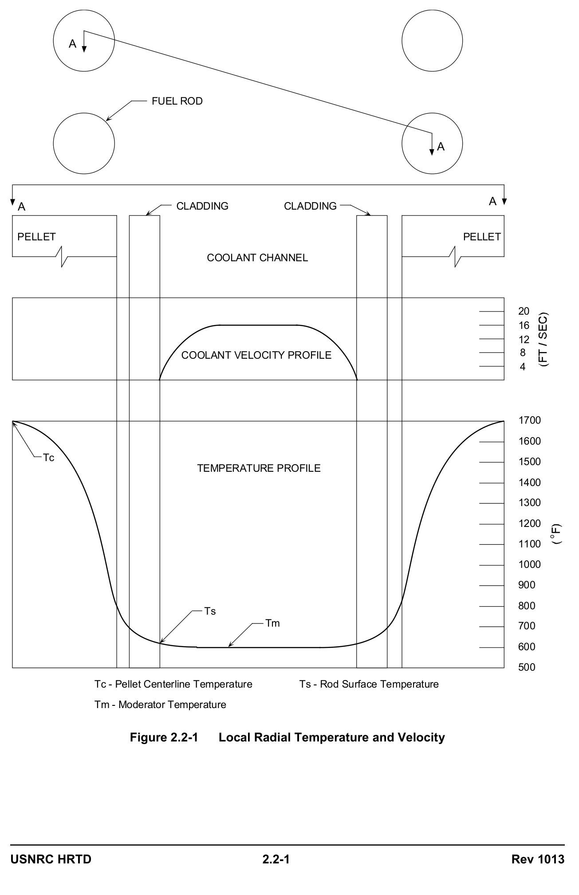
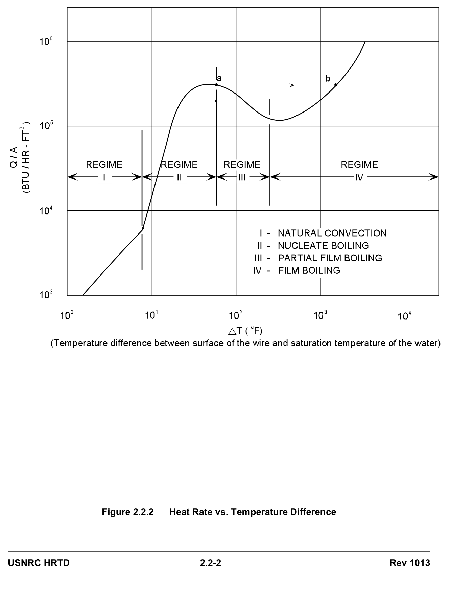
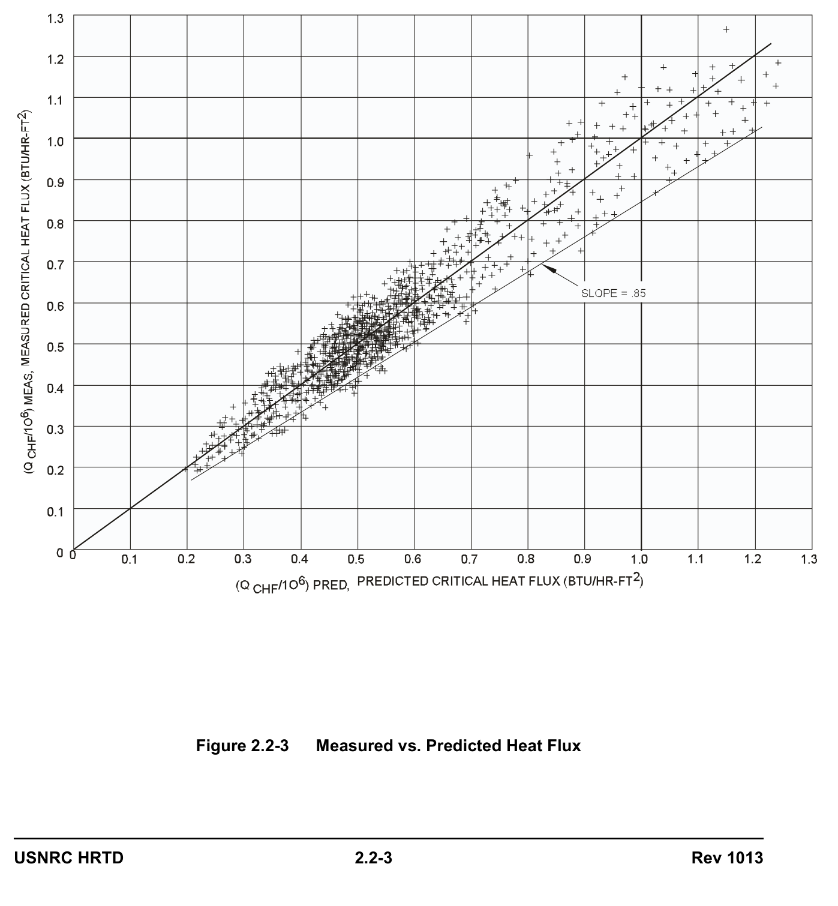
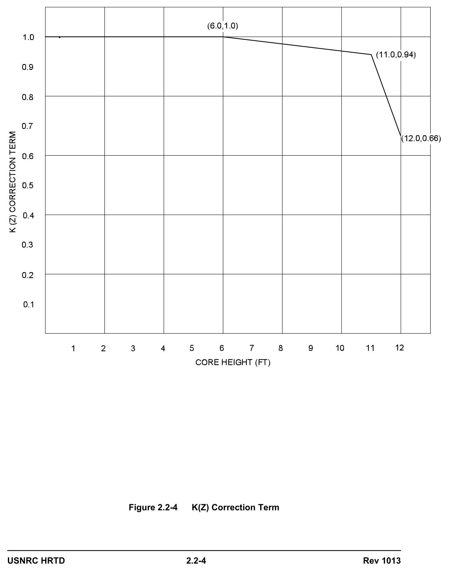
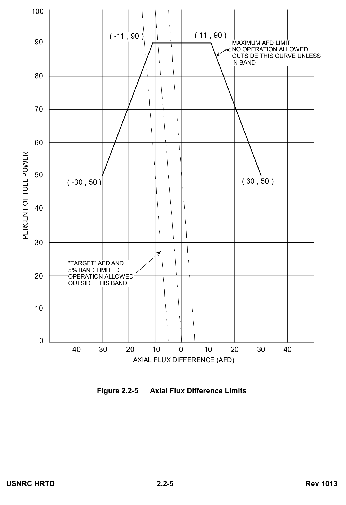

# 02.2 Power Distribution Limits

> Pages 200–225 of `ML20057E160.pdf`
> Westinghouse Technology Systems Manual — USNRC HRTD (PWR)

---
<!-- p.200 -->
#### Westinghouse Technology Systems Manual
#### Section 2.2
#### Power Distribution Limits
<!-- p.201 -->
TABLE OF CONTENTS

2.2 POWER DISTRIBUTION LIMITS................................................................. 2.2-1

2.2.1 Introduction ...................................................................................... 2.2-1

2.2.2 Thermal Hydraulic Considerations ................................................... 2.2-3

2.2.2.1 Heat Generation Process ............................................... 2.2-3

2.2.2.2 Heat Transfer Process.................................................... 2.2-3

2.2.2.3 Fluid Heat Transfer ......................................................... 2.2-4

2.2.2.4 Departure from Nucleate Boiling (DNB) ......................... 2.2-5

2.2.2.5 Departure from Nucleate Boiling Ratio (DNBR) .............. 2.2-6

2.2.3 Nuclear Power Distribution Considerations ...................................... 2.2-7

2.2.3.1 Peak Power Limits .......................................................... 2.2-8

2.2.3.2 Power Distribution Measurement ................................... 2.2-9

2.2.3.3 Hot Channel (Peaking) Factors .................................... 2.2-10

2.2.3.4 Peaking Factor Correction Terms ................................. 2.2-11

2.2.3.5 Changes to Peaking Factor Limits ................................ 2.2-12

2.2.3.6 Height Dependency Correction Term K(Z) ................... 2.2-13

2.2.3.7 Enthalpy Rise Hot Channel Factor ............................... 2.2-15

2.2.3.8 Quadrant Power Tilt Ratio ............................................ 2.2-15

2.2.3.9 Axial Flux Difference and Xenon Transients ................. 2.2-15

2.2.3.10 Operational Limits ........................................................ 2.2-17

2.2.4 Summary ........................................................................................ 2.2-18

LIST OF FIGURES

Figure 2.2-1 ............................................................... Local Radial Temperature and Velocity

Figure 2.2.2 ..................................................................Heat Rate vs. Temperature Difference

Figure 2.2-3 .........................................................................Measured vs. Predicted Heat Flux

Figure 2.2-4 ................................................................................................. K(Z) Correction Term

Figure 2.2-5 ...................................................................................... Axial Flux Difference Limits

2.2-i Rev 1013

<!-- p.202 -->
### 2.2 POWER DISTRIBUTION LIMITS
#### Learning Objectives:
1. Define the following terms:

a. Departure from nucleate boiling (DNB)
b. Departure from nucleate boiling ratio (DNBR)
c. Power density (linear heat generation rate)
d. Heat flux hot channel factor (FQ(Z))
e. Axial flux difference (AFD)
N f. Enthalpy rise hot channel factor (F ∆) H g. Quadrant power tilt ratio (QPTR)

2. Explain why DNBR is required to be greater than a specific limit.

3. Explain why the FQ limit is varied as a function of core height.

4. Explain why surveillance intervals of 31 effective full power days are adequate to ensure that peaking factor limits are not exceeded.

5. Explain how AFD limits ensure that the FQ limit is not exceeded.

#### 2.2.1 Introduction
The concept of placing limits on “hot channel factors” or “peaking factors” was introduced to limit the maximum power produced in the fuel to a value consistent with fuel design limitations. These limitations fall into two basic categories:

a. thermal hydraulic design considerations b. nuclear power distribution considerations

The two are not easily separated, but will be discussed separately for ease of clarification. The fuel design limitations provide adequate heat transfer (thermal hydraulic considerations) compatible with heat generation distribution (nuclear or power distribution considerations) in the core. These design limitations ensure adequate heat removal by the reactor coolant system during normal conditions or by appropriate engineered safety features during emergency conditions. The general performance and safety criteria are:

1. Fuel damage is not expected during normal operation and operational transients
(Condition I) or any transient conditions arising from faults of moderate frequency
(Condition II).

2. The reactor can be brought to a safe state following a Condition III event with only a small fraction of fuel rods damaged. However, sufficient fuel damage might occur to preclude immediate resumption of operation and result in considerable outage time.

<!-- p.203 -->
3. The reactor can be brought to a safe state and the core configuration can be kept subcritical with acceptable heat transfer characteristics following a transient arising from Condition IV events.

Since 1970, Westinghouse has been using the classification of plant conditions as described in ANSI Standard 18.2, “Nuclear Safety Criteria for the Design of Stationary Pressurized Water Reactor Plants,” which amplifies the General Design Criteria of 10 CFR Part 50, Appendix A. This standard divides plant operating conditions into four categories in accordance with the anticipated frequency of occurrence and potential radiological consequences to the public. The four categories are as follows:

• Condition I: Normal Operations

• Condition II: Faults of Moderate Frequency

• Condition III: Infrequent Faults

• Condition IV: Limiting Faults

The basic principle applied in relating design requirements to each of the conditions is that the most frequent occurrences must yield little or no radiological risk to the public and those extreme situations having the potential for the greatest risk to the public shall be those least likely to occur.

Condition I occurrences are those which are expected frequently or regularly in the course of power operation, refueling, maintenance, or maneuvering of the plant. As such, Condition I occurrences are accommodated with margin between any plant parameter and the value of that parameter which would require either automatic or manual protective action.

Condition II faults, at worst, result in a reactor shut down with the plant capable of returning to normal operation. By definition, these faults (or events) do not propagate to cause a more serious fault, i.e., a Condition III or IV category accident.
In addition, Condition II events are not expected to result in fuel rod failures.

Condition III occurrences are faults which may occur very infrequently during the life of the plant. They will be accommodated with the failure of only a small fraction of the fuel rods, although sufficient fuel damage might occur to preclude resumption of reactor operation for a considerable outage time. A Condition III fault will not, by itself, generate a Condition IV fault or result in a consequential loss of function of the reactor coolant system or containment barriers.

Condition IV occurrences are faults which are not expected to take place, but are postulated, because their consequences would include the potential for the release of significant amounts of radioactive material. They are the most drastic events which must be designed against and thus represent limiting design bases. Condition IV faults are not to cause a fission product release to the environment resulting in an undue risk to public health and safety in excess of 10 CFR Part 100 limits. Detailed

<!-- p.204 -->
descriptions of and the transients associated with each of these conditions may be found in Chapter 5.0.

#### 2.2.2 Thermal Hydraulic Considerations
The design of the core and its heat transfer system (reactor coolant system) must be compatible. That is, the heat transfer must be equal to or greater than the heat generation rate or overheating and possible damage to the fuel may occur. Both processes (heat generation and heat transfer) should be understood.

##### 2.2.2.1 Heat Generation Process
Of the total heat energy released during reactor operations, 97% is transferred from the fuel to the coolant (energy of all fission fragments, beta particles, some neutrons, and some gammas) and 3% is released directly into the reactor coolant, from the pressure vessel internals, and secondary shield as a result of the heating of these materials by neutrons and gammas. The energy released by the nuclear fission process in a PWR is emitted as heat from the fuel rods. The reactor coolant is circulated through the core and removes the generated heat. The temperature of the coolant increases continuously as it passes through the core. Some local boiling occurs at the fuel rod-coolant interface, although the reactor coolant system is pressurized to prevent bulk boiling during normal operation. The heat energy added to the coolant is measured by the change in its enthalpy, in Btu per pound.

##### 2.2.2.2 Heat Transfer Process
The heat generated in the fuel must be transferred through the fuel pellet, across the pellet-clad gap, and then through the clad to the coolant (Figure 2.2-1). The heated coolant is circulated out of the core and used to boil the water in the secondary side of the steam generators. The thermal conductivity (ability to transfer heat) of the fuel is quite low. The fuel is manufactured in a form that is ceramic or nonmetallic in structure. This results in good fission product retention and a high melting point.
Unfortunately, it also results in poor heat transfer characteristics.

Because of this resistance to heat transmission, the temperature gradient within the fuel must be high to achieve a satisfactory rate of heat transfer. Fortunately, the melting point of UO2 is high enough (5080°F for unirradiated fuel, approximately 4890°F for expended fuel) so that acceptable heat transfer rates can be attained.

Another resistance to heat transfer from the fuel pellet to the coolant is presented by the gap between the pellet and the interior walls of the cladding. The gap conductance is dependent upon the size of the gap, the nature of the gas in the gap, and the extent of direct pellet-to-clad contact. When the fuel is cold, there is clearance between the fuel pellets and the inner walls of the zircaloy rods.

At operating conditions, the highest temperature pellets will be in at least partial contact with the cladding’s inner wall. As irradiation progresses, the pellets swell and crack to some extent, increasing the amount of pellet-to-clad contact. Fission product gases mix with the helium gas originally present in the fuel rods. All these factors make the gap conductance variable and difficult to predict. Compared with

<!-- p.205 -->
the other thermal resistances, the cladding presents the least thermal resistance, and the temperature gradient from the inner to outer wall of the cladding is very small.

##### 2.2.2.3 Fluid Heat Transfer
The transfer of heat from the cladding surface to the coolant must also be considered in the heat transfer process. This requires an introduction to thermal hydraulics terminology and concepts.

1. Evaporation is the conversion of a liquid to a vapor.

2. Boiling is the evaporation of a liquid occurring within the body of the liquid by the mechanism of bubble formation.
3. Convection is the transfer of heat from one location to another by fluid motion between regions of unequal density that result from nonuniform heating.
4. Radiation is the transfer of thermal energy by means of electromagnetic waves, with no material medium playing an essential role in the process of transmission.
5. Conduction is the transfer of heat through the conducting medium without perceptible motion of the medium itself.
In a liquid, the types of heat transfer can be broken down into four categories, known as “regimes “ These may be best explained by referring to experiments performed with an electrically heated wire submerged in a pool of liquid, a situation similar to the transfer of heat by boiling from any heated surface to a pool.

This experiment relates the heat flux per unit area (or Q/A) to the temperature difference between the surface of the wire and the saturation temperature of the liquid. At low heat transfer rates between the wire surface and the liquid, heat is transferred via natural convection. Natural convection is shown by Regime I on Figure 2.2-2. The heated liquid rises to the surface, where evaporation without the formation of steam bubbles occur. Since temperature, or ΔT, is the “driving force” for transferring heat, the amount of heat transferred increases with the temperature differential while in the natural convection regime.

At a temperature difference of about 10°F, small vapor bubbles start to form at various points along the wire surface. These small bubbles then move into the liquid surrounding the wire and collapse in the cooler water. This agitates the wire/liquid interface promoting better heat transfer. This region of small bubble formation is known as the “nucleate boiling regime” and is designated as Regime II in the figure.
In this regime the increase in the amount of heat transferred from the wire surface is due primarily to the increased convective heat transfer due to agitation of the liquid at the heated surface, not due to the heat actually carried away as enthalpy of the vapor in the form of steam bubbles.

When Regime III (partial film boiling regime) is reached, there is a reduction in the amount of heat transfer. This reduction in heat transfer is due to the insulating effect of the formerly mobile nucleate steam bubbles becoming larger and combining to

<!-- p.206 -->
form stationary steam bubbles. Heat removal by radiation through the steam is much less efficient than that of convection or conduction to a liquid. The thermal energy is passed from molecule to molecule in the course of purely thermal motion, with no mass motion of the medium.

When the bubbles become somewhat stagnant, they tend to form an insulating layer between the heated surface and the liquid. In the partial film boiling regime, the film itself is unstable. It spreads over a part of the heated surface and then breaks down.
Under these conditions, some areas of the surface exhibit violent nucleate boiling, while film boiling occurs in other areas.

The precise point where the mobile, agitating nucleate boiling ends and where partial film boiling begins is referred to as the “critical heat flux” or “departure from nucleate boiling” (DNB), and is discussed below.

The fourth area, Regime IV, is the film boiling regime. Here, as in the partial film boiling regime, steam blanketing hinders the transfer of heat. With the increasing ΔT, however, the film becomes stable and the heat transfer mechanism is by radiation and conduction, neither of which is very efficient. Heat transfer by radiation requires an extremely large ΔT, which is not attainable in existing commercial reactors without producing considerable fuel damage.

This experiment and its results are not fully applicable to the conditions existing in the reactor coolant system with its forced circulation. Conditions in the reactor coolant system are much more complicated than in the experimental model. It is, however, a close enough approximation that it can be enhanced by computer modeling and actual data input to be used by the designers to predict core conditions with a reasonable certainty.

##### 2.2.2.4 Departure from Nucleate Boiling (DNB)
Pressurized water reactors are designed to operate in the nucleate boiling region at high power levels and are not allowed to operate, at any time, with partial film boiling. Due to the reduction in heat transfer capability that occurs with partial film boiling, excessive fuel rod surface temperatures would actually lower the heat being transferred. This would lead to a larger ΔT between the fuel rods and the coolant, which would lower the heat transfer rate even further. Figure 2.2-2 illustrates this effect. It further illustrates that once the conditions leave the nucleate boiling regime, (point “a”), the ΔT must increase from less than 100°F to slightly more than 1000°F (point “b”) before a net increase in heat flux is realized. This rise of more than 900°F in ΔT occurs as a rise in the temperature of the heated surface.

Once the critical heat flux is reached, the heat flux cannot be increased without a large increase in ΔT in the form of fuel rod surface temperature. This could result in a failure of the fuel. For this reason, the heat flux of the fuel rods must be limited to some value below the critical heat flux.

In an actual core, many things have an influence on the actual point at which DNB or the critical heat flux occurs. Core flow rate, coolant pressure, coolant temperature,

<!-- p.207 -->
coolant channel cross section, and localized variations in the fission rate along the length of the fuel rod can all cause changes in the critical heat flux value. Since many factors vary the point of critical heat flux, it is impossible to predict it with 100% accuracy.

Westinghouse initially used a calculational model known as the “Westinghouse W-3 DNB Correlation” and later used the WRB-1 correlation to assure that core conditions would not result in exceeding the critical heat flux. These correlations employ a computer-assisted program to examine the relationship between the many physical variables and the critical heat flux.

Using variables such as pressure, mass velocity, heated length to point of the critical heat flux, various hydraulic parameters, and grid designs, the WRB-1 correlation predicts the heat flux required to cause DNB. Actual tests were conducted at Columbia University using a range of conditions as described above. Figure 2.2-3 illustrates the difference between the heat flux at DNB predicted by the WRB-1 correlation and the actual heat flux at DNB as determined from the tests. Over 1100 points are plotted on this figure. If the prediction were perfect, all points on this graph would fall on the 45-degree line. However, the prediction of DNB is not exact and in most cases either over- or under-predicts the actual point of DNB.

As an example, using Figure 2.2-3, if the predicted heat flux to cause DNB
(horizontal axis) for a given set of conditions is 800,000 BTU/hr-ft2 and the measured value (vertical axis) for the same set of initial conditions was 700,000 BTU/hr-ft2, a point is placed at the intercept of these two values. In this case DNB occurs at 100,000 BTU/hr-ft2 less than the predicted value.

Since, in an operating core, the critical heat flux is predicted and never actually attained, a degree of safety margin or conservatism must be applied to the correlation to ensure that the core is operated below the departure from nucleate boiling point. It was concluded, to meet this design criterion, that the limit for DNBR
(DNBR is defined as the heat flux required to reach DNB divided by the actual local heat flux) should be set at 1.17 (as predicted by the WRB-1 correlation). This value is displayed as the 0.85-slope line on Figure 2.2-3. This line constitutes the limiting DNBR criterion, and at least 95% of the plotted points must fall above this line.

##### 2.2.2.5 Departure from Nucleate Boiling Ratio (DNBR)
The design criterion established for DNB is that there will be at least a 95 percent probability that departure from nucleate boiling will not occur on “the” limiting fuel rod during normal operation and operational transients and any transient conditions arising from faults of moderate frequency (Condition 1 and 2 events), at a confidence level of 95 percent. For Condition 3 and 4 events (limiting faults), a limited number of fuel rods are allowed to violate the 95/95 DNB criterion. The actual limit depends upon a given plant’s offsite radiation dose release criteria.

The above design criterion ensures safe core operation as discussed below. By preventing departure from nucleate boiling, adequate heat transfer is assured between the fuel cladding and the reactor coolant, which prevents cladding damage

<!-- p.208 -->
as a result of inadequate cooling. The DNBR concept was developed as a measure of the margin of safety existing between the critical heat flux and the actual or existing heat flux. DNBR is defined as:

the heat flux required to reach DNB DNBR = the actual local heat flux

Example: If the actual heat flux present at some instant is only half of the heat flux which could produce a departure from the nucleate boiling regime, then:

1.0 DNBR = = 2.0 0.5

In this instance the DNBR is equal to 2.0.

The minimum allowed DNBR varies depending upon which correlation is used for the calculation. Often the W-3 DNB correlation is used and places the DNBR limit at
1.3. This correlation uses a single tube as the reference point, with correction factors for unheated walls and non-uniform axial heat flux. Further modifications have been made to the W-3 DNB correlation to incorporate L-grid and R-grid fuel assembly designs (Section 3.1), which lower the DNBR limit to 1.24 and 1.28, respectively.

Predicting DNB with greater accuracy was accomplished when Westinghouse developed the WRB-1 (Westinghouse Rod Bundle) correlation. This correlation uses full-length tubes in either 4x4 or 5x5 bundle arrays. The calculations or predictions include both L-grid and R-grid configurations, along with uniform and non-uniform heat flux distributions. Using the WRB-1 correlation, a DNBR limit of
1.17 was shown to meet the 95 x 95 criteria explained earlier.

#### 2.2.3 Nuclear Power Distribution Considerations
As previously discussed, thermal hydraulic considerations place constraints on the design and operation of the core and its support systems. In addition, nuclear power distribution must be held within limits to ensure the integrity of the fuel cladding. The specific design criteria to ensure the integrity of the zircaloy fuel cladding are as follows:

1. DNBR > 1.30, as calculated by the Westinghouse W-3 correlation, or > 1.17 using the WRB-1 correlation. The expected minimum value of DNBR at nominal operating conditions is 2.08.

2. Fuel center line temperature below the melting point of the UO2 ceramic fuel pellets. This condition is imposed because the change from solid to liquid is accompanied by swelling which could crack the clad. The melting temperature of UO2 is assumed to be 5080°F minus 58°F for each 10,000 MWD/MTU of burnup. The expected peak value of the centerline temperature at nominal operating conditions is 3275°F.

<!-- p.209 -->
3. Cladding stress less than the zircaloy yield stress. (Stress is the force applied per unit area.)

4. Cladding strain less than 1%. (Cladding strain is a measure of how much the cladding has been stretched past its ability to recover elastically. A strain of 1% means that it has been deformed permanently a total of no more that 1% of its original diameter.)

Cladding stress and strain are minimized by limiting the internal fission gas pressure to less than the external reactor coolant system pressure of 2250 psia, and limiting the average cladding temperature to less than 850°F. Above this temperature the minimum ultimate yield strength reduces to the design yield strength.

Some stress and strain occur when the fuel is in contact with the interior wall of the clad. This is due to the fuel having roughly twice the thermal expansion coefficient of the clad. As the power level changes, the temperatures of both the fuel and the clad change. The uneven expansion and contraction of the fuel and clad cause stress and strain. Linear power density, kilowatts of power produced per foot of fuel rod, must also be limited during normal operations (Condition I) so that in the event of a worst-case loss-of-coolant accident (LOCA, a Condition IV event), the criteria of 10 CFR Part 50.46 would be met.

If a LOCA should occur, it is expected to be accompanied by some fuel cladding failure. The idea, then, is to limit the amount of fuel failure that could be expected to occur rather than to prevent cladding failure altogether. In addition to imposing limits on the fuel design, the NRC also imposes minimum design criteria on the Emergency Core Cooling System (ECCS). Each ECCS design must demonstrate the capability to maintain core conditions within five general limits in the event of a worst-case LOCA. These are stipulated in 10 CFR 50.46 and listed below:

a. Peak clad temp. < 2200°F, b. Clad oxidation < 17% clad thickness, c. H2 generation <1% hypothetical maximum, d. Coolable core geometry maintained, and e. Long term cooling maintained.

##### 2.2.3.1 Peak Power Limits
Peak power limits are placed on the core to avoid a boiling crisis and to eliminate the conditions which could cause fuel pellet melt. The boiling crisis puts a physical limit on the amount of heat that can be extracted from a fuel rod. The melting point of the fuel material places a limit on the amount of heat that can be generated by the fuel rod. For safety purposes, the license limit on the heat flux is set well below these physical limits.

The most economical way to operate the reactor would be to have the heat flux and power level at all points just equal to the maximum allowable to get the maximum power from each pound of fuel. This cannot be achieved because the neutron flux and the resulting power distribution, is non-uniform. Although attempts are made to

<!-- p.210 -->
“flatten” the radial power distribution with fuel enrichment and burnable poison rods, the flux decreases near the edge of the core. This means that many assemblies around the outer edge of the core operate below license limits. Their power output cannot be increased excessively without violating limits toward the center of the core. Secondly, the heat flux cannot be equal to the maximum allowable at all points along the vertical axis of any channel because the power output at the ends of the channel is lower. If the maximum allowable heat flux is reached near the ends of a channel, it may be exceeded at the middle of the channel.

These and other factors produce differences in power levels throughout the core. In addition, many localized conditions exist to further complicate the situation. These include the location of fuel assembly grid straps, minor manufacturing differences in fuel pellet enrichment and density, gaps between adjacent pellets, a partially inserted control rod, etc.

Since the potential exists for localized “hot spots,” those hot spots must be accounted for. Westinghouse has demonstrated by actual experiments and computational models that the four specific design criteria to ensure the fuel cladding integrity (listed in section 2.2.3) can be met if the maximum power output during normal operations does not exceed 13.6 kW/ft of fuel rod. The value of 13.6 kW/ft then becomes, in effect, the limit to be imposed on peak power output in the fuel.

##### 2.2.3.2 Power Distribution Measurement
Power is proportional to the fission rate, which is in turn proportional to the thermal neutron flux. Thus, local power in the fuel is often taken to be proportional to the thermal neutron flux at the point in question.

If the fuel is to be protected from localized high power conditions, it is necessary to be able to locate and measure these “hot spots.” If each individual point of each fuel pin could be monitored, then an upper limit of 13.6 kw/ft could be set on local fuel pin power. Monitoring each fuel pin is, however, a physical impossibility.

Since it is impossible to measure each foot of each individual rod, the next best approach is to predict, as accurately as possible, the condition of each location using available information. This consists of the read-out from the incore monitoring system, which is collected by the plant computer. The incore system consists of 6 separate miniature flux detectors that can be driven into the hollow center support thimbles in 58 of the 193 fuel assemblies. As the movable incore detector moves from the bottom to the top of a fuel assembly, and then back down, it provides an electrical output which is transmitted to the plant computer. The computer receives and stores this information once per second. Since the probe travels the full length of the fuel assembly in one minute, the result is a “stack” of points monitored.
Instead of a single picture of the core, there are 61 separate pictures collected in each of 58 different fuel assemblies. Having many individual pictures allows a more precisely detailed examination of the core.

Since only 6 detectors are provided, a total of 12 “passes” must be run to monitor all the available assemblies. The small size of the incore movable detectors enables

<!-- p.211 -->
them to “see” highly localized neutron flux conditions. This information is the basis for the computer-assisted calculations to follow. The information generated by the incore system is still in the form of fuel assembly-specific information. It must be extrapolated to include the other, unmonitored, fuel assemblies. The flux level or power detected in any fuel assembly is heavily influenced by the fuel assemblies surrounding the one being monitored. This general diffusion is accounted for in the extrapolation model.

After the information received from the instrumented 58 assemblies has been extrapolated to calculate what is occurring in the other 135 assemblies, a further extrapolation is performed. This involves calculating what each fuel rod is contributing to the power levels, either measured or calculated, for each fuel assembly. With this computer generated information, the fuel design engineer now has an idea about what is occurring in each fuel assembly and in each fuel pin. Not only is the total power known (calculated) for each fuel pin, but also the power level for each elevation of each pin. Remember that the incore detector provided outputs to the plant computer as it traversed the length of the core and provided data at each core slice.

Since the six probes travel together and their locations are known to the computer, the information can be made to reflect relative power levels at any and all core elevations. The information is now in its final form and power distribution throughout the core is known. Every fuel pin has been identified and measured.

The only thing left to do is to make sure that none of the core locations is producing more than the limit of 13.6 kw/ft.

##### 2.2.3.3 Hot Channel (Peaking) Factors
In the early development stages of its core design, Westinghouse found that, in an unrodded core, a relatively constant relationship exists between the peak power in the core and the average power. Since this condition yields a natural flux shape, even during a power level change in which the peak and average values are changing, the ratio remains relatively constant. In other words:

peak = K, where K is a constant average

The average linear heat generation rate (kw/ft) or power density can be calculated by dividing the total power of the core by the total active rod length. For the plant under discussion, the thermal megawatt rating is 3411 Mwt, 97.4% of which is produced in the fuel. The other 2.6% is contributed by radiation heating of vessel materials. The total number of kw are:

1000 kw 3411 Mw x x 0 .974 = ,3 322 , 314 kw Mw

A similar calculation yields the number of active feet of fuel rods:

<!-- p.212 -->
264 rods 11.97 ft 193 assemblies X X = 609,895 ft assembly rod

The average heat generation rate at full power is:

3,322,314 kw = 5.45 kw/ft 609,895 ft

This is the average power in one foot of fuel rod during operation at 100% power.

Safety analysis has determined that fuel damage will not result if the peak power does not exceed 13.6 kw/ft. Then at 100% power, the core can be shown to be safe if the ratio of the peak power to average power is 2.5 or less:

peak 13.6 kw Limit = = = 2.50 FQ average 5.45 kw

In other words, the plant can be safely operated if the peak/avg ratio does not exceed 2.50. In fact, core power distribution limits are placed on this ratio of peak to average. A typical peak power value at 100% power would be 10.9 kw/ft resulting in a ratio of 2.0 (i.e., 10.9 / 5.45), which is well below the limit of 2.50.

##### 2.2.3.4 Peaking Factor Correction Terms
Since calculated values are used instead of actual measurements, and since manufacturing tolerances preclude having perfect, defect-free fuel pellets and pins, the measured values have been conservatively increased. Experiments to match predictive versus actual conditions have demonstrated that the actual peak power is no more than 4.58% greater than the calculated peak power. This was rounded off to 5% and is called the “measurement uncertainty factor.”

In addition to the uncertainty in measuring the magnitude of peak local power density, there is also some uncertainty in precisely locating the peak local power density. This is due to the fact that the measured flux shape produced by the incore detectors and the computer programs is based on the assumption that all fuel rods are identical. Variations from rod to rod in fuel pellet enrichment, density and diameter; in the surface area of the cladding; and in the eccentricity of the pellet-toclad gap could all make the actual peak power density greater than the measured peak.

Statistical checks indicate that due to the tight quality assurance standards imposed on the fuel rod manufacturing process, it is almost certain that the magnitude of the actual peak local power density is no more than 3% greater than the peak predicted by the incore system and its computational model. This 3% is known as the “engineering uncertainty factor.”

These uncertainty factors are included in the measured value of FQ. After the

<!-- p.213 -->
measured FQ is found by the measurement and extrapolation techniques previously described, it is increased by the amount of the uncertainty factors.

FQ = Total Measured Heat Flux Hot Channel Factor (with correction terms applied)

maximum kw/ft = FQ ;
average kw/ft

= x x F F N F N F E Q Q U Q

where:

N Q = measured and extrapolated nuclear peaking factor, peak nuclear flux to F average nuclear flux ratio.

N U = nuclear uncertainty factor, which accounts for possible errors in the F measurement techniques involved. This “measurement uncertainty factor” is 1.05.

E Q = engineering uncertainty factor, which accounts for variations in the F manufacturing processes and the subsequent deviations in pellet density and diameter, fuel rod eccentricity, and pellet enrichment. This “engineering uncertainty factor” is 1.03.

Example: To illustrate these terms, assume a plant initiated a set of incore data runs. After the data was collected, an off-site computer with the approved math model found, through extrapolation, that the highest measured peak-to-average ratio was 2.0. Using the base formula:

= N x N x E F F F F Q Q U Q

= 2.0 x 1.05 x 1.03 = 2.16 FQ

The measured FQ with its correction terms is shown above to be 2.16 and is then compared to the FQ limit. As shown in this example, the corrected measured value is within the imposed FQ limit of 2.50.

##### 2.2.3.5 Changes to Peaking Factor Limits
Since the introduction of the peaking factors concept there have been several major changes in the measurement methods, in the math models, and in the basic concept itself. Along with these changes there have been significant changes in the core structure and design. As a result, the peaking factors have undergone several revisions.

<!-- p.214 -->
As the state of the art has advanced, more accurate and realistic analyses of core behavior under transient and accident conditions have caused several changes in the allowable limits. At one time a maximum of 18.0 kw/ft was considered safe.
Using an average of 5.45 kw/ft at 100% power as calculated earlier, this yielded an FQ limit of 3.30 (18.0/5.45 = 3.30). Later analysis, however, revealed some errors in the original assumptions. For instance, the early models did not include the possibility that the assumed LOCA could cause fuel swelling and clad burst. This could impede the flow of water from the ECCS which refills the reactor vessel and refloods the core after the initial LOCA blowdown. Delaying or impeding ECCS flow could cause more damage than originally calculated. Since the potential for rod burst could not be eliminated, the only alternative was to reduce the peak allowed kw/ft for normal operation. Therefore, the assumed LOCA would start with a lower peak power.

Similar reductions have occurred due to such diverse conditions as the practice of plugging leaking steam generator tubes (causing an increase in resistance to flow, and heat transfer area reduction), hotter than expected upper head temperatures, math errors found in the zirconium clad/water reaction rates, and fuel densification which causes localized neutron flux peaks.

As a result of the above considerations the FQ limit at most Westinghouse plants is
2.32. To calculate the equivalent peak power allowed for this value is as follows:

Peak Power ( kw/ft )
= FQ ; therefore, solving for peak power :
Average Power ( kw/ft )

peak power = 2.32 x average power = 2.32 x 5.45 kw = 12.64 kw/ft

After all the correction terms and factors have been applied, a peak linear power density of only 12.64 kw/ft is allowed for a core originally having been deemed safe operating with a peak of 18.0 kw/ft.

##### 2.2.3.6 Height Dependency Correction Term K(Z)
In addition to modifying the “measured” FQ as discussed in section 2.2.3.4, it became necessary to modify the FQ limit to account for another problem. Studies, experiments and computer models revealed that the fuel damage resulting from a LOCA is strongly height dependent. Specifically, the upper areas of the core will experience more damage than the lower areas. This is due to the nature of both the initial blowdown (upper areas uncovered first) and the reflood (upper areas reflooded last).

Additionally, for smaller (3" - 4" diameter) breaks, experiments and computer runs have indicated that reflooding of the top 10" - 12" of the core could be delayed for a significant time. The small break LOCA causes a backpressure which reduces the reflood flow rate.

<!-- p.215 -->
Rather than reducing the peaking factor limit throughout the core, it was decided to make the limit more restrictive at the higher core elevations. Figure 2.2-4 shows the correction term that must be applied to the FQ limit. Instead of a single limit that applies from top to bottom, the core now has a specific limit for each core elevation.
The new measured peaking factor is FQ(Z), which is defined as:

maximum kw/ft at elevation z
(z) = FQ average kw/ft in the core

For instance, the correction term for elevations between 0 and 6 ft is 1.0. This means that the FQ(z) limit for all locations below 6 ft. is the FQ limit multiplied by the height correction term K(z), or

FQ(z) limit = FQ limit x K(z)
= 2.32 x K(z) = = 2.32 x 1.0 = 2.32

There is no reduction or penalty imposed on the limit at core elevations less than 6.0 ft. For higher elevations, however, the correction term varies with core height.
Between 6.0 feet and 11.0 feet, the correction term reduces linearly to approximately 0.94. This reduction accounts for a large LOCA, which would uncover the upper half of the core first and reflood it last. Imposing a more restrictive limit precludes operating the core with power tilted toward the top. A combination of an upward power tilt and a subsequent LOCA could exceed the fuel design limits. With more restrictive limits, this possibility is reduced. For example:

At 11.0 ft, K(z) = 0.94; therefore, the FQ(z) limit = 2.32 x 0.94 = 2.18

The highly restrictive values of K(z) above the 11.0-ft elevation are to preclude high power levels in the last 12 inches of the core. In this area, the “small-break LOCA” analysis requires an additional limitation to account for the damage resulting from backpressure increases which could oppose the reflood rate (i.e., reducing the reflood rate to less than 1 in./sec as defined in 10 CFR 50 App. K). This restriction could occur if the break size were large enough to cause a blowdown of the core area but not large enough to allow the displacement of steam out the break when the ECCS starts reflooding the core. This impeding of the reflood water occurs to the extent where additional core damage results in the last 10 – 12 in. of the core.
At the 12-ft level the correction term is 0.666:

FQ(Z) limit = 2.32 x K(z) = 2.32 x 0.66 = 1.53

It should be understood that all of these power distribution limits are operating limits.
They ensure an acceptable power distribution at the start of the accident, so that the accident does not cause fuel damage in excess of that stipulated by the ECCS design criteria.

<!-- p.216 -->
##### 2.2.3.7 Enthalpy Rise Hot Channel Factor
The limits on the heat flux hot channel factor, FQ(z), ensure that the peak power density does not exceed its limit and that the peak cladding temperature after a LOCA will not exceed 2200°F. However, limiting FQ(z) does not in itself ensure that DNB will not occur. DNB depends not only on the local power density but also on the local enthalpy and flow rate of the coolant. Consider a case where FQ(z) is under the limit at each core elevation, but the maximum heat flux at several core elevations occurs in the same coolant channel. In this case, the heat flux is limited at each location, but the coolant enthalpy increases more in that coolant channel than in any other. DNB is more likely to occur in that channel because the heat flux that causes DNB is lower when coolant enthalpy is higher. Therefore, another peaking factor is needed to protect against such cases. This peaking factor is called the enthalpy rise hot channel factor, and is defined as:

maximum i ntegrated rod power = F N ∆ H average i ntegrated rod power

A typical technical specification limit for the enthalpy rise hot channel factor is:

N < 1.49[1 + 0.3(1 - P)] , where P = fraction of full power F ∆ H

##### 2.2.3.8 Quadrant Power Tilt Ratio
Quadrant power tilt ratio (QPTR) is defined in technical specifications as:

The ratio of the maximum upper excore detector calibrated output to the average of the upper excore detector calibrated outputs, or the ratio of the maximum lower excore detector calibrated output to the average of the lower excore detector calibrated outputs, whichever is greater.

The four upper and lower excore power range detectors are the instruments used to calculate the QPTR. If one of these detectors is inoperable the remaining three detectors will be used for computing the average.

The limit that is placed on the QPTR is 1.02. If the QPTR exceeds the limit and cannot be restored below its limit, thermal power must be reduced to restore calculated safety margins. If the QPTR were to exceed its limit it would most probably be due to a misaligned control rod.

##### 2.2.3.9 Axial Flux Difference and Xenon Transients
One of the few conditions which could cause flux and power levels to be tilted toward the top of the core, and exceeding the restrictive FQ(z) limits in that portion of the core, is a xenon transient. The concentration of xenon at any given location in the core is transient in nature. If the neutron flux levels in the core are allowed to be high at some elevations and low in others, the xenon concentrations will also be of varying magnitudes. The following is an example of how a xenon transient could be initiated:

<!-- p.217 -->
1. One bank of control rods is inserted into the core to the mid-plane while maintaining full power. This condition exists for 24 hours. While the rods are in the core, they depress the neutron flux in the upper half of the core and force a high flux to exist in the lower half. This initially causes the xenon in the lower half of the core to experience a high burn-up rate, and some hours later a new, higher xenon concentration is reached, consistent with the higher neutron flux and fission rate. The upper half of the core undergoes the opposite change: an initial increase in xenon concentration followed by a lower equilibrium xenon concentration.

2. At the end of the 24-hour period, the rods are withdrawn from the core. Since the two halves of the core now have different xenon levels, the flux will be depressed in the lower half of the core and will increase in the upper half of the core. This effect will eventually reverse itself in a cyclic manner, with each swing of xenon and flux being of a smaller magnitude. Over a period of approximately 48 hours, the transient should dampen itself out.

The problem, however, is in the initial swing of flux levels which displace the flux upward. With the highly restrictive FQ(z) limits at the higher elevations of the core, the limits would probably be exceeded.

To prevent exceeding these limits, operating conditions have been imposed which will minimize xenon transients. The most important of these are the axial flux difference (AFD) limits. AFD is a measure of the imbalance between the upper and lower halves of the core in terms of power or flux (φ). AFD is defined as:

AFD or ∆φ = φ top - φ bottom, where φ is expressed as a fraction of rated thermal power (RTP).

The AFD is determined from the outputs of the upper and lower excore neutron detectors.

For plants operating with “constant axial offset control,” the AFD limit involves a target band, as shown in Figure 2.2-5, and the collection of “penalty minutes” for time operated outside the target band. This target band,+5% and -5% around the target, defines, the allowed variation from the natural flux profile of an unrodded core. As an example, assume the core is operating at 100% power with all rods out, and the delta flux target is -10%. The core would then be able to operate with a delta flux of -15% to -5% without collecting any penalty minutes. The + 5% and - 5% flux difference around the target allows for a small amount of movement of the control rods.

Since the xenon distribution and concentration is time and flux dependent, the longer the core operates outside its target band, the greater the chance of initiating a xenon transient. Therefore, after 60 penalty minutes have accumulated, in a sliding 24hour period, operation above 50% power is not allowed until the potential for a xenon transient has abated. In addition, if the delta flux exceeds some maximum value, as shown by the maximum AFD limit line, the delta flux must be reduced. The

<!-- p.218 -->
delta flux must be reduced to a value less than this absolute limit within 15 minutes or the power of the core must be reduced to less than 50%. This lower power level provides additional margin to core thermal limits while the xenon transient is dampened.

For some plants an analysis has been completed which allows “relaxed axial offset control.” For these plants, the axial flux difference target band is no longer applicable and the axial flux difference is limited to the area defined by the absolute limits indicated on Figure 2.2-5. However, for plants incorporating the relaxed axial offset, the absolute limit is somewhat modified in size and goes to 100% power.

##### 2.2.3.10 Operational Limits
A problem with the technique described above for measuring the power distribution throughout the core lies in the fact that it is not an on-line system. Typically, incore flux mapping is performed every 31 effective full power days (EFPD). It takes one or two hours to run the incore system through the flux-mapping routine, and the information collected by the on-site computer may have to be transmitted to an offsite computer of sufficient capacity to run the computations and extrapolations. The entire process can take several days to complete. Hence, detailed power distribution data is not available for demonstrating compliance with peaking factor limits on a day-to-day basis. As a result, other methods are employed to ensure safe operation of the core between flux mapping runs.

To ensure that between flux maps the core is operated within the prescribed limits for the heat flux hot channel factor and for the enthalpy rise hot channel factor, technical specifications require compliance with four operational requirements. Such compliance ensures that the peaking factor limits are not exceeded between the required surveillance intervals. These operational requirements are as follows:

1. Control rod group alignment limits: Individual indicated rod positions are maintained within 12 steps of their group demanded position. A dropped or misaligned control rod may cause excessive power peaking.

2. Control bank insertion limits: Control rod banks are operated within the specified insertion, sequence, and overlap limits. Compliance with the insertion limits preserves an acceptable axial power profile for the core; an excessively inserted bank would likely result in a bottom-skewed power distribution.

3. Axial flux distribution: The AFD is maintained within the specified limits. As described above, compliance with the AFD limits prevents a highly top- or bottom-skewed axial power distribution and minimizes the potential for xenon transients.

4. Quadrant power tilt ratio: The QPTR is maintained within the specified limits.
Compliance with the QPTR limit minimizes the potential for excessive power peaking by preventing an undetected change in the gross radial power distribution.

<!-- p.219 -->
In summary, AFD and QPTR are direct and continuous measures of the core’s “global” power distribution. Staying within their limits and proper operation of the control rods should maintain acceptable peaking factors on a continuous basis. The 31-EFPD frequency for peaking factor verification via flux maps is thus adequate to monitor changes in power distribution with core burnup, because such changes are slow and well controlled with appropriate observance of operational limits.

#### 2.2.4 Summary
The heat generated in the core must be removed by the coolant in order to prevent or to minimize fuel damage. To be reasonably sure that core heat generation does not exceed the heat removal capability of the coolant, limitations have been placed on peak power density and DNBR. In order to meet these limits, certain peaking factors and operational requirements must be maintained.

If the peaking factors are limited and the operational requirements are met, there is a reasonable assurance that the fuel will not be damaged during normal and transient operations and that fuel damage will be limited during accidents. To ensure that the peaking factor limits are not exceeded between surveillences, the operational limits on control rod alignment, control bank insertion, AFD, and QPTR are observed.

<!-- p.220 -->
#### Figure 2.2-1

*Local Radial Temperature and Velocity*

[Vector original (SVG, lossless): fig_2.2-1.svg](../figures/fig_2.2-1.svg)

<!-- labels/text on this figure page -->
A
FUEL ROD
A
A A CLADDING CLADDING
PELLET PELLET
COOLANT CHANNEL
20 16 12
8 COOLANT VELOCITY PROFILE
4
1700
1600 Tc 1500 TEMPERATURE PROFILE 1400
1300
1200
1100
1000
900
800 Ts Tm 700
600
500 Tc - Pellet Centerline Temperature Ts - Rod Surface Temperature
Tm - Moderator Temperature
Figure 2.2-1 Local Radial Temperature and Velocity
USNRC HRTD
2.2-1 Rev 1013

<!-- p.221 -->
#### Figure 2.2.2

*Heat Rate vs. Temperature Difference*

[Vector original (SVG, lossless): fig_2.2.2.svg](../figures/fig_2.2.2.svg)

<!-- p.222 -->
#### Figure 2.2-3

*Measured vs. Predicted Heat Flux*

[Vector original (SVG, lossless): fig_2.2-3.svg](../figures/fig_2.2-3.svg)

<!-- p.223 -->
#### Figure 2.2-4

*K(Z) Correction Term*

[Vector original (SVG, lossless): fig_2.2-4_2.svg](../figures/fig_2.2-4_2.svg)

<!-- p.224 -->
#### Figure 2.2-5

*Axial Flux Difference Limits*

[Vector original (SVG, lossless): fig_2.2-5.svg](../figures/fig_2.2-5.svg)

<!-- labels/text on this figure page -->
100
( 11 , 90 ) ( -11 , 90 )
90 MAXIMUM AFD LIMIT NO OPERATION ALLOWED OUTSIDE THIS CURVE UNLESS IN BAND
80
70
60
50
( 30 , 50 ) ( -30 , 50 )
40
30
"TARGET" AFD AND 5% BAND LIMITED
20 OPERATION ALLOWED
OUTSIDE THIS BAND
10
0
-40 -30 -20 -10 0 10 20 30 40 AXIAL FLUX DIFFERENCE (AFD)
Figure 2.2-5 Axial Flux Difference Limits
USNRC HRTD
2.2-5 Rev 1013

<!-- p.225 -->
