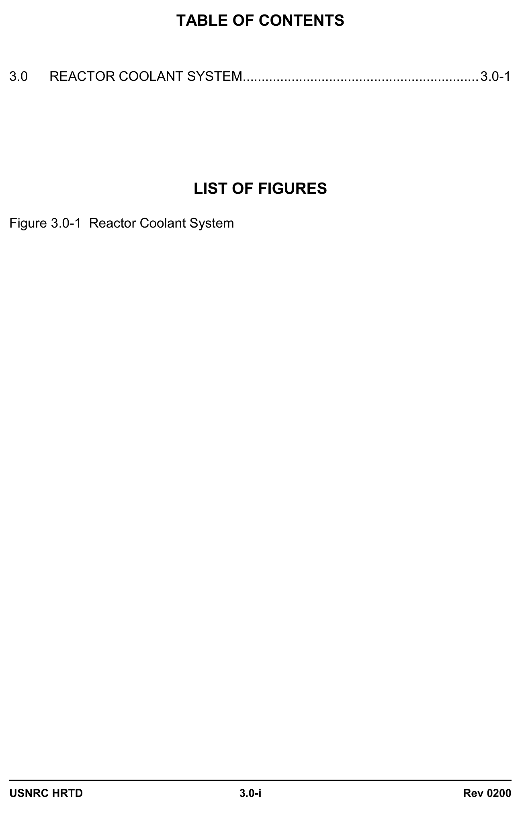
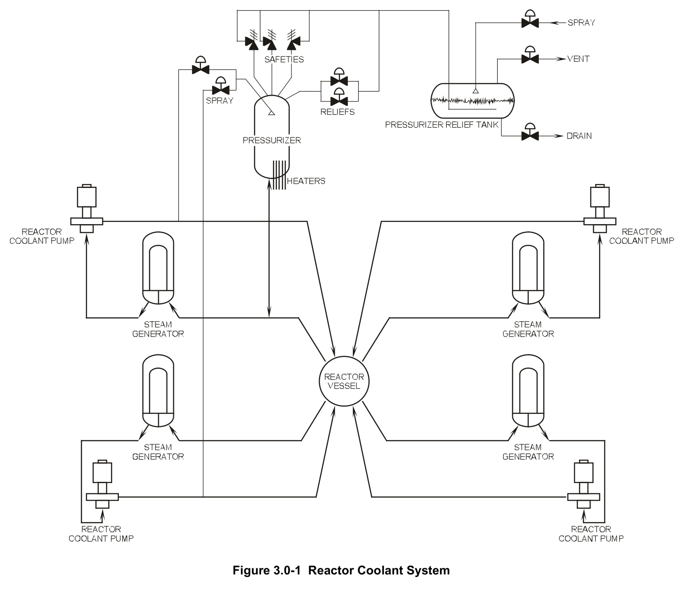

# 03.0 RCS

> Pages 226–231 of `ML20057E160.pdf`
> Westinghouse Technology Systems Manual — USNRC HRTD (PWR)

---
<!-- p.226 -->
#### Westinghouse Technology Systems Manual
#### Chapter 3
#### REACTOR COOLANT SYSTEM
#### Section
### 3.1 Reactor Vessel and Internals
### 3.2 Reactor Coolant System
Rev 0200 USNRC HRTD
3.0-i

<!-- p.227 -->
#### Figure 3.0-1

*Reactor Coolant System*

<!-- labels/text on this figure page -->
TABLE OF CONTENTS
3.0 REACTOR COOLANT SYSTEM ............................................................... 3.0-1
LIST OF FIGURES
Figure 3.0-1 Reactor Coolant System
Rev 0200 USNRC HRTD
3.0-i

<!-- p.228 -->
### 3.0 REACTOR COOLANT SYSTEM
The Reactor Coolant System (RCS), as shown in Figure 3.0-1, consists of the reactor vessel, which contains the nuclear fuel, and four parallel heat transfer loops.
Each loop contains a steam generator, a reactor coolant pump, associated piping and valves, and instrumentation for both control and protection. In addition, the system includes a pressurizer, a pressurizer relief tank, and a number of penetrations for connection of auxiliary systems and components necessary for normal or accident operations of the Reactor Coolant System. All RCS components are located inside the containment building.

The reactor vessel, as discussed in Section 3.1, is part of the Reactor Coolant System pressure boundary and is capable of accommodating the temperatures and pressures associated with operational transients. The reactor vessel supports the reactor core and control rod drive mechanisms.

The Reactor Coolant System, as discussed in Section 3.2, provides sufficient heat transfer capability to transfer the heat produced both during power operations and when the reactor is shutdown. In addition, heat may be transferred to the steam and power conversion system during the first phase of a plant cooldown.

The system heat removal capability under power operations and normal operational transients, including the transition from forced to natural circulation, assures no fuel damage within the operating limits permitted by the reactor control and protection systems.

This system provides the light water used as the neutron moderator and reflector and as a solvent for chemical shim control. The reactor coolant maintains the homogeneity of the soluble neutron poison concentration and controls the rate of change of coolant temperature such that uncontrolled reactivity changes do not occur.

The pressurizer maintains the reactor coolant system pressure during various modes of operation, and is designed to limit pressure transients. During an increase or decrease in plant load, the reactor coolant volumetric changes are accommodated via the surge line to the pressurizer.

Reactor coolant pumps provide the reactor core with sufficient coolant flow to remove the heat that is being generated as a result of the fission process. This coolant then flows to the steam generators and transfers this heat to the secondary water, thereby generating steam to be used by the turbine generator.

Steam generators are provided to supply high quality steam to the turbine. The tube and tube sheet boundaries are designed to prevent the transfer of reactor coolant system activity to the secondary system. The layout of the RCS, with the heat sink
(steam generators) located above the heat source, assures natural circulation capability following a loss of forced flow.

The RCS serves as a boundary for containing the coolant under operating temperature and pressure conditions and for limiting leakage to the containment

<!-- p.229 -->
atmosphere. The RCS piping contains demineralized light water which is circulated at a flow rate and temperature consistent with achieving the design reactor core thermal and hydraulic performance.

The RCS pressure boundary is defined as those systems and/or components which are subjected to full reactor coolant system pressure and include the following:

1. Reactor vessel including the control rod drive mechanism housings;
2. Reactor coolant side of the steam generators;
3. Reactor coolant pumps;
4. Pressurizer;
5. Pressurizer safety and relief valves;
6. Interconnecting piping, valves and fittings between major components; and 7. Piping, fittings and valves connecting the auxiliary or support systems up to and including the second isolation valve (from the high pressure side) in each line.

<!-- p.230 -->
#### Figure 3.0-1

*Reactor Coolant System*

[Vector original (SVG, lossless): fig_3.0-1_2.svg](../figures/fig_3.0-1_2.svg)

