# 03.2 Reactor Coolant System

> Pages 296–361 of `ML20057E160.pdf`
> Westinghouse Technology Systems Manual — USNRC HRTD (PWR)

---
<!-- p.296 -->
#### Westinghouse Technology Systems Manual
#### Section 3.2
#### Reactor Coolant System
<!-- p.298 -->
TABLE OF CONTENTS

3.2 REACTOR COOLANT SYSTEM ................................................................. 3.2-1

3.2.1 Introduction ...................................................................................... 3.2-2

3.2.2 System Description .......................................................................... 3.2-2

3.2.3 Component Descriptions.................................................................. 3.2-3

3.2.3.1. Reactor Coolant Piping ................................................. 3.2-3

3.2.3.2. Instrumentation ............................................................. 3.2-4

3.2.3.3. Pressurizer .................................................................... 3.2-7

3.2.3.4. Steam Generators ....................................................... 3.2-12

3.2.3.5. Reactor Coolant Pump ................................................ 3.2-17

3.2.4 Leakage Detection ......................................................................... 3.2-23

3.2.5 Vibration and Loose Parts Monitoring ............................................ 3.2-24

3.2.6 System Interrelationships............................................................... 3.2-25

3.2.6.1. Materials of Construction ............................................ 3.2-25

3.2.6.2. Heatup and Cooldown Limits ...................................... 3.2-25

3.2.6.3. Natural Circulation ...................................................... 3.2-26

3.2.7 PRA Insights .................................................................................. 3.2-26

3.2.7.1. Reactor Coolant Pump Seals ...................................... 3.2-26

3.2.7.2. Pressurizer Power-Operated Relief Valves ................. 3.2-27

3.2.8 Summary ....................................................................................... 3.2-28

LIST OF TABLES

Table 3.2-1 Reactor Coolant Piping Design Parameters .................................. 3.2-30

Table 3.2-2 Pressurizer Design Parameters ..................................................... 3.2-30

Table 3.2-3 Spray Control Valve Design Parameters ....................................... 3.2-31

Table 3.2-4 Safety Valve Design Parameters ................................................... 3.2-31

Table 3.2-5 Pressurizer Power Operated Relief Valve Design Parameters ...... 3.2-31

Table 3.2-6 Pressurizer Relief Tank Design Parameters .................................. 3.2-32

Table 3.2-7 Steam Generator Design Parameters ............................................ 3.2-32

Table 3.2-8 Reactor Coolant Pump Design Parameters ................................... 3.2-33

Table 3.2-9 Reactor Coolant Pump Motor Design Parameters ......................... 3.2-33

Table 3.2-10 Thermal and Loading Cycle Design Parameters ......................... 3.2-34

3.2-i Rev 0216

<!-- p.299 -->
#### LIST OF FIGURES
Figure 3.2-1 .......................................................................Reactor Coolant Loop Penetrations

Figure 3.2-2 ........................................................................................... Reactor Coolant System

Figure 3.2-3 .......................................................................................... Pressurizer Spray Scoop

Figure 3.2-4 ....................................................................................... Sample Connection Scoop

Figure 3.2-5 ...................................................................................... Hot Leg RTD Configuration

Figure 3.2-6 ...................................................................................... Reactor Coolant Flow Taps

Figure 3.2-7 .................................................................................................................... Pressurizer

Figure 3.2-8 ................................................... Pressurizer Manway Cover and Spray Nozzle

Figure 3.2-9 ...................................................................................... Model 51 Steam Generator

Figure 3.2-10 ................................................................................ Steam Generator Flow Paths

Figure 3.2-11 ............................................................................................. Feed Ring Assemblies

Figure 3.2-12 ...................................................................... Feedring and Moisture Separators

Figure 3.2-13 ............................................................... Steam Generator Moisture Separators

Figure 3.2-14 ................................................................................................... Tube Support Plate

Figure 3.2-15 ......................................................................Steam Generator Shrink and Swell

Figure 3.2-16 ............................................................................................ Reactor Coolant Pump

Figure 3.2-17 .......................................................................... Seal Water Injection and Leakoff

Figure 3.2-18 .......................................................................................... Shaft Seal Arrangement

Figure 3.2-19 .................................................................................................... Seal Flow Diagram

Figure 3.2-20 ..............................................................................Controlled Leakage Shaft Seal

Figure 3.2-21 ............................................ RCP Flywheel and Anti-reverse Rotation Device

Figure 3.2-22 ...................... Vibration and Loose Parts Monitoring Transducer Locations

Figure 3.2-23 ................................................. Vibration and Loose Parts Monitoring System

Figure 3.2-24 ...................... Vibration and Loose Parts Monitoring Cabinet Arrangement

Figure 3.2-25 ........................... Vibration and Loose Parts Monitoring Indicator Assembly

Figure 3.2-26 .................................................... RCS Pressure-Temperature Limits (Heatup)

Figure 3.2-27 .............................................. RCS Pressure-Temperature Limits (Cooldown)

Figure 3.2-28 ........................... Westinghouse High Temperature Shutdown Seals (SDS)

3.2-ii Rev 0216

<!-- p.300 -->
### 3.2 REACTOR COOLANT SYSTEM
#### Learning Objectives:
1. State the purposes of the Reactor Coolant System (RCS).

2. State the purposes of the following RCS penetrations:

a. Hot Leg

• Pressurizer surge line
• Residual Heat Removal (RHR) suction
• Sample line
• RHR/Safety Injection (SI) recirculation

b. Intermediate Leg

• Elbow flow taps
• Chemical and Volume Control System (CVCS) letdown
• Loop drain

c. Cold Leg

• Pressurizer spray line
• CVCS charging
• Common injection penetration for RHR, SI, and an accumulator
• High head injection
• Excess letdown

3. Describe the primary and secondary flow paths through the steam generator.

4. State the purposes of the following components of the reactor coolant pump.

a. Thermal barrier heat exchanger b. Seal package c. Flywheel d. Anti-reverse rotation device e. Number 1 seal bypass valve f. Number 1 seal leak off valve g. Seal stand-pipe

5. Explain why seal injection flow is supplied to the reactor coolant pumps.

6. State the purposes of the following:

a. Pressurizer b. Pressurizer safety valves c. Power-operated relief valves (PORVs)
d. PORV block valves

<!-- p.301 -->
e. Pressurizer relief tank (PRT)
f. Pressurizer spray valves g. Pressurizer heaters

7. Describe the methods for determining pressurizer relief and safety valve position and/or leakage.

8. Explain the following:

a. Pressurizer spray driving force b. Purpose of pressurizer spray bypass

9. Explain how failure of the following components could lead to core damage.

a. Reactor coolant pump seals b. Power-operated relief valves

#### 3.2.1 Introduction
The purposes of the RCS are:

1. To transfer the heat produced in the reactor to the steam and power conversion systems.
2. To provide a barrier to limit the escape of radioactivity to the containment.

#### 3.2.2 System Description
The reactor coolant piping and components are generally referred to as the reactor coolant system, even though the RCS also includes the reactor vessel and the components directly attached to the reactor vessel. The RCS consists of four similar heat transfer loops connected in parallel to the reactor vessel. Each loop contains a steam generator, a reactor coolant pump, penetrations for connection with auxiliary and emergency systems, and appropriate instrumentation. In addition, a pressurizer is connected by a surge line to one loop for pressure control. A pressurizer relief tank is provided to collect any release from the pressurizer relief and safety valves.
All RCS components are located inside the containment. A typical RCS loop is shown on Figure 3.2-1.

During normal operations, the RCS transfers the heat produced in the reactor to the steam generators where steam is produced to supply the turbine generator and other secondary system components. Hot reactor coolant exits the reactor vessel and flows through the hot leg piping to the steam generator where energy is removed to make steam. Coolant exits the steam generator and flows through the intermediate leg piping to the suction of the reactor coolant pump. The pump discharge is directed through the cold leg piping to the reactor vessel inlet nozzles to complete the cycle.

The RCS pressure boundary (described in section 3.0) acts as the second of the three barriers or “lines of defense” against fission product release to the

<!-- p.302 -->
environment. The first and third barriers are the fuel cladding and the reactor containment building respectively. Seismic restraints and supports are provided as required to ensure continued integrity of the RCS during seismic events. All RCS components are designated Seismic Category 1.

#### 3.2.3 Component Descriptions
##### 3.2.3.1. Reactor Coolant Piping
The reactor coolant piping and fittings are austenitic stainless steel. The loop piping is sized to limit the maximum flow velocity for erosion or vibration considerations.
The crossover line between the steam generator and reactor coolant pump is larger due to pump suction considerations.

All smaller piping which is part of the RCS boundary, such as the pressurizer surge line, spray and relief line, loop drains and connecting lines to other systems are also austenitic stainless steel. The nitrogen supply line for the pressurizer relief tank is carbon steel. All joints and connections are welded, except for the piping associated with the pressurizer relief and safety valves, where flanged joints are used.

Penetrations (Figures 3.2-1 and 3.2-2) which are common to all reactor coolant loops include the following:

1. Hot leg injection/recirculation from the Emergency Core Cooling Systems
(ECCSs),
2. Hot leg wide-range and narrow range, well-mounted, RTDs,
3. Elbow flow detector high and low pressure taps (intermediate leg), 4. Drain connection to the reactor coolant drain tank (RCDT), 5. Cold leg wide-range and narrow range, well-mounted RTDs, 6. Cold leg injection from the ECCS safety injection pumps, residual heat removal pumps and the accumulators, 7. Cold leg injection from ECCS boron injection tank (high head injection), and

Additional penetrations specific to individual loops and their typical locations are as follows:

1. Pressurizer surge line from loop 2 hot leg,
2. Supply to the RHR System from loop 4 hot legs,
3. CVCS letdown from loop 3 crossover leg, 4. CVCS charging to loops 1 and 4 cold legs, 5. Pressurizer spray from loops 2 and 3 cold legs, 6. Excess letdown to CVCS from loop 3 cold leg, and 7. Sample line from loop 1 and 3 hot legs.

Thermal sleeves are installed at points in the system where high thermal stresses could develop due to rapid changes in fluid temperature during normal operational transients. These points include:

1. Charging connections from the CVCS,
2. Pressurizer end of the surge line, and

<!-- p.303 -->
3. Pressurizer spray line connection to the pressurizer.

Piping connections from process systems are made above the horizontal center line of the reactor coolant piping, with the exception of:

1. RHR suction, which is 45Ε down from the horizontal centerline. This enables the water level in the RCS to be lower in the reactor coolant pipe while continuing to operate the RHR system, should this be required for maintenance.

2. Loop drain lines and the connection for temporary level measurement of water in the RCS during refueling and maintenance operation.

3. The differential pressure taps for flow measurement, which are downstream of the steam generators on the 90° elbow.

The following penetrations extend into the coolant flowpath:

1. The spray line inlet connections which extend into the cold leg piping in the form of a scoop so that the velocity head of the reactor coolant loop flow adds to the spray driving force (Figure 3.2-3).

2. The reactor coolant sample system taps are inserted into the main stream to obtain a representative sample of the reactor coolant (Figure 3.2-4).

3. The RCS narrow range temperature detectors, hot leg RTDs (3 per loop) and cold leg RTDs (1 per loop), are located in RTD wells that extend into the reactor coolant pipes.

4. The wide range temperature detectors are located in RTD wells that extend into the reactor coolant pipes.

All valves in the RCS which are in contact with the coolant are constructed primarily of stainless steel. Other materials in contact with the coolant are manufactured of special materials that are noncorrosive.

All RCS valves which are three inches or larger, and that will normally be operated at a temperature above 212°F, are provided with double-packed stuffing boxes with stem lantern gland leak off connections. All throttling control valves, regardless of size, are provided with double-packed stuffing boxes and stem leak off connections.
All leak-off connections are piped to the PRT. Leakage to the containment is essentially zero for these valves.

##### 3.2.3.2. Instrumentation
#### RCS Temperature
There are two ranges of RCS temperature monitors. Both ranges use RTDs. The temperatures of the hot leg and of the cold leg of each loop are monitored for indication only by wide-range (0-700°F) detectors. These detectors are mounted in

<!-- p.304 -->
wells which penetrate the coolant piping and are part of the pressure boundary.
These RTDs do not come in contact with the reactor coolant.

The narrow-range Th and Tc temperature detectors are used for reactor control and protection and are mounted in RTD wells which extend into the RCS piping. The narrow-range (530°F-650°F) Th RTDs obtain a representative sample of the hot leg temperature by using three RTDs which are mounted in wells that extend into the flow stream 120 degrees apart. The narrow-range (510°F – 630°F) Tc RTDs are also mounted in wells and have one tap directly downstream of each reactor coolant pump. Only one connection per cold leg is required to get a representative temperature indication due to the mixing of the reactor coolant caused by the reactor coolant pump.

The information derived from these hot and cold leg RTDs (Tavg and ∆T), from all four loops, is indicated in the control room. Additional information about these temperature indicators may be found in Chapter 10.0, Primary Systems Control and Instrumentation..

#### RCS Flow
Elbow taps are used in the RCS to indicate the status of the reactor coolant flow
(Figure 3.2-6). The function of this device is to provide information as to whether or not a reduction in flow has occurred. An advantage of this type of flow detection system is that no components need to be inserted into the coolant flowpath.
Components in the flowpath produce pressure drops and either reduce flow or require increased pumping power. The elbow flow instrument measures the differential pressure between the inner and outer radius of the intermediate leg piping elbow. The outer radius will experience a slightly higher pressure due to the dynamic effects of coolant flow.

The correlation between changes in flow and elbow tap indication has been well established and is described by the following equation:

∆ P ω 2 = ∆ P ω 2 0 0

where:

∆P is the differential pressure corresponding to present measured flow rate ω.
∆P0 is the differential pressure corresponding to initial reference flow rate ω0.

The full-flow reference point ∆P0 is established during initial plant startup. The lowflow reactor trip setpoint is then established by extrapolating data from a curve which correlates ∆P0 to flow. This technique has been well established in providing core protection against low coolant flow in Westinghouse PWR plants. The expected absolute accuracy of the channel is within ± 10% and field results have shown the repeatability of the trip point to be within ± 1%. The accident analysis for a loss-offlow transient assumes a instrumentation error of ± 3%.

<!-- p.305 -->
#### Pressurizer Pressure
Redundant pressure detectors are provided to monitor the pressure in the steam space of the pressurizer. Information from these detectors is used for indication, control, and protection. For additional information see Chapter 10.0, Primary Systems Control and Instrumentation.

#### Pressurizer Level
Redundant level instrumentation is provided to monitor the water level in the pressurizer. Differential pressure detectors monitor the difference between the height of a known column of water (reference leg) and the height of the water in the pressurizer.

This instrumentation is used for indication, control, and protection. A separate channel calibrated for cold plant conditions is provided for shutdown, startup and refueling operations. Additional information may be found in Chapter 10.0, Primary Systems Control and Instrumentation.

#### Safety and Relief Valve Monitors
The safety valves and power-operated relief valves (PORVs) are monitored for open or leaking conditions. Leakage or opening of these valves is indicated by increasing discharge piping temperature and (if installed) via acoustic monitors. Each poweroperated relief valve (PORV) also has a stem-mounted valve position indicating switch which provides positive Control Room indication of actual valve position (as opposed to “demanded” position). These switches were required to be added as modifications as a result of the confusing indications observed during the Three Mile Island event.

#### Loop Pressure
Three pressure detectors are installed at the hot leg suction of the residual heat removal system. These instruments are wide range transmitters (0-3000 psig) which provide pressure indication over the full operating range.

One of the three pressure transmitters provides indication to the remote shutdown station only. The remaining two pressure transmitters provide indication in the main control room, a PORV actuation signal in conjunction with the low temperature over pressure mitigation system, the permissive signals for the RHR loop isolation valves interlock circuits to protect the low pressure piping of the RHR system and input to the subcooled margin monitor.

Two local pressure indicators are also provided for operator reference during shutdown conditions. One taps into the loop 3 sample line, and the other senses the pressure in the loop-4-to-RHR suction line.

<!-- p.306 -->
##### 3.2.3.3. Pressurizer
The pressurizer is a vertical, cylindrical vessel with hemispherical top and bottom heads, constructed of manganese-molybdenum alloy steel, and clad with austenitic stainless steel on all surfaces exposed to reactor coolant water. Electrical heaters
(78) are installed through the bottom head of the vessel, while the spray nozzle, relief, and safety valve connections are located in the top of the vessel.

The pressurizer has four basic functions:

1. Pressurizing the RCS during plant heatup,
2. Maintaining normal RCS pressure during steady state operations,
3. Limiting pressure changes during RCS transients to within allowable values and, 4. Preventing the reactor coolant system pressure from exceeding its design pressure value of 2500 psig.

During normal operations, the pressurizer is maintained at saturation conditions by electrical heaters (Figure 3.2-7). Under saturation conditions, each temperature has a corresponding saturation pressure. At nominal full power conditions, approximately 60 percent of the pressurizer volume is saturated water, with the remaining 40 percent saturated steam.

The pressurizer is connected to a loop hot leg by the surge line. Since the RCS
(except for the pressurizer) is a hydraulically solid system, the pressure in the pressurizer will be maintained throughout the system. Design parameters for the pressurizer are listed in Table 3.2-2.

If the RCS were operated completely full of water any change in temperature of the reactor coolant would produce unacceptably large changes in pressure due to the density change of the coolant. Therefore, the pressurizer is attached to the reactor coolant system to provide a surge and makeup volume to accommodate these density changes.

To understand how the pressurizer maintains RCS pressure, consider the volumetric difference between water and steam. At normal system operating temperatures, water is approximately six times as dense as steam. Therefore, as the water is heated by the pressurizer electrical heaters to produce steam, a factor of six volume change occurs. For example, boiling one cubic foot of water would produce six cubic feet of steam. Since the volume in the pressurizer which is available for steam is fixed by the pressurizer level control system, the density of steam must increase.
This increase in density produces a pressure increase in the RCS. Conversely if steam is condensed, a factor of six density reduction occurs, which results in a reduction in pressure. The steam inside the pressurizer responds in a manner similar to an ideal gas (pressure is proportional to density).

During steady-state operations a small number of heaters are energized to make up for ambient heat losses. The small amount of subcooled liquid which is continuously circulated from the RCS via the spray line bypass valves promotes mixing and aids in chemistry control.

<!-- p.307 -->
Many transients affecting pressure are caused by changes in the reactor coolant temperature. Temperature changes produces changes in coolant density, which force water into (insurge) or out of (outsurge) the pressurizer.

In the case of an increase in RCS temperature, the expansion of the coolant produces an insurge into the pressurizer. This insurge compresses the steam “bubble,” resulting in an increase in steam density and a corresponding increase in pressure. If the pressure increases by a predetermined amount, the pressurizer pressure control system modulates the spray valves to admit relatively cool water to the steam space to condense some steam. This reduces the density of the steam and limits the pressure increase.

If the RCS temperature decreases, the contraction of the coolant produces an outsurge from the pressurizer. This is accommodated by an expansion of the steam bubble and a corresponding decrease in steam density and pressure. As the pressure decreases, some of the saturated water in the pressurizer will flash to steam to help maintain system pressure. If pressure decreases to a predetermined value, the pressurizer pressure control system will energize additional electrical heaters to boil more water and return pressure to normal.

If the RCS pressure increases towards the design limit, power-operated relief and safety valves open. These valves release steam from the steam space of the pressurizer and thereby limit the overpressure condition.

The volume of the pressurizer (1800 ft3) is greater than, or equal to, the minimum volume of steam and water combination which satisfies all of the following requirements:

1. The combined saturated water volume and steam expansion volume is sufficient to provide the desired pressure response to programmed system volume changes.

2. The water volume is sufficient to prevent the heaters from being uncovered during a step load increase of ten percent of full power.

3. The steam volume is large enough to accommodate the insurge resulting from a 50 percent reduction of full load with automatic rod control and full steam dump capacity without the water level reaching the high level reactor trip set point.

4. The pressurizer does not empty following a reactor trip with a turbine trip.

5. The steam volume is large enough to prevent water relief through the safety valves following a loss of load with the high pressurizer water level initiating a reactor trip.

6. A safety injection signal will not be activated following a reactor trip and turbine trip.

#### Pressurizer Heaters
<!-- p.308 -->
The electrical heaters installed in the pressurizer are replaceable, direct-immersion, tubular-sheath type heaters with hermetically sealed terminals. They are located in the lower portion of the pressurizer vessel and maintain the steam and water contents at equilibrium conditions. There are 78 heaters installed for a total capacity of 1794 kW. The heaters are broken down into two groups, the proportional heater group consists of 18 heaters for an output of 414 kW and the backup heater group consists of 60 heaters for an output of 1380 kW. The heaters are capable of raising the temperature of the pressurizer and its contents at approximately 55ΕF/hr.

The hermetically sealed terminals connected to the external pressurizer vessel wall are capable of retaining full system pressure should the immersed tubular heater sheath fail. Ventilation of the heater connections is accomplished through holes drilled in the pressurizer support skirt.

#### Pressurizer Spray
Spray water is injected into the steam volume of the pressurizer through a spray nozzle located in the top of the vessel (Figure 3.2-8). Automatically controlled, airoperated valves with remote manual overrides are used to control pressurizer spray from two loop cold legs. In parallel with each spray valve is a manual throttle valve which permits a small continuous flow to bypass the spray valves. This small flow
(one gpm) is provided to reduce the thermal stresses and/or thermal shock to the pressurizer spray penetration and spray nozzle inside the pressurizer when the spray valves open. In addition, this flow helps maintain uniform water chemistry in the pressurizer to that of the reactor coolant system. Design parameters for the spray valves are listed in Table 3.2-3.

Temperature sensors with low temperature alarms are provided in each spray line to alert the operator of insufficient bypass flow. The layout of the spray line piping to the pressurizer forms a water seal which prevents steam buildup back to the spray valves. The maximum spray flow rate (840 gpm) is selected to prevent the pressure in the pressurizer from reaching the operating set point of the PORVs, following a 10 percent step decrease in power.

The pressurizer spray lines and valves are sized and located to provide adequate spray using the differential pressure between the surge line connection in the hot leg and the spray line connection in the cold leg as the driving force. The spray line inlet connections (Figure 3.2-3) extend into the cold leg piping in the form of a scoop so that the velocity head of the reactor coolant loop flow adds to the spray driving force.
The spray valves and spray line connections are redundant so that the spray flow can be admitted to the steam space of the pressurizer even when one of the associated RCP's is not operating. In addition to their pressure control function, the sprays may be manually operated to circulate coolant from the loop to the pressurizer for boron concentration equalization.

A flow path from the CVCS to the pressurizer spray line is also provided. This connection provides auxiliary spray to the vapor space of the pressurizer during cool down if the reactor coolant pumps are not operating. The thermal sleeve on the pressurizer spray connection is designed to withstand the thermal stresses resulting from the introduction of this relatively cold auxiliary spray water.

<!-- p.309 -->
#### Surge Line
The surge line connects the bottom of the pressurizer to one of the reactor coolant system hot legs. It is sized to limit the pressure drop between the pressurizer and the RCS during the maximum anticipated insurge. It is designed in this fashion to ensure that the highest pressure point in the RCS does not exceed the design pressure with the safety valves discharging at their maximum allowable accumulation. The surge line also contains a thermal sleeve at the pressurizer end which is designed to withstand the thermal stresses resulting from surges of relatively hotter or colder water which will occur when the temperature of the RCS changes.

A temperature sensor with remote indication and a low temperature alarm is provided on the surge line. This indication along with the spray line temperature indication monitors performance of the continuous spray bypass flow.

#### Safety Valves
The three pressurizer safety valves are totally enclosed pop-open-type valves. The valves are spring loaded, and self actuating, and they have backpressure compensation designed to prevent the reactor coolant system pressure from exceeding the design pressure by more than 10 percent. This meets the requirements of the ASME Boiler and Pressure Code, Section III. The set pressure of the safety valves is 2485 psig. Design parameters for the pressurizer safety valves are listed in Table 3.2-4.

A water seal is maintained below each safety valve seat to minimize leakage. The 6-in. pipes connecting the pressurizer nozzles to their respective safety valves are shaped in the form of a loop seal. Condensate, as a result of normal heat losses to ambient, accumulates in the loop and floods the valve seat. This water seal prevents leakage of steam or hydrogen gas to pass by the safety valve seats. If the pressure inside the pressurizer exceeds the set point of the safety valves, they will lift and the water from the loop seal will discharge during the accumulation period.

Due to the high pipe and pipe support loads caused by these “water slugs,” catch pots were designed and placed immediately downstream of the relief and safety valves. A total of four of these slug diversion devices (SDDs) are installed (one for each of the safeties and one for the PORV combined discharge). The SDDs are located at the change in pipe direction so that the water slugs flow into the devices and are trapped. These devices are totally passive and ensure that the piping system is not subjected to stresses or loads beyond code allowable.

A temperature indicator in the safety valve discharge manifold alerts the operator to the passage of steam due to leakage or valves lifting. Acoustic monitors are also provided for each valve to provide a positive indication of leakage or safety valve operation.

<!-- p.310 -->
#### Power-Operated Relief Valves
The pressurizer is normally equipped with two PORVs, which limit pressure in the reactor coolant system and minimize the probability of actuation of the high-pressure reactor trip. The operation of the PORVs also limits the operation of the fixed highpressure safety valves. The PORVs are air operated and can be opened or closed automatically or by remote manual control. Should the air supply to the PORVs fail, a backup air supply system is provided to maintain the PORVs operable for 10 minutes following a loss of instrument air. Remotely operated block valves are provided to isolate the PORVs if excessive leakage occurs. Design parameters for the power-operated relief valves are listed in Table 3.2-5.

The PORVs are designed to limit the pressure in the pressurizer to a value below the high pressure reactor trip setpoint for design transients up to and including a 50percent step load decrease with full steam dump actuation. An acoustic monitor can be installed at the outlet of each PORV to detect leakage and/or valve opening. Note that the use of an added acoustic monitor is a plant-specific variation. Acoustic monitors on the PORVs are not installed on the Westinghouse reference simulator.

The PORVs, with additional actuation logic, are also utilized to mitigate potential RCS cold over pressurization transients during cold shutdown conditions.

#### Pressurizer Relief Tank
The PRT collects, condenses and cools the steam discharged from the pressurizer safety and power-operated relief valves. The tank is maintained approximately three quarters full of water with a nitrogen cover gas. Steam is discharged through a sparger at the bottom of the tank below the water level. This condenses and cools the steam by mixing it with water that is near containment ambient temperature.
Discharge from a number of smaller relief valves located in systems inside or outside of the containment are also piped to the pressurizer relief tank.

The design of the PRT is based on the requirement to condense and cool a discharge of pressurizer steam equal to 110 percent of the volume above the zero power pressurizer water level set point (25%). This tank is not designed to accept a continuous discharge from the pressurizer. The volume of water in the PRT is capable of absorbing the heat from the assumed discharge from the pressurizer safety valves, with an initial water temperature of 120°F and increasing to a final temperature of 200°F. If the temperature inside the PRT rises above 114°F during plant operation, the tank is cooled by spraying in cool primary makeup water and draining the warm mixture to the reactor coolant drain tank. Design parameters for the pressurizer relief tank are listed in Table 3.2-6. The spray rate inside the PRT is designed to cool the tank from 200°F to 120°F in approximately one hour following the design discharge of pressurizer steam. The nitrogen gas overpressure inside this tank is selected to limit the maximum pressure following a design discharge to 50 psig.

The PRT is constructed of austenitic stainless steel. A flanged nozzle is provided for connection of the pressurizer relief and safety valve discharge line. The discharge piping and the sparger are constructed of austenitic stainless steel. A vacuum

<!-- p.311 -->
breaker hole is located on the discharge line inside the PRT which will allow the PRT and the discharge line pressure to equalize, preventing water in the PRT from being forced up into the discharge line. Two rupture discs are provided to prevent exceeding the design pressure of the PRT. The rupture discs have a relief capacity equal to the combined capacity of all three pressurizer safety valves. The design pressure of the PRT (and the rupture discs setting) is twice the calculated pressure produced by the design relief volume described above. This margin is provided to prevent deformation of the rupture disc.

The PRT and its connections are designed to operate under a vacuum to prevent the collapse of the tank if the contents are cooled following a discharge without adding additional cover gas. Piping penetrations are provided so that the cover gas may be sampled and analyzed for hydrogen and oxygen. A vent to the gaseous waste disposal system allows venting of excess pressure or removal of any noncondensable or fission product gases which might be transferred from the pressurizer to the relief tank. A nitrogen supply connection allows initial supply and makeup of the cover gas.

##### 3.2.3.4. Steam Generators
The steam generators are vertical shell-and-U-tube heat exchangers in which energy from the hot pressurized reactor coolant is transferred to the secondary coolant to produce dry, saturated steam. The steam generator provides the boundary between the radioactive primary system and the non-radioactive secondary system.

Each steam generator is fitted with a ring on the inside of the hot and cold leg nozzles for the fitting of a nozzle dam. These nozzle dams are fitted robotically and allow RCS level to be raised to refueling levels while the steam generator primary side is drained. This allows more flexibility in scheduling the time consuming steam generator tube inspections. In addition it reduces the time where the RCS must be operated in a reduced inventory status with RCS water level at the loop mid point.

A cutaway diagram showing the construction of a Westinghouse model 51 steam generator may be found on Figure 3.2-9 and will be used for explanation purposes.
The design data for the steam generators are listed in Table 3.2-7.

The steam generator is designed to produce saturated steam with less than 0.25% percent moisture by weight under the following conditions:

1. Steady-state operation at up to 100% of full load steam flow, assuming that the water level in the steam generator is at program,
2. Ramp load changes at a maximum rate of 5% per minute in the range from 15 to 100% full power steam flow, and
3. Step load changes of 10% of full power between 15 and 100% full power steam flow.

The steam generator is constructed of carbon steel, with all surfaces in contact with reactor coolant made from or clad with appropriate corrosion resistant material.
Construction and operation of both the primary (reactor coolant) and secondary

<!-- p.312 -->
(steam) sides of the steam generator are described in the following paragraphs.
Primary and secondary flow paths are shown on Figure 3.2-10.

#### Primary (Reactor Coolant) Side
Reactor coolant enters and leaves the steam generator through nozzles in the bottom hemispherical head. The head is divided into inlet and outlet chambers by a vertical partition (divider) plate which extends from the bottom of the tubesheet to the bottom hemispherical head. Bolted, gasketed manways are provided for access to both the inlet and outlet sides of the bottom hemispherical head.

The tubesheet and the heat transfer tubes form the boundary between the primary and secondary systems. The tubes and the divider plate are manufactured of Inconel. The primary side of the tubesheet is clad with Inconel while the interior surfaces of the hemispherical head and the nozzles are clad with austenitic stainless steel. After the tube ends are seal welded to the tube sheet, they are roller expanded for the full depth of the tubesheet cladding. This is done to prevent the leakage of the high pressure reactor coolant from the primary side to the lower pressure secondary side.

#### Secondary (Steam) Side
The secondary side of the steam generator consists of the feed and steam nozzles, the tube bundle and supports, the tube bundle wrapper, primary and secondary moisture separators, appropriate instrumentation and blow down penetrations. The steam generator shell and its internals are constructed of carbon steel.

At 100% thermal power feedwater at a temperature of approximately 430°F enters the steam generator through the feedwater inlet nozzle. As the feedwater leaves the feed ring it is distributed to the annulus between the tube bundle wrapper and the steam generator shell where it mixes with the hot recirculation water from the moisture separation equipment. This annulus is called the downcomer and is where steam generator level is measured for indication, control and protection. The feed water is distributed through an upper feed ring (Figure 3.2-11) into the annulus.

The feedwater-recirculation flow mixture then flows between the bottom of the tube wrapper (shroud) and the tubesheet into the tube bundle region. In the tube bundle region, heat is transferred to the secondary coolant producing a steam-water mixture. This mixture flows upward to the primary or swirl-vane moisture separators
(Figure 3.2-12). These separators consist of a number of stationary vanes which impart a swirling motion to the steam water mixture. The steam, being less dense than the water can change direction easily and passes through the swirl vanes. The water is slung to the outside and flows to the downcomer where it mixes with incoming feedwater. The water in the downcomer is maintained at a level that is equal to a height in the boiling section of the steam generator that is approximately at the bottom of the swirl vanes.

Although the swirl vanes remove most of the moisture from the steam, a second stage of moisture separation is necessary to meet design requirements. The steam passes through chevron separators (Figure 3.2-13) and then leaves the generator

<!-- p.313 -->
through the outlet nozzle. These chevron separators force the steam to take a torturous path. Again the steam can change directions easily as it passes through while the more dense water cannot. The separated moisture is collected and drained to the downcomer. Steam exiting the steam generator has a minimum quality of 99.75% (less than 0.25% moisture).

The steam generator operates as a natural circulation boiler. The flow from the downcomer to the tube bundle is caused by the difference in density between the slightly subcooled liquid in the downcomer and the steam-water mixture in the tube bundle. At full power, the flow in the downcomer is three (3) to five (5) times that of the incoming feedwater. This is caused by the recirculation flow from the moisture separators and is necessary to ensure proper thermal-hydraulic performance of the steam generator. The higher flow velocities also help prevent the collection of impurities at the tube to tube sheet area of the steam generator.

In order to support and align the steam generator tubes and prevent flow induced movement, tube support plates are provided (See Figure 3.2-14). Some steam generators have support plates with drilled holes; each tube passes through a hole which is slightly larger than the diameter of the tube. Additional flow holes are drilled to provide passage for steam flow. During cold plant conditions, the gap between the tube and support plate increases due to differential expansion. Corrosion products deposit in the holes in the support plate. When the steam generator is heated, differential expansion closes the gaps. Since the holes are now smaller due to the corrosion products, tubes can actually be dented, and tube integrity can be affected. This phenomenon is known as tube denting.

To help maintain the steam generator relatively free of dissolved solids and remove corrosion products which tend to concentrate at the tubesheet, a penetration is provided to drain a portion of the steam generator water for processing. This drain is called steam generator blowdown. It removes water from just above the tubesheet and diverts it to the steam generator blow down system. This path is monitored for radiation which would indicate a steam generator primary to secondary leak. Steam generator blowdown is in service continuously during plant operations.

#### Steam Generator Level Instrumentation
There are two types of steam generator level indication: wide range and narrow range. Both indicators measure the water level in the downcomer. The wide-range level instrument (one per steam generator) provides indication only, and monitors the level from the top of the tube sheet to a height of approximately 48 feet.

The narrow-range level instruments monitor the upper 12 feet of the wide-range span. Therefore, if the water level is at the bottom of the narrow-range span, the narrow-range instrument indicates 0% level, and the wide-range instrument should indicate approximately 75% level. The narrow-range indicators are used for indication, control, and protection.

There are three narrow-range channels; each provides indication in the control room. The steam generator water level control system utilizes a median select circuit for the automatic feed water control system. For protection, a two-out-of-three

<!-- p.314 -->
logic provides a low-low steam generator level reactor trip for loss of heat sink protection, and a high-high steam generator level turbine trip to protect the turbine against excessive moisture carryover.

#### Steam Generator Operational Characteristics
It is a characteristic of U-tube steam generators that steam pressure decreases with increasing load or steam flow. The rate of heat transfer across the tubes is approximated by the following equation:

• Q = UAΔT

where:
• Q = Rate of heat transfer (typically expressed in BTU/hr)
U = Heat transfer coefficient A = Total heat transfer area ΔT = Temperature difference across the tubes, which is approximately equal to the average temperature of the reactor coolant (Tavg) minus the saturation temperature of the steam (Tsat) inside the steam generator
• ) is determined by the plant load. The heat transfer The rate of heat transfer (Q coefficient (U) can be assumed to be constant, since it is a function of the materials of construction. The heat transfer surface (A) is also a constant, given that the tubes remain covered at all power levels. Therefore, in order to transfer more energy across the tubes, the ΔT must increase. It would be desirable to accomplish this increase in ΔT by raising Tavg, but reactor thermal limits preclude raising Tavg to the extent necessary. Therefore, Tavg is increased by the rod control system to gain part of the required ΔT increase, but the additional increase in ΔT must come from a reduction in Tsat. As Tsat decreases, steam pressure also decreases because the steam generator operates as a saturated system. Steam pressure decreases approximately 150 psi from no load to full load.

As the secondary load is increased, the number and size of the steam bubbles in the steam generator increase. This reduces the density and increases the specific volume of the mass in the steam generator. If mass were held constant, steam generator level would increase unacceptably. The steam generator water level control system maintains a programmed level during power operation (see Chapter 11.1).

In order to maintain level constant with increasing load, the mass in the generator must decrease. Due to this reduction in mass at high power, a plant trip produces a large reduction in level as the steam bubbles collapse and the specific volume of the steam generator secondary fluid decreases. As described above, it should be understood that there is more mass of secondary coolant in the steam generator at no load than at full power. Therefore, no load is the worst case for steam line break analyses.

<!-- p.315 -->
#### Shrink and Swell
Characteristic of a U-tube steam generator are the phenomena of “shrink” and “swell.” Referring to Figure 3.2-15, at time 01 steam flow is decreased. This results in a rapid increase in steam pressure. This causes the steam bubbles in the tube bundle region to collapse and the saturation conditions to change. The boiling rate in this region decreases because of the pressure increase. Both effects result in the inability of the mass in the tube bundle region to hold up the level in the downcomer, and a drop in the measured level occurs. The continued heat input from the primary and the drop in heat removal from the generator combine to raise the temperature in the generator to a new saturation condition and boiling increases. The increase in bubble formation results in the ability of the mass in the tube bundle region to hold up the level in the downcomer and level starts to return to setpoint. The response of the feed water system causes level to oscillate, but eventually returns to setpoint.

With an increase in steam flow at time 02, and the resultant decrease in steam pressure, the opposite effect, swell, will occur. Again the saturation conditions in the generator are affected. The more rapid the change in steam flow, the more pronounced will be the effect of shrink or swell on generator level.

At low power levels, a similar effect is produced by rapid changes in feed flow. The heat input rate from the primary is low compared to that at high power levels. This limits the ability of the steam generator to compensate for rapid changes on the secondary side. For example, a rapid increase in feed water flow will put more relatively cold water in the steam generator than the primary can heat up in a short time period. This results in a drop in the temperature of the steam generator and a reduction of the boiling rate in the tube bundle region. Again the ability of the mass in the tube bundle region to hold up the level in the downcomer is affected and measured level drops.

As the water is heated and boiling begins to occur, there is an expansion of the additional mass in the steam generator, and the water level in the downcomer will rise to some higher value.

<!-- p.316 -->
##### 3.2.3.5. Reactor Coolant Pump
The reactor coolant pumps provide forced-circulation flow through the core sufficient to ensure adequate heat transfer to maintain a departure from nucleate boiling ratio
(DNBR) of greater than 1.3. The required net positive suction head (NPSH) for the reactor coolant pumps is always less than that available by system design and operating limits. Design parameters for the reactor coolant pumps are listed in Table 3.2-8.

To ensure adequate core cooling after a loss of electrical power to the RCPs, each pump is designed with a flywheel that is attached to the top of the pump motor. If the reactor trips on a loss of flow due to a loss of power to the reactor coolant pumps, the flywheels will extend the coast-down time to maintain adequate heat transfer capability and help establish natural circulation flow. Power to the reactor coolant pump motors is from the nonvital station service power and cannot be supplied from the emergency diesel generators. The RCPs are capable of operation without mechanical damage at speeds of up to 125% of normal speed. Periodic surveillances are performed on the flywheel to ensure its integrity.

The reactor coolant pump is a vertical, single-stage, centrifugal pump designed to pump large volumes of reactor coolant at high temperatures and pressures. A cutaway of a typical reactor coolant pump is shown on Figure 3.2-16. The pump consists of three sections from bottom to top:

1. The hydraulic section consists of the inlet and outlet nozzles, casing, flange, impeller, diffuser, pump shaft, pump bearing, thermal barrier and thermal barrier heat exchanger.

2. The shaft seal section consists of the number one controlled leakage seal and the numbers two and three rubbing face seals. These seals are located within the main flange and seal housing.

3. The motor section consists of a vertical, squirrel cage, induction motor with an oil lubricated double Kingsbury thrust bearing, two oil-lubricated radial bearings, and a flywheel with an antireverse rotation device and appropriate support equipment.

#### Hydraulic Section
Casing - The pump casing contains and supports the hydraulic section of the pump and is part of the reactor coolant pressure boundary. The casing is a 304 stainless steel casting whose nozzles are welded to the RCS piping. The entire weight of the pump and motor is supported by pads attached to the casing. This support system is designed to allow for thermal expansion of the RCS.

Impeller - The impeller is designed to impart energy to the reactor coolant. This energy is added in the form of kinetic energy (velocity head). The impeller is a stainless steel casting which is shrunk and keyed to the lower end of the pump shaft.
An impeller nut is then threaded and locked to the shaft. The impeller is designed for counter clockwise rotation as viewed from the top of the pump.

<!-- p.317 -->
Diffuser and Turning Vanes - The diffuser, which is located above the impeller, converts the velocity head generated by the impeller to a static head by reducing the fluid velocity in the expanding flow channels between the diffuser vanes. The flow is then directed to the outlet nozzle by the turning vanes. The diffuser and turning vanes are constructed of stainless steel.

Radial Bearing Assembly - The pump bearing is a self-aligning, spherical, graphitar-coated, journal bearing. The bearing provides radial support and alignment for the pump shaft and is water cooled and lubricated. It is essential that the water circulating through the bearing be kept cool. High temperatures will damage the graphitar coating and cause bearing failure. This cool water is normally supplied by seal injection from the CVCS as described in Chapter 4.0.

Thermal Barrier and Heat Exchanger - The thermal barrier assembly consists of the thermal barrier and thermal barrier heat exchanger. The thermal barrier is designed to reduce the rate of heat transfer from the hot reactor coolant to the pump radial bearing and thermal barrier heat exchanger. It consists of a number of concentric stainless steel cylinders extending vertically from the top of the impeller to the thermal barrier flange, and a number of stacked horizontal plates at the flange.
The barrier to heat transfer is provided by the gap between the cylinders and plates.
The thermal barrier heat exchanger is located at the bottom of the thermal barrier assembly below the pump radial bearing. The function of this heat exchanger is to cool any reactor coolant leaking up the shaft to protect the radial bearing and shaft seals.

Seal injection water is normally supplied to the reactor coolant pump from the CVCS
(Figure 3.2-17). This water is injected into the pump at a point between the radial bearing and the thermal barrier heat exchanger. Of the eight (8) gallons per minute total injection flow to each RCP, three (3) gpm flow upward through the radial bearing and pump seals and five (5) gpm flow downward through the heat exchanger and into the RCS. This downward flow acts as a buffer to prevent the hot reactor coolant from entering the bearing and seal area.

The reactor coolant pump is designed to operate with either seal injection or thermal barrier heat exchanger cooling. However, it is desirable to maintain bearing and seal cooling from the purified and filtered seal injection water rather than the contaminated unfiltered reactor coolant leaking up the shaft from the RCS. The thermal barrier heat exchanger is used as a backup if a loss of seal injection flow were to occur. Under this condition approximately three (3) gpm (the normal shaft seal leakage) flows from the RCS through the heat exchanger to the pump radial bearing and the controlled leakage seal package. Operation of the reactor coolant pump under these conditions is permitted only for a short period of time due to the fact that the unfiltered coolant flowing through the seal package could damage the seals. Labyrinth seals between the shaft and heat exchanger force most of this water through the heat exchanger. Component cooling water is the cooling medium for the thermal barrier heat exchanger.

<!-- p.318 -->
Coupling/Spool Piece - A spool piece connects the pump and motor shafts. The spool piece can be removed to make the shaft seals accessible for maintenance without removing the motor.

Shaft Seal Section - The function of the shaft seal assembly is to provide essentially zero leakage from the RCS along the pump shaft to the containment atmosphere during normal operating conditions. The assembly consists of three seals, two of which are full design pressure seals and a third which is simply a leakage diversion seal. Figure 3.2-18 shows the relative position of the three seals.
The seal assembly is located concentric to the pump shaft as it passes through the main flange. The seals are contained in a seal housing which is bolted to the top side of the main flange.

The number one seal (Figure 3.2-18) is the main seal of the pump. It is a controlledleakage, film-riding seal whose sealing surfaces do not contact each other. Its primary components are a runner which rotates with the shaft and a nonrotating seal ring. The seal ring and runner are faced with aluminum oxide coatings. If the two surfaces come in contact during operation, the seal will be damaged and excessive leakage will result. The number one seal produces a 2200 psi pressure drop.

During normal operation, cool injection water, at a pressure greater than RCS pressure, enters the pump through a connection on the thermal barrier flange at a rate of about eight gpm (Figure 3.2-19). About five gpm of this injection water flows downward through the thermal barrier/heat exchanger and into the RCS.

This downward flow of water prevents the primary coolant from entering the seal area of the pump. The remaining 3 gpm of the injected water pass through the pump radial bearing and number one seal. The seal is termed a “controlledleakage” seal because the leakage through the seal is controlled to a design value and is maintained by floating the seal ring so that the gap between the non-rotating seal ring and the rotating seal runner is always held to a constant value (Figure 3.2- 20).

To understand the concept of why the gap between the seal ring and the runner stays constant, it is necessary to examine the hydrostatic forces on the seal ring by dividing them into “closing forces” (those forces tending to close the gap) and “opening forces” (those forces tending to open the gap). A constant closing force proportional to the pressure differential across the seal is imposed on the upper surface of the ring. This is shown on Figure 3.2-20, as a rectangle on the force balance curve.

At equilibrium conditions, an equal and opposite opening force acts on the bottom of the ring. The nonuniform shape of the opening force distribution is due to the taper on the underside of the ring. The taper causes the rate of change of the pressure drop, and thus the associated force, to be different from those in the parallel section of the ring. If the gap closes, the seal ring moves downward and the percentage reduction of flow area in the parallel section is greater than that in the tapered section. This causes the resistance to flow in the parallel section to increase more rapidly than it does in the tapered section. This, in turn, distorts the force diagram and results in a slight increase in the opening force. The increased opening force

<!-- p.319 -->
pushes the seal ring up, which causes the gap to widen until equilibrium conditions are again established. Similarly, if the gap increases, the opening force decreases.
The closing force (being greater) will then push the seal ring down and close the gap. Again, the seal ring will be restored to its equilibrium position.

If the pressure in the primary system is decreased, the shape of the force-balance diagram does not change. However, the actual values of the forces decrease. If the pressure in the RCS continues to decrease, the weight of the seal ring becomes a large part of the “closing” force.

At pressure differentials below about 200 psid, the hydrostatic lifting forces become insufficient to float the seal ring, and contact between the seal ring and its runner may occur causing damage to both rings. Therefore to prevent damage to the number one seal, it is not permitted to operate the pump with the number one seal differential pressures less than 275 psid. The minimum required differential pressure of 275 psid should be obtained when the RCS pressure is 400 psig.

The flow rate through the seals at lower RCS pressures decreases to a value less than that required to cool the pump radial bearing. A penetration is provided to bypass some flow around the number one seal when the pressure in the RCS is less than 1500 psig (Figure 3.2-19). This ensures adequate radial bearing cooling flow.

The number two seal is a rubbing-face seal, with a graphitar-faced seal ring which rubs on an aluminum-oxide-coated stainless steel runner. During normal operation, the number two seal directs the leakage from the number one seal to the CVCS
(Figures 3.2-18 and 3.2-19).

The function of the number two seal is to act as a backup in case of number one seal failure. The number two seal has full operating pressure capability. If the number one seal fails, it will pass greater amounts of water. This is sensed by leakoff flow detectors which are indicated and alarmed in the control room. The operator should then shut the number one seal leak-off flow control valve. This directs all number one seal leakage through the number two seal placing it into service as the primary seal. The plant should then be shut down using normal procedures to replace the failed seal. Normal leakage through the number two seal (number one seal not failed) is three gph.

The number three seal is a rubbing face seal similar to the number two seal, except that it is not designed for full RCS pressure. It is provided to divert the leakage from the number two seal to the RCDT. The number two seal leak off is directed to a standpipe which maintains sufficient back pressure to ensure flow through the number three seal for cooling purposes. The leak off from the number two seal is then piped from the top of the standpipe to the reactor coolant drain tank. High and low level alarms on the standpipe alert the operator to malfunctions of the number two and three seals. Number three seal leak off is also routed to the RCDT. The normal leakage rate through the number three seal is 100 cc/hr.

The primary components of the number three seal are a 304 stainless steel rotating runner with a chrome-carbide-coated rubbing face and a Graphitar 114 stationary ring which is fit to a 304 stainless steel holding ring. The operation of the seal

<!-- p.320 -->
package ensures nearly zero leakage from the RCS at the reactor coolant pump shaft.

Instrumentation - Temperature detectors are provided to monitor the seal water inlet temperature to the pump bearing and the number one seal outlet temperature.
These are indicated and annunciated in the control room.

Differential pressure across the number one seal is also indicated and annunciated in the control room to ensure minimum ΔP for pump operation (Figure 3.2-19). This ensures sufficient gap between the number one seal ring and its runner. Each RCP seal supply has a flow transmitter and flow indicator followed by a seal injection throttle valve, all are located outside containment.

The number one seal leak-off flow is monitored, recorded and annunciated in the control room. A high leak-off flow indicates a failed number one seal and alerts the operator to close the number one seal leak-off flow control valve to place the number two seal in service. A low flow is usually produced by low RCS pressure and indicates that insufficient seal leak off exists to ensure proper cooling for the pump bearing. The operator should then open the number one seal bypass valve (a common valve for all pumps) to increase the leak off and provide sufficient cooling.

Motor Section - The motor (Figure 3.2-16) is a vertical, six-pole, squirrel-cage induction motor of drip-proof construction. It is equipped with upper and lower radial bearings, a double Kingsbury type thrust bearing, flywheel, antireverse rotation device, oil coolers, and appropriate instrumentation and support equipment. The power supply for reactor coolant pump motors is from the non-vital plant electrical distribution system. Design parameters for the RCP motors are listed in Table 3.2-9.

Flywheel - In the case of loss of power to the reactor coolant pumps, it is necessary to maintain a relatively high flow through the reactor core for a short while after reactor shutdown. Each reactor coolant pump has a 13,200-lb flywheel keyed to the top of its shaft above the motor upper bearings. The stored energy in the flywheel increases the total inertia extending the pump coastdown period by 22 to 30 seconds. This, in conjunction with the reactor protection system, assures adequate heat removal during a plant trip and loss of power to the RCPs. The flow coastdown provided by the flywheel also assists in initiating natural circulation flow. The flywheel is shown on Figures 3.2-16 and 3.2-21.

Antireverse Rotation Device - If one reactor coolant pump is de-energized while the remaining pumps continue to operate, reverse flow will occur in the idle loop (the loop with the RCP that is off). This reverse flow is not available for core cooling because it bypasses the core. The reverse flow also would cause the pump to turn backwards. Although this would produce no mechanical damage, an attempt to start the pump would produce excessively high starting currents which could overheat or otherwise damage the motor.

To prevent the pump from turning backwards, an antireverse rotation device is provided (Figure 3.2-21). The antireverse mechanism consists of eleven ratchet pawls mounted in the bottom of the flywheel at its outside diameter, a serrated ratchet plate that is mounted to the motor frame, and return springs and two shock

<!-- p.321 -->
absorbers for the ratchet plate which are also mounted to the motor frame. After the pump has stopped, one pawl will engage the ratchet plate. As the motor begins to rotate in the reverse direction, the ratchet plate will also rotate slightly until stopped by the shock absorbers. When the motor is started, the return springs return the ratchet plate to its original position.

As the motor speed increases, the pawls drag over the ratchet plate until the motor speed reaches approximately 80 rpm. At this time, centrifugal force and friction keep the pawls in an elevated position.

#### Thrust Bearing, Upper Radial Bearing, and Oil Lift System - The upper bearing
is a combination double-Kingsbury-type thrust bearing (suitable for up or down thrust) and a radial guide bearing (Figure 3.2-16). The babbitt-on-steel thrust bearing shoes are mounted on equalizing pads, which distribute the thrust load to all shoes equally.
The radial bearing is of conventional, babbitt-on-steel design. Both the thrust and radial bearings are located in the upper oil pot and are submerged in oil. During operation, the bearings are self lubricating and require no external oil pump. Oil is circulated from the bearings to an external oil cooler by means of drilled passages in the thrust runner which act as a centrifugal pump. Component cooling water provides the heat sink for the bearing cooler.

The thrust bearing oil lift system is provided for pump starts to reduce starting currents and to prevent damage to the thrust bearing (the thrust bearing is only selflubricating at relatively high pump speeds). A small, high pressure pump provides an oil film to lift the thrust shoes away from the thrust runner. An interlock prevents starting the pump unless proper oil lift pressure has been present for a preset time.
The oil lift pump is secured after the pump has been running for about a minute and is not required for pump shutdown.

During operation, the thrust is carried by the upper thrust bearing. This load is due to both RCS pressure and pump dynamic forces. The only time the lower thrust shoes carry load is when the RCS pressure is at a pressure less than the minimum allowable for pump operation or when the motor is run uncoupled from the pump.

Motor Lower Radial Bearing - The motor lower radial bearing is also a conventional, babbitt-on-steel design. It is immersed in oil in the lower oil pot. A cooling coil supplied by component cooling water is provided in the oil pot.

Motor Air Cooling - The motor windings are air cooled. Integral vanes on each end of the rotor force air through cooling slots in the motor frame. It is then discharged to the containment atmosphere. Some designs are supplied with air/water heat exchangers for additional cooling capacity.

Instrumentation - The motor is provided with various instruments which may provide indication in the control room and in most cases will provide annunciation.
These instruments include:

1. Temperature detectors for stator and bearing temperatures,

<!-- p.322 -->
2. Oil level switches for both the upper and lower oil pots, which alarm in the control room on low level,
3. Vibration monitors to detect pump misalignment or mechanical problems, and 4. Ammeters to monitor motor starting and running currents.

Cooling Water - It is essential that cooling water be supplied to the motor bearing coolers and thermal barrier heat exchanger during pump operation. Although it is possible to operate the pump without damage with no cooling flow to the thermal barrier heat exchanger, operation under these conditions should be minimized. If seal injection were lost while thermal barrier cooling was not available, hot reactor coolant would leak up the shaft into the bearing and seal area and damage these components.

The component cooling water system supplies the reactor coolant pump heat exchangers. The piping to the thermal barrier heat exchanger is designed to withstand full system pressure in case of a leak in the heat exchanger. The remainder of the system is low pressure piping.

In the event of a leak from the RCS into the thermal barrier heat exchanger, a high flow is sensed in the component cooling return line. This initiates an alarm and automatically isolates the return. Isolation of the return stops the leak flow and the high pressure piping of the component cooling system becomes part of the RCS pressure boundary. Component cooling water to the reactor coolant pumps is automatically isolated by a containment isolation phase B signal.

If component cooling water is unavailable to the RCP oil coolers and motor coolers, the reactor coolant pumps must be secured within approximately two minutes.
Additional information concerning the component cooling water system may be found in Chapter 14.0, Cooling Water Systems.

#### 3.2.4 Leakage Detection
Detection of leakage from the RCS is accomplished by a number of diverse systems and methods. Several of these are described below.

1. The most sensitive indication of reactor coolant system leakage is the containment air monitoring system. Experience has shown that the particulate activity in the containment atmosphere responds very rapidly to increased leakage. Systems are provided to monitor particulate and gaseous activity from the areas enclosing the reactor coolant system components so that any leakage from them will be easily detected.

2. Any leakage will cause an increase in the amount of makeup water required to maintain a normal level in the pressurizer. The makeup rate is monitored and any unexplained increase indicates a leak. The magnitude of the leak can be calculated by measuring the increased makeup requirements.

3. Leakage through the head to vessel closure joint will result in flow to the leak-off between the double gaskets of the closure and produce a high temperature alarm.

<!-- p.323 -->
4. Other methods of detecting leakage in the containment are containment pressure, temperature, humidity, containment condensate measurement, visual inspection, ultrasonic inspection and the containment sump water level. Primaryto-secondary system leakage is detected by the air ejector and steam generator blow down monitors as well as by chemical analysis of secondary water samples.

#### 3.2.5 Vibration and Loose Parts Monitoring
The purpose of the vibration and loose parts monitoring system (VLPMS) is to detect the presence of unexpected impacts within the boundary of the RCS and to actuate alarms to warn plant operators of the abnormal condition. The VLPMS equipment is installed to guard against inadvertent operation of the RCS with inadequately secured parts or drifting metallic parts within the coolant system.

The major components of the VLPMS are accelerometer sensors, preamplifiers, indicator assembly, audio monitor, FM cassette tape recorder, X-Y plotter and a chart recorder with selector switches.

Accelerometer sensors - There are 12 sensors installed at various locations
(Figure 3.2-22) on the external surfaces of RCS components and piping. The purpose of these sensors is to monitor the sonic outputs of the components and piping (Figures 3.2-23, 24, 25).

Preamplifiers - A preamplifier is installed in the circuitry from each accelerometer sensor to boost the sensor output signal before its transmission to signal processing and alarm instrumentation in the control room.

Indicator assembly - The indicator assembly receives amplified signals from the preamplifiers. The amplification and signal conditioning assure that only valid metallic impact signals will provide alarm indications.

Audio monitor - The audio monitor is an amplifier and speaker assembly that provides an audible means of detecting vibration or loose parts at each of the 12 sensor locations.

Cassette tape recorder - The FM tape recorder provides on-line recording of signals from any of the 12 sensors.

Spectrum analyzer - The spectral analyzer operates in the low frequency or audio range and measures the amplitude and frequencies of the spectral components of an input signal which allows a more detailed analysis of sensor signals.

X-Y plotter - The plotter may be used to produce graphic tracings showing the relationship between two variable functions.

Chart recorder - The recorder is a dual pen recorder capable of recording an appropriate voltage that represents any type of variable data.

<!-- p.324 -->
#### 3.2.6 System Interrelationships
##### 3.2.6.1. Materials of Construction
Each of the materials used in the RCS is selected for the expected environment and service conditions. All RCS materials which are exposed to the coolant are corrosion resistant. These materials are stainless steels and Inconel, and they are chosen for specific purposes at various locations within the system for their compatibility with the reactor coolant.

The phenomena of stress corrosion cracking and corrosion fatigue are not generally encountered unless a specific combination of conditions is present. The necessary conditions are a susceptible alloy, an aggressive environment, stress, and time.
Therefore, to minimize or prevent stress corrosion of the RCS components, strict chemistry specifications must be maintained to control the aggressive environment of the reactor coolant.

##### 3.2.6.2. Heatup and Cooldown Limits
The maximum rates of heatup and cooldown are based upon the total stress and temperature of the reactor vessel. There is a temperature below which the metal of the reactor vessel may experience brittle fracture. Brittle fracture is the catastrophic failure (cracking) of a material with little or no plastic deformation. Conditions necessary to produce brittle fracture are a susceptible material, an existing flaw
(stress riser), low temperature, and stress.

The nil-ductility transition (NDT) temperature of the reactor vessel material opposite the core is established at a Charpy V-notch test value of 30 ft-lb or greater. The material is tested to verify conformity to specified requirements and to determine the actual NDT temperature value. In addition, this material is 100 percent volumetrically inspected by ultrasonic test using both straight beam and angle beam methods. The transition temperature is increased by exposure to radiation, and this must be accounted for in setting operating limits.

Stresses on the reactor vessel wall are produced by reactor coolant system pressure and the differential temperature between the inner and outer walls which exists during heatup or cooldown. The pressure stresses upon the reactor vessel are tensile stresses. The stresses due to heatup are compressive on the inner wall and tensile on the outer wall. Therefore, the heatup-induced stresses subtract from the pressure stresses on the inner wall of the vessel. This results in a lower overall stress on the inner wall.

The stresses due to cooldown are tensile on the inner wall and compressive on the outer wall. Therefore, the cooldown-induced stresses add to the pressure stresses on the inner wall of the vessel. This results in an overall stress which is larger than the pressure-only stress on the inner wall.

To limit the maximum stress on the vessel to within allowable limits, reactor coolant pressure and temperature must be appropriately regulated. Typical pressure and temperature limit curves are shown in Figures 3.2-26 and 3.2-27. The curves are

<!-- p.325 -->
plots of allowable pressure vs. temperature for various heatup and cooldown rates.
Permissible operation is below and to the right of the heatup and cooldown limit curves. The criticality limit on Figure 3.2-26 defines a minimum temperature at which criticality may be achieved in order to limit pressure excursions which could occur with a critical reactor.

In actual operation, other limits prevent the reactor from being made critical until operating temperatures are achieved. Typical design thermal and loading cycles for the RCS are shown in Table 3.2-10.

##### 3.2.6.3. Natural Circulation
It is essential to ensure sufficient flow to remove reactor decay heat even when reactor coolant pumps are not operating. The higher elevation of the steam generators relative to the reactor vessel produces a thermal driving head to establish and maintain flow in the RCS when heat is removed from the steam generators by dumping steam. Natural circulation flow is sufficient only for decay heat removal of a shutdown reactor, not for power operation.

#### 3.2.7 PRA Insights
##### 3.2.7.1. Reactor Coolant Pump Seals
The purpose of the reactor coolant pump seals is to ensure nearly zero leakage from the reactor coolant pumps to the containment. A failure of the reactor coolant pump seals is a small break loss of coolant accident, which requires the high head injection system to be operable to supply core cooling, and later the recirculation system to provide the long-term core cooling.

For PRA accident sequences the failure of the reactor coolant pump seals is a result of the loss of component cooling water initiator and the loss of all ac power initiator.
Both of these initiators result in a loss of the pump seals, followed within a certain amount of time by core damage due to the unavailability of the high-head injection and/or recirculation system. The time to core damage is very dependent upon the assumed size of the seal LOCA, and the time between the seal LOCA occurring and the time of recovery of the high pressure injection flow. The causes of a loss of ac power and the loss of component cooling water are discussed in the appropriate chapters.

Westinghouse has developed a high temperature Shutdown Seal (SDS) which allows licensees who have the seal installed to use a new seal failure model that greatly reduces leakage of reactor coolant following a loss of seal cooling. See Figure 3.2-28 Westinghouse High Temperature Shutdown Seal (SDS).

The RCP SDS is located between the No. 1 and No. 2 seals, just upstream of the No. 1 seal leak-off line in the housing of the No. 1 insert, encircling the shaft. The No. 1 seal insert is modified by machining out a portion of the inner diameter at the top flange. Until activated, the SDS is completely contained within the space once taken by the No. 1 insert prior to modification. Thus the annulus between the No.1 insert and the shaft is unaltered. The leak-off through the No. 1 seal is expected to

<!-- p.326 -->
be unimpeded on its way to the No. 1 seal leak-off line and should not be affected during normal operation of the rotating equipment.

The SDS is composed of an actuating device and a sandwich composed of a wave spring, a piston ring, a polymer ring, and a retaining ring. The actuating device holds the piston ring "open" permitting No. 1 seal leak-off to flow up the shaft to the No. 1 seal leak-off line. The polymer ring is sandwiched between the piston ring and the retaining ring. The retaining ring is shrink-fitted and retains all of the SDS components. When assembled in the pump, the retaining ring is further retained in place by the RCP seal housing located directly above it. The wave spring is designed to maintain contact between the three rings.

The activating portion of the seal is made up of a retractable spacer holding the ends of a piston ring open. The retractable spacer is activated by a thermally responsive piston device. When the fluid coming through the No.1 seal increases to the temperature that causes the actuator to retract the spacer from the piston ring, the piston ring snaps closed against the shaft, providing a significant flow restriction and causing the pressure to build on the back side of the polymer ring. With the flow severely restricted, the pressure at the piston ring approaches the RCS pressure which forces the polymer ring against the shaft, creating a leak-tight seal. While the piston ring provides a substantial flow restriction, the primary sealing ring is a polymer material that, when acted upon by the very high pressure drop induced by the piston ring interrupting the flow through the annulus, is constricted around the shaft and upwards against a retaining ring. As the primary sealing ring constricts, it creates greater pressure drop which in turn further constricts the ring tighter around the shaft and upwards. This pressure drop also forces the piston ring and retaining ring upwards, ensuring a tight seal between all the sealing surfaces. The polymer ring design is expected to conform to pump shaft out-of-roundness, scratches, dents, debris, roughness, and other surface anomalies. Westinghouse maintains that an advantage of the polymer is its ability to slip along the shaft axially and shift with it radially and still maintain a tight seal. This is because it is a continuous ring with a low coefficient of friction. The piston ring, once it initiates sealing, is no longer required for the polymer ring to seal. The piston ring provides a secondary method to reduce No. 1 leak-off flow in the event of a polymer ring failure caused by a poorly sealing polymer ring or an inadvertent actuation. If the SDS actuates on a stationary sealing surface and the polymer ring fails to seal, the piston ring restricts flow to 1.7 gpm. If the polymer ring is removed, i.e. RCP is allowed to continue to operate and the polymer ring is completely worn away, analysis states that the piston ring will wear a gouge into the sealing surface until the ring’s two ends meet. The leak-off flow through the RCP shaft/retaining ring annulus will be restricted to 19 gpm.
Installation of the SDS is projected to reduce RCS inventory losses through the RCP seals, following a loss of seal cooling, to a negligible amount requiring no additional RCS makeup to achieve a stable state with the reactor core being cooled. The design basis for the SDS is contained in Section 3.1.2 of TR WCAP-17100-P/NP, Revision 1.

##### 3.2.7.2. Pressurizer Power-Operated Relief Valves
The pressurizer power-operated relief valves are used to limit the primary pressure on transients in order to avoid a reactor trip on high RCS pressure and lifting of the

<!-- p.327 -->
safety valves. The pressurizer PORVs are also used to remove the heat from the core if no other methods of heat removal are available.

The failure of the pressurizer power-operated relief valves is present in several accident sequences which lead to core damage. There are two general failure modes for the relief valves. First, the failure of the power-operated relief valve(s) to shut when required leads to the need for recirculation cooling of the reactor, and the subsequent failure of the recirculation mode of the emergency core cooling system results in core damage. The second failure is the failure to open when required for the purpose of initiating bleed and feed cooling for the reactor. This failure of heat removal results in core damage. At Surry, the failure of the PORVs to shut and, therefore, requiring recirculation cooling, are present in the accident sequences which are 21.2% of the core damage frequency. The failure of the PORVs to open which limits the bleed and feed capability are 4.4% at Surry and 3.2% at Sequoyah.
The values for bleed and feed capability will be affected by whether the plant requires one or two relief valves to open to provide sufficient flow for bleed and feed.

Probable causes of a loss of the power-operated relief valves are :

1. Failure of the PORVs to open on demand,
2. Failure of the block valve to shut to isolate a stuck open relief valve, or
3. Failure of the power supply to the PORVs.

NUREG-1150 studies on importance measures have shown that the power-operated relief valves are not a major contributor to risk achievement or risk reduction.

#### 3.2.8 Summary
The reactor coolant piping and components circulate the reactor coolant to transfer the energy produced in the reactor to the steam system to produce electrical output from the turbine generator. The reactor coolant piping is part of the primary pressure boundary and is considered the second line of defense to the release of fission products to the environment. The first line of defense is the fuel cladding and the third is the reactor containment building. Appropriate supports and seismic restraints are provided to ensure the integrity of the RCS pressure boundary during normal and accident operations, including the effects of the design basis earthquake.

The pressurizer, with heaters, sprays, and relief and safety valves, is used to pressurize the RCS during plant startup, to maintain normal RCS pressure during steady-state operation, to limit pressure changes during RCS transients, and to prevent RCS pressure from exceeding design values. Pressurizer pressure, level, and temperature instrumentation is provided for indication, control, and protection.

The steam generators are vertical, shell-and-U-tube heat exchangers which transfer energy from the radioactive reactor coolant to the nonradioactive steam system.
The dry, saturated steam produced is used to operate the main turbine and auxiliaries to produce electricity. The steam generator U-tubes provide the boundary between the primary and secondary systems. Steam generator level, steam flow,

<!-- p.328 -->
feed flow and steam pressure instrumentation is provided for indication, control, and protection.

The reactor coolant pumps provide sufficient flow to ensure adequate heat transfer from the RCS to the steam generators. A flywheel extends flow coastdown after a loss of power to maintain flow through the core and help establish natural circulation.
An antireverse rotation device prevents the pump from turning backwards which would increase core bypass flow and pump starting current. Shaft sealing is accomplished by a film-riding, controlled-leakage seal with a backup, rubbing-face seal. Seal injection from the CVCS, or flow from the RCS through the thermal barrier heat exchangers, cools and lubricates the seals and pump bearings. Cooling for the motor bearings and thermal barrier heat exchangers is from the component cooling water system. Electrical power to the pump motors is from a non-vital supply.

Reactor coolant piping is constructed of stainless steel and is sized to limit maximum flow velocities and provide proper pump suction characteristics. Penetrations which could experience large thermal stresses have thermal sleeves.

Reactor coolant system temperature instrumentation consists of well-mounted and direct-immersion RTDs. The direct-immersion detectors are located in the RTD bypass manifolds. These instruments are used to supply indication of Tavg and ΔT.

Reactor coolant flow is measured by elbow flow monitors which do not introduce a pressure drop in the reactor coolant flow. This flow signal is used for indication and protection.

Leakage detection is accomplished by containment activity monitors; observation of RCS makeup requirements; containment sump level, pressure, temperature and humidity monitors; and steam generator activity monitors.

Heatup and cooldown limits maintain the reactor vessel total stresses to within limits, especially during low temperature operation, when the vessel might be susceptible to brittle fracture. The transition temperature from brittle to ductile fracture increases with exposure of the vessel to radiation, so the limits become more restrictive as the plant ages.

The orientation of the major components in the RCS is designed so that a thermal driving head will exist to produce natural circulation flow if the RCPs are not operating. Natural circulation flow is sufficient for removal of reactor decay heat.

<!-- p.329 -->
#### Table 3.2-1 Reactor Coolant Piping Design Parameters
Inlet piping - inside diameter 27.5" Inlet piping - nominal thickness
2.69" Outlet piping - inside diameter 29.0" Outlet piping - nominal thickness
2.84" RCP suction piping - inside diameter 31.0" RCP suction piping - nominal thickness
2.99"

Design pressure 2,485 psig Design temperature 650°F

#### Table 3.2-2 Pressurizer Design Parameters
Design pressure 2,485 psig Hydrostatic test pressure 3,107 psig Design Temperature 680°F

Volume 1,800 ft3 Full power water volume 1,080 ft3 Full power steam volume 720 ft3

Shell - inside diameter 84.0" Surge line - inside diameter 14.0" Surge line - wall thickness
1.40" Surge line design temperature 680°F Heater capacity 1,794 kW

<!-- p.330 -->
#### Table 3.2-3 Spray Control Valve Design Parameters
Number of spray valves 2 Design pressure 2,485 psig Design temperature 650°F Design flow rate per valve 420 gpm

#### Table 3.2-4 Safety Valve Design Parameters
Number of safety valves 3 Set pressure 2,485 psig Design temperature 680°F Relieving capacity per safety valve 420,000 lb/hr

Normal backpressure 3 psig Maximum backpressure during discharge 500 psig

Accumulation 3% Blowdown 5%

#### Table 3.2-5 Pressurizer Power Operated Relief Valve Design Parameters
Number of power operated relief valves 2

Design pressure 2,485 psig

Design temperature 680°F

Relieving capacity per relief valve 210,000 lb/hr

<!-- p.331 -->
#### Table 3.2-6 Pressurizer Relief Tank Design Parameters
Volume 1,800 ft3 Design pressure 100 psig Design temperature 340°F Rupture disc release pressure 100 psig Rupture disc relieving capacity
1.6x106 lb/hr

#### Table 3.2-7 Steam Generator Design Parameters
Number of steam generators 4 Design pressure RCS side 2,485 psig Design pressure steam side 1,185 psig Design temperature RCS side 650°F Design temperature steam side 600°F

Height 67.75' Shell - outside diameter 175.75" U-Tubes - number 3,388 U-Tubes - number 0.875" U-Tubes - number 0.050"

Steam generator conditions at full load Steam flow
3.77x106 lb/hr Steam pressure 895 psig Steam temperature 533.3°F Moisture carryover - weight 0.25%

<!-- p.332 -->
#### Table 3.2-8 Reactor Coolant Pump Design Parameters
Number of reactor coolant pumps 4 Design pressure 2,485 psig Design temperature 650°F RCP capacity per pump 88,500 gpm Speed rating 1,200 rpm Discharge head 277 ft Minimum required NPSH 170 ft

Overall height 28.5 ft Overall weight 188,900 lb Suction nozzle - inside diameter 31.0" Discharge nozzle -inside diameter 27.5"

#### Table 3.2-9 Reactor Coolant Pump Motor Design Parameters
Horsepower rating 6,000 Voltage 12,500Vac Phase 3 Frequency 60 hz

Power (cold RCS)
5,997 kW Power (hot RCS)
4,540 kW Starting current 3,000 amps

AC induction motor, single speed, air cooled. Insulation class B, thermoplastic epoxy

<!-- p.333 -->
#### Table 3.2-10 Thermal and Loading Cycle Design Parameters
Design Cycles Heatup at <100°F/hr 200 Cooldown at <100°F/hr 200

Loss of load without an immediate reactor trip 80 Loss of offsite power 40 Loss of RCS flow (one pump only)
80 Reactor trip from 100% power 400 Auxiliary spray >320°F differential 10 Main RCS pipe break 1 Safe shutdown earthquake 1 Leak test at >2335 psig 50 RCS hydrostatic test >3107 5 Steam line break >6" in diameter 1 Steam generator hydrostatic test >1485 psig 5 Turbine rolls on pump heat with >100°F/hr 10 cooldown

<!-- p.334 -->
#### Figure 3.2-1

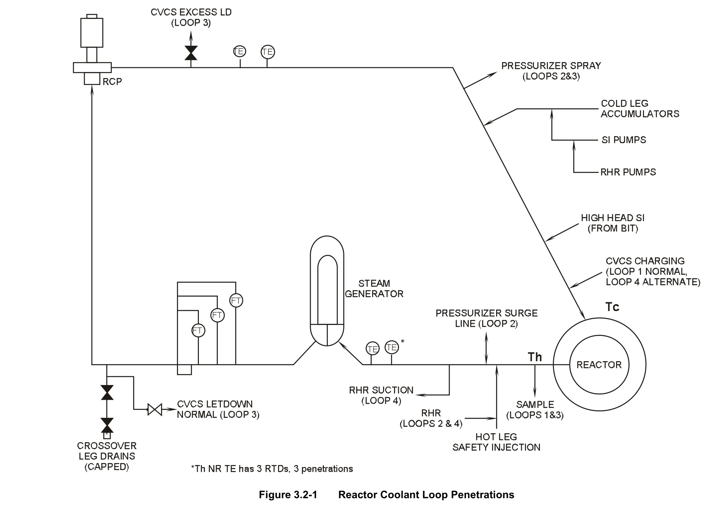

*Reactor Coolant Loop Penetrations*

[Vector original (SVG, lossless): fig_3.2-1.svg](../figures/fig_3.2-1.svg)

<!-- p.335 -->
#### Figure 3.2-2

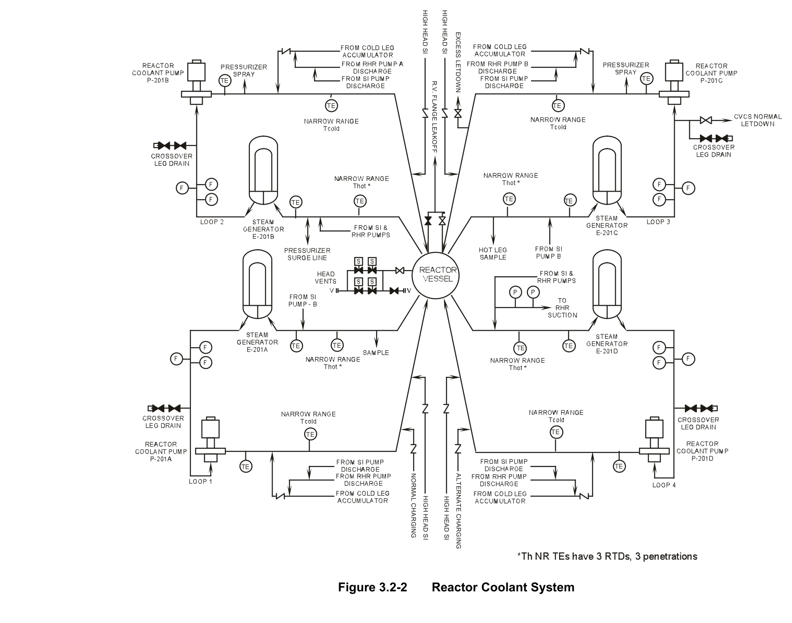

*Reactor Coolant System*

[Vector original (SVG, lossless): fig_3.2-2.svg](../figures/fig_3.2-2.svg)

<!-- labels/text on this figure page -->
HIGH HEAD SI HIGH HEAD SI EXCESS LETDOWN R.V. FLANGE LEAKOFF
NORMAL CHARGING ALTERNATE CHARGING HIGH HEAD SI HIGH HEAD SI
Figure 3.2-2 Reactor Coolant System

<!-- p.336 -->
#### Figure 3.2-3

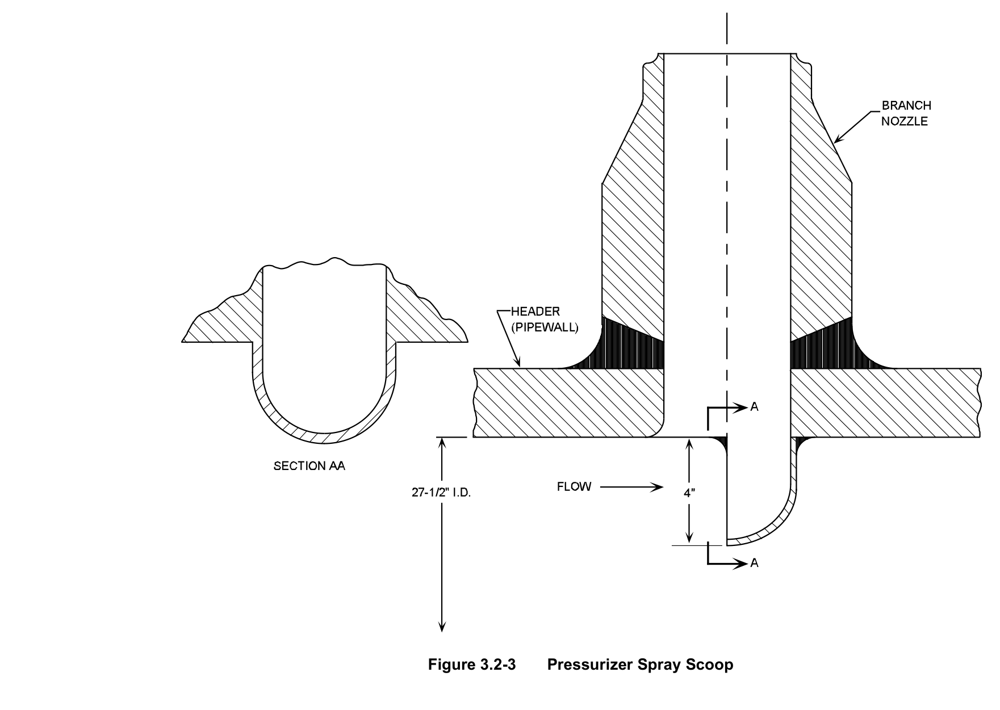

*Pressurizer Spray Scoop*

[Vector original (SVG, lossless): fig_3.2-3.svg](../figures/fig_3.2-3.svg)

<!-- p.337 -->
#### Figure 3.2-4

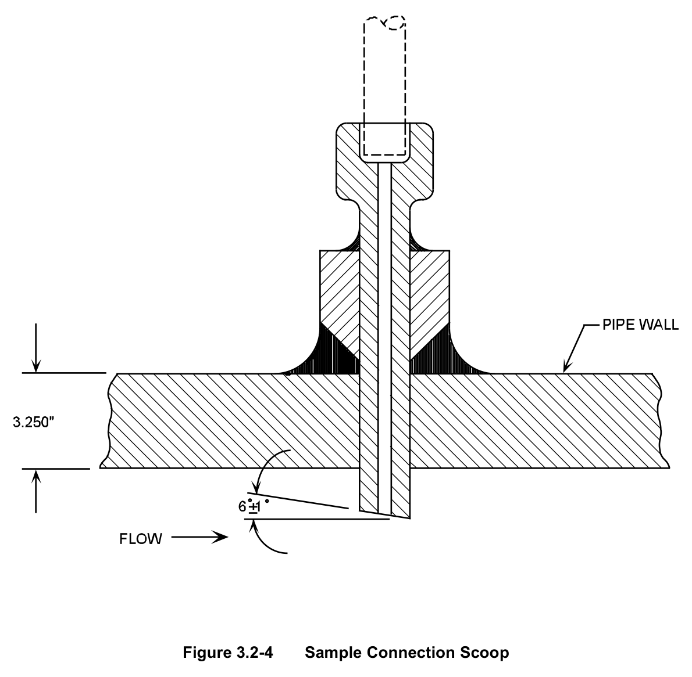

*Sample Connection Scoop*

[Vector original (SVG, lossless): fig_3.2-4.svg](../figures/fig_3.2-4.svg)

<!-- p.338 -->
#### Figure 3.2-5

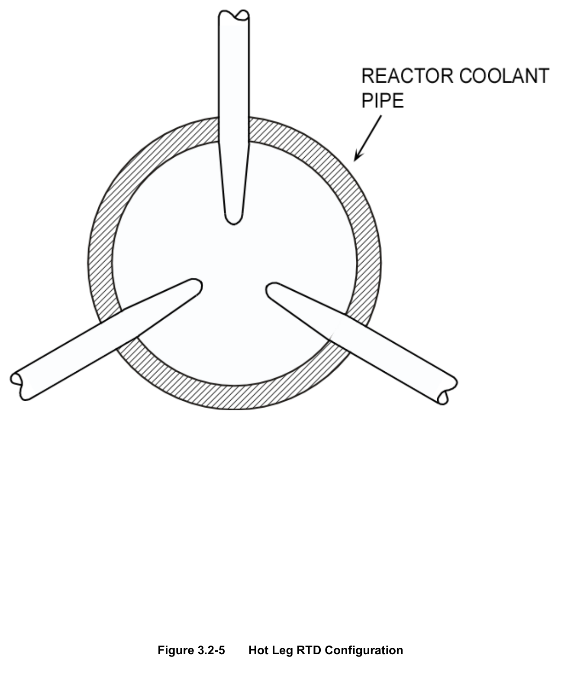

*Hot Leg RTD Configuration*

<!-- p.339 -->
#### Figure 3.2-6

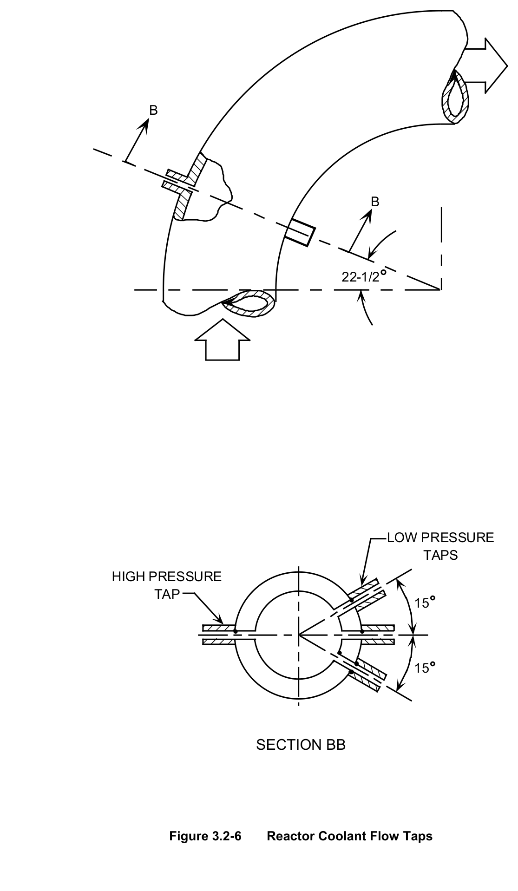

*Reactor Coolant Flow Taps*

[Vector original (SVG, lossless): fig_3.2-6.svg](../figures/fig_3.2-6.svg)

<!-- labels/text on this figure page -->
B
B
22-1/2
LOW PRESSURE TAPS HIGH PRESSURE TAP 15
15
SECTION BB
Figure 3.2-6 Reactor Coolant Flow Taps

<!-- p.340 -->
#### Figure 3.2-7

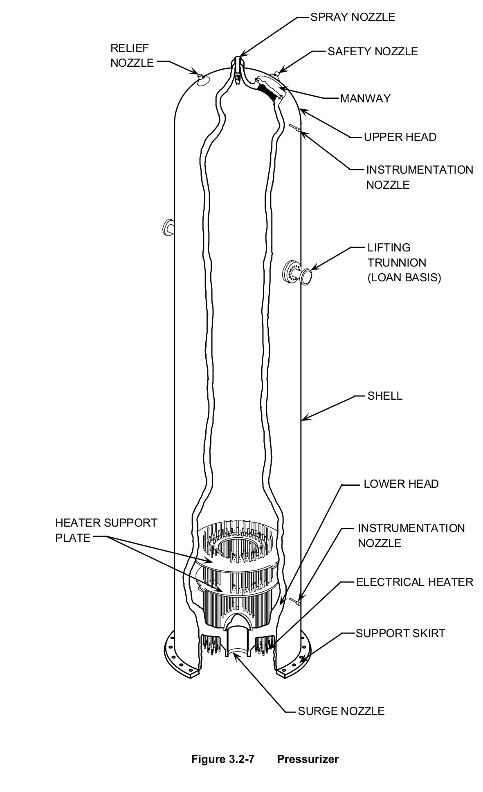

*Pressurizer*

[Vector original (SVG, lossless): fig_3.2-7.svg](../figures/fig_3.2-7.svg)

<!-- labels/text on this figure page -->
SPRAY NOZZLE
RELIEF SAFETY NOZZLE NOZZLE
MANWAY
UPPER HEAD
INSTRUMENTATION NOZZLE
LIFTING TRUNNION
(LOAN BASIS)
SHELL
LOWER HEAD
HEATER SUPPORT INSTRUMENTATION PLATE NOZZLE
ELECTRICAL HEATER
SUPPORT SKIRT
SURGE NOZZLE
Figure 3.2-7 Pressurizer

<!-- p.341 -->
#### Figure 3.2-8

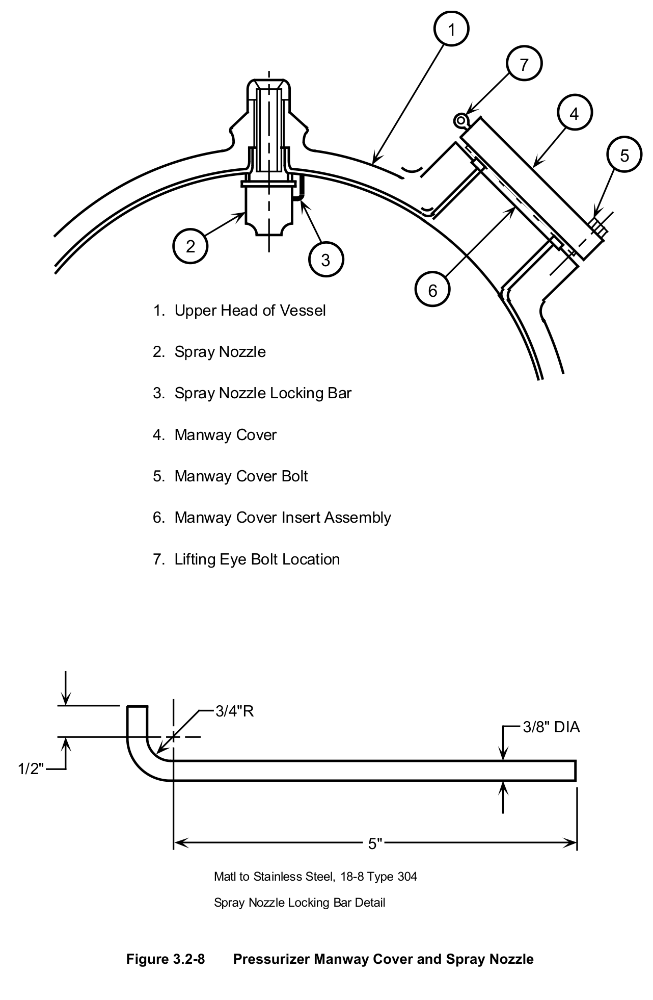

*Pressurizer Manway Cover and Spray Nozzle*

[Vector original (SVG, lossless): fig_3.2-8.svg](../figures/fig_3.2-8.svg)

<!-- labels/text on this figure page -->
1
7
4
5
2 3 6
1. Upper Head of Vessel
2. Spray Nozzle
3. Spray Nozzle Locking Bar
4. Manway Cover
5. Manway Cover Bolt
6. Manway Cover Insert Assembly
7. Lifting Eye Bolt Location
3/4"R 3/8" DIA
1/2"
5"
Matl to Stainless Steel, 18-8 Type 304
Spray Nozzle Locking Bar Detail
Figure 3.2-8 Pressurizer Manway Cover and Spray Nozzle

<!-- p.342 -->
#### Figure 3.2-9

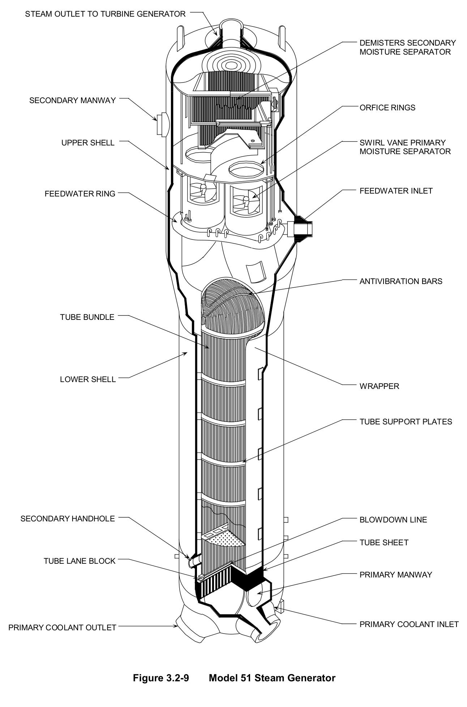

*Model 51 Steam Generator*

[Vector original (SVG, lossless): fig_3.2-9.svg](../figures/fig_3.2-9.svg)

<!-- labels/text on this figure page -->
STEAM OUTLET TO TURBINE GENERATOR
DEMISTERS SECONDARY MOISTURE SEPARATOR
SECONDARY MANWAY ORFICE RINGS
SWIRL VANE PRIMARY UPPER SHELL MOISTURE SEPARATOR
FEEDWATER INLET FEEDWATER RING
ANTIVIBRATION BARS
TUBE BUNDLE
LOWER SHELL WRAPPER
TUBE SUPPORT PLATES
SECONDARY HANDHOLE BLOWDOWN LINE
TUBE SHEET
TUBE LANE BLOCK PRIMARY MANWAY
PRIMARY COOLANT INLET PRIMARY COOLANT OUTLET
Figure 3.2-9 Model 51 Steam Generator

<!-- p.343 -->
#### Figure 3.2-10

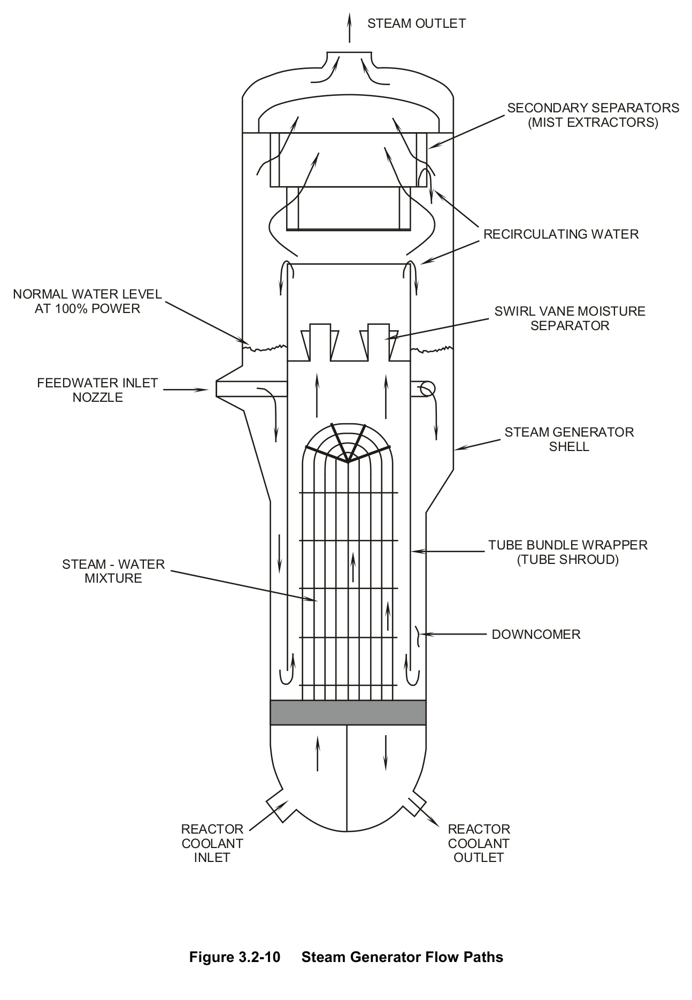

*Steam Generator Flow Paths*

[Vector original (SVG, lossless): fig_3.2-10.svg](../figures/fig_3.2-10.svg)

<!-- labels/text on this figure page -->
STEAM OUTLET
SECONDARY SEPARATORS
(MIST EXTRACTORS)
RECIRCULATING WATER
NORMAL WATER LEVEL AT 100% POWER SWIRL VANE MOISTURE SEPARATOR
FEEDWATER INLET NOZZLE
STEAM GENERATOR SHELL
TUBE BUNDLE WRAPPER
(TUBE SHROUD)
STEAM - WATER MIXTURE
DOWNCOMER
REACTOR REACTOR COOLANT COOLANT INLET OUTLET
Figure 3.2-10 Steam Generator Flow Paths

<!-- p.344 -->
#### Figure 3.2-11

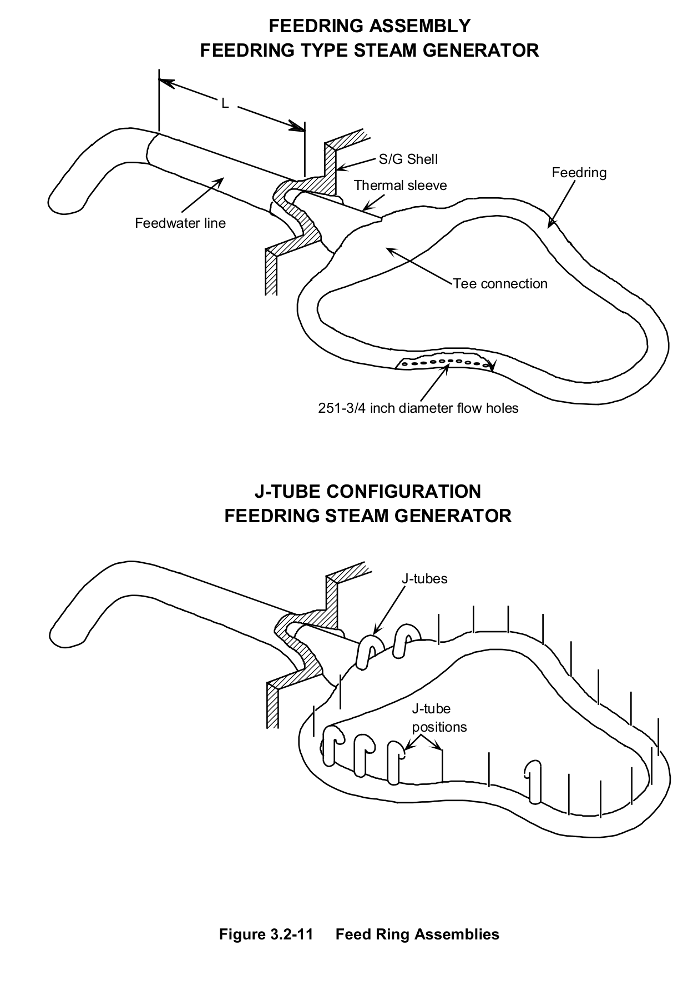

*Feed Ring Assemblies*

[Vector original (SVG, lossless): fig_3.2-11.svg](../figures/fig_3.2-11.svg)

<!-- labels/text on this figure page -->
FEEDRING ASSEMBLY
FEEDRING TYPE STEAM GENERATOR
L
S/G Shell Feedring Thermal sleeve
Feedwater line
Tee connection
251-3/4 inch diameter flow holes
J-TUBE CONFIGURATION
FEEDRING STEAM GENERATOR
J-tubes
J-tube positions
Figure 3.2-11 Feed Ring Assemblies

<!-- p.345 -->
#### Figure 3.2-12

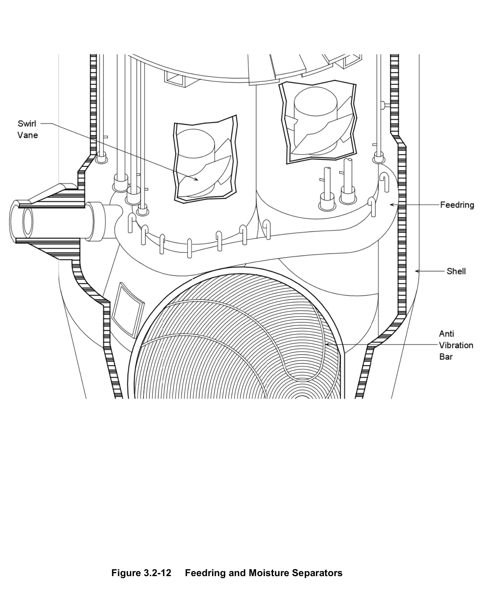

*Feedring and Moisture Separators*

<!-- p.346 -->
#### Figure 3.2-13

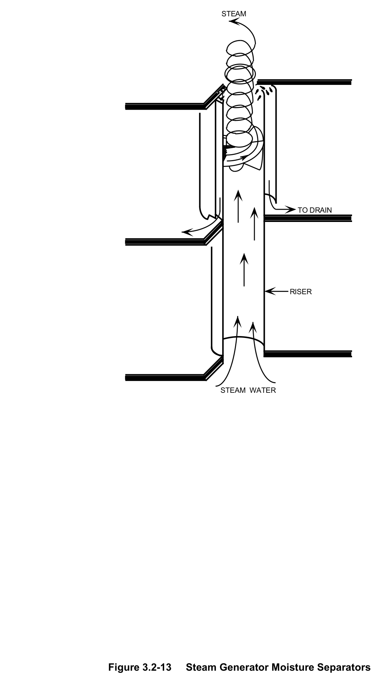

*Steam Generator Moisture Separators*

[Vector original (SVG, lossless): fig_3.2-13.svg](../figures/fig_3.2-13.svg)

<!-- labels/text on this figure page -->
STEAM
TO DRAIN
RISER
STEAM WATER
Figure 3.2-13 Steam Generator Moisture Separators

<!-- p.347 -->
#### Figure 3.2-14

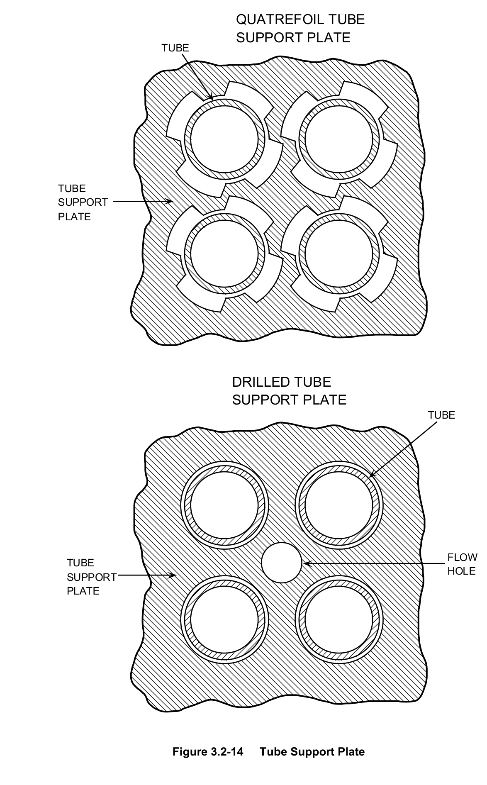

*Tube Support Plate*

[Vector original (SVG, lossless): fig_3.2-14.svg](../figures/fig_3.2-14.svg)

<!-- labels/text on this figure page -->
QUATREFOIL TUBE SUPPORT PLATE TUBE
TUBE SUPPORT PLATE
DRILLED TUBE SUPPORT PLATE TUBE
FLOW TUBE HOLE SUPPORT PLATE
Figure 3.2-14 Tube Support Plate

<!-- p.348 -->
#### Figure 3.2-15

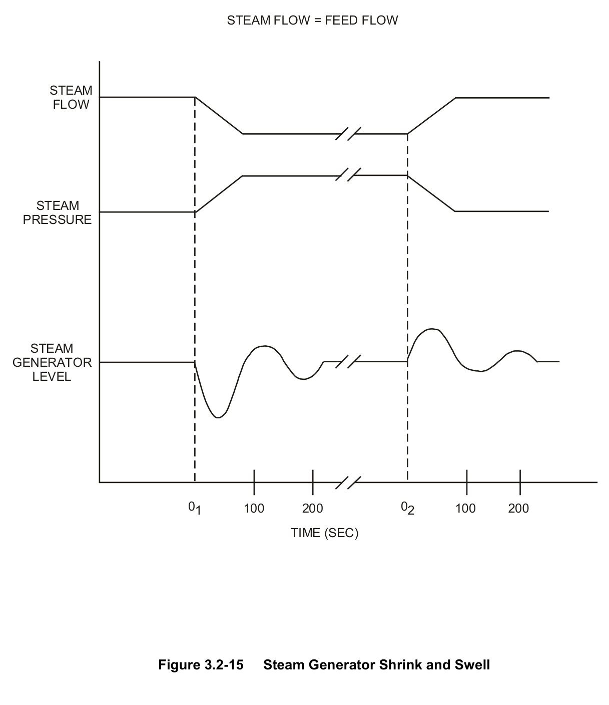

*Steam Generator Shrink and Swell*

[Vector original (SVG, lossless): fig_3.2-15.svg](../figures/fig_3.2-15.svg)

<!-- labels/text on this figure page -->
STEAM FLOW = FEED FLOW
STEAM FLOW
STEAM PRESSURE
STEAM GENERATOR LEVEL
02 100 200 100 200 01 TIME (SEC)
Figure 3.2-15 Steam Generator Shrink and Swell

<!-- p.349 -->
#### Figure 3.2-16

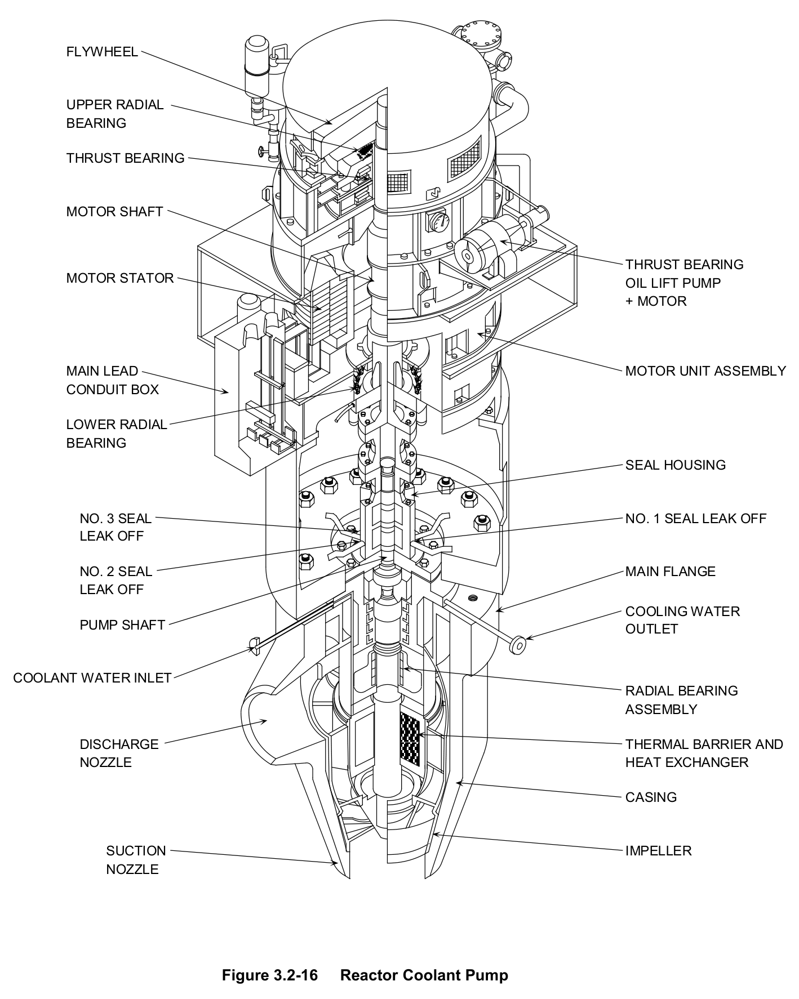

*Reactor Coolant Pump*

[Vector original (SVG, lossless): fig_3.2-16.svg](../figures/fig_3.2-16.svg)

<!-- labels/text on this figure page -->
FLYWHEEL
UPPER RADIAL BEARING
THRUST BEARING
MOTOR SHAFT
THRUST BEARING MOTOR STATOR OIL LIFT PUMP + MOTOR
MOTOR UNIT ASSEMBLY MAIN LEAD CONDUIT BOX
LOWER RADIAL BEARING SEAL HOUSING
NO. 1 SEAL LEAK OFF NO. 3 SEAL LEAK OFF
MAIN FLANGE NO. 2 SEAL LEAK OFF COOLING WATER PUMP SHAFT OUTLET
COOLANT WATER INLET RADIAL BEARING ASSEMBLY
THERMAL BARRIER AND DISCHARGE HEAT EXCHANGER NOZZLE
CASING
IMPELLER SUCTION NOZZLE
Figure 3.2-16 Reactor Coolant Pump

<!-- p.350 -->
#### Figure 3.2-17

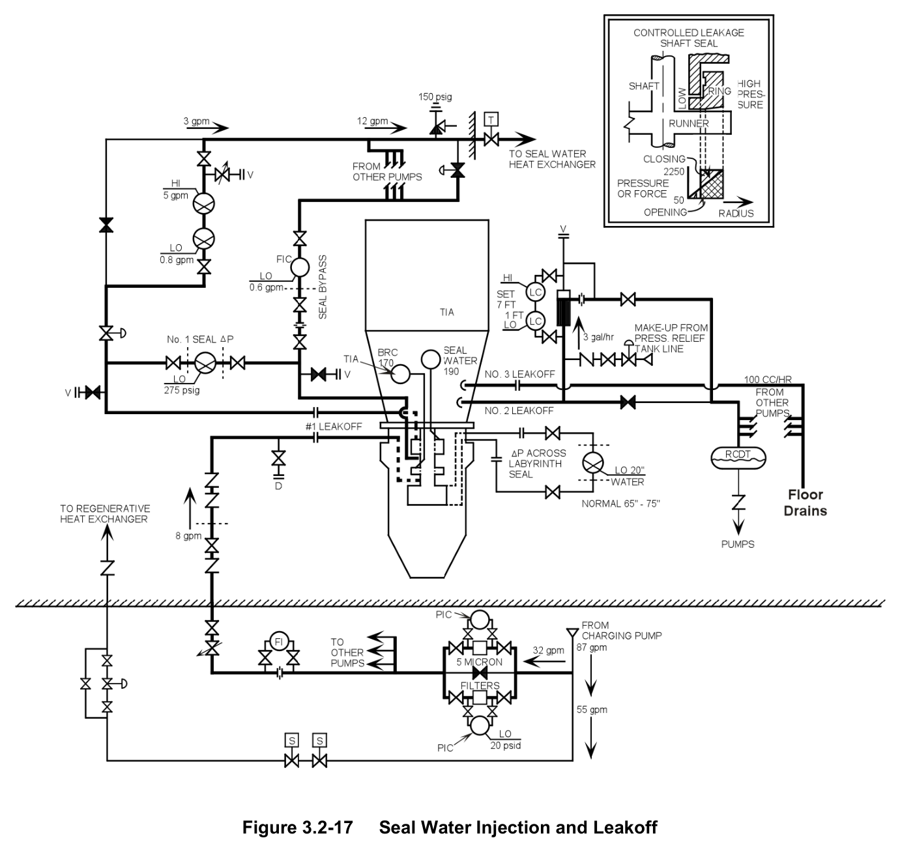

*Seal Water Injection and Leakoff*

<!-- p.351 -->
#### Figure 3.2-18

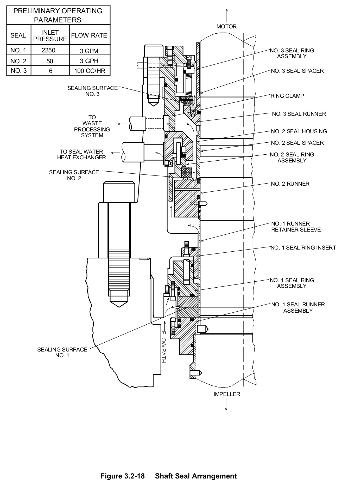

*Shaft Seal Arrangement*

[Vector original (SVG, lossless): fig_3.2-18.svg](../figures/fig_3.2-18.svg)

<!-- labels/text on this figure page -->
PRELIMINARY OPERATING PARAMETERS MOTOR INLET SEAL PRESSURE FLOW RATE NO. 1 2250 3 GPM NO. 3 SEAL RING ASSEMBLY NO. 2 50 3 GPH NO. 3 6 100 CC/HR NO. 3 SEAL SPACER
SEALING SURFACE NO. 3 RING CLAMP
NO. 3 SEAL RUNNER TO WASTE PROCESSING NO. 2 SEAL HOUSING SYSTEM NO. 2 SEAL SPACER TO SEAL WATER NO. 2 SEAL RING HEAT EXCHANGER ASSEMBLY
SEALING SURFACE NO. 2 NO. 2 RUNNER
NO. 1 RUNNER RETAINER SLEEVE
NO. 1 SEAL RING INSERT
NO. 1 SEAL RING ASSEMBLY
NO. 1 SEAL RUNNER ASSEMBLY
SEALING SURFACE NO. 1
IMPELLER
Figure 3.2-18 Shaft Seal Arrangement

<!-- p.352 -->
#### Figure 3.2-19

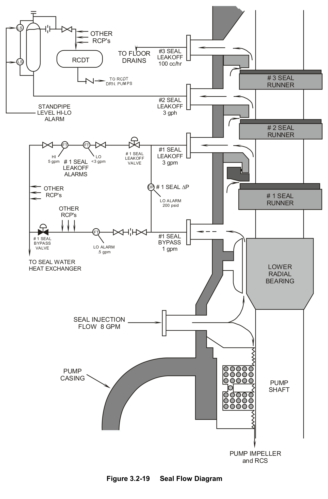

*Seal Flow Diagram*

[Vector original (SVG, lossless): fig_3.2-19.svg](../figures/fig_3.2-19.svg)

<!-- labels/text on this figure page -->
LS OTHER RCP's #3 SEAL TO FLOOR LEAKOFF RCDT DRAINS LS 100 cc/hr
# 3 SEAL RUNNER
#2 SEAL LEAKOFF STANDPIPE LEVEL HI-LO 3 gph ALARM # 2 SEAL RUNNER
FT FT #1 SEAL # 1 SEAL LEAKOFF HI LO LEAKOFF 5 gpm # 1 SEAL <3 gpm 3 gpm VALVE LEAKOFF ALARMS
# 1 SEAL ∆P OTHER DP RCP's # 1 SEAL LO ALARM RUNNER 200 psid OTHER RCP's
FT #1 SEAL # 1 SEAL BYPASS BYPASS LO ALARM 1 gpm VALVE .5 gpm
TO SEAL WATER LOWER HEAT EXCHANGER RADIAL BEARING
SEAL INJECTION FLOW 8 GPM
PUMP CASING PUMP SHAFT
PUMP IMPELLER and RCS
Figure 3.2-19 Seal Flow Diagram

<!-- p.353 -->
#### Figure 3.2-20

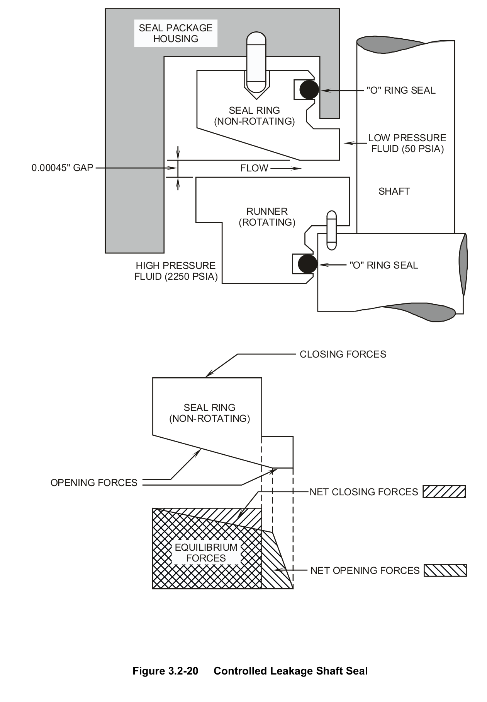

*Controlled Leakage Shaft Seal*

[Vector original (SVG, lossless): fig_3.2-20.svg](../figures/fig_3.2-20.svg)

<!-- labels/text on this figure page -->
SEAL PACKAGE HOUSING
"O" RING SEAL
SEAL RING
(NON-ROTATING)
LOW PRESSURE FLUID (50 PSIA)
0.00045" GAP FLOW
SHAFT
RUNNER
(ROTATING)
"O" RING SEAL HIGH PRESSURE FLUID (2250 PSIA)
CLOSING FORCES
SEAL RING
(NON-ROTATING)
OPENING FORCES NET CLOSING FORCES
EQUILIBRIUM FORCES NET OPENING FORCES
Figure 3.2-20 Controlled Leakage Shaft Seal

<!-- p.354 -->
#### Figure 3.2-21

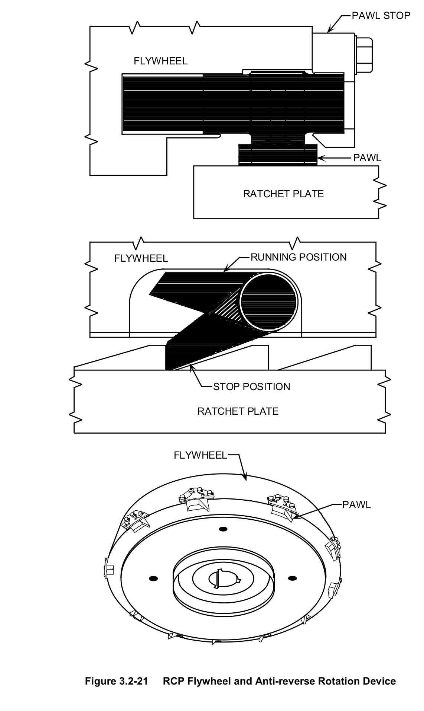

*RCP Flywheel and Anti-reverse Rotation Device*

[Vector original (SVG, lossless): fig_3.2-21.svg](../figures/fig_3.2-21.svg)

<!-- labels/text on this figure page -->
PAWL STOP
FLYWHEEL
PAWL
RATCHET PLATE
RUNNING POSITION FLYWHEEL
STOP POSITION
RATCHET PLATE
FLYWHEEL
PAWL
Figure 3.2-21 RCP Flywheel and Anti-reverse Rotation Device

<!-- p.355 -->
#### Figure 3.2-22

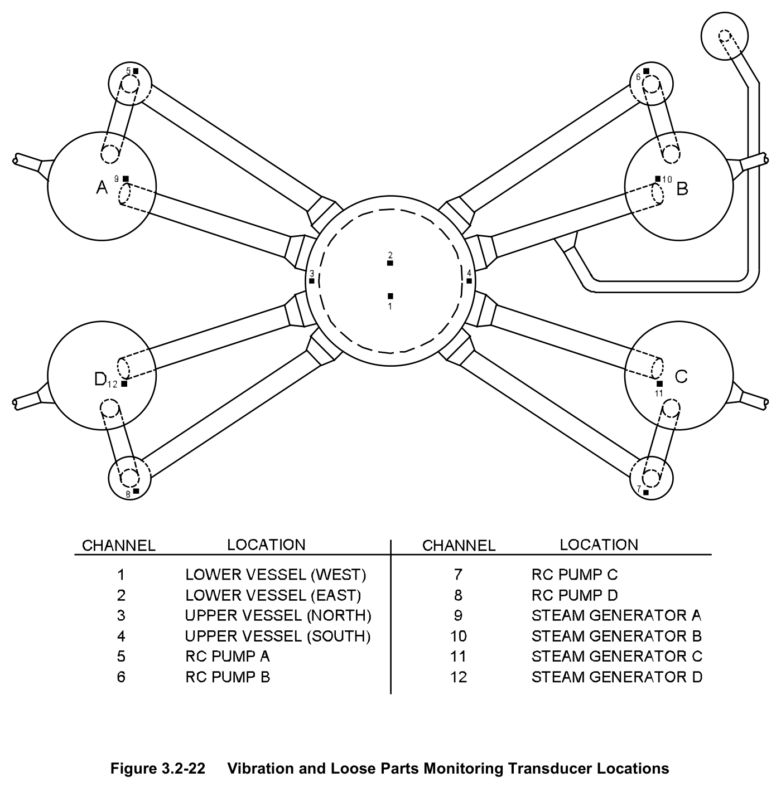

*Vibration and Loose Parts Monitoring Transducer Locations*

[Vector original (SVG, lossless): fig_3.2-22.svg](../figures/fig_3.2-22.svg)

<!-- p.356 -->
#### Figure 3.2-23

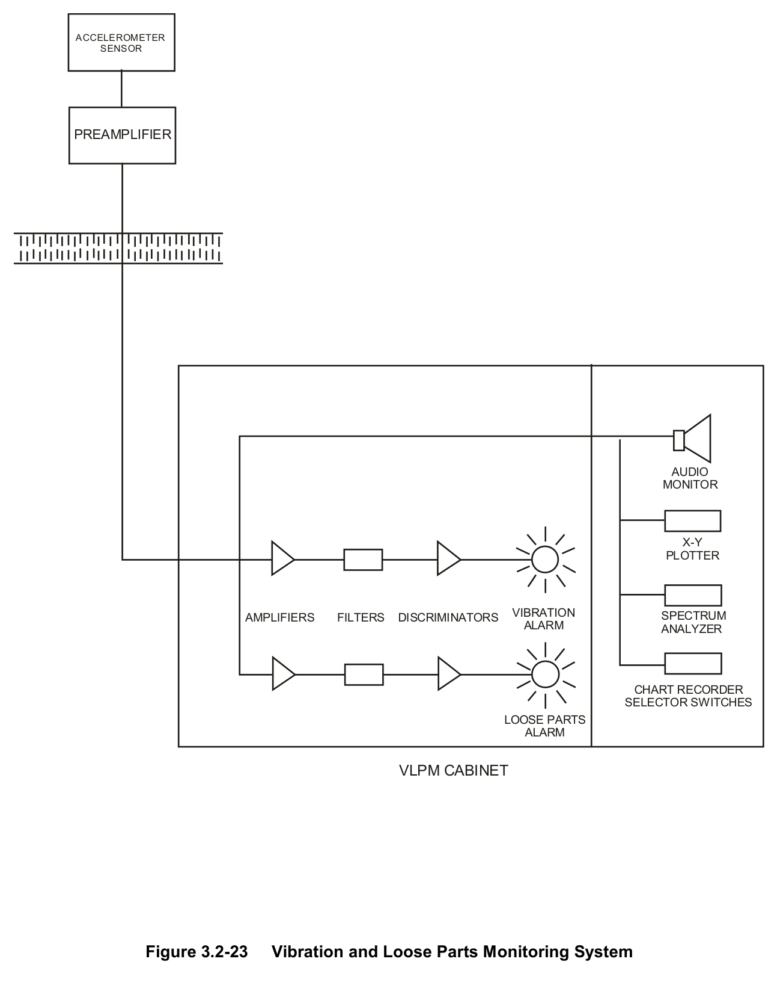

*Vibration and Loose Parts Monitoring System*

[Vector original (SVG, lossless): fig_3.2-23.svg](../figures/fig_3.2-23.svg)

<!-- labels/text on this figure page -->
ACCELEROMETER SENSOR
PREAMPLIFIER
AUDIO MONITOR
X-Y PLOTTER
VIBRATION SPECTRUM AMPLIFIERS FILTERS DISCRIMINATORS ALARM ANALYZER
CHART RECORDER SELECTOR SWITCHES LOOSE PARTS ALARM
VLPM CABINET
Figure 3.2-23 Vibration and Loose Parts Monitoring System

<!-- p.357 -->
#### Figure 3.2-24

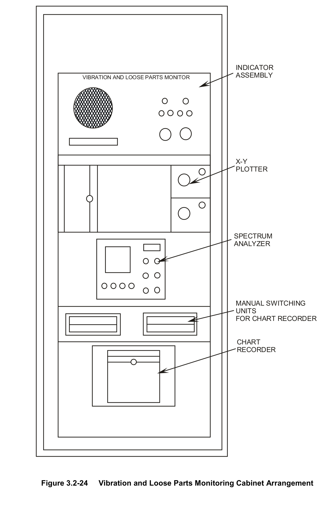

*Vibration and Loose Parts Monitoring Cabinet Arrangement*

[Vector original (SVG, lossless): fig_3.2-24.svg](../figures/fig_3.2-24.svg)

<!-- labels/text on this figure page -->
INDICATOR ASSEMBLY VIBRATION AND LOOSE PARTS MONITOR
X-Y PLOTTER
SPECTRUM ANALYZER
MANUAL SWITCHING UNITS FOR CHART RECORDER
CHART RECORDER
Figure 3.2-24 Vibration and Loose Parts Monitoring Cabinet Arrangement

<!-- p.358 -->
#### Figure 3.2-25

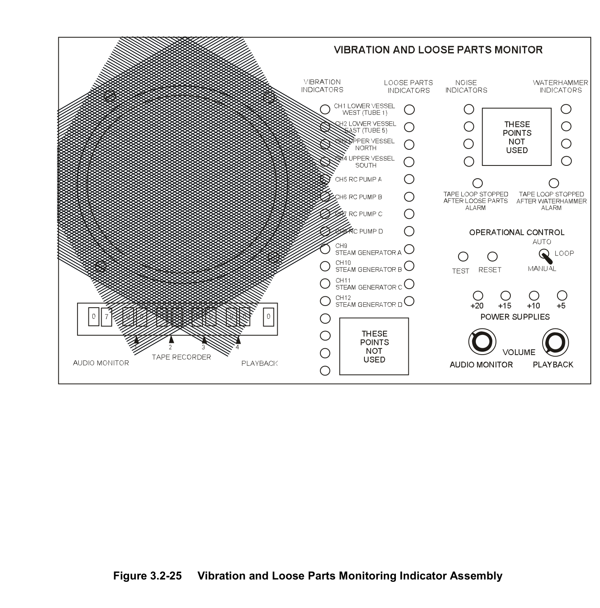

*Vibration and Loose Parts Monitoring Indicator Assembly*

[Vector original (SVG, lossless): fig_3.2-25.svg](../figures/fig_3.2-25.svg)

<!-- p.359 -->
#### Figure 3.2-26

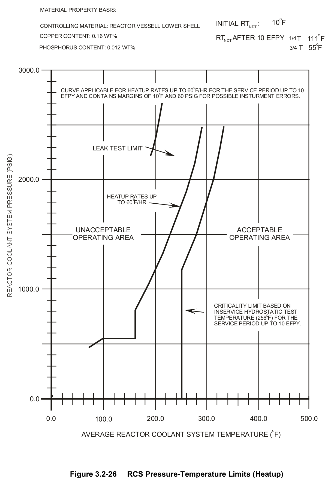

*RCS Pressure-Temperature Limits (Heatup)*

[Vector original (SVG, lossless): fig_3.2-26.svg](../figures/fig_3.2-26.svg)

<!-- labels/text on this figure page -->
MATERIAL PROPERTY BASIS:
10 F O INITIAL RT :
CONTROLLING MATERIAL: REACTOR VESSELL LOWER SHELL NDT
COPPER CONTENT: 0.16 WT% RT AFTER 10 EFPY O 1/4 T 111 F NDT T 55 F O 3/4 PHOSPHORUS CONTENT: 0.012 WT%
3000.0
O CURVE APPLICABLE FOR HEATUP RATES UP TO 60 F/HR FOR THE SERVICE PERIOD UP TO 10 EFPY AND CONTAINS MARGINS OF 10 F AND 60 PSIG FOR POSSIBLE INSTURMENT ERRORS. O
LEAK TEST LIMIT
2000.0
HEATUP RATES UP O TO 60 F/HR
UNACCEPTABLE ACCEPTABLE OPERATING AREA OPERATING AREA
1000.0
CRITICALITY LIMIT BASED ON INSERVICE HYDROSTATIC TEST O TEMPERATURE (256 F) FOR THE SERVICE PERIOD UP TO 10 EFPY.
0.0
0.0 200.0 300.0 400.0 500.0 100.0
O AVERAGE REACTOR COOLANT SYSTEM TEMPERATURE ( F)
Figure 3.2-26 RCS Pressure-Temperature Limits (Heatup)

<!-- p.360 -->
#### Figure 3.2-27

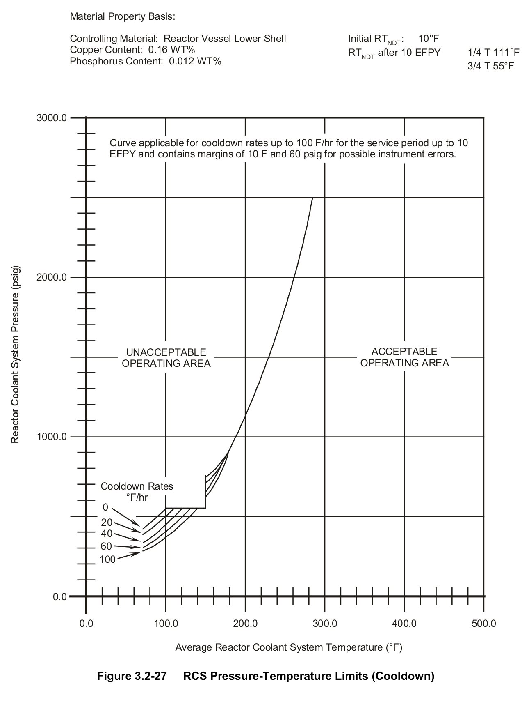

*RCS Pressure-Temperature Limits (Cooldown)*

[Vector original (SVG, lossless): fig_3.2-27.svg](../figures/fig_3.2-27.svg)

<!-- labels/text on this figure page -->
Material Property Basis:
Controlling Material: Reactor Vessel Lower Shell Initial RTNDT: 10°F Copper Content: 0.16 WT% RTNDT after 10 EFPY 1/4 T 111°F Phosphorus Content: 0.012 WT% 3/4 T 55°F
3000.0
Curve applicable for cooldown rates up to 100 F/hr for the service period up to 10 EFPY and contains margins of 10 F and 60 psig for possible instrument errors.
2000.0
ACCEPTABLE UNACCEPTABLE OPERATING AREA OPERATING AREA
1000.0
Cooldown Rates °F/hr 0 20 40 60 100
0.0
0.0 100.0 200.0 300.0 400.0 500.0
Average Reactor Coolant System Temperature (°F)
Figure 3.2-27 RCS Pressure-Temperature Limits (Cooldown)

<!-- p.361 -->
#### Figure 3.2-28

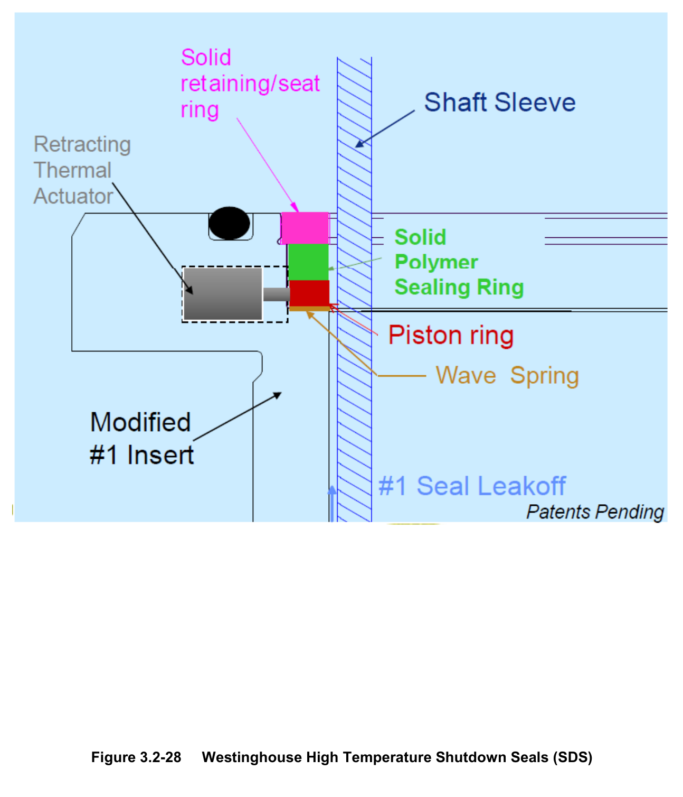

*Westinghouse High Temperature Shutdown Seals (SDS)*

