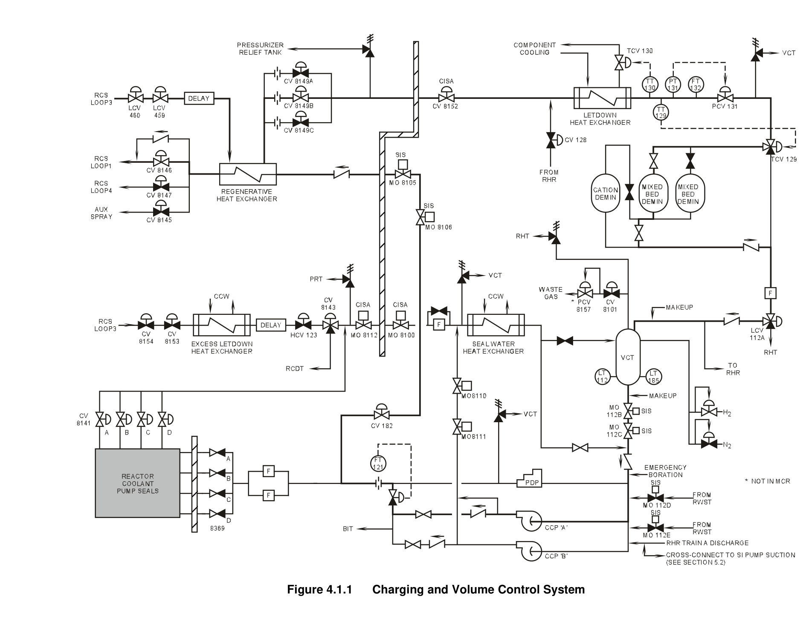
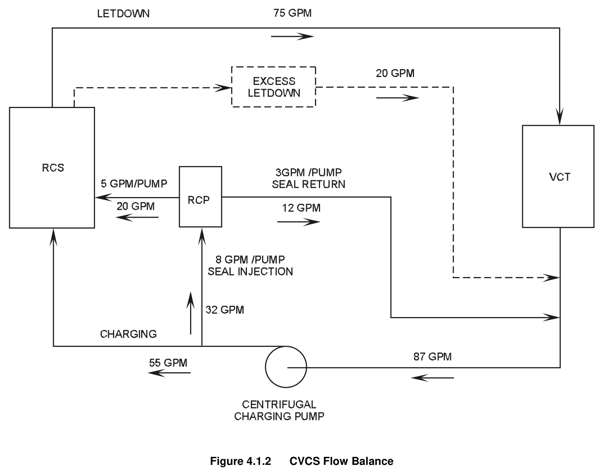
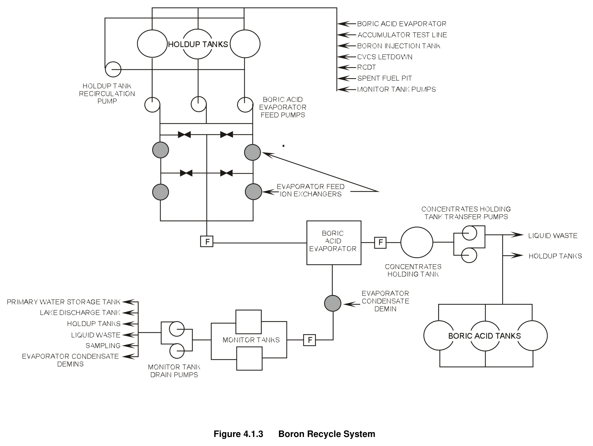
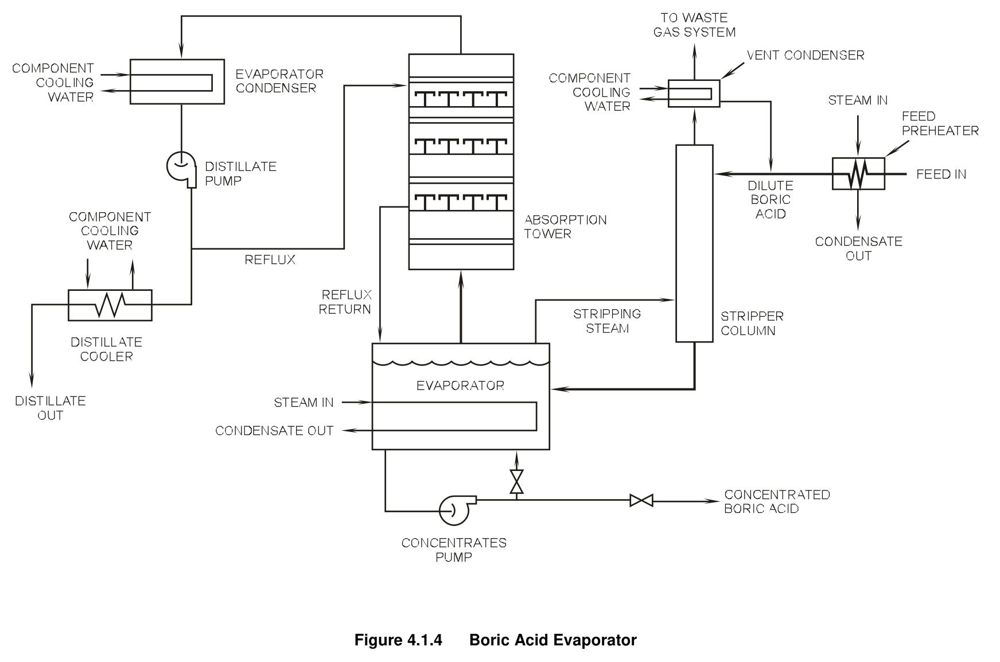
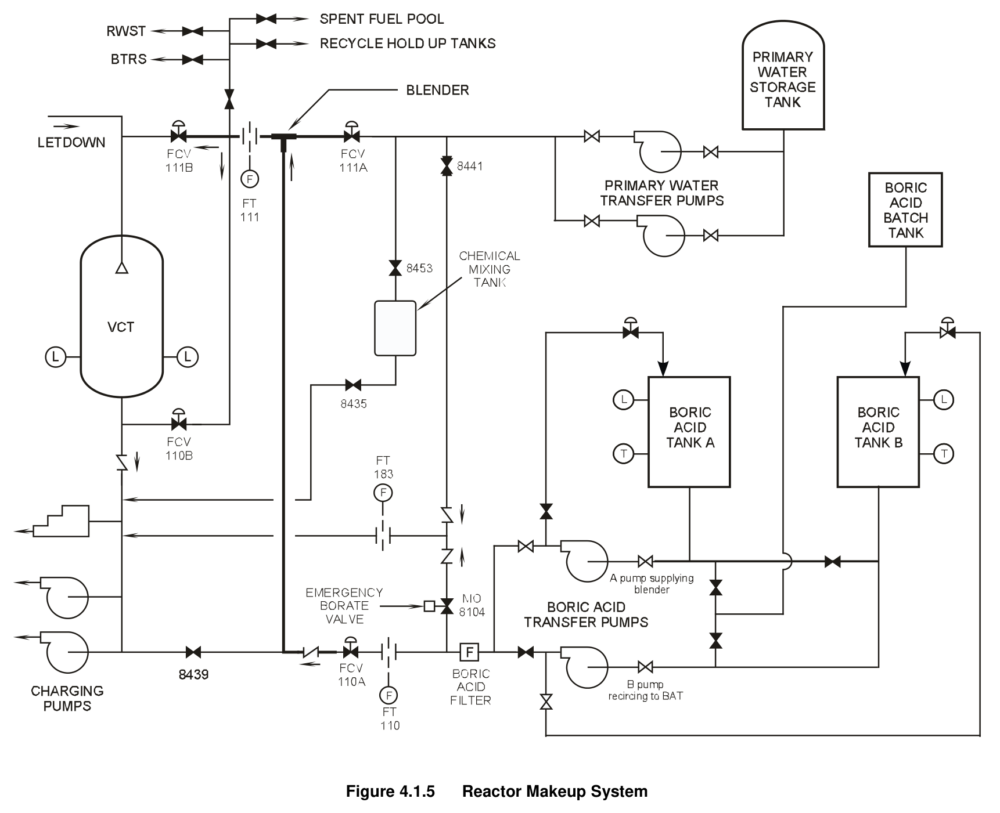
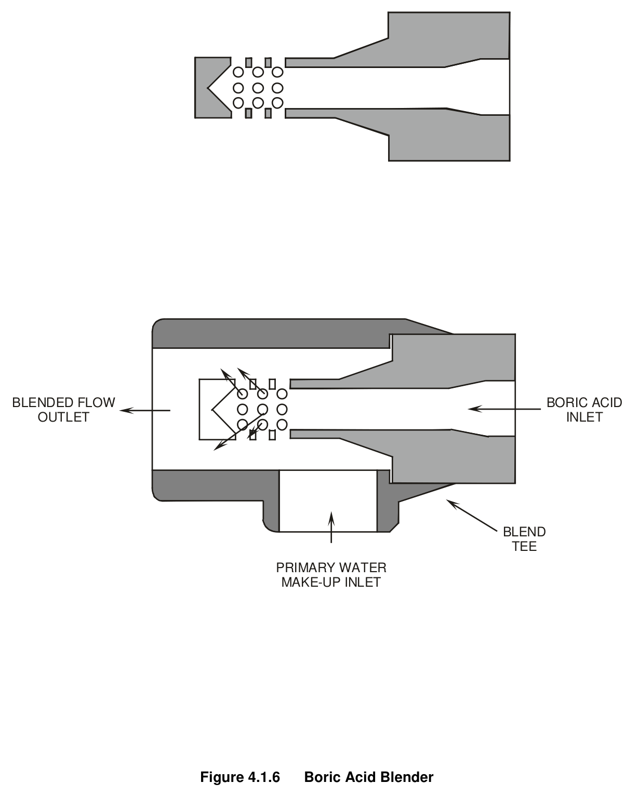
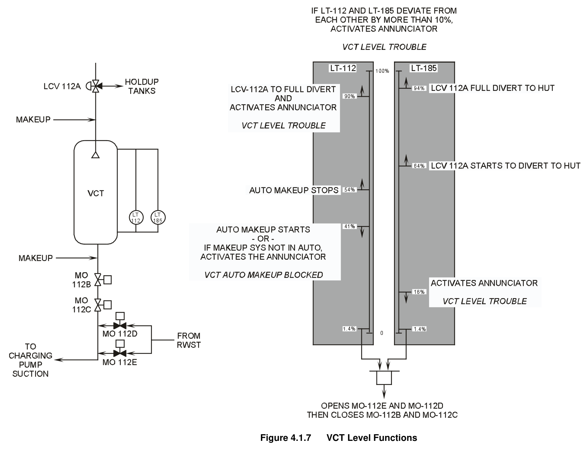

# 04.1 CVCS

> Pages 362–390 of `ML20057E160.pdf`
> Westinghouse Technology Systems Manual — USNRC HRTD (PWR)

---
<!-- p.362 -->
#### Westinghouse Technology Systems Manual
#### Section 4.1
#### Chemical and Volume Control System
<!-- p.363 -->
TABLE OF CONTENTS

4.1 Chemical and Volume Control System .................................................... 4.1-1

4.1.1 Introduction .............................................................................................. 4.1-2

4.1.2 System Description .................................................................................. 4.1-2

4.1.2.1 Letdown .................................................................................... 4.1-2

4.1.2.2 Volume Control Tank ................................................................ 4.1-3

4.1.2.3 Reactor Makeup and Chemical Addition ................................... 4.1-3

4.1.2.4 Charging ................................................................................... 4.1-3

4.1.2.5 Excess Letdown ........................................................................ 4.1-4

4.1.2.6 Boron Recovery (Recycle) System ........................................... 4.1-5

4.1.3 Component Descriptions .......................................................................... 4.1-6

4.1.3.1 Letdown Components ............................................................... 4.1-6

4.1.3.2 Reactor Makeup System Components .................................... 4.1-10

4.1.3.3 Charging Components ............................................................ 4.1-15

4.1.3.4 Seal Injection and Seal Return ................................................ 4.1-17

4.1.3.5 Excess Letdown ...................................................................... 4.1-17

4.1.4 System Features and Interrelations ....................................................... 4.1-18

4.1.4.1 Deborating Ion Exchangers ..................................................... 4.1-18

4.1.4.2 Boron Thermal Regeneration System ..................................... 4.1-18

4.1.4.3 Boron Concentration Monitoring System ................................. 4.1-18

4.1.4.4 Pressurizer Level Control ........................................................ 4.1-19

4.1.4.5 Purification during Residual Heat Removal Operation ............ 4.1-19

4.1.4.6 CVCS Alignment during ECCS Operation ............................... 4.1-19

4.1.4.7 Volume Control Tank Level Functions .................................... 4.1-20

4.1.5 Summary ............................................................................................... 4.1-20

LIST OF FIGURES

Figure 4.1.1 .................................................................. Charging and Volume Control System

Figure 4.1.2 .................................................................................................... CVCS Flow Balance

Figure 4.1.3 ............................................................................................... Boron Recycle System

Figure 4.1.4 ................................................................................................. Boric Acid Evaporator

Figure 4.1.5 ............................................................................................ Reactor Makeup System

Figure 4.1.6 ....................................................................................................... Boric Acid Blender

Figure 4.1.7 ................................................................................................... VCT Level Functions

USNRC HRTD 4.1-i Rev 1013

<!-- p.364 -->
### 4.1 CHEMICAL AND VOLUME CONTROL SYSTEM
#### Learning Objectives:
1. List the purposes of the Chemical and Volume Control System (CVCS).

2. List in flowpath order and state the purposes of the following major components of the CVCS:

a. Regenerative heat exchanger b. Letdown orifice c. Letdown heat exchanger d. Demineralizers (ion exchangers)
e. Letdown filter f. Volume control tank (VCT)
g. Charging pump

3. Identify the components in the CVCS that are used to purify the reactor coolant and the types of contaminants each is designed to remove.

4. Describe how the makeup system is used to borate, dilute, and make up a blended flow of boric acid and primary water to, the reactor coolant system
(RCS).

5. Explain why and for what plant conditions the following chemicals are added to the RCS:

a. Lithium hydroxide b. Hydrogen c. Hydrazine

6. Describe the emergency boration flow path, and identify the plant conditions which would require its use.

7. State the purpose of the connection between the Residual Heat Removal (RHR)
System and CVCS letdown.

8. List the plant operations that result in large amounts of influent into the Boron Recovery System (BRS).

9. Identify the changes in the CVCS that occur upon receipt of engineered safety features actuation signals.

10. Explain how the CVCS is designed to prevent the following:

a. Flashing and pressure transients in the regenerative and nonregenerative heat exchangers, b. Loss of suction to the charging pumps, c. High temperature in the letdown ion exchangers (demineralizers), and d. Overpressurization of the volume control tank.

USNRC HRTD 4.1-1 Rev 1013

<!-- p.365 -->
11. State when and why excess letdown would be used.

12. List the automatic actions initiated by VCT level instrumentation.

#### 4.1.1 Introduction
The chemical and volume control system is a Seismic Category I system. Its purposes are to:

1. Adjust the reactor coolant boric acid concentration,
2. Maintain the proper water inventory in the RCS in conjunction with the pressurizer level control system,
3. Provide seal water flow to the reactor coolant pump shaft seals, 4. Add corrosion inhibiting chemicals to the reactor coolant, 5. Purify the reactor coolant in order to maintain it within its design activity limits, 6. Provide borated water for emergency core cooling, 7. Process reactor coolant for the reuse of boric acid and reactor makeup water in the boron recovery system, 8. Degasify the reactor coolant, and 9. Provide a means of emergency boration of the reactor coolant.

Discussions of these purposes, a system description, and individual component descriptions are contained in subsequent paragraphs of this section.

#### 4.1.2 System Description
##### 4.1.2.1 Letdown
The CVCS letdown path, as shown in Figure 4.1-1, taps off of the intermediate section of the loop 3 cold leg piping through two series letdown isolation valves (LCV 459, 460). The reactor coolant, now referred to as letdown fluid, then flows through a delay pipe to the regenerative heat exchanger. The regenerative heat exchanger provides the initial cooling of the letdown fluid by preheating the returning charging flow. From the regenerative heat exchanger, the letdown fluid passes through one or more letdown orifices. The letdown orifice(s) controls the amount of reactor coolant that is let down (removed) from the RCS and provides the initial pressure reduction of this high pressure fluid. The letdown, after passing through the letdown orifices and isolation valves, exits the containment and flows through a containment isolation valve (CV-8152) to the letdown heat exchanger where the final cooling of this liquid occurs.

The letdown heat exchanger is cooled by the component cooling water (CCW)
system. This heat exchanger reduces the letdown fluid temperature to a value that is compatible with the ion exchanger (mixed bed demineralizer) resin. From the letdown heat exchanger the fluid is delivered to the letdown pressure control valve
(PCV-131). This valve is sometimes referred to as the back pressure regulator. The letdown pressure control valve automatically maintains a constant pressure of 340 psig in the section of letdown piping upstream of the letdown heat exchanger to

USNRC HRTD 4.1-2 Rev 1013

<!-- p.366 -->
prevent the letdown liquid from flashing to steam. The cooled and depressurized letdown is then directed to the mixed-bed demineralizers.

The mixed-bed demineralizers (ion exchangers) are designed to remove ionic impurities from the reactor coolant. The ion exchangers are called mixed-bed demineralizers because they contain a mixture of anion and cation resins. In addition to the mixed-bed demineralizers, a special-purpose ion exchanger, the cation demineralizer, is used when a reduction in the RCS lithium or cesium concentration is desired. All of the ion exchanger resins are temperature sensitive;
therefore, a temperature divert valve (TCV-129) bypasses letdown flow around the ion exchangers if the letdown heat exchanger outlet temperature rises to 137°F.
The next component in the letdown stream is the letdown filter. The letdown filter removes any resin fines (broken resin beads) that escape from the ion exchangers.
The purified, filtered letdown then flows to the volume control tank through a threeway valve. This three-way valve (LCV-112A) diverts the letdown to the boron recovery system (BRS) on a high level in the volume control tank. The VCT completes the portion of the CVCS known as the letdown path.

##### 4.1.2.2 Volume Control Tank
The volume control tank collects the coolant letdown and provides a suction reservoir and head for the charging pumps. The tank is pressurized with hydrogen gas. The hydrogen dissolves into the tank contents so that it can ultimately scavenge oxygen from the coolant in the reactor core.

##### 4.1.2.3 Reactor Makeup and Chemical Addition
The reactor makeup system (RMS) provides a method of supplying concentrated boric acid, demineralized reactor makeup water, or a mixture of both, to the volume control tank or the charging pump suction header. Chemicals such as lithium hydroxide and hydrazine may be added to the charging pump suction header via the chemical addition mixing tank (section 4.1.3.2).

##### 4.1.2.4 Charging
The charging portion of the system contains three pumps: two redundant centrifugal charging pumps and a positive displacement pump. Any of the pumps may be used to supply charging; however, a centrifugal charging pump is normally used. In addition to the charging function, the centrifugal charging pumps also serve as the high head safety injection pumps following emergency core cooling system actuation. During normal operation, the charging pumps supply both reactor coolant pump seal injection and normal charging requirements.

The seal injection portion of the system consists of seal injection filters and individual flow control valves to supply the required amount of seal injection flow to each reactor coolant pump.

The normal charging header contains a flow control valve (HCV-182) that divides flow between the seal injection header and the charging header. The charging header contains isolation valves to isolate the charging header during accident conditions. Downstream of the charging header isolation valves, MO-8105 and MO-

USNRC HRTD 4.1-3 Rev 1013

<!-- p.367 -->
8106, is the tube side of the regenerative heat exchanger, and three charging paths.
The charging paths allow the preheated charging flow to be directed to loop 1
(normal charging), to loop 4 (alternate charging), or to the pressurizer spray line
(auxiliary spray).

During normal steady-state operations, letdown is in service through one letdown orifice and a mixed-bed demineralizer, and then to the VCT. This flowpath allows continuous purification of the RCS. From the VCT, reactor coolant is returned to the RCS via the seal injection piping and the normal charging path by one of the charging pumps. Reactor coolant pump seal return flow is routed to the charging pump suction via the seal water heat exchanger.

A flow balance diagram of the CVCS is provided in Figure 4.1-2. Normally operators establish a letdown flow of 75 gpm. The pressurizer level control system (Chapter 10.3) balances this rate of coolant removal from the RCS by maintaining a charging pump discharge flow of 87 gpm, of which 55 gpm returns to the RCS via the normal charging line and 32 gpm flows to the reactor coolant pump (RCP) seals. This division of flow is determined by the position of valve HCV-182. Five gpm per RCP are returned to the RCS via the hydraulic chambers of the RCPs, for an RCS total of 20 gpm. This flow, plus the 55 gpm normal charging, results in a total of 75 gpm returning to the RCS, matching the letdown flow.

A flow balance is maintained on the VCT by the 75 gpm letdown and 12 gpm seal return into the VCT, and the 87 gpm output to the charging pump suctions. In reality, since 3 gph per RCP of the seal injection goes to the liquid waste system, slightly less than the 3 gpm per pump is returned to the VCT. Therefore, the VCT has a normal flow imbalance; that is, less entering the tank than leaving. As a result of this flow imbalance over a time period of several operating shifts, the automatic makeup system to the VCT or manual operator action makes up for this inventory loss.

##### 4.1.2.5 Excess Letdown
Certain plant evolutions, such as RCS heatup or the inoperability of the normal letdown path, may require the use of the excess letdown. At low RCS pressures, when the letdown orifices do not pass their design flows, the excess letdown may be placed in service. Placing excess letdown in service assists the normal letdown system in removing the expansion volume due to the RCS heatup. The amount of water removed via the 1-in. excess letdown line at low pressures is small; it is designed to pass the nominal RCP seal injection flow (20 gpm) at normal RCS pressure. If plant conditions dictate the removal of the normal letdown flow path from service, then excess letdown can be placed in service to balance RCP injection flow.

The excess letdown line consists of a penetration to the loop 3 cold leg piping, an excess letdown heat exchanger with associated inlet and outlet valves, and an excess letdown divert valve. To place excess letdown in service, CCW is supplied to the heat exchanger, and excess letdown flow is established by opening the heat exchanger inlet and outlet valves.

USNRC HRTD 4.1-4 Rev 1013

<!-- p.368 -->
Normally the excess letdown is directed to the CVCS through the reactor coolant pump seal return line. However, the excess letdown divert valve may be positioned to divert flow to the reactor coolant drain tank (RCDT).

##### 4.1.2.6 Boron Recovery (Recycle) System
The BRS (sometimes called the boron recycle system), as shown in Figure 4.1-3, collects excess borated water resulting from certain plant operations. In each of these operations, the excess reactor coolant is diverted from the CVCS letdown line to the recycle holdup tanks as a result of a high level in the volume control tank. The following operations result in borated water being diverted to the BRS:

1. Dilution of reactor coolant to compensate for core burnup,
2. Load follow operations,
3. Heatup of the RCS from cold shutdown to hot standby, and 4. Refueling operations.

Excess liquid effluents containing boric acid flow from the RCS through the letdown line and collect in the holdup tanks. As this liquid enters the holdup tanks and the level rises, nitrogen cover gas is displaced to the waste gas decay tanks in the gaseous waste disposal system. The concentration of boric acid in the holdup tanks varies throughout core life from the just-after-refueling concentration of 2000 ppm to essentially zero ppm at the end of the core cycle. A holdup tank recirculation pump is provided to transfer liquid between the holdup tanks. After a certain amount of fluid has been collected, the liquid effluent in the holdup tanks will be processed in a batch operation. First, the liquid is pumped by a boric acid evaporator feed pump through a pair of evaporator feed ion exchangers. The liquid then flows through a filter into the boric acid evaporator.

After passing through a preheater, the fluid enters the stripper column of the evaporator (Figure 4.1-4), where dissolved gasses are removed from the liquid.
These gases are vented through the vent condenser to the waste gas disposal system. The liquid effluent from the stripper column enters the evaporator section, where the evaporator separates the fluid into water vapor and a concentrated boric acid solution. The water vapor rises through the absorption tower, where any boric acid or gas carryover is absorbed by the recirculated condensate (reflux) flow and returned to the evaporator section. The remaining water vapor is condensed in the evaporator condenser and pumped through an evaporator condensate demineralizer
(Figure 4.1-3) and filter to one of two monitor tanks. The condensate is accumulated in the monitor tanks and sampled before it is moved. Discharge from the monitor tanks may be pumped to any one of the following places.

1. Primary water storage tank,
2. Lake discharge tank,
3. Holdup tanks, 4. Evaporator condensate demineralizers, or 5. Liquid waste system.

The concentrated boric acid solution originally in the evaporator section remains as the bottoms of the distillation process and is concentrated to approximately four

USNRC HRTD 4.1-5 Rev 1013

<!-- p.369 -->
weight percent boric acid. Boric acid evaporator bottoms are sampled and, if analysis indicates that the solution meets specifications for use as boric acid makeup, the solution is sent to the boric acid tanks via the concentrates filter and concentrates holding tank. Otherwise, the concentrates are returned to the holdup tanks for reprocessing or are pumped to the liquid waste system.

#### 4.1.3 Component Descriptions
##### 4.1.3.1 Letdown Components
#### Letdown Isolation Valves
The letdown isolation valves (LCV-459 and LCV-460) automatically isolate the letdown flow when pressurizer level decreases to the low level (17%) setpoint. An interlock prevents opening or closing these valves unless all three letdown orifice isolation valves are closed. This feature prevents depressurization of the letdown piping which contains the regenerative heat exchanger.

#### Letdown Delay Pipe
A long section of larger diameter pipe results in a coolant transport time sufficient to allow most of the highly radioactive nitrogen-16 to decay before the letdown flow exits the containment.

#### Regenerative Heat Exchanger
The regenerative heat exchanger is a stainless steel, tube-and-shell heat exchanger with letdown flow on the shell side and charging flow through the tubes. The first stage of letdown cooling is performed by the charging flow. The removal of heat from the letdown drops its temperature from 550°F to 290°F and preheats the charging stream from 130°F to 500°F. This helps conserve energy and minimizes thermal stresses to the charging nozzles.

#### Letdown Orifices and Letdown Orifice Isolation Valves
Three orifices are provided to control letdown flow. Two of these orifices pass 75 gpm each at an RCS pressure of 2235 psig. The third orifice is rated at 45 gpm.
Normally one of the two 75-gpm orifices is in service. If extra purification flow is desired, or additional letdown flow for boron concentration changes is required, the 45-gpm orifice may be placed in service. Ion exchanger flow limitations (127 gpm maximum), which are administratively maintained, preclude placing both 75 gpm orifices in service at normal system pressure.

Remotely operated letdown orifice isolation valves are located downstream of the letdown orifices. These valves are interlocked as follows:

1. The letdown orifice isolation valves automatically close on low pressurizer level.
These valves and the letdown isolation valves redundantly isolate letdown.

USNRC HRTD 4.1-6 Rev 1013

<!-- p.370 -->
2. At least one charging pump must be running in order to open any letdown orifice isolation valve. If the running charging pump(s) is lost, then the letdown orifice isolation valves close. This interlock ensures that cooling water (charging) is available to the regenerative heat exchanger prior to the establishment of letdown flow.

3. The letdown isolation valves (LCV-459 and LCV-460) must be open prior to opening the letdown orifice isolation valves. This interlock prevents depressurization of the letdown line.

4. The letdown orifice isolation valves automatically close on receipt of a containment isolation phase A signal.

The interlocks associated with the letdown isolation valves and the letdown orifice isolation valves mandate a specific order of operation when placing the CVCS in service. First, a charging pump is started. Next, the letdown isolation valves are opened. Finally, a letdown orifice isolation valve is opened.

#### Containment Isolation Valve
The containment isolation valve (CV-8152) is a remotely operated isolation valve that provides redundant isolation of letdown flow, along with the orifice isolation valves, on receipt of a containment isolation phase A signal.

#### Letdown Heat Exchanger
The final cooling of the letdown is accomplished by the letdown heat exchanger.
This heat exchanger is of the tube-and-shell design, with letdown flowing through its stainless steel tubes and component cooling water flowing through its carbon steel shell.

The component cooling water outlet valve is a modulating valve; its position is controlled by the letdown outlet temperature. The normal controller setpoint is 120°F. If the controller is in automatic and the letdown outlet temperature increases, then the letdown heat exchanger component cooling water outlet valve opens to increase cooling flow. Conversely, if temperature decreases, component cooling water flow through the letdown heat exchanger decreases.

#### Letdown Pressure Control Valve (Back Pressure Regulating Valve)
In order to prevent the letdown fluid from flashing to steam upstream of the letdown heat exchanger, a high pressure must be maintained until the letdown temperature is reduced. The required pressure is maintained by the letdown pressure control valve (PCV-131). A PID controller receives an input from a pressure transmitter downstream of the letdown heat exchanger and compares this pressure with an adjustable setpoint (normally 340 psig). The controller modulates the pressure control valve to maintain letdown system pressure at setpoint.

#### Temperature Divert Valve
USNRC HRTD 4.1-7 Rev 1013

<!-- p.371 -->
The temperature divert valve (TCV-129) is a three-way valve. In the normal position, the temperature divert valve directs letdown flow to the mixed-bed demineralizers; in the bypass position, letdown flow is diverted around the demineralizers.
Demineralizer efficiency is reduced and resin-bed lifetime is shortened by high temperatures. The position of the temperature divert valve is determined by the letdown temperature at the outlet of the letdown heat exchanger. The temperature divert valve directs flow to the demineralizers when the temperature is less than 137°F. When the letdown heat exchanger outlet temperature reaches 137°F, the temperature divert valve automatically bypasses letdown flow around the demineralizers. The valve can also be manually operated from the main control board. The operator can select either the normal or the divert position. Once the divert valve has been automatically shifted to the divert position, operator action is required to return the valve to its normal position.

#### Letdown Line Overpressure Protection
Two relief valves are installed to prevent overpressurization of the letdown piping.
The first relief valve is located downstream of the letdown orifices; it prevents overpressurization of the piping between the orifices and the letdown pressure control valve. The valve has a setpoint of 600 psig, and has a capacity equal to the flow through all three letdown orifices (195 gpm). The valve discharges to the pressurizer relief tank (PRT). The second relief valve is located downstream of the letdown pressure control valve and protects the ion exchangers, letdown filter, and low pressure letdown piping from overpressurization. This valve is set at 285 psig, and also has a capacity equal to the flow through all three letdown orifices. This valve discharges to the VCT.

#### Mixed-Bed Demineralizers
Two mixed-bed demineralizers are installed to remove ionic impurities from the coolant letdown from the RCS. The demineralizers are called “mixed bed” because both anion resins (remove negatively charged ions) and cation resins (remove positively charged ions) are contained in the same vessel.

Each of the stainless steel demineralizer vessels has a capacity of 30 ft3 of resin.
During normal operations, one mixed-bed demineralizer will be in service with the other in standby. The minimum design decontamination factor (input activity/output activity) for the resin beds is ten. Since each cubic foot of resin contains millions of beads, the ion exchangers are also very effective mechanical filters. Either Li-OH or H-OH resin may be used in the mixed-bed demineralizers.

#### Cation Demineralizer
During power operations, lithium is formed from the boron-neutron reaction. This extra lithium could result in excessively high pH values in the RCS. One of the purposes of the cation demineralizer is to remove excess lithium. This demineralizer is placed in service as needed to maintain the coolant lithium concentration within limits. In the event of fuel clad failure, the cation demineralizer can also remove fission-product ions, especially cesium, from the letdown stream. As its name implies, the cation ion exchanger contains only cation-type resin.

USNRC HRTD 4.1-8 Rev 1013

<!-- p.372 -->
#### VCT Level Divert Valve
The level divert valve (LCV-112A) is a three-way valve controlled by volume control tank level. An operator-adjusted VCT level setpoint is compared with actual VCT level. If actual tank level exceeds the setpoint, then LCV-112A begins to divert a portion of the letdown flow to the BRS holdup tanks. As the level error increases, an increased amount of letdown is diverted. With decreased flow into the VCT (due to partial diversion of letdown flow) and normal charging outflow, the VCT level drops.
As VCT level drops, the amount of letdown diverted to the holdup tanks decreases.
This action continues until the level setpoint is again reached. At or below the begindivert setpoint, LCV-112A is automatically positioned to direct all letdown flow to the VCT.

Backup level control from a redundant VCT level transmitter is provided in the case of normal controller failure. In the backup control mode, if VCT level reaches the high level alarm setpoint, LCV-112A diverts all letdown flow to the BRS. The level divert valve can also be operated from the main control board. The operator can select either the normal or the divert position. If the divert position is selected the valve will go to full divert, with no flow being supplied to the VCT.

#### Volume Control Tank
The VCT assists the pressurizer with RCS volume changes, provides an interface with the RMS (Section 4.1.3.2), provides a means of hydrogen addition to the RCS, and allows for RCS degasification.

If the level in the pressurizer is above its setpoint, then CVCS charging flow is reduced. Reduced charging flow and constant letdown flow restore pressurizer level to normal. The mass removed from the RCS to lower pressurizer level results in an increased VCT level. Conversely, if the level in the pressurizer is below its setpoint, then the charging flow is increased. Increased charging flow and constant letdown flow raise pressurizer level to its normal setpoint. The water required to raise the pressurizer level comes from the VCT. Pressurizer level control is discussed in Section 10.3.

A hydrogen overpressure is maintained in the volume control tank. The letdown flow enters the VCT through a spray nozzle and absorbs the hydrogen gas. When this fluid reaches the reactor core, radiation causes the combination of the excess hydrogen with any free oxygen to form water.

The following list contains additional penetrations into the VCT:

1. Nitrogen supply - This tap shares a VCT penetration with the plant hydrogen system. Nitrogen may be used to purge hydrogen and fission gasses from the VCT during periods of shutdown or maintenance. Nitrogen is not added during power operations because of possible nitric acid formation in the RCS.
2. VCT vent - This connection is used to vent fission gasses and hydrogen from the VCT gas space to the waste gas system. The vent line contains a remotely operated solenoid valve and a pressure regulating valve. The pressure

USNRC HRTD 4.1-9 Rev 1013

<!-- p.373 -->
regulating valve senses VCT pressure and closes if pressure drops to 15 psig, to ensure an adequate net positive suction head (NPSH) for the charging pumps.

3. VCT relief valve - The VCT relief valve line shares a penetration with the VCT vent. The relief valve provides overpressure protection for the tank. The valve relieves at 75 psig and discharges to the recycle holdup tanks.

4. RCP seal return line – This penetration allows the seal return from the reactor coolant pumps to be directed to the VCT. However, the seal return is normally aligned directly to the charging pump suction.

As the letdown is depressurized through the spray nozzle in the VCT, dissolved fission-product gases come out of solution and collect in the VCT. Degasification of the RCS is accomplished by opening the VCT vent to the waste gas system and dropping the VCT pressure. When pressure reaches 15 psig, the vent is closed.
VCT level is increased to compress the gasses, and again the VCT vent is opened until the pressure drops to 15 psig. During venting operations, letdown flow is manually diverted to the holdup tanks until the automatic makeup point is reached.
This decrease in VCT level allows a volume for the accumulation of hydrogen and fission gasses from the reactor coolant. When the automatic makeup setpoint is reached, letdown flow is manually returned to the VCT. The level oscillations and venting operations are continued until the desired gas concentration is reached.

##### 4.1.3.2 Reactor Makeup System Components
As stated in section 4.1.2.3, the RMS provides a method of supplying concentrated boric acid, demineralized reactor makeup water, or a mixture of both to the VCT or to the charging pump suction. The reactor makeup system can also supply borated water to the refueling water storage tank (RWST), the spent fuel pool, and the waste holdup tanks. The system consists of storage tanks, transfer pumps, and associated pipes and valves. The reactor makeup system is illustrated in Figure 4.1-5.

#### Primary Water Storage Tank
The primary water storage tank provides a source of demineralized water for the RMS. This 203,000-gal tank may be filled with water from the plant secondary makeup system or with distillate from the boric acid evaporators. Demineralized water is transferred from the primary water storage tank by one of the two primary water transfer pumps.

#### Boric Acid Tanks
Two boric acid tanks are located in the auxiliary building. Each boric acid tank is constructed of stainless steel and has a capacity of 24,228 gal. The concentration of the stored boric acid is approximately 4 weight percent (7000 ppm). The boric acid is maintained in solution by maintaining the room temperature above 65°F. A major advantage of this system over the 12 weight percent systems found at some plants is that special heat tracing is not required for the 4 weight percent solution.

USNRC HRTD 4.1-10 Rev 1013

<!-- p.374 -->
The Technical Requirements Manual for the plant requires a minimum volume of 15,900 gal of 7,000-ppm borated water from the boric acid tanks to ensure a shutdown margin from all operating conditions of 1.0 %K/K after xenon decay and cooldown to cold shutdown (< 200°F). The limiting operating conditions for this requirement occur with the plant at full power with an equilibrium xenon concentration and at the end of its fuel cycle.

A boric acid tank may be filled with a solution from the boric acid batch tank or with boric acid evaporator concentrates. As shown in Figure 4.1-5, the RMS is normally aligned so that the contents of one boric acid tank are supplied by its associated boric acid transfer pump to the charging pump suction during RMS operation. The contents of the other tank are recirculated by its associated pump to minimize boric acid stratification in that tank.

#### Boric Acid Batch Tank
The batch tank is used for mixing the makeup supply of boric acid solution for the boric acid tanks. The mixing evolution consists of heating the required volume of demineralized water to a temperature above the saturation temperature for the boric acid concentration to be mixed, adding the correct amount of boric acid crystals, and agitating the mixture with an electric-driven agitator. The concentrated boric acid mixture is transferred to one of the boric acid tanks by one of the boric acid transfer pumps.

#### Boric Acid Transfer Pumps
Two electric-driven pumps transfer boric acid from the boric acid tanks to the charging pump suctions and from the boric acid batch tank to the boric acid tanks.
Each pump can also be used to recirculate the contents of a boric acid tank. During boration operations initiated at the reactor makeup control station, both pumps automatically start. If emergency boration is required, the operator must open the emergency boration valve (MO-8104) and start a pump.

#### Boric Acid Filter
The boric acid filter collects particulates from the boric acid solution being pumped to the CVCS. The filter is designed to pass the design flow of two boric acid transfer pumps operating simultaneously.

#### Reactor Makeup Control
Components involved in reactor makeup operations include the boric acid flow transmitter, boric acid batch integrator, boric acid flow control valve, total flow transmitter, total flow batch integrator, primary water flow control valve, a blender, blender supply valves to the VCT and to the charging pump suction, a mode selector switch, and a makeup permissive switch. These components are used to add boric acid or demineralized water to the RCS and other plant destinations via five modes of operation. These modes are borate, dilute, alternate dilute, automatic, and manual. The operator controls RMS operation from the reactor makeup control station in the control room by selecting a particular mode with the mode selector

USNRC HRTD 4.1-11 Rev 1013

<!-- p.375 -->
switch and then selecting “start” with the makeup permissive switch. Changing the position of the mode selector switch automatically turns off the makeup system.
Therefore, after selection of a new mode, the system must be re-initiated by placing the makeup permissive switch in “start.”

1. BORATE - The borate mode is used to increase the boron concentration in the RCS. The mode selector switch is selected to the “borate” position. The desired amount of boric acid to be added is set into the boric acid batch integrator, and the desired boric acid flow rate is selected with the boric acid flow controller. The makeup permissive switch is selected to “start.” The boric acid transfer pumps are automatically started, and boric acid is added from a boric acid tank to the charging pump suction via the boric acid flow control valve (FCV-110A), the blender, and the blender supply valve to the charging pumps (FCV-110B). The flow controller automatically positions the boric acid flow control valve so that the flow measured by the boric acid flow transmitter matches the selected flow rate.
The output of the flow transmitter is also supplied to the boric acid batch integrator. When the batch integrator has determined that the desired amount of boric acid has been added, valves FCV-110A and FCV-110B are automatically closed, the boric acid transfer pumps are automatically stopped, and “stop” is automatically selected at the makeup permissive switch.

After the boration ends, the operator must either (1) select a new mode and energize the system by selecting “start” with the makeup permissive switch, or
(2) initiate another boration by leaving the mode selector switch in “borate” and again selecting “start” with the makeup permissive switch.

2. DILUTE - The dilute mode is used to reduce the boron concentration in the RCS. The mode selector switch is selected to the “dilute” position. The desired amount of water to be added is set into the total flow batch integrator, and the desired primary water flow rate is selected with the total flow controller. The makeup permissive switch is selected to “start.” One primary water transfer pump is automatically started, and water is added from the primary water storage tank to the VCT via the total flow control valve (FCV-111A), the blender, and the blender supply valve to the VCT (FCV-111B). The flow controller automatically positions the total flow control valve so that the flow measured by the total flow transmitter matches the selected flow rate. The output of the flow transmitter is also supplied to the total flow batch integrator. When the batch integrator has determined that the desired amount of water has been added, valves FCV-111A and FCV-111B are automatically closed, the primary water transfer pump is automatically stopped, and “stop” is automatically selected at the makeup permissive switch.

3. ALTERNATE DILUTE - Operation of the RMS in the alternate dilute mode is the same as in the dilute mode, except that the flowpath for primary water is different. With the mode selector switch selected to the “alternate dilute” position, both FCV-110B and FCV-111B are opened. As a result, a portion of the primary water flows directly to the charging pump suction, and a portion flows through the normal dilution path to the VCT. Use of the alternate dilute mode reduces the time for the dilution to take effect in the reactor coolant, because some of the dilution water does not have to drain from the top of the VCT to the

USNRC HRTD 4.1-12 Rev 1013

<!-- p.376 -->
charging pump suction before it is pumped into the RCS. Since some of the primary water bypasses the VCT, it does not absorb hydrogen. Excessive use of the alternate dilute mode could result in high RCS oxygen concentrations.

4. AUTOMATIC - With the automatic makeup mode selected, the reactor makeup control system, upon demand, provides a predetermined blend of boric acid and primary water to the charging pump suction. With the system controls preset properly by the operator, the boron concentration of the blended makeup flow should match that of the reactor coolant. The automatic makeup compensates for normal leakage of reactor coolant, which is reflected in a decreasing VCT level, without causing changes in the reactor coolant boron concentration.

Under normal plant operating conditions, the mode selector switch is selected to “auto,” RMS valves and pumps are set in their automatic positions, and the makeup permissive switch is set to “start.” The operator sets the boric acid flow controller to a desired flow rate that results in the desired final boron concentration; this setting is provided by a table or chart readily available to the operator. A preset low level signal from the volume control tank level controller
(see Figure 4.1-7) initiates automatic makeup: both boric acid transfer pumps and one primary water transfer pump start, the blender supply valve to the charging pump suction (FCV-110B) opens, the boric acid flow control valve
(FCV-110A) automatically positions to provide the boric acid flow rate selected by the operator, and the total flow control valve (FCV-111A) automatically positions to provide a total flow rate of 80 gpm. (The primary water flow rate is thus the difference between 80 gpm and the boric acid flow rate.)

The addition of the blended flow to the charging pump suction header causes the water level in the volume control tank to rise. At a preset level in the VCT, the boric acid and primary water transfer pumps stop, and valves FCV-110A, FCV- 111A, and FCV-110B close. The RMS is now ready for another automatic makeup demand.

5. MANUAL - The manual mode of operation permits the addition of operatorselected quantities and blends of boric acid and primary water to the CVCS, the refueling water storage tank, the holdup tanks in the boron recovery system, and other locations via temporary connections. With the RMS in the manual mode of operation, automatic makeup to the RCS is prevented. The operator manually aligns the RMS flow paths.

The operator sets the mode selector switch to “manual,” sets the boric acid and total flow controllers to the desired flow rates, sets the boric acid and total flow batch integrators to the desired quantities, and positions the makeup permissive switch to “start.” Both boric acid transfer pumps and one primary water transfer pump start, the boric acid and total flow control valves position to provide the selected flow rates, and the blended flow goes to the selected destination. When the preset quantities of boric acid and primary water have been added, the boric acid and primary water transfer pumps stop, and the boric acid and total flow control valves close. This operation may be stopped manually by placing the

USNRC HRTD 4.1-13 Rev 1013

<!-- p.377 -->
makeup permissive switch in the “stop” position, and by manually closing any valves the operator had previously opened.

If either batch integrator is satisfied before the other has reached its selected total, the pump(s) and flow control valve associated with the satisfied integrator terminate that portion of the total flow. The flow controlled by the other integrator continues until that integrator is also satisfied.

#### Boric Acid Blender
The boric acid blender (Figure 4.1-6) ensures thorough mixing of boric acid and primary water for the RMS. The blender consists of a conventional pipe tee fitted with a perforated tube insert. The boric acid enters through the perforated tube, and primary water enters at the bottom. A blended concentration exits the tee. The blender and boric acid flow control valve limit boric acid flow to a maximum of 10 gpm in plants with a 12 weight percent boric acid concentration in the boric acid tanks.

#### Emergency Boration Path
Certain operational events require the rapid addition of large quantities of boric acid into the RCS. This is accomplished through the emergency boration flowpath.
Events that would require emergency boration are shutdown margin related, and include anticipated transients without scram (ATWSs), reactor trips with more than one rod stuck out of the core, and the development of inadequate boron concentrations during shutdown or refueling conditions. Boric acid addition is a diverse alternative to control rod insertion as a method of negative reactivity addition to assure that the reactor can be shut down.

The emergency boration flow path, as shown in Figure 4.1-5, consists of the motoroperated emergency boration valve (MO-8104) and a flow transmitter. Emergency
(immediate) boration is accomplished by starting a boric acid transfer pump and throttling the emergency boration valve to achieve the desired flow rate. In the event that both the normal (blender) and emergency boration flow paths are unavailable, an alternate emergency boration path is provided. For this path, FCV-110A and a normally locked-closed local manual valve (8439) must be opened. Regardless of the emergency boration path chosen, the delivery of emergency boration to the RCS is governed by the charging pump flow rate.

Electric Heat Tracing (Only for RMSs with 7 or 12 weight percent boric acid)

Electric heat tracing is installed under the insulation on all piping, valves, linemounted instrumentation, and components normally containing the concentrated boric acid solution. The heat tracing is designed to prevent boric acid precipitation due to cooling. Redundant heat tracing in applicable locations provides protection against single failure. Power for the electric heat tracing is supplied from 480-Vac vital busses. Heat tracing is addressed by Technical Specifications.

#### Chemical Addition
USNRC HRTD 4.1-14 Rev 1013

<!-- p.378 -->
The chemical addition portion of the CVCS, as shown in Figure 4.1-5, consists of a chemical mixing tank and the piping which connects the tank to the charging pump suction. Added chemicals include lithium hydroxide for pH control of the reactor coolant and hydrazine for oxygen control when the plant is in cold shutdown.
Chemicals are added to the mixing tank through a funnel and flushed to the charging pump suction with primary water.

##### 4.1.3.3 Charging Components
#### VCT Outlet Valves
Two series motor-operated valves (LCV-112B and LCV-112C) are located in the VCT outlet line. These valves provide redundant isolation of the charging pump suction path from the VCT on low VCT level or on receipt of a safety injection actuation signal.

#### RWST Suction Supply
Two parallel motor-operated valves (LCV-112D and LCV-112E) supply the charging pump suction header with borated water from the refueling water storage tank
(RWST). The valves are normally closed; they open to supply the suctions of the charging pumps on low VCT level or on receipt of a safety injection actuation signal.

#### RHR Suction Supply
A suction supply to the centrifugal charging pumps is supplied by the residual heat removal (RHR) pump discharge. This line is used to supply the high head injection pumps during the recirculation phase of ECCS operation in response to a loss-ofcoolant accident.

#### Charging Pumps
Three charging pumps are installed in the system to provide charging flow to the RCS. Two of the pumps are single-speed, horizontal centrifugal pumps powered from vital (Class 1E) ac power, and the third is a positive displacement
(reciprocating) pump equipped with a variable speed drive. The positive displacement pump is powered from a nonvital ac source. All parts in contact with the reactor coolant are fabricated of austenitic stainless steel or other materials of adequate corrosion resistance. The centrifugal pump seals and the reciprocating pump stuffing box are provided with leak-offs to collect reactor coolant leakage before it can escape to the atmosphere. Flow through the minimum flow recirculation line for the centrifugal charging pumps protects them from a low flow condition. The reciprocating pump has a recirculation line with a relief valve
(relieves to the VCT) for overpressure protection.

The charging flow rate is determined by the pressurizer level control system.
Control of the flow rate from the reciprocating pump is accomplished by varying the speed of the pump. With a centrifugal charging pump operating, the charging flow

USNRC HRTD 4.1-15 Rev 1013

<!-- p.379 -->
rate is controlled by varying the position of a modulating valve (FCV-121) on the discharge of the centrifugal pumps. The charging flow measured downstream of FCV-121 (by FT-121) is an input to the controller which positions the valve (see Section 10.3).

The centrifugal charging pumps also serve as the high head safety injection pumps of the emergency core cooling systems.

#### RCP Seal Flow Control Valve
The reactor coolant pump seal flow control valve (HCV-182), located in the charging header, determines the division of flow between the RCP seal injection path and the charging path. This valve is remotely adjusted by the control room operator. RCP seal flow is increased by throttling closed HCV-182. If seal flow is increased, then the charging flow is decreased. Conversely, if HCV-182 is throttled open, the seal flow decreases and the charging flow increases.

#### Charging Isolation Valves
Two series motor-operated isolation valves (MO-8105 and MO-8106) isolate the charging header on receipt of a safety injection actuation signal.

Two charging paths to the RCS are provided. The normal path is into loop 1 through an air operated isolation valve (CV-8146). A spring-loaded check valve set to open at 200 psid is in parallel with the isolation valve. The purpose of the check valve is to relieve the volumetric expansion of coolant if charging were to be isolated and letdown continued. The alternate charging connection (CV-8147) taps into loop 4, and can be used if the normal charging line is inoperable.

#### Pressurizer Auxiliary Spray
The charging header can supply spray to the pressurizer when the reactor coolant pumps are not running. Depressurization of the RCS during RHR system operation is a normal evolution requiring the use of the auxiliary spray valve.

The auxiliary spray line is routed from the outlet of the regenerative heat exchanger to the pressurizer spray line downstream of the normal pressurizer spray valves.
Auxiliary spray flow is remotely controlled with an air-operated valve (CV-8145).

USNRC HRTD 4.1-16 Rev 1013

<!-- p.380 -->
##### 4.1.3.4 Seal Injection and Seal Return
#### Seal Injection Header
The reactor coolant pump seal injection header connects to the CVCS at the discharge of the charging pumps, and directs flow to the seal injection filter(s). The seal injection filters are 5-micron filters installed to collect particulate matter that could damage the reactor coolant pump seal faces. The filtered seal injection water is directed to each reactor coolant pump through an individual injection line.

A total seal injection flow of 32 gpm, determined by the position of the seal injection flow control valve (HCV-182), is divided equally among the four reactor coolant pumps. Each seal injection line contains a manual throttle valve, locked in a throttled position, for balancing pump seal injection flow rates, and a manually operated isolation valve.

#### Seal Return Header
A seal return flow of 3 gpm/RCP is returned to the CVCS. The individual pump seal return lines join together and exit the containment through one penetration. Motor operated isolation valves (MO-8112 and MO-8100), located on opposite sides of the containment building penetration, provide redundant isolation of the seal return line on receipt of a containment isolation phase A signal. A relief valve, located in the containment, routes seal return flow to the pressurizer relief tank (PRT) if the seal return motor-operated isolation valves are closed. The relief valve lifts at 150 psig.

A filter is installed in the seal return piping to collect particulates from the seal return and excess letdown lines. The filtered seal return water passes through the seal water heat exchanger to the charging pump suction header.

The seal water heat exchanger is also used to cool the centrifugal charging pump recirculation flow. This heat exchanger is cooled by the component cooling water system.

##### 4.1.3.5 Excess Letdown
Excess letdown (Figure 4.1-1) is supplied from the loop 3 cold leg through the excess letdown heat exchanger and isolation valves to the CVCS.

#### Excess Letdown Valves
Four remotely operated valves are associated with the excess letdown line. Two isolation valves (CV-8153 and CV-8154) are located at the excess letdown heat exchanger inlet. A control valve (HCV-123) at the excess letdown heat exchanger outlet is positioned with a manual controller in the control room to throttle excess letdown flow. A three-way valve (CV-8143) is used to direct excess letdown flow to the CVCS or to the reactor coolant drain tank (RCDT). Excess letdown flow is normally routed to the CVCS.

USNRC HRTD 4.1-17 Rev 1013

<!-- p.381 -->
#### Excess Letdown Heat Exchanger
The excess letdown heat exchanger cools reactor coolant letdown. Its capacity at full system operating pressure is equal to that portion of the seal injection flow which enters into the RCS through the reactor coolant pump labyrinth seals (normally 20 gpm total).

The excess letdown heat exchanger can be employed when normal letdown is temporarily out of service to balance the RCP seal injection flow which returns to the RCS. It can also be used to supplement maximum letdown during the final stages of plant heatup. The letdown fluid flows through the tube side of the excess letdown heat exchanger, and component cooling water circulates through the shell.

#### 4.1.4 System Features and Interrelations
##### 4.1.4.1 Deborating Ion Exchangers
Some Westinghouse plants are equipped with deborating ion exchangers. Late in core life, the necessary boron concentration of the RCS approaches zero. At low boron concentrations, the volume of dilution required to further decrease the boron concentration is extremely large. The large dilution volume required must be processed as liquid radioactive waste because boron recovery becomes impractical at low boron concentrations.

The deborating ion exchangers provide a means of reducing RCS boron concentration without generating a large volume of liquid radioactive waste. The ion exchangers contain anion-type resin and remove boric acid from the RCS by ion exchange.

##### 4.1.4.2 Boron Thermal Regeneration System
To allow maximum load following while minimizing the amount of processing in the boron recovery system, some plants are equipped with a boron thermal regeneration system (BTRS). The BTRS takes the letdown flow at the outlet of the ion exchangers, adds or removes boron, and returns the flow to the inlet of the letdown filter. The BTRS is discussed in detail in Section 4.2.

##### 4.1.4.3 Boron Concentration Monitoring System
Boron concentration can be determined from lab analysis of a reactor coolant sample. In addition, some plants have an on-line boron concentration monitoring system (BCMS) that continuously measures the boron concentration with a remote readout in the control room.

The BCMS consists of a neutron radiation source and a sample chamber in a tank full of water. The water moderates neutrons and shields against neutron leakage. A BF3 proportional neutron detector is located in the center of the sample chamber to detect neutrons that get through the sample boron solution. The neutrons come from an Am-Be source located just outside the chamber. The time required to detect a given number of neutrons is proportional to the boron concentration.

USNRC HRTD 4.1-18 Rev 1013

<!-- p.382 -->
Sample flow to the BCMS is from downstream of the ion exchangers (or upstream of the letdown filter). The return flow is via the relief line to the VCT.

##### 4.1.4.4 Pressurizer Level Control
The CVCS maintains the proper water inventory in the RCS by adjusting the changing flow rate as pressurizer level deviates from its program. The error signal from the pressurizer level control system (Section 10.3) increases or decreases the charging system flow. The charging flow may be controlled by varying the speed of the positive displacement (PD) charging pump, or by varying the position of the charging flow control valve (FCV-121) if a centrifugal charging pump is in service. If the level in the pressurizer is below its setpoint, the PD pump speed is increased, or FCV-121 is opened to increase charging flow. If the level in the pressurizer is above its setpoint, then the PD pump speed is decreased, or FCV-121 is closed to decrease charging flow.

##### 4.1.4.5 Purification during Residual Heat Removal Operation
A connection from the RHR system, located between the letdown line containment isolation valve (CV-8152) and the letdown heat exchanger, allows purification of the RCS while the plant is in cold shutdown. Purification is accomplished by directing a portion of the RHR flow to the CVCS. Flow from the RHR system to the CVCS letdown line is controlled by HCV-128. The mixed-bed ion exchanger and letdown filter purify the coolant prior to its entry into the VCT. The purified coolant is then returned to the RCS by the normal charging flow path.

##### 4.1.4.6 CVCS Alignment during ECCS Operation
The following valves close in response to engineered safety features actuation signals:

1. Letdown orifice isolation valves (CV-8149A, CV-8149B, and CV-8149C) - closed by a containment isolation phase A signal,
2. Containment isolation valve (CV-8152) - closed by a containment isolation phase A signal,
3. Seal return isolation valves (MO-8112 and MO-8100) - closed by a containment isolation phase A signal, 4. VCT outlet valves (LCV-112B and LCV-112C) - closed by a safety injection actuation signal, and 5. Charging isolation valves (MO-8105 and MO-8106) - closed by a safety injection actuation signal.

Closing the above valves isolates letdown, normal charging, seal return, and charging pump suction from the VCT.

The following valves open in response to a safety injection actuation signal:

1. RWST suction supply valves to the charging pumps (LCV-112D and LCV-112E), and

USNRC HRTD 4.1-19 Rev 1013

<!-- p.383 -->
2. Boron injection tank (BIT) inlet and outlet valves. (These are not CVCS valves, but are included here for completeness. See Section 5.2.)

Opening the above valves supplies borated water to the RCS from the RWST via the BIT by the centrifugal charging pumps, which automatically start in response to a safety injection actuation signal.

##### 4.1.4.7 Volume Control Tank Level Functions
The level in the VCT controls the position of the level divert valve (LCV-112A), the VCT outlet valves (LCV-112B and LCV-112C), and the RWST suction supply valves
(LCV-112D and LCV-112E), and starts and stops the reactor makeup system when the mode selector switch is in automatic. Figure 4.1-7 summarizes the VCT level control functions.

#### 4.1.5 Summary
The CVCS is a major process system that controls RCS inventory, maintains RCS chemistry, provides the reactor coolant pumps with seal water, and controls the soluble poison concentration of the RCS. In addition, the centrifugal charging pumps supply borated water from the RWST to the RCS in the event of an accident.

The CVCS interfaces with the following systems:

 Pressurizer level control system  Reactor makeup system  Emergency core cooling system  Boron recovery system

USNRC HRTD 4.1-20 Rev 1013

<!-- p.384 -->
#### Figure 4.1.1

*Charging and Volume Control System*

[Vector original (SVG, lossless): fig_4.1.1.svg](../figures/fig_4.1.1.svg)

<!-- p.385 -->
#### Figure 4.1.2

*CVCS Flow Balance*

[Vector original (SVG, lossless): fig_4.1.2.svg](../figures/fig_4.1.2.svg)

<!-- p.386 -->
#### Figure 4.1.3

*Boron Recycle System*

[Vector original (SVG, lossless): fig_4.1.3.svg](../figures/fig_4.1.3.svg)

<!-- p.387 -->
#### Figure 4.1.4

*Boric Acid Evaporator*

[Vector original (SVG, lossless): fig_4.1.4.svg](../figures/fig_4.1.4.svg)

<!-- p.388 -->
#### Figure 4.1.5

*Reactor Makeup System*

[Vector original (SVG, lossless): fig_4.1.5.svg](../figures/fig_4.1.5.svg)

<!-- p.389 -->
#### Figure 4.1.6

*Boric Acid Blender*

[Vector original (SVG, lossless): fig_4.1.6.svg](../figures/fig_4.1.6.svg)

<!-- labels/text on this figure page -->
BLENDED FLOW BORIC ACID OUTLET INLET
BLEND TEE PRIMARY WATER MAKE-UP INLET
Figure 4.1.6 Boric Acid Blender

<!-- p.390 -->
#### Figure 4.1.7

*VCT Level Functions*

[Vector original (SVG, lossless): fig_4.1.7.svg](../figures/fig_4.1.7.svg)

