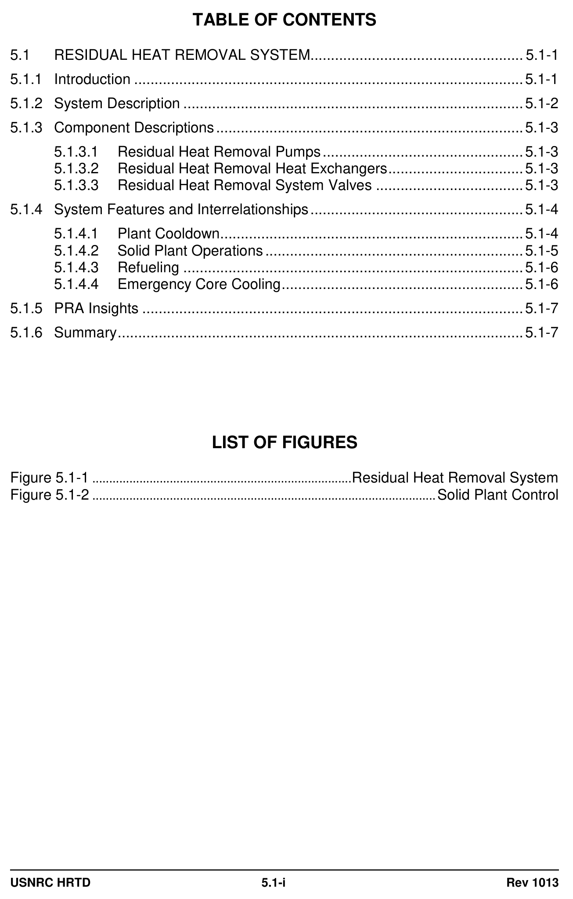
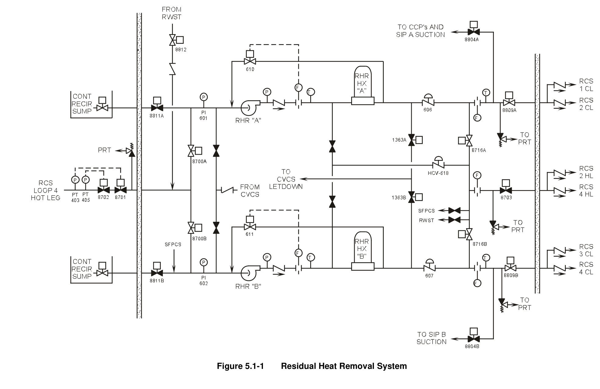
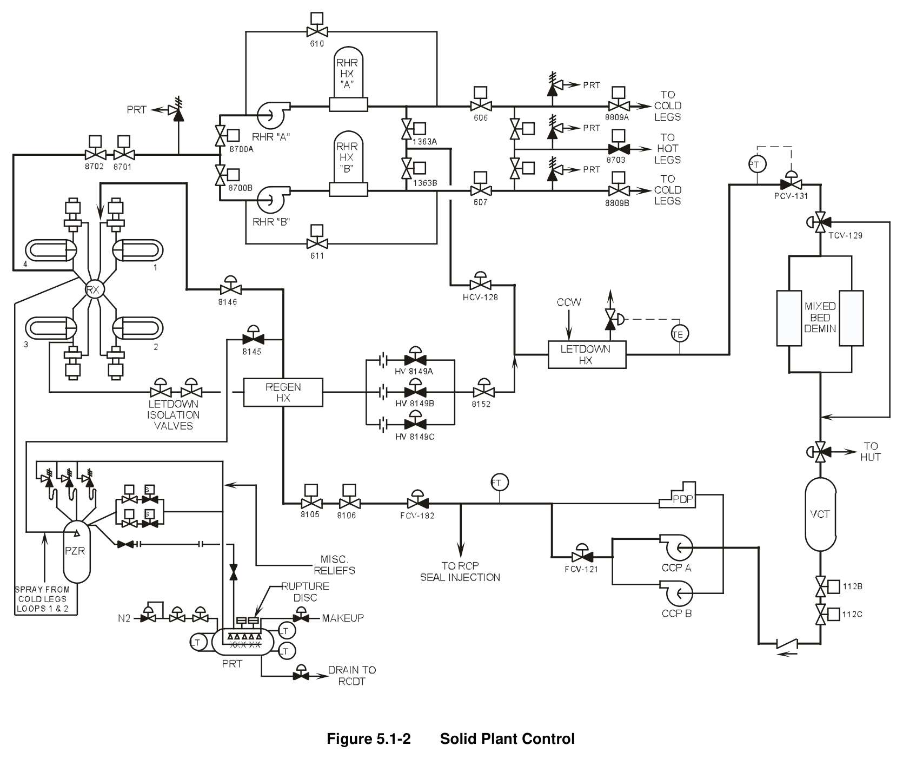

# 05.1 RHR

> Pages 410–421 of `ML20057E160.pdf`
> Westinghouse Technology Systems Manual — USNRC HRTD (PWR)

---
<!-- p.410 -->
#### Westinghouse Technology Systems Manual
#### Section 5.1
#### Residual Heat Removal System
<!-- p.411 -->
#### Figure 5.1-1

*............................................................................ Residual Heat Removal System*

<!-- labels/text on this figure page -->
TABLE OF CONTENTS
5.1 RESIDUAL HEAT REMOVAL SYSTEM.................................................... 5.1-1
5.1.1 Introduction ............................................................................................... 5.1-1
5.1.2 System Description ................................................................................... 5.1-2
5.1.3 Component Descriptions ........................................................................... 5.1-3
5.1.3.1 Residual Heat Removal Pumps ................................................. 5.1-3
5.1.3.2 Residual Heat Removal Heat Exchangers ................................. 5.1-3
5.1.3.3 Residual Heat Removal System Valves .................................... 5.1-3
5.1.4 System Features and Interrelationships .................................................... 5.1-4
5.1.4.1 Plant Cooldown .......................................................................... 5.1-4
5.1.4.2 Solid Plant Operations ............................................................... 5.1-5
5.1.4.3 Refueling ................................................................................... 5.1-6
5.1.4.4 Emergency Core Cooling ........................................................... 5.1-6
5.1.5 PRA Insights ............................................................................................. 5.1-7
5.1.6 Summary ................................................................................................... 5.1-7
LIST OF FIGURES
Figure 5.1-1 ............................................................................. Residual Heat Removal System
Figure 5.1-2 ...................................................................................................... Solid Plant Control
USNRC HRTD 5.1-i Rev 1013

<!-- p.412 -->
### 5.1 RESIDUAL HEAT REMOVAL SYSTEM
#### Learning Objectives:
1. State the purposes of the Residual Heat Removal (RHR) System.

2. Describe the RHR system flow path including suction supplies, discharge points and major components during decay heat removal.

3. Describe the normal, at-power lineup of the RHR system.

4. Explain why Reactor Coolant System (RCS) pressure and temperature limits are placed on the initiation of RHR cooldown.

5. Explain how the RHR system is protected against overpressurization.

6. Explain how an intersystem LOCA is initiated in the residual heat removal system and what effect it can have on long-term core cooling.

#### 5.1.1 Introduction
The purposes of the residual heat removal system are as follows:

1. Removes decay heat from the core and reduces the temperature of the RCS during the second phase of plant cooldown,

2. Serves as the low pressure injection portion of the Emergency Core Cooling System (ECCS), following a loss of coolant accident, and

3. Transfers refueling water between the refueling water storage tank and the refueling cavity before and after refueling.

The RHR system transfers heat from the reactor coolant system to the component cooling water system. During shut down plant operations, the RHR system is used to remove the decay heat from the core and reduce the temperature of the reactor coolant to the cold shutdown temperature (< 200°F). The cooldown performed by the RHR system (from 350°F to < 200°F) is referred to as the second phase of cooldown. The first phase of cooldown is accomplished by the auxiliary feedwater
(AFW) system (Chapter 5.8), steam dump control system (Chapter 11.2), and the steam generators.

Once the plant is in cold shutdown, the RHR system will maintain RCS temperature until the plant is started up again. The residual heat removal system also serves as part of the emergency core cooling system during the injection and recirculation phases of a loss of coolant accident. The residual heat removal system is used to transfer refueling water between the refueling water storage tank and the refueling cavity before and after the refueling operations.

USNRC HRTD 5.1-1 Rev 1013

<!-- p.413 -->
#### 5.1.2 System Description
The residual heat removal system, as shown in Figure 5.1-1, consists of two heat exchangers, two residual heat removal pumps, and the associated piping, valves, and instrumentation necessary for operational control. The inlet lines to the residual heat removal system for the second phase of cooldown are connected to the hot leg of reactor coolant loop 4, and the return lines are connected to each cold leg of the reactor coolant system. These return lines also function as the emergency core cooling system low pressure injection lines.

The RHR System is normally used to remove the decay and sensible heat from the RCS during plant heatup, cooldown, and refueling when RCS pressure is  450 PSIG and temperature is  350°F. The 350°F restriction is based on the RHR pump seal limitations. The 450 PSIG limitation is based on not exceeding RHR System design pressure. The 450 PSIG system limitation plus the RHR pump head of about 150 PSID equals the system design pressure of 600 PSIG.

The RHR pump suction line from the reactor coolant system is normally isolated by two series motor-operated valves (8701&8702). The suction line has a relief valve located downstream of the isolation valves, all of which are located inside the containment. Each RHR pump discharge line is isolated from the reactor coolant system by two check valves located inside the containment and by two normally open motor-operated valves (8809A and 8809B) located outside the containment.
These motor operated valves are part of the emergency core cooling system and receive confirmatory open signals from the engineered safety features actuation system. During the second phase of cooldown, reactor coolant flows from the RCS to the residual heat removal pumps, through the tube side of the RHR heat exchangers, and back to the RCS. The heat from the reactor coolant is transferred to the component cooling water which is circulating through the shell side of the RHR heat exchangers.

If one of the two pumps or one of the two heat exchangers is not operable, the ability to safely cooldown the plant is not compromised; however, the time required for the cooldown is extended. When the residual heat removal system is in operation, the water chemistry requirements are the same as that of the reactor coolant system.
Provisions are made for extracting samples from the flow of reactor coolant downstream of the RHR heat exchangers for analysis. A local sampling point is also provided on each residual heat removal train between the pump and its associated heat exchanger.

To insure the reliability of the RHR system, the two residual heat removal pumps are powered from separate vital electrical power supplies. If a loss of offsite power occurs, each vital bus is automatically transferred to a separate emergency diesel power supply. A prolonged loss of offsite power would not adversely affect the operation of the residual heat removal system.

The residual heat removal system is normally aligned to perform its safety function.
Therefore, no valves are required to change position. For the RHR system to perform its safety function, the RHR pumps must start when the engineered safety

USNRC HRTD 5.1-2 Rev 1013

<!-- p.414 -->
features actuation signal is received, and the pressure in the reactor coolant system must drop below the discharge pressure of the RHR pumps.

The materials used to fabricate the RHR system components are in accordance with the applicable ASME code requirements. All parts or components in contact with borated water are fabricated of, or clad with austenitic stainless steel or an equivalent corrosion resistant material.

#### 5.1.3 Component Descriptions
##### 5.1.3.1 Residual Heat Removal Pumps
Two pumps are installed in the residual heat removal system. The pumps are vertical, centrifugal units with mechanical seals on the shafts. These seals can be cooled by either component cooling water or service water depending on the plant design. All pump surfaces in contact with reactor coolant are manufactured from austenitic stainless steel or an equivalent corrosion resistant material. The pumps are sized to deliver reactor coolant flow through the residual heat exchangers to meet the plant cooldown requirements.

The residual heat removal pumps are protected from overheating and loss of suction flow by minimum flow bypass lines that assure flow to the pump suction for pump cooling. A control valve located in each minimum flow line (MO-610, 611) is regulated by a signal from the flow transmitters located in each pump discharge header. These control valves open when the RHR pump discharge flow is less than 500 gpm and the pump is running and closed when the flow exceeds 1000 gpm or the pump is not running. A pressure sensor in each pump header provides a signal for an indicator on the main control board. A high pressure annunciator alarm is also actuated by the pressure sensor.

##### 5.1.3.2 Residual Heat Removal Heat Exchangers
Two heat exchangers are installed in the system. The heat exchanger design is based on the heat load and temperature differences between reactor coolant and component cooling water twenty hours after the reactor has been shut down. The temperature difference between these two systems at that time is at its minimum, thus creating the minimum heat transfer capability.

The heat exchangers are of the shell and U-tube type. Reactor coolant circulates through the tubes while component cooling water circulates through the shell. The tubes are welded to the tube sheet to prevent leakage of reactor coolant.

##### 5.1.3.3 Residual Heat Removal System Valves
Each valve that performs a modulating function is equipped with two stem packing glands and an intermediate leak-off connection that discharges to the drain header.

Manual and motor-operated valves have backseats to facilitate repacking and to limit stem leakage when the valves are open. Leakage connections are provided where required by valve size and fluid conditions. The suction line from the reactor coolant system is equipped with a pressure relief valve sized to relieve the combined flow of

USNRC HRTD 5.1-3 Rev 1013

<!-- p.415 -->
all the charging pumps at the relief valve set pressure. This relief valve is installed to provide overpressure protection for the reactor coolant system under solid plant operations.

Each discharge line to the reactor coolant system is equipped with a pressure relief valve to relieve the maximum possible backleakage through the check valves which separate the residual heat removal system from the reactor coolant system. The design of the residual heat removal system includes two isolation valves (8701 and 8702) in series on the inlet line between the high pressure reactor coolant system and the lower pressure RHR system.

Each isolation valve is interlocked with one of two independent reactor coolant system pressure transmitters. These interlocks prevent the valves from being opened unless the reactor coolant system pressure is less than 425 psig to ensure that the RHR system is not over pressurized. After the valves are open, another set of interlocks will cause the valves to automatically close when the reactor coolant system pressure increases to approximately 585 psig.

#### 5.1.4 System Features and Interrelationships
##### 5.1.4.1 Plant Cooldown
The initial phase of reactor cooldown is accomplished by transferring heat from the RCS to the steam and power conversion system across the steam generator tubes.
The second phase of cooldown starts with the RHR system being placed in operation. The RHR system is placed in operation approximately four hours after reactor shutdown, when the temperature and pressure of the RCS are approximately 350°F and 425 psig, respectively.

Assuming that two heat exchangers and two RHR pumps are in service, and that each heat exchanger is being supplied with component cooling water at its design flow rate and temperature, the RHR system is designed to reduce the temperature of the reactor coolant from 350°F to 140°F within 16 hours. The heat load handled by the residual heat removal system during the cooldown includes residual and decay heat from the core, and reactor coolant pump heat. The design heat load is based on the decay heat fraction that exists at 20 hours following reactor shutdown from extended operations at full power. Coincident with operation of the residual heat removal system, a portion of the reactor coolant flow may be diverted from downstream of the residual heat removal heat exchangers to the chemical and volume control system (CVCS) low pressure letdown line for cleanup and/or pressure control.

Startup of the residual heat removal system includes a warmup period during which time reactor coolant flow through the heat exchangers is limited to minimize thermal shock to the heat exchangers. The rate of heat removal from the reactor coolant is manually controlled by regulating the coolant flow through the RHR heat exchangers.

Component cooling water is supplied at a constant flow rate to the RHR heat exchangers. The temperature of the return flow can be controlled by manually adjusting the control valves (606, 607) downstream of the RHR heat exchangers. In

USNRC HRTD 5.1-4 Rev 1013

<!-- p.416 -->
coincident with the manual adjustment of the heat exchanger outlet valves, a heat exchanger bypass valve (HCV-618) is manually adjusted to maintain a constant flow through each train of the RHR system.

The reactor coolant system cooldown rate is limited by equipment cooldown rates based on allowable stress limits. The available cooldown rate can be affected by the operating temperature limits of the component cooling water system. As the reactor coolant temperature decreases, the reactor coolant flow through the RHR heat exchangers is gradually increased by adjusting the control valve in each heat exchanger outlet line. The normal plant cooldown function of the residual heat removal system is independent of any engineered safety features function.

The normal cooldown return lines are arranged in parallel redundant flow paths and are also utilized as the low pressure emergency core cooling injection lines to the reactor coolant system. Utilization of the same return lines for emergency core cooling as well as for normal cooldown lends assurance to the proper functioning of these lines for engineered safety features purposes.

##### 5.1.4.2 Solid Plant Operations
The residual heat removal system is used in conjunction with the chemical and volume control system (Figure 5.1-2) during cold shutdown operations (< 200°F) to maintain reactor coolant chemistry and pressure control. Solid plant operation (i.e., no steam bubble in the pressurizer) is one method of operating the plant during the cold shutdown period. This mode of operation is generally limited to system refill and venting operations. Solid plant operation receives its name from the fact that the reactor coolant system is completely filled to the top of the pressurizer with liquid coolant.

The RHR system circulates reactor coolant from the loop 4 hot leg to the cold leg connections on each loop. The RHR system is essentially operating as an extension of the reactor coolant system and is completely filled with reactor coolant. Pressure in the system can be changed by either changing the temperature of the reactor coolant or by varying the mass of the reactor coolant within the system. Varying the temperature of the reactor coolant is not an effective method of RCS pressure control due to the time required to heat the coolant and the large pressure changes that are experienced for a small temperature change. Volume control of the reactor coolant is preferred because it is fast responding, and any desired pressure change can be obtained within controllable limits. Since it is preferred to control the mass in the RCS for pressure control, a portion of the RHR flow is diverted to the chemical and volume control system through valve HCV-128.

The volume of water diverted to the CVCS is controlled by the position of the backpressure regulating valve PCV-131, which is located downstream of the letdown heat exchanger. During solid plant operations the volume of water returned to the reactor coolant system is determined by the charging rate, which is controlled by manually positioning the charging flow control valve HCV-182. The chemical and volume control system is also a water solid system, with the exception of the volume control tank, which acts as a buffer or surge volume for the purpose of pressure control. Pressure is controlled by maintaining a constant charging rate and varying the flow rate of the water into the chemical and volume control system (PCV-131).

USNRC HRTD 5.1-5 Rev 1013

<!-- p.417 -->
To maintain a constant pressure in the RCS, both flow rates (charging and letdown), must be equal. If the charging rate exceeds the letdown rate, then the pressure in the RCS will increase. Conversely pressure in the RCS will decrease if the letdown flow rate exceeds the charging flow rate.

Normally the backpressure regulating valve, PCV-131, is maintained in the automatic mode of operation and set to control the reactor coolant pressure at a desired setpoint. The volume control tank absorbs any mismatches in flow rates between charging and letdown. Pressure regulation is necessary to maintain the pressure in the RCS to a pre-selected range dictated by the fracture prevention criteria requirements of the reactor vessel.

##### 5.1.4.3 Refueling
Both residual heat removal pumps are utilized during refueling to pump borated water from the refueling water storage tank to the refueling cavity. During this operation, the isolation valves in the inlet line from the reactor coolant system (8701, 8702) are closed, and the isolation valve from the refueling water storage tank
(8812) is opened. The reactor vessel head is lifted slightly, refueling water is pumped into the reactor vessel through the normal RHR system return lines, into the refueling cavity through the open reactor vessel. The reactor vessel head is gradually raised as the water level in the refueling cavity increases. After the water level reaches the normal refueling level, the reactor coolant system inlet isolation valves are opened and the refueling water storage tank supply valves are closed.

During refueling, the residual heat removal system is maintained in service with the number of pumps and heat exchangers in operation as required by the heat load and Technical Specification minimum flow requirements.

After completion of the refueling, the RHR system is used to return the water from the refueling cavity to the refueling water storage tank via a manual isolation valve.
The water level is brought down to the flange of the reactor vessel. The remainder of the water in the refueling cavity is removed through drains located in the bottom of the refueling canal.

##### 5.1.4.4 Emergency Core Cooling
The residual heat removal system functions in conjunction with the higher pressure portions of the emergency core cooling systems to inject borated water from the refueling water storage tank into the RCS cold legs during the injection phase following a loss of coolant accident. The residual heat removal system is aligned as shown in Figure 5.1-1. After the injection phase, the RHR system provides longterm recirculation capability for core cooling. This function is accomplished by aligning the residual heat removal system to take water from the containment sump
(opening valves 8811A&B and closing valves 8700A&B and 8812), to cool it by circulating it through the residual heat removal heat exchangers, and to pump it back to the core through the cold leg penetrations. If pressure in the RCS is greater than the discharge pressure of the RHR pumps, water may be returned to the core by the centrifugal charging pumps (8804A) and the safety injection pumps (8804B), with the RHR pump discharge serving as the suction source fro those pumps.

USNRC HRTD 5.1-6 Rev 1013

<!-- p.418 -->
In the event of a loss of coolant accident, fission products may be circulated through parts of the residual heat removal system that are exterior to the containment. If a residual heat removal pump seal should fail, the water would spill out on the floor in a shielded compartment. Each pump is located in a separate, shielded room. If one of the rooms floods, it would have no effect on the other train since there are no interconnections between trains during the recirculation phase.

Provisions are made for draining spillage into a sump which is provided with dual pumps and suitable level instrumentation so that this spillage can be pumped to the waste disposal system.

#### 5.1.5 PRA Insights
A type of LOCA which has become a safety concern is the intersystem loss of coolant accident, sometimes called “Event V.” An intersystem LOCA is of concern because the coolant is lost outside the containment, and therefore would not be available for recirculation from the containment sump.

The intersystem LOCA is a small contributor to core damage frequency (4% at Surry, 0.1% at Zion, and 0.4% at Sequoyah). The failure that leads to an intersystem LOCA is the failure of the check valves in the low pressure injection system (RHR). This would lead to a loss of coolant outside the containment building. The water would not be available for recirculation from the containment sump.

Probable causes of an intersystem LOCA include:

1. Transfer open of one check valve followed by the rupture of the second interface valve,
2. Failure of one valve to close on re-pressurization followed by the rupture of the second valve,
3. Rupture of the interface valve, and 4. Operator failure to isolate the interfacing valve.

NUREG-1150 studies on importance measures have shown that Event V is a contributor to risk achievement, but a very minor contributor to risk reduction.
Specifically, a large increase in the probability of the check valve rupture event involved in the intersystem LOCA would increase the core damage frequency (a factor of 30 at Sequoyah and a factor of 270 at Surry). Reducing the probability of the Event V initiators did not have a significant effect on the risk reduction factors.

#### 5.1.6 Summary
The residual heat removal system performs both normal plant functions and accident functions. The normal plant function is the transfer of heat from the reactor coolant system to the component cooling water system during shutdown operations. This is referred to as the second phase of plant cooldown, which starts when RCS Tavg is at 350°F. The RHR System is designed to remove the decay heat associated with the shutdown reactor until the plant is restarted. During the shutdown, if solid plant operations are desired, the RHR system is used in conjunction with the chemical and volume control system for solid plant pressure control.

USNRC HRTD 5.1-7 Rev 1013

<!-- p.419 -->
The RHR system is normally aligned to perform its accident function. During the injection phase following a loss of coolant accident, water is supplied from the refueling water storage tank to the reactor coolant system cold legs. For long-term cooling and recirculation, the containment sump as the source of water to the RHR system, and the RHR heat exchangers to cool the water as it is returned to the reactor coolant system.

The RHR system is also used during refueling to remove decay heat and to transfer water between the refueling water storage tank and the refueling cavity.

USNRC HRTD 5.1-8 Rev 1013

<!-- p.420 -->
#### Figure 5.1-1

*Residual Heat Removal System*

[Vector original (SVG, lossless): fig_5.1-1_2.svg](../figures/fig_5.1-1_2.svg)

<!-- p.421 -->
#### Figure 5.1-2

*Solid Plant Control*

[Vector original (SVG, lossless): fig_5.1-2.svg](../figures/fig_5.1-2.svg)

