# 05.3 Containment

> Pages 453–478 of `ML20057E160.pdf`
> Westinghouse Technology Systems Manual — USNRC HRTD (PWR)

---
<!-- p.453 -->
#### Westinghouse Technology Systems Manual
#### Section 5.3
#### Containment
<!-- p.454 -->
TABLE OF CONTENTS

5.3 Containment ............................................................................................. 5.3-1

5.3.1 Introduction ............................................................................................... 5.3-1

5.3.2 System Description ................................................................................... 5.3-2

5.3.3 Component Descriptions ........................................................................... 5.3-3

5.3.3.1 Containment Shell ..................................................................... 5.3-3

5.3.3.2 Internal Structures ..................................................................... 5.3-3

5.3.3.3 Steel Liner ................................................................................. 5.3-4

5.3.4 System Features and Interrelationships ................................................... 5.3-4

5.3.4.1 Prestressing ............................................................................... 5.3-4

5.3.4.2 Tendons ..................................................................................... 5.3-4

5.3.4.3 Penetrations .............................................................................. 5.3-5

5.3.4.4 Cranes ....................................................................................... 5.3-6

5.3.4.5 Containment Recirculation Sump .............................................. 5.3-6

5.3.4.6 Containment Building Sumps..................................................... 5.3-6

5.3.4.7 System Isolation and Integrity .................................................... 5.3-6

5.3.5 System Instrumentation ............................................................................ 5.3-6

5.3.5.1 Containment Pressure Instrumentation ..................................... 5.3-7

5.3.5.2 Containment Temperature Instrumentation ............................... 5.3-7

5.3.5.3 Containment Sump Level Instrumentation ................................. 5.3-7

5.3.5.4 Containment Radiation Monitors ................................................ 5.3-8

5.3.5.5 Containment Humidity Instrumentation ...................................... 5.3-8

5.3.5.6 Containment Hydrogen Analysis System (CHAS) ..................... 5.3-8

5.3.6 Containment Evacuation Alarm ................................................................. 5.3-9

5.3.7 Summary ................................................................................................... 5.3-9

LIST OF TABLES

Table 5.3-1 Containment Shell Design Parameters .......................................... 5.3-10

Table 5.3-2 Containment Liner Design Parameters .......................................... 5.3-10

Table 5.3-3 Tendon Design Parameters ........................................................... 5.3-10

USNRC HRTD 5.3-i Rev 1013

<!-- p.455 -->
#### Figure 5.3-1

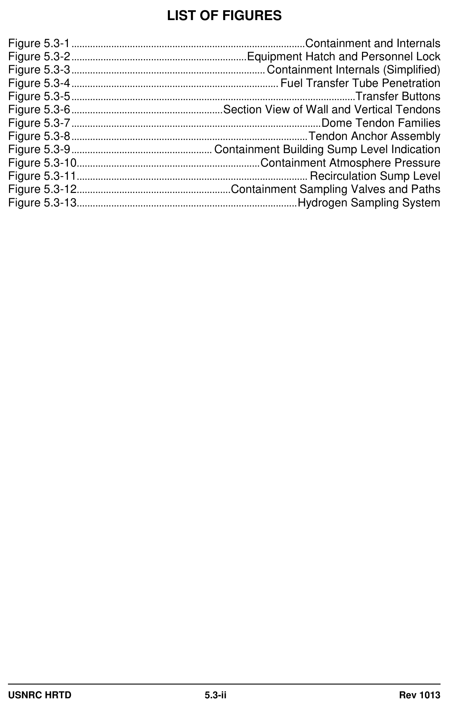

*....................................................................................... Containment and Internals*

<!-- labels/text on this figure page -->
LIST OF FIGURES
Figure 5.3-1 ........................................................................................ Containment and Internals
Figure 5.3-2 .................................................................. Equipment Hatch and Personnel Lock
Figure 5.3-3 ......................................................................... Containment Internals (Simplified)
Figure 5.3-4 .............................................................................. Fuel Transfer Tube Penetration
Figure 5.3-5 ...........................................................................................................Transfer Buttons
Figure 5.3-6 ......................................................... Section View of Wall and Vertical Tendons
Figure 5.3-7 .............................................................................................. Dome Tendon Families
Figure 5.3-8 ......................................................................................... Tendon Anchor Assembly
Figure 5.3-9 ..................................................... Containment Building Sump Level Indication
Figure 5.3-10 ..................................................................... Containment Atmosphere Pressure
Figure 5.3-11 ....................................................................................... Recirculation Sump Level
Figure 5.3-12 .......................................................... Containment Sampling Valves and Paths
Figure 5.3-13 ................................................................................... Hydrogen Sampling System
USNRC HRTD 5.3-ii Rev 1013

<!-- p.456 -->
### 5.3 CONTAINMENT
#### Learning Objectives:
1. State the purposes of the containment.

2. Briefly describe the functions of the following:

a. Containment liner b. Primary shield wall c. Secondary shield wall d. Refueling canal e. Containment sumps f. Containment recirculation sump g. Containment hydrogen analyzer

3. Briefly describe the methods of monitoring the containment environmental conditions.

#### 5.3.1 Introduction
The purposes of the containment are as follows:

1. Provides a barrier to prevent the escape of radioactivity during normal and accident conditions,
2. Provides protection against internally and/or externally generated missiles,
3. Provides biological shielding during normal and accident conditions, and 4. Provides Seismic Category I supports for the reactor coolant system (RCS) and its associated support systems.

The containment completely encloses the reactor and the RCS, and serves to prevent the inadvertent release of radioactive fission products to the atmosphere.
The containment also provides biological shielding during normal operations and during the unlikely event of a loss-of-coolant accident (LOCA).

Several different types of containments have been developed for PWR applications, and almost all are premised on the use of the containment structure to contain the large volume of high pressure, high temperature steam-water mixture that would result from a LOCA or a Steam Line Break (SLB) inside the containment. After a LOCA or a SLB, the pressure and temperature inside the containment will increase to a peak level, and then decrease as the containment support systems are activated.

The containment structure must be shown to be functionally available for the life of the plant. From the viewpoint of design, the containment design must consider the following loadings:

1. Pressure and temperature transients that occur as the result of a design-basis accident (DBA).

USNRC HRTD 5.3-1 Rev 1013

<!-- p.457 -->
2. Thermal loads, such as the temperature gradient through the containment wall, during normal and transient conditions.

3. Dead loads consisting of the weight of the concrete wall, dome, base slab, internal concrete, and machinery, and other permanent load-contributing stresses.

4. Live loads, which consist of snow loading, movable equipment loads, and other loads which vary with intensity and occurrence.

5. Earthquake loads, such as those associated with the operating basis earthquake
(OBE) and the safe shutdown earthquake (SSE).

6. Wind and tornado loads, with consideration given to missile impingement.

7. Hydrostatic loads based on the worst-case flood conditions with a water level significantly above mean sea level.

8. External pressure loads based on a maximum differential pressure, inside to outside, on the containment.

9. Prestressing loads, considered in all loading combinations.

10. Pressure test loads up to 1.15 times the design pressure.

The loading conditions caused by the DBA, resulting from gross failure of the RCS, and those caused by earthquake, are considered to be the critical loading conditions.

#### 5.3.2 System Description
The large dry primary containment utilizing a three dimensional (3-D) posttensioned, prestressed, reinforced concrete cylinder with a steel liner was first used in 1966 and is deployed in the majority of the PWRs in the United States.

Because of the inherent weakness of concrete in tension and its strength in compression, prestressing systems were developed to superimpose compressive loads onto concrete structures so that when these structures are loaded by exterior force systems (such as a LOCA) the net stresses in the concrete are still generally compressive. Therefore, prestressing keeps the concrete in compression under all postulated loading conditions, and the concrete will be available to carry seismic shear forces without any need for additional reinforcement. The prestressed containment’s single greatest disadvantage is the active nature of the structural system which requires monitoring during the life of the plant. This monitoring is accomplished in the form of periodic lift-off tests of a sample of tendons, to insure no prestress loss, and added in-service inspection requirements of the tendon strands.

USNRC HRTD 5.3-2 Rev 1013

<!-- p.458 -->
#### 5.3.3 Component Descriptions
##### 5.3.3.1 Containment Shell
The containment shell (Figure 5.3-1) is a Seismic Category I prestressed, posttensioned concrete cylinder with a hemispherical dome and a flat foundation slab.
The reactor cavity and instrumentation tunnel are located below the foundation slab.
A continuous access gallery for the installation, tensioning and inspection of the vertical U-tendons is also provided below the foundation slab. A 19-ft diameter equipment hatch and two personnel airlocks approximately 10 ft in diameter are provided in the shell (Figure 5.3-2). Table 5.3-1 lists the design parameters of the containment shell.

The foundation slab is conventionally reinforced with high-strength reinforcing steel.
Three (3) buttresses equally spaced at 120° intervals around the outside of the containment are provided as anchor points for the horizontal tendons.

A transfer tube penetration (Figure 5.3-4) is provided for fuel movement between the refueling canal in the containment building and the fuel handling building. Numerous smaller penetrations for electrical conduits, piping and other systems are also provided.

##### 5.3.3.2 Internal Structures
The major internal structures (Figure 5.3-3) are :

1. Primary shield wall,
2. Secondary shield wall,
3. Operating floor, 4. Refueling canal, 5. Intermediate floor, platforms, and hatches, 6. Removable shield slabs, 7. Pipe supports and restraints, and 8. Nuclear steam supply system (NSSS) equipment supports and restraints.

The primary shield wall is a reinforced concrete wall which completely surrounds the reactor vessel and provides biological shielding. The shield wall is located in the center of the containment and extends from the foundation slab to the operating floor. The primary shield wall also gives support to the reactor.

The secondary shield wall is a reinforced concrete structure which provides radiation shielding and protection to the RCS. The RCS is completely enclosed by the secondary shield wall, which extends from the foundation slab to above the operating floor. The wall also provides lateral support to the steam generators, reactor coolant pumps, pressurizer and associated piping.

The operating floor is constructed of reinforced concrete and structural steel framing.
The floor is supported by the refueling canal walls, secondary shield walls and the containment shell. Separation is provided in the supports and between the floor and shell to allow for differential horizontal movement. Floor hatches are provided for

USNRC HRTD 5.3-3 Rev 1013

<!-- p.459 -->
equipment and tank removal. A refueling canal, of reinforced concrete with a stainless steel liner, is provided for transportation of new and used fuel between the reactor vessel and the fuel transfer penetration. During periods of maintenance or refueling the canal is used for temporary storage of vessel internals or fuel.

The intermediate floor is constructed of reinforced concrete with steel grating platforms and walkways supported by structural steel framing. Hatches are provided for equipment removal. The floor is also used as a laydown area during maintenance activities or refueling.

Removable shield slabs, of precast concrete, are supported above the reactor vessel by the secondary shield walls. These shield slabs protect the steel liner from damage by missile impingement.

##### 5.3.3.3 Steel Liner
To ensure a high degree of leak tightness, the inside face of the containment shell is lined with one-quarter (1/4) inch of carbon steel plate, which is thickened in the regions adjacent to all penetrations. The carbon steel has a minimum yield strength of 30,000 psi and an elongation, in an eight (8) inch section, of 21 percent.

The liner is designed to function as a leak-tight seal only. Any tensile stresses due to a DBA are transferred from the liner to the concrete wall. Table 5.3-2 shows the liner design parameters.

#### 5.3.4 System Features and Interrelationships
##### 5.3.4.1 Prestressing
Prestressing is a method by which internal compressive stresses are induced in concrete, so that when a load is applied the tensile stresses in the concrete are minimized.

In prestressed containment shells, compressive stresses are produced in both directions in the cylinder and the dome. The level of prestressing is adjusted such that when tensile forces are acting on the shell, most load combinations do not produce tensile stresses in the concrete.

The concrete compression is achieved by installing high strength steel tendons in ducts in the concrete and tensioning them. To minimize the adverse affects of corrosion, the ducts are filled with corrosion-inhibiting grease. The number and placement of the tendons is determined by the containment design such that the minimum force required is provided to all sections of the containment shell in both the horizontal and vertical directions. Consideration is also given for stress losses in the tendons which result from friction forces during tensioning, elastic shortening of concrete, concrete creep under long term loads and tendon steel relaxation.

##### 5.3.4.2 Tendons
Each tendon is composed of 170 stress relieved, high strength one-quarter (1/4)
inch diameter wires. Each tendon has an ultimate yield strength in excess of 1000

USNRC HRTD 5.3-4 Rev 1013

<!-- p.460 -->
tons. Button heads are employed at the ends of the tendons to transfer tensile forces to the anchor plates (Figures 5.3-5, 5.3-6 and 5.3-8). There are 70 vertical tendons arranged in two (2) families that are perpendicular to each other in the upper region of the dome (Figure 5.3-7). See Table 5.3-3 for tendon design data.

Each vertical tendon is continuous and stretches from one anchor point in the tendon gallery, up through the wall, through the roof, and back down the opposite wall to another anchor point in the tendon gallery.

There are three (3) buttresses equally spaced around the outside of containment.
The buttresses serve as anchor points for the hoop tendons, each of which extends from one buttress, past the next, and to the third buttress. The 132 horizontal tendons continue in this manner up the wall and onto the roof, with each successive tendon anchored to a different buttress.

Sufficient prestressing is provided in the cylindrical and dome portions of the containment to eliminate any tensile stress across the interior wall thickness under design loads. There is a loss of approximately 12 percent of prestress, due to elastic and creep losses, which reduces the prestress to design levels.

Each tendon is pretested at the time of initial tensioning. The stress in the tendons during accident loading is approximately 80 percent of the stress induced at tensioning. This ensures that the possibility of tendon failure under DBA loading is remote. The coincident failure of two (2) or three (3) side by side tendons during DBA conditions will have no significant affect on containment integrity. This is ensured by designing the walls sufficiently thick to transmit the force to adjoining tendons without resulting in any serious local stress. The tendons are inspected periodically and lift-off readings made to ensure adequate performance of the prestressing system during the life of the plant.

##### 5.3.4.3 Penetrations
There are four types of penetrations through the containment. All are welded assemblies, except the equipment hatch, which is manufactured in two (2) bolted halves and seal welded after installation. All penetrations are pressure resistant and leak tight. The steel liner is thickened in the region near each penetration.

The four types of penetrations are:

1. Electrical,
2. Piping,
3. Equipment hatch and personnel airlocks, and 4. Special purpose.

The containment penetrations are discussed in more detail in Section 5.6 of this manual.

USNRC HRTD 5.3-5 Rev 1013

<!-- p.461 -->
##### 5.3.4.4 Cranes
The containment is equipped with two (2) cranes and a hoist for installation of equipment and for plant maintenance. The reactor area polar bridge crane is supported by brackets embedded in the containment shell concrete. The polar crane is equipped with two (2) 15-hp bridge motors, a 10-hp trolley motor, an auxiliary hoist, and a main hoist. The auxiliary hoist has a capacity of 25 tons and is driven by a 60-hp motor. The main hoist has a capacity of 125 tons and is driven by a 60-hp motor.

The containment jib crane is a one-ton capacity, 14-ft crane installed on the steam generator shield wall near the refueling cavity. The crane can pivot over the refueling cavity, and against the wall for storage.

The stairwell hoist crane provides lifting capability for the stairwell.

##### 5.3.4.5 Containment Recirculation Sump
The containment recirculation sump serves a vital safety-related function as a large collection reservoir designed to provide an adequate water supply to both the containment spray (CS) and residual heat removal (RHR) systems. A detailed discussion of the recirculation sump is provided in Section 5.2 of this manual.

##### 5.3.4.6 Containment Building Sumps
Two containment building sumps provide low points for leakage collection within the containment building Each sump has a dedicated sump pump which is utilized to pump water to the dirty waste drain tank when necessary (Figure 5.3-9).

Technical Specifications require that the containment building sumps and their associated sump pumps be operable for so that RCS leakage can be monitored.
The frequency with which the sump pumps operate is an indication of leakage.

##### 5.3.4.7 System Isolation and Integrity
The containment isolation systems provide the means for isolating fluid, air, and gas systems that penetrate containment. This confines any radioactivity that may be released during and after a design-basis LOCA to the containment volume.
Containment isolation is achieved by applying common design criteria to penetrations in the many different fluid systems and by use of a containment isolation signal (CIS) to actuate appropriate valves. A detailed discussion of containment isolation is provided in Section 5.6 of this manual.

#### 5.3.5 System Instrumentation
Containment instrumentation is provided for the detection of radioactive and nonradioactive leakage in the containment. Continuous monitoring of the environmental conditions within the containment also provides a background level of overall normal leakage from primary systems and components. Detection of deviations from the normal containment environmental conditions provides indication in the control room of increases in leakage rates.

USNRC HRTD 5.3-6 Rev 1013

<!-- p.462 -->
The instrumentation provided for containment monitoring consists of pressure transmitters, resistance temperature detectors (RTDs), sump level transmitters, area and process radiation monitors, a humidity monitor, and the containment hydrogen analysis system (CHAS).

##### 5.3.5.1 Containment Pressure Instrumentation
Four pressure transmitters (Figure 5.3-10) and seven pressure switches provide indication in the main control room and actuation signals to engineered safety features (ESF) systems. Employing a two-out-of-three logic, pressure switches provide a “Containment Pressure High” alarm in the main control room at 3.5 psig.
Additionally, safety injection actuation and containment isolation signals are generated. Using a two-out-of-four logic, pressure switches provide a “Containment Pressure High-High” alarm in the main control room at 30 psig. Containment spray actuation and steam line isolation signals are also generated. To prevent an inadvertent spraydown of the containment, the Hi-Hi pressure switches energize to cause actuation. A loss of power to the switches thus does not cause actuation of the containment spray system.

##### 5.3.5.2 Containment Temperature Instrumentation
Containment ambient temperature is monitored by eight (8) RTDs located above the 205-ft elevation. In addition, local temperatures are monitored in the steam generator cubicles, in the pressurizer cubicle, in the reactor vessel cavity, alongside the containment wall and bio-shield wall, and in the incore instrumentation switching room. Main control room indication for the containment temperatures is provided on a scanning temperature recorder.

##### 5.3.5.3 Containment Sump Level Instrumentation
Level indications and alarms are provided for the containment recirculation sump
(Figure 5.3-11) and for the containment building sumps (Figure 5.3-9).

The containment recirculation sump is designed to operate in the post-DBA environment to provide water for the CS pumps and to provide water for long-term core cooling by low head recirculation. The recirculation sump is provided with dual level alarm and indication circuitry. Each channel has three (3) indicating lights for levels of 24 inches, 30 inches and 34 inches above the sump floor. There are also high level alarms at 30 inches and 34 inches. All indications are in the main control room.

Containment sump level indication and alarms are provided on the radioactive waste control panel. The low level alarm setpoint is set at three (3) inches above the bottom of the sump, and the high level alarm setpoint is 42 inches above the bottom of the sump. Level indication for each sump is provided by a series of six (6) lights which indicate at eight-in. intervals from three (3) inches to 42 inches. Additional narrow-range and wide-range level indication is provided in the main control room for the containment sumps.

USNRC HRTD 5.3-7 Rev 1013

<!-- p.463 -->
##### 5.3.5.4 Containment Radiation Monitors
The containment process and effluent radiation monitors (collectively, PERM-1)
continuously monitor gaseous, iodine, and air particulate activity levels in the containment atmosphere during normal operation. PERM-1 detectors also monitor the gaseous, iodine and air particulate activity levels of the containment purge exhaust flow during containment purge operations. Increasing airborne radiation levels are one indication of potential RCS leakage. By comparing the activity in the coolant to the activity in the containment atmosphere, a magnitude of leakage can be determined.

There are five (5) area radiation monitors (ARMS) in containment. Two (2) of them are high-range post-accident detectors used to determine the effectiveness of accident mitigation efforts. The other three (3) detectors monitor containment radiation levels in areas likely to experience high levels. A detailed presentation of the radiation monitoring system is provided in Chapter 16 of this manual.

##### 5.3.5.5 Containment Humidity Instrumentation
The containment humidity detection system (HDS) provides a means of measuring the overall leakage within the containment. The psychrometric detector measures wet and dry bulb temperature and displays percent humidity in the main control room on both a meter and a chart recorder. By comparing these values for specific humidity within the containment over a period of time, a means of measuring the overall leakage within the containment is achieved.

##### 5.3.5.6 Containment Hydrogen Analysis System (CHAS)
The CHAS (Figures 5.3-12, 5.3-13) is a standby system that is only used when directed by procedure. The system is used to determine the need for operation of hydrogen recombiners and hydrogen mixing fans in containment. In addition, since the amount of hydrogen in containment is proportional to the amount of core damage, a rough approximation of damage can be made using the CHAS.

In the event of a LOCA, the CHAS is designed to operate for up to 30 days without servicing while providing accurate hydrogen measurement at containment pressures up to 50 psig and containment temperatures up to 445°F. Remote readouts of hydrogen concentration are available in the main control room.

The CHAS consists of two (2) large analysis panels and two (2) smaller control panels with appropriate indication and control capability. The control units are located in an area that would be accessible during an accident and will normally be operated by chemistry personnel to obtain the sample. The system uses redundant sample paths, with CHAS A using the normal PERM 1 sample path and CHAS B using a separate penetration.

The CHAS has a selectable span for the indication. In LOW, the indication reads out from zero (0) to ten (10) percent. In HIGH, the indication reads out from zero (0) to thirty (30) percent. The system is normally selected to the LOW span, and the control room must be notified if the span is changed to the HIGH position.

USNRC HRTD 5.3-8 Rev 1013

<!-- p.464 -->
To initiate sampling of the containment atmosphere for hydrogen, containment isolation signals must be cleared, a sample flow path must be established, and the CHAS must be turned on. The CHAS A and CHAS B inlet and outlet valves are controlled from the main control room. The system takes about 20 minutes to warm up and be operational. During the warmup, the alarms from the system are disabled.

#### 5.3.6 Containment Evacuation Alarm
A containment evacuation alarm circuit is provided to alert personnel that may be in containment of the need to evacuate. The alarm is of particular significance during maintenance and outage activities when there may be many people in containment.

The alarm consists of an audible siren and a portion of the normal containment lighting that is made to flash during actuation. The alarm is actuated by the highflux-at-shutdown bistables in the excore nuclear instrumentation source range indication circuit and manually from the main control room.

#### 5.3.7 Summary
The containment is a cylindrical, fully reinforced concrete Seismic Category I structure with a hemispherical roof and a flat foundation slab. The cylindrical portion is prestressed by a post-tensioning system consisting of horizontal and vertical tendons. The dome is prestressed by a two way post-tensioning system consisting of horizontal and vertical tendons.

The containment structure provides biological shielding for both normal and accident conditions. By completely enclosing the reactor and the RCS, the containment system ensures that an acceptable upper limit for leakage of radioactive materials to the environment is not exceeded even with gross failure of the RCS.

The containment is designed for all credible conditions of loading, including normal loads, LOCA loads, test loads and loads due to adverse environmental conditions.
The loading conditions caused by a DBA, resulting from gross failure of the RCS, and those caused by earthquake are considered to be the critical loading conditions.

USNRC HRTD 5.3-9 Rev 1013

<!-- p.465 -->
#### Table 5.3-1 Containment Shell Design Parameters
Inside diameter, ft 124 Inside height, ft 203 Wall thickness, ft
3.5 Dome thickness, ft
2.5 Internal free volume, ft3 2 x 106 Design pressure, psig 60 Design temperature, °F 120 normal 288 DBA OBE, g 0.15 SSE, g 0.25 DBA, break area, ft2 10.48
(double-ended pump suction shear)
Buttresses 3 Material Prestressed reinforced concrete

#### Table 5.3-2 Containment Liner Design Parameters
Material ASTM-442, Grade 55 welded steel plate Thickness, in.
0.25 Yield strength, psi > 30,000 Elongation (8-in. specimen), % 21

#### Table 5.3-3 Tendon Design Parameters
Number of vertical 70 Number of horizontal 150 Wires per tendon 170 Wire diameter, in.
0.25 Ultimate strength, tons > 1000 Material High strength, stress-relieved steel in accordance with ASTM A- 421

USNRC HRTD 5.3-10 Rev 1013

<!-- p.466 -->
#### Figure 5.3-1

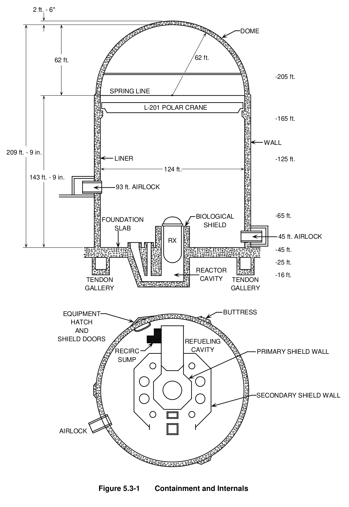

*Containment and Internals*

[Vector original (SVG, lossless): fig_5.3-1_2.svg](../figures/fig_5.3-1_2.svg)

<!-- labels/text on this figure page -->
2 ft. - 6"
DOME
62 ft.
62 ft.
-205 ft.
SPRING LINE
L-201 POLAR CRANE
-165 ft.
WALL 209 ft. - 9 in.
LINER
-125 ft.
124 ft.
143 ft. - 9 in.
93 ft. AIRLOCK
BIOLOGICAL -65 ft.
FOUNDATION SHIELD SLAB 45 ft. AIRLOCK RX
-45 ft.
-25 ft.
REACTOR
-16 ft.
CAVITY TENDON TENDON GALLERY GALLERY
BUTTRESS EQUIPMENT HATCH AND SHIELD DOORS REFUELING CAVITY RECIRC PRIMARY SHIELD WALL SUMP
SECONDARY SHIELD WALL
AIRLOCK
Figure 5.3-1 Containment and Internals

<!-- p.467 -->
#### Figure 5.3-2

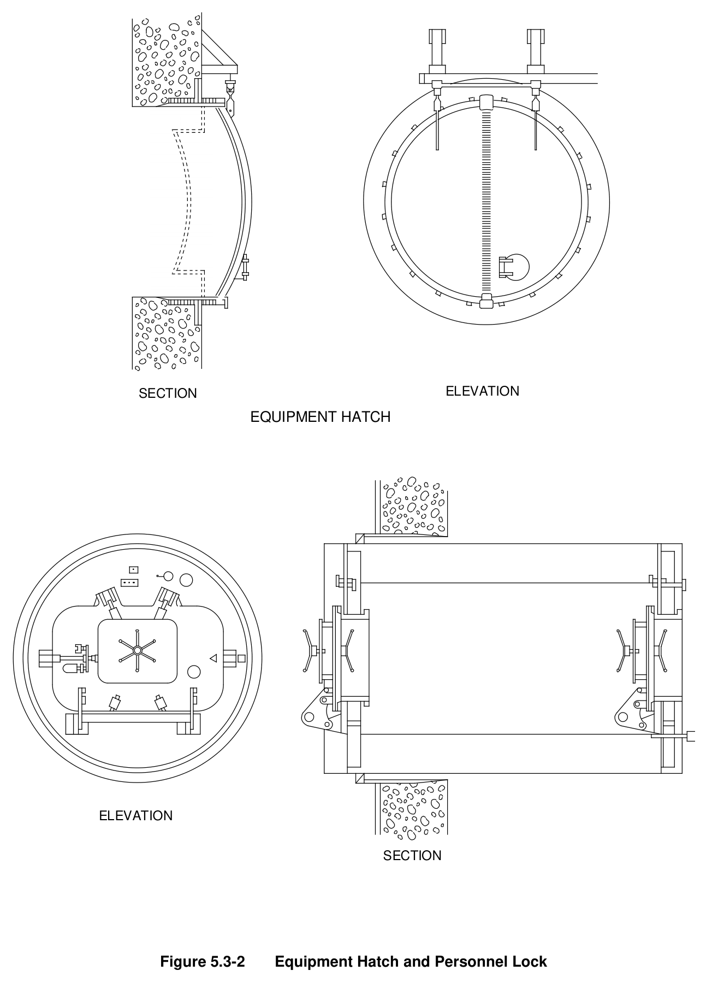

*Equipment Hatch and Personnel Lock*

[Vector original (SVG, lossless): fig_5.3-2.svg](../figures/fig_5.3-2.svg)

<!-- labels/text on this figure page -->
ELEVATION SECTION EQUIPMENT HATCH
ELEVATION
SECTION
Figure 5.3-2 Equipment Hatch and Personnel Lock

<!-- p.468 -->
#### Figure 5.3-3

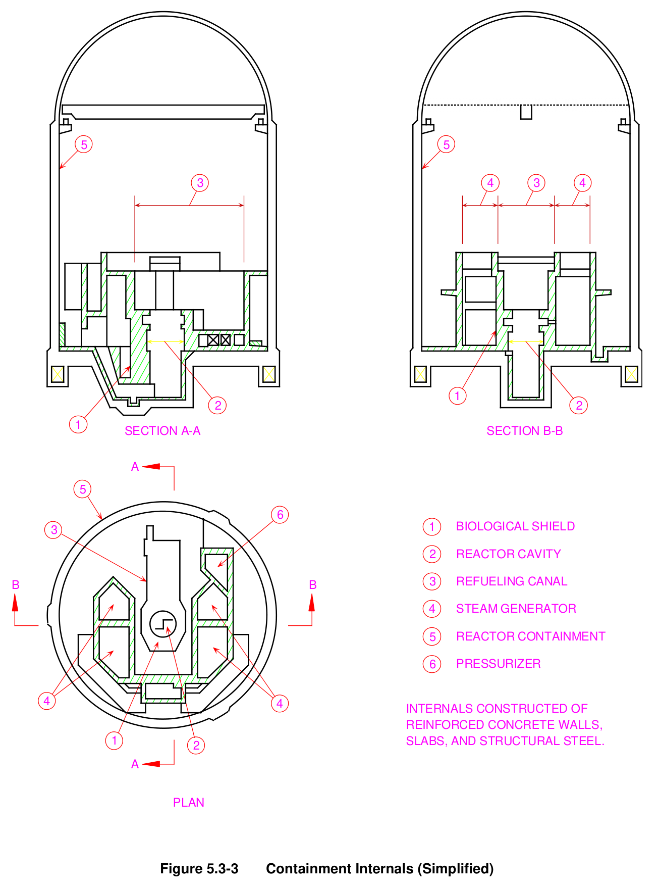

*Containment Internals (Simplified)*

[Vector original (SVG, lossless): fig_5.3-3.svg](../figures/fig_5.3-3.svg)

<!-- labels/text on this figure page -->
5 5
3 4 3 4
1 2 2 1 SECTION A-A SECTION B-B
A
5
6
1 BIOLOGICAL SHIELD 3
2 REACTOR CAVITY
3 REFUELING CANAL B B
4 STEAM GENERATOR
REACTOR CONTAINMENT 5
6 PRESSURIZER
4 4 INTERNALS CONSTRUCTED OF REINFORCED CONCRETE WALLS, 1 SLABS, AND STRUCTURAL STEEL.
2 A
PLAN
Figure 5.3-3 Containment Internals (Simplified)

<!-- p.469 -->
#### Figure 5.3-4

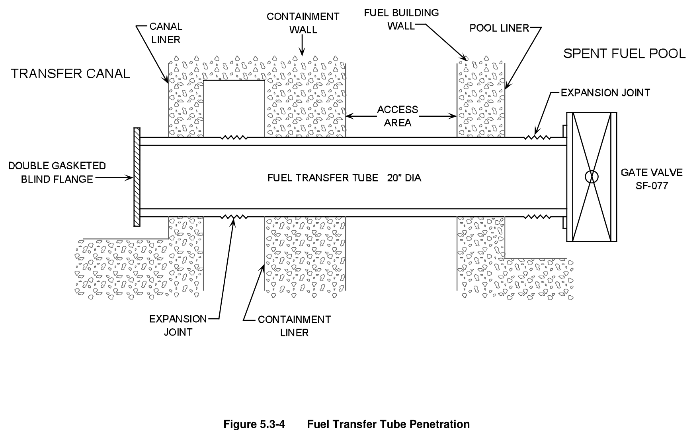

*Fuel Transfer Tube Penetration*

[Vector original (SVG, lossless): fig_5.3-4.svg](../figures/fig_5.3-4.svg)

<!-- p.470 -->
#### Figure 5.3-5

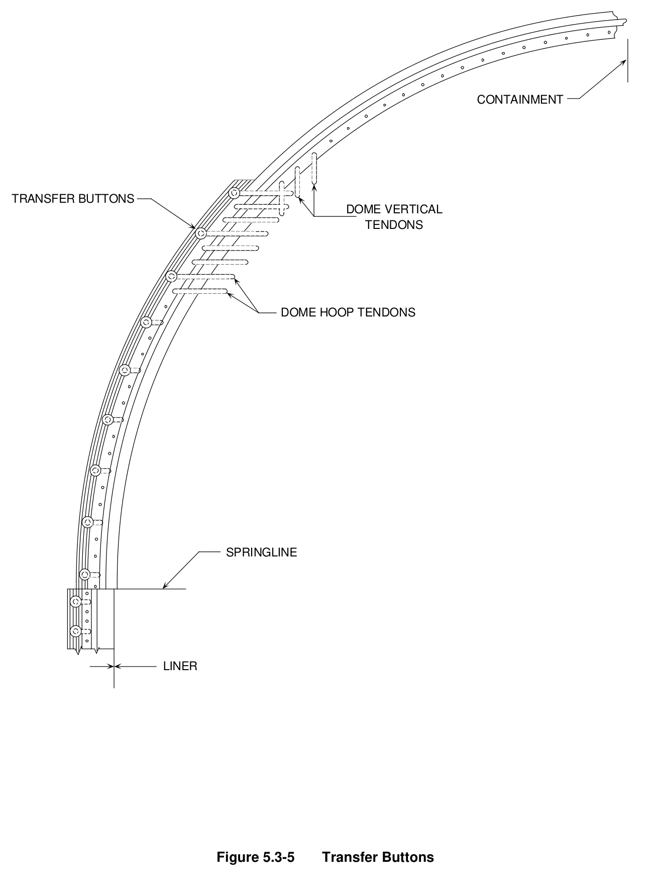

*Transfer Buttons*

[Vector original (SVG, lossless): fig_5.3-5.svg](../figures/fig_5.3-5.svg)

<!-- labels/text on this figure page -->
CONTAINMENT
TRANSFER BUTTONS DOME VERTICAL TENDONS
DOME HOOP TENDONS
SPRINGLINE
LINER
Figure 5.3-5 Transfer Buttons

<!-- p.471 -->
#### Figure 5.3-6

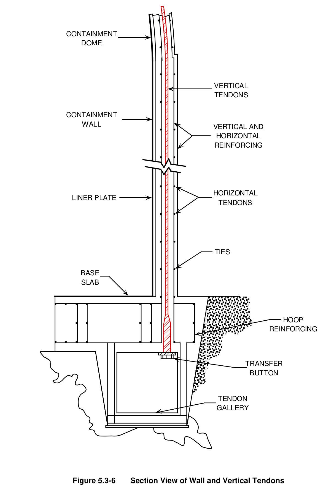

*Section View of Wall and Vertical Tendons*

[Vector original (SVG, lossless): fig_5.3-6.svg](../figures/fig_5.3-6.svg)

<!-- labels/text on this figure page -->
CONTAINMENT DOME
VERTICAL TENDONS
CONTAINMENT WALL VERTICAL AND HORIZONTAL REINFORCING
HORIZONTAL LINER PLATE TENDONS
TIES
BASE SLAB
HOOP REINFORCING
TRANSFER BUTTON
TENDON GALLERY
Figure 5.3-6 Section View of Wall and Vertical Tendons

<!-- p.472 -->
#### Figure 5.3-7

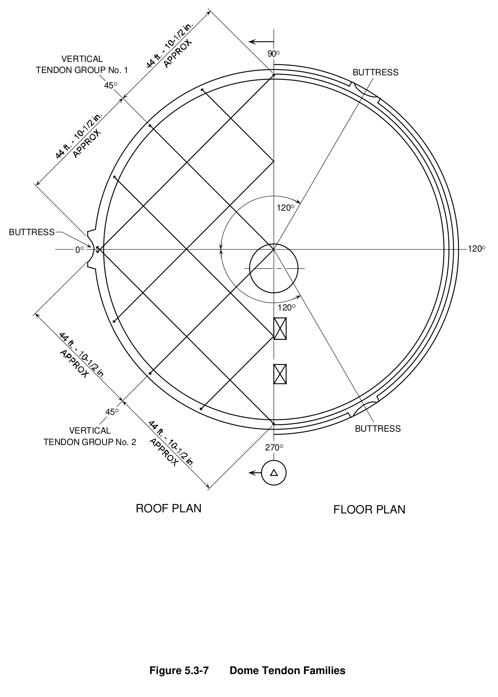

*Dome Tendon Families*

[Vector original (SVG, lossless): fig_5.3-7.svg](../figures/fig_5.3-7.svg)

<!-- labels/text on this figure page -->
90O VERTICAL TENDON GROUP No. 1 BUTTRESS 45O
120O
BUTTRESS
120O 0O
120O
45O
BUTTRESS VERTICAL TENDON GROUP No. 2 270O
ROOF PLAN FLOOR PLAN
Figure 5.3-7 Dome Tendon Families

<!-- p.473 -->
#### Figure 5.3-8

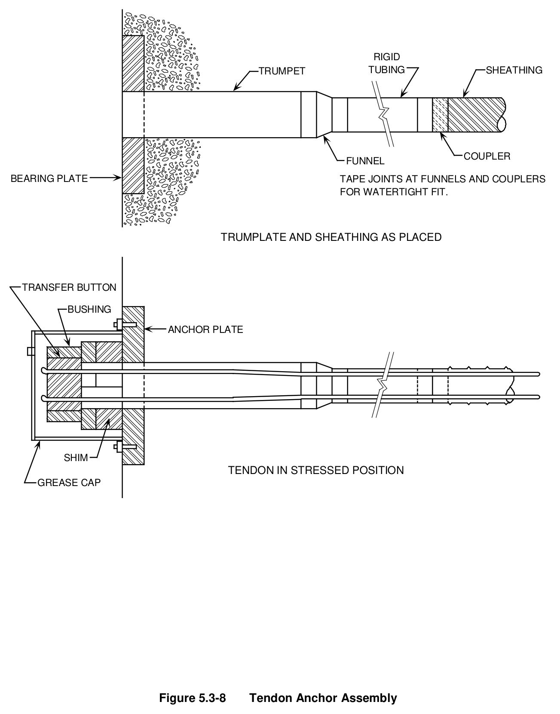

*Tendon Anchor Assembly*

[Vector original (SVG, lossless): fig_5.3-8.svg](../figures/fig_5.3-8.svg)

<!-- labels/text on this figure page -->
RIGID SHEATHING TRUMPET TUBING
COUPLER FUNNEL
BEARING PLATE TAPE JOINTS AT FUNNELS AND COUPLERS FOR WATERTIGHT FIT.
TRUMPLATE AND SHEATHING AS PLACED
TRANSFER BUTTON
BUSHING
ANCHOR PLATE
SHIM TENDON IN STRESSED POSITION GREASE CAP
Figure 5.3-8 Tendon Anchor Assembly

<!-- p.474 -->
#### Figure 5.3-9

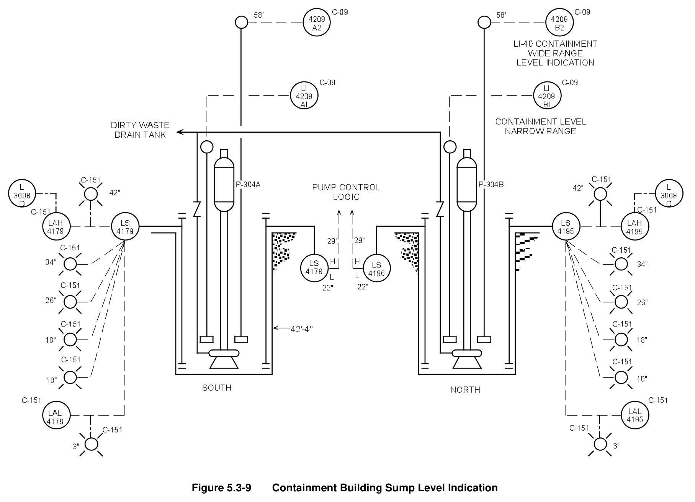

*Containment Building Sump Level Indication*

[Vector original (SVG, lossless): fig_5.3-9.svg](../figures/fig_5.3-9.svg)

<!-- p.475 -->
#### Figure 5.3-10

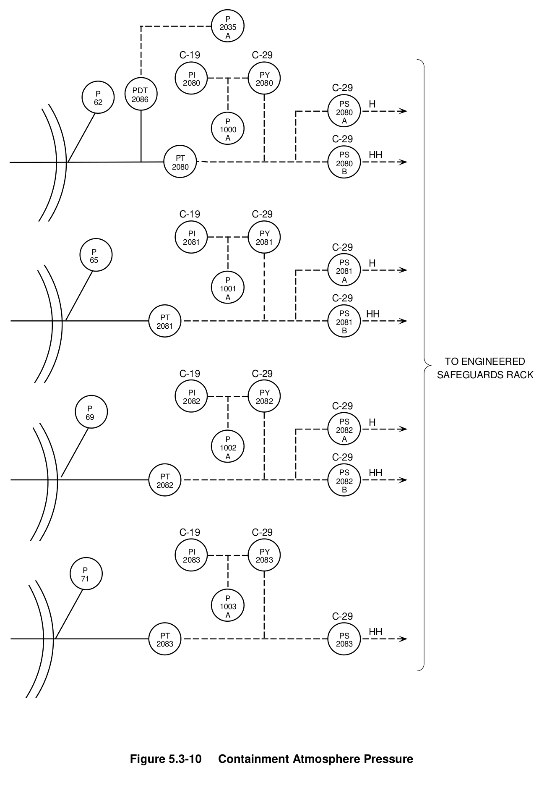

*Containment Atmosphere Pressure*

[Vector original (SVG, lossless): fig_5.3-10.svg](../figures/fig_5.3-10.svg)

<!-- labels/text on this figure page -->
P 2035 A
C-19 C-29
PI PY 2080 2080 C-29 PDT P 2086 62 PS H 2080 A P 1000 C-29 A
PS HH PT 2080 2080 B
C-19 C-29
PI PY 2081 2081 C-29 P 65 PS H 2081 A P 1001 C-29 A
PS HH PT 2081 2081 B
TO ENGINEERED C-19 C-29 SAFEGUARDS RACK
PI PY 2082 2082 C-29 P 69 H PS 2082 A P 1002 C-29 A
PS HH PT 2082 2082 B
C-19 C-29
PI PY 2083 2083 P 71
P 1003 C-29 A HH PT PS 2083 2083
Figure 5.3-10 Containment Atmosphere Pressure

<!-- p.476 -->
#### Figure 5.3-11

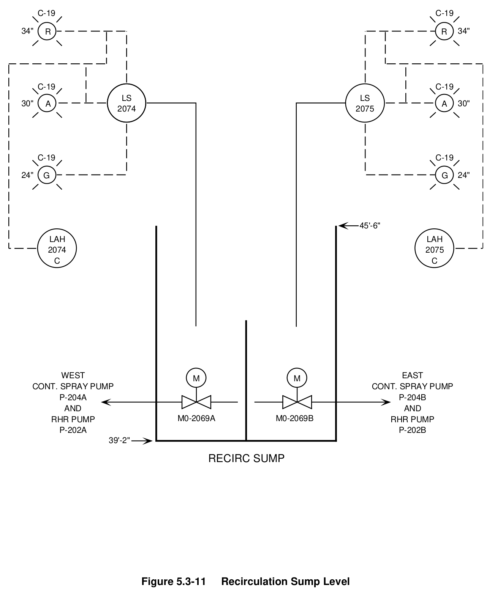

*Recirculation Sump Level*

[Vector original (SVG, lossless): fig_5.3-11.svg](../figures/fig_5.3-11.svg)

<!-- labels/text on this figure page -->
C-19 C-19
34" R R 34"
C-19 C-19 LS LS 30" A A 30" 2074 2075
C-19 C-19
24" 24" G G
45'-6" LAH LAH 2074 2075 C C
WEST EAST M M CONT. SPRAY PUMP CONT. SPRAY PUMP P-204A P-204B AND AND M0-2069A M0-2069B RHR PUMP RHR PUMP P-202A P-202B 39'-2"
RECIRC SUMP
Figure 5.3-11 Recirculation Sump Level

<!-- p.477 -->
#### Figure 5.3-12

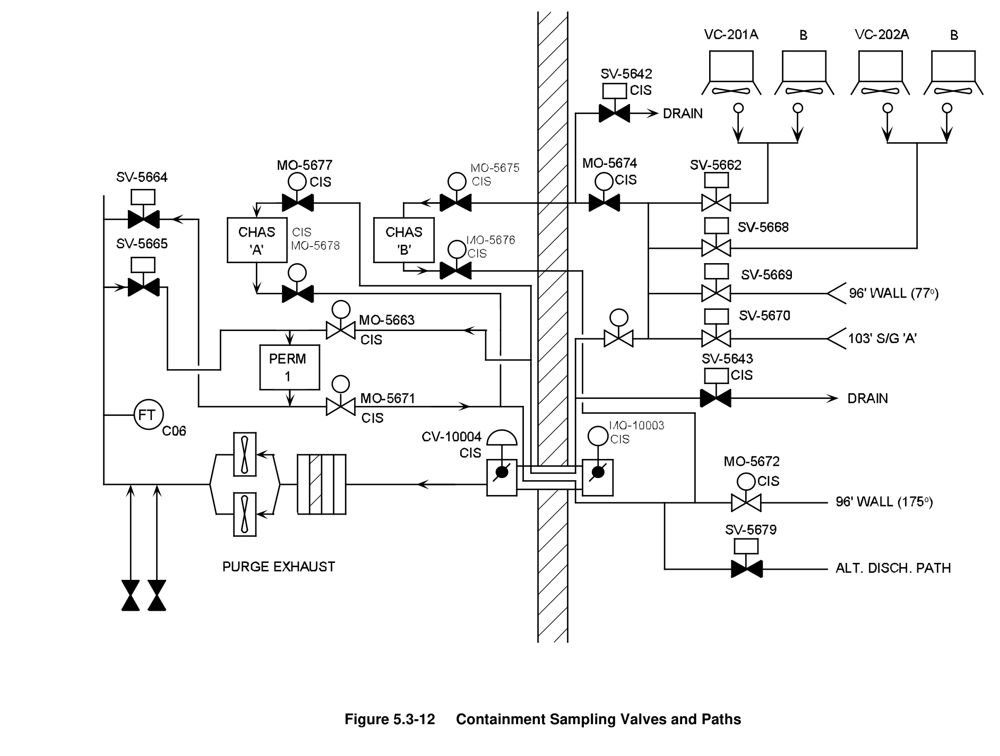

*Containment Sampling Valves and Paths*

[Vector original (SVG, lossless): fig_5.3-12.svg](../figures/fig_5.3-12.svg)

<!-- p.478 -->
#### Figure 5.3-13

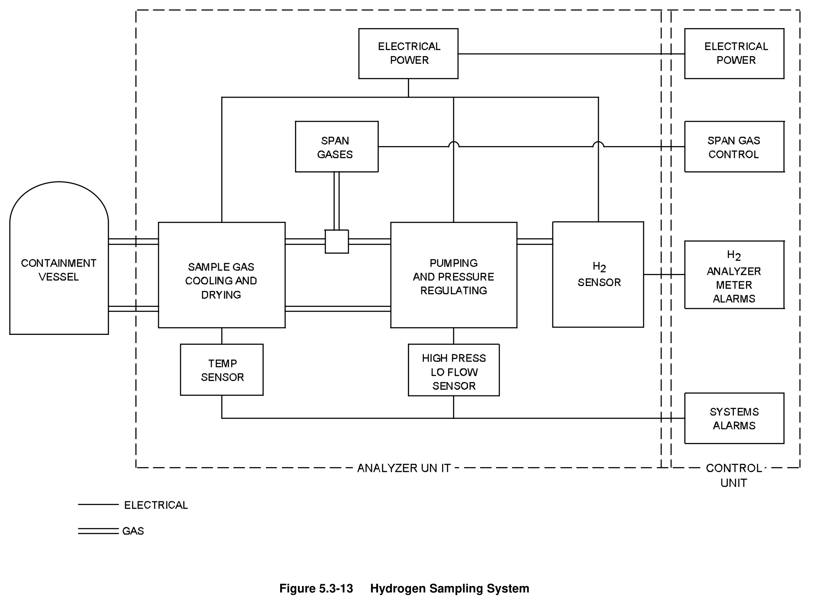

*Hydrogen Sampling System*

[Vector original (SVG, lossless): fig_5.3-13.svg](../figures/fig_5.3-13.svg)

