# 05.4 CTMT Temp Press Gas Control

> Pages 479–508 of `ML20057E160.pdf`
> Westinghouse Technology Systems Manual — USNRC HRTD (PWR)

---
<!-- p.479 -->
#### Westinghouse Technology Systems Manual
#### Section 5.4
#### Containment Temperature, Pressure,
#### and Combustible Gas Control Systems
<!-- p.480 -->
TABLE OF CONTENTS

5.4 Containment Temperature, Pressure, and Combustible Gas Control

Systems .................................................................................................... 5.4-1

5.4.1 Introduction ............................................................................................... 5.4-1

5.4.2 Containment Ventilation Systems ............................................................. 5.4-2

5.4.2.1 Purge Supply System ................................................................ 5.4-3

5.4.2.2 Purge Exhaust and Refueling Cavity Supply and Exhaust

System ...................................................................................... 5.4-4

5.4.2.3 CRDM Cooling System .............................................................. 5.4-4

5.4.2.4 Chill Water System .................................................................... 5.4-5

5.4.2.5 Pressurizer Compartment and Incore Instrumentation

Switching Room Cooling System .............................................. 5.4-5

5.4.2.6 Reactor Coolant Pump Cooling System .................................... 5.4-5

5.4.2.7 Reactor Cavity Cooling System ................................................. 5.4-5

5.4.2.8 Containment Air Cooler System................................................. 5.4-6

5.4.2.9 Unit Heater System .................................................................... 5.4-7

5.4.2.10 Cleanup Recirculating Units ...................................................... 5.4-7

5.4.3 Containment Combustible Gas Control Systems ...................................... 5.4-8

5.4.3.1 Hydrogen Control System .......................................................... 5.4-8

5.4.3.2 Hydrogen Mixing System ........................................................... 5.4-9

5.4.3.3 Hydrogen Vent System .............................................................. 5.4-9

5.4.4 Containment Spray System..................................................................... 5.4-10

5.4.4.1 System Description .................................................................. 5.4-10

5.4.4.2 Component Descriptions ......................................................... 5.4-11

5.4.4.3 Containment Spray Actuation Signals ..................................... 5.4-13

5.4.5 Summary ................................................................................................. 5.4-13

USNRC HRTD 5.4-i Rev 1013

<!-- p.481 -->
#### Figure 5.4-1

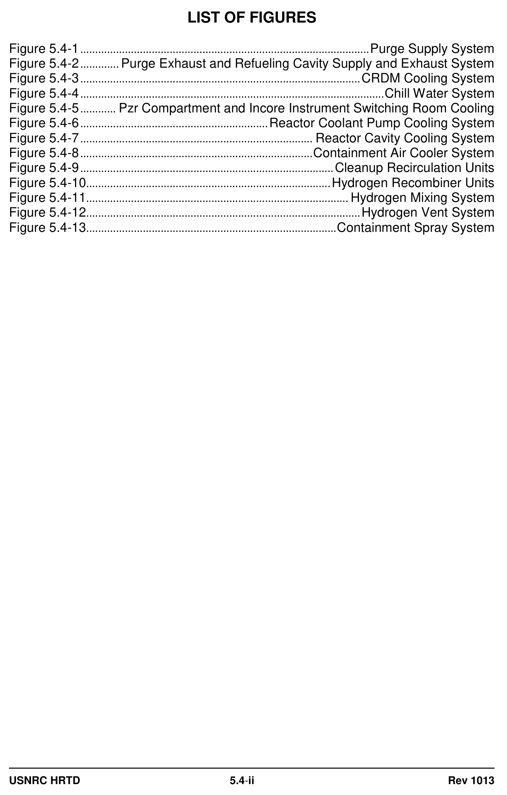

*................................................................................................ Purge Supply System*

<!-- labels/text on this figure page -->
LIST OF FIGURES
Figure 5.4-1 ................................................................................................. Purge Supply System
Figure 5.4-2 ............. Purge Exhaust and Refueling Cavity Supply and Exhaust System
Figure 5.4-3 .............................................................................................. CRDM Cooling System
Figure 5.4-4 ...................................................................................................... Chill Water System
Figure 5.4-5 ............ Pzr Compartment and Incore Instrument Switching Room Cooling
Figure 5.4-6 ............................................................... Reactor Coolant Pump Cooling System
Figure 5.4-7 .............................................................................. Reactor Cavity Cooling System
Figure 5.4-8 .............................................................................. Containment Air Cooler System
Figure 5.4-9 ..................................................................................... Cleanup Recirculation Units
Figure 5.4-10 .................................................................................. Hydrogen Recombiner Units
Figure 5.4-11 ........................................................................................ Hydrogen Mixing System
Figure 5.4-12 ............................................................................................ Hydrogen Vent System
Figure 5.4-13 .................................................................................... Containment Spray System
USNRC HRTD 5.4-ii Rev 1013

<!-- p.482 -->
### 5.4 CONTAINMENT TEMPERATURE, PRESSURE AND COMBUSTIBLE GAS
#### CONTROL SYSTEMS
#### Learning Objectives:
1. State the purposes of the containment ventilation systems.

2. List the signals that automatically initiate isolation of the purge supply and exhaust systems.

3. State the purposes of the containment spray system.

4. List the signals that automatically initiate the containment spray system.

5. State the purposes of the containment combustible gas control systems.

#### 5.4.1 Introduction
The purposes of the containment temperature, pressure, and combustible gas control systems are as follows:

1. To control the temperature and pressure of the containment during normal operations,

2. To protect the containment barrier and to minimize the leakage of radioactivity to the environment following an accident by reducing the containment temperature and pressure,

3. To remove hydrogen from the containment atmosphere and to limit localized hydrogen concentrations to prevent explosive mixtures, and

4. To remove radioactive iodine from the containment atmosphere after a loss-ofcoolant accident (LOCA).

The central safety objective in reactor plant design and operation is limiting the release of radioactive fission products. To ensure that this objective is met, the containment must be designed and maintained so that the fission products are retained after operational and accidental releases inside the containment.

The containment temperature, pressure, and combustible gas control systems are those systems which are necessary for reducing the release of airborne radioactivity and for ensuring continued containment integrity. These containment systems function as necessary during normal operation and during the period following a postulated accident.

To minimize the leakage from the containment and any subsequent release of fission products after an accident, it is necessary to reduce the pressure and temperature inside the containment. Also, the capability to remove the additional energy produced by reactor decay heat must be provided, so that the containment design pressure is not exceeded. Since it is not permissible to cool the containment

USNRC HRTD 5.4-1 Rev 1013

<!-- p.483 -->
by means of once-through ventilation (due to the increased radioactive release to the environment) the containment ventilation systems and the containment spray
(CS) system provide the required heat removal.

To further limit the release of radioactive species, the CS system includes a chemical additive (sodium hydroxide) to scrub any iodine from the containment atmosphere and keep it in solution in the containment sump water.

It is also necessary to control the buildup of hydrogen gas resulting from metal-water reactions in the core, from evolution of dissolved hydrogen from the reactor coolant, and from other sources to prevent reaching flammable levels. This is necessary to protect the integrity of the containment and the equipment within containment. The hydrogen recombiners and hydrogen vent system are used to remove hydrogen from the containment atmosphere, and the hydrogen mixing system is operated to prevent high localized hydrogen concentrations.

#### 5.4.2 Containment Ventilation Systems
The purposes of the containment ventilation systems are as follows:

1. To control the temperature and pressure of the containment during normal operations to maintain operability of the containment and associated equipment,

2. To provide localized area ventilation for equipment inside containment, and

3. To provide cleanup of the containment atmosphere for limited personnel access while at power, and for continuous access while shutdown.

To satisfy these purposes, the containment ventilation systems are designed to accomplish the following:

1. Maintain the average containment temperature within 50 - 120°F during normal operation.

2. Provide 70,000 CFM of air to the control rod drive mechanisms with a maximum inlet air temperature of 120°F.

3. Supply air to maintain the reactor coolant pump (RCP) air temperature below 120°F.

4. Provide cooling air for the primary concrete shield and the enclosed nuclear instrumentation wells.

5. Provide air to cool the reactor vessel supports.

6. Control containment airborne fission product gases, halogens and particulates in order to allow containment access without exceeding the occupational exposure dose limits of 10 CFR Part 20.

USNRC HRTD 5.4-2 Rev 1013

<!-- p.484 -->
7. Control the releases of fission product halogens, particulates, and noble gases during containment purge such that the requirements of 10 CFR Part 50, Appendix A, may be met for overall plant radioactivity releases.

Nine systems, operating together, meet the diverse design requirements for containment ventilation. These systems are as follows:

 Purge supply system  Purge exhaust and refueling cavity supply and exhaust system  Control rod drive mechanism (CRDM) cooling system  Pressurizer compartment and incore instrumentation switching room cooling system  RCP cooling system  Reactor cavity cooling system  Containment air cooler system  Unit heater system  Cleanup recirculation units

##### 5.4.2.1 Purge Supply System
The purge supply system (Figure 5.4-1), operating in conjunction with the purge exhaust system (section 5.4.2.2), is designed to ensure safe, continuous access to the containment after a planned or unplanned reactor shutdown by reducing the airborne particulates of the containment atmosphere. The system performs no function with respect to reactor safety.

The containment is normally isolated from the environment during power operations.
Prior to unisolating and activating the purge supply and exhaust systems, the radioactive particulate and gaseous activity levels inside the containment are monitored to ensure that releases from the containment are permitted. The activity of the purge exhaust flow is then monitored during purging operations.

The purge supply system consists of an outside air intake, an automatic roll filter, a bank of high efficiency particulate air (HEPA) filters, two 100-percent supply fans arranged in parallel, backdraft dampers, an outboard air-operated isolation damper, a containment penetration, an inboard motor-operated isolation damper, and associated ductwork.

The ductwork out to and including the containment outboard isolation valve is designed to Seismic Category I specifications. The quick closing isolation dampers are capable of closing within five seconds for the motor-operated damper and within three seconds for the air-operated damper upon receipt of a containment ventilation isolation signal (CVIS).

The purge supply fans are 480-Vac, 3-phase, 125-hp vane axial fans. Each is capable of providing 100 percent of the required 50,000-CFM air flow. The fans are controlled from the main control room and are interlocked such that only one fan runs at a time. To start a fan, both isolation valves must be open, and the other fan must be stopped. A pressure switch that senses pressure in the common discharge ductwork will start the standby fan on low pressure if the running fan stops. When

USNRC HRTD 5.4-3 Rev 1013

<!-- p.485 -->
starting a fan, the control switch for the redundant fan must be placed in pull-to-lock until the running fan has increased the duct pressure above the pressure switch setpoint. The supply fans have undervoltage and overcurrent protection.

The automatic roll filter is an 80-percent efficient filter designed to reduce the particulates and dust in the supply air and to serve as a prefilter for the HEPA filter.
The filter drive motor is interlocked with the supply fans such that it will run when either fan is running, and it is de-energized by a filter runout interlock.

The inboard and outboard dampers are controlled from the main control room. With their control switches in their normal positions (not in lockout), they will automatically close on a CVIS. A CVIS is generated by a safety injection signal (SIS), a high containment radiation signal, manual containment spray actuation, or manual initiation of phase A containment isolation. The open/closed status of each damper is sensed by limit switches and is indicated at the control switch and also on one of the containment isolation system status panels in the main control room.

##### 5.4.2.2 Purge Exhaust and Refueling Cavity Supply and Exhaust System
The purge exhaust and refueling cavity supply and exhaust system (Figure 5.4-2) is operated in conjunction with the containment purge supply system to exchange 150% of the containment air volume per hour. The purge exhaust system is operated in modes 5 and 6 when continuous containment occupancy is desired.

The purge exhaust system consists of an inboard motor-operated isolation damper, a containment penetration, an outboard air-operated isolation damper, an automatic roll filter, a bank of HEPA filters, two 100-percent exhaust fans arranged in parallel, backdraft dampers, and associated ductwork. These components meet the same requirements as noted for the purge supply system. The isolation dampers automatically close upon receipt of a CVIS.

The purge exhaust system exhausts to the containment purge vent at the top of the containment building. The exhausted air is monitored for gaseous, particulate and iodine activity.

The supply portion of the refueling cavity supply and exhaust system consists of two fans drawing air from the containment atmosphere and discharging it horizontally across the refueling cavity. The exhaust portion of the system consists of two fans drawing air from the inlets at the surface of the refueling cavity and discharging it to the purge exhaust system. The refueling cavity supply and exhaust system’s design objective is to rapidly remove and exhaust water vapor and fission products escaping from the fuel pool surface, to reduce the burden in the containment atmosphere during refueling.

##### 5.4.2.3 CRDM Cooling System
The CRDM cooling system (Figure 5.4-3) is designed to remove heat from the CRDMs and release it to the containment atmosphere. The system flow rate and static pressure drop requirements are based on maintaining the CRDM temperatures < 300F with normal operation of two of the four fans and a

USNRC HRTD 5.4-4 Rev 1013

<!-- p.486 -->
containment air temperature of 120F. The system is operating any time the reactor coolant temperature is > 350F. The system draws a minimum of 70,000 CFM of air through the shroud enclosing the CRDMs an discharges it upward, where it rises by convection to the containment air coolers. The four fans are mounted on the CRDM missile shield. The system is designated Seismic Category II.

##### 5.4.2.4 Chill Water System
The chill water system (Figure 5.4-4) is not a safety-related system; however, it performs the important function of removing heat generated in the digital rod position indication and control cabinets, the pressurizer compartment, the incore instrumentation switching room, the reactor cavity, and the process sample system.
The majority of the cooled equipment and spaces are located in the containment, where ambient temperatures range from 90°F to 110°F. Any equipment cooled by chill water may overheat if chill water flow is interrupted.

##### 5.4.2.5 Pressurizer Compartment and Incore Instrumentation Switching
#### Room Cooling System
The pressurizer compartment and incore instrumentation switching room cooling system (Figure 5.4-5) is designed to circulate containment air to these areas during normal operation and to supply 80°F air when personnel must access these areas.
The system consists of two independent subsystems, one for the pressurizer compartment and the other for the incore instrumentation switching room.

Each subsystem consists of a dust filter, a chill water cooling coil, a supply fan, and distribution ductwork. Each subsystem cools its area sufficiently for personnel entry with the fan running and chill water supplied to the cooling coil, and maintains a suitable compartment temperature for normal equipment operation with only the fan running. The cooling coils can be served by either of two chillers, each of which can provide 100 percent of the required design cooling capacity. The system is designed as a Seismic Category II system.

##### 5.4.2.6 Reactor Coolant Pump Cooling System
The RCP cooling system (Figure 5.4-6) distributes cooling air to each of the RCP motors. The system consists of four independent subsystems, one for each RCP.
Each subsystem consists of two 100-percent capacity fans arranged in parallel, backdraft dampers, and associated ductwork. One fan is normally running in each subsystem with the other in standby. The RCP cooling system is a Seismic Category II system.

##### 5.4.2.7 Reactor Cavity Cooling System
The reactor cavity cooling system (Figure 5.4-7) circulates chilled air through the incore instrumentation tunnel and then up through the reactor cavity around the reactor vessel and its supports. The system is designed to handle the portion of the vessel cooling load below the cavity seal. The 110F upper limit on the system’s exit air temperature is based on the fact that the air exiting the reactor cavity subsequently enters the CRDM cooling system. The system is a Seismic Category II system.

USNRC HRTD 5.4-5 Rev 1013

<!-- p.487 -->
##### 5.4.2.8 Containment Air Cooler System
The containment air cooler system (Figure 5.4-8), when operating under normal conditions, and in conjunction with other normally running containment ventilation systems, removes heat from normally operating equipment and from radiation and convective transfer from the primary and secondary coolant systems.

The system provides the heat removal capacity to maintain containment temperature below 120F during normal plant operation. The system also has the capacity to remove significant heat from the containment following a LOCA. The containment air cooler system is an engineered safety features (ESF) system and is designated Seismic Category I.

The system consists of eight individual air cooler units of equal capacity mounted above the containment spray header. Each unit contains a fan enclosed by an airtight roof and floor and surrounded on four sides by 12 cooling coils. The fans draw air horizontally across the cooling coils and discharge the cooled air downward into the containment. The cooling coils are supplied with cooling water from the component cooling water (CCW) system. The eight air coolers are divided into two groups of four units, designated as trains A and B. The cooling coils of each of the train A air coolers are supplied with cooling water from train A of the CCW system.
Each of the four train A cooler fans is powered by a train A 480-Vac ESF electrical bus. The fans and cooling coils of the train B air coolers are similarly supplied by train B of the Class IE electrical distribution system and train B of the CCW system.
Physical separation and barriers are provided between all train A and train B components.

The containment air cooler system is designed to maintain containment air temperature below 120°F during normal operation with six of the eight cooler units in operation and with the CCW system operating with design flows and temperatures.
The containment air cooler system also removes heat from the containment atmosphere in the event of a LOCA in order to suppress any resultant increase in containment pressure and temperature. The system is designed such that a single failure of any active component during the injection phase, or any active or passive failure during the recirculation phase, will not degrade the system’s ability to meet the design objectives.

The air cooler fans are 480-Vac, three-phase, 125-hp, down-blast discharge, vane axial fans. Each fan has a design capacity of 100,000 CFM. The fan motors are designed to ensure that the required air and steam mixture flow is achieved under design-basis-event conditions. Fan motor output horsepower requirements are greater under accident conditions because of the greater density of the containment atmosphere.

The containment air cooler fans are normally controlled from the main control room.
The control switches have STOP, NORMAL, and START positions, with PULL-TO- LOCK and spring return to NORMAL features. With the control switches in NORMAL, the air coolers are automatically started by the design basis accident
(DBA) load sequencer.

USNRC HRTD 5.4-6 Rev 1013

<!-- p.488 -->
During normal operation the CCW system supplies both containment air cooler trains. The CCW supply to each air cooler train contains a normally closed motoroperated valve and an orificed bypass line which supplies 1950 gpm of CCW flow.
The air cooler fans are started as necessary to maintain containment temperature between 50 and 120F. Not more than three air coolers in each train are run simultaneously, except for periodic testing. Normal air cooler operation has six of the eight coolers in operation.

Humidity in the containment air condenses on the cooling coils. The condensation from each cooler collects in a drip pan below the cooler. The drip pans are connected to a common collection header, and the drains are directed to a condensate collection pot. When the level in the pot reaches a setpoint, a motoroperated valve opens, and the pot drains to the containment sump. The number of times that the motor-operated valve opens is recorded in the control room.
Condensate pot drain cycles are proportional to the condensation rate. The condensation rate is proportional to humidity and CCW temperature. Humidity is proportional to the leak rate of liquid systems inside the containment.

An SIS causes the start of any standby CCW train and the separation of the two CCW trains (if the trains are not already separated). The motor-operated valve in each CCW supply to the containment air coolers opens and provides a minimum flow of 6000 gpm flow to its associated cooler train. The DBA load sequencer automatically starts all previously idle air cooler fans when their control switches are in the NORMAL positions.

##### 5.4.2.9 Unit Heater System
The unit heater system consists of ten unit heaters located throughout the containment building. The unit heaters are designed to provide heating to allow for personnel comfort during periods of personnel access. The electrical heating coils and blower units are locally controlled and have a variable temperature control.

##### 5.4.2.10 Cleanup Recirculating Units
During normal operation, two Seismic Category II recirculating filter units are available for intermittent or continuous operation to control the buildup of airborne halogens and particulates which result from small RCS leaks within the containment.
The cleanup filters (in conjunction with the containment purge supply and exhaust systems) have two objectives. The first is to maintain airborne fission product levels below the 10 CFR Part 20 limits for occupational exposures to allow safe access to the containment. The second is to reduce fission product releases to the environment to levels as low as reasonably achievable when containment purging is required. The cleanup recirculation system performs no function with respect to reactor safety.

The cleanup recirculation system (Figure 5.4-9) consists of two separate units. Each unit draws a containment air flow of 4000 CFM through a prefilter, a HEPA filter, and a carbon adsorber. With both units in operation, approximately one equivalent containment air volume is recirculated every four hours.

USNRC HRTD 5.4-7 Rev 1013

<!-- p.489 -->
#### 5.4.3 Containment Combustible Gas Control Systems
Three systems are provided to control hydrogen in the containment building. These systems are the hydrogen control system, the hydrogen mixing system, and the hydrogen vent system.

Following a LOCA, hydrogen gas may accumulate within the containment as a result of:

1. The metal/water reaction involving the zirconium fuel cladding and the reactor coolant,
2. Radiolytic decomposition of the post-accident emergency cooling solutions, and
3. Corrosion of metals caused by the solutions used for emergency cooling or containment spray.

If a sufficient amount of hydrogen is generated, it may react with the oxygen present in the containment atmosphere or with the oxygen generated following the accident.
In this event, the reaction could take place at rates rapid enough to lead to high temperatures and significant pressures in the containment. This could conceivably result in the loss of containment integrity and/or damage to systems and components essential to the control of the post-LOCA conditions.

##### 5.4.3.1 Hydrogen Control System
The hydrogen control system consists of two in-containment hydrogen recombiner units. The recombination units draw in containment air by natural convection and heat it to a temperature of 1150 - 1400°F. At a temperature of approximately 1135°F, hydrogen and oxygen recombine and thereby reduce the containment hydrogen concentration. The units are completely enclosed, and the internals are protected against impingement by containment spray. The units are designed as Seismic Category I components and are capable of functioning during a LOCA.

Each recombination unit (Figure 5.4-10) consists of an inlet preheater section, a recombination section, and a mixing chamber. Containment air is drawn into the unit by natural convection via inlet louvers and passes through the preheater section.
The preheater section is outside a shroud placed around the central heaters; it takes advantage of heat conduction through internal unit walls. Preheating the air accomplishes the dual function of increasing the system efficiency and evaporating any moisture which is entrained in the air. The warmed air then passes through a specifically sized flow orifice and flows vertically upward through the recombination section, where its temperature is raised and the hydrogen and oxygen recombine.

The recombination section contains five banks of vertically stacked electric heaters.
Each heater bank contains 60 U-type heating elements. After heating and recombination, the air rises to the mixing chamber. In the mixing chamber the hot air is mixed with the cooler containment air that enters the mixing chamber through the lower parts of the louvers located on three sides of the mixing chamber; the mixture is then discharged to the containment atmosphere.

USNRC HRTD 5.4-8 Rev 1013

<!-- p.490 -->
In the event of a LOCA, plant personnel use the containment hydrogen analysis system to determine the hydrogen concentration in containment. The recombination units are started as required (normally with the hydrogen concentration between 0.5 percent and 4.0 percent). The units are started from the main control room.

##### 5.4.3.2 Hydrogen Mixing System
The hydrogen mixing system (Figure 5.4-11) consists of two fans which take suction from the high point of the containment dome, where any generated hydrogen is expected to collect. The exhaust from the fans is directed downward into the lower containment air space, where rapid mixing by turbulence created by the containment air coolers occurs. Operating the hydrogen mixing fans helps to prevent a localized hydrogen concentration in the containment dome area which exceeds the flammability limit. The hydrogen mixing system is an ESF system which meets Seismic Category I requirements.

##### 5.4.3.3 Hydrogen Vent System
The hydrogen vent system (Figure 5.4-12) consists of two redundant subsystems which permit controlled purging of the containment. Each subsystem includes a fan which exhausts air from the containment through motor-operated isolation dampers and a filter assembly containing a roughing filter, a HEPA filter, a carbon adsorber, and a HEPA after filter. The filter assembly reduces the activity of the halogens and particulates in the vent flow. Each fan exhausts air through a motor-operated damper to the purge exhaust system.

Filtered air from the purge supply system is supplied by the hydrogen vent system to replace the air that is removed and to maintain containment pressure within normal limits. The intake path is through a manual valve and remotely controlled motoroperated dampers.

The eight motor-operated containment isolation dampers are operated from the main control room. A phase A containment isolation signal (CIS - channel A for inboard dampers and channel B for outboard dampers) or a CVIS will cause the dampers to automatically close. Damper open and closed indication is provided in the main control room.

Following an accident, the hydrogen vent system provides the capability to lower the containment hydrogen concentration by venting hydrogen to the environment.
Analyses show that hydrogen venting should not be required until a few weeks after the accident; that time should be sufficient for containment air activity to reach a level which can be vented to the environment without exceeding exposure guidelines. During normal plant operation, the system is periodically operated to vent containment air to maintain the containment pressure below the upper limit.
(Containment pressure increases mainly due to leakage from the instrument air system.) The hydrogen vent system is the preferred vent path because of the extensive filtering of the exhausted air.

USNRC HRTD 5.4-9 Rev 1013

<!-- p.491 -->
#### 5.4.4 Containment Spray System
The containment spray (CS) system is designed to accomplish three (3) main objectives:

1. Limit the peak containment pressure below its design pressure of 60 psig following a worst case LOCA, and then subsequently reduce the postaccident containment pressure;

2. Reduce the concentration of fission product iodine in the containment atmosphere following a LOCA; and

3. Keep spray-entrained iodine in the containment recirculation sump while maintaining the sump water at a basic pH.

The CS system is an ESF system which functions to reduce the containment pressure and airborne fission products in the containment atmosphere following a steam break or a LOCA. The pressure reduction is accomplished by spraying cool, borated water from the refueling water storage tank into the containment atmosphere. Sodium hydroxide is added to the containment spray water to enhance absorption of the airborne fission product iodine and to retain the radioactive iodine in solution.

##### 5.4.4.1 System Description
The containment spray system (Figure 5.4-13) is comprised of two 100-percent, independent, and identical trains, with the exception of a common spray additive tank and a common containment spray pump recirculation test line to the refueling water storage tank (RWST). Otherwise, train separation extends from the pump suctions to the containment spray headers. Redundancy of equipment in the containment spray trains satisfies the single failure design criterion.

The containment spray system consists of two pumps, two spray ring headers, a spray additive tank, a number of motor-operated isolation valves, and all necessary piping, instrumentation, and accessories to make the system operable.

During the injection phase of system operation, the containment spray pumps start and take suction from the RWST upon receipt of a containment spray actuation signal (CSAS). The pumped fluid pumped is borated water mixed with a sodium hydroxide (NaOH) solution from the spray additive tank. The NaOH is added to the spray water to enhance removal of elemental iodine from the containment atmosphere. The spray water pH value is maintained within the range of 9.0 - 10.5 during injection. This pH range helps ensure iodine removal from the containment atmosphere by the spray droplets, retaining iodine in solution, and compatibility between the spray fluid and the materials with which it comes in contact.

The NaOH solution is piped to two liquid jet eductors, each of which is located in a bypass line around one of the spray pumps. Motor-operated isolation valves in the NaOH supply path to the eductors open upon receipt of the CSAS. The bypassed spray water from each pump’s discharge passes through an eductor and draws the

USNRC HRTD 5.4-10 Rev 1013

<!-- p.492 -->
NaOH solution into the eductor, where it mixes with the spray water and is piped back to the suction of the pump.

The discharge from each CS pump is piped to a ring header located on the inside of the containment dome. A motor-operated isolation valve in each header supply line opens upon receipt of the CSAS. Each ring header contains spray nozzles aimed in various predetermined directions to ensure maximum spray coverage of the containment. The ring headers are piped to provide complete coverage of the containment even if one spray pump fails to start on demand.

During the recirculation phase of system operation, the spray pump suctions are manually realigned from the RWST to the containment recirculation sump. The pump discharge paths to the ring headers and the eductors are unchanged. This evolution permits continued delivery of spray flow to the containment environment after the RWST has largely emptied.

Recirculation lines from the pumps to the RWST allow testing of the pumps without initiating containment spray. A locked-closed, manually operated globe valve in each pump recirculation line and one in the downstream common line allow test flow alignment and throttling.

##### 5.4.4.2 Component Descriptions
#### Containment Spray Pumps
The spray pumps are vertical, single-stage centrifugal pumps. Each pump is rated for 2800 gpm at approximately 200 psig. The pumps are made of a material compatible with the NaOH additive and the boric acid solution of the RWST. Each spray pump delivers a design flow equal to 100 percent of the heat removal capability necessary to maintain the pressure in the containment below its design maximum. The design discharge pressure of each pump is sufficient to continue at rated flow with the RWST almost empty, against a head equivalent to the sum of design containment pressure, the elevation head of the uppermost nozzle, and the line and nozzle pressure losses.

As a component of an ESF system, each pump is supplied electrical power from an independent ESF 4.16-kv bus. The CS pumps can be individually controlled from two separate locations. A selector switch, mounted on the local switchgear panel, determines which station, LOCAL or REMOTE, has control. In LOCAL, START or STOP may be selected at the switchgear panel. In REMOTE, control is shifted to the main control room. With the pump control selected to REMOTE and the main control room switch selected to AUTO, the CS pumps are started by a CSAS coincident with an SIS.

#### Spray Additive Tank
The spray additive tank is constructed of carbon steel and lined with a special coating on its interior surface to protect the tank from the highly corrosive caustic contained within. The tank capacity is 4000 gal of 30 weight percent NaOH solution.
To prevent degradation of the NaOH solution due to introduction of air into the tank,

USNRC HRTD 5.4-11 Rev 1013

<!-- p.493 -->
a nitrogen blanket is maintained above the solution surface. The normal nitrogen pressure is two psig.

The NaOH concentration of the spray additive tank and the addition rate of NaOH to the spray flow provided by the eductors are selected so that, after the tank solution mixes with the water from the reactor coolant system, the RWST, and the safety injection accumulators, the resulting basic pH of the containment recirculation sump solution ensures effective iodine retention and limited corrosion of containment materials.

#### Spray Additive Eductors
The liquid jet eductors provide the means of adding NaOH to the spray water. An eductor uses the kinetic energy of a pressurized liquid to entrain another liquid, mix the two, and discharge the mixture against a counter pressure. For the spray additive eductors, the pressurized liquid is the spray pump discharge, which entrains the NaOH solution and discharges the mixture into the suctions of the spray pumps.
During the initial injection phase of CS system operation, the RWST supplies water to each spray pump. Ninety-five percent of a pump’s discharge is directed to its respective spray ring, and the remaining five percent bypasses the spray ring to supply motive force for that train’s additive eductor. From each eductor, the mixture of NaOH and borated water enters the suction of its associated CS pump.

#### Spray Headers and Nozzles
The CS pumps discharge to two concentric spray rings in the dome of the containment. The rings are redundant, with half being supplied from each spray pump through a normally shut motor-operated isolation valve. Each ring provides a full 360° coverage of the containment. Protruding from each spray ring are hollow core nozzles. Train A has 176 spray nozzles and Train B has 178 spray nozzles.
Each nozzle is capable of delivering approximately 15 gpm of atomized spray water.
The spray nozzles are not subject to clogging by particles less than 1/4 in. in maximum dimension.

The spray rings are a critical portion of the CS system. The pumps provide the proper flow of spray water, and the eductors supply the proper addition rate of NaOH solution. The spray nozzles deliver this mixture in a fine mist to the containment atmosphere. Atomization increases the effective surface area of the water spray.
The greater surface area allows a given volume of water to absorb more internal energy from the atmosphere, thereby increasing the rate at which the containment pressure and temperature decrease. Secondly, the greater surface area exposes a given water volume to more iodine and therefore increases its iodine-removal efficiency.

The positioning of the spray nozzles is such that both spray ring headers develop a blanket of mist covering over 90 percent of the containment building volume. The remaining 10 percent consists of completely flooded lower regions as well as the volume above the spray rings. A portion of the spray pattern intentionally strikes the containment inner walls to create a liquid layer that acts as an additional barrier to fission product leakage.

USNRC HRTD 5.4-12 Rev 1013

<!-- p.494 -->
##### 5.4.4.3 Containment Spray Actuation Signals
Containment spray actuation signals are developed by two completely redundant channels (A and B). Either of the following conditions will cause both a train A and a train B CSAS:

1. High-high containment pressure (30 psig), as sensed by two out of four containment building pressure detectors, or
2. Manual operator initiation from the main control room.

Containment spray initiation involves several unique features in comparison to initiation of other ESF functions. First, for manual initiation from the control room, two actuation switches are provided; both must be simultaneously positioned to the ACTUATE position to initiate containment spray. The simultaneous positioning of these switches is also required to generate a phase B containment isolation signal
(CCW flows to the reactor coolant pumps will be isolated). Second, a CSAS, either from manual or automatic initiation, is insufficient, by itself, to start the CS pumps.
An SIS must also be present to energize each ESF train’s DBA load sequencer, allowing it to start that train’s CS pump. An SIS is not required to open the spray header isolation valves or NaOH tank outlet valves; the CSAS alone is sufficient to cause valve opening. Third, the containment pressure bistables for spray actuation are energized to actuate, whereas other protection bistables are de-energized to actuate. The status of the four individual high-high containment pressure channels is monitored by trip status lamps on the ESF trip status panel in the main control room. These design features make an inadvertent and unnecessary spraydown of the containment building unlikely.

Each CSAS (high-high containment pressure, manual initiation) can be manually reset from the control room. The reset logic for the high-high containment pressure CSAS involves a retentive memory with an actuation block. The presence of the retentive memory means that, once an actuation signal has initiated (assuming no reset action by the operator), it remains present even if the containment building pressure returns to normal (below the actuation setpoint). The operator must manually reset the automatic actuation in accordance with plant emergency operating procedures to stop spraying into the containment atmosphere. If the operator resets the CSAS prior to the containment pressure returning below the high-high actuation setpoint, automatic reinitiation does not occur because of the actuation block feature. When the containment building pressure decreases below the actuation setpoint, the block feature automatically clears, and automatic reinitiation would then occur if containment pressure again exceeds the actuation setpoint.

#### 5.4.5 Summary
Containment ventilation systems are provided to maintain the containment’s temperature, pressure, humidity, and activity within appropriate limits for equipment operation and personnel access.

USNRC HRTD 5.4-13 Rev 1013

<!-- p.495 -->
The purge supply and exhaust systems maintain proper environmental quality for unlimited access during periods of reactor shutdown. This function is accomplished by continuously circulating outside air through the containment.

The containment air coolers provide general containment atmosphere cooling by removing heat generated by plant components and heat losses to ambient from reactor coolant system piping. Other ventilation systems force cooled air directly past components requiring additional cooling. The cleanup recirculating units, with HEPA filters and carbon adsorbers, are used to reduce containment activity.

The refueling cavity supply and exhaust system minimizes exposure of refueling personnel to airborne activity during refueling operations.

Three combustible gas control systems (the hydrogen control system, hydrogen mixing system, and the hydrogen vent system) are provided to remove hydrogen from the containment atmosphere and to limit localized hydrogen concentrations to prevent explosive mixtures.

A containment spray system is designed to limit the peak containment pressure following a LOCA, to subsequently reduce the post-accident containment pressure, and to reduce the concentration of iodine in the containment building. Additionally, the system keeps spray-entrained iodine in the containment recirculation sump while maintaining the sump water at a basic pH. The containment air coolers supplement the containment spray system in cooling the post-accident containment environment.

USNRC HRTD 5.4-14 Rev 1013

<!-- p.496 -->
#### Figure 5.4-1

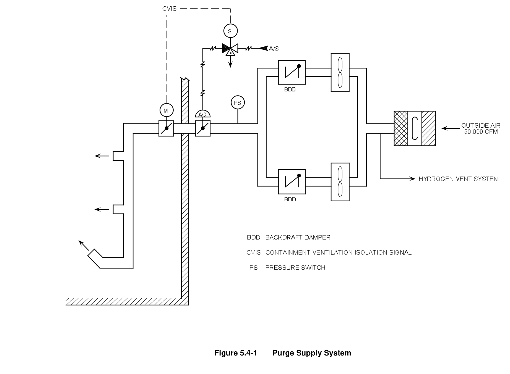

*Purge Supply System*

[Vector original (SVG, lossless): fig_5.4-1_2.svg](../figures/fig_5.4-1_2.svg)

<!-- p.497 -->
#### Figure 5.4-2

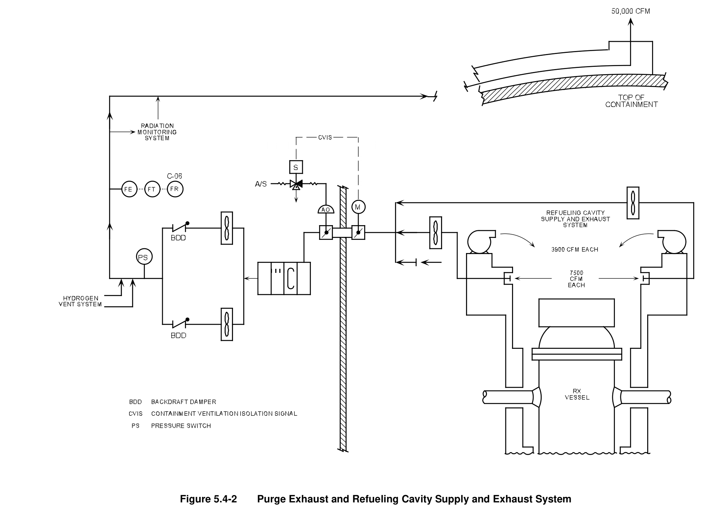

*Purge Exhaust and Refueling Cavity Supply and Exhaust System*

[Vector original (SVG, lossless): fig_5.4-2.svg](../figures/fig_5.4-2.svg)

<!-- p.498 -->
#### Figure 5.4-3

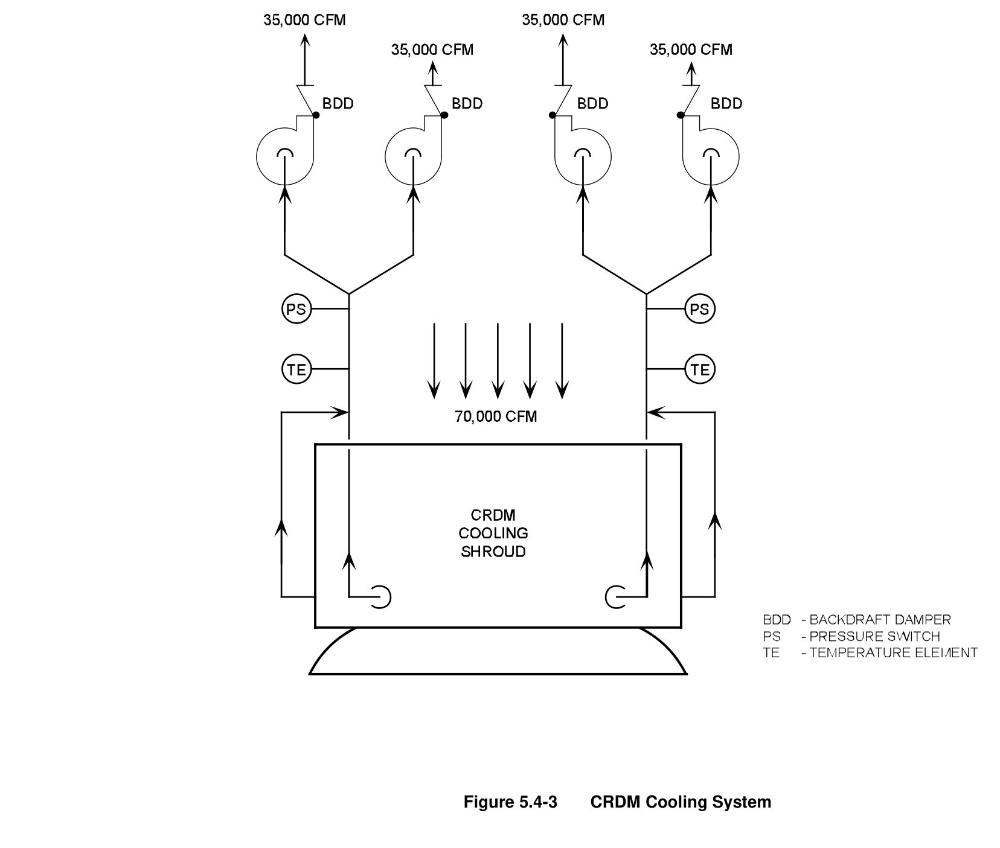

*CRDM Cooling System*

[Vector original (SVG, lossless): fig_5.4-3.svg](../figures/fig_5.4-3.svg)

<!-- p.499 -->
#### Figure 5.4-4

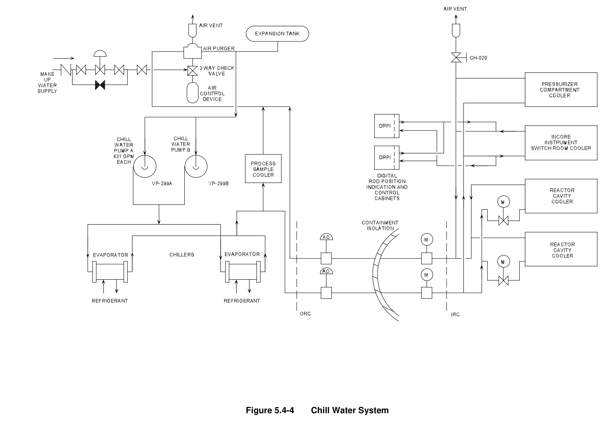

*Chill Water System*

[Vector original (SVG, lossless): fig_5.4-4.svg](../figures/fig_5.4-4.svg)

<!-- p.500 -->
#### Figure 5.4-5

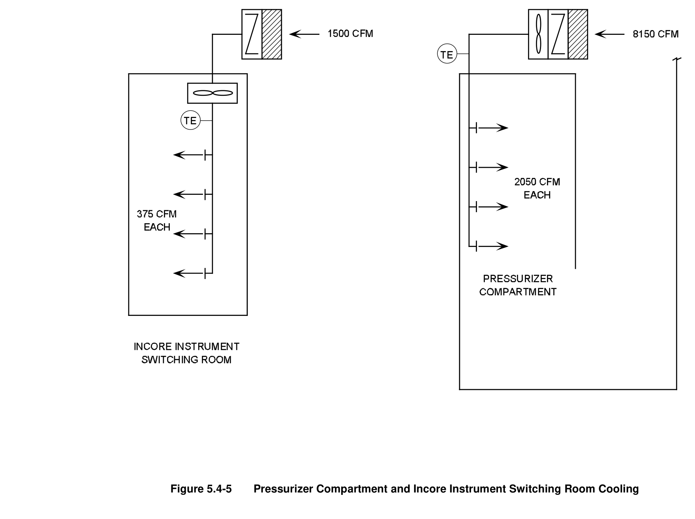

*Pressurizer Compartment and Incore Instrument Switching Room Cooling*

[Vector original (SVG, lossless): fig_5.4-5.svg](../figures/fig_5.4-5.svg)

<!-- labels/text on this figure page -->
Figure 5.4-5 Pressurizer Compartment and Incore Instrument Switching Room Cooling

<!-- p.501 -->
#### Figure 5.4-6

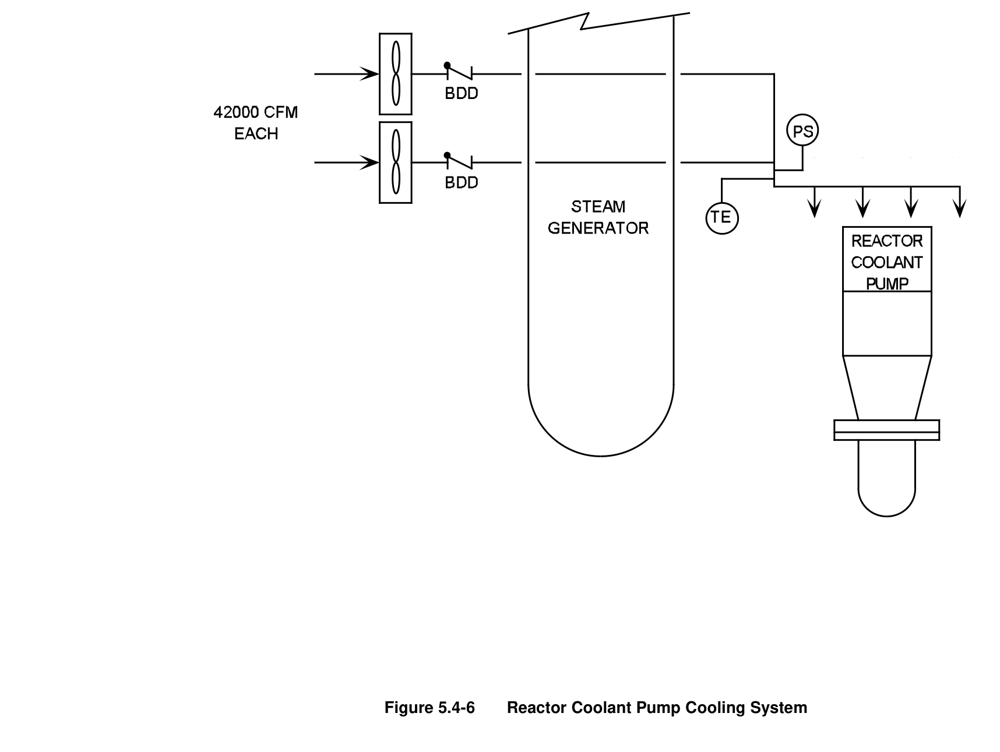

*Reactor Coolant Pump Cooling System*

[Vector original (SVG, lossless): fig_5.4-6.svg](../figures/fig_5.4-6.svg)

<!-- p.502 -->
#### Figure 5.4-7

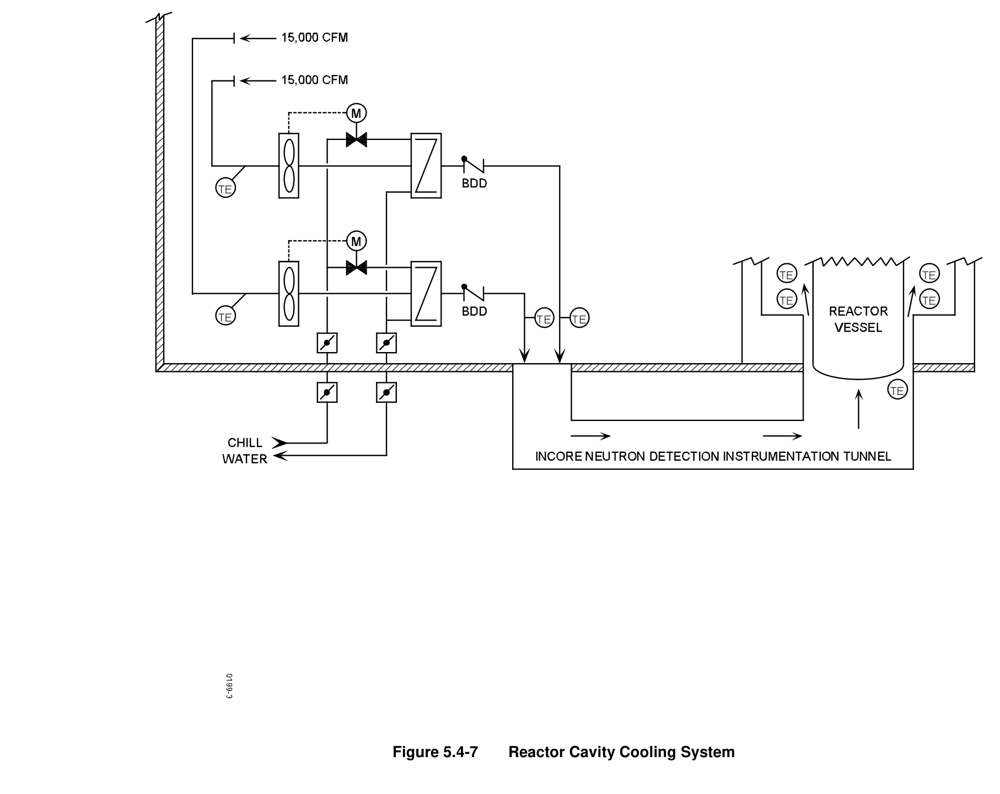

*Reactor Cavity Cooling System*

[Vector original (SVG, lossless): fig_5.4-7.svg](../figures/fig_5.4-7.svg)

<!-- p.503 -->
#### Figure 5.4-8

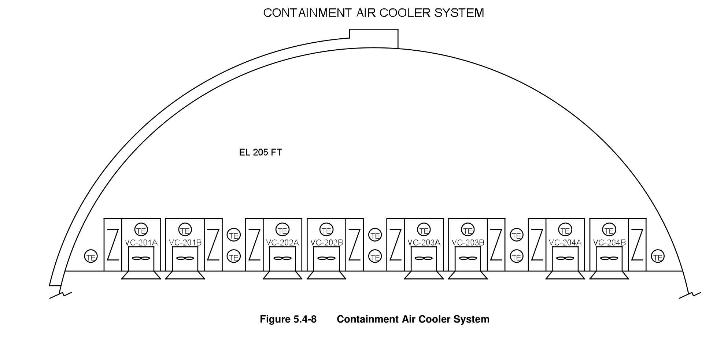

*Containment Air Cooler System*

[Vector original (SVG, lossless): fig_5.4-8.svg](../figures/fig_5.4-8.svg)

<!-- p.504 -->
#### Figure 5.4-9

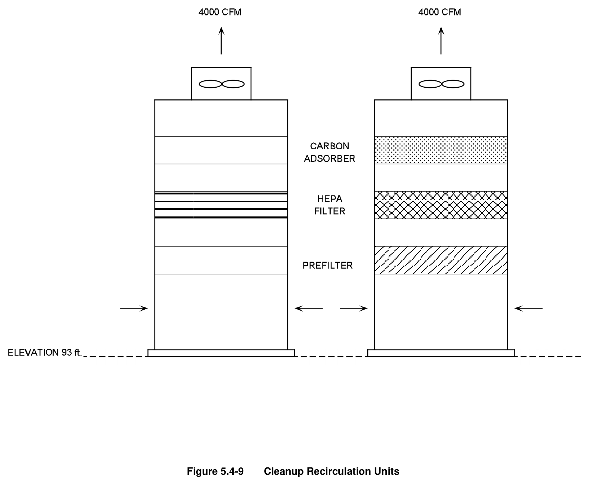

*Cleanup Recirculation Units*

[Vector original (SVG, lossless): fig_5.4-9.svg](../figures/fig_5.4-9.svg)

<!-- p.505 -->
#### Figure 5.4-10

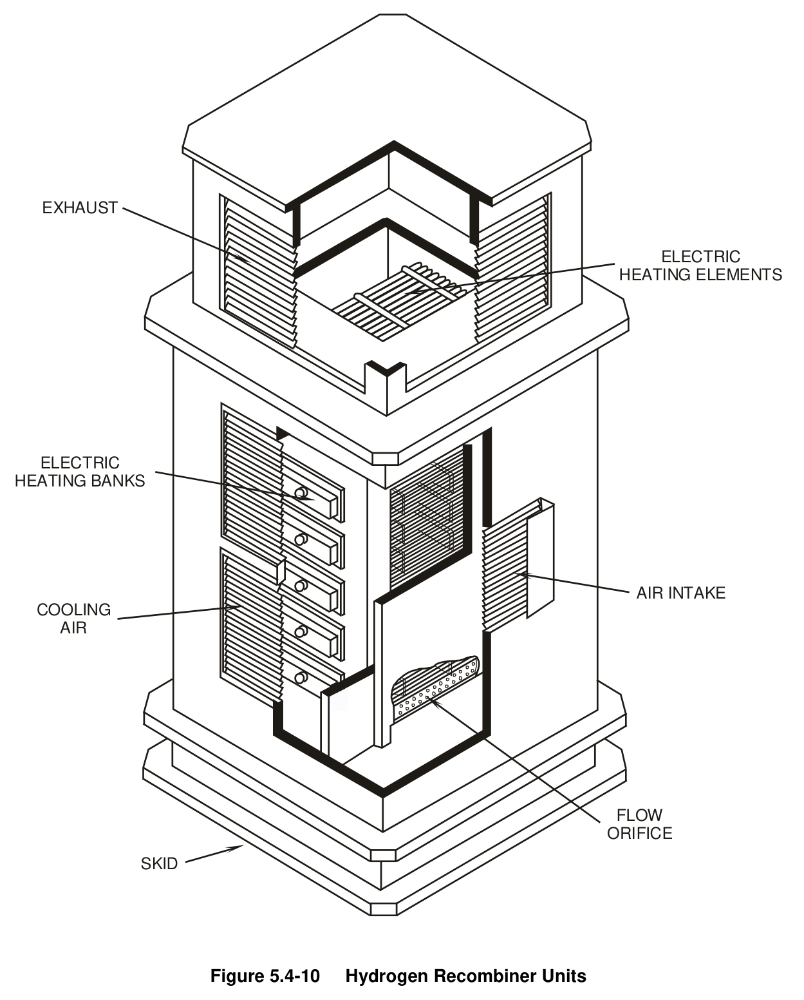

*Hydrogen Recombiner Units*

[Vector original (SVG, lossless): fig_5.4-10.svg](../figures/fig_5.4-10.svg)

<!-- labels/text on this figure page -->
EXHAUST
ELECTRIC HEATING ELEMENTS
ELECTRIC HEATING BANKS
AIR INTAKE COOLING AIR
FLOW ORIFICE
SKID
Figure 5.4-10 Hydrogen Recombiner Units

<!-- p.506 -->
#### Figure 5.4-11

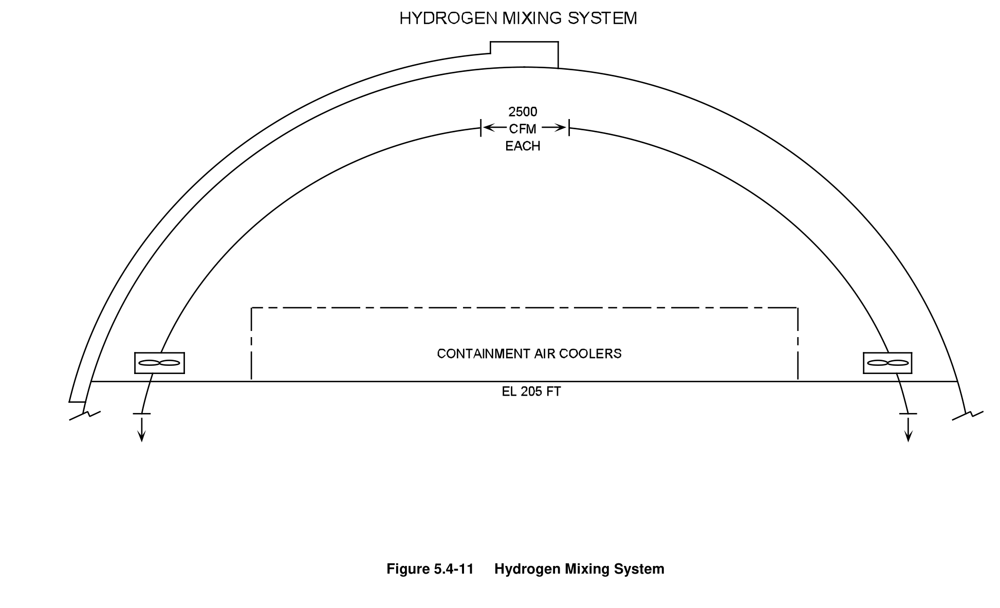

*Hydrogen Mixing System*

[Vector original (SVG, lossless): fig_5.4-11.svg](../figures/fig_5.4-11.svg)

<!-- p.507 -->
#### Figure 5.4-12

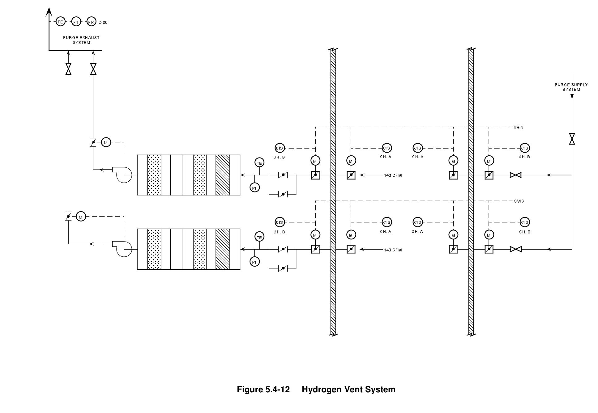

*Hydrogen Vent System*

[Vector original (SVG, lossless): fig_5.4-12.svg](../figures/fig_5.4-12.svg)

<!-- p.508 -->
#### Figure 5.4-13

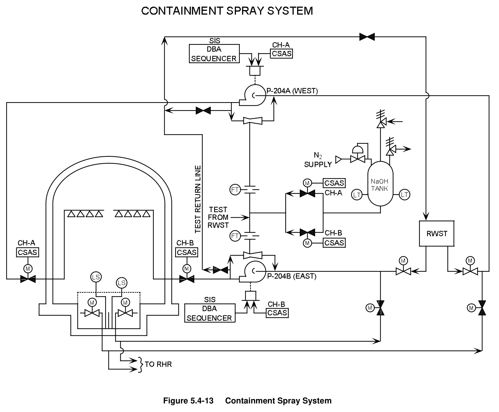

*Containment Spray System*

[Vector original (SVG, lossless): fig_5.4-13.svg](../figures/fig_5.4-13.svg)

