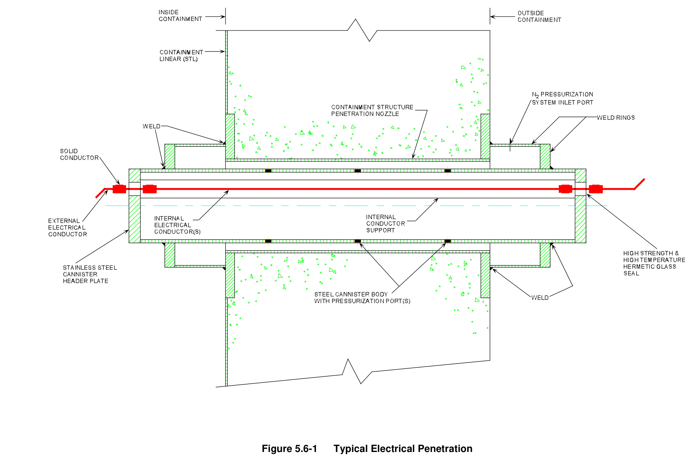
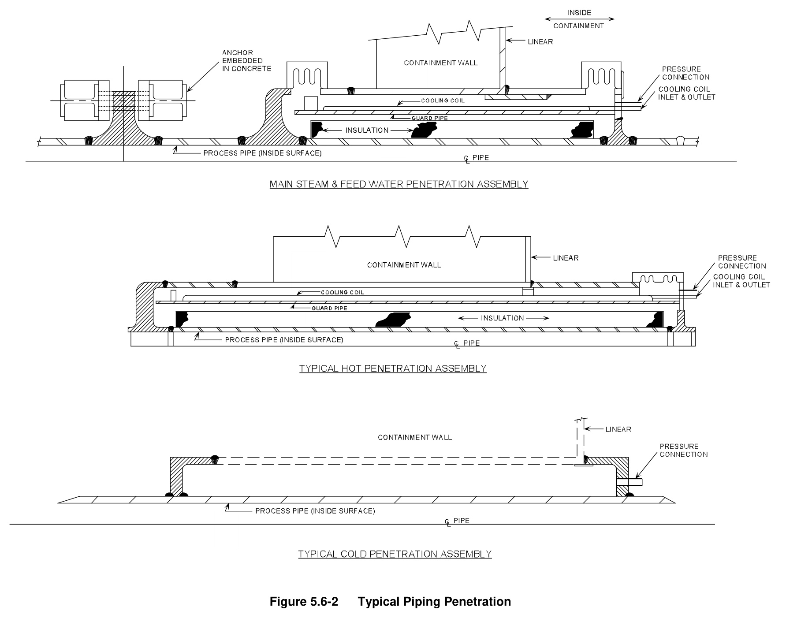
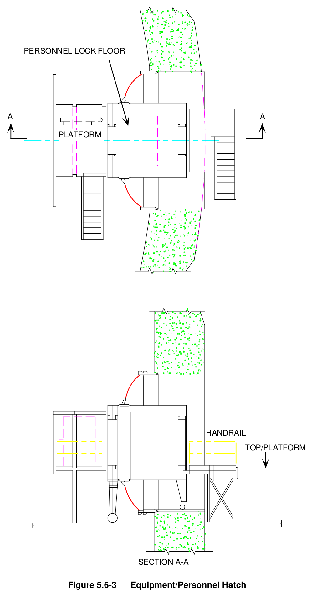
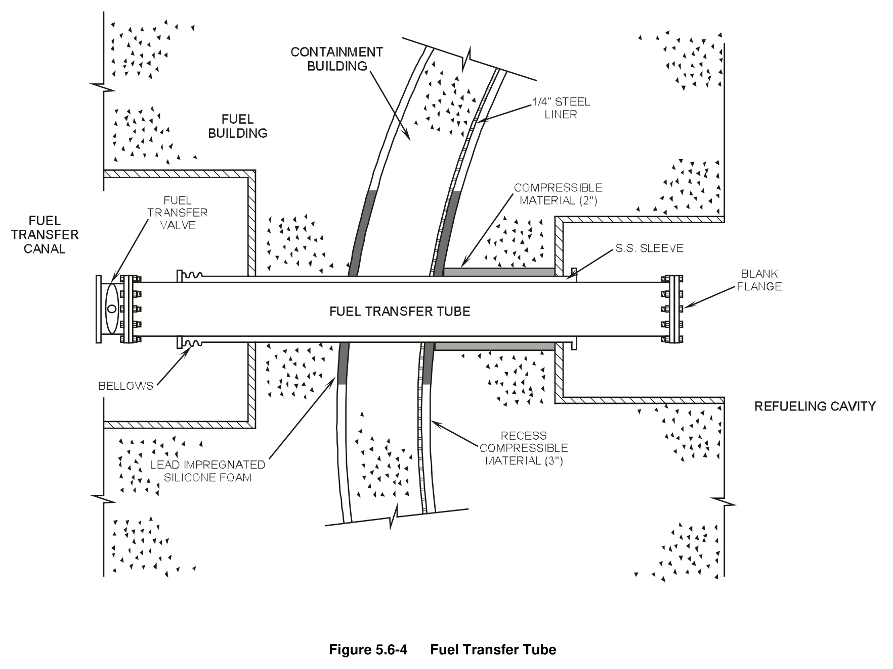

# 05.6 CTMT Isolation

> Pages 509–520 of `ML20057E160.pdf`
> Westinghouse Technology Systems Manual — USNRC HRTD (PWR)

---
<!-- p.509 -->
#### Westinghouse Technology Systems Manual
#### Section 5.6
#### Containment Penetrations and Isolation Systems
<!-- p.510 -->
TABLE OF CONTENTS

5.6 Containment Penetration and Isolation Systems ....................................... 5.6-1

5.6.1 Introduction ............................................................................................... 5.6-1

5.6.2 Containment Penetration Types ................................................................ 5.6-2

5.6.2.1 Electrical Penetrations ............................................................... 5.6-2

5.6.2.2 Piping Penetrations .................................................................... 5.6-2

5.6.2.3 Equipment and Personnel Access Hatches ............................... 5.6-3

5.6.2.4 Special Penetrations .................................................................. 5.6-3

5.6.3 Containment Isolation Systems ................................................................. 5.6-4

5.6.3.1 Design Basis .............................................................................. 5.6-4

5.6.3.2 Initiation Signals ......................................................................... 5.6-4

5.6.3.3 Isolation Classes ........................................................................ 5.6-5

5.6.4 Systems Features and Interrelationships .................................................. 5.6-5

5.6.5 Summary ................................................................................................... 5.6-6

LIST OF FIGURES

Figure 5.6-1 .................................................................................. Typical Electrical Penetration

Figure 5.6-2 ........................................................................................ Typical Piping Penetration

Figure 5.6-3 .................................................................................... Equipment/Personnel Hatch

Figure 5.6-4 ..................................................................................................... Fuel Transfer Tube

USNRC HRTD 5.6-i Rev 1013

<!-- p.511 -->
### 5.6 CONTAINMENT PENETRATION AND ISOLATION SYSTEMS
#### Learning Objectives:
1. State the purposes of the system.

2. Define the following:

a. Deleted b. Containment Isolation Phase A c. Containment Isolation Phase B

3. List the signals that initiate phase A and phase B isolation.

#### 5.6.1 Introduction
The purposes of the containment penetration and isolation systems are as follows:

1. Isolate nonessential containment penetrations during accident conditions, and
2. Provide leak-tight mechanical and electrical containment penetrations.

The primary means of minimizing the release of radioactive gases and particulates after an accident is the isolation of the reactor containment from the environment.
Containment penetration and isolation systems are designed to limit any releases to within those allowed by Technical Specifications. Common leakage limits are between one tenth and four tenths of one percent of the containment volume per day.

## 10 CFR 50, Appendix J (Reactor Containment Leakage Testing for Water Cooled
Power Reactors) requires that the actual leak rate be verified experimentally prior to operation and periodically thereafter.

All containment penetrations (both electrical and piping) are double barrier assemblies consisting of a closed sleeve, in most cases, or a double gasketed closure for special penetrations, such as the fuel transfer tube. The void space between the double barriers is continuously pressurized, by the penetration pressurization system, to a pressure in excess of the containment design pressure.
Leakage from this system is monitored to indicate penetration leakage.

The containment isolation system provides the means of isolating fluid systems that pass through containment penetrations so as to confine any radioactivity that may be released into the containment following a loss of coolant accident. The containment isolation systems are required to function following an accident, to isolate non-safety-related fluid systems penetrating the containment. A particular system does not exist for containment isolation, but isolation design is achieved by applying common criteria to penetrations in many different fluid systems and by using ESF signals to actuate appropriate valves.

The main function of the containment isolation system is to provide containment integrity when needed. Containment integrity is defined to exist when:

USNRC HRTD 5.6-1 Rev 1013

<!-- p.512 -->
1. The non-automatic containment isolation valves and blind flanges are closed as required.
2. The containment equipment hatch is properly closed.
3. At least one door in each containment personnel air lock is properly closed.
4. All automatic containment isolation valves are operable or are deactivated in the closed position or at least one valve in each line having an inoperable valve is closed and, 5. All requirements of the Technical Specifications with regard to containment leakage and test frequency are satisfied.

All containment penetrations and isolation systems are designed to be Seismic Category I.

#### 5.6.2 Containment Penetration Types
##### 5.6.2.1 Electrical Penetrations
Canister-type electrical penetration assemblies are used to extend conductors through the containment penetration nozzles. Figure 5.6-1 shows a typical electrical penetration assembly in place within a containment penetration nozzle. Hermetic
(airtight) seals between each conductor and the metallic canister end header plates are obtained by the use of high strength, high temperature glass and ceramic materials.

There are five types of electrical penetration assemblies, classified by service and application as follows:

1. Type 1 - Medium voltage power service
2. Type 2 - Low voltage power service
3. Type 3 - Control service 4. Type 4 - Shielded instrumentation service 5. Type 5 - Triaxial instrumentation cable service

The penetrations associated with engineered safety features within the containment are fully rated for both normal and post-loss-of-coolant accident (LOCA) operation.

##### 5.6.2.2 Piping Penetrations
Double barrier piping penetrations are provided for all piping which passes through the containment as shown in Figure 5.6-2. The pipe is contained in a sleeve which is welded to the liner. Closure heads are welded to the sleeve and to the pipe, both inside and outside the containment, to form the double barriers. The annulus between the pipe and sleeve is continuously pressurized. Several pipes may pass through the same sleeve to minimize the number of containment penetrations required. In these cases, each pipe is welded to both closure heads.

The penetrations for main steam, feedwater, and steam generator blowdown are anchored outside the containment in such a way as to ensure containment integrity should any one of these lines rupture. These penetrations are provided with a bellows expansion joint on both the inside and the outside of the containment, which

USNRC HRTD 5.6-2 Rev 1013

<!-- p.513 -->
allows for differential movement between the containment wall and the anchor. The inside joint will also take up the differential movement of the hot pipe relative to the liner. The expansion joints have been designed so that, in the event of a pipe rupture within the sleeve, the inside joint will subsequently rupture and the outside joint will remain intact, thereby maintaining containment integrity.

Hot penetrations are normally provided with some type of cooling to minimize drying of the containment concrete around the penetrations. Other hot penetrations, which are not anchored outside the containment for pipe rupture, are where required, provided with a single expansion joint, either inside or outside the containment, to allow for thermal movement of the pipe relative to the anchor.

##### 5.6.2.3 Equipment and Personnel Access Hatches
The equipment hatch (as shown on Figure 5.6-3) is fabricated from welded steel, and furnished with a double-gasketed flange and a bolted dished door. Equipment up to and including the size of the reactor vessel upper head O-ring seal can be transferred into and out of containment via this hatch. The hatch barrel is welded to the containment liner.

Two personnel air locks are provided for the containment, one of which is for normal access and penetrates the dished shaped door of the equipment hatch. The other is an emergency escape hatch located on the side of containment opposite the equipment hatch at grade level. Each personnel air lock is a double door, hydraulically-latched, welded steel assembly as shown in Figure 5.6-3. A quickacting-type, equalizing valve connects the personnel lock with the interior of the containment structure. Its purpose is equalizing pressure in the escape lock and the containment when entering or leaving the containment structure.

The two doors in each personnel lock are interlocked to prevent both doors being opened simultaneously and to ensure that one door is completely closed before the opposite door can be opened. Remote indicating lights and annunciators in the control room indicate the status of these doors. An emergency lighting and communication system, operated from an external emergency power supply, is provided in the personnel lock interior.

##### 5.6.2.4 Special Penetrations
A fuel transfer penetration is provided (see Figure 5.6-4) for fuel movements between the refueling cavity in the reactor containment and the spent fuel pit. The penetration consists of a 20-in. pipe located inside a 24-in. sleeve. The inner pipe acts as the transfer tube and is fitted with a double gasketed blind flange in the refueling cavity inside containment. A seal plate is welded to the containment liner and also to the inside tube. This seal plate and the blind flange act as the containment boundary.

Bellows expansion joints have been installed in the sleeve. These joints, which are welded to the sleeve and connected to the tube by welding to end plates, provide for normal and seismic differential building movements. The sleeve and expansion joints also serve to cover most of the welds on the tube inside the containment. The

USNRC HRTD 5.6-3 Rev 1013

<!-- p.514 -->
annulus between the sleeve and tube is continuously pressurized to demonstrate containment integrity.

Lines originating from the containment recirculation sumps penetrate the containment through the slab below the containment walls. In this case the pipe is contained in a sleeve which is buried in the slab. Both sleeve and pipe extend into the sump, where the sleeve is seal welded to both the pipe and the sump liner.

The sleeve and pipe also extend outside the containment to an isolation valve which is completely enclosed in a small tank. The sleeve terminates at the entrance to the tank where it is welded to the tank. At the outlet of the tank, the pipe is seal welded to the tank through an expansion joint which takes up the thermal expansion of the pipe.

The annulus between the pipe and sleeve, and the volume within the tank are continuously pressurized through a connection on the tank. The sleeve and tank serve as an extension of the containment boundary to maintain containment integrity in the event of a pipe break outside containment.

#### 5.6.3 Containment Isolation Systems
##### 5.6.3.1 Design Basis
The design basis for the containment isolation systems includes provisions for the following:

1. A double barrier at the containment penetration in those fluid systems that are not required to function following a LOCA or a secondary rupture inside the containment.

2. Automatic, fast closure of those valves required to close for containment integrity following an accident to minimize the release of any radioactive material.

3. A means of leak testing fluid system barriers that serve as containment isolations.

4. The capability to periodically test the operability of the containment isolation valves.

##### 5.6.3.2 Initiation Signals
Containment isolation is accomplished by two separate signals designated as phase A and phase B. The phase A isolation is initiated by any safety injection actuation signal or manually from the control room. The containment phase A signal isolates nonessential piping penetrations into the containment, such as the containment sump pump discharge, containment ventilation connections to atmosphere, etc. The most important penetrations not isolated on a phase A isolation are the penetrations for the component cooling water supplies to the reactor coolant pumps.

The phase B isolation is initiated by a high-high containment pressure signal or manually from the main control board. It isolates the remainder of the nonsafety

USNRC HRTD 5.6-4 Rev 1013

<!-- p.515 -->
penetrations (the component cooling water supplies to the reactor coolant pumps).
This same high-high pressure signal also closes the main steam line isolation valves and initiates containment spray.

##### 5.6.3.3 Isolation Classes
The criteria defining the number and location of containment isolation valves in each fluid system depends on the function of the system and whether it is open or closed to the containment atmosphere or reactor coolant system. Four isolation classes of penetrations are defined as follows:

1. Isolation class I - lines which are open to the atmosphere outside the containment and are connected to the reactor coolant system or are open to the containment atmosphere. Each isolation class I system has a minimum of two isolation valves in series. Where system design permits, one valve is located inside and one valve is located outside containment.

2. Isolation class II - lines which are connected to a closed system outside the containment, and are connected to the reactor coolant system or are open to the containment atmosphere. Also included in isolation class II are fluid lines which are open to the atmosphere outside the containment and are separated from the reactor coolant system and the containment atmosphere by a closed system inside the containment. Each isolation class II system has a minimum of one isolation valve.

3. Isolation class III - lines which are connected to a closed system both inside and outside the containment. Isolation class III systems have as a minimum one isolation valve.

4. Isolation class IV - lines which must remain in service subsequent to a LOCA or a secondary pipe break inside the containment, such as the emergency core cooling systems (ECCS). Isolation valves on these lines are not automatically closed by the containment isolation signal. Each isolation class IV system has a minimum of one isolation valve (remote-manual operation).

The criteria for containment penetrations ensure that all fluid lines penetrating the containment have at least one isolation valve near the point of penetration. Most fluid lines that communicate directly with the containment atmosphere have, as a minimum, two isolation valves in series. These lines and isolation valves are designed to Seismic Category I specifications and are missile protected.

#### 5.6.4 Systems Features and Interrelationships
A containment isolation signal initiates closing of automatic isolation valves in those lines which must be isolated immediately following an accident. There is no order of sequence of timing for containment isolation valve closure. However, on a loss of off-site ac power, the diesel will have to be started prior to the closure of the motoroperated valves. Air-operated valves used for containment isolation are designed to fail closed on loss of air.

USNRC HRTD 5.6-5 Rev 1013

<!-- p.516 -->
Check valves are sometimes used as containment isolation valves where the differential pressure, under accident conditions, will close the valves to maintain containment integrity. Lines which, for safety reasons, must remain in service subsequent to an accident are provided with at least one isolation valve.

Each automatic isolation valve required to operate subsequent to an accident is additionally provided with a manual control switch for operation. The position of these automatic isolation valves are indicated by status lights in the main control room.

Containment isolation valves that are located inside the containment are designed to function under the radiation, pressure, and high temperature conditions existing during both normal operation and accident conditions.

Containment isolation valves are designed to Seismic Category I requirements. The valves are capable of operation during and after seismic loadings. Valves with operators or similar features of extended proportions are designed to withstand an inertial safe shutdown earthquake (SSE) load in addition to normal operating loads.
Electrical switches or other actuating mechanisms are designed to withstand the inertial load as a result of an SSE without changing position and causing change of position of the valve disc.

#### 5.6.5 Summary
The containment isolation systems provide the means of isolating fluid systems that pass through containment penetrations so as to confine any radioactivity that may be released into the containment following an accident. The containment isolation systems are required to function following a design basis event to isolate nonsafetyrelated fluid systems that penetrate the containment.

Containment isolation is initiated in two levels: phase A and phase B. Containment isolation phase A always exists if containment isolation phase B exists (unless phase B is manually initiated). A containment isolation signal initiates closing of automatic isolation valves in those lines which are not required to respond to an accident. The positions of these automatic isolation valves are indicated by status lights in the main control room.

Containment isolation valves are designed to Seismic Category I requirements.
These valves are capable of operation during and after seismic loadings.

Containment penetrations are designed to ensure that the leakage from the containment, at a maximum calculated containment pressure and temperature, does not exceed the limits of the plant’s Technical Specifications.

USNRC HRTD 5.6-6 Rev 1013

<!-- p.517 -->
#### Figure 5.6-1

*Typical Electrical Penetration*

[Vector original (SVG, lossless): fig_5.6-1.svg](../figures/fig_5.6-1.svg)

<!-- p.518 -->
#### Figure 5.6-2

*Typical Piping Penetration*

[Vector original (SVG, lossless): fig_5.6-2.svg](../figures/fig_5.6-2.svg)

<!-- p.519 -->
#### Figure 5.6-3

*Equipment/Personnel Hatch*

[Vector original (SVG, lossless): fig_5.6-3.svg](../figures/fig_5.6-3.svg)

<!-- labels/text on this figure page -->
PERSONNEL LOCK FLOOR
A A
PLATFORM
HANDRAIL
TOP/PLATFORM
SECTION A-A
Figure 5.6-3 Equipment/Personnel Hatch

<!-- p.520 -->
#### Figure 5.6-4

*Fuel Transfer Tube*

[Vector original (SVG, lossless): fig_5.6-4.svg](../figures/fig_5.6-4.svg)

