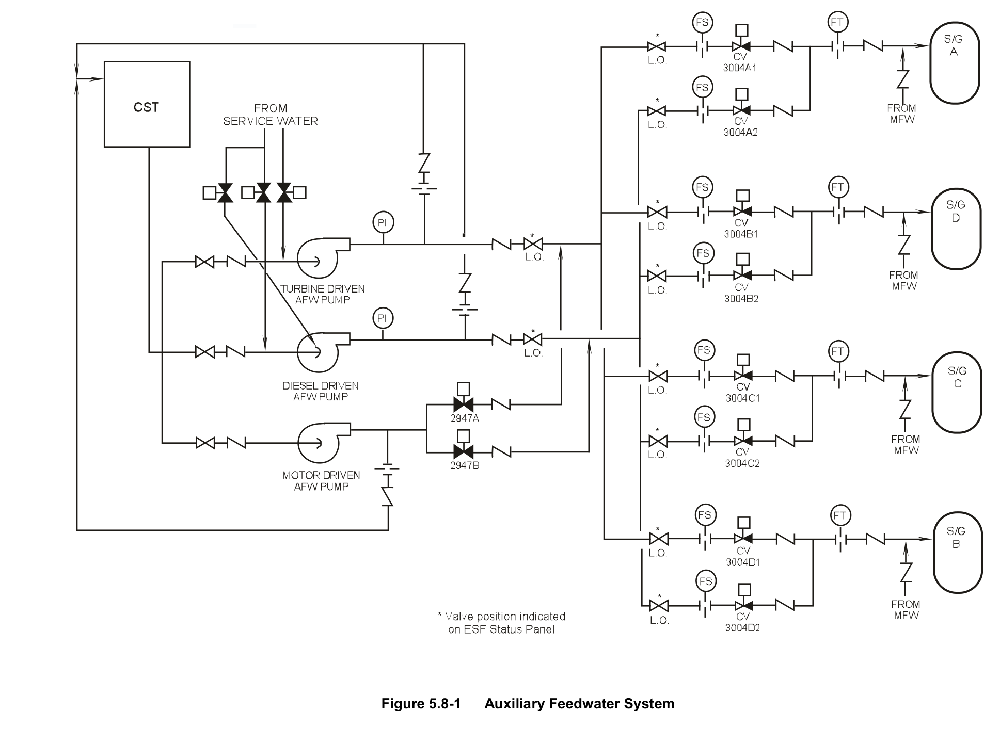
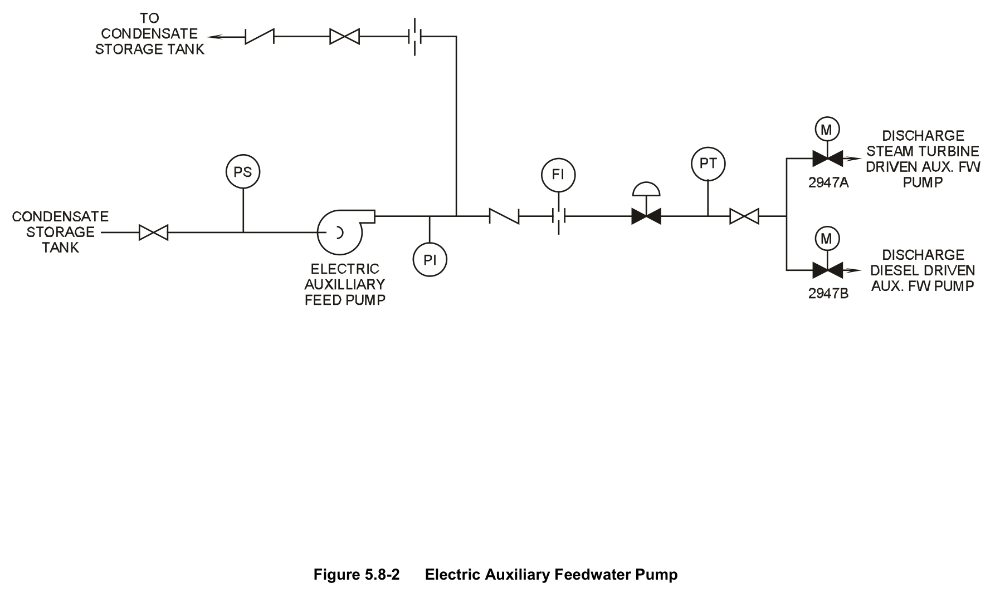
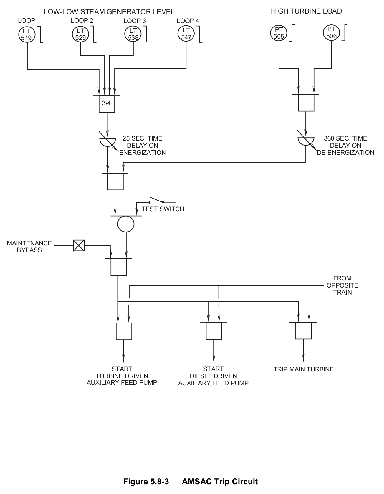
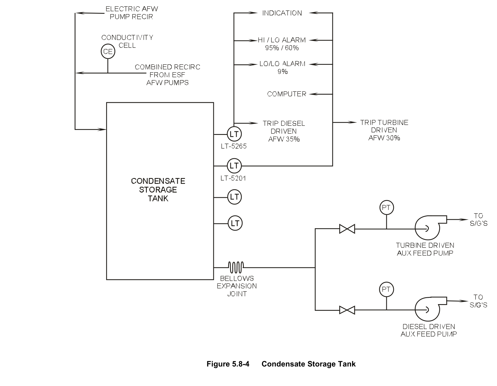
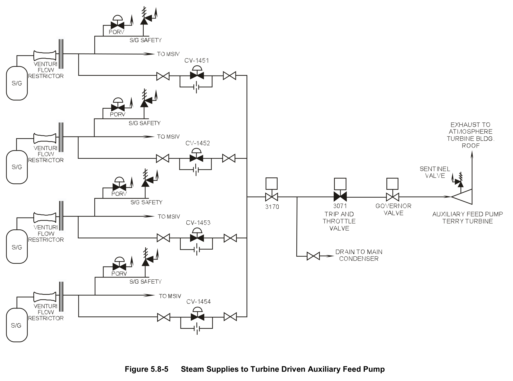
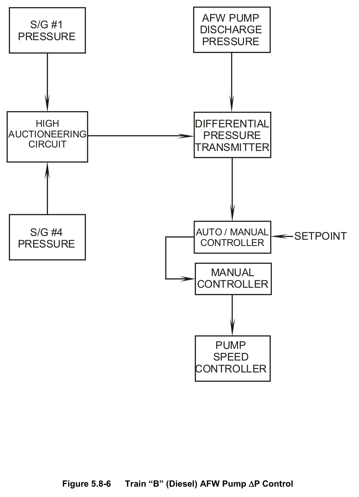
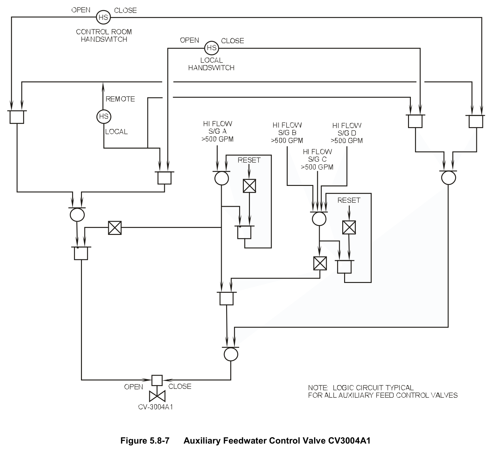

# 05.8 AFW

> Pages 521–551 of `ML20057E160.pdf`
> Westinghouse Technology Systems Manual — USNRC HRTD (PWR)

---
<!-- p.521 -->
#### Westinghouse Technology Systems Manual
#### Section 5.8
#### Auxiliary Feedwater System
<!-- p.523 -->
TABLE OF CONTENTS

5.8 Auxiliary Feedwater System .................................................................... 5.8-1

5.8.1 Introduction ................................................................................................... 1

5.8.1.1 Design Basis .................................................................................... 1

5.8.2 System Description ....................................................................................... 3

5.8.2.1 Instrumentation And Control ............................................................. 4

5.8.2.2 Service Water ................................................................................... 6

5.8.2.3 Auxiliary Feedwater Pump Turbine Steam Supply Valves ............... 6

5.8.2.4 Service Water to Auxiliary Feedwater Pump Cooler Valves ............. 7

5.8.3 Component Descriptions ............................................................................... 8

5.8.3.1 Auxiliary Feedwater Pumps.............................................................. 8

5.8.3.2 Condensate Storage Tank ............................................................... 8

5.8.3.3 Diesel Engine ................................................................................... 9

5.8.3.4 Steam Turbine ................................................................................ 10

5.8.3.5 Auxiliary Feedwater Flow Control Valves ....................................... 11

5.8.4 System Operation ....................................................................................... 12

5.8.4.1 Electric-Driven Auxiliary Feedwater Pump ..................................... 12

5.8.4.2 AFW System Problem Areas - Water Hammer .............................. 13

5.8.5 PRA Insights ............................................................................................... 14

5.8.6 Summary ..................................................................................................... 16

LIST OF FIGURES

Figure 5.8-1 .................................................................................... Auxiliary Feedwater System

Figure 5.8-2 ........................................................................ Electric Auxiliary Feedwater Pump

Figure 5.8-3 .................................................................................................... AMSAC Trip Circuit

Figure 5.8-4 ....................................................................................... Condensate Storage Tank

Figure 5.8-5 ................................ Steam Supplies to Turbine Driven Auxiliary Feed Pump

Figure 5.8-6 ........................................................... Train “B” (Diesel) AFW Pump ∆P Control

Figure 5.8-7 .................................................. Auxiliary Feedwater Control Valve CV3004A1

USNRC HRTD 5.8-i Rev 1013

<!-- p.525 -->
### 5.8 AUXILIARY FEEDWATER SYSTEM
#### Learning Objectives:
1. State the purposes of the Auxiliary Feedwater (AFW) System.

2. List all suction sources for the AFW pumps and under what conditions each is used.

3. List the five plant conditions that will result in an automatic start of the AFW system.

4. Explain how decay heat is removed following a plant trip and loss of offsite power.

5. Explain how the availability of other decay heat removal methods limits the AFW system’s contribution to core damage frequency.

#### 5.8.1 Introduction
The purpose of the auxiliary feedwater system (AFW) is to supply feedwater to the steam generators (SGs) when the main feedwater system is unavailable. The steam generators provide a heat sink for the reactor coolant system (RCS), which in turn limits the increase in reactor coolant system pressure. By limiting the pressure increase in the RCS, challenges to the integrity of the RCS pressure boundary via opening of the pressurizer power-operated relief valves (PORVs) or safety valves are reduced. The specific transients for which the AFW system is designed, are as follows:

• Loss of all main feedwater,
• Turbine trip and loss of offsite power, and
• Small-break loss-of-coolant accident (LOCA).

In addition, an electrically driven auxiliary feedwater pump is used to supply water to the steam generators during startups and shutdowns. This pump is not safety related, and its function is to reduce the wear and tear on the safety-grade auxiliary feedwater pumps and their prime movers.

##### 5.8.1.1 Design Basis
The auxiliary feedwater system is comprised of two safety-related trains and is designated as an engineering safety feature (ESF) system. Its design provides two redundant means of supplying feedwater to the steam generators as a means for removing heat from the reactor coolant during accident conditions. This system is designed to operate under the adverse environmental conditions resulting from the design-basis accident (LOCA). This accident is the most limiting from a plant safety aspect, and the auxiliary feedwater system's capability to operate for this accident assures its proper operation for less severe accidents.

USNRC HRTD 5.8-1 Rev 1013

<!-- p.526 -->
Each of the two safety-grade AFW pumps is capable of providing 880 gpm to the four steam generators. Each pump is rated at 960 gpm, which includes a minimum recirculation flow of 80 gpm. The pumps are rated for a pump head of 3400 ft
(approximately 1472 psid), based on the most severe condition of pumping 880 gpm water into the steam generators with steam generator code safety valves discharging at their maximum set pressure (1170-1230 psig). Each pump is designed to start and deliver rated flow within 60 seconds of receiving an automatic start signal. This system is designed in accordance with the single-failure criterion.

This criterion states that the system must perform adequately with a single active or passive failure. An active failure is one involving the failure of a pump to operate or the failure of a valve to open or shut as needed. The use of two independent channels of control/protection signals and two trains of auxiliary feedwater equipment ensures that a single active failure will not prevent proper operation of the system. Therefore, if one AFW pump fails to start (an active failure), the second AFW pump, in a separate independent train, has sufficient capacity to provide water to the steam generators. A passive failure is one that involves the failure of inactive components such as pipes or pressure vessels. A pipe leak from a weld joint is an example of a passive failure. Design studies assume that the maximum credible passive failure results in a 50-gpm leak for 30 minutes.

Specifically, the AFW system is capable of operating at its design values if an active failure occurs during the injection phase of a LOCA (the injection phase consists of water from the refueling water storage tank being injected into the RCS to cool the core). In addition, the system must be designed so that no passive failure occurs during the injection phase. When the recirculation phase (water being pumped into the RCS from the containment sump) begins, the AFW system is designed to perform its intended function with either an active or a passive failure.

The design flow that is required to be provided by the AFW system during a complete loss of normal and preferred power is 440 gpm to two of four SGs within 60 seconds of the initiation of the loss of offsite power. The actuation time and minimum injection flow prevent an excessive temperature rise in the reactor coolant that would lead to overfilling the pressurizer and causing an overpressure event.
This overpressure condition would cause the PORVs on the pressurizer to lift. After the PORVs cycle several times, there is some probability that they would fail; their failure contributes to the core melt frequency of the plant’s PRA. The minimum of 440 gpm supplied to two of four steam generators is a generic Westinghouse performance requirement which serves to bound all Westinghouse AFW systems.
However, for this reference plant, the system design does not have to be as restrictive. The actual criteria, as stated by the Final Safety Analysis Report, to prevent overpressurizing the RCS for this design is a total of 426 gpm being fed to three out of four SGs within 60 seconds. This works out to an actual minimum flow of 142 gpm being fed from one safety-related auxiliary feedwater pump to each of the three SGs.

Taking into account allowable speed variations in the AFW pump prime movers and flow measurement errors (during normal conditions), the indicated minimum is actually set to 165 gpm. Assuming that one steam generator is faulted, flow is provided to three of the four SGs. With the flow control valves (CV-3004A1, A2, B1,

USNRC HRTD 5.8-2 Rev 1013

<!-- p.527 -->
B2, C1, C2, D1, D2) throttled to allow 165 gpm per AFW train per steam generator, 330 gpm is fed to each steam generator with both trains operating. This value is below the flow rate thought to be necessary to cause a water hammer (400 gpm).

The emergency operating procedure (EOP) entered after a reactor trip, when no accident is in progress, specifies a minimum adequate AFW flow of 495 gpm (165 gpm total to 3 SGs). For the remaining EOPs, which would be entered only if an accident were in progress, the water hammer concern is secondary to core decay heat removal. In addition, an adverse environmental flow measurement error of 98 gpm per feed line is assumed. This results in an indicated minimum required AFW flow (as stated in the EOPs) of 720 gpm: ([142 gpm/SG x 3 SGs] + [98 gpm/line x 3 lines]) = 720 gpm. This minimum required flow (720 gpm) is less than the capacity of one safety-related auxiliary feedwater pump (880 gpm).

As previously stated the AFW system consists of two safety-related trains. One train’s pump is driven by a steam turbine, and the redundant pump is driven by a diesel engine. The steam-driven turbine is powered from the main steam system.
This turbine can operate with steam pressures as low as 110 psig and is ac power independent. The diesel is started by two 28-Vdc batteries and is dependent upon external power supplies for continued operation (to provide service water cooling).

The majority of the auxiliary feedwater system is designed to Seismic Category I requirements. The exceptions are the pump recirculation line, the condensate storage tank, and the electric AFW pump with its associated piping, valves, and support systems. These components are designated as Seismic Category II.

Following a plant trip concurrent with loss of offsite power, decay heat should be removed by feeding with AFW and steaming via the atmospheric relief valves (SG PORVs) or via the secondary safety valves.

#### 5.8.2 System Description
The auxiliary feedwater system (Figure 5.8-1) consists of one steam-driven and one diesel-engine-driven auxiliary feedwater pump (each of which is safety related) with associated feedwater control valves, instruments, pipes, and controls. There is also a nonsafety-related motor-driven auxiliary feedwater pump that is used for feedwater addition during normal startups and shutdowns. Although this component is not safety related, it can fulfill certain action statement requirements in Technical Specifications and does have some operability requirements.

The normal supply of water to the AFW system is the condensate storage tank
(CST). An alternate, emergency supply from the service water system (SWS) can be used when problems occur with the CST. Each safety-related AFW pump discharges to its own discharge header. A recirculation line, with a flow restrictor, returns part of each pump's discharge to the CST. This recirculation line is required to allow some flow in case the auxiliary feedwater flow control valves are completely closed. The recirculation flow prevents the pump from being overheated while operating at its shutoff head.

USNRC HRTD 5.8-3 Rev 1013

<!-- p.528 -->
Each pump's discharge header divides into four lines, one for each steam generator.
Each steam generator has two auxiliary feedwater control valves; one from the turbine-driven pump discharge, and one from the diesel-driven pump discharge.
The two lines from each steam generator's auxiliary feedwater flow control valves combine into a common header which ties to the main feedwater line at the containment wall. Each motor-operated flow control valve has a downstream check valve along with upstream and downstream isolation valves. In the common line downstream of the auxiliary feedwater flow control valves is a flow element with two flow transmitters, which provide indication to meters in the main control room as well as in the remote shutdown station. A flow-sensing element just upstream of each control valve shuts its respective flow control valve if it detects flow greater than 500 gpm.

A single line from the condensate storage tank supplies the safety-related auxiliary feedwater pumps. This line branches into two separate lines just upstream of the pumps. Each pump suction line has a normally open globe valve and a check valve.
The suction of each pump has a Seismic Category I service water connection with a normally closed motor operated valve. The valve is normally shut in order to prevent chloride contamination of the steam generators. In the event of a condensate storage tank failure, the service water supply is initiated by manual operation of the isolation valves from the control room.

The electric auxiliary feedwater pump (Figure 5.8-2) can only take suction on the condensate storage tank. It has a recirculation line that returns a portion of its flow to the condensate storage tank. The discharge line, with an air-operated flow control valve, splits into two parallel feed lines, each with a motor-operated isolation valve.
One of the feed lines taps into the discharge line of the diesel-driven auxiliary feedwater pump, while the other taps into the discharge line of the steam-turbinedriven auxiliary feedwater pump.

##### 5.8.2.1 Instrumentation and Control
The AFW system is required to have redundant features. This is accomplished, in part, by having separate trains of pumps, control valves, and pipes. Two independent automatic start signal channels are used. Channel A receives inputs from train A of the Reactor Protection System (RPS). It also receives inputs from non-RPS (i.e., not processed through the RPS) sources, such as main feed pump tripped contacts. Similarly, channel B of the auxiliary feedwater automatic start circuitry receives signals from train B of the RPS and from other non-RPS sources.
The channel A automatic start circuitry controls the steam-turbine-driven pump, while channel B controls the diesel-driven pump.

The control logic for the two pumps is similar. Five signals will cause an auxiliary feedwater pump to automatically start:

1. An undervoltage condition on the ESF 4.16-kV bus A1 (A2) (A1 for the turbinedriven pump, A2 for the diesel driven pump,
2. At least two of three SG level detectors less than the low-low water level setpoint
(10.7%) in any one of the four steam generators (can be blocked when SGs are drained for maintenance),

USNRC HRTD 5.8-4 Rev 1013

<!-- p.529 -->
3. Safety injection actuation signal, 4. Both main feed pumps tripped (can be blocked individually for either auxiliary feed pump), and 5. ATWS (anticipated transient without scram) mitigation system actuation circuit
(AMSAC) actuation.

The fifth automatic start signal for the AFW pumps was added to address the following concerns. Sponsored studies conducted by Westinghouse and the NRC have shown that if a complete loss of normal feedwater or loss of electrical load occurs without a reactor trip, RCS pressure could exceed 3200 psig at thermal power levels above 70 percent. This occurrence assumes a common-mode failure in the reactor protection system which incapacitates auxiliary feed flow initiation and/or a turbine trip in addition to prohibiting a reactor trip. If this hypothetical event were to occur, an alternate method of providing AFW flow and turbine trip initiation is needed. 10 CFR 50.62 (the “ATWS rule”) requires plants to have an alternate method of starting the AFW system; AMSAC satisfies the requirement. This circuitry detects a loss of main feedwater and actuates a turbine trip and initiates AFW within a set time if reactor power has been greater than 40%. (The 40% value is more conservative than the analysis result of 70% in order to minimize the amount of RCS voiding during an ATWS event.)

The AMSAC logic is shown in Figure 5.8-3. Note that both trains of AMSAC must actuate to cause a turbine trip and AFW actuation. Four isolated SG level inputs
(LT-519, -529, -538, and -547), and two isolated turbine first-stage pressure inputs
(PT-505 and -506) provide actuation signal detection. Time delays of 25 seconds for SG level and 360 seconds for turbine power detection are provided to assist in the prevention of inadvertent actuation. Test actuation circuitry along with an installed maintenance bypass switch allows for system testing and deactivation. This circuitry is also deactivated by the operation of the SG low-low level AFW automatic start block switches. System actuation and status alarms are provided to ensure that operators are aware of the AMSAC system status.

When AFW actuation channel A is actuated by any of the signals listed above, a relay powered by 120-Vac preferred instrument bus Y11 is energized. This relay performs the following for the steam-turbine-driven pump:

1. Opens air-operated steam supply valves CV-1451, -1452, -1453, and -1454 (one valve from each steam generator),
2. Opens turbine trip and throttle valve MO-3071,
3. Isolates SG blowdown and SG sampling, and 4. Actuates an alarm for AUX FW AUTO START on the remote shutdown station
(RSS) panel.

The operation of channel B, which starts the diesel-driven auxiliary feedwater pump, is similar to that of channel A. When channel B’s relay is energized (powered by bus Y22), the following occurs:

1. Energizes the diesel start relay,

USNRC HRTD 5.8-5 Rev 1013

<!-- p.530 -->
2. Opens service water isolation valve MO-3060B, which supplies cooling water to the diesel lube oil cooler, pump lube oil cooler, diesel engine jacket cooler, and speed increaser lube oil cooler,
3. Isolates SG blowdown and SG sampling, and 4. Actuates annunciator AFW PUMP A/B AUTO START.
One of the recognized problems with ensuring proper operation of an essential system like auxiliary feedwater is the ability to demonstrate that a proper flow path exists when the system is in standby. This means that some way of indicating manual valve position is needed. Microswitches on crucial manual valves in the auxiliary feedwater system sense when the valves are not open and provide alarms in the control room and at the remote shutdown station.

The valves monitored include the individual safety-related pump suction and discharge isolation valves and the two isolation valves for each flow control valve.
These switches also provide full open indication at the remote shutdown station and in the control room on the safety injection equipment status lamp panel.

##### 5.8.2.2 Service Water
Recall that the CST is not a Seismic Category I storage tank. Therefore, the service water system provides a safety-related backup water supply to the auxiliary feedwater system. In addition, it cools components associated with the diesel-driven pump and serves as a backup cooling source for components associated with the turbine-driven pump.

The service water supplies to the auxiliary feedwater pump suctions are normally isolated by motor-operated gate valves. These valves have no automatic control function and are controlled by switches having incorporated lockout devices.

For the diesel-driven auxiliary feedwater pump, service water supplies cooling water to the diesel jacket cooler, engine lube oil cooler and intercooler, pump lube oil cooler, and gear cooler on the speed increaser. Service water is supplied to the suction of an attached auxiliary water pump, which provides additional motive force for cooling flow through the engine lube oil cooler and intercooler (in series). The auxiliary water pump is belt driven off of the diesel engine. For the steam-driven auxiliary feedwater pump, service water is a backup cooling supply for the lube oil cooler for the pump and the bearing heat exchangers for the turbine. The normal cooling supply to those components is diverted pump discharge flow. Thus, the steam-driven pump is referred to as “self-cooling.”

##### 5.8.2.3 Auxiliary Feedwater Pump Turbine Steam Supply Valves
The original system design called for motor-operated steam supply valves. This design has since been found inadequate because the system becomes dependent on the presence of AC power to operate correctly. For the turbine-driven auxiliary feedwater pump to be completely independent of AC power, the valves have been changed to three-inch, air-operated globe valves.

Each valve has a single, solenoid-operated, four-way valve in its air supply. The air supply taps off the existing air supply for the main steam isolation valves. The

USNRC HRTD 5.8-6 Rev 1013

<!-- p.531 -->
steam supply valves use a “balanced-piston” design (i.e., there is no internal spring to cause the valves to reposition to a specified failure state on loss of actuating air).
Motive air is required to both open and close the valves. Accordingly, upon a loss of air supply, the valves fail “as is.” There is also a backup air supply consisting of four 15-gal accumulators (T-166A, -166B, -166C, and -166D), one for each steam supply valve. Each accumulator is designed to allow one valve cycle two hours after the normal air supply is lost. If accumulator pressure falls below 80 psig, alarms are initiated to warn of accumulator low pressure. Testing has shown that accumulator pressures as low as 45 psig have been sufficient to open the steam supply valves.

Each steam supply valve has a bypass line. The bypass line has two normally open isolation valves and a flow restricting orifice. The combined flow through all four orifices allows a nominal total of 500 lbm/hr steam flow to warm the steam supply lines and remove condensation. This prevents turbine damage from water hammer and moisture on startup. The bypass steam normally exhausts via an orificed line to the condenser. It may also vent to the atmosphere via a 3/4-in. line tapping off directly upstream of the turbine trip and throttle valve.

Control and indication power for the steam supply valves is supplied by 120-Vac preferred instrument power bus Y11 for CV-1451, -1452, -1453, and -1454. Control power supplies the solenoids on the four-way valves (SV-1451, -1452, -1453, and - 1454). If a solenoid loses power, the valve positions to supply air to open its respective steam supply isolation valve. Thus the steam supply valves will automatically open if ac power is lost. This in itself will not drive the turbine, as the turbine trip and throttle valve remains closed.

It should be noted that the loss of a 120-Vac preferred instrument bus is relatively unlikely, since it is usually powered from a battery-backed 125-Vdc bus through an inverter (Chapter 6). If operating air is lost to a steam supply valve, it fails as is.
There is no return spring in the valve actuator against which the operating air pressure acts.

The steam supply isolation valves can be manually operated with handwheels.
Automatic opening of the steam supply isolation valves is initiated by the same conditions that cause automatic trip and throttle valve actuation.

##### 5.8.2.4 Service Water to Auxiliary Feedwater Pump Cooler Valves
These normally closed valves (MO-3060A, and -3060B) can supply service water to cool various steam-turbine-driven AFW pump and diesel-driven AFW pump components. MO-3060A, which supplies cooling water to the turbine-driven AFW pump, is a two-in. motor-operated globe valve with an upstream isolation valve and a downstream check valve (not shown in this figure). However, because of the selfcooling nature of the turbine-driven AFW pump, as discussed below, service water is a backup means of cooling. The motor operator for MO-3060A has been electrically disconnected and must be manually opened to provide service water cooling. The service water supply to the diesel-driven feedwater pump, MO-3060B, is a six-in.
motor-operated butterfly valve; it opens on receipt of a channel B pump start signal.

USNRC HRTD 5.8-7 Rev 1013

<!-- p.532 -->
#### 5.8.3 Component Descriptions
##### 5.8.3.1 Auxiliary Feedwater Pumps
The safety-related diesel- and turbine-driven auxiliary feedwater pumps are identical six-stage, horizontal, centrifugal pumps designed for 2000 psig, 70°F water. They operate with a design flow rate of 960 gpm, including 80 gpm recirculation, at a 3400 ft (1472 psid) head. The rated speed of each pump is 4560 RPM.

The turbine-driven auxiliary feedwater pump bearing heat exchangers and lube oil heat exchangers have the capability of being cooled from three sources. There are two sources of self cooling, one from the second-stage impeller of the pump via the pump casing, and one from the recirculation line, and a third possible supply from the service water system. Using the self cooling supplies for cooling makes the turbine-driven pump independent of ac power and able to operate on a loss of all power to the 4160-V buses.

The nonsafety-related electric-driven auxiliary feedwater pump is also designed for 2000-psig, 90°F service. It will produce 1020 gpm of flow at 3400 ft head (1472 psid). This includes 140 gpm of recirculation flow back to the condensate storage tank. It is an eight-stage centrifugal pump driven by a 1250-hp ac motor. An electric lube oil pump provides bearing lubrication on startup. As the pump accelerates, a shaft-driven pump provides the motive force for oil lubrication.

##### 5.8.3.2 Condensate Storage Tank
The condensate storage tank (Figure 5.8-4) has a capacity of 450,000 gallons. The Technical Specifications require that this tank be operable by having an indicated volume of 239,000 gallons of water. This volume ensures the availability of 196,000 gallons of usable water. The assumptions are that there are 27,700 unusable gallons at the bottom of the tank (minimum vortexing level) and a possible 14,400 unavailable gallons due to level instrument error. The usable, unusable, and instrument error volumes are added together and rounded off to obtain 239,000 gallons. This volume ensures that there is enough water to maintain the plant in hot standby (using the SG safety valves) for two hours, and then cooling down the reactor coolant to 350°F over the next four hours. These times assume that 880 gpm of AFW flow is available. The 350°F cutoff point is where the residual heat removal system is capable of taking over and continuing the cooldown.

The auxiliary feed supply line is an eight-in. Seismic Category I pipe up to the metal bellows expansion joint adjacent to the bottom of CST. A debris strainer in the line
(near the CST) prevents foreign material (e.g., from the collapse of the CST floating roof) from entering the suction of the safety-related AFW pumps. The combined pump recirculation line is a 2-in. pipe.

The diesel-driven and turbine-driven AFW pumps have CST low level trips of 35% and 30% respectively. The turbine-driven AFW pump has the lower trip setpoint because it is the ac independent (hence, more reliable) pump. These trips provide an indication to the operator of a diminishing water volume in the CST. Control

USNRC HRTD 5.8-8 Rev 1013

<!-- p.533 -->
switches, one for each pump, on the main control board that can be used to block the low level trip, allowing subsequent pump restart.

The CST low-low level alarm, at 9% (55,000 gallons), alerts the operator to the impending loss of the CST as a source of water to the suction of the AFW pumps.
This alarm warns the operator that an alternate source of auxiliary feedwater must be provided to ensure a continuing source of water to the steam generators and to prevent damage to the auxiliary feedwater pumps.

CST level indication and protective signals are provided by Seismic Category I instruments. The variable and reference legs to the level transmitters are heat traced to minimize the possibility that freezing conditions can cause erroneous level indications. The control power to the instrument channels is Class IE; however, the heat-trace power supply is non-Class IE.

The recirculation line has an in-line conductivity cell that supplies an alarm. This alarm is indicative of potential service water inleakage at the auxiliary feedwater pump suction.

##### 5.8.3.3 Diesel Engine
The diesel engine is a 12-cylinder Waukesha model rated at 1579 bhp (at 1200 rpm)
with a speed range of 450-1200 rpm. The diesel operates with a Westinghouse speed increaser, and has integral starting power supplies. A 28-Vdc battery provides power to electric motor starting units. Diesel fuel oil is supplied to the engine from a day tank via a gravity feed line. The engine has a closed cooling system and a self-actuated lubricating oil system with pumps, filters and lube oil coolers. The service water system supplies the cooling water for the lube oil coolers, diesel engine, and speed increaser.

The diesel is started automatically by a Channel B auxiliary feedwater pump start signal. The diesel may be manually started and controlled remotely from the main control board or from the remote shutdown station. It has the following automatic trips:

1. Overspeed - 1350 +50 rpm,
2. Low lube oil pressure - 20 psig (25 second time delay on startup),
3. High jacket water temperature - 205°F (blocked on auto starts only), 4. Starter over-crank - 112 seconds, and 5. Low CST level - 35% (blockable).

The speed of the diesel is automatically controlled (Figure 5.8-6) by the difference between the pump discharge pressure (measured by PT-3083B) and auctioneered high steam header pressure (measured by PT-516 or -545). This differential pressure signal is compared with an automatic setpoint in an auto-manual controller.
The setpoint is normally 50% (150 psid).

#### Diesel Fuel Oil
USNRC HRTD 5.8-9 Rev 1013

<!-- p.534 -->
The diesel fuel oil system is an ESF system. It supplies diesel fuel for the auxiliary feedwater pump diesel as well as the two site emergency diesel generators. Two independent trains of fuel oil supply are provided. Each consists of an underground storage tank, a transfer pump, and transfer piping. Each independent source of fuel supplies the auxiliary feedwater pump day tank. The day tank has sufficient capacity
(500 gallons) to allow diesel operation at design capacity (960 gpm at 3400 ft of head) for 10 hours. The minimum allowed level in the AFW pump diesel fuel oil day tank per Technical Specifications is 450 gallons (69%) to fulfill the operability requirements for train B of AFW. Each storage tank has sufficient capacity to support both site emergency diesel generators running at full load for 4 days and the auxiliary feedwater pump diesel running for 24 hours.

##### 5.8.3.4 Steam Turbine
A Terry turbine drives one of the auxiliary feedwater pumps. It is a noncondensing, single-stage, horizontal-shaft turbine, of a split-casing design. The turbine is designed to operate with a steam pressure of 110 - 1305 psig. It exhausts to the atmosphere via an 8-in. line, and develops 1045 hp at its rated speed of 4560 rpm.

The turbine receives steam (Figure 5.8-5) from all four steam generators via supply lines tapping from upstream of the main steam isolation valves. Each three-in.
steam supply line has an air-operated isolation valve. The steam supply lines join to form a combined four-in. steam header. This steam header has a normally open stop valve and a normally closed trip-and-throttle valve.

The turbine is started automatically upon receipt of a Channel A start signal, as described in section 5.8.2.1. This pump may be operated and controlled remotely from the main control board or from the remote shutdown station.

An auto-manual speed controller for the turbine develops an output based on an operator adjusted signal and the difference between the pump discharge pressure
(measured by PT-3083A) and auctioneered high steam header pressure (measured by PT-514 or -536). In automatic control, the operator can vary the internal setpoint to control pump speed. Lowering the setpoint generates a lower controlling ΔP, causing a lower flow rate. Similarly, a higher setpoint yields a higher flow rate. The controller is normally set to control at 50% (150 psid). In manual control, the controller output depends on the manual potentiometer setting.

The turbine has the following trips:

1. Mechanical overspeed - 5500 +100 rpm (120% of rated speed),
2. Electrical overspeed - 5100 +50 rpm (112% of rated speed), and
3. Low CST level - 30% (blockable).

Either of the first two signals trips shut turbine trip-and-throttle valve MO-3071.
When MO-3071 is tripped, a spring rapidly forces the valve shut. In this condition, the valve cannot be opened by the motor operator until the trip is reset. A low CST level condition causes MO-3071 to be driven shut by its motor operator. This method allows the turbine to be restarted after the CST level is restored (or after the

USNRC HRTD 5.8-10 Rev 1013

<!-- p.535 -->
low CST level trip is blocked) without the need to locally reset any mechanical devices.

#### Turbine Trip-and-Throttle Valve
MO-3071 is a four-in., normally closed, motor-operated valve that is downstream of stop valve MO-3170 and upstream of the turbine governor valve. The valve is physically mounted on the steam turbine. It serves two functions:

1. On turbine startup, it slowly strokes open and helps throttle steam flow to the governor valve until the governor valve can adequately control steam flow and turbine speed;

2. When the turbine undergoes an overspeed condition, it closes rapidly (trips shut)
to cut off steam flow to the turbine.

#### Auxiliary Feedwater Pump Turbine Stop Valve
MO-3170 is a normally open, four-in., motor-operated valve, located downstream of the four air-operated main steam header supply valves (CV-1451, -1452, -1453, and
-1454) and upstream of trip-and-throttle valve MO-3071 (Figure 5.8-5). This valve has no automatic opening or shutting functions. Control and indication power is from 480-Vac ESF bus B23.

##### 5.8.3.5 Auxiliary Feedwater Flow Control Valves
Each steam generator is supplied via two three-in. feed flow control valves (Figure 5.8-1), for a total of eight valves. Four of the valves (CV-3004A1, B1, C1, and D1)
control flow from the turbine-driven pump. The other four valves (CV-3004A2, B2, C2, and D2) control flow from the diesel-driven pump. These valves receive control and indication power from 125-Vdc buses. During standby operation, the valves are throttled to provide a predetermined flow rate. When an individual flow control valve is correctly positioned (throttled to provide 165 gpm), a WHITE light is illuminated on the safety injection equipment status lamp panel for the appropriate train. The basis for the throttle settings is discussed in section 5.8.1.1. These valves have no automatic control functions. Each valve has remote and local manual controls.

If a high flow condition (> 500 gpm), as sensed in a flow element upstream of a flow control valve, develops, then that control valve shuts, as ilustrated in Figure 5.8-7.
Once one valve is closed due to a high flow signal, it prevents the other three auxiliary feedwater control valves in that train from closing due to high flow signals in their respective logic circuits. This logic in prevents more than one steam generator from losing feed flow due to this protection feature. Also, as shown in Figure 5.8-7, if a second steam generator experiences high flow due to a fault in a steam generator, its associated control valve can be closed from the control room or locally.

The high flow signal serves to isolate auxiliary feed to a steam generator with excessive flow. It is assumed that a flow rate over 500 gpm would be caused by a steam line or feed line break. In the steam break case, the steam generator depressurizes, thereby decreasing the flow resistance in the AFW supply piping tp

USNRC HRTD 5.8-11 Rev 1013

<!-- p.536 -->
that SG and causing high feed flow. It is undesirable to feed a faulted steam generator because of the resultant excessive cooling of the primary system. During a feed break, the affected feed line has the least flow resistance and therefore inhibits maintaining the other (intact) steam generators as a heat sink.

#### 5.8.4 System Operation
The auxiliary feedwater system is normally aligned to allow automatic initiation of flow to the steam generators as follows. The flow control valves are in preset throttled positions. The auxiliary feedwater pump LOCKOUT switches are in NORMAL (allowing start on either the loss of both MFPs or low-low SG level). The maintenance LOCKOUT switches are in NORMAL. The steam header isolation valves to the turbine-driven auxiliary feed water pump are shut, while its associated steam stop valve (MO-3170) is open, and the turbine trip-and-throttle valve (MO- 3071) is shut. Both pumps are in remote control with their respective control switches in AUTO. Their auto-manual controllers are in AUTOMATIC, each with a setpoint of 50% (150 psid).

When the auxiliary feedwater pumps are in standby, backflow from the main feedwater header is prevented by three check valves in the discharge line of each AFW pump (Figure 5.8-1). Some nuclear plants with similar AFW system designs have had problems with backleakage through the check valves, which has rendered affected AFW pumps inoperable.

Leakage of hot main feedwater (nominally 440°F) into an AFW pump discharge line causes voiding in the piping. If all the discharge check valves leak, backleakage could cause voiding in affected AFW pump. If the voiding is limited to the AFW discharge piping, a severe water hammer event could occur when the AFW pumps start and supply feedwater to the steam generators. If the AFW pumps are voided, they would be unable to supply adequate AFW flow when started, or the high temperature of the pump environment could damage pump components. The AFW pump discharge temperature must be checked when the pump is secured and periodically thereafter to verify that there is no backleakage of hot main feedwater into the AFW pump discharge piping.

##### 5.8.4.1 Electric-Driven Auxiliary Feedwater Pump
The electric auxiliary feedwater pump (Figure 5.8-2) is used to add feedwater to the steam generators during normal startup and shutdown conditions to minimize wear on the safety-grade auxiliary feed pumps. This component has no automatic start features and is not safety grade. The electric auxiliary feedwater pump is powered from 4160-Vac bus A5.

Even though the electric driven AFW pump has no automatic start features, it does have some automatic trip features. Below is a list of the automatic trip signals provided for this pump:

1. Low suction pressure - 12 psia (can be overridden),
2. Low pump bearing pressure - 3 psig,
3. 4.16-kV bus A5 undervoltage,

USNRC HRTD 5.8-12 Rev 1013

<!-- p.537 -->
4. Phase overcurrent, and 5. Ground overcurrent.

Overriding the low suction pressure trip may be required in an emergency situation if the electric AFW pump is the last available means for providing feedwater to the steam generators.

An air-operated control valve, CV-2967, is positioned to control pump head. In automatic, the control system senses steam header pressure from PT-535 and compares it with pump discharge pressure measured downstream of the control valve. The ΔP signal is compared with an adjustable setpoint in the auto-manual controller, PDC-2967. The automatic controller setpoint is adjustable from 0 - 100%, which represents 0 - 200 psid. The normal setpoint is 50%, which is equivalent to 100 psid.

Downstream of the control valve, the pump discharge header splits into two lines, each with an isolation valve (MO-2947A, MO-2947B). These valves isolate feedwater from the discharge of the electric-driven pump to the discharge lines of the turbine-driven pump and diesel-driven pump. The valves are controlled from the main control board. To meet the requirements for separation of the two auxiliary feedwater trains, these valves are normally shut. When the electric auxiliary feedwater pump is used, no more than one isolation valve should be opened at a time to prevent cross connecting the two safety-related trains of auxiliary feedwater.
Check valves provide for Seismic Category I isolation.

##### 5.8.4.2 AFW System Problem Areas - Water Hammer
The degree of feedwater piping displacement at the Trojan plant indicates that it experienced moderate water hammer events during its operating life. These events were generated by small amounts of steam (approximately 5 in.3 in volume) being rapidly condensed by cold feedwater. During conditions of low feed flow, with SG levels below the feed rings, steam voids were created in the feed rings.

Two leakage paths out of the feedwater system were identified:

1. Backleakage through the system check valves of the main feedwater system, and
2. Leakage through a 0.025-in. gap between the SG nozzle and the sleeve of the feed ring.

This gap may have grown to 0.25 in. due to erosion. Steam voids form in the SG feed rings only if the SG levels are below the tops of the feed rings and the total feed flow rate is less than the leakage out of the system. The maximum leakage rate was calculated at 30 gpm. AFW flow rates in excess of 400 gpm per SG are thought to be necessary for a sudden collapse of steam voids, vice a gradual sweeping action which results in no water hammer. For this reason the auxiliary feedwater control valves are preset to throttled positions which supply approximately 165 gpm per AFW train per steam generator.

#### Reactor Trip Scenario
USNRC HRTD 5.8-13 Rev 1013

<!-- p.538 -->
After a reactor trip, the levels in the steam generators shrink due to the rapid reduction in steam flow. The main feedwater system is isolated when the low Tavg setpoint (564°F) is reached. This stops feed flow to the SGs about 2.5 seconds after the reactor trip. There is a 30 – 60-sec delay prior to the delivery of AFW flow. With feed flow secured, and SG level below the tops of the J tubes on top of the feed ring
(20.6% narrow range [NR]), steam voids begin to form in the feed ring. The volume of all the J tubes is about 1.5 gallons. Void formation increases if the SG level drops below the bottom of the feed ring (9% NR) due to leakage through the nozzle-sleeve gap.

#### Hot Standby/Hot Shutdown Scenario
During hot standby and hot shutdown conditions, it is difficult to maintain continuous feed flow to the SGs due to low steaming and blowdown rates. During this operation the SGs are usually fed intermittently. If the SG level slowly decreases to below 20.6% and AFW flow to that SG is less than leakage (check-valve backleakage only at that level), then steam voids begin to form. If the level continues to decrease to below the bottom of the feed ring (9% NR), then draining of the feed ring would increase due to the additional leak path through the nozzle-sleeve gap. If subsequent AFW flow rates exceed 400 gpm, then water hammer may result.

#### 5.8.5 PRA Insights
The AFW system provides feedwater to the steam generators to allow continued heat removal from the primary system when the main feedwater system is not available. In this capacity, the AFW system serves as one means of early core heat removal following a transient or small-break LOCA.

Loss of the AFW system is a small contributor to core damage frequency as part of major accident sequences (1.4% at Zion and 2.6% at Sequoyah). One of the reasons for the relatively small contribution is the ability of the plant to initiate bleedand-feed cooling using high pressure injection and the pressurizer power-operated relief valves (PORVs). At a unit such as Surry, where two PORVs are required to open to provide sufficient bleed and feed capability, the AFW system can be a larger contributor (14.8%).

When performing the PRA for the AFW system certain items are plant specific, such as human error. If the AFW system is normally configured so that one pump is locked out, failure to start that pump becomes critical. Failure to correctly realign the system after testing or maintenance is another. Common-mode failures are also plant specific. One such failure is an undetected flow diversion through a crossconnect line to the second unit on multiple unit sites (Surry risk achievement factor - 400). A second example of a common-mode failure is steam binding of the AFW pumps due to main feedwater leakage through system check valves (Surry risk achievement factor - 400).

USNRC HRTD 5.8-14 Rev 1013

<!-- p.539 -->
PRAs for 13 PWRs were analyzed to identify risk-important accident sequences involving the loss of AFW and to identify and risk-prioritize the component failure modes involved. Below is a list of four accident categories explaining how AFW failure is a contributor to the analysis. Included at the end of the list are the riskimportant component failure modes.

1. Loss of Power System - A loss of offsite power is followed by the failure of the AFW system. Due to the loss of actuating power, the (PORVs) cannot be opened, preventing adequate bleed-and-feed cooling, resulting in core damage.

A station blackout fails all ac power except the vital Class IE ac busses from the dc invertors. All decay heat removal systems, except the turbine-driven AFW pump, also fail. AFW subsequently fails due to battery depletion or hardware failures, resulting in core damage.

A dc bus fails, causing a trip and failure of the power conversion system. One AFW motor-driven pump is failed by the bus loss, and the turbine-driven pump fails due to loss of the turbine or valve control power. AFW is subsequently lost completely due to other failures. Bleed-and-feed cooling fails because PORV control is lost, resulting in core damage.

2. Transient-Caused Reactor or Turbine Trip - A transient-caused trip is followed by a loss of the power conversion system and the AFW system. Bleed-andfeed cooling fails either due to a failure of the operator to initiate it, or due to hardware failures, resulting in core damage.

3. Loss of Main Feedwater - A feedwater line break affects the common water source to the steam generators from both main feedwater and AFW. If the operators fail to provide feedwater from alternate sources and fail to initiate bleed-and-feed cooling core damage will result.

A loss of main feedwater trips the plant, and the AFW system fails due to operator error and hardware failures. If he operators fail to initiate bleed-andfeed cooling, core damage will result.

4. Steam Generator Tube Rupture (SGTR) - A SGTR is followed by a failure of the AFW system. Coolant is lost from the primary until the refueling water storage tank is depleted. High pressure injection fails since recirculation cannot be established from the empty containment recirculation sump, and core damage results.

#### Risk-Important Component Failure Modes
The generic component failure modes identified from the PRA analyses as important to AFW system failure are listed below in decreasing order of risk importance:

1. Turbine-driven pump failure to start or run,
2. Motor-driven pump failure to start or run,
3. Turbine- or motor-driven pump unavailable due to testing or maintenance, and

USNRC HRTD 5.8-15 Rev 1013

<!-- p.540 -->
4. AFW system valve failures, such as failures of steam admission valves, trip and throttle valves, flow control valves, pump discharge valves, or pump suction valves, and valves in testing or maintenance.
Reductions in core damage frequency through improvements to the AFW system are negligible for the plants studied in NUREG-1150.

#### 5.8.6 Summary
The auxiliary feedwater system is an engineered safety feature system designed to Seismic Category I requirements. It is designed to delivering at least 440 gpm to two steam generators within 60 seconds of the loss of offsite power. To meet the single-failure requirement, the system has two independent trains of equipment.
Each train takes suction on the condensate storage tank. Service water provides a backup suction supply to the AFW pumps should the condensate storage tank become unavailable.

The auxiliary feedwater flow to the steam generators is controlled by throttle valves.
These valves are preset to provide a desired flow of water to the steam generators.
This flow is more than that needed to meet the decay heat requirements of the reactor following a reactor trip, but below the threshold value that could cause water hammers to occur in the feed piping or feed rings inside the steam generators.
Pump speed is controlled by comparing the difference between pump discharge and steam header pressures with a desired setpoint differential pressure. This method of control ensures approximately the same feed flow rate for any given steam generator pressure.

The train A pump prime mover is a steam turbine. Each main steam line has a 3-in.
steam supply line which taps off upstream of its main steam isolation valve. Each supply line contains an air-operated, fail-open isolation valve. The four steam supply lines join to form a common steam header with a motor-operated stop valve and a motor-operated trip-and-throttle valve. This pump is ac power independent and will continue to operate in the event of a station blackout.

The train B pump prime mover is a diesel engine. The diesel engine is cooled by service water. It has two 28-Vdc batteries for starting and various control functions.
The diesel-driven AFW pump requires some support from external vital ac power because service water cooling is necessary during operation.

A nonsafety-grade electric-driven auxiliary feedwater pump is also installed. This pump takes suction on the condensate storage tank. It delivers flow to the discharge lines of the two safety-grade auxiliary feedwater pumps through a flow control valve and two motor-operated isolation valves. This pump is used to add feedwater to the steam generators during shutdown periods and startups. It saves wear and tear on the ESF equipment.

Systems which interface with the auxiliary feedwater system include:

• Condensate - The condensate storage tank provides a source of water for the auxiliary feedwater system. It has high and low level alarms and blockable low level trips of the turbine- and diesel-driven AFW pumps.

USNRC HRTD 5.8-16 Rev 1013

<!-- p.541 -->
• Diesel Fuel Oil - A day tank is located above the auxiliary feedwater diesel engine and supplies fuel oil to the engine by gravity feed.

• Service Water – This system provides an alternate supply of auxiliary feedwater should the CST fail or empty. Service water is isolated from the pump suctions by motor-operated valves.

There are two independent sets of controls and indications for the auxiliary feedwater pumps. Each of the following signals automatically starts the auxiliary feedwater pumps:

1. Safety injection actuation signal,
2. Low-low steam generator water level (2/3 level transmitters on 1/4 SGs, can be blocked),
3. Undervoltage on 4.16-kVac ESF buses A1 and A2, 4. Loss of both main feed pumps (this signal can be blocked during a normal shutdown), and 5. AMSAC actuation.

When the steam turbine receives a start signal, the following actions occur:

1. Steam line isolation valves open.
2. The turbine trip-and-throttle valve opens.
3. The governor controls steam flow to accelerate the turbine to the desired speed.
4. Pump room cooling fans energize.
5. Steam generator blowdown and blowdown sample isolation valves shut.
6. Various alarms energize to indicate the pump start.

When the diesel engine receives a start signal, the sequence of events is the same as above, except that instead of steam and throttle valves opening, the diesel engine is started by the self-contained, battery-powered, dc electric motors.

The auxiliary feedwater system can be controlled from the control room or from the remote shutdown station.

USNRC HRTD 5.8-17 Rev 1013

<!-- p.543 -->
#### Figure 5.8-1

*Auxiliary Feedwater System*

[Vector original (SVG, lossless): fig_5.8-1.svg](../figures/fig_5.8-1.svg)

<!-- p.544 -->
#### Figure 5.8-2

*Electric Auxiliary Feedwater Pump*

[Vector original (SVG, lossless): fig_5.8-2.svg](../figures/fig_5.8-2.svg)

<!-- p.545 -->
#### Figure 5.8-3

*AMSAC Trip Circuit*

[Vector original (SVG, lossless): fig_5.8-3.svg](../figures/fig_5.8-3.svg)

<!-- labels/text on this figure page -->
HIGH TURBINE LOAD LOW-LOW STEAM GENERATOR LEVEL LOOP 1 LOOP 2 LOOP 3 LOOP 4 PT PT LT LT LT LT 506 529 538 547 505 519
3/4
25 SEC. TIME
360 SEC. TIME DELAY ON DELAY ON ENERGIZATION DE-ENERGIZATION
TEST SWITCH
MAINTENANCE BYPASS
FROM OPPOSITE TRAIN
START START TRIP MAIN TURBINE TURBINE DRIVEN DIESEL DRIVEN AUXILIARY FEED PUMP AUXILIARY FEED PUMP
Figure 5.8-3 AMSAC Trip Circuit

<!-- p.547 -->
#### Figure 5.8-4

*Condensate Storage Tank*

[Vector original (SVG, lossless): fig_5.8-4.svg](../figures/fig_5.8-4.svg)

<!-- p.548 -->
#### Figure 5.8-5

*Steam Supplies to Turbine Driven Auxiliary Feed Pump*

[Vector original (SVG, lossless): fig_5.8-5.svg](../figures/fig_5.8-5.svg)

<!-- p.549 -->
#### Figure 5.8-6

*Train “B” (Diesel) AFW Pump ∆P Control*

[Vector original (SVG, lossless): fig_5.8-6.svg](../figures/fig_5.8-6.svg)

<!-- labels/text on this figure page -->
AFW PUMP S/G #1 DISCHARGE PRESSURE PRESSURE
DIFFERENTIAL HIGH AUCTIONEERING PRESSURE CIRCUIT TRANSMITTER
S/G #4 AUTO / MANUAL SETPOINT CONTROLLER PRESSURE
MANUAL CONTROLLER
PUMP SPEED CONTROLLER
Figure 5.8-6 Train “B” (Diesel) AFW Pump ∆P Control

<!-- p.551 -->
#### Figure 5.8-7

*Auxiliary Feedwater Control Valve CV3004A1*

[Vector original (SVG, lossless): fig_5.8-7.svg](../figures/fig_5.8-7.svg)

