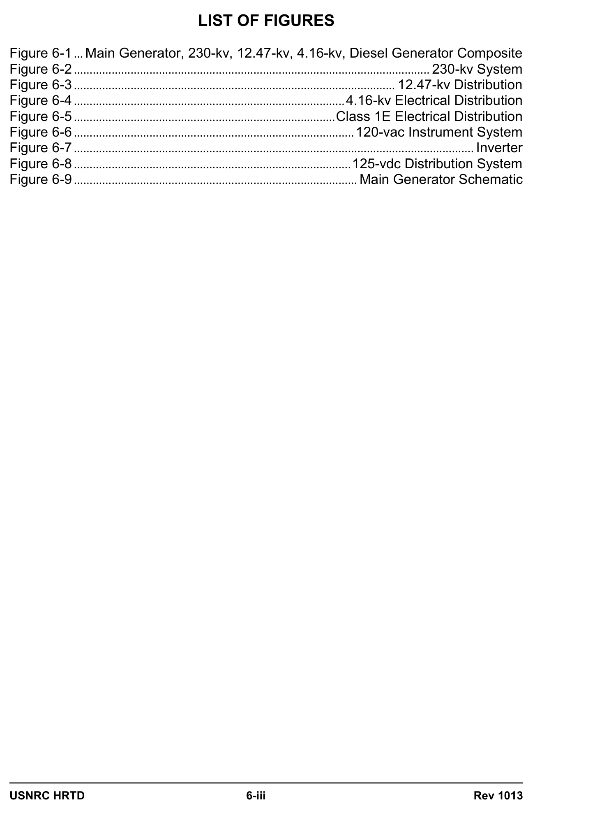
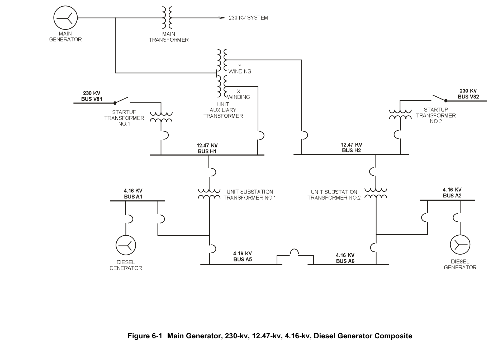
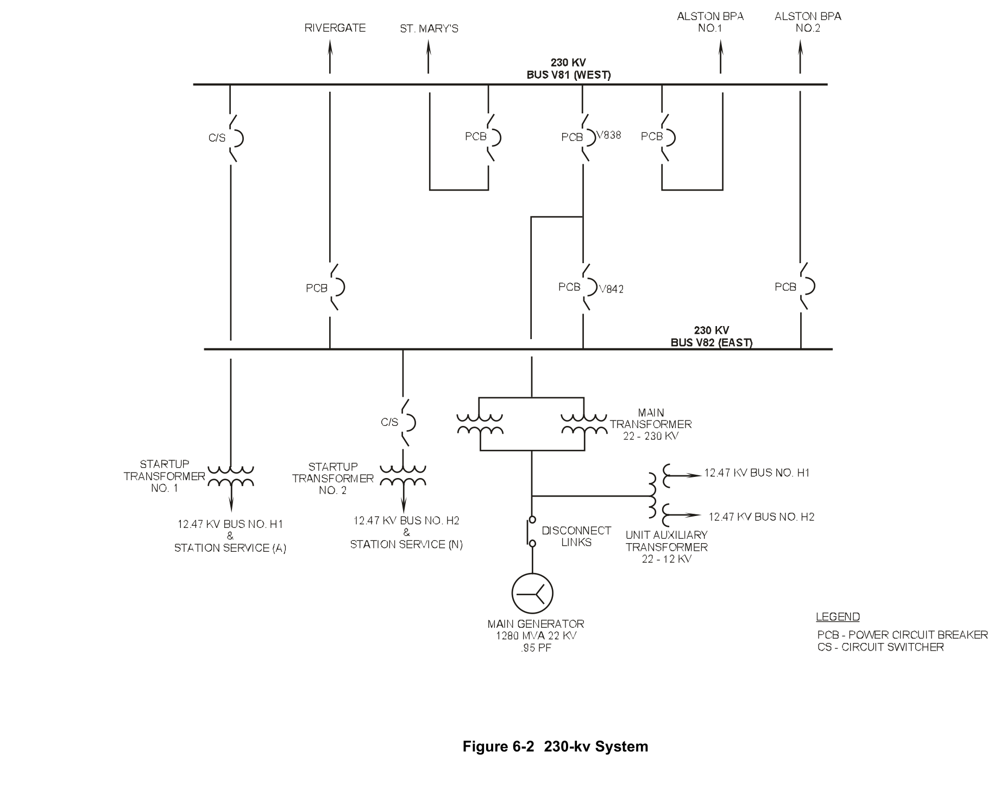
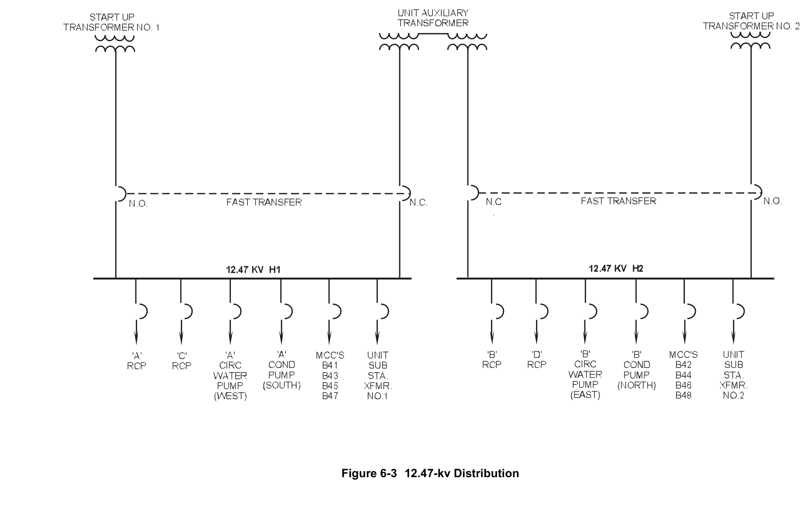
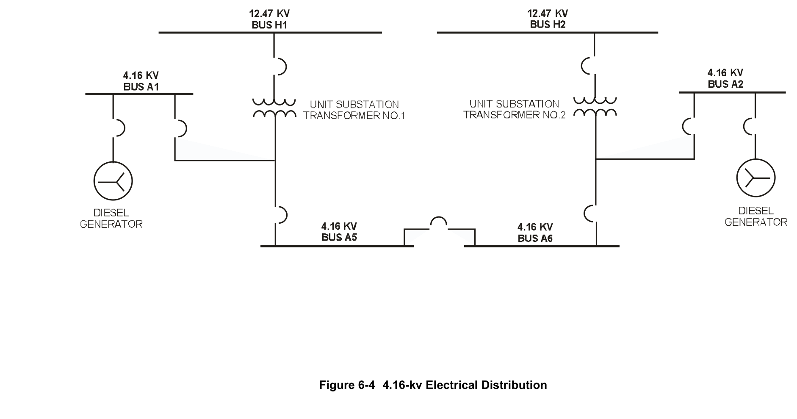
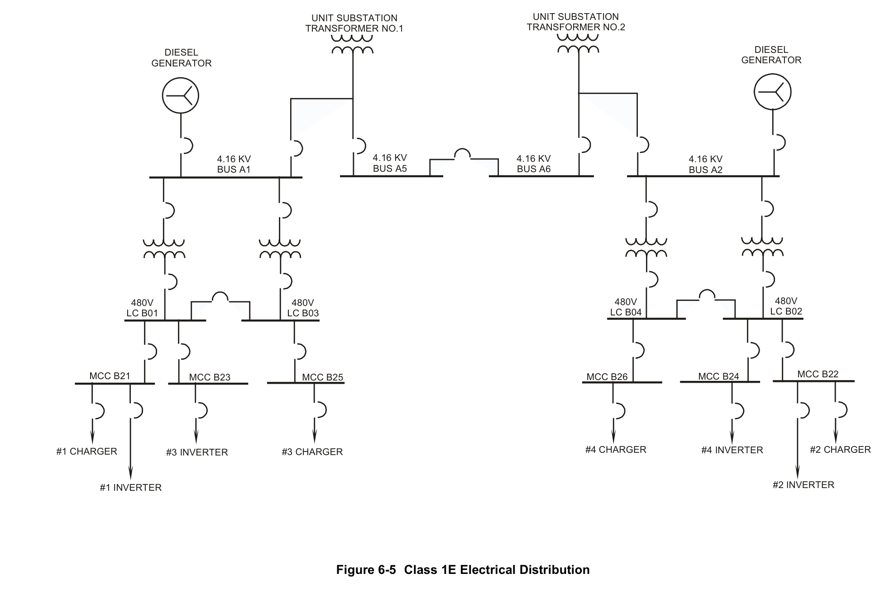
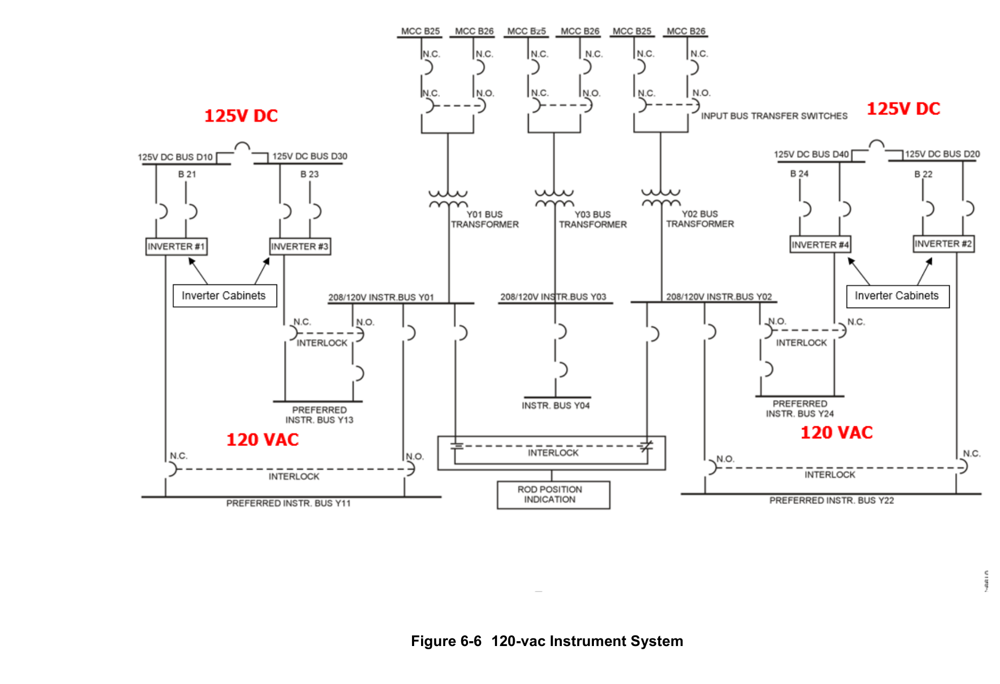
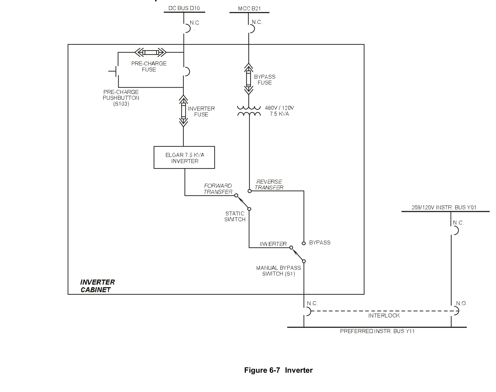
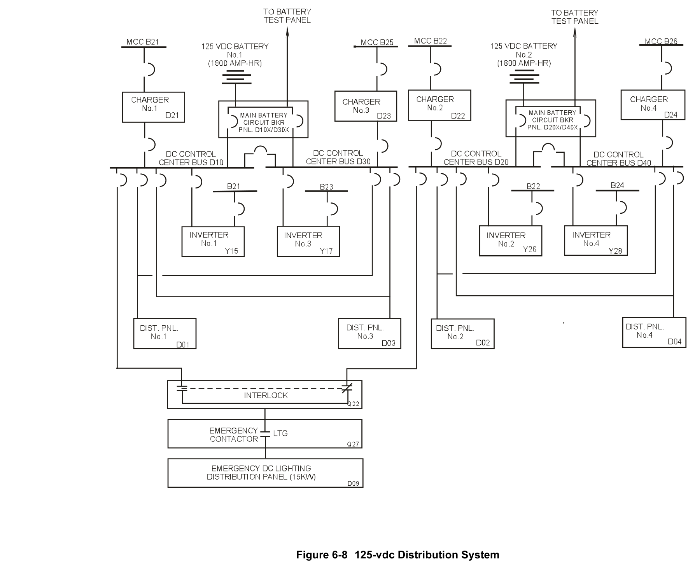
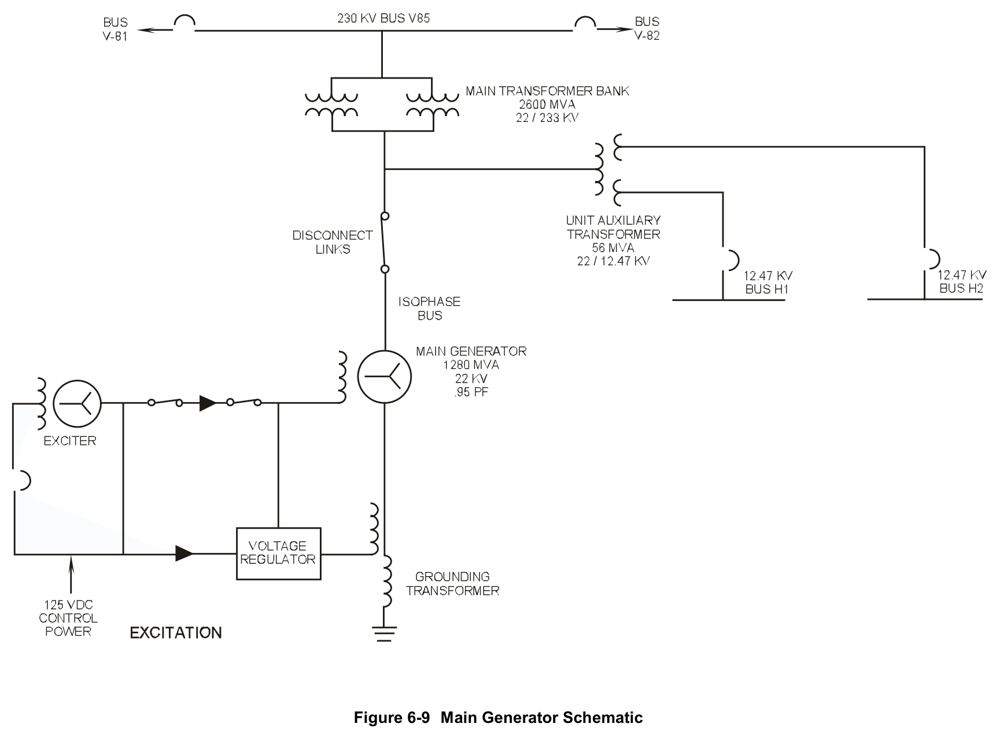

# 06.0 Elect dist

> Pages 552–602 of `ML20057E160.pdf`
> Westinghouse Technology Systems Manual — USNRC HRTD (PWR)

---
<!-- p.552 -->
#### Westinghouse Technology Systems Manual
#### Section 6.0
#### Electrical Distribution System
<!-- p.554 -->
TABLE OF CONTENTS

6.0 ELECTRICAL DISTRIBUTION SYSTEM ..................................................... 6-1

6.0.1 Introduction ........................................................................................ 6-1

6.0.2 Class 1E Distribution ......................................................................... 6-2

6.0.3 Offsite (Preferred) Power Distribution ................................................ 6-2

6.0.4 Onsite (Standby) Power Distribution.................................................. 6-3

6.0.5 PRA Insights ...................................................................................... 6-3

6.0.6 Summary ........................................................................................... 6-4

6.1 230-kv Electrical System .............................................................................. 6-5

6.1.1 Detailed Description .......................................................................... 6-5

6.1.2 Component Descriptions ................................................................... 6-6

6.1.2.1 Potential Transformers ........................................................ 6-6

6.1.2.2 Current Transformers .......................................................... 6-6

6.1.2.3 Power Circuit Breakers ........................................................ 6-7

6.1.2.4 Circuit Switchers.................................................................. 6-7

6.1.2.5 Disconnect Switches ........................................................... 6-7

6.1.2.6 Startup Transformers .......................................................... 6-8

6.1.3 Summary ........................................................................................... 6-8

6.2 12.47-kv Electrical System ........................................................................... 6-9

6.2.1 Detailed Description .......................................................................... 6-9

6.2.2 Component Descriptions ................................................................... 6-9

6.2.2.1 Unit Auxiliary Transformer ................................................... 6-9

6.2.2.2 Startup Transformers .......................................................... 6-9

6.2.3 12.47-kv Load Controls ................................................................... 6-10

6.2.4 12.47-kv Undervoltage, Underfrequency, and RCP Breaker Trips .. 6-10

6.2.4.1 Undervoltage Trips ............................................................ 6-10

6.2.4.2 Underfrequency Trips ........................................................ 6-10

6.2.4.3 RCP Breaker Position Trip ................................................ 6-11

6.2.5 Instrumentation ................................................................................ 6-11

6.2.6 Summary ......................................................................................... 6-11

6.3 4.16-kv Electrical System ........................................................................... 6-11

6.3.1 Detailed Description ........................................................................ 6-11

6.3.2 Component Descriptions ................................................................. 6-12

6.3.2.1 Air Circuit Breakers ........................................................... 6-12

6.3.2.2 Unit Substation Transformers ............................................ 6-12

6.3.2.3 Emergency Diesel Generators .......................................... 6-13

6.3.2.4 ESF Switchgear A1 and A2 ............................................... 6-14

6.3.2.5 ESF Bus Feeder ACBs ...................................................... 6-15

6.3.2.6 DBA and Shutdown Sequencers ....................................... 6-16

6.3.2.7 Non-ESF Switchgear A5 and A6 ....................................... 6-18

6.3.2.8 Bus A5/A6 Tie ACB ........................................................... 6-19

6.3.3 Summary ......................................................................................... 6-20

USNRC HRTD 6-i Rev 1013

<!-- p.555 -->
TABLE OF CONTENTS (cont.)

6.4 480-vac Electrical System .......................................................................... 6-20

6.4.1 Detailed Description ......................................................................... 6-20

6.4.2 Component Descriptions .................................................................. 6-21

6.4.2.1 Transformers ..................................................................... 6-21

6.4.2.2 Circuit Breakers ................................................................. 6-22

6.4.3 Summary ......................................................................................... 6-22

6.5 120-vac Electrical System .......................................................................... 6-22

6.5.1 Preferred System ............................................................................. 6-22

6.5.1.1 Inverters ............................................................................. 6-24

6.5.2 Nonpreferred System ....................................................................... 6-25

6.5.3 Summary ......................................................................................... 6-26

6.6 125-vdc Electrical System .......................................................................... 6-26

6.6.1 System Description .......................................................................... 6-26

6.6.2 Component Descriptions .................................................................. 6-28

6.6.2.1 Battery Chargers ............................................................... 6-28

6.6.2.2 Batteries ............................................................................ 6-29

6.6.3 Summary ......................................................................................... 6-29

6.7 Main Generator ........................................................................................... 6-30

6.7.1 Detailed Description ......................................................................... 6-30

6.7.1.1 Generator Construction ..................................................... 6-30

6.7.1.2 Stator Core ........................................................................ 6-30

6.7.1.3 Stator Winding ................................................................... 6-31

6.7.1.4 Rotor .................................................................................. 6-31

6.7.2 Generator Cooling ........................................................................... 6-31

6.7.3 Component Descriptions .................................................................. 6-32

6.7.3.1 Excitation System .............................................................. 6-32

6.7.3.2 DC Voltage Regulator ........................................................ 6-32

6.7.3.3 AC Voltage Regulator ........................................................ 6-33

6.7.3.4 Relaying and Control Circuits ............................................ 6-33

6.7.3.5 Generator Synchronizing Circuit ........................................ 6-33

6.7.4 Main Generator Protection ............................................................... 6-34

6.7.4.1 Turbine Trips ..................................................................... 6-34

6.7.4.2 Generator Lockout Relays ................................................. 6-34

6.7.5 Main Transformer ............................................................................ 6-35

6.7.6 General System Operation .............................................................. 6-35

6.7.6.1 Normal Operation .............................................................. 6-35

6.7.6.2 System Shutdown .............................................................. 6-35

6.7.6.3 System Operations While Shutdown ................................. 6-35

6.7.6.4 Generator Operating Limits ............................................... 6-35

6.7.7 Summary ......................................................................................... 6-36

USNRC HRTD 6-ii Rev 1013

<!-- p.556 -->
#### Figure 6-1

*.. Main Generator, 230-kv, 12.47-kv, 4.16-kv, Diesel Generator Composite*

<!-- labels/text on this figure page -->
LIST OF FIGURES
Figure 6-1 ... Main Generator, 230-kv, 12.47-kv, 4.16-kv, Diesel Generator Composite
Figure 6-2 ................................................................................................................. 230-kv System
Figure 6-3 ...................................................................................................... 12.47-kv Distribution
Figure 6-4 ...................................................................................... 4.16-kv Electrical Distribution
Figure 6-5 ................................................................................... Class 1E Electrical Distribution
Figure 6-6 ......................................................................................... 120-vac Instrument System
Figure 6-7 ............................................................................................................................... Inverter
Figure 6-8 ........................................................................................ 125-vdc Distribution System
Figure 6-9 .......................................................................................... Main Generator Schematic
USNRC HRTD 6-iii Rev 1013

<!-- p.558 -->
### 6.0 ELECTRICAL DISTRIBUTION SYSTEM
#### Learning Objectives:
1. State the purposes of the electrical distribution system.

2. Define the following:

a. Offsite distribution b. Onsite distribution c. Class 1E distribution d. Standby power source e. Preferred power source

3. Explain how a reliable source of power is ensured to the following:

a. The 4.16-kv and 480-vac safety related distribution buses b. The 125-vdc instrumentation and control buses c. The 120-vac instrumentation buses

4. Describe the response of the non-Class 1E electrical distribution system to a turbine-generator trip.

5. Describe the operation of the Class 1E electrical distribution system for all combinations of loss of offsite power and engineered safety features actuation signal.

6. List the automatic start signals for the emergency diesel generators.

7. Explain the effect of an automatic start signal on the diesel generator protection system.

8. Explain why a station blackout in conjunction with a reactor coolant pump seal failure is a high contributor to core damage frequency.

#### 6.0.1 Introduction
The purposes of the electrical distribution system are to:

1. Provide a reliable source of electrical power to the engineered safety features equipment,
2. Provide a reliable source of control and instrumentation power,
3. Provide power to station auxiliary equipment, and 4. Direct the main generator’s output to the utility’s distribution system.

The designs of electrical distribution systems vary considerably between commercial nuclear power plants and can be significantly different in the nomenclature used to

USNRC HRTD 6-1 Rev 1013

<!-- p.559 -->
designate the system components, bus voltages, and the numbers and physical arrangements of components. All plants have the following generic features:
a. High voltage offsite distribution, b. High voltage and medium voltage onsite distribution, and c. Low voltage control and instrumentation distribution.

This chapter describes the electrical systems as they are modeled on the Westinghouse simulator at the Technical Training Center. The simulator is based on the Trojan plant design, but the electrical system is representative of a typical plant electrical distribution system.

#### 6.0.2 Class 1E Distribution
Class 1E is the safety classification of the electrical equipment and systems that are essential to emergency reactor shutdown, containment isolation, reactor core cooling, and containment and reactor heat removal, or are otherwise essential in preventing the significant release of radioactive material to the environment. All safety-related electrical equipment and systems are designated Class 1E.

#### 6.0.3 Offsite (Preferred) Power Distribution
The offsite (preferred) power distribution system includes two or more power sources capable of operating independently of the onsite or standby power sources.
It encompasses the grid, transmission lines (overhead or underground), transmission line control systems, switchyard battery systems, common station service transformers, interconnecting buswork, and circuit breakers provided to supply electric power to safety-related and other equipment.

The offsite (preferred) power distribution system is, as the name implies, the preferred source of power for Class 1E loads during accident conditions. The offsite
(preferred) power distribution system may be considered as two or more connections, however made, to the utility grid for supplying power to the plant’s Class 1E loads.

General design criterion 17 of 10CFR50, Appendix A states that electric power from the transmission network to the onsite electric distribution system shall be supplied by two physically independent circuits (not necessarily on separate rights of way)
designed and located so as to minimize the likelihood of their simultaneous failure under operating and postulated accident and environmental conditions. A switchyard common to both circuits is acceptable. Each of these circuits shall be designed to be available in sufficient time following a loss of all onsite alternating current power supplies and the other offsite electric power circuit, to assure that specified acceptable fuel design limits and design conditions of the reactor coolant pressure boundary are not exceeded. One of these circuits shall be designed to be available within a few seconds following a loss of coolant accident to assure that core cooling, containment integrity, and other vital safety functions are maintained.

USNRC HRTD 6-2 Rev 1013

<!-- p.560 -->
#### 6.0.4 Onsite (Standby) Power Distribution
The onsite (standby) power distribution system includes those power sources, distribution systems, and vital supporting systems provided to supply power to safety-related equipment and capable of operating independently of the offsite power distribution system.

The onsite (standby) power distribution system is the Class 1E portion of a nuclear plant’s auxiliary power system. It includes an ac distribution system, a dc power system, an uninterruptable ac power system and an emergency (diesel generator)
power system. Its preferred source of ac power is the offsite power distribution system. If the preferred source is not available, ac power is provided by onsite diesel generators.

In accordance with general design criterion 17 of 10CFR50, Appendix A, the onsite electric power system is provided to permit the functioning of structures, systems, and components important to safety. The safety function for the onsite electric power system (assuming the offsite system is not functioning) is to provide sufficient capacity and capability to assure that (1) specified acceptable fuel design limits and design conditions of the reactor coolant pressure boundary are not exceeded as a result of anticipated operational occurrences and (2) the core is cooled and containment integrity and other vital functions are maintained in the event of postulated accidents.

The onsite electric power supplies, including the batteries, and the onsite electric distribution system, are required to have sufficient independence, redundancy, and testability to perform their safety functions assuming a single failure.

#### 6.0.5 PRA Insights
Because of the dependence on electrical power for most of the systems involved in the mitigation of an accident, failure of the electrical system is a major contributor to the core damage frequency. The contribution is attributed in part to scenarios involving station blackouts and losses of offsite power. In general, power problems contribute to about 62% of the total core damage frequency at Surry (38%-station blackout, 4% - loss of offsite power, and 20% - loss of various ac and dc busses), 3% at Zion (2% - station blackout and 1% - loss of offsite power), and 8% at Sequoyah (5% - station blackout and 3% - loss of a dc bus).

The major problem associated with a loss of power, especially a station blackout, is the probability of a reactor coolant pump seal failure, leading to a small-break loss of coolant accident (LOCA). This problem is magnified by the unavailability of the high pressure injection system to inject cooling water due to the loss of power.

The other sequences involving the loss of power as an initiator also involve the failures of systems such as the auxiliary feedwater system, the failure of a pressurizer power-operated relief valve to shut, and the failure of the pressurizer relief valves to open to enable feed and bleed. Probable causes of the loss of power initiator include:

USNRC HRTD 6-3 Rev 1013

<!-- p.561 -->
• Failure of the emergency diesel generators to start,
• Failure of the emergency diesel generators to run after starting,
• Failure to recover ac power,
• Unavailability of the diesel generators due to testing or maintenance, and
• A local fault of an inverter, which prevents the automatic actuation of the auxiliary feedwater pumps.

NUREG-1150 studies on importance measures have pointed out several areas which can be of major significance to the risk achievement and to risk reduction. For risk achievement, the time the seal-failure LOCA occurs after the loss of power (1-10 hours), the time required to deplete the batteries, and the assumptions for the recovery of offsite power are the major areas which tended to increase the probability of core damage.

For risk reduction, the probability of core damage can be significantly reduced if the probability of the loss of offsite power (a factor of 1.9 for Surry), the nonrecovery of ac power (for Surry, a factor of 1.5 if recovery is within 1 hour and a factor of 1.7 if recovery is within 2 hours), the nonrecovery of high pressure injection, or the sealfailure LOCA can be reduced (factor of 1.5 at Surry).

The contribution of human error to core damage frequency is plant specific. If the auxiliary feedwater system is normally configured so that one pump is locked out, failure to start that pump becomes critical. Failure to correctly realign the system after testing or maintenance is another.

In March of 1990, the Vogtle nuclear plant experienced a loss of all ac power for a short period of time as a result of an unusual power lineup, a loss of offsite power
(due to a truck knocking over a tower into a transformer), and the subsequent failure to start of the diesel generators. One of the diesel generators was disassembled for maintenance, and the other did not start immediately. All ac power was lost for 36 minutes, before the emergency starting of a diesel generator. Offsite power was not restored for about two hours. During this time the primary temperature increased at a rate of 1.3°F/min. The plant had been shut down for a period of time, so the decay heat was not very significant.

However, had the loss of power occurred with a large decay heat load, the temperature increase would have been substantial. In this case, the existing plant conditions minimized the consequences of a loss of all ac power, and the time period that all ac power was lost was just over a half hour. Since the plant was already cooled down, the effect on the reactor coolant pump seals was negligible.
Far worse consequences would have resulted if the plant had been at power and the same events had occurred.

#### 6.0.6 Summary
The following sections of this chapter discuss the 230-kv electrical system (6.1), the 12.47-kv electrical system (6.2), the 4.16-kv electrical system (6.3), the 480-vac electrical system (6.4), the 120-vac electrical system (6.5), the 125-vdc electrical system (6.6), and the main generator (6.7). The introduction, definitions, design

USNRC HRTD 6-4 Rev 1013

<!-- p.562 -->
criteria, and PRA information of this section apply to the systems that are discussed in the remaining sections.

### 6.1 230-kv Electrical System
The 230-kv electrical system, shown in Figure 6-2, provides power produced by the main generator to the distribution grid. Additionally, as shown in Figure 6-1, the system supplies electrical power to plant engineered safety feature (ESF) equipment and auxiliary loads during operating and shutdown conditions.

#### 6.1.1 Detailed Description
During normal plant operation, the main generator provides electrical power at 22 kv through an isolated phase bus and two parallel-connected main transformers to the 230-kv west and east buses through two power circuit breakers (PCBs).

The west bus supplies power to:

a. St. Mary's via a PCB, b. Alston #1 via a PCB, and c. startup transformer #1.

The east bus supplies power to:

a. Alston #2 via a PCB, b. Rivergate via a PCB, and c. startup transformer #2.

This offsite power system provides the following reliability and flexibility:

1. Any transmission line can be isolated under normal or fault conditions without affecting the power flow of the other lines.

2. Either 230-kv bus, with its associated circuit breakers and protective relaying, can be isolated without interruption of power to the other 230-kv bus.

3. Either startup transformer can be shut down under normal or fault conditions without interruption of power to the other transformer.

4. Any circuit switcher or circuit breaker can be opened and removed from service under normal conditions for routine maintenance, repair, or replacement with no loss of power to the offsite power system.

5. No failure of a single transmission line, a circuit breaker, a major bus, or the main generator will cause the loss of all offsite power to the onsite distribution system.

Four overhead transmission lines transmit the power from the Trojan switchyard to Rivergate, St. Mary’s, and the switchyard at Alston. The four transmission lines, the Trojan switchyard, and the two startup transformers constitute the offsite power supply. This 230-kv offsite power supply is divided into two independent sources.

USNRC HRTD 6-5 Rev 1013

<!-- p.563 -->
The first source includes:

a. St. Mary’s - Trojan 230-kv transmission line, b. Alston - Trojan #1 230-kv transmission line, c. 230-kv bus #1 (west), and d. Startup transformer #1.

The second source includes:

a. Rivergate - Trojan 230-kv transmission line, b. Alston - Trojan #2 230-kv transmission line, c. 230-kv bus #2 (east), and d. Startup transformer #2.

Figure 6-2 illustrates the two-bus (east and west), four-line switchyard arrangement that provides maximum system flexibility and availability. There are two PCBs for the main generator and one circuit switcher for each of the two startup transformers.

During normal operation all line disconnect links/switches, PCBs, and circuit switchers are closed. In this arrangement, the 230-kv system is powered by the main generator. Power is then available to the grid via the 230-kv system. Power for plant auxiliaries is normally supplied through the unit auxiliary transformer. Loadside breakers from the normally energized startup transformers are open. However, if power from the unit auxiliary transformer is unavailable, these breakers will close and provide the preferred source of power from the grid to the plant.

During plant shutdowns, the generator bus disconnects and PCBs are open and all line PCBs and disconnects are closed. The startup transformer circuit switchers, disconnect switches, and load-side breakers are closed, and the plant receives power from the grid via the startup transformers. In this condition the unit auxiliary transformer load breakers are open.

#### 6.1.2 Component Descriptions
##### 6.1.2.1 Potential Transformers
Potential transformers provide metering and protection for electrical buses and supply relay polarization voltage, undervoltage relays, and signals for wattmeters and var meters in the control house and the control room. The potential transformers on the line side of each line PCB supply voltmeters, synchronizing circuits, and synchronization check relays in the control house and in the control room. Potential transformers on the generator side of each generator PCB supply voltmeter and synchronizing circuits and a synchronization check relay. Bus potential transformers, which also perform metering and relay functions, are provided on each of the 230-kv buses.

##### 6.1.2.2 Current Transformers
Current transformers located on the bushings of each line PCB supply ammeters, var meters, and watt meters in the control house and in the control room. Bushing

USNRC HRTD 6-6 Rev 1013

<!-- p.564 -->
current transformers on the generator side of each generator PCB supply ammeters, var meters, and wattmeters in the control room. Both of these current transformers also supply a significant number of protective relays and telemetering devices.

##### 6.1.2.3 Power Circuit Breakers
The power circuit breakers (PCB) provide a means of connecting the switchyard buses with and isolating them from the main generator, the east and west buses, and the loads supplied by the 230-kv electrical system. All PCBs are located in the switchyard. They are air-operated, oil-filled, high-speed breakers. Each generator PCB has a 3000-amp continuous rating and is normally operated from the control room. When selected for "backfeed" or "cycle," the generator PCBs can be operated from the switchyard control house. The line PCBs are physically the same as the generator PCBs except that each line PCB has a continuous rating of 2000 amp.
They can be operated from the switchyard control house or the control room. The breakers are air operated to close and spring operated to open. Thus energy is stored to open them even after a loss of power.

Control power for the protective relays and trip devices is provided by the switchyard 125-vdc bus. Protective relays are operated by current transformers and/or potential transformers. The compressor motor is powered by station service 240-vac. The line PCBs are interlocked to prevent their closure from the switchyard control house unless the applicable local synchronizing switch is turned to the “on” position. In order to close a line PCB from the control room, the appropriate line must be energized, the synchronizing check relay must be in synchronizing to prevent relying only on the synchronizing check relays, and the applicable synchronizing switch should be turned to the “on” position to monitor the switching operation. Generator PCBs are interlocked with synchronizing check relays, which prevent paralleling unsynchronized power supplies.

##### 6.1.2.4 Circuit Switchers
Circuit switchers combine the features of disconnects and circuit breakers. Each has a continuous service rating of 230 kv and 1600 amp. Each operates by breaking the circuit within its interrupting section and isolating the circuit with conventional disconnect blades. Like a circuit breaker, the interrupting unit carries the continuous rated current when the disconnect blade is closed, and is controlled by a completely enclosed linkage. A control unit correlates the opening of the disconnect blades with the action of the interrupting unit, preventing reclosing of the blades until the interrupting unit contacts have closed. The interrupter unit is gas filled to help break the load arc. A motor is used to open the disconnect blades once the interrupter has opened. It also closes the circuit after the interrupter contacts close. A shunt trip is also provided to open contacts rapidly should a fault develop in a startup transformer.

##### 6.1.2.5 Disconnect Switches
Disconnect switches are used to isolate PCBs and circuit switchers. This allows repairs to be accomplished without putting down entire buses and provides the visible air gap required for personnel working on high voltage components. They are manually operated from the local station only and are not designed to be opened

USNRC HRTD 6-7 Rev 1013

<!-- p.565 -->
under load. Therefore, a PCB or circuit switcher must be open prior to opening its load-side and supply-side disconnects. Ground disconnects are installed to ground the line PCBs when maintenance on the line is being performed. The ground disconnect and the line disconnect are mechanically interlocked to prevent their simultaneous closure.

##### 6.1.2.6 Startup Transformers
The startup transformers provide the preferred path of power for the plant during a design-basis accident, and should be continuously available. Two emergency diesel generators provide backup power to the plant engineered safety feature (ESF)
buses should the startup transformers become unavailable.

Each of the two startup transformers has a single primary winding which supplies an intermediate winding that, in turn, supplies the secondary (low voltage) side of the transformer. The low voltage side of each transformer is connected to the onsite 12.47-kv distribution system with fifteen underground cables. The cable runs from each transformer are physically separated from each other. The high voltage side of each startup transformer is connected to a separate 230-kv bus, which is fed from two offsite transmission lines.

Normal "live-bus" transfers between the preferred source (startup transformers) and the normal source (unit auxiliary transformer) during startup and shutdown are manually initiated, with momentary source paralleling during transfer so that all auxiliaries continue to operate. Following a turbine-generator trip, there is an automatic "fast" transfer to the startup transformers if this preferred source is available. The startup transformers are sized to provide all auxiliary station power during normal plant startups and all ESF loads during emergency operation.

Should it be necessary to remove a bus from service, the startup transformer on the affected side will be isolated and its high-side disconnect tagged open. The line side PCBs will be opened and then the generator breaker to that side will be opened. All three bus side disconnects will be tagged open.

During shutdown conditions, the main generator is secured and its PCBs are open.
The two startup transformers will be supplied with power from the grid. If the startup transformers are unavailable, alternate connections to the 230- kv system for the ESF buses are available through the main and unit auxiliary transformers. This is accomplished by removing the disconnect links in the isolated phase bus between the generator and the main transformers. Power is sent by backfeeders to the plant from the 230-kv buses via the generator breakers to the main transformer, and then through the unit auxiliary transformer to 12.47-kv buses H1 and H2.

#### 6.1.3 Summary
The 230-kv electrical system provides power produced by the main generator to the distribution grid. The system also supplies electrical power to the plant ESF equipment and auxiliary loads during operating and shutdown conditions.

USNRC HRTD 6-8 Rev 1013

<!-- p.566 -->
### 6.2 12.47-kv Electrical System
The 12.47-kv electrical system provides power to two buses for distribution to all plant electrical loads during normal operation. It also supplies large motors necessary for plant operation, such as those which drive the reactor coolant pumps
(RCPs), circulating water pumps, and condensate pumps. Figure 6-3 shows the 12.47-kv distribution system.

#### 6.2.1 Detailed Description
The 12.47-kv system is comprised of distribution buses designated H1 and H2.
During normal plant operation, the 12.47-kv buses receive power from the main generator through the unit auxiliary transformer. Bus H1 is normally supplied by the "X" winding of the unit auxiliary transformer and bus H2 is supplied by the “Y” winding. If the main generator is not in operation or is tripped, the 12.47-kv buses are supplied from the offsite 230-kv system through the startup transformers. The supply for bus H1 is the #1 startup transformer, and the supply for bus H2 is the #2 startup transformer. Although the 12.47-kv system is not safety related, a two-bus arrangement is provided to achieve the required reliability for supplying plant house loads during normal operation.

#### 6.2.2 Component Descriptions
##### 6.2.2.1 Unit Auxiliary Transformer
The unit auxiliary transformer steps down the main generator output voltage from 22 kv to 12.47 kv for system distribution. The transformer has one primary (high voltage) winding energized from the main generator, and two secondary (low voltage) windings, designated "X" and "Y."

The transformer is connected in a “delta-wye” configuration. The “wye” secondary utilizes a resistance grounding which reduces the transient overvoltage when a faulted equipment's breaker trips or during arcing line-to-ground faults. The “delta” winding on the generator side protects the generator from a single-phase fault on the secondary side.

The transformer cooling is a forced-oil system consisting of oil circulation throughout the transformer and then to radiators which are forced-air cooled. The cooling system is similar to that of the main transformer, which is discussed in section 6.4.

The unit auxiliary transformer feeds buses H1 and H2. The feeder breakers are 2000-amp air circuit breakers. Opening and closing control power for bus H1 and H2 breakers is supplied from the 125-vdc system.

##### 6.2.2.2 Startup Transformers
The two startup transformers receive power from the 230-kv buses. Startup transformer #1 is powered from the west bus and #2 is supplied by the east bus.
During normal operation, the startup transformers are in standby (energized) and will be available to supply the 12.47-kv buses automatically in the event of a generator lockout. Loads are transferred to the startup transformers manually during a

USNRC HRTD 6-9 Rev 1013

<!-- p.567 -->
controlled plant shutdown. The transformers are cooled by forced-air and naturalcirculation-oil radiators. They are located in the switchyard. The primary and secondary windings are wye connected, with the secondary wye connection being resistance grounded.

#### 6.2.3 12.47-kv Load Controls
All 12.47-kv loads trip on:

a. ground, b. overcurrent, or c. undervoltage that exists for greater than two seconds (for the RCP breakers to trip, the unit auxiliary transformer normal feeder must also be open).

Each motor load, in addition to the ground and overcurrent relays previously mentioned, is also provided with a differential trip. In addition, the reactor coolant pumps utilize an additional overcurrent relay as a backup for trip purposes and an underfrequency trip at 57.7 hz.

#### 6.2.4 12.47-kv Undervoltage, Underfrequency, and RCP Breaker Trips
The undervoltage and underfrequency reactor trip signals provide reactor core protection against departure from nucleate boiling in the event of loss of core flow due to loss of voltage or underfrequency to more than one reactor coolant pump.

##### 6.2.4.1 Undervoltage Trips
The undervoltage condition is sensed on each bus by two undervoltage relays. If an undervoltage condition (less than 68.6% of normal voltage) is sensed, both relays de-energize, shutting their associated contacts wired in series to energize a time delay relay. If the undervoltage condition exists for greater than two seconds, the time delay relay will shut its associated contact, which energizes auxiliary relays to trip the breakers for all loads except the reactor coolant pumps. In addition, each reactor coolant pump’s trip circuit has a contact which closes when the auxiliary relay energizes. This contact is in series with a "b" contact energized from the position of the unit auxiliary transformer 12.47-kv feeder breaker. When the feeder breaker is open, the "b" contact is shut. With both contacts shut, the reactor coolant pumps powered by that bus will trip.

If an undervoltage condition (less than 68.6% of normal voltage) is sensed on both buses (by at least one of the two sensors on each bus) for greater than 0.01 sec, a reactor trip signal is generated if reactor power is greater than 10% (P-7 permissive).

##### 6.2.4.2 Underfrequency Trips
The underfrequency condition (less than 57.7 hz) is sensed on each bus by two underfrequency relays. If an underfrequency condition is sensed on both buses (by at least one of the two sensors on each bus) for greater than 1/6 sec, a trip signal is sent to each reactor coolant pump. Additionally, a reactor trip signal is generated if reactor power is greater than 10% (P-7).

USNRC HRTD 6-10 Rev 1013

<!-- p.568 -->
##### 6.2.4.3 RCP Breaker Position Trip
In addition to the underfrequency and undervoltage trips for the reactor coolant pumps, a reactor trip generated by reactor coolant pump breaker position is provided. This trip provides anticipatory reactor core protection against departure from nucleate boiling resulting from the opening of two or more pump breakers if reactor power is greater than 10% (P-7).

#### 6.2.5 Instrumentation
Each 12.47-kv bus is equipped with two potential transformers which provide input to underfrequency, undervoltage, and synchronism check circuits. Also, various current transformers are used to supply the protection and alarm relays previously discussed as well as indicators.

Ammeters and voltmeters are located on the switchgear and in the control room. A voltmeter and ammeter selector switch is provided in the control room for individual phase currents and phase-to-phase voltages for each bus. Also located in the control room are wattmeters and watthour meters for each bus.

#### 6.2.6 Summary
The 12.47-kv electrical system provides power to all plant electrical loads during normal operation, including reactor coolant pumps, circulating water pumps, and condensate pumps. It is not a safety-related system, but it is very reliable due to its two-bus arrangement.

### 6.3 4.16-kv Electrical System
The 4.16-kv electrical system, as shown in Figure 6-4, consists of four buses. Two of these buses, A1 and A2, are classified as ESF buses which supply power to equipment that is vital for the safe shutdown of the reactor plant. Either ESF bus can supply sufficient power to auxiliaries to safely shut down the reactor. Though not ESF buses, A5 and A6 supply power to equipment that is vital for plant operation but not needed to achieve a safe shutdown condition. The four-bus arrangement is utilized to provide electrical separation between the ESF and non-ESF systems and to provide electrical and physical separation between the two redundant ESF power supplies. The system is designed such that no single component failure will prevent operation of the required loads necessary to achieve a safe shutdown condition.
Redundant power sources and automatic load transfers are provided to ensure continuous equipment operation under emergency conditions.

#### 6.3.1 Detailed Description
The 4.16-kv system, shown on Figure 6-4, normally receives power from the 12.47kv buses through the two unit substation transformers. Each transformer supplies two buses, one ESF bus and one non-ESF bus. Buses A1 and A5 receive power from bus H1, while buses A2 and A6 receive power from bus H2. During normal operation, the 12.47-kv buses receive power from the main generator via the unit auxiliary transformer. When the main generator is not available, the 12.47-kv buses are supplied from the 230-kv system through the two startup transformers. If there

USNRC HRTD 6-11 Rev 1013

<!-- p.569 -->
were a failure of the 12.47-kv power source or a fault in either of the transformers, each of the ESF buses would be supplied from an emergency diesel generator.

Each emergency diesel generator is capable of starting and providing power to its ESF bus within 10 seconds of receiving an auto-start signal. To prevent rapid loading of the emergency diesel generators after starting, all loads are initially tripped and later sequenced on by one of two sequencers, the shutdown sequencer
(also referred to as the safe-shutdown or normal shutdown sequencer) or the DBA
(design basis accident) sequencer, depending on the initiating circumstances.
Buses A5 and A6 can be supplied by either unit substation transformer via a bus tie circuit breaker.

Only one 4.16-kv bus may be de-energized at a time. The reactor should be placed in a hot shutdown condition prior to de-energizing a non-ESF bus. Prior to deenergizing an ESF bus, the reactor should be placed in a cold shutdown condition.
ESF buses A1 and A2 are never energized from the same power supply because a single fault could cause a loss of the entire 4.16-kv ESF electrical system.

#### 6.3.2 Component Descriptions
##### 6.3.2.1 Air Circuit Breakers
All the buses and loads discussed in this section are connected through air circuit breakers (ACBs). These breakers use 125-vdc control power. Each has a nominal continuous load rating of 1200 amp with an instantaneous interrupting capacity of 29,000 amp. Specific interlocks, permissives and trips are discussed in more detail throughout this system description.

The ACBs are provided with “operate,” “test,” and “withdrawn” positions. In the “operate” position, the ACB is fully inserted into the switchgear and is ready for operation. It is operated either from the control room or locally from the ACB cubicle. A remote-local switch is provided on the cubicle door to select the operating location. In the “test” position the ACB is partially withdrawn from the cubicle and the power stabs are disconnected from the bus. The ACB still receives control power through the longer control power stabs. In the “test” position the ACB functions in the same manner as described above except that it cannot pass load current since the power stab bases are disconnected from the bus. This mode is used for ACB testing. In the “withdrawn” position the ACB is fully withdrawn (racked out) from the cubicle. The power stabs and the control power stabs are disconnected and the ACB cannot be operated unless a local ACB bar is used for spring charging. Manual release pushbuttons or levers are used to close/open the ACB.

##### 6.3.2.2 Unit Substation Transformers
Unit substation transformers (USTs) #1 and #2 are powered by 12.47-kv buses H1 and H2, respectively. The USTs reduce voltage from 12.47 kv to 4.16 kv for system distribution. The two USTs are located adjacent to the main transformers. Each is rated at 10 Mva at 55ΕC or 11.2 Mva at 65ΕC and is self-cooled, which means that no forced cooling mechanism is employed. Each UST is rated at sufficient capacity

USNRC HRTD 6-12 Rev 1013

<!-- p.570 -->
to supply all 4.16-kv loads on all buses and to start the largest load while all other loads are energized.

##### 6.3.2.3 Emergency Diesel Generators
The emergency diesel generators (EDGs) automatically provide power at 4.16 kv to ESF buses A1 and A2 within 10 seconds following a loss of power to those buses.
Each EDG is rated at 4.16 kv, 3 phase, 60 hz, and 900 rpm, with a continuous load rating of 4418 kw.

An EDG can be manually started remotely from the control room or locally. An EDG starts automatically with any of the following conditions:

1. A safety injection actuation signal (SIS) has been generated.

2. An undervoltage condition has been generated on the EDG’s associated 4.16-kv ESF bus. An undervoltage signal is generated for two different voltage levels: (a)
loss of voltage (bus voltage less than 2.56 kv for at least one second) and (b)
degraded voltage (bus voltage less than 3.85 kv for greater than 55 seconds).
Undervoltage protection is provided by undervoltage relays arranged in a one-oftwo-taken-twice logic configuration. Additional responses to an undervoltage condition are discussed in section 6.3.2.5.

3. An undervoltage condition exists on the secondary side of the associated startup transformer, as sensed by each of two undervoltage relays. This signal automatically starts the EDG in anticipation of a possible undervoltage condition on its associated 4.16-kv ESF bus. (This automatic start is a specific feature of the plant modeled by the Westinghouse [Trojan] simulator and does not typically exist at operating Westinghouse plants.)

The generator output ACBs are operated either locally or in the control room.
Tripping and closing power is from the 125-vdc electrical system. To manually close the EDG output ACB remotely, all of the following conditions must be satisfied:

• Either the ESF bus normal feeder must be tripped or the synchronizing switch must be on,
• The bus lockout relay must be reset, and
• The EDG lockout relays must be reset.

For local operation, the ESF bus normal feeder must be tripped since there is no synchronizing switch for this evolution at the local switchgear.

For the EDG ACB to close automatically all of the following conditions must be met:

1. The bus lockout relay must be reset,
2. The EDG lockout relays must be reset,
3. Either NO turbine trip occurred within the last second or the remote control switch is NOT "red flagged," 4. The remote control switch must be in NORMAL,

USNRC HRTD 6-13 Rev 1013

<!-- p.571 -->
5. The EDG must be at rated voltage (greater than 3.85 kv), rated speed (greater than 850 rpm), and an auto start signal must be present, 6. An undervoltage condition exists on the associated ESF bus, and 7. The normal supply ACB must be open.

These interlocks prevent the EDG from:

1. Being paralleled out of phase (because the bus is not energized),
2. Being placed on a bus which has an existing fault (because the lockout relays are reset), and
3. Being closed onto an energized bus (because the undervoltage relay has actuated).

If an EDG is supplying its associated ESF bus with the normal feeder closed while the main generator is operating and a turbine trip occurs, a relay will trip the EDG ACB to prevent overload. However, to allow automatic startup and load sequencing, this trip signal is automatically removed after one second.

When the EDG receives an automatic start signal, on an SI signal or an undervoltage condition, some of the protection trips are bypassed. This is to prevent an undesired EDG trip when the EDG is needed to supply 1E loads.

An EDG output ACB can be manually tripped by using the control switch or automatically on an engine stop or idle signal, a lockout relay, an EDG emergency trip, or a turbine trip if the normal bus feeder is closed.

##### 6.3.2.4 ESF Switchgear A1 and A2
The ESF buses provide continuous power to various vital ac loads which are necessary for the safe shutdown of the reactor plant. Buses A1 and A2 supply all ESF loads in the plant. ESF channel A loads are powered from bus A1 and ESF Channel B loads are supplied from bus A2. Some non-ESF loads, for which it is desirable to have manually switched access to the EDGs, are also supplied from the ESF buses.

The loads supplied by ESF bus A1 are:

• Service water pump A,
• Containment spray pump A,
• Component cooling water pump A,
• Load center B01,
• Transfer switch for service water pump C,
• Transfer switch for component cooling water pump C,
• Centrifugal charging pump A,
• Safety injection pump A,
• Residual heat removal pump A,
• Load center B03, and
• Positive displacement charging pump (alternate).

The loads supplied by bus A2 are:

USNRC HRTD 6-14 Rev 1013

<!-- p.572 -->
• Service water pump B,
• Containment spray pump B,
• Component cooling water pump B,
• Load center B02,
• Transfer switch for service water pump C,
• Transfer switch for component cooling water pump C,
• Centrifugal charging pump B,
• Safety injection pump B,
• Residual heat removal pump B,
• Load center B04, and
• Positive displacement charging pump (normal).

The transfer switches for the "C" service water and component cooling water pumps are used as a means of shifting the power supply of the spare pumps to either train A or train B as necessary to maintain separate power supplies to the operating pumps.

A similar feature is available for the positive displacement charging pump. Transfer switches allow the positive displacement pump to be powered from its normal supply, bus A2 or its alternate supply bus A1. A key interlock prevents both transfer switches from being closed simultaneously, thereby avoiding inadvertent paralleling of buses A1 and A2.

The ACBs to all the bus loads will trip on an overcurrent condition and on a ground condition. Each motor is also equipped with a thermal overload relay for alarm functions only. The non-motor-load ACBs do not have the thermal overload alarm.
The inputs to the overload, overcurrent, and ground relays are from current transformers.

Overcurrent and ground relaying on the bus will actuate the lockout relays, which will trip all potential or actual power supplies to the bus (except as noted in the EDG ACB description). All loads are equipped with local and remote ammeters in the same locations as the control switches. Ammeter phase selector switches are also provided to enable monitoring of each individual phase since only one meter face is utilized for all three phases.

When an undervoltage condition exists on bus A1 or A2, all load ACBs on the associated bus except for feeders to load centers will trip. This is done to allow a startup of the associated EDG in an unloaded condition.

##### 6.3.2.5 ESF Bus Feeder ACBs
The ESF bus incoming ACBs are physically identical to the other 4.16-kv ACBs in the system with the exception of trips and interlocks. Tripping and closing power is supplied by the 125-vdc electrical system, as previously discussed. The ACBs are operated either locally with the local control switches or from the control room.

To close an ESF bus feeder ACB, all of the following conditions must be satisfied:

USNRC HRTD 6-15 Rev 1013

<!-- p.573 -->
1. The bus lockout relay must be reset,
2. The unit substation transformer lockout relay must be reset, and
3. For remote operation, the synchronizing switch must be on. For local operation, the EDG output ACB must be tripped.

An ESF bus feeder ACB trips automatically if any one of the following occurs:

1. A bus lockout signal is generated,
2. A unit substation transformer lockout signal is generated,
3. A bus undervoltage relay actuates and the associated EDG automatically starts and attains normal speed and voltage, or 4. A bus voltage greater than 2.56 kv but less than 3.85 kv is maintained for greater than 55 seconds

A bus lockout is caused by either a phase overcurrent or a ground overcurrent on the bus feeder. This condition energizes the lockout relay and trips the ESF bus feeder ACB and removes a permissive for closing the EDG output ACB.

An ESF bus undervoltage condition energizes the undervoltage auxiliary relays. The undervoltage auxiliary relay will cause the following:

• A trip of the bus feeder ACB,
• Trips of all 4.16-kv load ACBs except those which supply load centers,
• A start signal for the associated EDG,
• A permissive to close the EDG ACB,
• Delaying the DBA or shutdown sequencer from operating until voltage is restored to the bus,
• An auxiliary feed pump start permissive, and
• Energizing of the undervoltage relays which trip all containment air coolers and non-essential 480-v loads.

Two levels of undervoltage protection are provided. Primary protection is provided against an undervoltage of less than 2560 volts for greater than one second. The one second time delay is selected because motor damage could be sustained if operation were to continue at this low voltage for greater than 1.1 seconds.

Secondary protection, commonly referred to as degraded grid protection, is provided against an undervoltage of less than 3850 volts. “Degraded grid” is a term describing a low voltage condition affecting an ESF bus which results in a voltage on the bus that if sustained longer than 60 seconds could result in motor insulation damage due to the higher than normal currents. If a safety injection signal (SIS) is present, the normal feeder is closed, and voltage drops to less than 3850 volts for more than 4 seconds, the undervoltage relay is energized. If there is not an SIS present, then the undervoltage condition must continue an additional 51 seconds (a total of 55 seconds) before the undervoltage relay energizes.

##### 6.3.2.6 DBA and Shutdown Sequencers
Upon initiation of a diesel generator start signal and closure of the EDG ACB, certain small loads supplied from the ESF motor control centers are energized immediately

USNRC HRTD 6-16 Rev 1013

<!-- p.574 -->
since they are not stripped on undervoltage. To allow the EDGs to start unloaded, the undervoltage scheme will strip all large motor loads (including the containment air coolers) and non-ESF loads off the 4.16-kv bus and connected 480-volt load centers. Depending on the plant conditions at the time of the initiating event, either of two sequencers will begin loading the bus either to safely shut down the plant or to meet emergency needs in response to a safety injection signal.

Each sequencer consists of Agastat timers which are simultaneously energized and which perform their functions in a timed sequence. The DBA sequencer consists of

## 10 Agastat timers. The shutdown sequencer consists of four timers. The sequence
and timing for energizing loads in accordance with the DBA sequencer are shown in the following table:

Sequence Load Time (sec)

1. CCP and ESF switchgear room coolers 2.0
2. Safety injection pump 6.5
3.* Containment spray pump 11.0 4. RHR pump 15.5 5. CCW pump 20.0 6. SW pump 24.5 7. Containment air coolers 29.0 8.* Containment spray pump 40.0

* The containment spray pump has two separate start signals. The first start signal at 11 seconds will start the pump only if there is also a simultaneous Hi-Hi containment pressure signal. If the pump starts, it will continue to run. If there is not a simultaneous Hi-Hi containment pressure signal with the 11-second start signal, the pump will not be enabled to start until the second start signal at 40 seconds. The 40-second start signal locks in, after which the pump will start whenever a Hi-Hi containment pressure signal is received. This feature prevents spurious starting of the containment spray pump during the interval from 11 to 40 seconds when other loads are being started on the diesel generator.

The sequence and timing for energizing loads in accordance with the shutdown sequencer are shown in the following table:

Sequence Load Time (sec)

1. CCP and ESF switchgear room coolers 2.0
2. CCW pump 6.5
3. SW pump 11.0

(Note that auxiliary feedwater [AFW] pumps do not appear on the lists of equipment powered by ESF buses or as equipment energized by the DBA and shutdown sequencers. The AFW system modeled by the Westinghouse simulator [described in Chapter 5.8] has no motor-driven pumps which have to be loaded onto ESF buses, so the steam-driven and diesel-driven pumps of that system are started directly by an SIS or by an ESF bus undervoltage condition. For a plant with a more

USNRC HRTD 6-17 Rev 1013

<!-- p.575 -->
typical AFW system like that described in Chapter 5.7, each motor-driven pump would be supplied by a separate ESF bus, and each motor-driven pump would be energized [probably late in the sequence] by both sequencers associated with its train.)

In general, each Agastat timer serves a dual function: it starts the next load in the starting sequence and removes the start demand from the previous load in the starting sequence. As an example, with the DBA sequencer, the centrifugal charging pump is started at 2 seconds, and the start circuit is "opened" at 6.5 seconds when the safety injection pump is started. This feature prevents the simultaneous starting of more than one motor on the EDG, which could damage the generator or actuate protection. Exceptions to this scheme are the start signals for the containment air coolers and service water pumps. Another exception to this scheme is the "lock-in" signal for the containment spray pump. When the timer energizes it bypasses the first start circuit and does not have another relay to reopen its circuit. The DBA sequencer must be reset (SIS reset) to remove the start signal from the pump circuit.

Each DBA sequencer requires only the initiation of a safety injection signal and the availability of voltage on the associated 4.16-kv bus to energize and begin its sequence. Therefore, it does not absolutely require the start of the EDG or the initiation of the undervoltage scheme to function. The shutdown sequencer is designed to function after a loss of offsite power to enable a safe shutdown of the plant. In order for it to energize, the EDG must be at rated speed and voltage, the EDG ACB must be closed, and power must be restored to the 4.16-kv bus. If a safety injection signal occurs simultaneously with the loss of offsite power, the shutdown sequencer will not energize, but as soon as power is restored to the bus the DBA sequencer will start. It is important to note that even though the sequencers will start specific loads automatically, there is nothing to prevent the operator from starting any load at any time. Furthermore, once a load is sequenced on, there are no interlocks in the load circuitry to prevent opening its ACB, whether inadvertent, intentional, or automatic. (Only the last containment spray pump to start is equipped with a "lock-in" signal. This relay prevents tripping except when the switch is placed in the pull-to-lock position and is in the circuit until the SIS is reset.)
However, it should be noted that the containment spray pumps will operate only when a Hi-Hi containment pressure of 30 psig is reached.

##### 6.3.2.7 Non-ESF Switchgear A5 and A6
The non-ESF buses provide power to vital loads necessary for plant operation but not necessarily required for reactor shutdown in the event of a design basis accident. The A5 and A6 switchgear and the ACB controls and operations are identical to those of the ESF switchgear discussed earlier.

Bus A5 supplies the following loads:

• Heater drain pump A,
• Cooling tower makeup pump A,
• Pressurizer heater load center,
• Several load centers,

USNRC HRTD 6-18 Rev 1013

<!-- p.576 -->
• Startup auxiliary feed pump, and
• A5/A6 bus tie ACB.

Bus A6 supplies the following loads:

• Heater drain pump B,
• Cooling tower makeup pump B,
• Pressurizer heater load center,
• Several load centers, and
• A motor control center.

All load ACBs on buses A5 and A6 have the same protection devices as those discussed in the ESF bus description. That is, the motor ACBs are equipped with ground and overcurrent trips and thermal overload alarm protection. All other loads have only the ground and overcurrent trips. On an undervoltage condition on a non-ESF bus, all load ACBs will trip, including the load center ACBs. Undervoltage protection for the non-ESF buses is more simplified than that for the ESF buses and consists of two undervoltage relays per bus. Upon sensing an undervoltage of 2.5 kv, the undervoltage relays energize a one-second timer (to allow for transient voltage dips); the timer energizes a relay which completely strips the bus. For this reason all loads on buses A5 and A6 will require restarting/re-energizing following a sustained loss of voltage for greater than one second.

##### 6.3.2.8 Bus A5/A6 Tie ACB
Buses A5 and A6 can be connected through an ACB. Although rated at 1200 amp, this ACB is limited to 800 amp due to metering limitations. This rating may become limiting during abnormal electric lineups in which one unit substation transformer is supplying all buses.

To close the A5/A6 tie ACB, the following conditions must be satisfied:

1. The synchronizing switch must be on,
2. Bus A5 and A6 lockout relays must be reset, and
3. Either bus H1 or H2 must be energized.

It is important to note that regardless of whether the ACB is operated remotely or locally, the synchronizing switch must be on. For other ACBs discussed in previous sections of this chapter, this prerequisite applies only to remote closing of an ACB.
With regard to the A5/A6 tie ACB, even if one of the buses is de-energize, the synchronizing switch must still be on.

The A5/A6 tie ACB trips automatically if any one of the following occurs:

• A bus lockout signal,
• Low voltage on both 12.47-kv buses, or
• Phase or ground overcurrent protection is actuated.

The A5 and A6 bus feeder ACBs are operated locally or from the control room. To close a non-ESF bus feeder ACB:

USNRC HRTD 6-19 Rev 1013

<!-- p.577 -->
1. The synchronizing switch must be on for both local and remote operation,
2. The unit substation transformer lockout relay must be reset, and
3. The bus lockout relay must be reset.

A non-ESF bus feeder ACB trips automatically if either of the following occurs:

1. A bus lockout signal, or
2. A unit substation transformer lockout signal.

#### 6.3.3 Summary
The 4.16-kv electrical system consists of four buses. Two of these buses are classified as ESF buses which supply power to equipment that is vital for the safe shutdown of the reactor plant. The two non-ESF buses, supply power to equipment that is vital for plant operation but not needed to achieve a safe shutdown condition.

### 6.4 480-vac Electrical System
The 480-vac electrical system is the most extensive electrical system in the plant, supplying a majority of plant electrical loads. This system supplies power to both ESF and non-ESF load groups. The ESF portion is required to enable a safe shutdown of the reactor in the event of a plant accident. The ESF load centers and motor control centers supply power to two physically and electrically independent load groups, each of which is capable of supplying the necessary auxiliaries to safely shut down the reactor. In addition to the normal and auxiliary power sources, the 4.16-kv ESF safety trains, and in turn the 480-vac ESF loads, are supplied with standby diesel generator power (to permit a safe reactor shutdown and long-term cooling capability for all design conditions.)

#### 6.4.1 Detailed Description
The 480-vac electrical system is designed to provide sufficient power for both the ESF and non- ESF loads from load centers and motor control centers. The motor control centers supply small motor loads, station lighting, battery chargers, and 208/120-vac instrument buses through transformers.

The 480-vac electrical system is divided into three separate categories:

• The 480-vac ESF electrical system,
• The 480-vac non-ESF electrical system, and
• The 480-vac heating and ventilating electrical system.

The ESF portion of the system (Figure 6-5) is powered by the 4.16-kv electrical system buses A1 and A2 directly through four 4.16-kv/480-v step-down transformers. Each train of the 480-vac electrical system powers 100% redundant vital loads and is in turn powered from a separate 4.16-kv bus. In other words, safety systems have identical components powered from independent and electrically separated power supplies, such that in the unlikely event that one of the

USNRC HRTD 6-20 Rev 1013

<!-- p.578 -->
safety buses fails, the other bus is capable of completely performing its intended safety function.

The non-ESF portion of the 480-vac system is powered from 4.16-kv electrical system buses A5 and A6 directly through 10 4.16-kv/480-v step-down transformers.
Both the heating and ventilating portion and the non-ESF portion of the system are divided to permit the maximum operability and reliability possible.

The 480-vac heating and ventilating electrical system is supplied from 12.47-kv electrical system buses H1 and H2 directly through eight 12.47-kv/480-v step-down transformers. This portion of the 480-vac system is divided such that approximately one half of the load groups are supplied from bus H1 and the remaining load groups are supplied from bus H2.

All of the 480-vac systems consist of the following major components:

1. Load centers (LCs) - the large distribution switchgear which contains metalenclosed, drawout-type air circuit breakers. The LCs supply motor control centers and motors of greater than 100 hp.

2. Motor control centers (MCCs) - distribution points which supply the majority of inplant loads. MCCs contain molded- case circuit breakers, motor controllers, and transformers.

3. Circuit breakers - interrupting devices utilized to connect and disconnect LCs, MCCs, and individual loads from the particular power supply.

4. Transformers - devices utilized to change an ac voltages and currents. A transformer can be either a step-up (voltage increase) or step-down (voltage decrease) transformer. The current varies inversely with voltage. The current is also dependent on the load on the transformer.

#### 6.4.2 Component Descriptions
##### 6.4.2.1 Transformers
The majority of transformers utilized throughout the 480-vac systems are of the indoor, dry, air-cooled type. Three transformers installed outdoors are sealed and filled with octafluorocyclobutane (C4F8), an inert gas. The heating and ventilating electrical system transformers are rated for 12.47 kv and the ESF and non-ESF electrical system transformers are rated for 4.16 kv. Most of the secondaries of the transformers are connected in a grounded "Y" configuration yielding an output of 480 vac. The delta-wye configuration used on most transformers enhances fault isolation. This configuration acts as a filter such that instabilities on the high voltage side of a transformer are not transferred to the low voltage side of that transformer.
The transformers which power the pressurizer heaters are connected in delta-delta configurations to enable single-phase 480-vac power to be taken from the transformer secondaries, which is required to operate the heaters. All transformers utilized in the 480-vac system are rated from 500 kva to 1000 kva.

USNRC HRTD 6-21 Rev 1013

<!-- p.579 -->
##### 6.4.2.2 Circuit Breakers
Two types of circuit breakers are utilized throughout the 480-vac distribution system, air circuit breakers and molded-case breakers. Air circuit breakers are large metalenclosed, drawout-type circuit breakers located in the load centers. Smaller moldedcase breakers are utilized as the 480-vac MCC load feeders. These breakers have a lower current rating than that of the air circuit breakers. They are not provided with remote operating capability since they normally do not provide control functions for their associated load.

#### 6.4.3 Summary
The 480-vac electrical system supplies a majority of plant electrical loads. This system supplies power to both ESF and non-ESF load groups. The ESF portion is required to enable a safe shutdown of the reactor in the event of a plant accident.

### 6.5 120-vac Electrical System
The 120-vac electrical system is designed to provide reliable power for control and instrumentation. The 120-vac electrical system is composed of the following subsystems:

• The preferred system, and
• The nonpreferred system.

The preferred system is safety related. It provides control and instrumentation power to equipment that is required for the safe shutdown of the reactor.

The nonpreferred system, which is also called the 208/120-v instrument system, is not safety related. It provides power to equipment that is not required for the safe shutdown of the reactor.

#### 6.5.1 Preferred System
The preferred system is composed of two physically separate, electrically independent, redundant trains. Each train consists of two preferred instrument buses and two inverters (Figure 6-6).

Each train is made up of two channels, which are color coded because of their safety functions. Train A consists of channels I (red) and III (blue), and train B consists of channels II (white) and IV (yellow).

The purpose of the preferred system is to supply reliable, continuous Class 1E electrical power to the engineered safety feature (ESF) equipment, the four reactor protection system (RPS) channels (I, II, III, and IV), and essential plant instrumentation and control equipment required for plant startup, operation, and shutdown. Note that the system provides this power under all conditions, including the complete loss of offsite and onsite power.

The preferred system satisfies the following design criteria:

USNRC HRTD 6-22 Rev 1013

<!-- p.580 -->
• Seismic qualification,
• Quality assurance,
• Redundancy/diversity,
• Environmental qualification,
• Fire protection, and
• Environmental protection.

The seismic criteria are satisfied because the system is designed to withstand the effects of earthquakes without the loss of the ability to perform its safety functions.
Since the preferred system is designed to remain functional in the event of a safe shutdown earthquake, it is designated safety related and Seismic Category I (SCI).

The quality assurance criteria are satisfied because the system is designed, fabricated, created, and tested to quality standards commensurate with the importance of the safety functions to be performed.

The redundancy/diversity criteria are satisfied because the system has sufficient independence, redundancy, and testability to perform its safety function assuming a single failure. The preferred system satisfies the following specific redundancy/diversity requirements:

1. The system is an uninterruptable power system with diverse onsite power supplies as input sources. The input sources are of the same ESF train (A or B)
as the inverters they supply.

2. The system has physically separate and independent trains to support the two trains of ESF loads (A and B) and the four RPS channels (I, II, III, and IV).

3. Each train is redundant with no cross connection between trains so that a failure in one train does not affect the other.
4. Each train supplies electrical power at a sufficient capacity for plant startup, operation, or shutdown with a total loss of main ac power, and assuming the worst-case accident loading.

The environmental qualification criteria are satisfied because the system is designed to accommodate the effects of and to be compatible with the environmental conditions associated with normal operation, maintenance, testing, and postulated accidents, including loss of coolant accidents.

The fire protection criteria are satisfied because the system is designed and located to minimize the probability and effects of fires and explosions.

The environmental protection criteria are satisfied because the system is designed to withstand the effects of natural phenomena such as earthquakes, tornadoes, hurricanes, floods, tsunami, and seiches without the loss of the ability to perform its safety functions, and because the system is appropriately protected against dynamic effects, including missiles, pipe whips, and discharging fluids.

USNRC HRTD 6-23 Rev 1013

<!-- p.581 -->
Figure 6-7 shows that each inverter has two power supplies, each of which is ultimately powered from a 4.16-kv ESF bus. The normal power supply is an underground 125-vdc bus. The alternate power supply is a 480-vac motor control center. If the normal power supply should fail, the inverter will automatically shift to its alternate power supply to prevent an interruption of power to the associated preferred instrument bus.

Each preferred instrument bus also has two power supplies, but only one of these is ultimately powered from an ESF bus. An inverter is the normal (Class 1E) power supply for each preferred instrument bus. A nonpreferred instrument bus is the alternate (non-Class 1E) power supply for each preferred instrument bus. Figure 6-7 shows that the alternate power supplies completely bypass the inverters and their two sources of Class 1E power. Note that the only time a preferred instrument bus is powered from its alternate power supply is when its normal power supply must be removed from service for maintenance or repair.

Unlike the power supplies for the inverters, the power supplies for the preferred instrument buses are not equipped with an automatic transfer feature; therefore, when an inverter fails or needs maintenance, the associated preferred instrument bus power supply must be manually transferred to its alternate source.

Consider a preferred instrument bus. Normally, an inverter supplies power to the bus. When the inverter is not available, the bus can be powered from a nonpreferred bus. The main feeder breakers to the preferred bus are mechanically interlocked such that if one is closed, the other opens. Since they are "break-beforemake" connections, both breakers cannot be closed simultaneously; however, both breakers can be opened simultaneously to de-energize the bus. This interlock prevents the Class 1E and the non-Class 1E power supplies from being electrically paralleled.

The major loads on train A of the preferred electrical system include ESF train A equipment and RPS channels I and III. The major loads on train B of the system include ESF train B equipment and RPS channels II and IV. Since the ESF loads and circuits are divided into two completely redundant groups which are electrically independent and physically separated, only one preferred instrument train is needed to achieve and maintain a safe shutdown condition.

##### 6.5.1.1 Inverters
Although the component shown in Figure 6-7 is commonly referred to as an "inverter," it is not a true inverter. Instead, it is an uninterruptable power supply
(UPS) because it provides the preferred instrument buses with uninterruptable power from two Class 1E sources. However, since these components are frequently called "inverters," that is what they will be called in this system description.

The true inverters are the components within the UPSs that actually convert 125-vdc power into 120-vac power. These components will be called "static inverters" in order to distinguish them from the UPSs, or "inverters."

USNRC HRTD 6-24 Rev 1013

<!-- p.582 -->
Figure 6-7 shows the four basic components installed in each inverter cabinet.
These components are:

• A dc-to-ac solid-state static inverter,
• A solid-state static switch,
• A 480/120 v transformer, and
• A manual bypass switch.

The function of the static inverter is to convert the 125-vdc input into a single-phase, 120-vac, 60-hz output. The static inverter provides the normal source of preferred instrument power. The function of the static switch is to automatically transfer the selected source of preferred instrument power from the static inverter to the transformer if the static inverter fails. The function of the transformer is to step down a single phase of the 480-vac input to a 120-vac, 60-hz output. The transformer provides the alternate source of preferred instrument power. The function of the manual bypass switch is to allow the static inverter and static switch to be manually bypassed for maintenance or repairs.

During normal operation of the preferred system, each static inverter converts the 125-vdc input power to a 120-vac output power, which is fed through the static switch and the manual bypass switch to the associated preferred instrument bus.

If the alternate power source is energized, the static switch of an inverter will automatically transfer to the alternate power source when any of the following static inverter faults is sensed:

• Low input voltage,
• Low output voltage,
• High output voltage,
• High output current, or
• Low control logic voltage.

(Note: The static switch is not "normal seeking"; therefore, if the static switch automatically transfers the load to the alternate source and the normal source is later restored, it will not automatically transfer the load back to the normal source.
This will have to be done manually.)

#### 6.5.2 Nonpreferred System
The nonpreferred system consists of four buses which are powered from the 480vac system through three bus transformers as shown in Figure 6-6. The nonpreferred system supplies reliable power to various indication and control circuits that are necessary for the proper operation of the plant, but are not required to be operable in order to achieve a safe reactor shutdown.

The nonpreferred buses are powered from 480-vac ESF motor control centers
(MCCs). The supply breakers from the MCCs are mechanically interlocked via input bus transfer switches to prevent any pair of supply breakers from being closed at the same time. This feature ensures that the ESF MCCs are not electrically paralleled through the nonpreferred instrument buses. Power from the MCCs is applied to

USNRC HRTD 6-25 Rev 1013

<!-- p.583 -->
regulating transformers, each of which provides three single-phase outputs of 120vac power for system distribution.

Most of the loads on the nonpreferred instrument buses are indicating and control panels and various control valves. As shown in Figure 6-6, bus Y01 can supply the train A preferred instrument buses, although that is not the normal lineup. Similarly, bus Y02 can supply the train B preferred instrument buses. In addition, buses Y01 and Y02 power the digital rod position indication cabinet through a transfer switch which ensures that the cabinet is powered from only one source at a time (normally Y01).

#### 6.5.3 Summary
The 120-vac electrical system provides reliable power for control and instrumentation. The 120-vac electrical system is composed of the preferred system and the nonpreferred system. The preferred system is safety related and provides control and instrumentation power to equipment that is required for the safe shutdown of the reactor. The nonpreferred system is not safety related and provides power to equipment that is not required for the safe shutdown of the reactor.

### 6.6 125-vdc Electrical System
The purpose of the 125-vdc electrical system is to supply reliable, continuous Class 1E electrical power to engineered safety feature (ESF) equipment and non-safetyrelated equipment required for startup, normal operation, and safe shutdown of the plant. The 125-vdc system provides this power for a specified time under all plant conditions, including the complete loss of offsite and onsite ac power sources.

#### 6.6.1 System Description
The 125-vdc electrical system is composed of two physically separate, electrically independent, redundant trains. Figure 6-8 shows the arrangements of both trains.
Each train contains a large lead-acid battery. The batteries are continuously connected to the dc distribution system and are maintained in a fully charged condition by their respective battery chargers during normal plant operations. The batteries have a passive role in the system during normal operations. When an abnormal condition results in a failure of the battery charger to power all dc loads, the associated battery is called upon to provide the necessary power, thereby ensuring continuity of operation. The batteries may only be needed during the short period required for starting the emergency diesel generators (EDGs), or they may be called upon to supply power for an extended period of time in the event of a loss of all ac power. In either case, it is absolutely essential that the batteries function properly if the plant safety systems are to operate as required.

Each train provides power for a redundant ESF load group, and is arranged so that the battery or any one charger can independently supply the buses in that train.
Normally, one battery charger in each train rectifies 480-vac power to 125-vdc power to supply the system loads and to maintain the battery in a fully charged condition.
The battery in each train will supply the system loads if the in-service battery charger fails or if a complete loss of offsite and onsite ac power occurs.

USNRC HRTD 6-26 Rev 1013

<!-- p.584 -->
The 125-vdc system satisfies the following design criteria:

• Seismic qualification,
• Quality assurance,
• Redundancy/diversity,
• Environmental qualification,
• Fire protection, and
• Environmental protection.

The seismic qualification criteria are satisfied because the system is designed to withstand the effects of earthquakes without the loss of the ability to perform its safety functions. Since the 125-vdc system is designed to remain functional in the event of a safe shutdown earthquake, it is designated safety related and Seismic Category I.

The quality assurance criteria are satisfied because the system is designed, fabricated, created, and tested to quality standards commensurate with the importance of the safety functions to be performed.

The redundancy/diversity criteria are satisfied because the system has sufficient independence, redundancy, and testability to perform its safety functions assuming a single failure. The 125-vdc system satisfies the following specific redundancy/diversity requirements:

1. The system is an ungrounded dc system for safety and greater reliability.

2. The system has physically separate and independent trains to support the two trains of ESF loads (A and B).

3. Each train is redundant, with no cross-connections, so that the failure of one train does not affect the other.

4. Each train supplies dc electrical power at a sufficient capacity for normal plant startup, operation, or shutdown and during a total loss of ac power if there is a worst-case accident loading.

The environmental qualification criteria are satisfied because the system is designed to accommodate the effects of and to be compatible with the environmental conditions associated with normal operation, maintenance, testing, and postulated accidents, including loss of coolant accidents.

The fire protection criteria are satisfied because the system is designed and located to minimize the probability and effects of fires and explosions. Fire detection and suppression systems minimize the adverse effects of fire.

The environmental protection criteria are satisfied because the system is designed to withstand the effects of natural phenomena such as earthquakes, tornadoes, hurricanes, floods, tsunami, and seiches without the loss of the ability to perform its

USNRC HRTD 6-27 Rev 1013

<!-- p.585 -->
safety functions, and because the system is appropriately protected against dynamic effects, including missiles, pipe whips, and discharging fluids.

Figure 6-8 shows that each battery charger is powered from a different 480-vac ESF Motor Control Center (MCC). Normally, each train is aligned such that the dc buses are cross-connected through the battery breakers with the bus tie breaker open.
This arrangement improves reliability during fault conditions because the bus tie breaker is a non-tripping breaker. Since the battery chargers are not designed with load-sharing capabilities, only one battery charger is in operation to supply the bus loads and maintain the battery in a fully charged condition. Figure 6-8 shows that the major loads on each train include two inverters, two dc distribution panels, and emergency dc lighting (which is usually selected to train B).

The dc distribution panels supply power to the following types of loads:
annunciators, indicating lights, solenoid valves, control relays, small dc motors, switchgear (close and tripping power for all 12.47-kv, 4.16-kv, and some 480- v breakers), reactor trip and trip bypass breakers (close, trip, and indication power), and the EDGs (field flash, air start solenoid, control circuit, and fuel pump power).

#### 6.6.2 Component Descriptions
##### 6.6.2.1 Battery Chargers
The battery chargers are the normal power supplies for the dc buses. The basic components installed in each battery charger cabinet are:

• An input power breaker,
• A 480/120-v transformer,
• A solid-state rectifier,
• An output power breaker, and
• A charger failure relay.

The function of the input power breaker is to supply the transformer with power from the 480-vac ESF MCC. The function of the transformer is to step down the 480-vac input from the MCC to a 120-vac output. The transformer also provides physical separation between the 480-vac system and the 125-vdc system. The function of the solid-state rectifier is to convert the 120-vac output from the transformer into a smooth, nominal 125-vdc output. The function of the output power breaker is to supply the output from the rectifier to the 125-vdc ESF bus. The function of the charger failure relay is to detect a loss of charger output due to a failure in the charger's ac power input or dc power output. The charger failure relays supply a common trouble alarm for each train. The alarm associated with the charger failure relays is delayed approximately 45 seconds by the alarm circuitry in order to prevent normal fluctuations in the charger output from causing a false alarm.

The battery charger is provided with a fail-safe filtering circuit across the output to limit any transient change in dc voltage to + 2% of the rated voltage in the event that the battery is disconnected from the charger. The charger is designed to prevent the battery from discharging back into any internal charger load in the event of an ac power supply failure or a charger failure.

USNRC HRTD 6-28 Rev 1013

<!-- p.586 -->
The maximum post-accident steady-state load with ac power available is only 171 amp per charger (assuming only one charger per train is in service). Since each charger is rated for 200 amp, a single charger per train would be capable of carrying the required post-accident loads while recharging the battery in that train.

##### 6.6.2.2 Batteries
The batteries serve as backup dc power supplies for the 125-vdc buses. If the operating battery charger in a train should fail, the associated battery will automatically supply power to the dc buses until the standby battery charger can be placed in service. In the event of a loss of a station blackout, the batteries will automatically supply power to the dc buses until ac power is restored (e.g., by automatic startup of the EDGs) or for a specified time interval which depends on the loads being supplied.

The proper battery size (i.e., battery capacity) for the plant is determined by the amount of starting and running current each load draws and the length of time each load needs to be supplied from the batteries during an accident. Note that emergency lighting is selected to train B. Also, note that the train A battery is required to be operable for two hours, but the train B battery is required to be operable for only 30 minutes. The battery duty cycles, or accident load profiles, are created from the list of design loads by plotting the total current drawn by those loads versus time.

Each battery is located in a separate room. The battery room exhaust system continuously operates to ventilate the battery rooms to reduce any hydrogen accumulation (especially during charging operations), and exhausts it to the atmosphere. A loss of ventilation will not result in hazardous hydrogen levels until approximately 15 days later. In addition, the loss of ventilation to either battery room is annunciated in the control room. Each room has a space heater to maintain the air temperature between 70ΕF and 80ΕF. A low air temperature in either battery room is also annunciated in the control room. The combined effects of ventilation and the battery room space heaters ensure that the maximum temperature spread for all connected cells does not exceed 5ΕF. Operation with high temperature gradients between cells contributes to nonuniform charging and premature aging of cells.

Each battery consists of 60 cells which are series connected to achieve a nominal terminal voltage of 125 v. Each lead-acid battery cell consists of a group of positive and negative electrodes, or plates, connected together and encased in a vented, transparent container.

#### 6.6.3 Summary
The 125-vdc electrical system supplies reliable, continuous Class 1E electrical power to ESF equipment and non-ESF equipment required for startup, normal operation, and safe shutdown of the plant. The 125-vdc system provides this power for a specified time under all plant conditions, including the complete loss of offsite and onsite ac power sources.

USNRC HRTD 6-29 Rev 1013

<!-- p.587 -->
### 6.7 Main Generator
The main generator produces electrical power and transmits that power to the offsite distribution system. It also supplies power for normal operation of the nuclear generating unit through the unit auxiliary transformer.

Power is taken from the main generator through a high voltage bushing assembly and transmitted through the isolated phase bus to the main transformer. The voltage is stepped up from 22 kv to 230 kv by the main transformer for delivery to the high voltage overhead transmission system. Figure 6-9 provides a basic illustration of the system.

#### 6.7.1 Detailed Description
The main generator, located in the turbine building, is driven at 1800 rpm by the main turbine and converts the mechanical energy of the turbine into 3-phase, 22-kv, 60-hz electrical power at a 1,280,000-kva rating. The unit is a four-pole, wye-connected machine with a rated power factor of .95. Its construction consists of the casing, the stator core, the rotor, the inner and outer end shields, and bearings.

##### 6.7.1.1 Generator Construction
The generator casing and end shields are of a welded, gas-tight construction. The gas-tight construction prevents the escape of the hydrogen gas used as the cooling medium. The casing houses and supports the stationary armature winding, the rotor, and the hydrogen gas coolers. Because the outer end shields are designed to support the weight of the rotor and prevent the escape of the hydrogen cooling gas, they contain the rotor bearings and the hydrogen shaft seals. The bearings are horizontally split, tin-base, babbitt-lined journal bearings. The hydrogen seals are located inboard of the bearings to allow bearing maintenance without gas evacuation of the generator. The bearing ring at the collector end is insulated from the end shield to prevent stray shaft electrical currents from circulating through the bearings.
The bearings are forced-oil lubricated by the turbine-generator lube oil system. The inner end shields are located between the armature winding and outer end shields and serve to separate the cooling fan suction and discharge. Fan nozzles, attached to the inner end shields, provide optimum gas flow for the cooling fans.

##### 6.7.1.2 Stator Core
The stator core is made up of segmented, insulated, silicon sheet steel with radial slots for installation of the stator bars. The core must be made of a high permeability steel so that it can easily pass the lines of flux. This feature reduces the amount of field current necessary to achieve the high terminal voltage. The reason several thin insulated sheets are used rather than a single section is to minimize circulating eddy currents within the core. Excessive eddy currents could lead to core overheating.
After assembly, the core is varnished and baked for corrosion resistance and further insulation. The core is contained within the stator frame, which is made up of the casing and end shields.

USNRC HRTD 6-30 Rev 1013

<!-- p.588 -->
##### 6.7.1.3 Stator Winding
The armature winding is comprised of insulated bars of hollow copper strands joined at the ends to form coils and connected in the proper phase belts by connection rings. The copper strands are arranged in the form of a rectangular bar such that each strand shares an equal load current. This method of winding is accomplished by spiraling each strand along the entire bar length such that each strand occupies every radial position at some point in the bar. In addition to ensuring equal load current, this arrangement also minimizes current losses within the bar. Each bar is individually insulated with mica tape.

The individual hollow strands are joined at each end of the bar by a clip assembly forming a manifold. De-ionized water, used for cooling purposes, is supplied to one end of the winding by a flexible Teflon hose. The cooling outlet header is located on the opposite end of the winding. To prevent flux leakage from the end of the stator core to the retaining rings on the field, a copper flux shield is installed over the steel clamping flange at each end of the stator core. This tends to reduce losses in the end turns of the stator windings.

##### 6.7.1.4 Rotor
The rotor is machined from a single steel forging. A center axial hole is drilled the length of the rotor to carry the leads from the collector rings to the field windings.
Slots are machined radially in the rotor to contain the field coils. The field windings consist of rectangular bars formed into coils and held in place by textolite wedges.
Several turns in one pair of slots around one pole form a coil, and several coils assembled around each pole (located 90Ε apart) form the field winding. The end turns of the winding are held in place on the rotor by retaining rings which are attached to centering rings on the rotor shaft. The turns of the windings have a series of holes for cooling purposes and are individually insulated. All turns are series wired and attached to the connection bars in the center bore hole of the shaft.
These connections are made by terminal studs. Current is supplied to the field windings through self-lubricated graphite brushes that ride on collector rings installed on the end of the rotor shaft. Current then travels through additional terminal studs to the connection bars located in the shaft centerline. Each field-side and collectorside terminal stud is gasketed to prevent gas leakage.

#### 6.7.2 Generator Cooling
All generator components, with the exception of the stator windings, are cooled by hydrogen gas. Hydrogen is chosen as the coolant because it is non-corrosive and has a high electrical resistance and a relatively high thermal conductively. It is also a low density gas, reducing windage and ventilating losses. The gas is circulated at 90,000 cfm by two fans, one mounted on each end of the generator and driven by the rotor. The gas is forced through the radial ducts in the core, removing the heat generated in the electrical production process, and is then circulated through four gas coolers and back to the suction sides of the fans. The rated hydrogen pressure is 75 psig; the minimum allowable pressure is 30 psig. The generator contains 5180 cubic feet of hydrogen at 98% purity.

USNRC HRTD 6-31 Rev 1013

<!-- p.589 -->
High and low pressure areas are established within the frame by plates in the frame and back of the core and by the outside wrapper plate. Hydrogen is circulated through these areas by tubes and ducts. The four gas coolers are vertically mounted in the frame, one on each corner.

Any one cooler may be serviced with the generator at load. The coolers are supplied with water from the turbine building cooling water system.

Stator cooling is accomplished by deionized water from the stator cooling water system. The water is supplied to the clip assembly of each individual hollow strand and then into an annular header connected to the stator cooling water system.

#### 6.7.3 Component Descriptions
##### 6.7.3.1 Excitation System
The alternator-exciter produces the output current used by the main generator's field. It is a direct-coupled, four-pole, ac synchronous generator driven by the main generator rotor. Located on the end of the main generator, it has a construction similar to that of the main generator except that it is air cooled and self excited during operation. Two fans, mounted on either end of the alternator-exciter shaft, circulate filtered air throughout the exciter. Circulated air is cooled by heat exchangers mounted on top of the exciter housing. The heat exchangers are cooled by the turbine building cooling water system. The alternating current from the smaller ac generator (exciter) is rectified by a group of power rectifiers to furnish direct current for the main generator field.
As shown in Figure 6-9, generator excitation is controlled by varying the field current to the exciter. The exciter field excitation is controlled by a static voltage regulator.
The regulator is a thyristor type containing silicon-controlled rectifiers (SCRs) in the output circuit that drives the exciter field. The regulator includes both automatic and manual control functions to regulate the generator terminal voltage or the generator field voltage, respectively.

The SCR control signal comes from the AC regulator or DC regulator as selected by the transfer panel. With the exciter operating in manual control, the DC regulator holds generator field voltage constant. With the exciter operating in automatic control, the AC voltage regulator holds generator terminal voltage constant. A transfer voltmeter is used for matching signals to provide for a smooth transfer between the two regulators.

##### 6.7.3.2 DC Voltage Regulator
In DC voltage operation, the generator field voltage is sensed to control and keep the exciter output constant. The DC regulator consists of three basic elements. The front end senses exciter output voltage and compares it with a reference voltage to produce an error signal. The error signal is increased by the amplifier stage for the SCR bridge firing circuit. The controlling set point for the regulator is adjusted in the control room. The inputs to the DC regulator include a feedback signal from the exciter voltage and a current input to act as an auxiliary power source during transient conditions when the exciter voltage may be low.

USNRC HRTD 6-32 Rev 1013

<!-- p.590 -->
##### 6.7.3.3 AC Voltage Regulator
Alternator-exciter field excitation is controlled in the same way in both AC and DC operation. The AC regulator senses generator output terminal voltage to keep it constant under varying load conditions. The basic control system scheme is the one used in DC operation, with some major signal differences. The error signal produced by the front end is essentially the same, except that the AC regulator's range is more limited and the terminal voltage signal is compensated. A reactive current compensator (droop circuit) causes a decrease in the terminal voltage signal with an increase in generator reactive load. The terminal voltage signal is decreased as load increases, regardless of the voltage drop between generator and grid. A comparison circuit receives a compensated voltage signal, compares it to the reference voltage, and produces a compensated error signal. This signal is proceessed as described in the preceding section; the result is an output to the SCR bridge firing circuit.

##### 6.7.3.4 Relaying and Control Circuits
Relaying and control circuits are operated by dc power, which is supplied from storage batteries for maximum reliability. The following control functions are provided:

• Field breaker,
• Regulator transfer and lockout,
• Exciter field bridge overcurrent,
• Generator field bridge overcurrent,
• Exciter field flashing, and
• Motor-driven DC regulator setpoint adjuster.

##### 6.7.3.5 Generator Synchronizing Circuit
The synchronizing check relays ensure that the main generator output breakers close only when the main generator is synchronized to the grid. The synchrocloser relay (semi-automatic) controls the closure of the first output breaker to the grid. It provides a close signal to the breaker such that it will close when the synchroscope is at 0°, provided the following conditions are met:

1. The synchroscope is rotating at one to three rpm in the "fast" direction,
2. The switchyard voltage is between 218 and 249 kv,
3. The voltage differential between the generator and switchyard is within 10 kv, and 4. The breaker control switch is selected to "close."

The manual synchronizing relay (zero slip) controls the closure of the second output breaker when the slip frequency is zero, such as when the generator has been synchronized with the grid with the first output breaker. It provides a close signal to the breaker when the following conditions are met:

1. The phase angle is ∀10°,
2. A time delay of seven seconds has passed with slip frequency at zero
(synchroscope stopped), and

USNRC HRTD 6-33 Rev 1013

<!-- p.591 -->
3. The breaker control switch is selected to "close."

#### 6.7.4 Main Generator Protection
##### 6.7.4.1 Turbine Trips
A turbine trip will result in a generator trip (opening of the generator output breakers). Some turbine trips (in which there are no electrical faults which require tripping the generator from the network) allow a delay in generator tripping of 30 seconds. This delayed trip ensures that the reactor coolant pumps remain in operation for 30 seconds following the trip, ensuring an adequate coastdown time.
The delay also helps to prevent an overspeed condition by using the steam that is still present in the valve chests, turbines, and moisture separator reheaters to generate some electrical power after the turbine inlet valves are tripped closed.
Power from the grid is reversed through the main transformer to the unit auxiliary transformer supplying all auxiliary loads. When the generator trips, a fast transfer of the 12.47-kv buses to the startup transformers occurs, and power is maintained to the auxiliaries.

The following turbine trips allow a 30-sec delay of the generator trip:

• High steam generator level,
• Low condenser vacuum,
• Reactor trip/safety injection,
• Low electrohydraulic control (EHC) hydraulic pressure,
• Loss of EHC pressure,
• High turbine vibration,
• Loss of 24 vdc/125 vdc,
• High exhaust hood temperature,
• Underfrequency, and
• Overspeed.

The following turbine trips results in an immediate generator trip:

• Manual,
• Backup overspeed,
• Loss of two speed signals,
• Thrust bearing wear/low oil pressure,
• Loss of stator coolant,
• Low shaft lube oil pump pressure, and
• Moisture separator drain tank level.

##### 6.7.4.2 Generator Lockout Relays
A generator lockout signal will trip the main turbine, the exciter breaker, the main generator output breakers, and the unit auxiliary transformer output breakers. It will also initiate a fast transfer of power to the startup transformers. Relays are energized to lock out the generator in the event of a generator, main transformer, or unit auxiliary transformer fault.

USNRC HRTD 6-34 Rev 1013

<!-- p.592 -->
#### 6.7.5 Main Transformer
The main transformer increases the line voltage of the generator output from 22 to 230 kv for distribution. By raising the line voltage, hysteresis and resistance losses are significantly reduced, thus minimizing conductor heating. The increased line voltage eliminates the need for costly bus cooling systems and reduces the expense of distribution systems. The main transformer is actually two transformers in parallel which receive power from the isophase buswork and, after raising the voltage to 230 kv, deliver it to the high voltage overhead transmission system. Each transformer can carry two-thirds of the total station generating capability.

Each transformer consists of three single-phase transformers. The high voltage winding is wye connected with a solid-grounded neutral, while the low voltage winding is delta connected. Each phase is a 22-to-230-kv, outdoor, oil-filled transformer rated at 535 Mva. The 230-kv power from the main transformers is transmitted by the overhead transmission system to the switchyard.

#### 6.7.6 General System Operation
##### 6.7.6.1 Normal Operation
During operation the voltage regulator is adjusted to maintain the proper reactive loading, and the DC regulator position is verified to be near that of the AC regulator.
This allows a smooth transfer in case control is shifted to the DC regulator.

##### 6.7.6.2 System Shutdown
At 20% load, the 12.47-kv buses are manually transferred from the unit auxiliary transformers to the startup transformers. When the reactor power is reduced to 5%, the turbine is tripped and the generator output and exciter field breakers trip open.
The voltage regulator is placed in manual, excitation current is removed, and the unit is secured.

##### 6.7.6.3 System Operations While Shutdown
The main generator output breakers can be cycled from the switchyard control house. Exercising the breakers should ensure that they will close in a timely manner prior to plant startup.

When a startup transformer is required to be removed from service, its 12.47-kv bus may be energized (backfed) via the main and unit auxilary transformers through the generator output breaker(s). The operators will be able to control the generator output breakers from the control room.

##### 6.7.6.4 Generator Operating Limits
The operation of a generator involves certain limiting conditions. A generator has so many variable operating factors that the operating limits cannot be easily or simply specified. The purpose of the operating limits is primarily to protect the generator from excessive temperature. The capability or capacity of a generator is limited by the hot-spot temperatures in various elements of the component, such as the stator

USNRC HRTD 6-35 Rev 1013

<!-- p.593 -->
winding, rotor winding, and the stator iron, and by the temperature differential across the insulation of the winding. Any one of these points may be the limiting location depending on the load, power factor, etc. High temperature causes damage to the winding insulation which may lead to an internal fault. The insulation damage results from embrittlement due to the elevated temperature. Brittle insulation is subject to cracking and loss of its insulating properties. This type of damage is basically a result of the temperature existing at a point. Another type of temperature-related damage occurs from the differential expansion between the winding conductors and the core. The thermal expansion causes relative movement with resultant abrasion and damage to the insulation.

The heat produced in the generator or any other electrical apparatus is a function of the current and the resistance (I2R). As current increases, the amount of heat produced increases rapidly due to the current squared term. This heat must be removed by the cooling medium (either hydrogen gas or liquid).

In the newest and largest generators another factor, other than temperature, is becoming important in prescribing operating limits. Electromagnetic forces acting on various components of the generator are now of significance. The large capacity of such a generator produces magnetic fields of great strength. These strong fields are constantly revolving and apply fluctuating forces to the generator components.
Movement induced by these forces can cause vibration and eventual failure of components which are not properly restrained.

There are other factors that play important roles in limiting the operation of a generator. These are rotor vibration, generator frame distortion, and reactive capability limits.

Vibration of the rotor due to imbalance does not constitute an electrical problem. It may, however, cause damage to bearings and/or seals. A typical limit is five mils.

The reactive capability curve defines the operating limits which ensure that hot-spot temperature conditions are not excessive. The curve is based on design and test information and includes allowances for manufacturing tolerances.
The basic limitation is on the apparent power in Mva (mega-volt-amperes), not on the true power in Mw. The heating effect of current is independent of whether the current is in or out of phase with the voltage. If the basic limitation is Mva rating and the voltage is relatively constant, then the limit is essentially governed by the generator current over a limited operating range. It is sometimes desirable to operate the generator at power factors considerably different from unity. For this type of operation, the use of a reactive capability curve is essential.

#### 6.7.7 Summary
The main generator produces electrical power and transmits that power to the offsite distribution system. The generator output voltage is stepped up from 22 kv to 230 kv by the main transformer for delivery to the high voltage overhead transmission system. It also supplies power for normal operation of station equipment.

USNRC HRTD 6-36 Rev 1013

<!-- p.594 -->
#### Figure 6-1

*Main Generator, 230-kv, 12.47-kv, 4.16-kv, Diesel Generator Composite*

[Vector original (SVG, lossless): fig_6-1_2.svg](../figures/fig_6-1_2.svg)

<!-- p.595 -->
#### Figure 6-2

*230-kv System*

[Vector original (SVG, lossless): fig_6-2.svg](../figures/fig_6-2.svg)

<!-- p.596 -->
#### Figure 6-3

*12.47-kv Distribution*

[Vector original (SVG, lossless): fig_6-3.svg](../figures/fig_6-3.svg)

<!-- p.597 -->
#### Figure 6-4

*4.16-kv Electrical Distribution*

[Vector original (SVG, lossless): fig_6-4.svg](../figures/fig_6-4.svg)

<!-- p.598 -->
#### Figure 6-5

*Class 1E Electrical Distribution*

[Vector original (SVG, lossless): fig_6-5.svg](../figures/fig_6-5.svg)

<!-- labels/text on this figure page -->
UNIT SUBSTATION UNIT SUBSTATION UNIT SUBSTATION UNIT SUBSTATION TRANSFORMER NO.2 TRANSFORMER NO.2 TRANSFORMER NO.1 TRANSFORMER NO.1
DIESEL DIESEL DIESEL DIESEL GENERATOR GENERATOR GENERATOR GENERATOR
4.16 KV 4.16 KV 4.16 KV 4.16 KV
4.16 KV 4.16 KV
4.16 KV 4.16 KV
BUS A5 BUS A5 BUS A6 BUS A6 BUS A1 BUS A1 BUS A2 BUS A2
480V 480V 480V 480V 480V 480V 480V 480V LC B02 LC B01 LC B01 LC B03 LC B03 LC B04 LC B04 LC B02
MCC B22 MCC B21 MCC B21 MCC B26 MCC B24 MCC B24 MCC B22 MCC B23 MCC B26 MCC B23 MCC B25 MCC B25
#4 CHARGER #4 INVERTER #2 CHARGER #1 CHARGER #1 CHARGER #3 INVERTER #3 CHARGER #4 CHARGER #4 INVERTER #2 CHARGER #3 INVERTER #3 CHARGER
#2 INVERTER #1 INVERTER #2 INVERTER #1 INVERTER
Figure 6-5 Class 1E Electrical Distribution

<!-- p.599 -->
#### Figure 6-6

*120-vac Instrument System*

<!-- p.600 -->
#### Figure 6-7

*Inverter*

[Vector original (SVG, lossless): fig_6-7.svg](../figures/fig_6-7.svg)

<!-- p.601 -->
#### Figure 6-8

*125-vdc Distribution System*

[Vector original (SVG, lossless): fig_6-8.svg](../figures/fig_6-8.svg)

<!-- p.602 -->
#### Figure 6-9

*Main Generator Schematic*

[Vector original (SVG, lossless): fig_6-9.svg](../figures/fig_6-9.svg)

