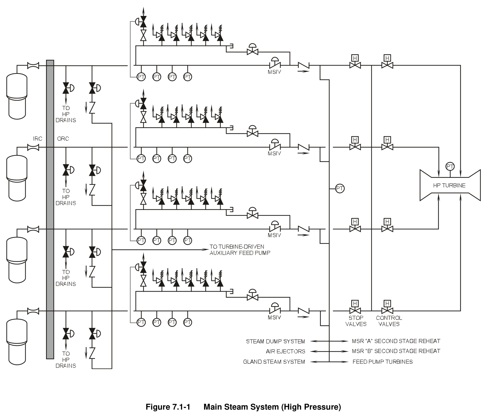
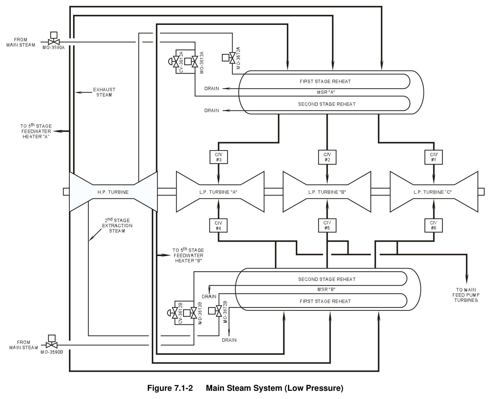
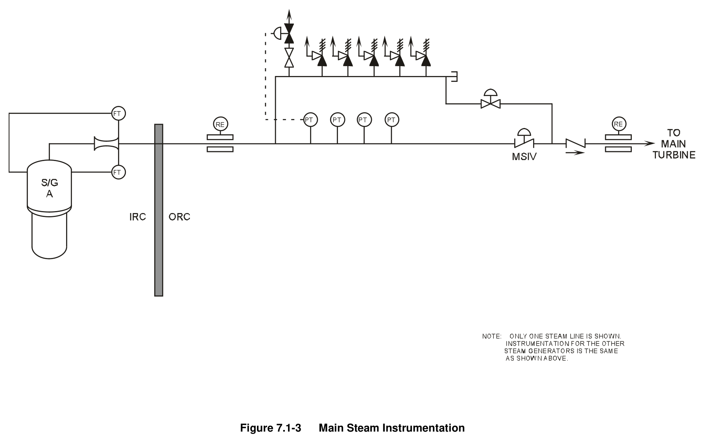
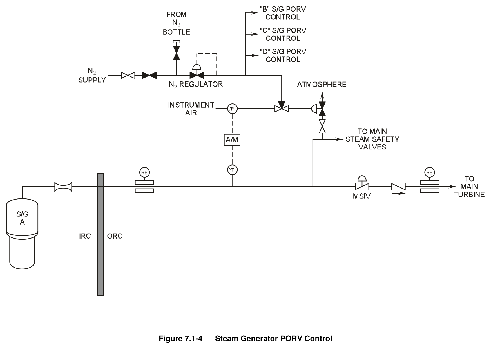
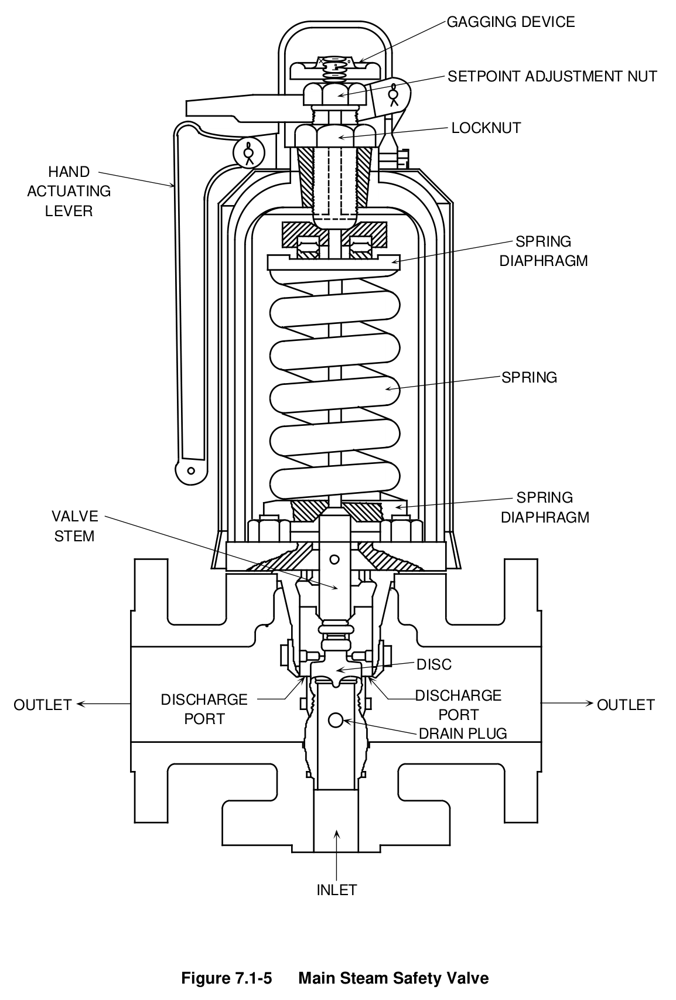
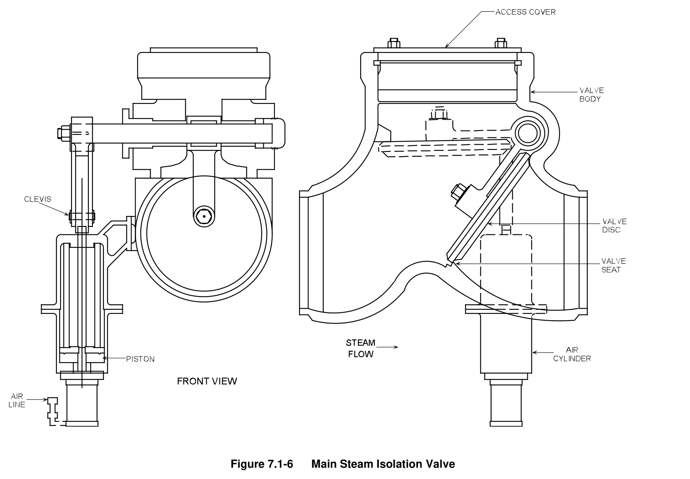
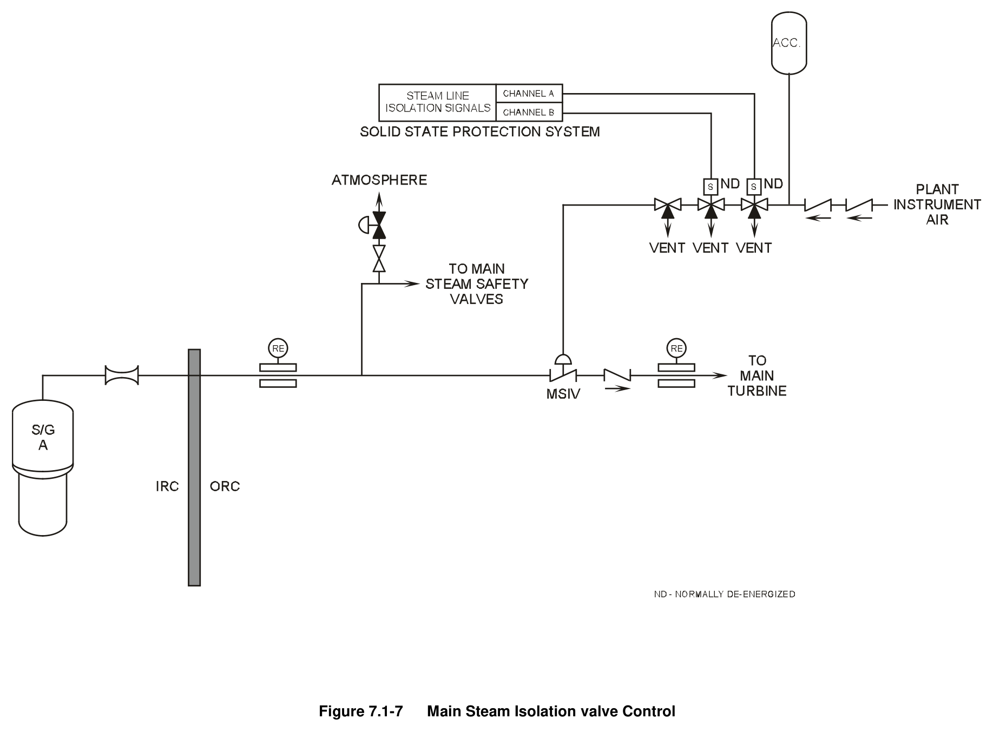
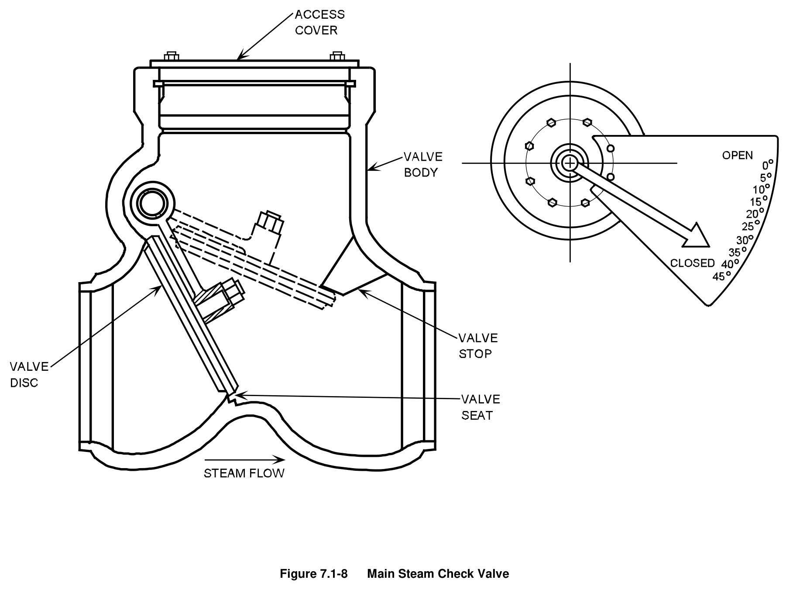
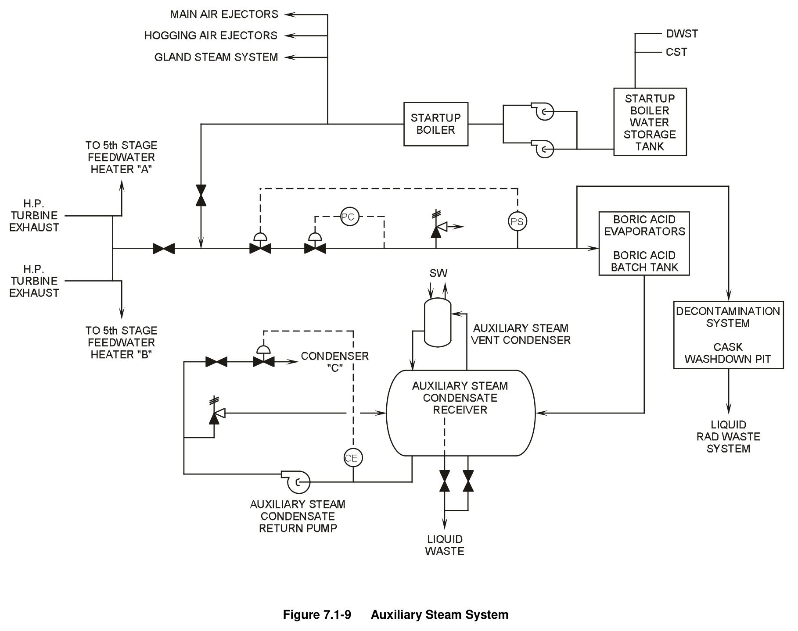

# 07.1 Main & Aux Stm

> Pages 604–623 of `ML20057E160.pdf`
> Westinghouse Technology Systems Manual — USNRC HRTD (PWR)

---
<!-- p.604 -->
#### Westinghouse Technology Systems Manual
#### Section 7.1
#### Main and Auxiliary Steam Systems
<!-- p.605 -->
TABLE OF CONTENTS

7.1 Main and Auxiliary Steam Systems ........................................................... 7.1-1

7.1.1 Introduction ............................................................................................... 7.1-1

7.1.2 Main Steam System Description ............................................................... 7.1-1

7.1.2.1 Safety Considerations ................................................................ 7.1-2

7.1.2.2 Accident Considerations ............................................................ 7.1-3

7.1.3 Main Steam System Component Descriptions .......................................... 7.1-4

7.1.3.1 Flow Restrictors ......................................................................... 7.1-4

7.1.3.2 Main Steam Instrumentation ...................................................... 7.1-4

7.1.3.3 Power-Operated Relief Valves................................................... 7.1-5

7.1.3.4 Steam Generator Safety Valves ................................................ 7.1-5

7.1.3.5 AFW Pump Steam Supplies ...................................................... 7.1-6

7.1.3.6 High Pressure Drains ................................................................. 7.1-6

7.1.3.7 Main Steam Isolation Valves ..................................................... 7.1-6

7.1.3.8 Main Steam Check Valves ......................................................... 7.1-7

7.1.3.9 MSIV Bypass Valves ................................................................. 7.1-8

7.1.4 Auxiliary Steam System Description ......................................................... 7.1-8

7.1.5 Summary ................................................................................................... 7.1-9

LIST OF FIGURES

Figure 7.1-1 ................................................................... Main Steam System (High Pressure)

Figure 7.1-2 .................................................................... Main Steam System (Low Pressure)

Figure 7.1-3 .................................................................................... Main Steam Instrumentation

Figure 7.1-4 ............................................................................ Steam Generator PORV Control

Figure 7.1-5 ......................................................................................... Main Steam Safety Valve

Figure 7.1-6 ..................................................................................... Main Steam Isolation Valve

Figure 7.1-7 ....................................................................... Main Steam Isolation valve Control

Figure 7.1-8 ......................................................................................... Main Steam Check Valve

Figure 7.1-9 ............................................................................................ Auxiliary Steam System

Rev 1013 USNRC HRTD 7.1-i

<!-- p.606 -->
### 7.1 MAIN AND AUXILIARY STEAM SYSTEMS
#### Learning Objectives:
1. State the purposes of the main and auxiliary steam systems.

2. Identify the portion of the main steam system that is Seismic Category I.

3. List the components and connections located in the Seismic Category I portion of the main steam system, and explain the purpose of each.

4. Explain how the main steam system design prevents the blowdown of more than one steam generator during a steam line rupture accident.

5. Describe the steam flowpaths for decay heat removal after a plant trip:

a. With offsite power available, and b. Without offsite power available.

#### 7.1.1 Introduction
The purposes of the main steam system are:

1. To transfer steam from the steam generators to the turbine-generator and other secondary system components,
2. To provide overpressure protection for the steam generators, and
3. To provide diverse methods of decay heat removal.

The auxiliary steam system supplies steam to the gland steam system, main air ejectors, and hogging air ejectors during plant startups and shutdowns and to various loads in the auxiliary and fuel buildings.

#### 7.1.2 Main Steam System Description
At full power, the four steam generators supply steam via four main steam lines to the main steam system at a rate of 15.07 X 106 lbm/hr at 895 psig. Each main steam line contains only one piping connection between its associated steam generator and its containment penetration. This connection is for flow measurement across the steam flow restrictor. Refer to Figure 7.1-1.

Directly outside containment, each 28-in. main steam line contains penetrations for a steam supply to the turbine-driven auxiliary feedwater (AFW) pump, for a poweroperated atmospheric relief valve, and for five code safety valves. Downstream of these penetrations are the main steam isolation valves (MSIVs) and main steam check valves. A three-in. MSIV bypass valve is provided in parallel with the MSIV.
The MSIVs and bypass valves isolate the main steam lines from each other in the event of a steam line break. Each main steam line supplies steam to the high pressure turbine through throttle (stop) and governor (control) valves.
Upstream of the throttle valves, the main steam lines are cross-connected by a 28in. bypass header, which equalizes the four steam line pressures and thereby

Rev 1013 USNRC HRTD 7.1-1

<!-- p.607 -->
ensures equal loading of the steam generators. The bypass header also supplies steam to:

 The second-stage heaters of the moisture separator reheaters (MSRs),  The main feed pump (MFP) turbines,  The main condenser air ejectors,  The gland steam system, and  The steam dump system.

From the throttle and governor valves, steam enters the high pressure turbine at four entry points and drives the main turbine-generator. Steam is exhausted from the high pressure turbine via six 42-in. lines to two MSRs. Refer to Figure 7.1-2. In the MSRs the high pressure turbine exhaust (cold reheat) steam is dried and is slightly superheated through two stages of reheating. The heating media are extraction steam from the high pressure turbine second stage (first stage of reheating) and main steam from the bypass header (second stage of reheating). A more detailed description of the MSRs is provided in Chapter 7.4.

The reheated steam exits each MSR via three 42-in. lines and enters the three low pressure turbines through combined intermediate valves (six valves total, one for each outlet from each MSR). Some of the reheated steam from one MSR is routed to the main feed pump (MFP) turbines during operation at high power levels. Each of the low pressure turbines exhausts steam to one of the three shells of the main condenser.

Some of the steam passing through the high and low pressure turbines is extracted from various turbine stages and is used to preheat feedwater as it is supplied to the steam generators. Also, as mentioned above, second-stage extraction steam from the high pressure turbine is used to reheat steam in the MSRs. Additional discussion concerning the use of extraction steam for feedwater heating is provided in Chapter 7.2.

##### 7.1.2.1 Safety Considerations
The safety considerations associated with the main steam system apply to the portions of the main steam lines which extend from the steam generator steam outlets to the main steam check valves. The following discussion identifies the safety-related features of the piping and components of this portion of the main steam system.

The piping in each main steam line is Seismic Category I from the steam outlet of the steam generator to the first piping restraint downstream of the main steam check valve (the steam generators themselves are also Seismic Category I). This portion of the main steam system must not be damaged as a consequence of reactor coolant system damage. Conversely, a main steam line break must not cause damage to the reactor coolant system. This portion of the main steam system is also essential for the safe shutdown of the plant (1) with offsite power available (by providing steam flowpaths to the steam dump system for decay heat removal), as well as (2) following a loss of offsite power (by providing steam flowpaths to the atmospheric relief valves for decay heat removal).

Rev 1013 USNRC HRTD 7.1-2

<!-- p.608 -->
The main steam lines downstream of the main steam check valves are not seismically qualified. If they pass through a seismically qualified structure such as the auxiliary building, the structure and equipment within must be protected from possible damage resulting from a main steam line break. For example, at some plants the steam lines are routed through concrete tunnels.

Safety-related components in the main steam lines include:

 The flow restrictors,  The power-operated relief valves (PORVs),  The steam generator safety valves,  The steam supplies to the turbine-driven AFW pump, and  The MSIVs and main steam check valves.

The flow restrictor in each main steam line limits the escaping steam flow rate and the resultant thrust forces on the affected piping following a steam line break.
Limiting the steam flow rate also minimizes the cooldown of the reactor coolant system.

The steam supplies to the turbine-driven AFW pump are also Seismic Category I, as the AFW system is required for reactor decay heat removal during plant shutdowns.
The four supply lines provide both redundancy and dependability of supply. Isolation and check valves in each supply line maintain physical separation of the main steam lines by preventing any interconnecting backflow (see Figure 7.1-1).

The safety-related aspects of the PORVs, safety valves, MSIVs, and main steam check valves are discussed in the component descriptions of section 7.1.3.

##### 7.1.2.2 Accident Considerations
The failure of any main steam line, the malfunction of a valve installed therein, or any consequential damage must not:

 Reduce the feed flow capability of the AFW system below the minimum required,  Render inoperable any engineered safety feature (i.e., controls, electric cables, containment cooling system piping, etc.),  Initiate a loss of coolant accident,  Cause uncontrolled flow from more than one steam generator, or  Result in the containment pressure exceeding its design limit.

For a loss-of-coolant accident, the plant’s control and protection systems will not prevent the initial discharge of steam to the main condenser or atmosphere associated with a turbine trip. If steam generator tube leaks were present prior to the accident, some radioactivity accumulated in the secondary inventory of the steam generators could be discharged through the steam line PORVs or safety valves. The total plant releases associated with a loss of coolant accident, including releases from the secondary plant, must be within 10 CFR 100 limits.

Rev 1013 USNRC HRTD 7.1-3

<!-- p.609 -->
Any radioactive releases associated with a main steam line break or steam generator tube rupture also must be within 10 CFR 100 limits. To limit the releases and resulting doses associated with these accidents, technical specification limits are placed on primary and secondary activities and primary-to-secondary leakage.

#### 7.1.3 Main Steam System Component Descriptions
##### 7.1.3.1 Flow Restrictors
The dry, saturated steam leaving the second-stage moisture separators exits each steam generator through a steam flow restrictor (see Figure 7.1-1). Each restrictor is located in containment as close as possible to its associated steam generator outlet nozzle to minimize the length of piping preceding the restriction. This arrangement limits the probability of a steam line break upstream of the restrictor.
The restrictor consists of a venturi nozzle insert welded into carbon steel pipe. The converging and diverging sections of the nozzle are carbon steel with an Inconel throat liner.

The flow restrictor is designed to limit the blowdown rate of steam released from its associated steam generator to 9.68 X 106 lbm/hr in the event of a steam line rupture downstream of the restrictor. Limiting the steam flow rate limits the cooldown rate of the reactor coolant and the accompanying rate of positive reactivity addition to the core. Also, limiting the flow from a steam line break minimizes piping forces and the potential for pipe whip.

During normal operation, each flow restrictor offers minimal resistance to steam flow and provides a differential pressure for the measurement of steam flow.

##### 7.1.3.2 Main Steam Instrumentation
Each main steam line contains two steam flow transmitters, four steam pressure transmitters, and one radiation monitor upstream of the MSIV and a second radiation monitor downstream of the MSIV. These instruments provide inputs for plant control and protection as well as indication and alarms. Refer to Figure 7.1-3.

The two flow transmitters in each steam line, located inside containment, sense the differential pressure across the flow restrictor (part of the differential pressure is the internal pressure drop across the upper moisture separator section of the associated steam generator, as shown in Figure 7.1-3). Each steam flow transmitter provides an input to the logic for (1) the high steam flow engineered safety features actuation and steam line isolation and (2) the reactor trip for anticipated loss of heat sink.
Either flow transmitter can be selected to provide an input to (1) the flow mismatch portion of the feedwater control system for the associated steam generator and (2)
the load reference portion of the MFP speed control system (see Chapter 11.1).

Of the four pressure transmitters on each steam line, one supplies an input for actuation of that line’s PORV. The other three provide inputs to the feedwater control system and to the reactor protection system. The three protection-grade channels provide inputs to the protection logic for (1) the high steam line differential pressure engineered safety features actuation and (2) the high steam flow engineered safety features actuation and steam line isolation. Two of the protection-

Rev 1013 USNRC HRTD 7.1-4

<!-- p.610 -->
grade channels provide density compensation for separate steam flow channels.
Four of the plant’s 12 protection-grade steam line pressure channels provide inputs to the AFW pump speed controllers (see Chapter 5.8). All of the pressure transmitters are located outside containment and upstream of the MSIVs.

The upstream radiation monitor for each steam line is a Geiger-Mueller detector which monitors the background gamma radiation level in the main steam pipe. The downstream monitor is a scintillation detector sensitive to nitrogen-16. Both monitors supply plant indication panels and control room alarms. Either monitor can provide indication of a steam generator tube rupture. These radiation monitors are discussed further in Chapter 16.0.

##### 7.1.3.3 Power-Operated Relief Valves
The PORV (also called an atmospheric relief valve or atmospheric dump valve) in each steam line is a 6-in. air-operated, spring-opposed globe valve capable of relieving approximately 10% of the rated steam flow at no-load pressure from each steam generator (2.5% of the total steam system flow). The PORVs are mounted outside containment on the main steam support structure. Each PORV has a nominal setpoint of 1125 psig, which is approximately half the difference between the no-load steam generator pressure and the lowest set pressure of the safety valves. The PORVs thus lift to relieve an overpressure condition before the safety valves do.

In addition to providing overpressure protection for the steam generators and the Seismic Category I portion of the main steam system, the PORVs provide a means of removing heat from the reactor coolant system. If the main condenser is unavailable or the steam dumps are inoperable, the PORVs are manually controlled from the control room to relieve steam to the atmosphere and thereby to cool down the plant. The PORVs thus allow the removal of decay heat in the event of a loss of offsite power (the steam generators would be fed by the AFW system to provide the secondary inventory for heat removal). The PORVs can also be operated from the remote shutdown station.

Figure 7.1-4 illustrates the development of an air signal to open a PORV. The PORV fails shut on a loss of instrument air or electrical signal. Figure 7.1-4 also shows the backup nitrogen control system for the PORVs. A worst-case fire is projected to disable both the electrical signals and the pneumatic supplies to the PORVs; the nitrogen control system allows PORV operation under such conditions.
To operate a PORV with the backup system, the plant’s nitrogen system is unisolated and a three-way ball valve is repositioned to admit nitrogen to the PORV actuator (the ball valve is normally positioned to admit instrument air to the PORV actuator). The nitrogen regulator is then adjusted to obtain the desired opening signal.

##### 7.1.3.4 Steam Generator Safety Valves
Each main steam line has five six-in. spring-loaded steam generator safety valves
(see Figure 7.1-5). The safety valves provide overpressure protection for the steam generators and the main steam piping. The valves have staggered set pressures to

Rev 1013 USNRC HRTD 7.1-5

<!-- p.611 -->
provide an increased relieving capacity with an increasing overpressure. The set pressures for the five valves are 1170, 1200, 1210, 1220, and 1230 psig; the highest setpoint is less than 110% of the steam generator design pressure in accordance with the ASME Boiler and Pressure Vessel Code. The combined capacity of the 20 safety valves is 16,467,380 lbm/hr, which is 109% of full-power steam flow. In addition to providing overpressure protection, the safety valves remove plant decay heat when the steam dumps and secondary PORVs are unavailable.

The safety valves relieve to the atmosphere via opposing discharge ports. They are located on the main steam support structure outside containment. The exhaust stacks for the safety valves and the PORVs extend approximately 13 ft above the turbine building roof.

##### 7.1.3.5 AFW Pump Steam Supplies
Connected to each main steam line upstream of the MSIV is a three-in. line which supplies steam to the turbine-driven AFW pump. The air-operated isolation valve in the line is automatically opened by an AFW system actuation signal (see Chapter 5.8) and can be manually operated from the control room or remote shutdown station. A normally energized four-way solenoid valve (not shown in Figure 7.1-1)
supplies air to the top port of each isolation valve’s operating cylinder to keep the isolation valve closed; de-energizing the solenoid valve admits air to the bottom port of the operating cylinder and opens the isolation valve. The AFW pump steam supply valves thus fail open on a loss of ac power.

To facilitate a rapid start of the turbine-driven AFW pump, the steam supply lines are kept warm by 3/4-in. bypass lines which skirt the steam supply isolation valves. In addition, connected to each isolation valve’s air supply is a 15-gal accumulator capable of supporting three valve cycles 20 minutes after instrument air is lost.

##### 7.1.3.6 High Pressure Drains
Each main steam line has a high pressure drain tap outside containment. This onein. line directs condensate to the B main condenser via an isolation valve and steam trap. The drain lines remove moisture from the steam lines during system startups and are isolated during operation at power. The isolation valves are automatically closed by a steam line isolation signal.

Each drain line has a connection to the plant’s nitrogen system. Nitrogen is supplied via the drain lines to the gas spaces in the steam generators during wet layup periods for shutdown corrosion control.

##### 7.1.3.7 Main Steam Isolation Valves
The MSIV in each main steam line is a 28-in. air-operated stop-check valve (see Figure 7.1-6). During normal operation each MSIV is held open by the instrument air pressure applied to the valve’s operator. When the MSIV is shut, instrument air is vented from the valve’s operator, allowing the weight of the valve disc, spring force, and main steam pressure to seat the disc in the closed position. Instrument air to the valve operator is supplied via two series solenoid valves (see Figure 7.1-7). The

Rev 1013 USNRC HRTD 7.1-6

<!-- p.612 -->
solenoid valves are normally de-energized; energizing one or both solenoid valves vents the MSIV’s operator and shuts the MSIV.

Evidence of a steam line rupture results in the actuation of a steam line isolation signal, which closes the MSIVs, MSIV bypass valves, and high pressure drain valves. A steam line isolation signal is initiated by either of the following:

1. High-high containment pressure (sensed by two out of four pressure detectors), or

2. High steam line flow (sensed by one out of two flow detectors in two out of four steam lines) coincident with either:

a. Low steam pressure (sensed in two out of four steam lines), or b. Low-low Tavg (sensed in two out of four coolant loops).

Each engineered safety feature train provides an isolation signal to a separate solenoid valve for each MSIV. The steam line isolation signal is delayed 0.5 seconds by a time-delay relay before it energizes the MSIV solenoid valves. The affected valves do not close if the signal clears in less than 0.5 seconds. The MSIVs interrupt steam flow within five seconds of receipt of the isolation signal.

Each MSIV can be manually operated with a control room switch, which deenergizes (to open) or energizes (to close) one of the two MSIV solenoid valves (the other solenoid valve remains de-energized). Connected to each MSIV operator air supply line upstream of the solenoid valves is an accumulator capable of keeping the MSIV open for 15 minutes following the loss of instrument air.

The MSIVs are designed to provide protection against the following accidents:

 A break in the bypass header downstream of the MSIVs, by preventing the uncontrolled blowdown of all steam generators,

 A break in a main steam line outside containment and upstream of the MSIV, by isolating the affected steam generator from the others and thereby preventing the uncontrolled blowdown of more than one steam generator,

 A break in a main steam line inside containment, by isolating the affected steam generator from the others and thereby preventing the uncontrolled blowdown of more than one steam generator and limiting the resultant containment pressure increase, and

 A steam generator tube rupture, by minimizing the spread of contamination to the secondary systems and to the environment.

##### 7.1.3.8 Main Steam Check Valves
Each main steam line has a main steam check valve located immediately downstream of the MSIV. The main steam check valves provide protection against

Rev 1013 USNRC HRTD 7.1-7

<!-- p.613 -->
an upstream steam line break coincident with the failure of an MSIV to shut. Each main steam check valve is a 28-in. reverse-seating swing-check valve with a position indicator mounted on the valve shaft (see Figure 7.1-8). The MSIVs and main steam check valves are located in the main steam support structure outside containment.

##### 7.1.3.9 MSIV Bypass Valves
In parallel with the MSIV in each main steam line is an MSIV bypass valve (see Figure 7.1-1). The MSIV bypass valves are used to warm up the piping downstream of the MSIVs and to equalize the pressure across the MSIV disks during steam system startups. Each MSIV bypass valve is a three-in. air-operated double-disk gate valve. Instrument air is supplied to each bypass valve via series solenoid valves, which are energized to close the bypass valves and de-energized to open them. The MSIV bypass valves are closed by a steam line isolation signal. The bypass valves are located in the main steam support structure.

#### 7.1.4 Auxiliary Steam System Description
The auxiliary steam system supplies steam to the gland steam system, main air ejectors, and hogging air ejectors during plant startups and shutdowns and to various loads in the auxiliary and fuel buildings. As shown in Figure 7.1-9, the secondary plant steam loads are supplied by the startup boiler, while the auxiliary and fuel building loads can be supplied either with steam from the startup boiler or high pressure turbine exhaust steam.

The startup boiler has a steam supply rating of 64,000 lb/hr at 150 psig. The boiler’s burner has a rated fuel consumption of 580 gph at a fuel oil supply pressure of 125 psig. The startup boiler is supplied with water from the startup boiler water storage tank, which in turn is supplied from either the condensate storage tank or the demineralized water storage tank. The boiler supplies its steam loads via a stopcheck valve and a locally operated steam line stop valve.

The startup boiler has a chemistry control system (not shown in Figure 7.1-9) for the addition of corrosion-inhibiting chemicals (primarily hydrazine) during boiler operation and shutdown. If the boiler is not to be maintained in wet layup after it is shut down, it is supplied with a nitrogen purge.

The auxiliary steam system supplies the following major loads in the auxiliary and fuel buildings:

 Boric acid evaporators,  Boric acid batch tank,  Decontamination system, and  Cask washdown pit.

Of these, the boric acid evaporators constitute the primary load. These loads are supplied with extraction steam from high pressure turbine exhaust during plant operation and with steam from the startup boiler during plant shutdowns and when sufficient turbine exhaust steam is unavailable. Each load is normally isolated from

Rev 1013 USNRC HRTD 7.1-8

<!-- p.614 -->
the steam sources; steam is supplied only as needed for operation of a particular component or system.

Auxiliary steam is provided via a pressure control valve which is normally set to maintain a pressure of 40 - 50 psig. The steam supply line is protected from overpressure by an overpressure stop valve and a spring-loaded relief valve.

Condensate from the boric acid evaporators and boric acid batch tank is collected and returned to the secondary cycle (condensate from the other auxiliary steam loads is treated as radioactive liquid waste). Condensate is collected in the auxiliary steam condensate receiver and pumped by the level-controlled auxiliary steam condensate return pump to main condenser shell C. Any remaining steam which reaches the condensate receiver is condensed in the auxiliary steam vent condenser. The suction of the condensate return pump is monitored by a conductivity element; a high conductivity condition causes isolation of the return path to the main condenser and rejection of the return pump’s discharge back to the condensate receiver. The receiver then overflows via a standpipe to the liquid waste processing system.

#### 7.1.5 Summary
During normal operation the four steam generators deliver saturated steam through four separate steam lines to the main turbine. These lines are cross-connected by a bypass header to ensure that the steam generators are loaded equally. The bypass header also supplies steam to a number of secondary plant components.

Each main steam line is provided with an isolation valve and check valve just outside containment. The main steam piping from the steam generators to these valves is Seismic Category I and contains several safety-related features. The main steam isolation valves automatically close on either of the following signals:

 High steam line flow coincident with low steam pressure or low-low Tavg, or  High-high containment pressure.

In the low pressure portion of the main steam system, exhaust steam from the high pressure turbine is directed to the MSRs, where it is dried and reheated before it is supplied to the low pressure turbines and the main feed pump turbines.

The auxiliary steam system supplies steam to several secondary plant components during startups and shutdowns and to fuel and auxiliary building loads as needed.

Rev 1013 USNRC HRTD 7.1-9

<!-- p.615 -->
#### Figure 7.1-1

*Main Steam System (High Pressure)*

[Vector original (SVG, lossless): fig_7.1-1.svg](../figures/fig_7.1-1.svg)

<!-- p.616 -->
#### Figure 7.1-2

*Main Steam System (Low Pressure)*

[Vector original (SVG, lossless): fig_7.1-2.svg](../figures/fig_7.1-2.svg)

<!-- p.617 -->
#### Figure 7.1-3

*Main Steam Instrumentation*

[Vector original (SVG, lossless): fig_7.1-3.svg](../figures/fig_7.1-3.svg)

<!-- p.618 -->
#### Figure 7.1-4

*Steam Generator PORV Control*

[Vector original (SVG, lossless): fig_7.1-4.svg](../figures/fig_7.1-4.svg)

<!-- p.619 -->
#### Figure 7.1-5

*Main Steam Safety Valve*

[Vector original (SVG, lossless): fig_7.1-5.svg](../figures/fig_7.1-5.svg)

<!-- labels/text on this figure page -->
GAGGING DEVICE
SETPOINT ADJUSTMENT NUT
LOCKNUT
HAND ACTUATING LEVER
SPRING DIAPHRAGM
SPRING
SPRING VALVE DIAPHRAGM STEM
DISC
DISCHARGE DISCHARGE OUTLET OUTLET PORT PORT DRAIN PLUG
INLET
Figure 7.1-5 Main Steam Safety Valve

<!-- p.620 -->
#### Figure 7.1-6

*Main Steam Isolation Valve*

[Vector original (SVG, lossless): fig_7.1-6.svg](../figures/fig_7.1-6.svg)

<!-- p.621 -->
#### Figure 7.1-7

*Main Steam Isolation valve Control*

[Vector original (SVG, lossless): fig_7.1-7.svg](../figures/fig_7.1-7.svg)

<!-- p.622 -->
#### Figure 7.1-8

*Main Steam Check Valve*

[Vector original (SVG, lossless): fig_7.1-8.svg](../figures/fig_7.1-8.svg)

<!-- p.623 -->
#### Figure 7.1-9

*Auxiliary Steam System*

[Vector original (SVG, lossless): fig_7.1-9.svg](../figures/fig_7.1-9.svg)

