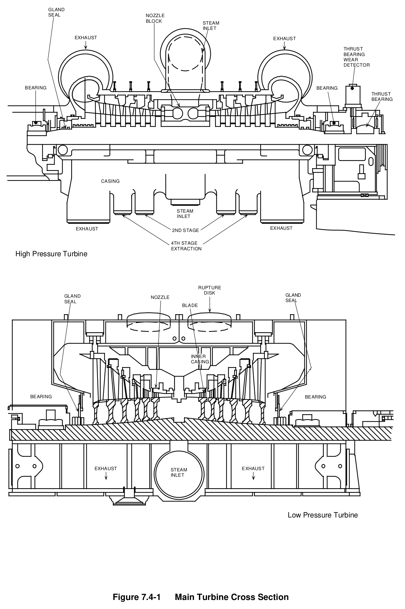
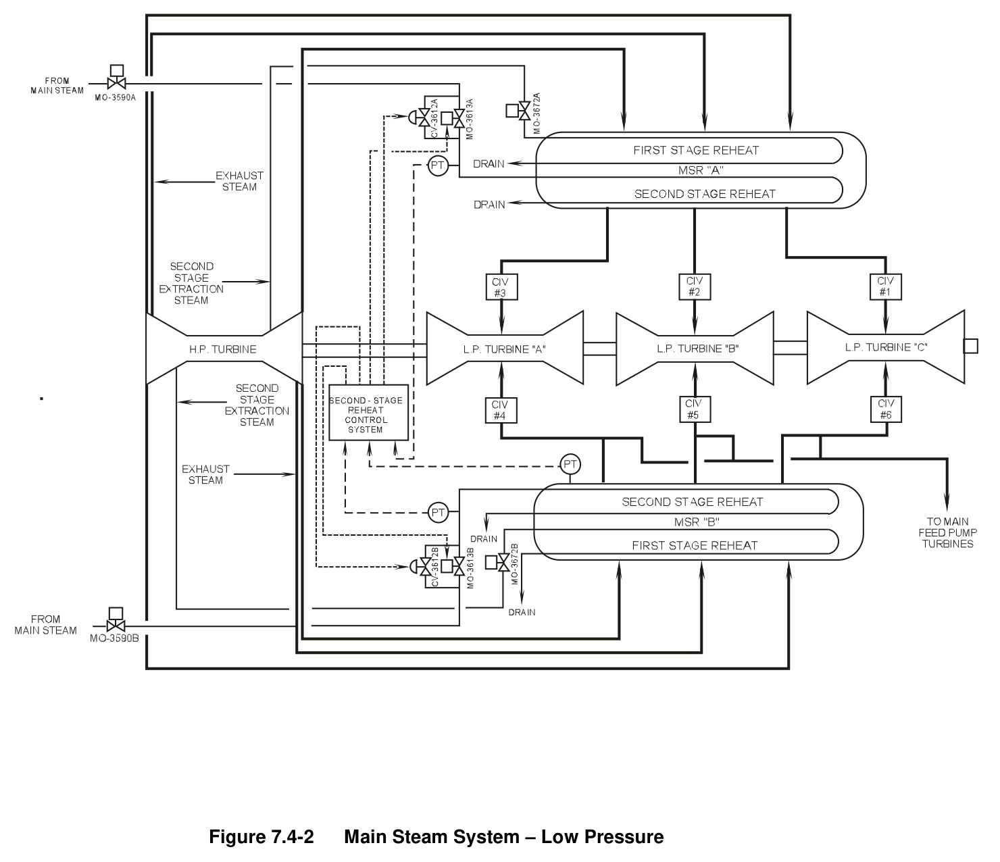
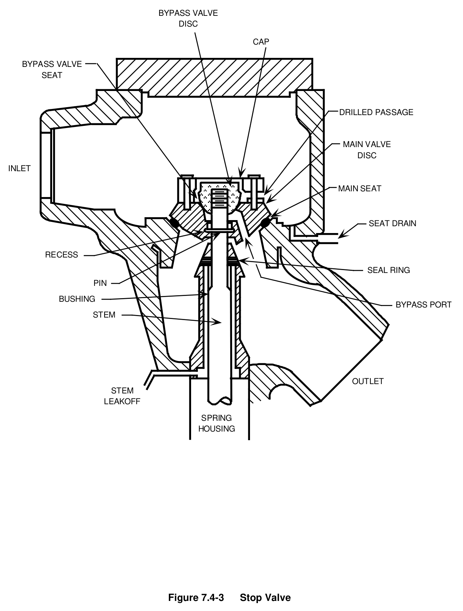
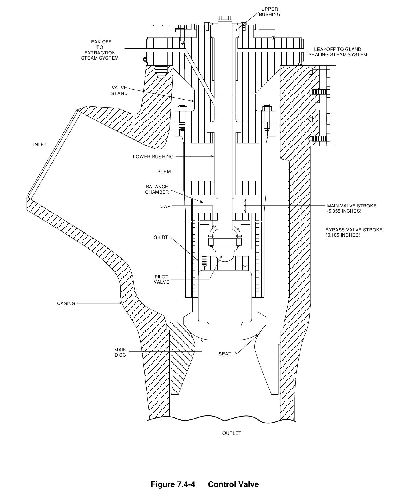
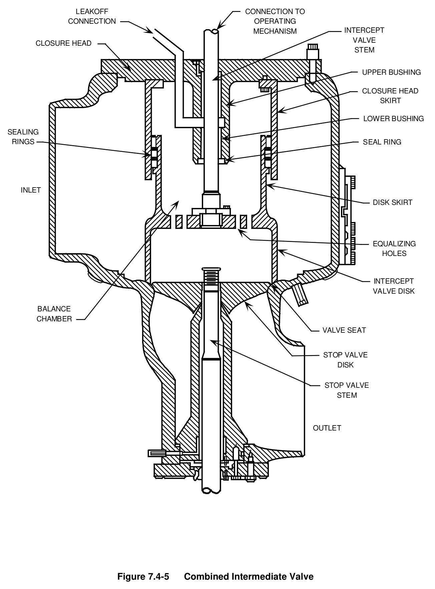
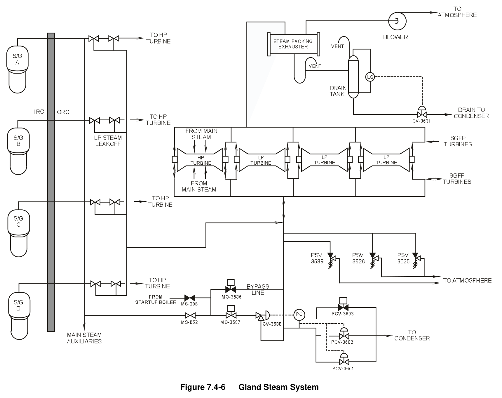
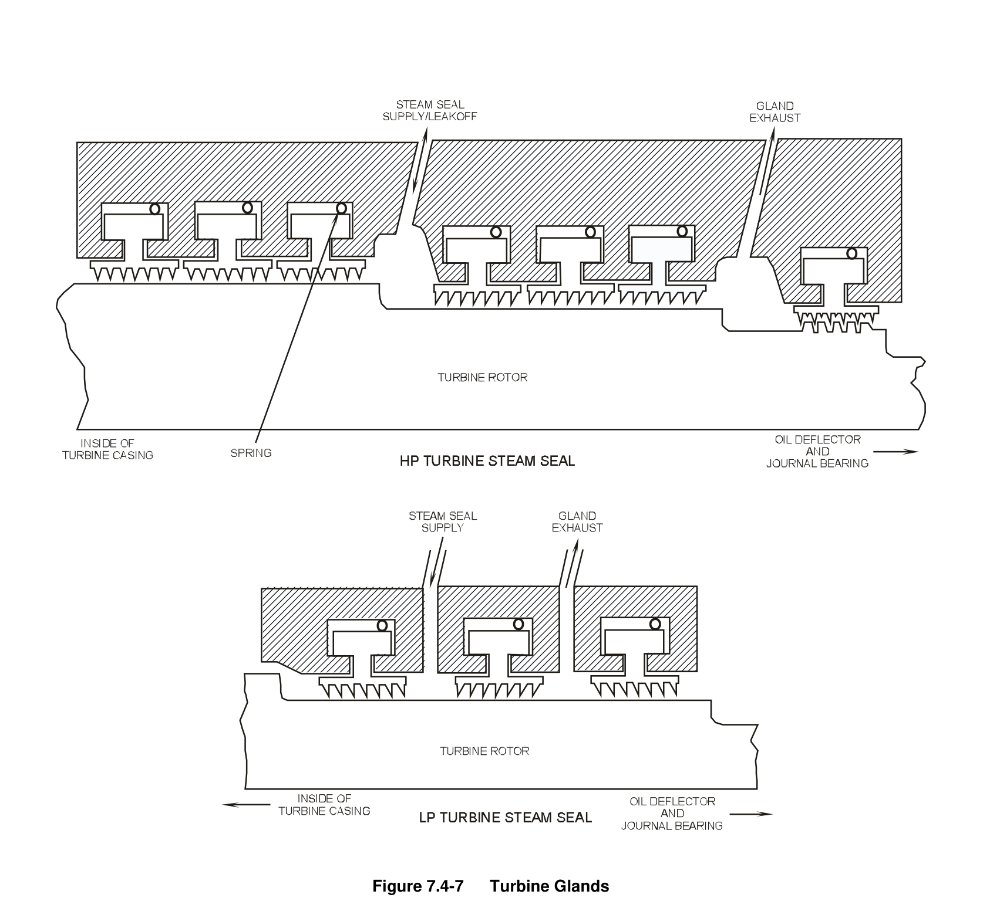
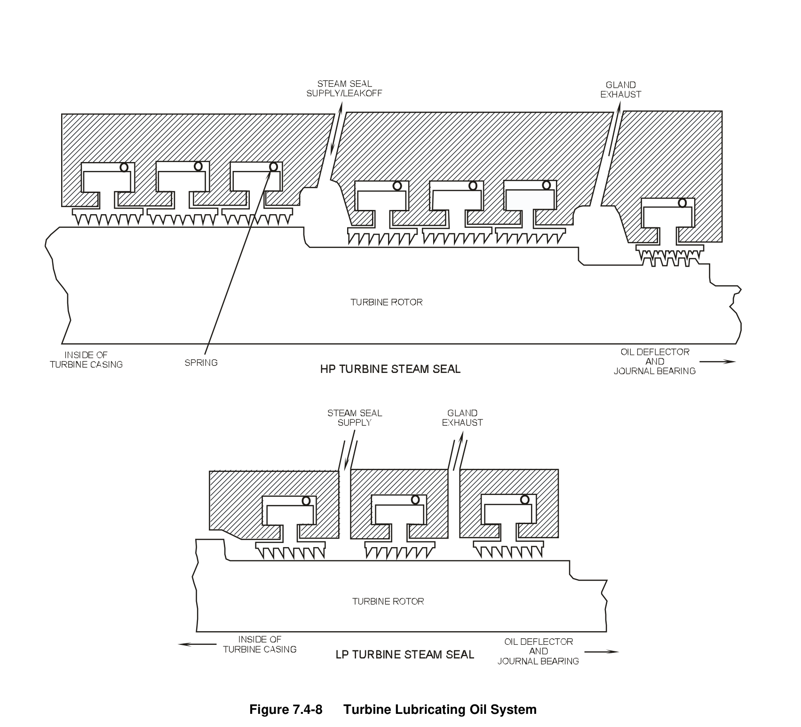
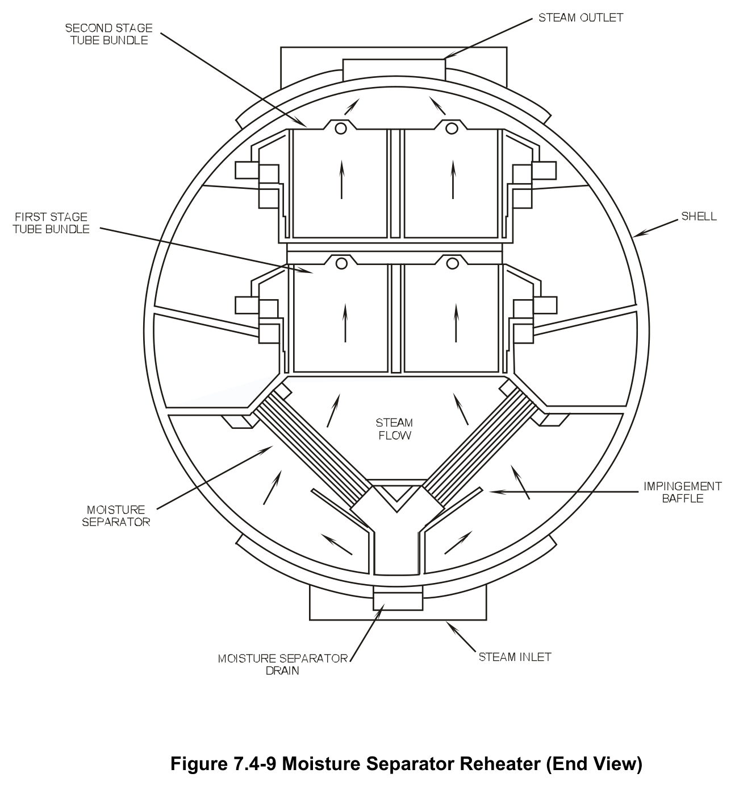

# 07.4 GE Turb & Aux

> Pages 654–676 of `ML20057E160.pdf`
> Westinghouse Technology Systems Manual — USNRC HRTD (PWR)

---
<!-- p.654 -->
#### Westinghouse Technology Systems Manual
#### Section 7.4
#### General Electric Turbine and Auxiliaries
<!-- p.655 -->
### 7.4 GENERAL ELECTRIC TURBINE AND AUXILIARIES
#### Learning Objectives:
1. State the purposes of the turbine and turbine auxiliaries.

2. Identify the sources of heating steam to the moisture separator reheaters
(MSRs).

3. State the purposes of the following turbine valves:

a. Stop valves, b. Control valves, and c. Combined intermediate valves.

#### 7.4.1 Introduction
The purposes of the turbine and auxiliaries are as follows:

1. To convert the thermal energy of the steam to mechanical energy to turn the main generator,

2. To provide turbine shaft sealing,

3. To provide turbine-generator lubricating oil, and

4. To provide dry, superheated steam to the low pressure turbines to reduce moisture erosion and to increase plant efficiency.

#### 7.4.2 Main Turbine
##### 7.4.2.1 System Description
The main turbine consists of one high pressure turbine and three low pressure turbines coupled to a single shaft. The four turbines that comprise the main turbine are coupled to the generator and exciter; they serve as the prime mover for these components. A cross-section of the turbine is shown in Figure 7.4-1. Steam enters the main turbine at the high pressure turbine through the turbine stop (throttle) and control (governor) valves.

The thermal energy of the steam is converted to mechanical energy in the high pressure turbine, and the steam is exhausted to the moisture separator reheaters.
In each MSR the steam is dried, reheated, and superheated prior to its entry into the low pressure turbines. The superheated steam is routed through the intermediate stop and intercept valves as it travels from the MSRs to the low pressure turbines.
Energy conversion occurs again in the low pressure turbines as the steam expands into the vacuum of the main condenser.

USNRC HRTD 7.4-1 Rev 1013

<!-- p.656 -->
##### 7.4.2.2 Component Descriptions
#### High Pressure Turbine
The high pressure turbine is a double-flow turbine with six stages in each direction.
The first three stages are rateau (impulse) stages, and the last three stages are reaction stages. Steam enters the four nozzle block segments at the center of the high pressure turbine and flows axially in both directions. About one fifth of the steam entering the turbine at 100% power is extracted from the second and fourth stages for moisture removal, feedwater heating, and reheating of the high pressure turbine exhaust steam. Most of the steam supplied to the turbine does work in all six stages and exhausts through six cold reheat (cross-around) lines to the two MSRs, as shown in Figure 7.4-2.

The turbine rotor assembly, which consists of the rotor and the turbine wheels (the wheels contain the rotating blades), is machined from a single casting. The rotating blades (buckets) are secured to the wheels with dovetail joints. The turbine rotor is supported by two elliptical journal bearings, which carry the rotor’s weight and limit its radial motion.

#### Stop Valves
The four stop valves supply steam to the main turbine and close rapidly to isolate the steam flow to the high pressure turbine when the turbine trips. The stop valves are located just upstream of the control valves. The stop valve casings are welded to the control valve casings, and all four casing units are welded together to form a single assembly. The below-seat chambers of the stop valves are cross-connected, as are the steam headers upstream of the stop valves; this arrangement allows the opening of one stop valve to equalize the pressure across all four valve disks.

The stop valves are identical 28-in., reverse-seating globe valves, with the exception that the #2 stop valve contains an internal bypass valve (see Figure 7.4-3). Opening the internal bypass valve accounts for a small amount of valve stem movement for this valve. When opened, the bypass valve uncovers holes in the main valve disk, allowing steam to flow from the inlet to the outlet with the main disk seated. Opening the internal bypass valve in the #2 stop valve equalizes the pressure across the stop valve main disks to allow valve opening (a stop valve’s hydraulic operator cannot open the valve with a differential pressure of greater than 150 psi across the main disk). The bypass valve is also used to provide warming steam for the turbine steam chests and the high pressure turbine shell during turbine startups (see Chapter 11 .5).

The #2 stop valve position is controlled by the electrohydraulic control (EHC)
system. The other three stop valves are “slaved” to the #2 stop valve through a limit switch associated with the #2 stop valve. (See Chapter 11.5 for details on stop valve control.)

USNRC HRTD 7.4-2 Rev 1013

<!-- p.657 -->
#### Control Valves
The four control valves, located immediately downstream of the stop valves, are positioned by the EHC system for the control of turbine speed and load (see Chapter 11.5). Rapid closure of the control valves when the turbine trips provides redundant isolation of the steam flow to the high pressure turbine. The control valves admit steam to the high pressure turbine via four internal nozzle block segments at the center of the turbine rotor.

Each of the control valves is a 28-in., spherically seated globe valve (see Figure 7.4- 4). Each valve contains a small internal pilot valve within the main valve disk. When a control valve is opened, the first portion of stem movement opens the pilot valve, thereby reducing the differential pressure across the main valve disk and reducing the opening force required of the valve’s hydraulic operator. Further stem movement causes the pilot valve to engage the main disk and open the valve.

#### Low Pressure Turbines
Each of the three low pressure turbines is a double-flow, condensing turbine with seven reaction stages in each direction. The MSRs supply steam via the combined intermediate valves to the center of each turbine; the steam then flows axially in both directions. About one fourth of the steam entering each low pressure turbine at 100% power is extracted from the seventh, eighth, tenth, and eleventh stages for moisture removal and feedwater heating (the low pressure turbine stages are numbered 7 - 13). Most of the steam supplied to each turbine does work in all seven stages and exhausts to the main condenser.

The rotor of each low pressure turbine is machined from a single forging. The turbine wheels are manufactured separately and shrunk onto the rotor. The rotating blades are attached to the wheels with dovetail joints. Due to the steam expansion that occurs in the low pressure turbine, the blade height and stage diameter increase with each succeeding stage. The last-stage blading of each low pressure turbine is 38 in. long. Each low pressure turbine is supported by two journal bearings.

#### Combined Intermediate Valves
Each of the six combined intermediate valves consists of two valves in one body, the intercept valve and the intermediate stop valve. Refer to Figure 7.4-5. The two valves share the same seating surface but are equipped with separate operators.
The intercept valves and intermediate stop valves are completely open during normal operation. All 12 valves shut when the turbine trips to provide redundant isolation of the low pressure turbines from the reheat steam supply. The intercept valves can also shut partially or completely to limit turbine overspeed following a load rejection. Intercept valves #1, #2, and #3 are controlled by the EHC system;
intercept valves #4, #5, and #6 are slaved to the controlled intercept valves through limit switches associated with the controlled valves. The intermediate stop valves are automatically opened when the master trip reset pushbutton is depressed. (See Chapter11.5 for a discussion of valve operation.)

USNRC HRTD 7.4-3 Rev 1013

<!-- p.658 -->
Each intercept valve disk is hollow and cylindrically shaped to accommodate the disk of its associated intermediate stop valve. This arrangement permits the intermediate stop valve to open or close with the intercept valve completely closed. Equalizing holes in the intercept valve disk minimize the differential pressure across the disk and allow opening of the intercept valve even against maximum reheat steam pressure. Each intermediate stop valve can be opened with a differential pressure across the seat of no greater than 150 psi. The intermediate stop valves are thus opened during the turbine startup sequence before all other turbine valves are opened so that the differential pressure across the valve seats is minimized.

#### 7.4.3 Gland Steam System
##### 7.4.3.1 System Description
During plant operation the entry of air into and the exit of steam from the main turbine must be prevented at those points where the rotor penetrates the turbine casings. These functions are accomplished through the labyrinth design of the rotor/casing penetrations (glands) and through the operation of the gland steam system. The system is designed to handle the steam and air flows that would exist with twice the normal turbine penetration clearances.

The gland steam system (Figure 7.4-6) supplies steam to the turbine glands of the high and low pressure turbines and of the main feed pump turbines. During startup and low-load operation, the sealing steam distribution header has two sources of steam supply: the startup boiler and the main steam system. A regulating valve controls the steam pressure supplied by either source. In the initial phases of a startup from cold shutdown conditions, gland steam is supplied from the startup boiler. Once the plant has been heated up and an adequate supply of main steam is available, gland steam is supplied from the main steam system. The sealing steam distribution header also receives low pressure stem leakage from the high pressure turbine stop and control valves.

At higher plant powers (greater than approximately 40%), the direction of steam flow in portions of the gland steam system changes. Steam from inside the high pressure turbine casing leaks past the inner turbine glands and into the sealing steam distribution header. Similarly, steam leaks from the main feed pump turbine glands to the distribution header (although at a much smaller flow rate). The steam leakage from these sources supplies the sealing steam for the low pressure turbine glands at high powers. The unloading valves on the distribution header relieve any excess steam pressure during this mode of operation. (Note: The arrows in Figure 7.4-6 indicate the two possible flow directions in certain portions of the system.)

Steam leakage from the inner turbine packing and air leakage through the outer turbine packing (see Figure 7.4-7) is extracted from the turbine glands by the steam packing exhauster. The exhauster condenses the incoming steam and returns the condensate to the main condenser via a drain tank. The exhauster blower maintains a slight vacuum in the exhauster and discharges air and other noncondensible gases to the turbine building roof.

USNRC HRTD 7.4-4 Rev 1013

<!-- p.659 -->
##### 7.4.3.2 Component Descriptions
#### Gland Seal Regulating Valve
The gland seal regulating valve (CV-3588 in Figure 7.4-6) is a four-in., air-operated gate valve. The valve’s position is controlled by a pressure controller, which supplies instrument air to the valve’s operator based on the pressure sensed in the sealing steam distribution header. The pressure controller maintains the gland steam supply pressure between 2.5 and 4.5 psig. Control of the distribution header pressure by the regulating valve is expected only with turbine loads less than 40%.
If the regulating valve or its associated controller is inoperable, the operator can maintain the gland steam supply pressure with the regulating valve bypass valve
(MO-3586), which is controlled with a control room switch.

#### Unloading Valves
The two unloading valves are eight-in., direct-acting backpressure regulating valves.
Pressure from the regulating valve controller’s sensing line acts against spring force in each unloading valve’s operator. The unloading valves are set to crack open with a gland steam pressure of 3.5 psig and to open fully with a pressure of 5.5 psig. At loads greater than 40%, the unloading valves are open to relieve excess steam leakage from the high pressure turbine glands to the main condenser. The normal steam flow through the unloading valves at full power is 19,190 lbm/hr. If the valves are inoperable, the operator can manually dump steam to the condenser with the manual unloading valve (MO-3603), which is controlled with a control room switch.

#### Turbine Glands
The turbine glands contain labyrinth packing, which provide effective seals for the shaft penetrations. Each labyrinth seal is made up of stationary, spring-backed packing rings and machined grooves in the turbine rotor (see Figure 7.4-7). The packing rings hold stationary teeth arranged concentrically, with very small radial clearances between the teeth and the rotor. The narrow passages between the stationary packing and the rotor produce a cumulative pressure drop, which presents a large resistance to steam or air flow in the axial direction. This seal design minimizes but does not totally eliminate steam outleakage and air inleakage; the applied sealing steam completely seals the glands.

As shown in Figure 7.4-7, the high pressure turbine is sealed at both ends with three sets of packing. At low loads, sealing steam from the gland steam distribution header pressurizes the annulus formed by the inner and middle sets of packing to prevent air inleakage into the turbine. Sealing steam which leaks past the middle set of packing, and air which leaks past the outer set, enter the annulus maintained at a vacuum by the steam packing exhauster. At higher loads, the higher stage pressures inside the high pressure turbine casing prevent air inleakage. Instead, steam leaks past the inner set of packing and flows in the reverse direction to the gland steam distribution header to serve as the sealing steam supply for the low

USNRC HRTD 7.4-5 Rev 1013

<!-- p.660 -->
pressure turbines. Again, any leakage of steam and/or air past the middle and outer sets of packing is extracted by the steam packing exhauster.

Sealing of the low pressure turbines, which exhaust to a vacuum, is always accomplished in the manner described for the high pressure turbine at low loads.

#### Steam Packing Exhauster
The steam packing exhauster maintains a vacuum in the outer annuli of the turbine glands to prevent the escape of steam from the turbines into the turbine building.
The exhauster is a shell-and-tube heat exchanger cooled by the turbine building cooling water system. The condensed steam is drained from the exhauster to the main condenser via a loop seal and drain tank. The drain tank level is maintained by a level control valve in the drain line to the condenser. The slight vacuum in the exhauster shell is maintained by the exhauster blower.

##### 7.4.3.3 System Operation
During a plant startup, the gland steam system is placed in service before the turbine startup sequence is initiated. The initial source of steam to the gland steam system is the startup boiler. As the startup progresses and sufficient main steam becomes available, the gland steam supply source is transferred to the main steam system. During normal operation, the gland steam system distribution header pressure is automatically maintained by the gland seal regulating valve and the unloading valves. Sealing steam to the turbine glands is maintained during a shutdown until the condenser vacuum is broken. This practice prevents an inrush of cold air into the turbine casings, which could result in a bowed rotor. Operation of the gland steam system is not required during a shutdown after the condenser vacuum has been broken.

#### 7.4.4 Turbine Lubricating Oil System
##### 7.4.4.1 System Description
The turbine lubricating oil system, illustrated in Figure 7.4-8, supports turbinegenerator operation by supplying lubricating oil to the eight turbine journal bearings, the thrust bearing, the two generator bearings, the two exciter bearings, and the turning gear. Under normal operating conditions, the main shaft oil pump, driven by the turbine shaft, supplies oil to the turbine and generator bearings. The suction head for the main shaft oil pump is provided by the lubricating oil booster pump, which takes suction on the lubricating oil reservoir. In addition to supplying the bearing supply header, the main shaft oil pump also supplies oil to the hydraulic turbine which drives the lubricating oil booster pump. Return oil from the bearings gravity drains into the lubricating oil reservoir.

The turbine lubricating oil system includes additional pumps for supplying lubricating oil when the turbine is not in service: the motor suction pump, the turning gear oil pump, and the emergency bearing oil pump. The lubricating oil system also includes bearing lift oil pumps, which supply high pressure oil to turbine and generator bearings in support of turning gear operation. Detailed descriptions of the components mentioned here are provided in the following section.

USNRC HRTD 7.4-6 Rev 1013

<!-- p.661 -->
The system is designed for fire safety. Any pressurized oil supply line which passes near a hot steam line or potentially hot turbine component is enclosed within an oil drain line or guard pipe. The drain and guard pipes drain to the lubricating oil reservoir, ensuring that there is no loss of oil in the event of a supply line rupture.

##### 7.4.4.2 Component Descriptions
#### Main Shaft Oil Pump
The main shaft oil pump maintains the normal bearing oil pressure under normal operating conditions. The pump is a single-stage centrifugal pump driven by the turbine shaft through a step-up gear assembly and is located in the front standard.
The pump suction is supplied with oil at 15 - 20 psig from the electrically driven motor suction pump during startups and from the lubricating oil booster pump during normal operation. The main shaft oil pump develops a discharge pressure sufficient for turbine operation at turbine speeds greater than 1350 rpm. With the turbine at rated speed, the main shaft oil pump discharges oil at a pressure of 235 psig to the booster pump turbine and bearing supply header.

#### Motor Suction Pump
The motor suction pump supplies oil to the suction of the main shaft oil pump when the turbine speed is less than 1800 rpm. The pump is a single-stage centrifugal pump driven by a 60-hp ac motor. The pump is located inside the lubricating oil reservoir, and the motor is mounted atop the reservoir. The pump is started manually with a control room switch during turbine startups. With the turbine at rated speed, the pump is idle, and its control switch is in the automatic position. The motor suction pump starts automatically when the lubricating oil booster pump discharge pressure falls below 10 psig.

#### Lubricating Oil Booster Pump
The lubricating oil booster pump supplies the suction head required by the main shaft oil pump during normal operation. The pump is a single-stage centrifugal pump driven by the discharge of the main shaft oil pump via a hydraulic turbine. The lubricating oil pump is located inside the lubricating oil reservoir. Under normal operating conditions, it supplies a suction pressure of 15 - 20 psig to the main shaft oil pump. The booster pump turbine exhaust oil is supplied to the bearing supply header, where it joins the flow supplied directly by the main shaft oil pump.

#### Turning Gear Oil Pump
Because the main shaft oil pump cannot provide adequate bearing lubrication with turbine speeds less than 1350 rpm, the turning gear oil pump is provided as the pumping source of lubricating oil during turbine startups and shutdowns. The pump is a single-stage centrifugal pump driven by a 50-hp ac motor. The pump is located inside the lubricating oil reservoir, and the motor is mounted atop the reservoir. The pump is operated manually during startups and shutdowns. With the turbine at rated speed, the pump is idle, and its control switch is in the automatic position. The

USNRC HRTD 7.4-7 Rev 1013

<!-- p.662 -->
turning gear oil pump starts automatically when either the bearing supply header pressure falls below 15 psig or the main shaft oil pump discharge pressure falls below 190 psig.

#### Emergency Bearing Oil Pump
The emergency bearing oil pump supplies lubricating oil to the turbine and generator bearings for the safe shutdown of the turbine-generator when ac power is not available. The pump is a single-stage centrifugal pump driven by a 30-hp dc motor.
The pump is located inside the lubricating oil reservoir, and the motor is mounted atop the reservoir. Under normal operating conditions, the pump is idle, and its control switch is in the automatic position. The emergency bearing oil pump starts automatically whenever the turning gear oil pump discharge pressure is less than 10 psig coincident with a main shaft oil pump discharge pressure of less than 180 psig.

#### Baffler Valves
Two flow regulating valves, called baffler valves, in the lubricating oil system correctly apportion the main shaft oil pump discharge to the lubricating oil booster pump turbine and the bearing supply header. The valves are manually adjusted so that the bearing supply header pressure is maintained at 25 psig and that the discharge pressure of the lubricating oil booster pump is maintained between 15 and 20 psig.

#### Lubricating Oil Coolers
Before it is supplied to the turbine bearings, the lubricating oil is cooled in one of the two lubricating oil coolers. As each is a 100% capacity cooler, only one is in service at a time. The in-service cooler is determined by the position of the transfer valve.
Cooling water from the turbine building cooling water system flows through the tubes, and lubricating oil flows through the shell of the in-service cooler. A flow control valve regulates the cooling water flow to maintain a lubricating oil reservoir temperature of l20°F.

#### Lubricating Oil Reservoir
The lubricating oil reservoir stores the return oil from the lubricating oil system and provides the necessary suction head for each system pump located inside the reservoir. Oil gravity drains from the turbine and generator bearings and enters the reservoir through two wire screens arranged in series. The reservoir’s total capacity is 10,000 gal; the normally maintained oil volume is 7450 gal. The additional capacity accommodates the volume of oil which returns from the system piping when the lubricating oil system is shut down. The reservoir level instrumentation supplies high and low level alarms, with setpoints of ± four in. from the normal level
(five ft), and a high-high level alarm, with a setpoint of four in. below the top of the reservoir. The high-high level alarm warns of a potential overflow.

#### Vapor Extractor
USNRC HRTD 7.4-8 Rev 1013

<!-- p.663 -->
Air and other vapors are constantly removed from the lubricating oil reservoir by the vapor extractor. The extractor is a centrifugal blower driven by a 7.5-hp motor. The extractor takes suction on the reservoir and discharges through a mist eliminator to the turbine building roof. Because the vapor extractor maintains a slight vacuum in the reservoir, it also ventilates the lubricating oil drain lines from the turbine and generator bearings. Effective ventilation of the system enhances the removal of some of the contaminating influences that might affect the service life of the lubricating oil.

#### Bearing Lift Oil Pumps
The lubricating oil supply lines to bearings #3 through #10 (eight journal bearings which support the three low pressure turbines and the generator) differ from the other oil supply lines in that they are provided with bearing lift oil pumps. Operation of the bearing lift oil pumps reduces the torque on the turning gear motor and reduces the turning gear teeth stresses. The lift oil pumps serve these purposes by supplying high pressure oil to the lower halves of the bearings (the underside of the turbine shaft); the oil actually lifts the turbine shaft. In each bearing supplied by a lift oil pump, the high pressure oil passes through the lower half of the bearing into a recessed pocket. The pocket is located in the babbitt surface of the bearing. When sufficient pressure is built up in all of the bearings, the shaft will lift approximately two to five mils.

Each of the eight bearing lift oil pumps is a positive displacement pump driven by a five-hp ac motor. Each of the pumps supplies a single bearing. Upon initial starting, each pump generates a discharge pressure of 3000 - 3500 psig. As the shaft lifts, the pressure drops to about 900 psig. Each pump has a filter in its suction line for the removal of foreign material and a relief valve in its discharge line for overpressure protection. Pump running indication is provided for each pump by a pressure switch in its discharge line.

The bearing lift oil pumps can be started manually with control room switches or automatically through the operation of the low speed switch when the turbine speed decreases to 1.5 rpm (indicating that turning gear operation is required; refer to the turning gear description in the following paragraphs). The lift oil pumps are manually started when the turbine speed decreases to 900 rpm following a turbine trip. A starting permissive for each pump is supplied by a pressure switch which senses the pressure in the pump’s suction line; a pump start is permitted when suction pressure is greater than six psig. Similarly, a running pump will trip if its suction pressure falls below one psig.

#### Turning Gear
The function of the turning gear is to prevent turbine shaft distortion when it is being heated or cooled. Damage to the turbine because of rubbing between the moving and stationary components is therefore prevented. The turning gear slowly rotates the shaft when the turbine is shutdown and is being heated or cooled. The slow rotation ensures an even circumferential temperature distribution around the rotor.

USNRC HRTD 7.4-9 Rev 1013

<!-- p.664 -->
The turning gear is a motor-driven pinion that meshes with a bull gear located on the turbine shaft between bearings #8 and #9 (i.e., between the last low pressure turbine and the generator). The pinion is driven at 900 rpm by a 60-hp, single-speed motor.
The pinion drives the bull gear (and thus the turbine shaft) at 1.5 rpm.

The turning gear can be manually engaged by turning a wrench on the projection of the shaft engaging mechanism or by depressing a pushbutton at the local turning gear control panel. The pushbutton energizes a solenoid-operated valve which applies instrument air pressure to the turning gear engaging mechanism. The air pressure acts on a piston which, through mechanical linkage, forces the pinion to mesh with the bull gear. The solenoid-operated valve is also energized (and the turning gear engagement sequence is initiated) when the turning gear is automatically engaged by the low speed switch, which actuates when the turbine speed drops to 1.5 rpm. Automatic engagement of the turning gear or manual engagement with the local pushbutton is permitted when the turning gear motor is running.

The turning gear motor is started manually with a local control switch or automatically by the low speed switch described above. With an automatic start of the turning gear, there is a time delay between motor starting and gear engagement to ensure that the turning gear motor starts unloaded. Three permissives must be satisfied to start the turning gear motor either manually or automatically:

1. At least one bearing lift oil pump is running (as indicated by a pump discharge pressure of greater than 840 psig),
2. Bearing supply header pressure is greater than 10 psig, and
3. The generator output breakers are open.

In addition, an interlock provided by the speed control unit of the EHC system prevents automatic starting of the turning gear motor when the turbine speed exceeds 100 rpm.

##### 7.4.4.3 System Operation
With the plant shutdown, the turning gear oil pump and the bearing lift oil pumps are running to supply the turbine and generator bearing lubrication requirements and to support turning gear operation. In preparation for rolling the turbine, the motor suction pump is started to provide a suction head for the main shaft oil pump. The emergency bearing oil pump is idle, and its control switch is in automatic.

As the turbine speed increases, the speed of the main shaft lubricating oil pump increases, and the pump begins to develop a discharge pressure. The main shaft oil pump provides lubricating oil flow via the baffler valves to the turbine driver for the lubricating oil booster pump and to the bearing supply header. At low turbine speeds, the main shaft oil pump does not provide sufficient flow to support turbine operation; the turning gear oil pump supplies the majority of lubricating oil flow to the turbine and generator bearings.

When the turbine speed reaches 900 rpm, operation of the bearing lift oil pumps is no longer necessary, and the pumps are manually stopped. As the turbine speed

USNRC HRTD 7.4-10 Rev 1013

<!-- p.665 -->
approaches 1800 rpm, the discharge pressures of the main shaft oil pump and the lubricating oil booster pump gradually increase. When the turbine has reached rated speed, the discharge pressure of the main shaft lubricating oil pump exceeds that of the turning gear oil pump, and the main shaft lubricating oil pump supplies all oil flow to the bearings. Also, the lubricating oil booster pump is now supplying the suction head to the main shaft lubricating oil pump.

With the turbine at rated speed, the motor suction pump and the turning gear oil pump are manually stopped to complete the normal operating alignment of the turbine lubricating oil system. The control switches for these pumps are placed in automatic. The motor suction pump, the turning gear oil pump, and the emergency bearing oil pump will automatically start as required by system conditions.

#### 7.4.5 Moisture Separator Reheaters
##### 7.4.5.1 System Description
Two identical moisture separator reheaters convert the “wet” exhaust steam from the high pressure turbine into the dry, superheated steam supplied to the low pressure turbines. MSR B also supplies low pressure steam to the main feed pump turbines.
The exhaust steam entering the MSRs at 370°F and a moisture content of 12% is reheated to an exit temperature of 504°F. In the MSRs the steam is dried by moisture separators and heated by two stages of reheater tube bundles. The MSRs improve the plant’s secondary cycle efficiency and minimize moisture-induced erosion of the low pressure turbine blading.

##### 7.4.5.2 Component Descriptions
#### MSR Shells and Moisture Separators
Each MSR shell is a cylindrical vessel 74 ft long and 12 ft in diameter. The carbon steel shell is 1.25 in. thick and has a design pressure of 270 psig. Three relief valves mounted atop each MSR provide overpressure protection. High pressure turbine exhaust steam (also called cold reheat steam) enters each shell at the bottom via three inlet nozzles and exits the top of the shell, having been dried and reheated, via three outlet nozzles. Each outlet line supplies one low pressure turbine.

In each MSR, the incoming steam encounters impingement baffles at each inlet.
Refer to Figure 7.4-9. The baffles direct the steam flow axially to the primary steam lanes located in the lower portion of the MSR. From the primary steam lanes the steam bleeds into the moisture separator panels. The chevron-type moisture separator panels force the steam to undergo abrupt changes in direction; the dense moisture droplets are deposited on the chevron plates. The removed moisture collects at the base of the MSR and drains through six 10-in. penetrations to a common 24-in. header, which in turn drains to the MSR drain tank (each MSR has an associated drain tank). The dried steam exiting the moisture separators is directed upward through the first- and second-stage reheater tube bundles. The reheated steam exits the top of the MSR via the outlet nozzles.

#### First-Stage Reheater Tube Bundles
USNRC HRTD 7.4-11 Rev 1013

<!-- p.666 -->
Each first-stage reheater tube bundle is comprised of 690 stainless steel tubes. The straight-run sections of the tubes are 58 ft in length, and the tubes are one in. in diameter. As shown in Figure 7.4-2, the first-stage tube bundles are supplied with second-stage extraction steam from the high pressure turbine via steam supply valves MO-3672A (MSR A) and MO-3672B (MSR B). The steam supply valves have no associated control system; the steam supply to the first-stage reheater tube bundles increases with extraction steam pressure as the turbine load is increased.
The steam supply valves are opened when the turbine speed has reached 1800 rpm during plant startups. The condensate formed in the first-stage reheater tube bundles drains to the first-stage reheater drain tanks (one drain tank per MSR).

#### Second-Stage Reheater Tube Bundles
The construction of the second-stage reheater tube bundles is identical to that of the first-stage bundles, except that each second-stage bundle contains 621 tubes. As shown in Figure 7.4-2, the second-stage reheater tube bundles are supplied with steam from the main steam system bypass header via steam supply isolation valves MO-3590A (MSR A) and MO-3590B (MSR B). These valves are open when the turbine load exceeds 15%. Two parallel valves regulate the steam flow to each second-stage reheater tube bundle: an air-operated low load control valve (CV- 36l2A for MSR A and CV-3612B for MSR B) and a motor-operated high load valve
(MO-36l3A for MSR A and MO-3613B for MSR B). The condensate formed in the second-stage reheater tube bundles drains to the second-stage reheater drain tanks
(one drain tank per MSR).

The second-stage reheat control system controls the positions of the parallel valves in the second-stage reheater supply lines. The control system modulates the positions of the low load control valves over the turbine load range of 15 - 60%.
The valve positions are varied to maintain the appropriate second-stage reheater supply pressure for the existing turbine load. The inputs to the controller for each low load control valve are (1) a signal proportional to the supply header pressure downstream of the valve and (2) a signal proportional to the shell-side pressure of MSR B (an indication of turbine load). Any error between these signals results in a valve position change. The control system automatically opens the high load valves when the turbine load reaches 60% (as indicated by the MSR B shell-side pressure)
to reduce the pressure drops in the second-stage reheater supply lines for high turbine loads.

##### 7.4.5.3 System Operation
During a plant startup, the first-stage reheater steam supply valves are manually opened when the turbine speed has reached 1800 rpm. The steam flow to the firststage reheater tube bundles increases as the high pressure turbine extraction steam pressure increases with turbine load. When the turbine load reaches 15%, the second-stage reheater steam supply isolation valves are manually opened. For turbine loads in the range of 15 - 60%, the second-stage reheat control system controls the main steam supply to the second-stage reheater tube bundles via the low load control valves. When the turbine load exceeds 60%, the operator verifies that the control system has opened the high load valves which supply the secondstage reheaters.

USNRC HRTD 7.4-12 Rev 1013

<!-- p.667 -->
During a plant shutdown, the operator verifies that the high load valves close when the turbine load has been reduced to less than 60%. The operator manually closes the second-stage reheater steam supply valves when the turbine load reaches 15%.
Once the turbine has tripped, the operator manually closes the first-stage reheater supply valves.

#### 7.4.6 Summary
The nuclear steam supply system supplies steam to the main turbine. The main turbine consists of one high pressure turbine and three low pressure turbines coupled to the main generator. Hydraulically operated control valves regulate the flow of steam to the turbines, thereby adjusting the turbine speed in accordance with operator commands or maintaining a desired electric load for the grid.

Dry, superheated steam is supplied to the low pressure turbines by the moisture separator reheaters. The MSRs improve secondary cycle efficiency and minimize low pressure turbine blade erosion. In addition, one of the MSRs supplies steam to the main feed pump turbines.

The gland steam system is designed to prevent air entry into the turbine or steam leakage out of the turbine. The turbine lubricating oil system provides all required lubrication for the turbine and generator bearings.

USNRC HRTD 7.4-13 Rev 1013

<!-- p.668 -->
#### Figure 7.4-1

*Main Turbine Cross Section*

[Vector original (SVG, lossless): fig_7.4-1.svg](../figures/fig_7.4-1.svg)

<!-- labels/text on this figure page -->
GLAND SEAL NOZZLE BLOCK STEAM INLET
EXHAUST EXHAUST
THRUST BEARING WEAR DETECTOR
BEARING BEARING THRUST BEARING
CASING
STEAM INLET
EXHAUST 2ND STAGE EXHAUST
4TH STAGE EXTRACTION High Pressure Turbine
RUPTURE DISK GLAND GLAND NOZZLE SEAL SEAL BLADE
INNER CASING
BEARING BEARING
EXHAUST EXHAUST STEAM INLET
Low Pressure Turbine
Figure 7.4-1 Main Turbine Cross Section

<!-- p.669 -->
#### Figure 7.4-2

*Main Steam System – Low Pressure*

[Vector original (SVG, lossless): fig_7.4-2.svg](../figures/fig_7.4-2.svg)

<!-- p.670 -->
#### Figure 7.4-3

*Stop Valve*

[Vector original (SVG, lossless): fig_7.4-3.svg](../figures/fig_7.4-3.svg)

<!-- labels/text on this figure page -->
BYPASS VALVE DISC
CAP
BYPASS VALVE SEAT
DRILLED PASSAGE
MAIN VALVE DISC INLET
MAIN SEAT
SEAT DRAIN
RECESS
SEAL RING PIN
BUSHING BYPASS PORT STEM
OUTLET STEM LEAKOFF
SPRING HOUSING
Figure 7.4-3 Stop Valve

<!-- p.671 -->
#### Figure 7.4-4

*Control Valve*

[Vector original (SVG, lossless): fig_7.4-4.svg](../figures/fig_7.4-4.svg)

<!-- labels/text on this figure page -->
UPPER BUSHING
LEAK OFF TO LEAKOFF TO GLAND EXTRACTION SEALING STEAM SYSTEM STEAM SYSTEM
VALVE STAND
INLET
LOWER BUSHING
STEM
BALANCE CHAMBER
MAIN VALVE STROKE CAP
(5.355 INCHES)
BYPASS VALVE STROKE
(0.105 INCHES)
SKIRT
PILOT VALVE
CASING
MAIN SEAT DISC
OUTLET
Figure 7.4-4 Control Valve

<!-- p.672 -->
#### Figure 7.4-5

*Combined Intermediate Valve*

[Vector original (SVG, lossless): fig_7.4-5.svg](../figures/fig_7.4-5.svg)

<!-- labels/text on this figure page -->
LEAKOFF CONNECTION TO CONNECTION OPERATING MECHANISM INTERCEPT VALVE CLOSURE HEAD STEM
UPPER BUSHING
CLOSURE HEAD SKIRT
LOWER BUSHING
SEALING RINGS SEAL RING
INLET
DISK SKIRT
EQUALIZING HOLES
INTERCEPT VALVE DISK
BALANCE CHAMBER VALVE SEAT
STOP VALVE DISK
STOP VALVE STEM
OUTLET
Figure 7.4-5 Combined Intermediate Valve

<!-- p.673 -->
#### Figure 7.4-6

*Gland Steam System*

[Vector original (SVG, lossless): fig_7.4-6.svg](../figures/fig_7.4-6.svg)

<!-- p.674 -->
#### Figure 7.4-7

*Turbine Glands*

[Vector original (SVG, lossless): fig_7.4-7.svg](../figures/fig_7.4-7.svg)

<!-- p.675 -->
#### Figure 7.4-8

*Turbine Lubricating Oil System*

[Vector original (SVG, lossless): fig_7.4-8.svg](../figures/fig_7.4-8.svg)

<!-- p.676 -->
#### Figure 7.4-9

*Moisture Separator Reheater (End View)*

[Vector original (SVG, lossless): fig_7.4-9.svg](../figures/fig_7.4-9.svg)

