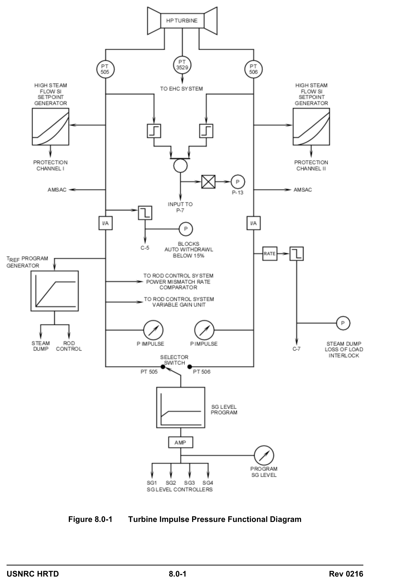

# 08.0 Rod Control and Instrumentation

> Pages 677–680 of `ML20057E160.pdf`
> Westinghouse Technology Systems Manual — USNRC HRTD (PWR)

---
<!-- p.677 -->
#### Westinghouse Technology Systems Manual
#### Chapter 8
#### ROD CONTROL AND INSTRUMENTATION
#### Section
### 8.1 Rod Control System
### 8.2 Rod Position Indication (Analog)
### 8.3 Rod Position Indication (Digital)
### 8.4 Rod Insertion Limits
<!-- p.678 -->
#### TABLE OF FIGURES
Figure 8.0-1 .................................................. Turbine Impulse Pressure Functional Diagram

### 8.0 ROD CONTROL AND INSTRUMENTATION
#### Introduction
The fundamental control philosophy for a Westinghouse Nuclear Steam Supply System is based on the fact that reactor power follows turbine load, or, more accurately secondary load (including all steam flow, leaks, feedwater variations, and etc.) As we learned in reactor physics, as turbine load increases more heat is removed from the primary system and RCS Average Temperature (Tavg) tends to decrease and add positive activity (negative moderator temperature coefficient)
which causes reactor power to increase as turbine load increases. In Chapter 1, we determined that a Tavg program is used to limit the change in RCS temperature as turbine load is increased which reduces the volume change in the RCS from no-load to full-load and allows the use of a smaller RCS pressurizer while minimizing the drop in steam header pressure.

Since reactor power inherently follows secondary load, Westinghouse determined to use secondary load as the reference for controlling reactor power and Tavg. An accurate indication of turbine load which has a linear increase from no-load to 100% Turbine Load is derived from Turbine 1st Stage Pressure. Turbine 1st Stage Pressure is the pressure between the first and second impulse blades of the high pressure turbine. It has a value of zero with no-load steam flow through the high pressure turbine and increases linearly with load to a value of approximately 600 psig at 100% turbine load.

Since the Westinghouse control philosophy is for reactor power to follow turbine load, Turbine 1st Stage Pressure is used to generate a reference signal for controlling RCS Tavg. This reference signal is called Tref. It is used in the Reactor Rod Control circuit to produce a reference temperature from no-load to 100% Power
(557°F to 585°F). Tref is also used in the Steam Dump Control circuit which is discussed chapter 11.2 (See Figure 8.0-1).

The linear response to increasing turbine load also allows Turbine 1st Stage Pressure to be used as a load reference for generating the High Steam Flow Safety Injection Signals (Chapter 12.3), the control interlock for blocking auto rod withdrawal less than 15% load (C-5), and the SG reference level for the SG level control system (Figure 8.0-1)

The purpose of the Rod Control System (Section 8.1) is to maintain a programmed average temperature in the reactor coolant system by regulating the reactivity in the core. An error between the programmed reference temperature (Tref), based on turbine impulse pressure, and the highest average temperature (Tavg) of the reactor coolant, generates a signal to cause automatic rod movement. Rod speed is varied,

USNRC HRTD 8.0-1 Rev 0216

<!-- p.679 -->
depending on the magnitude of the error between Tref and Tavg. Rod direction (either into or out of the core) is dependent on whether Tavg is higher or lower than Tref.

The rods are separated into two functional categories, shutdown rods and control rods, with each category consisting of several individual banks. The shutdown banks provide a large negative reactivity insertion upon a reactor trip and insure that the reactor shuts down and remains subcritical. The shutdown banks are always fully withdrawn during normal operation and are placed in this position by manual rod control prior to criticality.

The control bank rods are used to start up the reactor. After criticality is achieved, these rods are used to regulate the reactivity in the core to maintain the programmed Tavg. In addition, these are the only rods that can be manipulated under automatic rod control.

Power to the rod drive mechanisms is supplied by two motor generator sets, which are powered from two separate 480-volt, three-phase buses. The AC power from the MG sets is distributed to the rod control power cabinets via two series connected reactor trip breakers. A reactor trip signal, opening either one or both trip breakers, removes power from the rod drive mechanisms. Once power is removed from the magnetic coils of the rod drive mechanisms, all rods (shutdown and control) fall into the core by gravity.

The locations of the rods within the core are displayed by both individual rod position indication and group position indication. The individual rod position indication may be either the analog type (Section 8.2) or the digital type (Section 8.3), depending on the age of the plant. Older plants normally have the analog type of position indication. The group rod position indication is a demanded position indication, and receives the same signal that induces rod motion.

There are operating and Technical Specification restrictions placed on rod position during power operations. One such restriction, called the rod insertion limits
(Section 8.4), ensures that the reactor can be shut down from its present condition, assuming various design considerations.

USNRC HRTD 8.0-1 Rev 0216

<!-- p.680 -->
#### Figure 8.0-1

*Turbine Impulse Pressure Functional Diagram*

<!-- labels/text on this figure page -->
Figure 8.0-1 Turbine Impulse Pressure Functional Diagram
USNRC HRTD 8.0-1 Rev 0216

