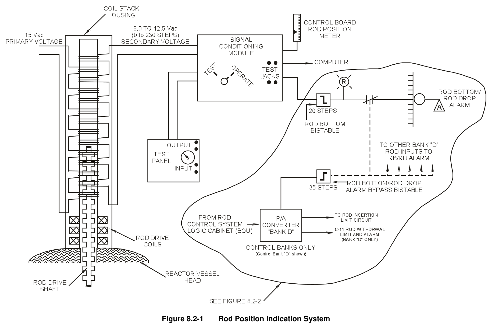
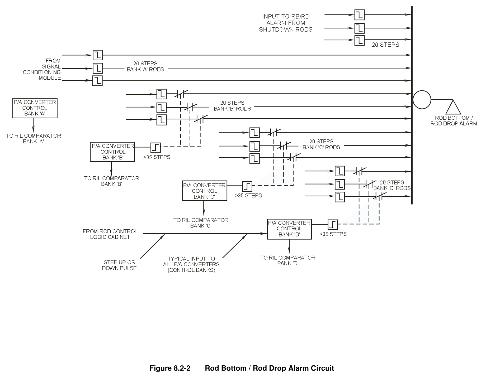

# 08.2 ARPI

> Pages 708–715 of `ML20057E160.pdf`
> Westinghouse Technology Systems Manual — USNRC HRTD (PWR)

---
<!-- p.708 -->
#### Westinghouse Technology Systems Manual
#### Section 8.2
#### Analog Rod Position Indication
<!-- p.709 -->
### 8.2 ROD POSITION INDICATION (ANALOG)
#### Learning Objectives:
1. State the purpose of the rod position indication system.

2. Briefly describe the operation of the following:

a. Analog individual rod position indication (IRPI), b. Group demand position indication, and c. Bank demand position indication.

3. List the conditions that will initiate a rod deviation alarm.

#### 8.2.1 Introduction
The purpose of the rod position indication system is to provide indication of actual and demanded control rod positions. In addition, this system provides alarms to alert the reactor operator to misaligned rods, or to the fact that the required shutdown margin is not available due to excessive rod insertion. (See Section 8.4 for information on rod insertion limits [RILs]).

In Westinghouse plants, there are several methods used to determine rod position.
For group demand indication, there are the demand step counters, which receive signals from the rod control system logic cabinet (Section 8.1). This system assumes that the rods of a specific group are at their demanded positions. For bank demand indication, there are the pulse-to-analog converters for the control banks, which also receive demanded position signals from the logic cabinet.

The third method of determining rod position is with the use of the individual rod position indication system. This system measures the actual position of each rod, regardless of its demanded position.

There are two types of individual rod position indication found in Westinghouse plants: the analog system and the digital system. The analog system is described in the following paragraphs; the digital system is described in Section 8.3.

#### 8.2.2 System Description
##### 8.2.2.1 Group Demand Position Indication
The group demand position indications display the positions that all groups of rods should have assumed in response to demands for rod motion generated within the rod control system. The demand position display for each rod group is an electromechanical add/subtract step counter which receives a count, or pulse, each time its associated group of rods is demanded by the logic cabinet to withdraw or insert.
The step counters are located on the main control board. This demand position indication system is used in conjunction with either the analog or digital individual rod position indication system.

USNRC HRTD 8.2-1 Rev 1013

<!-- p.710 -->
##### 8.2.2.2 Analog Position Indication
The analog individual rod position indication (IRPI) system furnishes an indication of the actual position each rod has assumed in response to the rod control system command signals. The analog system consists of field mounted detectors, cabinet mounted electronic equipment, and control board mounted meters and annunciators.

Figure 8.2-1 shows a typical analog rod position channel. Individual rod position information is sent to the plant computer, control board indication, and control board annunciators. This figure also shows that the output from the pulse-to-analog converter (Section 8.2.3.5) for that rod’s bank affects the status of the rod bottom/rod drop alarm circuit.

Each rod position detector is mounted on the outside of the pressure housing of a control rod drive mechanism. The vertical position of the rod drive shaft within the rod position detector produces an ac electrical output signal which is directly proportional to the rod’s vertical position. This signal is transmitted, by means of a shielded cable, to a signal conditioning circuit, which converts the ac rod position electrical signal into an adjustable dc analog position signal. This analog signal is then supplied to the following:

 A rod bottom bistable,  A control board meter, and  The plant computer.

The rod bottom bistable provides indication and an alarm when a rod has moved below a predetermined position. The output of this bistable actuates a control room annunciator (“ROD BOTTOM/ROD DROP”) and the rod bottom light for the associated rod. Each rod bottom light is located just below an individual rod position indicator located on the main control board. Each rod position channel also has the capability of being tested by means of a built-in test panel. The reactor operator is alerted to a channel test by the control room annunciator “RPI IN TEST.”

#### 8.2.3 Component Descriptions
##### 8.2.3.1 Detector
Each actual rod position detector is a linear transformer which is mounted outside, and concentric with, the rod drive pressure housing. The detector consists of alternately stacked primary and secondary coil windings, and the rod drive shaft acts as the moveable armature of the transformer. The position of the rod drive shaft within the rod position detector determines the amount of magnetic coupling between the primary and secondary windings. With the rod drive shaft fully inserted into the core, the magnetic coupling between the primary and secondary windings is small. Therefore, the signal induced in the secondary windings is small (8 Vac).
When the rod is withdrawn from the core, the relatively high permeability of the rod drive shaft causes an increase in the magnetic coupling between the primary and secondary windings. As the magnetic coupling increases, the magnitude of this output signal increases proportionally to indicate actual rod position.

USNRC HRTD 8.2-2 Rev 1013

<!-- p.711 -->
The power supply to the rod position equipment cabinet is 120-Vac regulated instrument power. The 120 Vac is then reduced to 15 Vac, which is used as the excitation voltage supplied to the primary windings. This reduction in voltage is accomplished through a dropping resistor located inside the rod position equipment cabinet. The detector output, or secondary coil winding voltage, is normally 8 to

### 12.5 Vac, which corresponds to 0 to 230 steps. This output voltage is transmitted to
the signal conditioning module.

##### 8.2.3.2 Signal Conditioning Module
Each rod position detector has an associated signal conditioning module. This module, located in the rod position equipment cabinet, receives an ac voltage input from the secondary windings. This ac signal is rectified and processed so that the output of the module is 11 to 16.8 Vdc. This range of dc voltage corresponds to the range of actual rod positions from fully inserted to fully withdrawn. The resultant dc signal from this module is sent to the main control board for indication, to the plant computer for rod position monitoring, and to the rod bottom bistable for visual indication and an alarm to indicate that the rod has been inserted past a preselected setpoint.

The signal conditioning module includes zero and span adjustments to facilitate channel calibration, as well as test points for monitoring the dc signal. In addition, the module has adjustments for calibrating the control board indicator from zero to full scale. When placed in “TEST,” the TEST-OPERATE switch, mounted on the front of the module, disconnects the detector output leads and allows the insertion of a test signal for checking the operation of the cabinet channel electronics from essentially the cabinet input terminals to the various output devices.

##### 8.2.3.3 Rod Bottom Bistable
The rod bottom bistable (an electronic switch) serves as a simple level comparator.
It receives its input signal from the signal conditioning module. The bistable output is used to light a rod bottom light and to operate a control relay which generates the “ROD BOTTOM/ROD DROP” alarm. When the output from the signal conditioning module reaches a preselected dc voltage (meaning that the rod is more deeply inserted than the rod bottom setpoint), the bistable trips (de-energizes), thereby removing power from the control relay, which in turn causes the ROD BOTTOM/ROD DROP alarm to actuate. When the bistable is in the tripped condition, it also turns on the rod bottom light. Each rod position detector has an associated rod bottom light; this light is located just below the individual rod position indicator. The trip setpoint (de-energizing point) for the rod bottom bistable is adjustable over the lower 25% (0-57 steps) of rod travel. The setpoint is generally selected at 20 steps from the bottom of the core.

##### 8.2.3.4 Rod Bottom/Rod Drop Alarm Circuit
The rod bottom/rod drop alarm circuit is shown in Figure 8.2-2. For simplicity, only three rods from each control bank and three shutdown rods are shown.

The purpose of this alarm is to alert the reactor operator in the event of a rod dropping below a predetermined setpoint. Since the rod bottom/rod drop alarm is a

USNRC HRTD 8.2-3 Rev 1013

<!-- p.712 -->
single alarm with multiple inputs, selected input signals are disarmed during a reactor startup. Without this feature, the alarm would be in the alarmed state until every rod is withdrawn greater than the setpoint. This condition would prevent an actual dropped rod event from causing a new dropped rod alarm during a reactor startup.

As shown in Figure 8.2-2, the disarming signal for a particular rod’s position input to the rod drop alarm is provided by a contact controlled by the status of a control bank’s rod bottom/rod drop alarm bypass bistable. This bypass bistable receives an input (bank demand position) from that bank’s pulse-to-analog converter (Section 8.2.3.5). In the bistable the input signal is compared to a preselected setpoint
(usually set at 35 steps from the bottom of the core). If the bank demand position is below this setpoint, the contact in the circuit supplying the rod bottom/rod drop alarm is open, thereby preventing an actual rod position of less than 20 steps from actuating the rod drop alarm. However, the open contact has no effect on the status of the rod bottom light for that rod. Only control banks B, C, and D are provided with rod bottom/rod drop alarm bypass bistables. As control banks B, C, and D are withdrawn above 35 steps, the bypass bistables cause the contacts in the rod bottom/rod drop alarm circuit to close. After these contacts are closed, any rod in one of those three banks falling below 20 steps will actuate the alarm. In other words, a bank B, C, or D control rod at the bottom of the core (withdrawn no farther than 20 steps) generates the rod bottom/rod drop alarm only when it is not demanded to be there.

Control bank A does not have an associated bypass bistable because it is the first control bank withdrawn during a reactor startup. When control bank A rods have been withdrawn to greater than 20 steps, the rod bottom/rod drop alarm circuit clears
(the alarm inputs for rods in control banks B, C, and D are disarmed), and any subsequent dropped rod will actuate the alarm.

##### 8.2.3.5 Pulse-To-Analog Converters
A pulse-to-analog converter is furnished for each control bank. The converter receives the control bank demand position pulses (up and down counts) from the rod control logic cabinet (bank overlap unit) and converts the count signal to an equivalent dc analog signal which is proportional to the bank demand position. This signal is sent to the rod bottom/rod drop alarm bypass bistable for control bank B, C, or D (Section 8.2.3.4). The output from the pulse-to-analog converter is also sent to the rod insertion limit comparator for the associated bank (Section 8.4).

The output from each converter is supplied to a common local display panel. The panel’s selector switch allows the operator to display the demanded position of either of the four control banks. The panel also has provisions for manually pulsing a particular bank’s converter either up or down if required. All converters are reset by the rod control startup pushbutton located on the main control board.

##### 8.2.3.6 Test Panel
The rod position equipment cabinet contains a test panel, shown in Figure 8.2-1, which is used in conjunction with the signal condition modules. The test panel

USNRC HRTD 8.2-4 Rev 1013

<!-- p.713 -->
supplies a variable ac signal (simulates the detector output) for checking the output of a particular signal conditioning module and the operation of the associated rod bottom bistable. The operator is alerted to a test of a signal conditioning module by the “RPI IN TEST” control room annunciator.

##### 8.2.3.7 Control Board Position Indicator
Each control rod has an associated position indicator mounted on the main control board. The indicator is a meter providing the rod’s actual position in terms of steps withdrawn from the bottom of the core. Each indicator receives the rod position dc analog signal from its signal conditioning module. Calibration of an indicator (zero to full scale deflection) is accomplished by adjustments performed at the signal conditioning module. All indicators are grouped in banks (i.e., control bank A, control bank B, etc.). This arrangement facilitates the visual detection of rod deviations within in a bank. Comparisons of the indicated actual rod positions serve as a backup to the rod deviation monitoring program of the plant computer.
Mounted beneath each analog rod position indicator is the associated rod bottom light.

##### 8.2.3.8 Rod Deviation Monitor
The rod deviation monitor is a plant computer program that receives inputs from the rod control system logic cabinet and each signal conditioning module. This program monitors the various inputs and, if certain conditions exist, alerts the reactor operator by means of the “COMPUTER ALARM ROD DEVIATION AND SEQUENCE NIS POWER RANGE” control room annunciator. This alarm alerts the operator to one or more of the following conditions:

1. Improper sequence (i.e., the sequence of control bank withdrawal should be A, B, C, D; and the sequence for insertion should be D, C, B, A). If the control banks move out of sequence, this alarm is generated.
2. Any shutdown bank rod less than 220 steps withdrawn.
3. Any rod within a bank greater than 12 steps from the bank demand.
4. Any two rods in the same bank greater than 12 steps from each other.

#### 8.2.4 Summary
The analog rod position indication system uses a linear transformer to continuously measure the actual position of each individual rod. The rod position is transmitted as an ac analog signal, which is then converted to a dc analog signal in the associated signal conditioning module.
From the signal conditioning modules, signals are sent to the plant computer, individual position indicators located on the main control board, and the rod bottom bistables.

A rod bottom bistable trips whenever its associated control rod is inserted below a predetermined setpoint. When the bistable trips, the “ROD BOTTOM/ ROD DROP” alarm actuates. Control banks B, C, and D are equipped with rod bottom/rod drop alarm bypass bistables. Each of these bistables control contacts which defeat the inputs to the ROD BOTTOM/ROD DROP alarm for the rods of a particular bank, until that bank has been withdrawn from the core by more than a preselected amount.

USNRC HRTD 8.2-5 Rev 1013

<!-- p.714 -->
#### Figure 8.2-1

*Rod Position Indication System*

[Vector original (SVG, lossless): fig_8.2-1.svg](../figures/fig_8.2-1.svg)

<!-- p.715 -->
#### Figure 8.2-2

*Rod Bottom / Rod Drop Alarm Circuit*

[Vector original (SVG, lossless): fig_8.2-2.svg](../figures/fig_8.2-2.svg)

