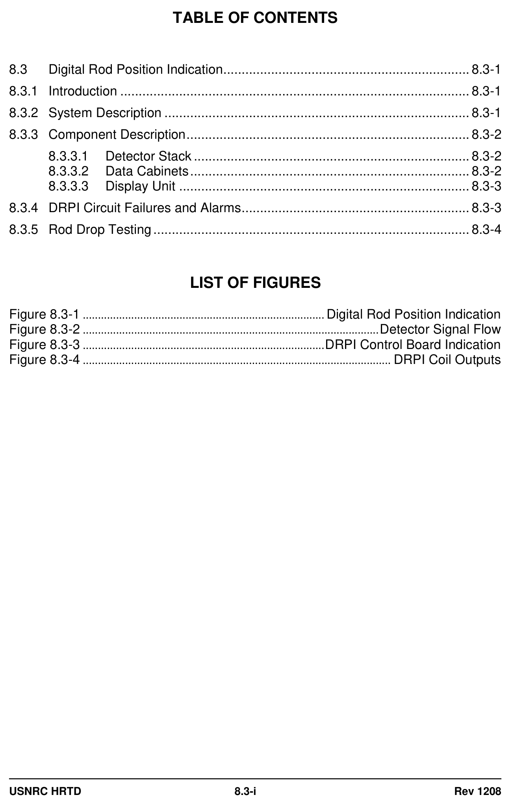
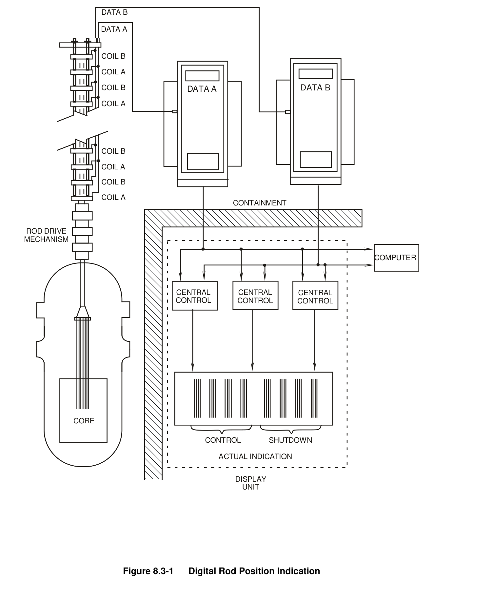
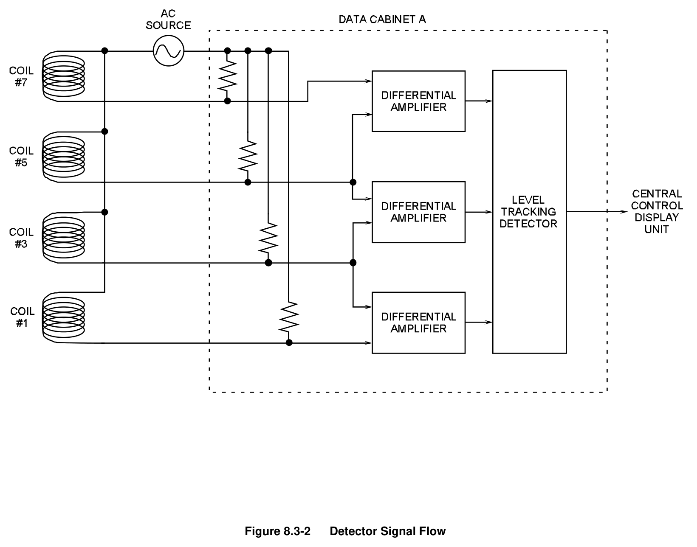
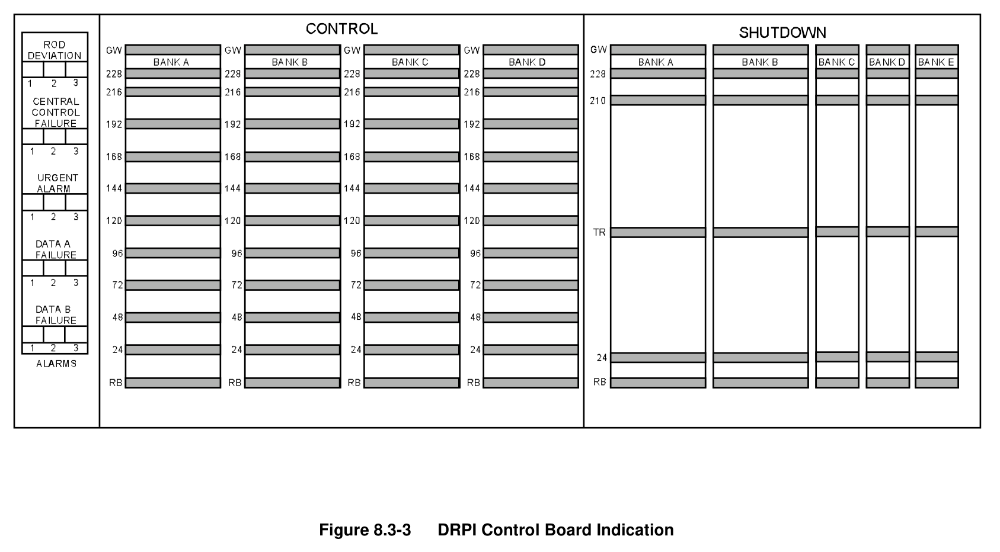
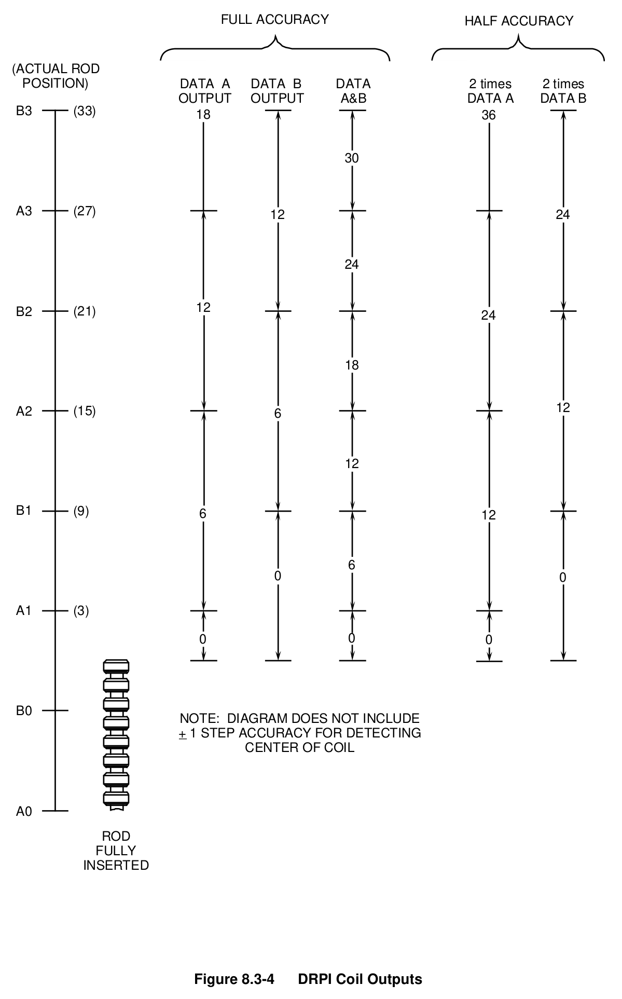

# 08.3 DRPI

> Pages 716–726 of `ML20057E160.pdf`
> Westinghouse Technology Systems Manual — USNRC HRTD (PWR)

---
<!-- p.716 -->
#### Westinghouse Technology Systems Manual
#### Section 8.3
#### Digital Rod Position Indication
<!-- p.717 -->
#### Figure 8.3-1

*............................................................................... Digital Rod Position Indication*

<!-- labels/text on this figure page -->
TABLE OF CONTENTS
8.3 Digital Rod Position Indication ................................................................... 8.3-1
8.3.1 Introduction ............................................................................................... 8.3-1
8.3.2 System Description ................................................................................... 8.3-1
8.3.3 Component Description ............................................................................. 8.3-2
8.3.3.1 Detector Stack ........................................................................... 8.3-2
8.3.3.2 Data Cabinets ............................................................................ 8.3-2
8.3.3.3 Display Unit ............................................................................... 8.3-3
8.3.4 DRPI Circuit Failures and Alarms .............................................................. 8.3-3
8.3.5 Rod Drop Testing ...................................................................................... 8.3-4
LIST OF FIGURES
Figure 8.3-1 ................................................................................ Digital Rod Position Indication
Figure 8.3-2 .................................................................................................. Detector Signal Flow
Figure 8.3-3 ................................................................................ DRPI Control Board Indication
Figure 8.3-4 ...................................................................................................... DRPI Coil Outputs
USNRC HRTD 8.3-i Rev 1208

<!-- p.718 -->
### 8.3 ROD POSITION INDICATION (DIGITAL)
#### Learning Objectives:
1. State the purpose of the rod position indication system.

2. Briefly describe the operation of the Digital individual rod position indication
(DRPI),

3. List the conditions that will initiate a rod deviation alarm.

#### 8.3.1 Introduction
The purpose of the rod position indication system is to provide indication of actual and demanded control rod positions. In addition, this system provides alarms to alert the reactor operator to misaligned rods, or to the fact that the required shutdown margin is not available due to excessive rod insertion. (See Section 8.4 for information on rod insertion limits [RILs]).

As explained in Section 8.2, there are two different systems employed for rod position indication: the first system is the demand step counters (Section 8.2.2.1), and the second is the individual rod position indication system. Two types of individual rod position indication systems are used in Westinghouse plants. The older design is the analog system (Section 8.2), and the newer design is the digital rod position indication system (DRPI). The digital system is explained in this section.

#### 8.3.2 System Description
In Westinghouse plants, there are several methods used to determine rod position.
For group demand indication, there are the demand step counters, which receive signals from the rod control system logic cabinet (Section 8.1). This system assumes that the rods of a specific group are at their demanded positions. For bank demand indication, there are the pulse-to-analog converters for the control banks, which also receive demanded position signals from the logic cabinet.

The digital rod position indication system continuously senses and displays rod position information for each rod (control and shutdown). The system consists of one locally mounted detector stack for each rod, two data cabinets located inside the containment, and one display unit mounted on the main control board.

Each digital rod position detector stack consists of a hollow tube with 42 individual coils mounted on the outside of the tube. This detector stack is placed over the rod drive shaft travel housing. When the tip of the rod drive shaft is located within a coil, the voltage drop across that coil increases. As a result, the voltage drop in that coil is greater than the voltage drop in the next higher coil (a coil where the rod drive shaft is not located). The voltage differences between coils are detected by data cabinets.

USNRC HRTD 8.3-1 Rev 1208

<!-- p.719 -->
Within the two data cabinets (data cabinets A & B), the voltages across the sensing resistors are continuously monitored. Differential amplifiers located inside the data cabinets compare the voltage drops produced by adjacent coils and generate an output according to the difference in voltages. Each data cabinet’s output is a digital signal equivalent to actual rod position.

The information from the two data cabinets is sent to central control units located within the DRPI display unit. The central control units add both signals together
(data A & B) to obtain full accuracy rod position. This position signal is sent to a display card for each individual rod on the DRPI display unit, and it is also sent to the plant computer.

On the display unit there is one column of lights for each rod. Each column of lights consists of 40 light-emitting diodes (LEDs). Thirty-eight of the forty LEDs are used to indicate actual rod position. Each LED represents six steps of rod position with an accuracy of ± 4 steps (section 8.3.3.3). The bottom LED in each column represents the “Rod at Bottom” position. The top LED is used for “General Warning.” The general warning alarm and the other DRPI alarms are discussed in Section 8.3.4.

#### 8.3.3 Component Description
##### 8.3.3.1 Detector Stack
Each detector stack consists of 42 discrete coils mounted axially on the rod drive travel housing with their vertical positions fixed at 3.75-in. centers (Figure 8.3-1).
Recall that each rod step is 5/8 in., therefore, 3.75 in. equals six steps. The coils are interlaced into two separate data channels - the odd numbered coils forming data channel A, and the even numbered coils forming data channel B. All of the channel A coil windings are connected in parallel to a 6-volt ac power source mounted inside the A data cabinet. The output signals from the A coils are brought out separately and directed to the A data cabinet. The B coil windings are similarly connected to the B data cabinet.

The position of a rod is determined by measuring the voltage drop across each coil’s sensing resistor, which is in series with the coil. As the ferromagnetic rod drive shaft passes through a coil, the voltage drop across the coil increases. The voltage drop across the sensing resistor thus decreases. The voltage drops associated with the A and B coil windings are analyzed in the data cabinets to determine actual rod position.

##### 8.3.3.2 Data Cabinets
The data cabinets (A and B) are located inside the containment (Figure 8.3-2). They contain the necessary circuitry to compare the sensing resistor voltage drops and generate an output signal corresponding to actual rod position. The data cabinets amplify the coil signals and deliver the amplified signal to a level-tracking detector.
A level-tracking detector selects the largest differential signal between two adjacent coils (corresponding to a rod position) and sends that signal to the display unit in the main control room.

USNRC HRTD 8.3-2 Rev 1208

<!-- p.720 -->
##### 8.3.3.3 Display Unit
The display unit is located on the main control board and consists of a column of lights for each rod. The light emitting diodes (LEDs) provide information of actual rod position. Only one LED per rod is lit at a time, and each light corresponds to 6 steps, as shown in Figure 8.3-3. With the system at full accuracy, the displayed rod position is within ± 4 steps (± 2.5 in.).
The central control cards receive data signals from the data cabinets (Figure 8.3-1).
These cards check the received position indication information for errors. Assuming that there are no errors, each central control card combines the inputs from both data cabinets and generates a rod position. Figure 8.3-4 shows the output from the data cabinets and the full accuracy rod position indication. As an example, assume that a rod is at 15 steps. The Data A and B indication could be as low as 12 steps, or as high as 18 steps. The accuracy of picking up a coil’s center is ± 1 step. This results in a ± 4 step accuracy for the combined A and B signal.

The central control card is the one common point between data channels A and B.
To prevent a loss of system position monitoring upon a failure of a central control card, two additional cards are used (Figure 8.3-1). The three control cards operate on a majority vote with an automatic disconnect upon a disagreement. If a card is automatically disconnected, local alarm lights illuminate. Mounted on the rear of the display unit is a four-position switch. This switch allows the operator to disconnect any one of the three central control cards removing it from service. Removing a control card from service allows a technician to troubleshoot or perform maintenance on a faulty card.

#### 8.3.4 DRPI Circuit Failures and Alarms
The DRPI system provides the plant computer with position data that is used for routine data logging and rod deviation analysis. A "Computer Rod Deviation" alarm is generated if any of the following conditions exist:

 Rods operating out of sequence,  A deviation of ± 12 steps between any rod and its bank demand,  A deviation of ± 12 steps between any two rods in the same bank, or  Any shutdown rod below 220 steps.

An “RPI Rod Deviation” alarm is generated if a deviation of ± 12 steps exists between any rod and its associated bank demand position. This alarm is displayed on the main control board and on the DRPI display unit.

If a circuit failure eliminates the data from one of the coil sets, the DRPI system places that rod's position indication to "half-accuracy." The failed data is blocked while the data information from non-affected cabinet is doubled. An "RPI Non- Urgent Failure" alarm is generated on the main control board, and a "General Warning" LED is illuminated on the rod position display unit.

As previously stated, the “RPI Non-Urgent Failure” annunciator alarms if there is an error in either the A or B data for any rod. When the annunciator alarms, either the “Data A Failure 1, 2, 3" or “Data B Failure 1, 2, 3" LED group on the control board

USNRC HRTD 8.3-3 Rev 1208

<!-- p.721 -->
display flashes. The rod whose position is in question is denoted by a flashing “General Warning” LED.

The half-accuracy position of the rod is visible until the source of the failure is identified and the problem corrected. During half-accuracy operation, the position of the rod is solely determined by the good data; either A or B. Therefore, rod movement is traced by the lighting of every other LED (i.e., every other step position in 6-step increments). The discrepancy between the indicated position on the control board display and the rod demand step counter reading may be as great as 10 steps during half-accuracy operation.

Half-accuracy indication is shown on Figure 8.3-4. If the data B channel fails, the system goes to half accuracy on the data A channel only. The normal data A signal is doubled by the central control card. For example, if the actual rod position were 15 steps, the half-accuracy position from data channel A could be either 24 or 12 steps (+ 9, - 3). Accounting for the ± 1 step coil center accuracy, the resultant indicated accuracy is + 10, - 4 steps. For a data A channel failure, the system halfaccuracy (on data channel B only) would be - 10, + 4 steps.

The system accuracy decreases to -10, +4 steps with a data A failure, or +10, -4 steps for a data B failure. If a failure occurs in both channels (data A and data B), the system alerts the operator with the following;

 A “Rod Bottom” light,  A “General Warning” light,  An “Urgent Failure alarm,” and  A “Rod Deviation” alarm.

The “Rod Bottom” alarm is generated when a rod is at the bottom of the core and the rest of the rods in its group is off the bottom. A “Two or More Rods at Bottom” alarm is generated if two or more rods in any bank are on the bottom. A “Rod Bottom” alarm is also generated if a bank is on the bottom while the next sequential bank is not. This could be an indication of a dropped bank or improper control bank sequencing. Both rod bottom alarms are bypassed on control banks B, C, and D when all rods of those banks are indicating on the bottom, and control bank A is greater than six steps.

An “RPI Urgent Alarm” occurs if an error or a failure is detected in the information from both data cabinets. A “Rod Bottom” alarm also occurs when an “RPI Urgent Alarm” actuates. When the “RPI Urgent Alarm” annunciator alarms, the Urgent Alarm 1, 2, 3 light group on the control board display also flashes. The rod whose position is in question is denoted by a flashing “General Warning” LED. In addition, that rod's position will not be available, and its associated Rod Bottom LED is energized.

#### 8.3.5 Rod Drop Testing
An additional feature of the digital rod position detectors is the capability of recording rod drop test measurements. If the 60-cycle ac voltage is removed from a detector coil stack, a rod dropping through the coils induces a voltage which causes a current

USNRC HRTD 8.3-4 Rev 1208

<!-- p.722 -->
flow in the common line to the coils. This induced current can be recorded to monitor rod drop performance. Plant Technical Specifications require that rod drop tests be performed periodically and after certain maintenance outages.

USNRC HRTD 8.3-5 Rev 1208

<!-- p.723 -->
#### Figure 8.3-1

*Digital Rod Position Indication*

[Vector original (SVG, lossless): fig_8.3-1_2.svg](../figures/fig_8.3-1_2.svg)

<!-- labels/text on this figure page -->
DATA B
DATA A
COIL B
COIL A
DATA B COIL B DATA A
COIL A
COIL B
COIL A
COIL B
COIL A CONTAINMENT
ROD DRIVE MECHANISM
COMPUTER
CENTRAL CENTRAL CENTRAL CONTROL CONTROL CONTROL
CORE
CONTROL SHUTDOWN
ACTUAL INDICATION
DISPLAY UNIT
Figure 8.3-1 Digital Rod Position Indication

<!-- p.724 -->
#### Figure 8.3-2

*Detector Signal Flow*

[Vector original (SVG, lossless): fig_8.3-2.svg](../figures/fig_8.3-2.svg)

<!-- p.725 -->
#### Figure 8.3-3

*DRPI Control Board Indication*

[Vector original (SVG, lossless): fig_8.3-3.svg](../figures/fig_8.3-3.svg)

<!-- p.726 -->
#### Figure 8.3-4

*DRPI Coil Outputs*

[Vector original (SVG, lossless): fig_8.3-4.svg](../figures/fig_8.3-4.svg)

<!-- labels/text on this figure page -->
FULL ACCURACY HALF ACCURACY
(ACTUAL ROD POSITION)
DATA A DATA B DATA 2 times 2 times OUTPUT OUTPUT A&B DATA A DATA B B3 (33)
18 36
30
A3 (27)
12 24
24
12 B2 (21)
24
18
12 A2
(15)
6
12
B1 (9)
6 12
6 0 0
A1 (3)
0 0 0
B0 NOTE: DIAGRAM DOES NOT INCLUDE + 1 STEP ACCURACY FOR DETECTING _ CENTER OF COIL
A0
ROD FULLY INSERTED
Figure 8.3-4 DRPI Coil Outputs

