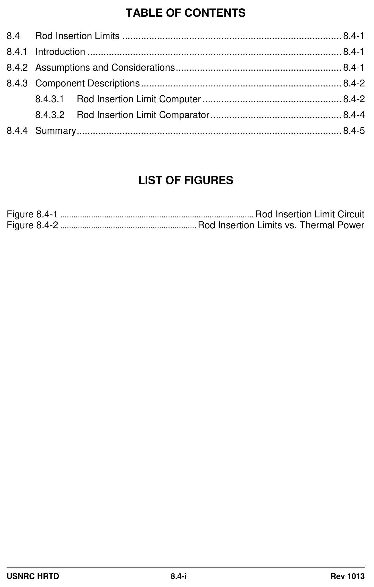
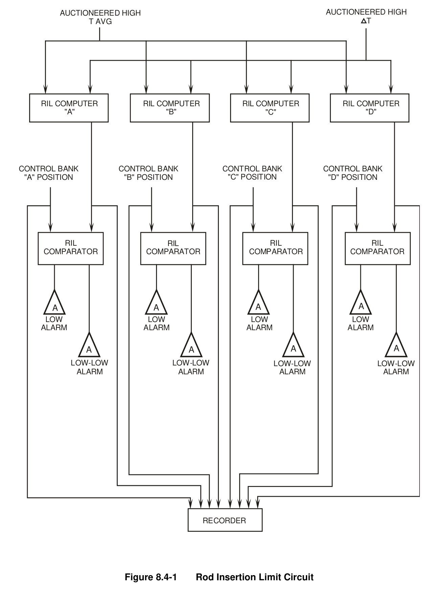
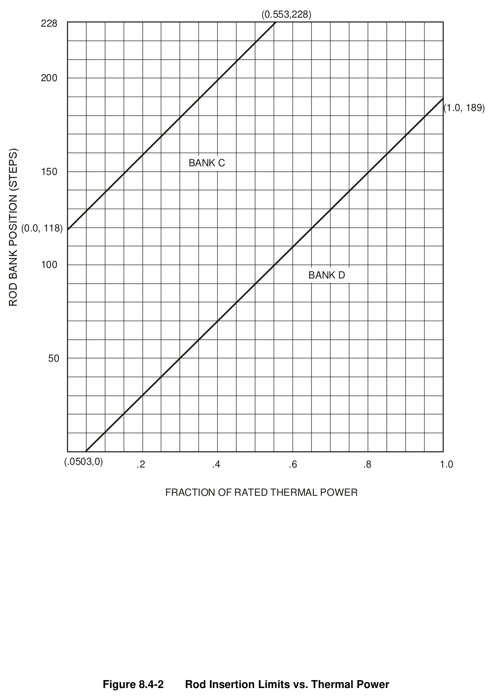

# 08.4 RIL

> Pages 727–735 of `ML20057E160.pdf`
> Westinghouse Technology Systems Manual — USNRC HRTD (PWR)

---
<!-- p.727 -->
#### Westinghouse Technology Systems Manual
#### Section 8.4
#### Rod Insertion Limits
<!-- p.728 -->
#### Figure 8.4-1

*....................................................................................... Rod Insertion Limit Circuit*

<!-- labels/text on this figure page -->
TABLE OF CONTENTS
8.4 Rod Insertion Limits .................................................................................. 8.4-1
8.4.1 Introduction ............................................................................................... 8.4-1
8.4.2 Assumptions and Considerations .............................................................. 8.4-1
8.4.3 Component Descriptions ........................................................................... 8.4-2
8.4.3.1 Rod Insertion Limit Computer .................................................... 8.4-2
8.4.3.2 Rod Insertion Limit Comparator ................................................. 8.4-4
8.4.4 Summary ................................................................................................... 8.4-5
LIST OF FIGURES
Figure 8.4-1 ........................................................................................ Rod Insertion Limit Circuit
Figure 8.4-2 .............................................................. Rod Insertion Limits vs. Thermal Power
USNRC HRTD 8.4-i Rev 1013

<!-- p.729 -->
### 8.4 ROD INSERTION LIMITS
#### Learning Objectives:
1. State the purposes of the control rod insertion limits (RILs).

2. List the inputs to the rod insertion limit computers and comparators.

3. Explain why the rod insertion limits increase with increasing reactor power.

#### 8.4.1 Introduction
The rod insertion limits ensure that the control rods are sufficiently withdrawn to:

a. Maintain an adequate shutdown margin, b. Maintain nuclear peaking factors within limits, and c. Minimize the reactivity effects on the core due to an ejected rod.

To comply with the rod insertion limits (one limit for each of the control banks), the rods may be inserted no farther than a certain number of steps into the core for a specific power level. A limiting condition for operation (LCO) of the plant’s technical specifications addresses this limit. This chapter discusses the assumptions, considerations, and calculations used to determine the rod insertion limits.

#### 8.4.2 Assumptions and Considerations
Compliance with the rod insertion limits ensures that there is enough negative reactivity associated with the rods to place the reactor in the hot standby condition following a reactor trip. Compliance with the RILs further ensures that, in conjunction with the operation of engineered safety feature systems, the negative reactivity margin provided by the rod insertion prevents acceptable fuel design limits from being exceeded during a reactivity addition accident. A typical value for this reactivity margin is -1.3 %K/K. The analyses which verify the adequacy of the RILs entail the following conservative assumptions:

1. The highest worth rod is stuck in the fully withdrawn position. As a result, the negative reactivity associated with this rod is not available to shut down the reactor upon a trip.

2. The reactor is operating with the highest power defect (Section 2.1) for a given power level, which occurs at the core’s end of life (EOL).

3. The plant is operating with the highest possible deviation from the programmed Tavg for a given power level.

The above list reflects the assumptions used in the accident analysis section of a plant’s final safety analysis report (FSAR). As an illustration of the need for an adequate shutdown margin (which is ensured by satisfying the RILs), consider the accident analyses associated with excessive secondary heat removal events in the Trojan (TTC simulator plant) FSAR. Each of these events causes a rapid cooldown

USNRC HRTD 8.4-1 Rev 1013

<!-- p.730 -->
of the reactor coolant, which adds positive reactivity to the core and may result in a return to criticality. The analysis for the inadvertent opening of an atmospheric steam relief valve, steam generator safety valve, or steam dump valve (a condition II event, see Section 5.0) shows that the rod insertion upon the resulting reactor trip and borated emergency core cooling system (ECCS) injection maintain subcriticality during the cooldown, and core damage is prevented. For the more severe steam line rupture (a condition IV event, see Section 5.0), the analysis shows that the coolant temperature decrease does cause a return to power, but the negative reactivity from rod insertion and ECCS injection again prevents core damage
(departure from nucleate boiling is avoided).

In addition to providing a sufficient shutdown margin, the rod insertion limits must satisfy additional considerations. First, setting the insertion limits as low as possible
(rods greatly inserted into the core) is desirable to allow the largest range of rod motion for power maneuvering. However, setting the insertion limits as high as possible (rods barely inserted into the core) is desirable to ensure that the limits on nuclear peaking factors are not exceeded. Inserting control rods into the core suppresses neutron flux (and power) in the vicinity of the rods and causes increased power densities in rod-free areas. Operating with rods largely withdrawn should limit local peaks in power density. Finally, operating with the rods largely withdrawn reduces the positive reactivity addition associated with a hypothetical rod ejection accident.

The rod insertion limits ultimately selected for the plant provide some maneuvering flexibility while providing a sufficient shutdown margin, limiting power peaking, and limiting the effects of a rod ejection.

#### 8.4.3 Component Descriptions
##### 8.4.3.1 Rod Insertion Limit Computer
Consider the reactivity changes associated with a reactor power increase. Because of the increases in fuel temperature and moderator temperature which accompany a power increase, the power defect adds negative reactivity to the core. Accordingly, the magnitude of the power defect increases with core power (see Section 2.1). To maintain the criticality of the core, the reactor operator must add an equal amount of positive reactivity. Positive reactivity addition can be accomplished via control rod withdrawal or boron dilution, or a combination of the two. Conversely, when a reactor trip occurs and the plant control systems establish the no-load coolant temperature, the removal of the power defect adds positive reactivity to the core. A higher power level means a greater positive reactivity addition upon a trip. Because there is no other rapidly available source of negative reactivity, the negative reactivity associated with the shutdown and control banks must alone counteract the positive reactivity addition associated with the power defect. Hence, the shutdown margin consideration dictates that the control rods must be maintained at a more withdrawn position (the rod insertion limits must increase) as reactor power and the associated power defect increase.

Increasing the rod insertion limits with power is also dictated by the other considerations discussed in Section 8.4.2. Operating with the control rods deeply

USNRC HRTD 8.4-2 Rev 1013

<!-- p.731 -->
inserted causes a large peak-to-average ratio for power density; without rod withdrawal the peak local power density approaches an unacceptable level as the core average power density increases. Also, a higher starting position for the rods is needed at higher powers to limit the effects of a rod ejection, because less additional core energy is needed to cause fuel damage at higher powers. Maintaining rod positions higher than the RILs limits the reactivity addition and resulting power increase from an ejected rod.

The actual values of the rod insertion limits for a particular power level are chosen to satisfy the most limiting of the considerations discussed above.

To account for the variation of the rod insertion limits with power level, two parameters proportional to power are input to the rod insertion limit computer for each control bank: auctioneered high ΔT and auctioneered high Tavg (Figure 8.4-1).
ΔT is directly proportional to power, and Tavg is programmed as a function of power.
Because the auctioneering units select the highest values of ΔT and Tavg, the rod insertion limit calculations use a conservatively high representation of power. Each rod insertion limit computer calculates the insertion limit for a particular control rod bank in accordance with the following equation:

RIL = K1 (Tavg - 557°F) + K2 (%ΔT) + K3

Where:

1. RIL = the limit for rod insertion for a selected control bank.

2. K1 is a constant used to compensate for the effect of a higher moderator temperature on the power defect if the plant is operating with a higher temperature program than the design Tavg program. If a plant is operating with an escalated Tavg, the extra reactivity associated with the greater cooldown of the reactor coolant following a reactor trip must be accounted for. Most plants operate in accordance with their normal programmed Tavg bands; therefore, the normally assigned value for K1 is zero.

3. (Tavg – 557°F) = auctioneered high Tavg minus the no-load Tavg (557°F).

4. K2 accounts for the power defect, since the auctioneered high ΔT varies directly with power. The constant K2 (expressed in steps per % power) times the %ΔT results in a given number of rod steps. This factor ensures that the calculated rod insertion limit provides enough negative reactivity to shut down the reactor with a sufficient margin from a given power level. (Note: K2 is the slope of each RIL line segment shown in Figure 8.4-2.)

5. (%ΔT) = the auctioneered high ΔT expressed in terms of percent power. If the expected ΔT for 100% power is approximately 64°F (a typical value), the input to the rod insertion limit equation at full power would be 100%, i.e., (64/64) x 100%.
If the ΔT is 32°F, then the input to the rod insertion limit computer would be 50%, i.e., (32/64) x 100%.

USNRC HRTD 8.4-3 Rev 1013

<!-- p.732 -->
6. K3 provides the minimum insertion limit setpoint (in steps) for hot zero power, i.e., the minimum insertion for criticality. K3 is the Y intercept of a particular RIL line segment shown in Figure 8.4-2.

The values for these constants vary depending upon plant design, fuel loading, fuel design, and rod worth. These values can be found in the precautions, limitations, and setpoints (PLS) document for a given Westinghouse plant. A typical set of constants is listed below:

K1 K2 (steps/%) K3 (steps)
Control Bank C 0 1.99 118 Control Bank D 0 1.99
- 10

Figure 8.4-2 displays the rod insertion limits for different control banks versus reactor power. (The figure and the underlying equations for the limits are typical for Westinghouse plants, but not necessarily correct for the plant modeled by the TTC’s Westinghouse simulator.) For example, calculations for the rod insertion limits for control banks C and D with plant at 50% power are as follows:

#### CONTROL BANK C:
RIL = K1 (Tavg - 557°F) + K2 (%ΔT) + K3 RIL = 0 (571°F - 557°F) + 1.99 (50) + 118 RIL = 0 + 99.5 + 118 RIL = 217.5 steps on Bank C

#### CONTROL BANK D:
RIL = K1 (Tavg - 557°F) + K2 (%ΔT) + K3 RIL = 0 (571°F - 557°F) + 1.99 (50) + (- 10)
RIL = 0 + 99.5 - 10 RIL = 89.5 steps on Bank D

After the computer calculates the insertion limit for a particular control bank, the calculated limit is sent to that bank’s RIL comparator circuit.

##### 8.4.3.2 Rod Insertion Limit Comparator
Each rod insertion limit comparator receives two input signals for comparison (see Figure 8.4-1). The first input comes from a rod insertion limit computer, which provides the rod insertion limit for a control bank. The second input comes from that bank’s pulse-to-analog converter (Section 8.2). This input represents the demanded bank position. The rod insertion limit comparator compares the calculated rod insertion limit to the demanded bank position. Each comparator generates two control room alarms: one for the demanded bank position approaching the RIL, and another for the demanded bank position equaling the RIL. These alarms are the “ROD LIMIT Lo” and “ROD LIMIT Lo-Lo” alarms. The equations for determining the setpoints of these alarms are as follows:

USNRC HRTD 8.4-4 Rev 1013

<!-- p.733 -->
 Rod Limit Low setpoint = RIL + 10 steps  Rod Limit Low-Low setpoint = RIL

The purpose of these alarms is to provide the reactor operator with a warning of excessive rod insertion for the existing power level. To exit the alarming condition, the operators can borate the reactor coolant to cause rod withdrawal or reduce turbine load while maintaining the rod position. If the “ROD LIMIT Lo-Lo” alarm is alarming, the technical specification limit for rod insertion has been violated. To comply with required actions, the operator has the option of either, within an hour, verifying that the shutdown margin is acceptable or borating the reactor coolant to restore an acceptable shutdown margin. In addition, within two hours of the rod insertion limits being violated, the control bank(s) must be restored to within their limit(s).

#### 8.4.4 Summary
The rod insertion limits constitute a technical specification LCO placed on how far the control rods may be inserted into the core. These limits ensure that there is sufficient negative reactivity associated with the rods to shut down the core, with a sufficient margin, upon a reactor trip. Maintaining control bank positions above the rod insertion limits also helps to maintain nuclear peaking factors within limits and minimizes the reactivity effects of an ejected rod. Each rod insertion limit computer calculates an insertion limit in accordance with the input values of auctioneered high ΔT and Tavg (although the Tavg term is usually multiplied by a constant value of zero).
Each calculated insertion limit is compared with the demanded position for one of the control banks; control room alarms warn of excessive rod insertion.

USNRC HRTD 8.4-5 Rev 1013

<!-- p.734 -->
#### Figure 8.4-1

*Rod Insertion Limit Circuit*

[Vector original (SVG, lossless): fig_8.4-1_2.svg](../figures/fig_8.4-1_2.svg)

<!-- labels/text on this figure page -->
AUCTIONEERED HIGH AUCTIONEERED HIGH T T AVG
RIL COMPUTER RIL COMPUTER RIL COMPUTER RIL COMPUTER "A" "B" "D" "C"
CONTROL BANK CONTROL BANK CONTROL BANK CONTROL BANK "A" POSITION "B" POSITION "C" POSITION "D" POSITION
RIL RIL RIL RIL COMPARATOR COMPARATOR COMPARATOR COMPARATOR
A A A A LOW LOW LOW LOW ALARM ALARM ALARM ALARM
A A A A
LOW-LOW LOW-LOW LOW-LOW LOW-LOW ALARM ALARM ALARM ALARM
RECORDER
Figure 8.4-1 Rod Insertion Limit Circuit

<!-- p.735 -->
#### Figure 8.4-2

*Rod Insertion Limits vs. Thermal Power*

[Vector original (SVG, lossless): fig_8.4-2.svg](../figures/fig_8.4-2.svg)

<!-- labels/text on this figure page -->
(0.553,228)
228
200
(1.0, 189)
BANK C 150
(0.0, 118)
100 BANK D
50
(.0503,0) .2 .4 .6 .8
1.0
FRACTION OF RATED THERMAL POWER
Figure 8.4-2 Rod Insertion Limits vs. Thermal Power

