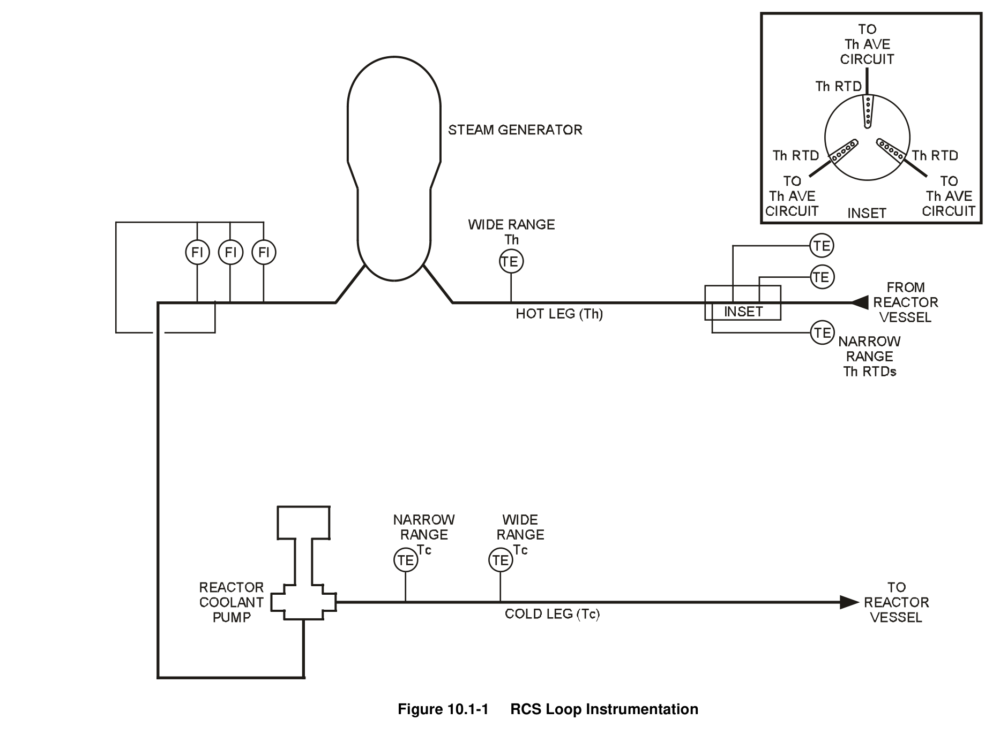
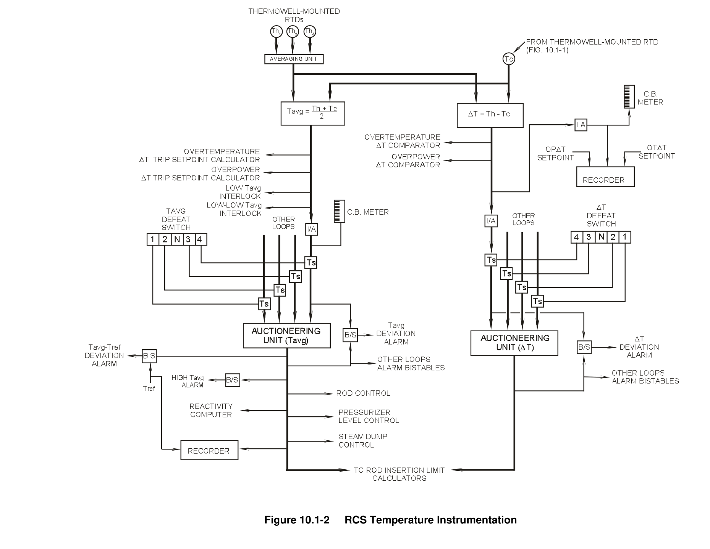
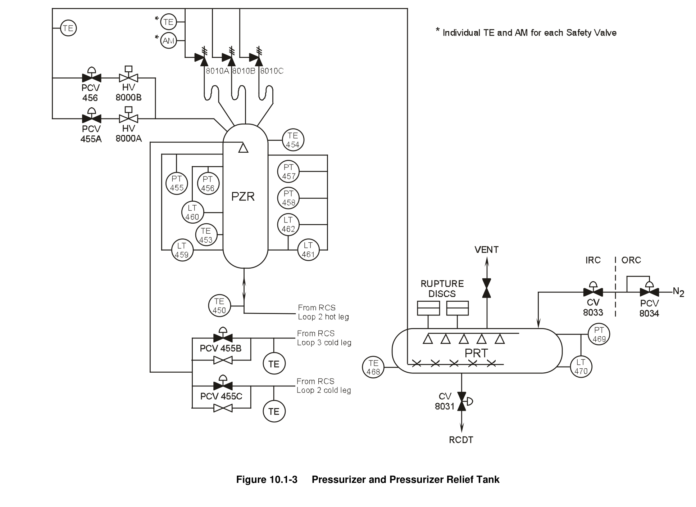
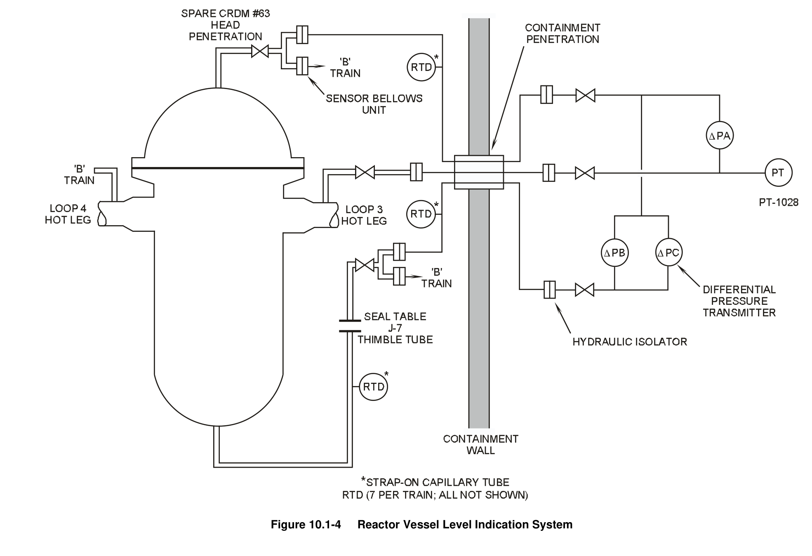
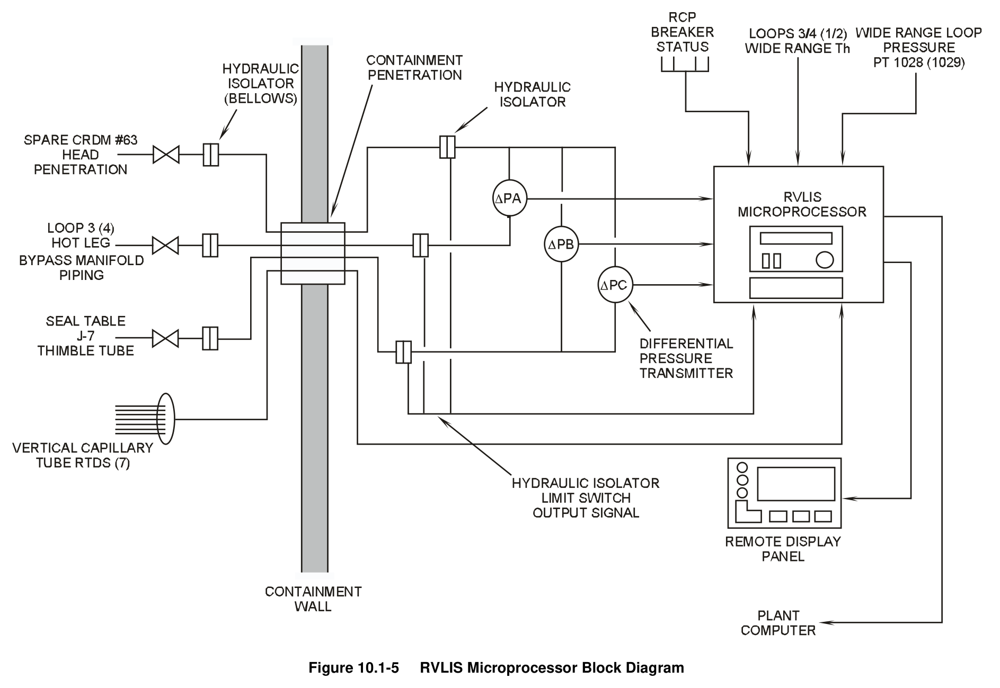
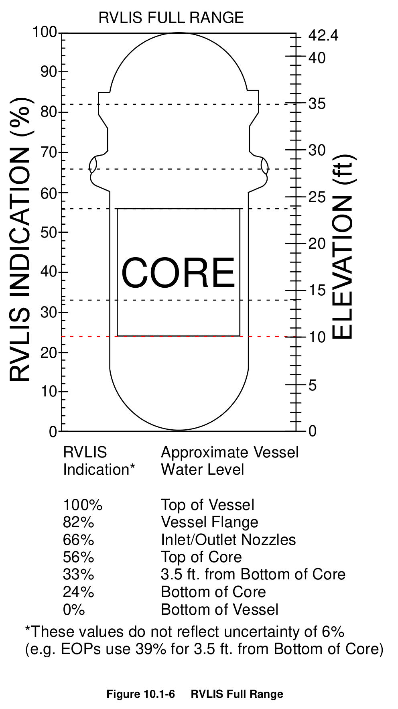
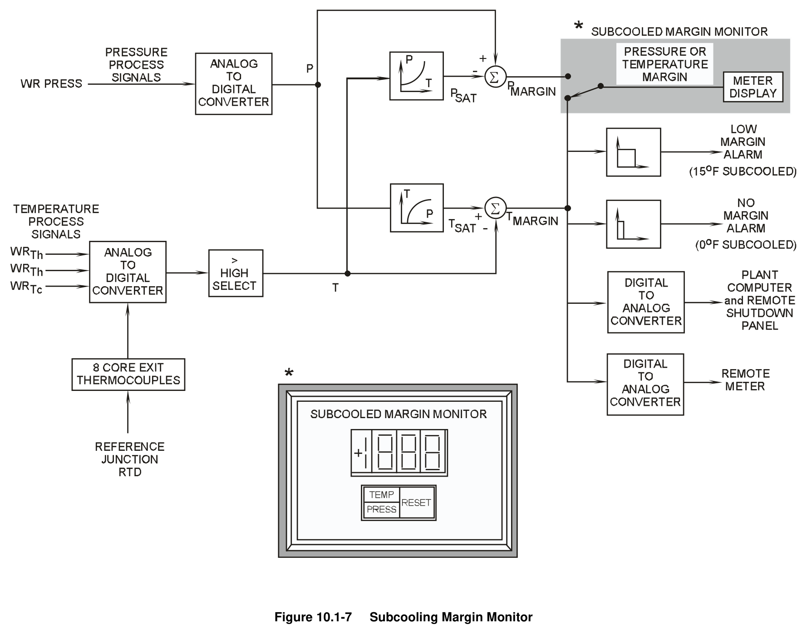

# 10.1 RCS Instrumentation

> Pages 816–835 of `ML20057E160.pdf`
> Westinghouse Technology Systems Manual — USNRC HRTD (PWR)

---
<!-- p.816 -->
#### Westinghouse Technology Systems Manual
#### Section 10.1
#### Reactor Coolant Instrumentation
<!-- p.817 -->
TABLE OF CONTENTS

10.1 Reactor Coolant Instrumentation .......................................................... 10.1-1

10.1.1 Temperature ......................................................................................... 10.1-1

10.1.1.1 Narrow-Range Temperature Detectors ............................... 10.1-1

10.1.1.2 Wide-Range Temperature Detectors .................................. 10.1-2

10.1.1.3 Pzr, Surge Line, and Spray Line Temperature Detectors .... 10.1-3

10.1.1.4 Safety and Relief Valve Disch. and PRT Temperature ....... 10.1-3

10.1.1.5 Reactor Vessel Flange Leakoff Temperature Detector ....... 10.1-3

10.1.2 Pressure ............................................................................................... 10.1-4

10.1.2.1 Pressurizer Pressure Detectors .......................................... 10.1-4

10.1.2.2 Reactor Coolant Loop and PRT Pressure Detectors........... 10.1-4

10.1.3 Pressurizer Level .................................................................................. 10.1-4

10.1.4 Reactor Coolant Flow ........................................................................... 10.1-4

10.1.5 Reactor Vessel Level Indicating System .............................................. 10.1-5

10.1.6 Subcooling Margin Monitoring .............................................................. 10.1-8

10.1.7 Summary ............................................................................................ 10.1-11

LIST OF FIGURES

Figure 10.1-1 ..................................................................................... RCS Loop Instrumentation

Figure 10.1-2 ...................................................................... RCS Temperature Instrumentation

Figure 10.1-3 ........................................................... Pressurizer and Pressurizer Relief Tank

Figure 10.1-4 ............................................................Reactor Vessel Level Indication System

Figure 10.1-5 ............................................................... RVLIS Microprocessor Block Diagram

Figure 10.1-6 ..................................................................................................... RVLIS Full Range

Figure 10.1-7 .................................................................................... Subcooling Margin Monitor

USNRC HRTD 10.1-i Rev 1013

<!-- p.818 -->
### 10.1 REACTOR COOLANT INSTRUMENTATION
#### Learning Objectives:
1. Describe how loop average temperature (Tavg) and temperature difference (ΔT)
are derived from the coolant loop narrow-range resistance temperature detector
(RTD) outputs, and how these signals are used.

2. List the functions of the following temperature monitors:

a. Reactor coolant system (RCS) wide-range temperature detectors;
b. Pressurizer, pressurizer surge line, and pressurizer spray line detectors;
c. Safety and relief valve discharge line detectors;
d. Pressurizer relief tank (PRT) detector; and e. Reactor vessel flange leak-off detector.

3. Explain how the differential pressure (P) cells at RCS piping elbows are used to measure RCS flows.

#### 10.1.1 Temperature
##### 10.1.1.1 Narrow-Range Temperature Detectors
Reactor coolant temperatures are measured by RTDs in the hot and cold legs of the RCS. The outputs of the narrow-range temperature instrumentation (Th and Tc) are further processed to provide the average temperature (Tavg) and the difference between the hot-leg and cold-leg temperatures (T) for each coolant loop. These processed signals are used for control room indication, inputs to various control systems, and inputs to the reactor protection system (RPS) for the generation of protection-grade interlocks and reactor trip signals.

Figure 10.1-1 shows the arrangement for measuring narrow-range temperature.
Three narrow-range hot-leg RTDs are located 120° apart circumferentially, ensuring that a representative temperature of the hot-leg flow is measured.

A dual-element RTD is inserted into each thermowell. One element provides an electronic signal to a low voltage amplifier. The amplified signals from the three hotleg RTDs of a particular loop are averaged together to generate a single narrowrange Th signal (Th average or Thave) for that loop. This averaged signal, along with the Tc signal from that loop, are used to generate a loop Tavg and a loop ΔT signal.

The cold-leg narrow-range RTD of each loop, also a dual-element, fast-acting RTD, is inserted into a thermowell directly downstream of the reactor coolant pump. Due to the turbulent flow at the discharge of the RCP, only one narrow-range RTD is required to provide an accurate indication of temperature. One element of the RTD provides the narrow-range Tc signal for its associated loop.

The second element of each fast-acting RTD, at each location, is considered an installed calibrated spare. It is wired directly to the RPS cabinets, but it is not

USNRC HRTD 10.1-1 Rev 1013

<!-- p.819 -->
connected to any electronics. In the event of a failure of the in-service temperature element, the spare element is available for use.

The narrow-range cold-leg RTDs are calibrated to provide an output of 510 - 630°F, while the narrow-range hot-leg RTDs are calibrated to provide an output of 530 - 650°F. Figure 10.1-2 illustrates how the hot- and cold-leg RTD temperature signals are combined to calculate a loop Tavg with a range of 530°F - 650°F, and a loop ΔT with a range of 0 - 150%. These calculated values provide information to the control room operators concerning plant conditions.

Figure 10.1-2 also shows that the calculated Tavg and ΔT for each loop are provided to the RPS for various protective functions. Each loop Tavg is provided to an RPS channel for the calculation of the overtemperature ΔT (OT ΔT) and overpower ΔT
(OP ΔT) trip setpoints. Each loop ΔT is also provided to an RPS channel, where it is compared to both the OT ΔT and OP ΔT trip setpoints. In addition, the loop Tavg signals are used to generate two protection-grade interlocks, low Tavg and low-low Tavg (permissive P-12). The protection-grade signals are separated from the controlgrade signals by isolation amplifiers.

The Tavg and ΔT inputs to control systems are provided via auctioneering units, which select the highest of the four input loop values. Auctioneered high Tavg is supplied to the rod control system (Section 8.1), the pressurizer level control system
(Section 10.3), and the steam dump control system (Section 11.2). In addition, auctioneered high Tavg and ΔT are supplied to the rod insertion limit calculators
(Section 8.4).

Reactor coolant Tavg [(Th+Tc )/2] indicates the condition of the coolant with regard to the margin to saturation, the heat capacity of the reactor coolant, and the deviation from the programmed temperature setpoint (Tref). The rate of change of Tavg and its deviation from Tref are indicative of an imbalance between primary and secondary power. The average temperature of the coolant is also an input to the determination of margin to departure from nucleate boiling (DNB).

When the reactor coolant is subcooled, the coolant ΔT (Th - Tc) is directly proportional to reactor power, and ΔT is used in both control and protection systems as a measure of reactor power.

##### 10.1.1.2 Wide-Range Temperature Detectors
Hot- and cold-leg reactor coolant loop temperatures are also measured by widerange RTDs (0-700°F) mounted in thermowells in the reactor coolant piping of each loop. These detectors provide indication during heatups and cooldowns and during natural circulation operation. Certain cold-leg and hot-leg wide-range RTDs supply inputs to the subcooled margin monitor (section 10.1.6). The hot-leg wide-range RTDs provide inputs to the reactor vessel level indicating system (RVLIS - section 10.1.5).

USNRC HRTD 10.1-2 Rev 1013

<!-- p.820 -->
##### 10.1.1.3 Pressurizer, Surge Line, and Spray Line Temperature Detectors
There are two temperature detectors on the pressurizer (Figure 10.1-3). One measures steam temperature, and the other measures the water temperature of the pressurizer. Under normal conditions, the pressurizer is a two-phase system in equilibrium, so the water and steam temperatures are equal. When they are not, an abnormal condition is indicated.

The surge line temperature detector provides indication and a low temperature alarm
(< 517°F). A low temperature alarm indicates that a large insurge of relatively cold water has entered the pressurizer or that ambient heat losses have lowered the temperature to the alarm setpoint. The temperature in the surge line should remain high due to the constant outflow from the pressurizer which balances the small constant spray bypass flow.

Each spray line has a temperature detector which provides indication and provides a low temperature alarm (< 450°F). Normal detector readings indicate that the spray bypass flows are keeping the spray lines and pressurizer spray nozzle at a temperature near that of the RCS cold legs (see Chapter 3.2). A low temperature alarm could indicate a loss of spray bypass flow, or an incorrectly positioned spray bypass throttle valve. Low spray line temperatures could subject the spray nozzle to thermal shock when pressurizer spray is demanded.

##### 10.1.1.4 Safety and Relief Valve Discharge and Pressurizer Relief Tank
#### Temperature
Figure 10.1-3 shows a temperature detector on the discharge line from each pressurizer safety valve and a single temperature detector on the common discharge line from both power-operated relief valves. These temperature detectors provide indication in the control room that a safety or a power-operated relief valve has opened or is leaking.

A high temperature alarm is actuated when the temperature measured by any of these detectors exceeds 160°F. This alarm alerts the control room operator to a discharge through one or more relief lines, or to leakage past one or more valve seats. Since these detectors are located close to each other, any single valve opening causes an increase in the temperature sensed by all of them.

A temperature detector on the pressurizer relief tank provides indication and generates a high temperature alarm (> 112.5°F). This detector is shown in Figure 10.1-3. A high temperature in the PRT is an alternate method of alerting the control room operator to a relief valve opening or to possible leakage past a relief valve seat.

##### 10.1.1.5 Reactor Vessel Flange Leakoff Temperature Detector
A temperature detector located between the leakoff line isolation valve and the reactor coolant drain tank is provided to alert the reactor operator to a leak from the reactor vessel flange O-ring seal. This alarm provides audible annunciation in the control room and is normally set 20°F above the ambient temperature of the containment.

USNRC HRTD 10.1-3 Rev 1013

<!-- p.821 -->
The reactor vessel flange leak detection system may be isolated from the reactor coolant drain tank by closing an air-operated valve (CV-8032) from the main control board. This valve is designed to fail closed upon a loss of instrument air to containment. If the reactor vessel flange inner O-ring starts leaking, the outer O-ring may be placed in service by manually realigning two valves located inside the containment. (See Section 3.1 for additional vessel flange seal details.)

#### 10.1.2 Pressure
##### 10.1.2.1 Pressurizer Pressure Detectors
Four pressurizer pressure transmitters provide indication and control- and protection-grade signals. These signals provide indications in the control room and inputs to the pressurizer pressure control system (Chapter 10.2) and the reactor protection system (Chapter 12.2). The pressure in the pressurizer is maintained by the operation of heaters immersed in the water volume at the bottom of the pressurizer and spray valves in the steam volume at the top. These transmitters are narrow range, with an indication span of 1700 - 2500 psig.

##### 10.1.2.2 Reactor Coolant Loop and Pressurizer Relief Tank Pressure Detectors
Two pressure transmitters (PT-403 and PT-405) are located in the residual heat removal (RHR) system suction line near its penetration into the RCS hot leg (loop 4).
These are wide-range transmitters (0-3000 psig) and provide indication during startups and shutdowns. They also provide interlocks to permit manual opening of
(pressure < 425 psig) and to automatically close (pressure > 585 psig) the two isolation valves in the RHR suction line from the RCS. The automatic closure of these valves prevents overpressurizing the RHR system piping.

A pressure transmitter on the pressurizer relief tank provides indication in the main control room as well as a high pressure alarm set at eight psig. A high pressure in this tank may be indicative of pressurizer relief valve discharge into the PRT.

#### 10.1.3 Pressurizer Level
Three pressurizer level transmitters provide indication and control- and protectiongrade signals. These signals provide indications in the control room and inputs to the pressurizer level control system (Section 10.3) and the reactor protection system
(Section 12.2). The level in the pressurizer is a direct measure of reactor coolant inventory. These transmitters are calibrated for the normal pressurizer operating temperature of 650°F. A fourth level transmitter is cold calibrated (80°F) and provides level indication during heatup, refueling, and cold shutdown operations.

#### 10.1.4 Reactor Coolant Flow
As shown in Figure 10.1-1, flow in each reactor coolant loop is measured by three differential pressure (d/P) transmitters located at the first bend (elbow) in the intermediate leg of each reactor coolant loop. The square root of the difference between the pressure at the outside radius and the pressure at the inside radius of

USNRC HRTD 10.1-4 Rev 1013

<!-- p.822 -->
the bend is proportional to flow. The developed flow signals provide indications in the control room and inputs into the reactor protection system.

There is one common high pressure (HP) tap at the outside radius of each intermediate-leg elbow, and there are three separate low pressure (LP) taps at the inside radius (see Section 3.2). The pressure at the HP tap is the sum of the static reactor coolant system pressure and the pressure resulting from the centrifugal force exerted by the coolant flow (the force is proportional to the square of the flow velocity). The LP taps sense only the static coolant system pressure. Therefore, the difference in pressure between the outside radius and the inside radius of the intermediate leg is dependent upon flow.

If the HP tap fails (it becomes clogged, or the instrument line ruptures), all three d/P transmitters would fail low (indicating an apparent loss of flow) and a reactor trip would result (all three measured flows would be less than the loop low flow trip setpoint). If the flow indication arrangement were designed with only one LP tap and it failed, then all three d/P transmitters would fail high, which is in the nonconservative direction, and a reactor trip on low flow in this loop could not occur.
Therefore, three LP taps are used to provide redundancy and a conservative system response. If one of the three LP taps were to fail, only its corresponding d/P transmitter would be affected (fails high), leaving the remaining two d/P transmitters to provide proper indications of flow, as well as low flow inputs to the RPS if flow is reduced or lost in that loop.

#### 10.1.5 Reactor Vessel Level Indicating System
The reactor vessel level indicating system (RVLIS) is designed to provide a reliable method of indicating the water level within the reactor vessel under normal and accident conditions. This instrumentation system is installed in the plant to satisfy a requirement of NUREG-0737. In addition to supplying reactor vessel water level indication during normal operations, the RVLIS also performs the following functions during abnormal operating and accident conditions:
a. Indicates the formation of voids in the reactor coolant system during forced circulation;
b. Detects the approach to inadequate core cooling, and provides information needed for selecting emergency operating procedures associated with inadequate or degraded core cooling;
c. Detects voiding in the reactor vessel head;
d. Provides an accurate measurement of the reactor vessel water level during natural circulation; and e. Provides information to the operator during operation of the reactor vessel head vent system.

As shown in Figure 10.1-4, the RVLIS utilizes two trains of instrumentation; each train includes three d/P transmitters for three different ranges of vessel level measurement. These transmitters are designed to measure the water level within the reactor vessel or to provide information on the relative void content of the fluid surrounding the core during various operating conditions.

USNRC HRTD 10.1-5 Rev 1013

<!-- p.823 -->
Penetrations for the RVLIS into the reactor coolant system pressure boundary are made through a spare control rod drive mechanism penetration in the vessel head near its center (low pressure tap) and through an incore instrument conduit at the seal table (high pressure tap). In addition, two penetrations (one per hot leg) are made in loops 3 and 4.

Each sensing line extending from an RCS penetration includes a sensor bellows unit in containment. The bellows units provide hydraulic coupling for pressure measurements. From its bellows unit each sensing line extends through a containment penetration to a second hydraulic coupling device, a hydraulic isolator.
The hydraulic isolator contains two opposing liquid-filled bellows linked by a connecting rod. Each hydraulic isolator acts as a second isolation valve for the RCS and functions as a containment isolation valve. From the hydraulic isolator, the sensed pressure is applied to the appropriate d/P transmitter(s).

As shown in Figure 10.1-5, the differential pressures for the three measurement ranges are supplied to a microprocessor (one per train). In addition, pressure and temperature inputs to each microprocessor are used for density compensation of the measured fluid pressures. The microprocessor adjusts the measured d/Ps for fluid density variations resulting from environmental conditions inside the containment to generate reactor vessel levels.

Each microprocessor is located in a cabinet in the control room. The RVLIS level outputs are displayed remotely in the control room and are supplied to the plant computer. The RVLIS provides no annunciation in the control room.

The following paragraphs describe the three d/P transmitters and the ranges of level measurement that they provide.

One d/P transmitter is calibrated to measure the level in the reactor vessel with the reactor coolant pumps operating (shown as ΔPc in Figures 10.1-4 and 10.1-5). The output from this transmitter is referred to as the dynamic range, with an indicated range of 0 - 120%. It provides an indication of the differential pressure between the bottom and top of the reactor vessel with forced circulation flow in the RCS. The indicated dynamic range level is typically between 100 and 110%.

The reactor coolant pumps can circulate water and steam as an essentially homogeneous mixture. Therefore, if the reactor coolant pumps are circulating coolant with a void fraction greater than zero, there will not be a distinct water level in the reactor vessel. However, a comparison of the measured d/P across the reactor vessel with the normal single-phase flow d/P provides an approximate indication of the relative void content or density of the circulating fluid.

It should be understood that this instrument is not providing an indication of reactor vessel level per se during forced circulation, but an indication of the relative void fraction of the reactor coolant. In addition, this instrument provides a backup level indication with the reactor coolant pumps turned off; i.e., this instrument is calibrated so that it indicates 40% with the reactor vessel full of water and the reactor coolant pumps turned off. Therefore, during natural circulation a value of less than 40% would be an indication that the reactor vessel is not completely full.

USNRC HRTD 10.1-6 Rev 1013

<!-- p.824 -->
The second d/P transmitter is calibrated to measure the coolant level in the reactor vessel with the reactor coolant pumps secured (ΔPb). This indication is referred to as the full range and spans the total height of the reactor vessel (approximately 40 ft). The full-range level should be 100% (the instrument range is 0-120%) with natural circulation flow and the reactor vessel completely filled with subcooled coolant (See Figure 10.1-6, RVLIS Full Range)..

When all reactor coolant pumps are stopped, if any voids exist in the reactor coolant, they separate from the liquid. As a result, the liquid collapses toward the bottom of the reactor vessel and the steam voids rise and fill the upper portion of the reactor vessel. This transmitter’s output is an indication of the collapsed water level. The actual water level in the reactor vessel may be slightly higher than that indicated, due to the presence of very small steam bubbles (froth) mixed with the coolant liquid volume. In this instance, the RVLIS provides a conservative indication of coolant level.

With the reactor coolant pumps operating, the pressure sensed at the bottom of the vessel (the high pressure tap) is higher than that during natural circulation. As a result of the higher sensed d/P, the full range indication is off-scale high during forced circulation, and the information provided is invalid.

The third d/P transmitter provides an indication of the water level in the reactor vessel head (ΔPa). This indication is referred to as the upper range and spans the total height from the hot leg to the top of the reactor vessel head (approximately 15 ft). The range of indication is 60-120% with natural circulation flow in the reactor coolant system. The upper-range level should be 100% with natural circulation flow and the reactor vessel completely filled with subcooled coolant. This instrument provides an accurate indication of possible voiding in the upper head region and provides useful information during reactor vessel head venting. This measurement also provides backup confirmation that the level in the RCS is above the hot-leg nozzles.
Because the hot-leg tap is positioned to sense static pressure only, when the reactor coolant pumps are operating, the measured d/P is less than the calibrated span of the upper-range instrument during natural circulation (the indication is off-scale low).
Therefore, like the indication from the full-range instrument, the output from this instrument is invalid whenever there is forced flow through the core.

In summary, the RCP operational status has a large influence on the outputs of these d/P transmitters. The dynamic-range transmitter, ΔPc, is calibrated to indicate 100% (or slightly greater) with the reactor coolant pumps operating and 40% without any RCPs operating. The full-range transmitter, ΔPb, and the upper-range transmitter, ΔPa, are calibrated to indicate 100% with the reactor vessel full of water and without any reactor coolant pumps operating. If the reactor coolant pumps are operating, the full-range and upper-range indications are off-scale high and low, respectively. Accordingly, the remote RVLIS panels display the RCP status and the expected levels for each indication range in addition to the actual measured levels.

Because of the relatively long sensing lines, temperature changes in the reactor coolant and changes in the ambient air temperature inside the containment affect

USNRC HRTD 10.1-7 Rev 1013

<!-- p.825 -->
the measured levels in the reactor vessel. Each RVLIS microprocessor is supplied with the following inputs to account for the effects of density changes on the measured d/Ps to ensure that the indicated level is as accurate as possible:

 Wide-range Th (two),  Wide-range loop pressure (one) and,  Capillary tube RTD temperatures (seven).

The temperatures of the sensing lines are used to compensate for the density of the fluid. The temperatures are obtained from strap-on RTDs (vertical capillary tube RTDs), which are placed on the vertical portions of various sensing lines. The following are areas through which sensing lines pass and where these strap-on RTDs may be placed:

 Reactor vessel cavity,  Incore thimble tunnel,  Hot-leg penetration area, and  Rise above the seal table.

The capillary tube RTD temperatures, along with the reactor coolant wide-range Th temperature and reactor coolant system wide-range pressure, are supplied to microprocessor algorithms which automatically compensate the d/P transmitter outputs for density changes.

The remaining inputs into the RVLIS microprocessor are provided by hydraulic isolator limit switches. These switches provide over-travel alarms. An alarm indicates an abnormally large deflection or failure of an isolator bellows, and alerts the operators that a hydraulic isolator is operating in an undesirable condition. An overtravel alarm does not necessarily mean that the information provided by the RVLIS is invalid.

Figure 10.1-6 shows the relationship between indicated RVLIS level and core coverage.

#### 10.1.6 Subcooling Margin Monitoring
At a given plant, the reactor coolant subcooling margin (margin to saturation) can be computed either manually with the aid of steam tables or automatically by a computer-based algorithm. In either case, pressure inputs are supplied by either the RCS wide-range pressure detectors or the pressurizer pressure detectors. In most instances, RCS wide-range pressure inputs are used. The temperature inputs used in the computation are RCS wide-range Th and Tc and temperatures from the coreexit thermocouples (CETs). The temperature input that ultimately determines the amount of coolant subcooling is typically one of the CET temperatures.

The subcooled margin monitor (SMM) installed in the plant modeled by the TTC Westinghouse simulator is a microprocessor-based instrumentation system which continually displays the margin to saturation of the reactor coolant. This instrument can determine the subcooling margin in terms of RCS pressure or temperature. It serves as a post-accident monitoring instrument in conjunction with the RVLIS and

USNRC HRTD 10.1-8 Rev 1013

<!-- p.826 -->
CETs. It quickly and accurately detects the approach to or existence of saturated conditions in the reactor coolant.

As shown in Figure 10.1-7, each train of the SMM receives the following process inputs:

 One RCS wide-range pressure input,  Two wide-range loop hot-leg temperatures,  One wide-range loop cold-leg temperature,  Eight CET temperatures, and  One cold junction RTD temperature.

The reactor coolant system pressure input is provided by RCS wide-range pressure instruments PT-403 (train A) and PT-405 (train B). Only one pressure input is sent to each train, and there is no designated alternate pressure input.

Wide-range Th inputs from loops two and four are supplied to the train A SMM, while Th inputs from loops one and three are supplied to train B. Due to the limit on inputs to the SMM, only one Tc input is provided to each train of the SMM. The wide-range Tc from loop one is input to train A, while the wide-range Tc from loop three is input to train B.

Eight core-exit thermocouple inputs (two per core quadrant) are provided to each SMM train. If a thermocouple fails, an input from a designated alternate thermocouple may be substituted at the respective train’s isolator.

Cold reference junction temperature inputs are also provided to the SMM calculator modules. Adjusting the CET inputs as necessary with the reference junction temperature increases accuracy by compensating for temperature effects on the thermocouple cabling.

Two analog outputs are provided by each train of the SMM. One drives a remote temperature display panel (indicating degrees subcooled or superheated) in the control room. The other output is sent to the plant computer and the remote shutdown station. In addition, two alarm signals (annunciated in the main control room) are provided from the SMM to alert the control room operator to an impending loss of core subcooling or to the actual loss of subcooling. The setpoints for these alarms are as follows:

 15°F for low margin, and  0°F for no margin of subcooling.

During normal operation each SMM train supplies a digital display module which displays the margin to saturation in either temperature or pressure units (selectable by the control room operator with a pushbutton on the display panel). The selected mode is indicated by the backlighting of either the “TEMP” or “PRESS” segment of the pushbutton. The displayed value is updated every two seconds.

When the pushbutton indicates that “TEMP” is selected, the subcooling margin is displayed in °F with a resolution of 0.1°F. The indicated temperature margin is the

USNRC HRTD 10.1-9 Rev 1013

<!-- p.827 -->
difference between the temperature at which the coolant will boil (saturation temperature) and the measured reactor coolant temperature.

The highest of all the active input temperature values is used to calculate the temperature margin. The high-selected temperature is compared to the saturation temperature calculated from the wide-range pressure input. The calculated result is then the worst-case temperature margin. A negative temperature margin indicates superheated conditions.

When the pushbutton indicates that “PRESS” is selected, the subcooling margin is displayed in psi with a resolution of one psi. The indicated pressure margin is the difference between the measured reactor coolant pressure and the pressure at which the coolant will boil (the saturation pressure). The saturation pressure is calculated from the high-selected temperature input.

The SMM is particularly useful during accident and post-accident conditions when primary coolant temperature and pressure may be rapidly changing. The control room operator is provided with a continuous indication of the margin to saturation and is thus able to devote his attention to mitigating the consequences of the accident or abnormal condition. The possibility of unknowingly changing plant parameters which could lead to uncovering the core is greatly reduced, as the SMM provides automatic alarms at preset subcooling setpoints.

Operability requirements for the SMM trains are contained in the technical specification limiting condition for operation (LCO) for post-accident monitoring instrumentation. The impacts of failed inputs on SMM operability are discussed in the following paragraphs.

The wide-range loop RTDs (Th and Tc) are input to the SMM only because they were included in the original SMM design. Should an RTD fail, its input can be disabled in accordance with approved procedures at the affected panel, and the associated SMM train is still operable. The RTD inputs are thus "nice to have," but are not required for operability. However, since there is only one pressure input per train, the affected SMM train is inoperable when a wide-range pressure detector fails.
There is no immediate recovery from this condition short of repairing the pressure input.

Flexibility was considered in the design of the SMM so that a failure of a CET can be overcome. The outputs of all 65 CETs are routed to two process panels, 32 CET outputs to one panel, and 33 CET outputs to the other panel. Eight operable coreexit thermocouples, two CETs per core quadrant, are required for each SMM train.
Eight signals from each process panel are thus transmitted to an SMM train. Any single failed CET input is easily removed from the SMM and replaced by an alternate CET input. The CET which is selected as an alternate must be from the same core quadrant as the failed CET. The operability of the CETs themselves, apart from their impact on SMM operability, is also addressed by the post-accident monitoring LCO.

USNRC HRTD 10.1-10 Rev 1013

<!-- p.828 -->
#### 10.1.7 Summary
RTDs monitor the RCS loop temperatures. These instruments are divided between wide-range (0-700°F) and narrow-range (510 - 630°F or 530 - 650°F) RTDs. The wide-range instruments provide indication in the control room and supply inputs to the RVLIS and the SMM. The signals from the narrow-range RTDs are electronically combined to form Tavg and ΔT signals, which are used to provide indication for the control room operator and inputs to control systems and the reactor protection system.

Temperatures in the pressurizer, pressurizer surge and spray lines, pressurizer safety and relief valve discharge lines, the pressurizer relief tank, and the reactor vessel flange leakoff line are also monitored.

Reactor coolant system wide-range pressure (0 - 3000 psig) is monitored by pressure transmitters located on the residual heat removal suction piping, which is attached to loop four of the reactor coolant system. In addition, the pressurizer and pressurizer relief tank are instrumented so that the reactor operator can monitor the pressure and level of these tanks. The pressurizer pressure and level transmitters and their outputs are discussed in Sections 10.2 and 10.3, respectively.

The flow in the reactor coolant system is continuously monitored by loop elbow flow d/P transmitters. The flow in each loop is proportional to the square root of the d/P between the inner and outer radii of the loop elbow. Each reactor coolant loop has three d/P transmitters that provide signals for indication and protection.

The RVLIS monitors the level within the reactor vessel during normal and abnormal plant conditions. This system incorporates a number of d/P transmitters to indicate the water level in the reactor vessel. The validity of the different RVLIS indicating ranges is sensitive to the presence or absence of forced circulation flow. In the event of an accident, the RVLIS aids the operator in selecting the proper emergency procedure for an inadequate or degraded core cooling condition.

The SMM provides an indication of the margin to saturation of the reactor coolant.
The SMM and the RVLIS are required by NUREG-0737, and their operability is dictated by the plant’s technical specifications.

USNRC HRTD 10.1-11 Rev 1013

<!-- p.829 -->
#### Figure 10.1-1

*RCS Loop Instrumentation*

[Vector original (SVG, lossless): fig_10.1-1.svg](../figures/fig_10.1-1.svg)

<!-- p.830 -->
#### Figure 10.1-2

*RCS Temperature Instrumentation*

[Vector original (SVG, lossless): fig_10.1-2.svg](../figures/fig_10.1-2.svg)

<!-- p.831 -->
#### Figure 10.1-3

*Pressurizer and Pressurizer Relief Tank*

[Vector original (SVG, lossless): fig_10.1-3.svg](../figures/fig_10.1-3.svg)

<!-- p.832 -->
#### Figure 10.1-4

*Reactor Vessel Level Indication System*

[Vector original (SVG, lossless): fig_10.1-4.svg](../figures/fig_10.1-4.svg)

<!-- p.833 -->
#### Figure 10.1-5

*RVLIS Microprocessor Block Diagram*

[Vector original (SVG, lossless): fig_10.1-5.svg](../figures/fig_10.1-5.svg)

<!-- p.834 -->
#### Figure 10.1-6

*RVLIS Full Range*

[Vector original (SVG, lossless): fig_10.1-6.svg](../figures/fig_10.1-6.svg)

<!-- labels/text on this figure page -->
RVLIS FULL RANGE 100 42.4 40 90
35 80
30 70
60 25
50 20 CORE 40 15 30 10 20
5 10
0 0 RVLIS Approximate Vessel Indication* Water Level
100% Top of Vessel 82% Vessel Flange 66% Inlet/Outlet Nozzles 56% Top of Core 33% 3.5 ft. from Bottom of Core 24% Bottom of Core 0% Bottom of Vessel *These values do not reflect uncertainty of 6%
(e.g. EOPs use 39% for 3.5 ft. from Bottom of Core)
Figure 10.1-6 RVLIS Full Range

<!-- p.835 -->
#### Figure 10.1-7

*Subcooling Margin Monitor*

[Vector original (SVG, lossless): fig_10.1-7.svg](../figures/fig_10.1-7.svg)

