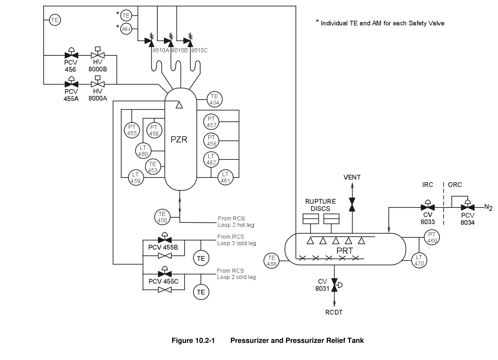
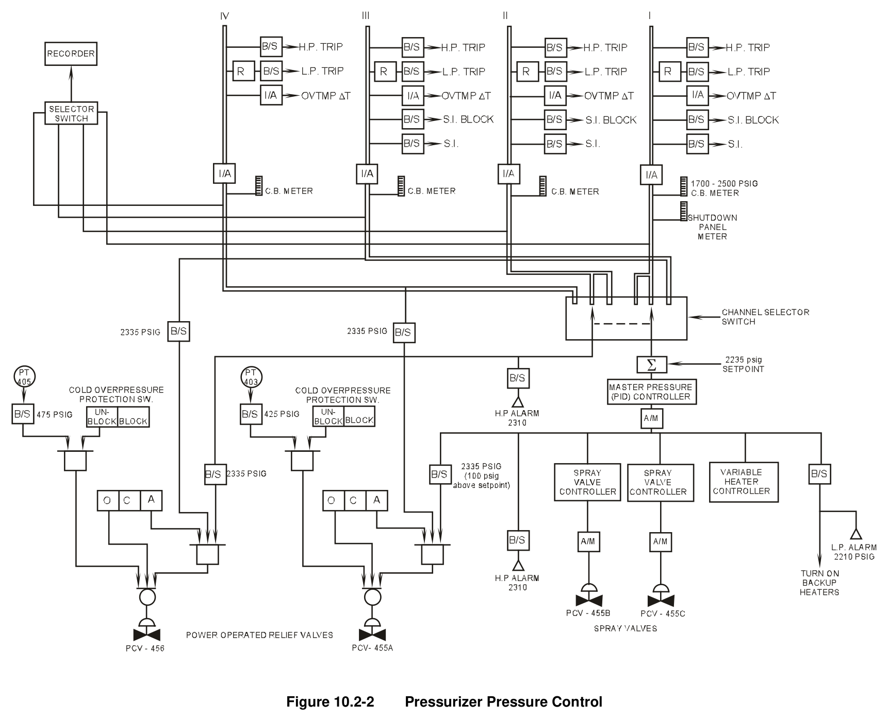
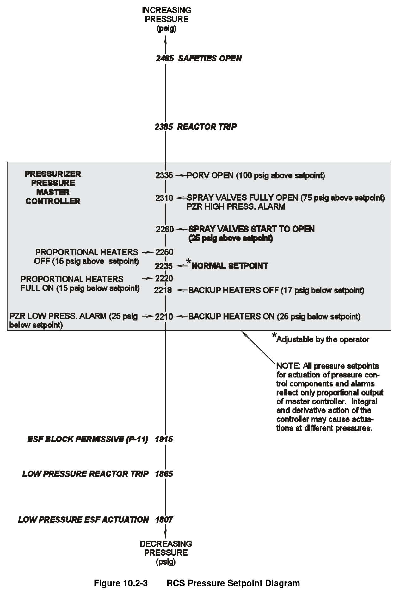

# 10.2 Pzr Press Control

> Pages 836–847 of `ML20057E160.pdf`
> Westinghouse Technology Systems Manual — USNRC HRTD (PWR)

---
<!-- p.836 -->
#### Westinghouse Technology Systems Manual
#### Section 10.2
#### Pressurizer Pressure Control System
<!-- p.837 -->
TABLE OF CONTENTS

10.2 Pressurizer Pressure Control System ................................................... 10.2-1

10.2.1 Introduction ........................................................................................... 10.2-1

10.2.2 System Description ............................................................................... 10.2-1

10.2.3 Reactor Protection Signals ................................................................... 10.2-3

10.2.3.1 High Pressure Reactor Trip .................................................. 10.2-4

10.2.3.2 Low Pressure Reactor Trip ................................................... 10.2-4

10.2.3.3 Overtemperature ΔT Trip ...................................................... 10.2-4

10.2.3.4 Safety Injection Actuation ..................................................... 10.2-4

10.2.4 Permissives and Interlocks ................................................................... 10.2-4

10.2.4.1 ESF Actuation Block ............................................................. 10.2-4

10.2.4.2 Relief Valve Interlocks and Cold Overpressure Protection ... 10.2-5

10.2.5 System Controls ................................................................................... 10.2-5

10.2.5.1 Channel Selector Switch ...................................................... 10.2-5

10.2.5.2 Master Pressure Controller ................................................... 10.2-6

10.2.5.3 Relief Valve Controls ............................................................ 10.2-6

10.2.5.4 Spray Valve Controls ............................................................ 10.2-6

10.2.5.5 Heater Controls .................................................................... 10.2-6

10.2.6 Summary .............................................................................................. 10.2-7

LIST OF FIGURES

Figure 10.2-1 ................................................ Pressurizer and Pressurizer Relief Tank

Figure 10.2-2 ................................................................. Pressurizer Pressure Control

Figure 10.2-3 ............................................................ RCS Pressure Setpoint Diagram

USNRC HRTD 10.2-i Rev 1013

<!-- p.838 -->
### 10.2 PRESSURIZER PRESSURE CONTROL SYSTEM
#### Learning Objectives:
1. List and describe the purposes (bases) of the protective signals provided by the pressurizer pressure transmitters.

2. List and describe the purposes of the permissives and interlocks provided by the pressurizer pressure transmitters.

3. List in sequence the actions performed by the pressurizer pressure control system during:

a. A continuous pressure increase above the normal pressure setpoint (2235 psig), and b. A continuous pressure decrease below 2235 psig.

4. Explain the effect of changing the pressure control setpoint on both control and protective functions.

5. List the inputs to the cold overpressure protection system, and explain the operation of the system.

#### 10.2.1 Introduction
The pressurizer pressure control system maintains reactor coolant system (RCS)
pressure within a narrow band around an operator selectable setpoint. The setpoint span is 1700 psig to 2500 psig, and the setpoint is normally set to 2235 psig.

The input to the master pressurizer pressure controller is the error between actual pressurizer pressure and the setpoint. The output of the master controller controls the operation of electrical heater banks, pressurizer spray valves, and one poweroperated relief valve (PORV). Separate control system inputs trigger operation of the second PORV. When these components are actuated at the proper times, under- and overpressurization events are minimized.

#### 10.2.2 System Description
The pressurizer heaters are divided into four banks: one bank of proportional heaters (heater bank C) and three banks of backup heaters (heater banks A, B, and D). The proportional heaters are controlled by varying the percentage of time during which they are energized. The backup heaters are either constantly energized or constantly de-energized.

If the pressure in the pressurizer decreases from the desired pressure of 2235 psig, the master controller increases the output of the proportional heaters (increases the percentage of time that they are energized). If the pressure continues to decrease, all banks of backup heaters are turned on. As the heaters add energy to the water in the pressurizer, more water flashes to steam, thereby increasing the pressure to the desired setpoint.

USNRC HRTD 10.2-1 Rev 1013

<!-- p.839 -->
As the pressure in the pressurizer increases above its normal setpoint, the master controller decreases the output of the proportional heaters. If the pressure continues to increase, the master controller output modulates the spray valves open. Opening the spray valves allows reactor coolant to flow from the RCS cold legs (loop B and loop C) through the spray nozzle into the pressurizer. The relatively cool water spraying into the steam space of the pressurizer condenses some of the steam, which in turn lowers pressurizer pressure.

If the spray valves are not capable of controlling the pressure increase for a large overpressure transient, the two PORVs, mounted on the pressurizer, open to aid the spray valves in minimizing the pressure excursion. The PORVs discharge steam into the pressurizer relief tank.

For transients that exceed the capability of the control system, appropriate high and low pressure reactor trips and a low pressure engineered safety features actuation are actuated by the reactor protection system (RPS). If the high pressure reactor trip is inoperable or an overpressure transient is of such a magnitude that the pressure in the RCS continues to increase beyond the trip setpoint, three code safety valves open to protect the integrity of the reactor coolant pressure boundary.

Figure 10.2-1 shows the pressurizer, its associated instrumentation, and the components used to control pressure. Figure 10.2-2 is a functional block diagram of the pressurizer pressure control system. The sequence of component operation and protective actions is shown in Figure 10.2-3.

The pressure from the selected pressurizer pressure channel (usually channel I, as shown in Figure 10.2-2) is compared to a variable pressure setpoint (normally 2235 psig). The resulting pressure error is the input to the master pressure controller, which is a proportional + integral + derivative (PID) controller. The integral action of the controller causes the controller output to vary with the duration of the pressure error and thus serves to return pressurizer pressure to setpoint. The derivative action causes the controller output to vary with the rate of change (derivative) of the pressure error and thus makes the controller responsive to rapid pressure changes.
The output from the master pressure controller provides input signals to the controllers for the proportional heaters and the spray valves (one controller for each spray valve). The master controller also provides inputs to the bistable that energizes the backup heaters, to the bistables for the high and low pressure alarms, and to the opening logic for one of the two PORVs.

Figure 10.2-3 shows the nominal master controller pressure setpoints for component actuation and modulation. These setpoints correspond to the proportional output of the controller only. The integral and derivative features of the controller could cause heater or spray operation at different pressures than those indicated in Figure 10.2-
3. For instance, if pressurizer pressure were to remain at exactly 2250 psig (above the normal setpoint) for a significant period of time, the integrated pressure error would gradually add to the output of the controller, which would eventually modulate open the spray valves. In summary, the master pressure controller decreases the output of the variable heaters and then increasingly opens the spray valves in response to an increasing or persistently above-setpoint pressure, and it increases

USNRC HRTD 10.2-2 Rev 1013

<!-- p.840 -->
the output of the variable heaters and then energizes the backup heaters in response to a decreasing or persistently below-setpoint pressure. In either case, the controlled components should bring the pressure back to setpoint.

In accordance with the design of the pressurizer pressure control system, during normal operation the heaters and spray valves are placed in automatic, ready to respond to outputs from the master pressure controller. During steady-state operation, the controller energizes the proportional heaters to compensate for minor pressure fluctuations. The proportional heaters are energized for a small percentage of the time (a portion of each 10-sec interval) to compensate for the continuous bypass spray flow (approximately one gpm) and to compensate for heat losses from the pressurizer to ambient.

By contrast, at present many plants normally operate with some banks of backup heaters manually energized to promote spray flow so that water chemistry (boron concentration) in the pressurizer is maintained equivalent to that of the RCS. When the heaters are first energized, the additional steam formation in the pressurizer increases the pressure above the setpoint. The output of the master pressure controller increases until the spray valves partially open, and the spray flow reduces the pressure back to setpoint. The integrated pressure error over the duration when pressure exceeded setpoint generates sufficient controller output to keep the spray valves partially open. When steady-state conditions are reached, pressurizer pressure is maintained at the normal setpoint with the spray valves open just enough to counteract the effect of the energized backup heaters.

For sufficiently low pressurizer pressures, a low pressure alarm is actuated in the main control room. This annunciator alerts the control room operators that a technical specification action requirement associated with the limiting condition for operation for departure from nucleate boiling (DNB) may be in effect as a result of low pressurizer pressure.

The purpose of the two PORVs is to maintain RCS pressure below the high pressurizer pressure reactor trip setpoint during transients that cause pressure in the RCS to increase. In addition, if these valves operate as designed, they prevent or minimize the number of times the spring-loaded, self-actuating code safety valves lift. One PORV opens automatically at a fixed bistable setpoint of 2335 psig as sensed by the selected pressurizer pressure transmitter (usually channel II). The second PORV opens automatically with a sufficiently large master controller output
(nominal 100-psi pressure error). The automatic opening of each PORV also requires the correct status of an interlocking bistable, which is supplied by a separate pressure transmitter. (See section 10.2.4.2 for relief valve interlock details.)

#### 10.2.3 Reactor Protection Signals
Four pressure transmitters are used to generate the required coincidence for the protective functions. These four channels also provide control functions through a channel selector switch which allows for testing an individual channel and, in the event of a failed transmitter, for substituting the output of a non-faulted detector into the control circuitry. The control functions of this system are physically separated

USNRC HRTD 10.2-3 Rev 1013

<!-- p.841 -->
from the protective features via isolation amplifiers. The protective functions of these pressure transmitters are discussed below and in detail in Chapter 12.

##### 10.2.3.1 High Pressure Reactor Trip
The high pressure trip is generated when pressure in the pressurizer exceeds 2385 psig, as sensed by at least two of four transmitters. It provides protection for the reactor coolant pressure boundary. This trip cannot be blocked by the operator.

##### 10.2.3.2 Low Pressure Reactor Trip
The low pressure trip is generated when pressurizer pressure decreases to 1865 psig, as sensed by at least two of four transmitters. The low pressure reactor trip is functional whenever the power of the reactor or the turbine is greater than 10%.
This trip is rate sensitive and protects against DNB (see Section 2.2).

##### 10.2.3.3 Overtemperature ΔT Trip
There are four separate overtemperature ΔT (OTΔT) trip setpoint calculators (see Section 12.2). Each reactor protection system (RPS) channel has its own dedicated calculator. Each of the four pressurizer pressure transmitters supplies an analog pressure signal to its respective channel’s calculator (e.g., pressurizer pressure channel I supplies an input to the RPS channel I OTΔT trip setpoint calculator). The pressure input is thus one of the DNB-related parameters used in the computation of the OTΔT trip setpoint. This trip provides protection against DNB.

##### 10.2.3.4 Safety Injection Actuation
Three of the four pressurizer pressure transmitters (channels I, II, & III) supply the logic for generating a safety injection (SI) actuation signal for loss-of-coolantaccident (LOCA) protection. This signal is generated when at least two of the three pressure transmitters sense a pressure of 1807 psig or less. In later generation Westinghouse units, the coincidence logic for this actuation signal is two out of four.

#### 10.2.4 Permissives and Interlocks
##### 10.2.4.1 ESF Actuation Block
The pressurizer safety injection block permissive (P-11) is generated when at least two of three pressure transmitters sense a pressurizer pressure of less than 1915 psig. This permissive allows the operator to manually block the low pressurizer pressure engineered safety features actuation and thereby enables a normal plant cooldown and depressurization without an engineered safety features actuation.

In accordance with IEEE Standard 279-1979, if a protective feature is removed from service it must automatically be reinstated if the plant state requires that protective feature. Therefore, when at least two of the three pressure transmitters sense a pressure of 1915 psig or greater, the P-11 permissive is automatically removed, and the low pressure ESF actuation signal is reinstated within the logic portion of the RPS.

USNRC HRTD 10.2-4 Rev 1013

<!-- p.842 -->
##### 10.2.4.2 Relief Valve Interlocks and Cold Overpressure Protection
Each PORV attached to the pressurizer is provided with an interlock to prevent its inadvertent opening if pressurizer pressure is less than 2335 psig. This interlock prevents the failure of either a single pressure transmitter or the master pressure controller from inadvertently opening a PORV. Accidental opening of a PORV is in effect a small-break LOCA through the top of the pressurizer, which causes a depressurization of the RCS. The interlock is the status of a second bistable in the PORV opening logic; the bistable receives an input from a separate independent pressure transmitter. The second bistable’s setpoint is established at 2335 psig.
With this configuration, as shown in Figure 10.2-2, automatic opening of PORV PCV-456 requires two pressurizer pressure channels sensing a pressure ≥ 2335 psig, in conjunction with the valve operating switch being in the AUTO position.
Automatic opening of PORV PCV-455A requires one pressurizer pressure channel sensing a pressure ≥ 2335 psig, the output of the master pressure controller calling for the valve to open, and the valve operating switch being in the AUTO position.

Technical Specifications require that the cold overpressure protection system
(consisting of either two PORVs, a combination of other relief valves of sufficient capacity, or a suitably large RCS vent) be operable whenever the RCS cold-leg temperature is less than a predetermined value. During at-power operation the cold overpressure protection switches (one per PORV, as shown in Figure 10.2-2) are in the block position. When the RCS pressure, as indicated by the wide-range pressure detectors, is < 375 psig, the operator is directed by the plant’s operating procedures to place these switches in the unblocked positions. This action arms the overpressure protection circuitry, and all that is needed for the opening of a PORV is for the pressure in the RCS, as sensed by the associated wide-range pressure detector, to increase to a value greater than its cold overpressure bistable setpoint.

If the pressure in the RCS increases to 400 psig or greater with the cold overpressure protection system unblocked, an alarm is annunciated in the control room alerting the operator to an overpressure condition. If the control room operator takes no corrective action and pressure continues to increase, one PORV (PCV- 455A) opens when RCS pressure exceeds 425 psig (as sensed by pressure transmitter PT-403). If the magnitude of the pressure surge into the RCS is greater than the capacity of a single PORV, the second PORV (PCV-456) opens when the pressure in the RCS exceeds 475 psig (as sensed by PT-405). The PORVs close in reverse order as the pressure in the RCS decreases below the opening setpoints.

The control room operator can manually open or close either PORV. The PORV opening logic shown in Figure 10.2-2 shows that manual opening is independent of both the plant pressure and the status of the cold overpressure protection system.

#### 10.2.5 System Controls
##### 10.2.5.1 Channel Selector Switch
A three-position selector switch mounted on the control board allows the control room operator to select different pressure transmitters for pressure control and relief valve actuation during channel testing and in the event of a transmitter failure. This

USNRC HRTD 10.2-5 Rev 1013

<!-- p.843 -->
switch allows the pressure from channel I or III to generate the pressure error used as the input to the master pressure controller, while channel II or IV can supply one input to the opening logic for PORV PCV-456, the PORV not controlled by the master controller. Note that channel III always provides the interlock function for PCV-456, and that channel IV always provides the interlock function for PCV-455A.

##### 10.2.5.2 Master Pressure Controller
The master pressure (PID) controller develops an output control signal in response to the error resulting from the comparison of actual pressure to an adjustable pressure setpoint normally set at 2235. This setpoint adjustment (1700 psig to 2500 psig) is accessible to the operator via a potentiometer knob on the controller.

As shown in Figure 10.2-2, the master controller is “downstream” of the isolation amplifiers which separate protective features from pressure control functions. If the control room operator changes the setpoint of this controller, the pressures at which pressure control components actuate change accordingly, and pressurizer pressure ultimately stabilizes at the new setpoint. The setpoint adjustment has no impact on the inputs to the protection system bistables, which are “upstream” of the isolation amplifiers, and the bistable setpoints remain unchanged.

##### 10.2.5.3 Relief Valve Controls
Each PORV has a three-position switch located adjacent to each other on the main control board. These switches allow the control room operator to manually open or close the valves, or to place them in the automatic mode of operation.

##### 10.2.5.4 Spray Valve Controls
Each spray valve has an automatic/manual controller on the main control board.
These controllers allow the operator to manually open or close the spray valves, or to place them in the automatic mode of control and allow the master pressure controller to modulate their positions. The amount of modulation, when the valve controllers are in automatic, is dependent on the output of the master controller. The nominal setpoints (corresponding to the proportional output of the controller only) are 2260 psig (25 psig above setpoint) for spray valves to start opening and 2310 psig
(75 psig above setpoint) for spray valves to fully open. The amount of valve opening varies linearly between the full-closed and full-open setpoints.

##### 10.2.5.5 Heater Controls
The proportional heaters have an on-off switch, mounted on the control board, which either places them in automatic control or de-energizes them. When the proportional heaters are operated in automatic, they are energized for a percentage of each successive 10-sec interval; that percentage is proportional to the output of the master pressure controller. The nominal setpoints (corresponding to the proportional output of the controller only) are 2220 psig (15 psig below setpoint) for the proportional heaters to be constantly energized and 2250 psig (15 psig above setpoint) for the proportional heaters to be constantly de-energized. The percentage of time that the proportional heaters are energized varies linearly between the constantly energized and constantly de-energized setpoints.

USNRC HRTD 10.2-6 Rev 1013

<!-- p.844 -->
Each of the three backup heater banks has an off-on-automatic control switch mounted on the main control board which allows the operator to manually control the heaters or to place them in automatic control. In automatic control, the actuation of the backup heaters is dependent on the output of the master controller. The nominal setpoints (corresponding to the proportional output of the controller only) are 2210 psig (25 psig below setpoint) for the heaters to energize and 2217 psig (18 psig below setpoint) for the heaters to de-energize.

In addition, there are local-remote, on-off switches for the backup heater banks which are located on the remote shutdown panel in the auxiliary building. These switches allow limited remote control of pressurizer pressure in the event of a control room emergency.

#### 10.2.6 Summary
The pressurizer pressure control system maintains the RCS pressure at or near a desired adjustable setpoint. This setpoint may be changed by the control room operator; it is normally selected to 2235 psig. The pressurizer pressure control system maintains the RCS at the desired pressure by operating proportional and backup heaters, spray valves, and power-operated relief valves. The master pressure controller calls for actuation of pressure control components in accordance with how much, how long, and how quickly actual pressurizer pressure deviates from the pressure setpoint.

The pressure transmitters also provide the RPS with input signals for reactor trips which provide reactor coolant pressure boundary protection and protection against DNB. These transmitters also supply inputs to the low pressurizer pressure safety injection actuation for the mitigation of a potential LOCA.

USNRC HRTD 10.2-7 Rev 1013

<!-- p.845 -->
#### Figure 10.2-1

*Pressurizer and Pressurizer Relief Tank*

[Vector original (SVG, lossless): fig_10.2-1.svg](../figures/fig_10.2-1.svg)

<!-- p.846 -->
#### Figure 10.2-2

*Pressurizer Pressure Control*

[Vector original (SVG, lossless): fig_10.2-2.svg](../figures/fig_10.2-2.svg)

<!-- p.847 -->
#### Figure 10.2-3

*RCS Pressure Setpoint Diagram*

[Vector original (SVG, lossless): fig_10.2-3.svg](../figures/fig_10.2-3.svg)

