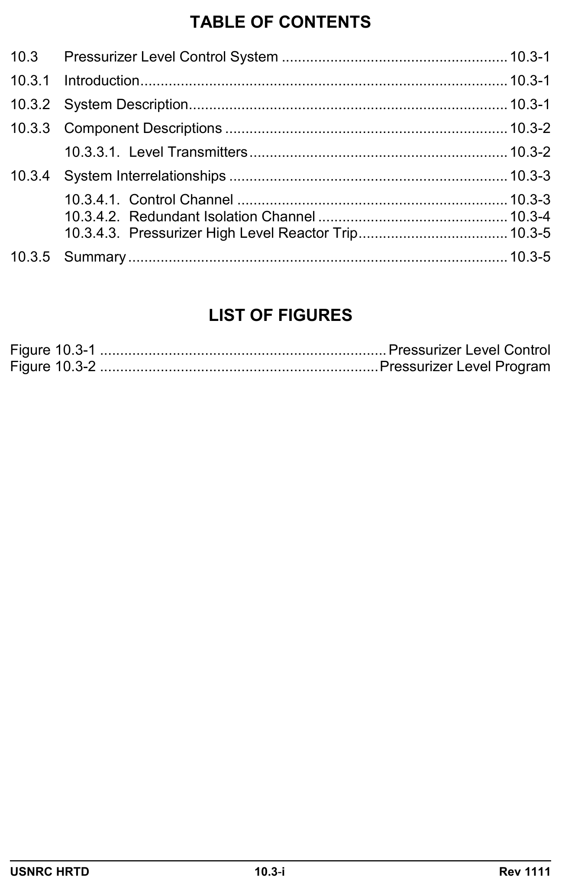
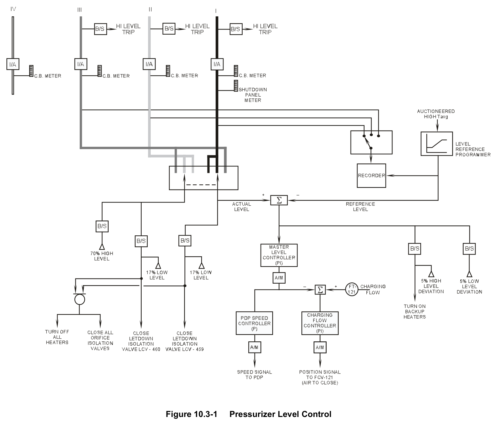
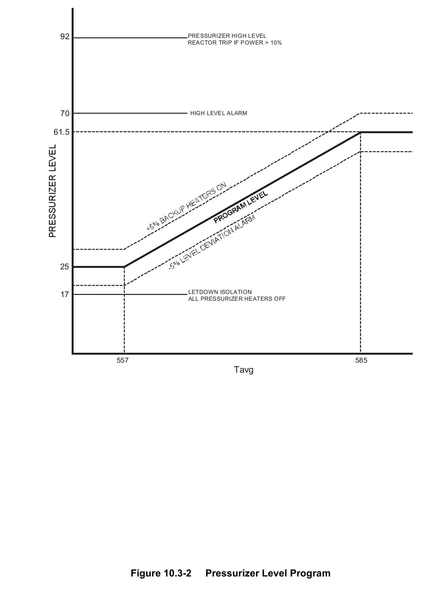

# 10.3 Pzr Level Control

> Pages 848–857 of `ML20057E160.pdf`
> Westinghouse Technology Systems Manual — USNRC HRTD (PWR)

---
<!-- p.848 -->
#### Westinghouse Technology Systems Manual
#### Section 10.3
#### Pressurizer Level Control System
<!-- p.849 -->
#### Figure 10.3-1

*...................................................................... Pressurizer Level Control*

<!-- labels/text on this figure page -->
TABLE OF CONTENTS
10.3 Pressurizer Level Control System ........................................................ 10.3-1
10.3.1 Introduction ........................................................................................... 10.3-1
10.3.2 System Description ............................................................................... 10.3-1
10.3.3 Component Descriptions ...................................................................... 10.3-2
10.3.3.1. Level Transmitters ................................................................ 10.3-2
10.3.4 System Interrelationships ..................................................................... 10.3-3
10.3.4.1. Control Channel ................................................................... 10.3-3
10.3.4.2. Redundant Isolation Channel ............................................... 10.3-4
10.3.4.3. Pressurizer High Level Reactor Trip ..................................... 10.3-5
10.3.5 Summary .............................................................................................. 10.3-5
LIST OF FIGURES
Figure 10.3-1 ....................................................................... Pressurizer Level Control
Figure 10.3-2 ..................................................................... Pressurizer Level Program
USNRC HRTD 10.3-i Rev 1111

<!-- p.850 -->
### 10.3 PRESSURIZER LEVEL CONTROL SYSTEM
#### Learning Objectives:
1. State the purposes of the pressurizer level control system.

2. List and describe the purposes (bases) of the protective signal provided by pressurizer level instrumentation.

3. Identify the instrumentation signal that is used to generate the pressurizer level program, and explain why level is programmed.

4. Explain how charging flow is controlled in response to pressurizer level error signals during the following:

a. Centrifugal charging pump operation, and b. Positive displacement charging pump operation.

5. Explain the purposes of the pressurizer low level interlocks.

#### 10.3.1 Introduction
The purposes of the pressurizer level control system are to:

1. Control charging flow to maintain a programmed level in the pressurizer, and

2. Provide inputs to pressurizer heater control and letdown isolation valves for certain pressurizer level conditions.

#### 10.3.2 System Description
During steady-state operation, an unchanging pressurizer level indicates that a balance exists between the charging flow into the reactor coolant system and the letdown flow from the reactor coolant system into the chemical and volume control system. During transients the level in the pressurizer changes because the reactor coolant expands or contracts as the average temperature of the coolant increases or decreases.

Designing a control system to maintain a constant pressurizer level, as reactor power and reactor coolant temperatures change, is a relatively simple matter.
However, a major disadvantage of such a system is that, as the temperature of the reactor coolant increases, the coolant expands. The expansion of coolant is seen as an increase in pressurizer level. When the level in the pressurizer increases above the programmed setpoint, the pressurizer level control system decreases the charging flow.

Recall from the description of the chemical and volume control system (Section 4.1)
that the letdown flow from the reactor coolant system is constant (75 gpm). With constant letdown and decreasing charging as described in the previous paragraph, the rate of coolant letdown is greater than the rate of coolant return to the reactor

USNRC HRTD 10.3-1 Rev 1111

<!-- p.851 -->
coolant system via the charging pumps. With this imbalance of flow, the level in the volume control tank increases. When the level in the volume control tank reaches a high level, coolant is diverted to the holdup tanks.

Once the water is diverted, it is treated as liquid waste and is processed for reuse or discarded. This places a large burden on the liquid radioactive waste processing systems.

On the other hand, a decrease in the temperature of the reactor coolant causes the coolant to contract and places a large demand on the makeup system. To minimize the demands on the liquid waste system and the chemical and volume control system, the level in the pressurizer is programmed to follow the natural expansion or contraction of the reactor coolant as the temperature of the coolant increases or decreases.

The pressurizer level control system is shown in Figure 10.3-1, while the functional system parameters are displayed in Figure 10.3-2.

#### 10.3.3 Component Descriptions
##### 10.3.3.1. Level Transmitters
The level in the pressurizer is determined by the measuring the difference in pressure between an external column of water of a known height (reference leg) and a variable column of unknown height inside the pressurizer (variable leg). The differential pressure between these two columns of water is converted into a pressurizer level signal.

Four differential pressure transmitters (d/P cells) are mounted on the pressurizer.
Each d/P cell converts the sensed d/P into an electrical current that corresponds to a level varying from 0 to 100%. Each transmitter has an external, bellows-type, sealed reference leg, with a condensate pot attached at the top of the leg, to generate the static pressure head of the reference leg. The actual water level inside the pressurizer constitutes the dynamic or variable leg. Since the density of water varies with temperature, any temperature change of the coolant inside the pressurizer affects its indicated level. Therefore, the pressurizer level instruments are calibrated based upon pressurizer temperature.

Three of the four level transmitters are calibrated for normal operating temperatures and are used for indication, control and protection. The remaining level transmitter is calibrated for cold conditions and is used only for indication with the plant in cold shutdown or when a steam bubble is drawn in the pressurizer. The cold-calibrated transmitter does not provide an input to the pressurizer level circuitry or an input into the reactor protection system.

The output of each level transmitter indicates a level of 0 to 100% for the water volume inside the pressurizer. A selector switch, located on the main control board, allows the control room operator to select two of the three transmitters used for control. One channel is used for level control, letdown isolation, and pressurizer heater cutoff, while the other channel is used for backup letdown isolation and

USNRC HRTD 10.3-2 Rev 1111

<!-- p.852 -->
heater cutoff. The third channel can be selected to replace either of the two controlling channels during testing or failures. An additional selector switch is provided on the main control board that allows the operator to select any one of the three transmitters for recording.

#### 10.3.4 System Interrelationships
##### 10.3.4.1. Control Channel
The difference between the actual pressurizer level and the programmed reference level signal is supplied to the master pressurizer level controller. If an error signal exists, this PI (proportional plus integral) controller varies the chemical and volume control system charging flow. This controller prevents the charging flow from reacting to small temporary level perturbations while eliminating steady-state level errors. Since the letdown flow is fixed, the inventory of the reactor coolant system is maintained by varying the charging flow. This is accomplished by one of two different methods:

1. If the positive displacement charging pump is operating, charging flow is controlled by varying the speed of the positive displacement charging pump. For this method of control, the output of the master level controller is supplied to a proportional (P) pump speed controller.

2. If a centrifugal charging pump is operating, charging flow is controlled by varying the position of the flow control valve (FCV-121), located in the common discharge header downstream of the centrifugal charging pumps. For this method of control, the output of the master pressurizer level controller serves as the flow setpoint; the setpoint is compared to the actual charging flow measured by flow transmitter FT-121, located just downstream of FCV-121. The difference is supplied to the PI charging flow controller, which controls the air pressure to the operator for FCV-121 and thus regulates its position. As FCV-121 is an airto-close valve, an increasing output from the charging flow controller (meaning that charging flow exceeds the demand from the master level controller)
repositions the valve in the closed direction.

When the plant is operating and the power in the reactor is changed, the average temperature of the reactor coolant system is programmed to change. This change in temperature causes a corresponding change in the level of the pressurizer. To reduce the effect on the charging system, the level in the pressurizer is programmed
(shown in Figure 10.3-2) as a function of auctioneered high Tavg, so that it follows the natural expansion characteristics of the reactor coolant. However, a rapid transient causes an increase or decrease in the water level of the pressurizer and a corresponding response by charging flow. For this reason, both minimum and maximum level limitations are placed on the level program in order to satisfy the following:

1. The pressurizer low level setpoint of 25% is selected to prevent the pressurizer from emptying following a reactor trip. In addition, this level ensures that a step load increase of 10% power does not uncover the heaters.

USNRC HRTD 10.3-3 Rev 1111

<!-- p.853 -->
2. The pressurizer high level setpoint of 61.5% is derived from the natural expansion of the reactor coolant when the coolant is heated up from the no-load to the full power Tavg (557°F to 585°F), with the assumption that the level in the pressurizer is 25% when the heatup begins.

This high level setpoint (61.5%) is low enough to ensure that the pressurizer does not go solid following a turbine trip from 100% power without a direct reactor trip, assuming no operator action and no response by the automatic control systems (the rod control and steam dump control systems).

In addition, this level (61.5%) is low enough that the insurge from a step load reduction of 50% does not cause the level in the pressurizer to reach the high level reactor trip setpoint, assuming that the automatic rod control system and the steam dump control system respond to the transient properly.

In general, an outsurge of water from the pressurizer results in a system pressure decrease, and an insurge of water from the reactor coolant system results in a pressure increase. However, if the insurge is large, it ultimately results in a system pressure decrease because the insurge water is cooler than the water initially in the pressurizer. Therefore, if the level in the pressurizer increases above the program level setpoint by 5%, the control system automatically energizes the backup heaters in an effort to offset that effect.

An insurge into the pressurizer is observed during a step load decrease (RCS temperature increases due to reactor power being higher than the secondary load);
over time the cooler water that has entered the pressurizer would cause a pressure reduction. This insurge is followed by a larger outsurge as the rod control system brings Tavg to program for the lower power level; this control response also tends to reduce pressure. Therefore, the 5% deviation above level setpoint serves as an anticipatory signal to limit the pressure reduction in the reactor coolant system upon a load decrease.

The same level signal which is compared to the reference level in the level controller is also sent to a bistable. This bistable provides a low level interlock at 17% level in the pressurizer. In addition to providing a low level alarm, this interlock isolates the letdown from the chemical and volume control system by closing one letdown isolation valve and all orifice isolation valves, and turns off all pressurizer heaters.
Isolating the letdown prevents further lowering of the pressurizer level, and the heater cutoff protects the heaters which would be damaged if operated in a steam environment.

##### 10.3.4.2. Redundant Isolation Channel
This channel consists of an actual level signal sent through the channel selector switch and then to two bistables. One of these bistables functions to provide a high level alarm at 70% level. The other bistable closes the second letdown isolation valve, provides a redundant signal to close all orifice isolation valves, and turns off all heaters.

USNRC HRTD 10.3-4 Rev 1111

<!-- p.854 -->
##### 10.3.4.3. Pressurizer High Level Reactor Trip
If two out of the three level transmitters sense a level greater than 92%, a reactor trip signal is generated. This trip is provided to protect the RCS pressure boundary by tripping the reactor before the pressurizer completely fills with water, or “goes solid.” It thus functions as a backup to the high pressurizer pressure reactor trip.

The high level trip setpoint is selected at a value low enough to prevent the discharge of water through the pressurizer safety valves. Discharges of water could mechanically damage the pressurizer safety valves. This trip is an “at-power” trip and is only active if either reactor power or turbine power is 10% or greater ("atpower permissive" P-7). This reactor trip is discussed in detail in Chapter 12.

#### 10.3.5 Summary
The pressurizer level control system maintains the water inventory of the reactor coolant system by varying the charging rate from the chemical and volume control system. In addition, provisions are made to isolate letdown and turn off the pressurizer heaters on a pressurizer low level. This feature minimizes the effects of a loss of coolant and protects the pressurizer heaters.

The system also turns on the pressurizer heaters if the level in the pressurizer is higher than the program level. Turning on the heaters is performed in anticipation of a pressure decrease following a loss of load transient.

A pressurizer high level reactor trip is provided to prevent operation with a “solid” pressurizer and thus provides RCS boundary protection.

USNRC HRTD 10.3-5 Rev 1111

<!-- p.855 -->
#### Figure 10.3-1

*Pressurizer Level Control*

[Vector original (SVG, lossless): fig_10.3-1_2.svg](../figures/fig_10.3-1_2.svg)

<!-- p.856 -->
#### Figure 10.3-2

*Pressurizer Level Program*

[Vector original (SVG, lossless): fig_10.3-2.svg](../figures/fig_10.3-2.svg)

<!-- labels/text on this figure page -->
92 PRESSURIZER HIGH LEVEL REACTOR TRIP IF POWER > 10%
70 HIGH LEVEL ALARM
61.5
25
LETDOWN ISOLATION 17 ALL PRESSURIZER HEATERS OFF
557 585 Tavg
Figure 10.3-2 Pressurizer Level Program

