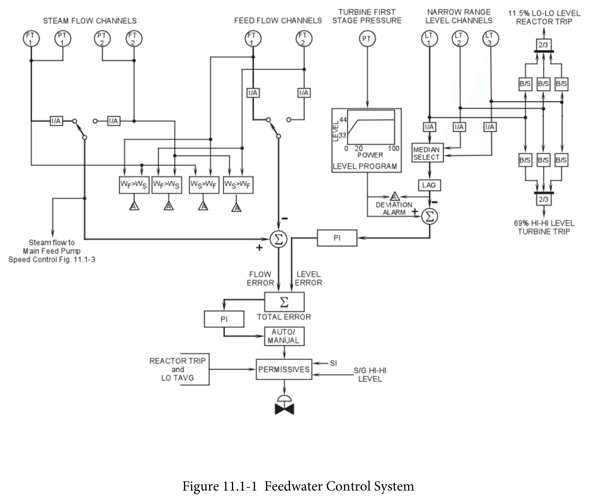
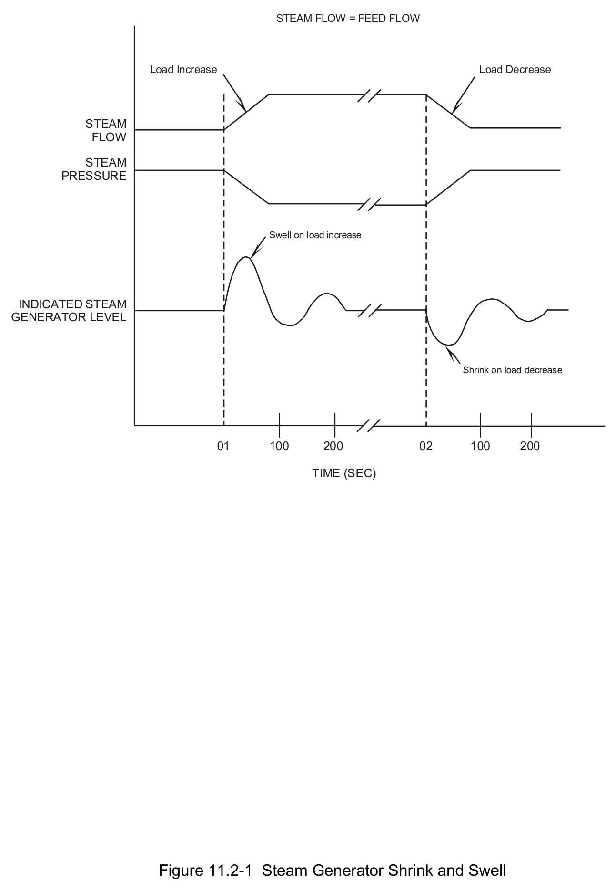
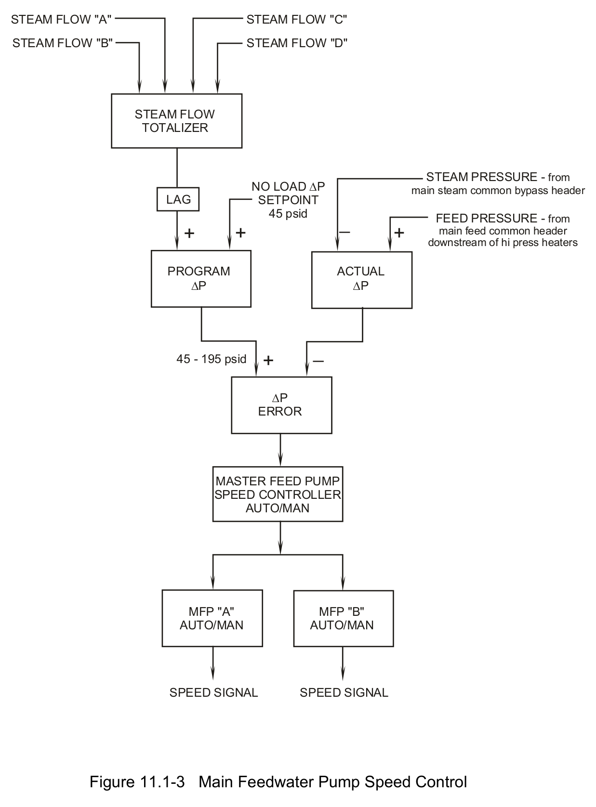
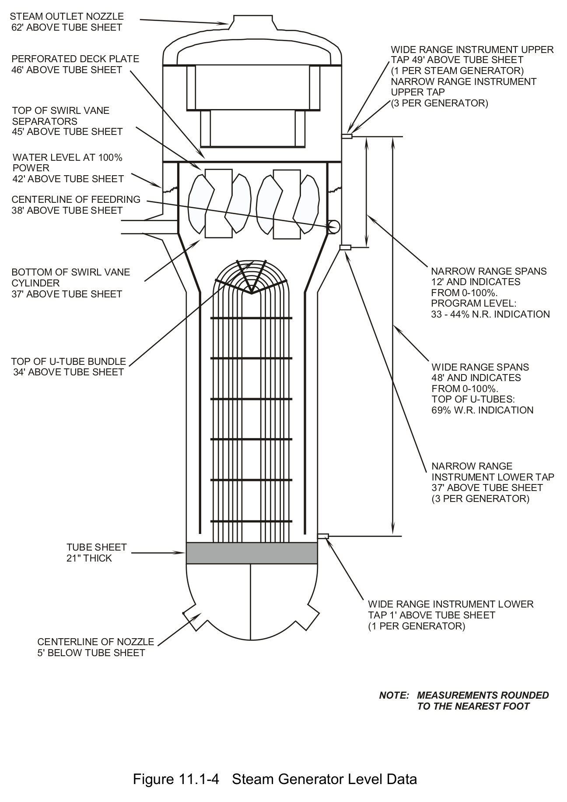

# 11.1 SGWLC

> Pages 858–869 of `ML20057E160.pdf`
> Westinghouse Technology Systems Manual — USNRC HRTD (PWR)

---
<!-- p.858 -->
#### Westinghouse Technology Systems Manual
#### Section 11.1
#### Steam Generator Water Level Control System
<!-- p.859 -->
TABLE OF CONTENTS

11.1 Steam Generator Water Level Control System ..................................... 11.1-1

11.1.1 Introduction ........................................................................................... 11.1-1

11.1.2 System Description ............................................................................... 11.1-2

11.1.2.1 Feedwater Control System ................................................... 11.1-2

11.1.2.2 Main Feedwater Pump Speed Control System ..................... 11.1-4

11.1.3 Instrumentation ..................................................................................... 11.1-4

11.1.3.1 Level Channels ..................................................................... 11.1-4

11.1.3.2 Turbine First-Stage Pressure ................................................ 11.1-5

11.1.3.3 Steam Flow Channels ........................................................... 11.1-5

11.1.3.4 Feedwater Flow Channels .................................................... 11.1-5

11.1.3.5 Steam Pressure Channels .................................................... 11.1-6

11.1.3.6 Feedwater Pressure Channel ............................................... 11.1-6

11.1.4 System Interrelationships ...................................................................... 11.1-6

11.1.5 Summary ............................................................................................... 11.1-6

LIST OF FIGURES

Figure 11.1-1 ..................................................................... Feedwater Control System

Figure 11.1-2 ........................................................ Steam Generator Shrink and Swell

Figure 11.1-3 ................................................... Main Feedwater Pump Speed Control

Figure 11.1-4 .................................................................. Steam Generator Level Data

USNRC HRTD 11.1-i Rev 0216

<!-- p.860 -->
### 11.1 STEAM GENERATOR WATER LEVEL CONTROL SYSTEM
#### Learning Objectives:
1. State the purposes of the Steam Generator Water Level Control System.

2. List the Reactor Protection System and turbine trip inputs provided by steam generator instrumentation, and state the purpose of each trip.

3. List the inputs used in the feedwater control system. Describe how and why each input is used.

4. List the inputs used in the main feed pump speed control system. Describe how and why each input is used.

#### 11.1.1 Introduction
The purposes of the steam generator water level control system are as follows:

1. To control feedwater flow to maintain the programmed levels in the steam generators, and
2. To control the main feed pump speed to maintain the programmed main feed regulating valve differential pressure.

Additionally, the steam generator instrumentation provides inputs into the reactor protection system for loss of heat sink protection and inputs into the turbine trip system for equipment protection.

The steam generator water level control system involves two separate control systems for regulating feedwater flow to the steam generators. The feedwater control system, which controls steam generator level from 20% to 100% power, modulates the positions of the 14-inch main feed regulating valves. This control system is provided with inputs of main steam flow, main feedwater flow, actual level, and reference level (programmed as a function of turbine impulse pressure). Below 20% power, feedwater flow is controlled through manual operation of the 6-inch feed regulating bypass valves.

The main feed pump speed control system is utilized above 20% power to control the speed of the main feed pumps. Appropriate control of feed pump speed maintains each feed regulating valve near the midpoint of its travel. The feed pump speed control system does not directly control the levels of the steam generators.
The inputs provided for feed pump speed control are main steam header pressure, main feed header pressure, and a programmed reference differential pressure (∆P).

The reactor protection system is provided with several inputs from the detectors used in the steam generator water level control system. The inputs are used for the generation of reactor trips and engineered safety features actuations. The reactor protection system also generates feedwater isolation signals, which affect the

USNRC HRTD 11.1-1 Rev 0216

<!-- p.861 -->
operation of feedwater system components. Inputs from steam generator instrumentation are also provided to the turbine trip system for turbine protection.

#### 11.1.2 System Description
The steam generator water level control system utilizes the inputs from various detectors to control the feedwater flow to maintain programmed levels in the steam generators. The following sections provide a detailed discussion of each of the control systems involved.

##### 11.1.2.1 Feedwater Control System
The feedwater control system for one steam generator is shown in Figure 11.1-1.
Each steam generator has an identical system. The feedwater control system utilizes the following inputs for controlling the position of the main feed regulating valve:

• One of two pressure-compensated steam flow channels (selectable),
• One of two feedwater flow channels (selectable),
• An actual steam generator level channel (no alternate channel available), and
• A programmed level generated by one of the turbine first-stage pressure channels.

For an accurate measure of the steam flow rate, a pressure-compensated steam flow signal is required. The mass flow rate of the steam is dependent on the density of the steam. Since steam is a compressible fluid, the density is a function of the steam pressure. Feedwater flow does not require density compensation because water is an incompressible fluid. These two flow signals are compared to produce a flow error signal, which is combined with the level error signal as the input to the feed regulating valve controller. The flow signals are also compared to provide steam flow/feed flow mismatch alarms.

The level error signal is derived from the comparison of the actual level signal with the programmed level. The programmed level is generated by turbine first-stage
(impulse) pressure. Since impulse pressure is proportional to power, the steam generator levels are effectively programmed with power level.

The programmed level varies linearly from hot zero power (33% narrow-range level indication) to 20% power (44% narrow-range level indication), then remains at 44% above 20% power. The lower programmed level at low power levels minimizes the consequences of a steam line break inside the containment. The mass in the Steam Generators is greatest at low power levels. The 44% maximum program level satisfies the following considerations:

• The “shrink” in steam generator water level during a 50% (maximum design) load reduction will not cause a reactor trip on low-low steam generator level,

USNRC HRTD 11.1-2 Rev 0216

<!-- p.862 -->
• The “swell” in steam generator water level during a 10% step load increase will not cause water in the steam generator downcomer to back up into the moisture separators, and

• The peak containment pressure resulting from the blowdown of one steam generator’s entire inventory during a steam line break is limited.

A median select circuit eliminates the possibility of adverse control/protection interaction. The selected level signal is then conditioned by a lag unit to delay the input of level error to level control during the initial stages of a transient. Lagging the actual level signal prevents shrink and swell effects from masking actual steam generator inventory changes and thus allows the flow error to initially control the feed regulating valve position during a transient. The actual level is then subtracted from the programmed level to generate the level error.

The level error is the input signal to a proportional-plus-integral (PI) controller. The proportional section amplifies the error signal. The integral portion adds to the controller’s output as long as a level error persists, thereby making level error increasingly dominant. The time constant associated with the integral portion of the controller is two minutes, which allows the flow error to initially control water level and prevents rapid responses to level errors. The integrated level error also prevents an offset in level that could result from calibration errors in steam or feed flow detectors.

The output of the PI level controller is sent to the total error controller, where it is combined with the flow error. The flow error is generated by subtracting feed flow from steam flow. The output of the total error controller (also a PI controller) is used to position the main feed regulating valve. An opening signal to the valve results when either (1) the actual level is less than the programmed level or (2) feed flow is less than steam flow. A closing signal results from one of the converse conditions.

A load change affects steam flow and steam generator level. However, the control action caused by the level change would initially be in the wrong direction. For example, using Figure 11.1-2, during a load increase, steam flow increases; this action by itself produces a corresponding increase in feedwater flow. However, a load increase also causes an increase in steam generator level. This increase in level is called a swell (a temporary effect due to the measurement of level in the downcomer). This increase in level by itself would produce a decrease in feedwater flow (an undesirable effect). To prevent this undesired action, the lagged actual level signal and the large time constant of the PI level controller limit the effect of the momentary swell on the SG level control output. Therefore, the flow error increases feed flow, which is the desired response. A continuing level error will be amplified by the integral function of the level controller, and actual level will be returned to the programmed level setpoint.

During a load decrease the opposite of the load increase occurs; in a load decrease case, the indicated level in the steam generator level decreases for a short period of time. This phenomenon is called ‘shrink’. Once again, the control system features allow the flow error to produce the initial desired response of reducing feedwater

USNRC HRTD 11.1-3 Rev 0216

<!-- p.863 -->
flow before the lagged and integrated level error input returns the actual level to the programmed level setpoint.

##### 11.1.2.2 Main Feedwater Pump Speed Control System
Each main feed regulating valve is a throttling valve with linear flow characteristics throughout its travel. However, the best characteristics for flow control result when the valve position is somewhat near the midpoint of valve travel, or from about 25% open to 75% open. To maintain the valve position in this optimal range for all power levels, the speed of the main feed pumps is controlled to overcome the feedwater system dynamic losses (head losses), which vary with the feedwater flow and valve position. As a result, the pressure at the discharge of the pumps varies, and the differential pressure across the feedwater regulating valves changes. Controlling the feed pump speed also reduces regulating valve wear by allowing the valves to be further open with low feedwater flow rates and increases pump efficiency by reducing pump power requirements. The main feed pump speed control system is shown in Figure 11.1-3.

The feed pump speed is controlled by the differential pressure error generated through a comparison of programmed differential pressure and actual differential pressure. The programmed differential pressure is generated by summing the pressure-compensated steam flows from all four steam generators and sending them to a setpoint generator, which has a no-load setpoint as a starting point. The output of the setpoint generator is the programmed differential pressure, which has a range of 45 -195 psid from no load to full power. The programmed differential pressure is then compared to the actual differential pressure. The lag unit on the output of the steam flow summer slows the system response to rapid changes in steam flow. This feature allows the main feed regulating valves, not the feed pumps, to be the primary components controlling steam generator level.

The actual differential pressure is the difference between steam header pressure and feed header pressure. The steam header pressure is sensed in the bypass header of the main steam system. The feed header pressure is measured in the combined header downstream of the high pressure heaters. The programmed differential pressure and the actual differential pressure are compared in a summer to produce the differential pressure error. A positive error (actual differential pressure less than programmed differential pressure) would call for an increase in feed pump speed. This error is sent to the master pump speed (PI) controller, which eliminates steady-state errors and sends an output to the individual feed pump speed controllers.

#### 11.1.3 Instrumentation
##### 11.1.3.1 Level Channels
There are four level detectors for each steam generator (see Figure 11.1-4), three protection-grade narrow-range transmitters and one wide-range transmitter. The span of each narrow-range detector is the top 12 ft of the wide-range span. Each narrow-range detector’s upper tap (100% narrow-range level) is located just below an upper manway, and the lower tap (0% narrow-range level) is located 26 in. above

USNRC HRTD 11.1-4 Rev 0216

<!-- p.864 -->
the top of the U-tube bundle. Each detector supplies control board indication and level alarms.
The narrow-range detectors generate a reactor trip for loss of heat sink protection when at least two out of the three channels indicate a low-low level (11.5%) in any steam generator. In addition, the low-low level condition starts the auxiliary feedwater pumps.

The narrow-range detectors also generate a turbine trip if two out of the three channels exceed the high-high level setpoint (69%) in any steam generator. This condition also generates a main feedwater isolation signal and trips the main feed pumps. The purpose of this turbine trip is for protection of the turbine blades from excessive moisture carryover.

The fourth level detector for each steam generator is the wide-range channel (not shown in Figure 11.1-1). This instrument provides indication of wide range level and is recorded in the main control room. The location of the lower tap of this detector is one foot above the steam generator tube sheet. The span of the detector is 48 ft.
The wide-range level detectors are addressed by the Westinghouse emergency operating procedures and are used by the operator for verification of a loss of heat sink.

##### 11.1.3.2 Turbine First-Stage Pressure
One of the two turbine first-stage (impulse) pressure transmitters is used to generate the reference steam generator level. Since this pressure is proportional to power, steam generator level is effectively programmed as a function of power.

##### 11.1.3.3 Steam Flow Channels
Two steam flow channels for each steam generator can provide an input to the feedwater control system; the operator selects one with a switch on the main control board. Each detector’s flow signal is developed from the ΔP sensed across the flow restrictor at the outlet of the steam generator. Because steam is a compressible fluid and its density varies with pressure, the steam flows are pressure compensated to account for density variations. Each steam flow channel is compensated by a separate steam pressure channel.

In addition to providing an input to the feedwater control system, each steam flow detector provides an input to the high steam flow safety injection actuation and steam line isolation logic. Each steam flow channel also supplies control board indication and a steam flow/feed flow mismatch alarm.

##### 11.1.3.4 Feedwater Flow Channels
Two feedwater flow channels for each steam generator can provide an input to the feedwater control system; the operator selects one with a switch on the main control board. Each detector’s flow signal is developed from the ΔP sensed across the venturi downstream of the feedwater regulating valve.

USNRC HRTD 11.1-5 Rev 0216

<!-- p.865 -->
In addition to providing an input to the feedwater control system, each feed flow channel also supplies control board indication and a steam flow/feed flow mismatch alarm.

##### 11.1.3.5 Steam Pressure Channels
Four steam pressure detectors per steam generator are located on the steam line just outside containment and upstream of the main steam isolation valve. One of these detectors is dedicated solely to the control of the steam generator atmospheric relief valve. The other three channels are protection-grade channels. They provide inputs to the protection logic for the high steam line differential pressure safety injection actuation. Two of the protection-grade channels provide density compensation for separate steam flow channels. All protection-grade steam line pressure channels provide control board indication.

A steam pressure detector on the common bypass header which cross-connects the four main steam lines provides inputs to the feed pump speed control system and the steam dump control system. This detector provides indication on the control board.

##### 11.1.3.6 Feedwater Pressure Channel
A pressure transmitter on the common feedwater header downstream of the high pressure heaters provides an input to the feed pump speed control system. This detector also provides indication on the control board.

#### 11.1.4 System Interrelationships
Four inputs override the steam generator water level control system:

• Manual control by the operator,
• Reactor trip (P-4) coincident with low Tavg,
• Steam generator high level (P-14), and
• Safety injection actuation signal.

Each of the last three conditions listed above generates a feedwater isolation signal, which trips the main feed pumps and causes automatic closure of all feed regulating and bypass valves, and main feedwater isolation valves.

#### 11.1.5 Summary
Steam generator water level is controlled through the automatic or manual operation of the main feed regulating valves (at high powers), or through the manual operation of the main feed regulating valve bypass valves (at low powers). In addition, the speed of the main feed pumps is controlled through the maintenance of a programmed differential pressure across the steam generators to maintain efficient operation of the main feed regulating valves. The detectors used in the control systems provide signals for control, protection, and indication.

USNRC HRTD 11.1-6 Rev 0216

<!-- p.866 -->
#### Figure 11.1-1

*Feedwater Control System*

<!-- p.867 -->
#### Figure 11.2-1

*Steam Generator Shrink and Swell*

[Vector original (SVG, lossless): fig_11.2-1.svg](../figures/fig_11.2-1.svg)

<!-- labels/text on this figure page -->
STEAM FLOW = FEED FLOW
Load Increase Load Decrease
STEAM FLOW
STEAM PRESSURE
Swell on load increase
INDICATED STEAM GENERATOR LEVEL
Shrink on load decrease
01 100 200 02 100 200
TIME (SEC)
Figure 11.2-1 Steam Generator Shrink and Swell

<!-- p.868 -->
#### Figure 11.1-3

*Main Feedwater Pump Speed Control*

[Vector original (SVG, lossless): fig_11.1-3.svg](../figures/fig_11.1-3.svg)

<!-- labels/text on this figure page -->
STEAM FLOW "C" STEAM FLOW "A"
STEAM FLOW "D" STEAM FLOW "B"
STEAM FLOW TOTALIZER
STEAM PRESSURE - from NO LOAD ∆P main steam common bypass header LAG SETPOINT 45 psid FEED PRESSURE - from _ + + + main feed common header downstream of hi press heaters
PROGRAM ACTUAL ∆P ∆P
_ + 45 - 195 psid
∆P ERROR
MASTER FEED PUMP SPEED CONTROLLER AUTO/MAN
MFP "B" MFP "A" AUTO/MAN AUTO/MAN
SPEED SIGNAL SPEED SIGNAL
Figure 11.1-3 Main Feedwater Pump Speed Control

<!-- p.869 -->
#### Figure 11.1-4

*Steam Generator Level Data*

[Vector original (SVG, lossless): fig_11.1-4.svg](../figures/fig_11.1-4.svg)

<!-- labels/text on this figure page -->
STEAM OUTLET NOZZLE 62' ABOVE TUBE SHEET
WIDE RANGE INSTRUMENT UPPER PERFORATED DECK PLATE TAP 49' ABOVE TUBE SHEET 46' ABOVE TUBE SHEET
(1 PER STEAM GENERATOR)
NARROW RANGE INSTRUMENT UPPER TAP
(3 PER GENERATOR)
TOP OF SWIRL VANE SEPARATORS 45' ABOVE TUBE SHEET
WATER LEVEL AT 100% POWER 42' ABOVE TUBE SHEET
CENTERLINE OF FEEDRING 38' ABOVE TUBE SHEET
NARROW RANGE SPANS BOTTOM OF SWIRL VANE 12' AND INDICATES CYLINDER FROM 0-100%. 37' ABOVE TUBE SHEET PROGRAM LEVEL:
33 - 44% N.R. INDICATION
TOP OF U-TUBE BUNDLE WIDE RANGE SPANS 34' ABOVE TUBE SHEET 48' AND INDICATES FROM 0-100%.
TOP OF U-TUBES:
69% W.R. INDICATION
NARROW RANGE INSTRUMENT LOWER TAP 37' ABOVE TUBE SHEET
(3 PER GENERATOR)
TUBE SHEET 21" THICK
WIDE RANGE INSTRUMENT LOWER TAP 1' ABOVE TUBE SHEET
(1 PER GENERATOR)
CENTERLINE OF NOZZLE 5' BELOW TUBE SHEET
NOTE: MEASUREMENTS ROUNDED TO THE NEAREST FOOT
Figure 11.1-4 Steam Generator Level Data

