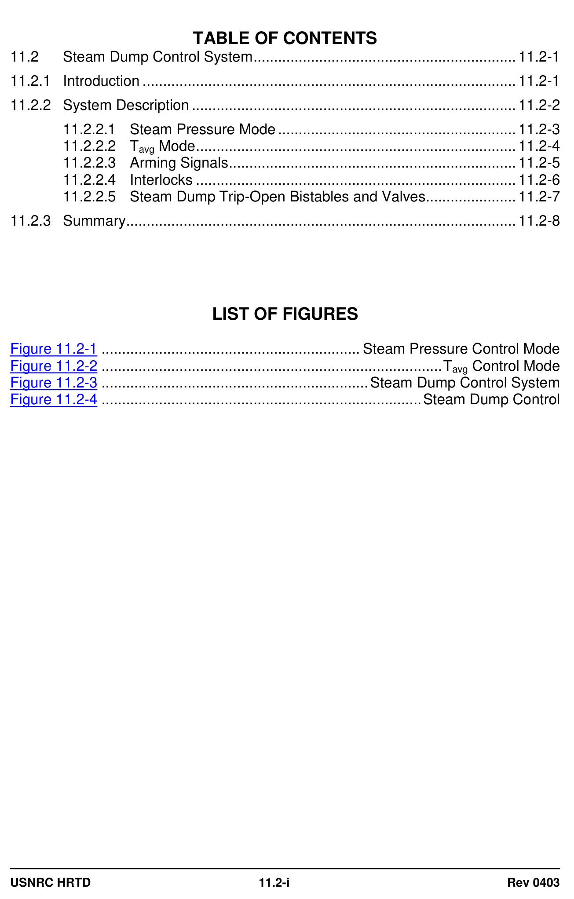
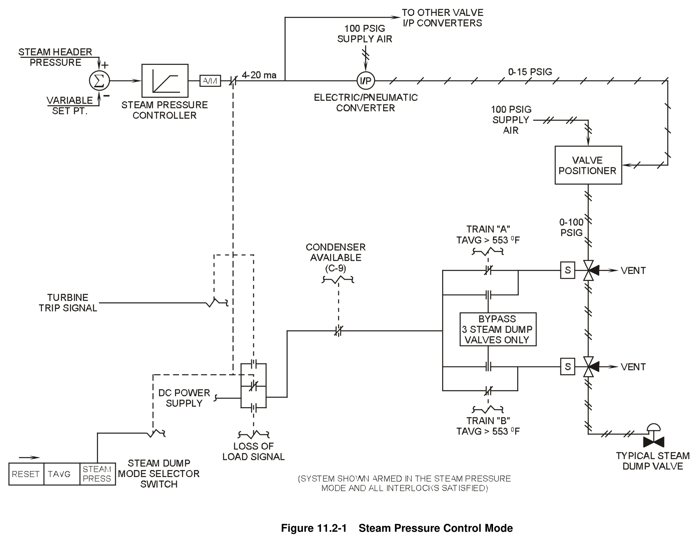
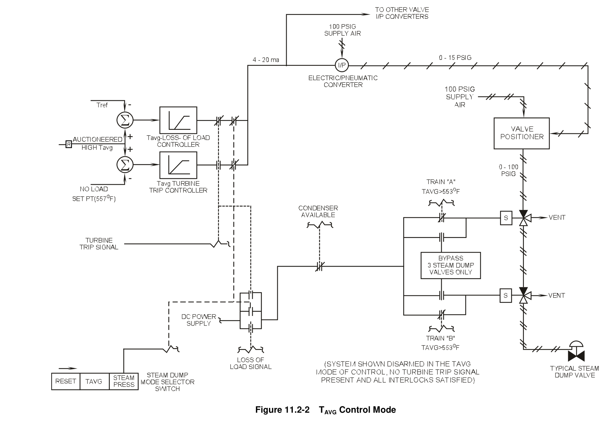
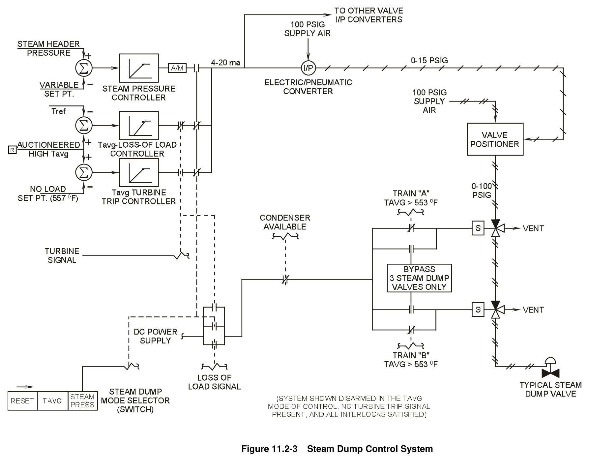
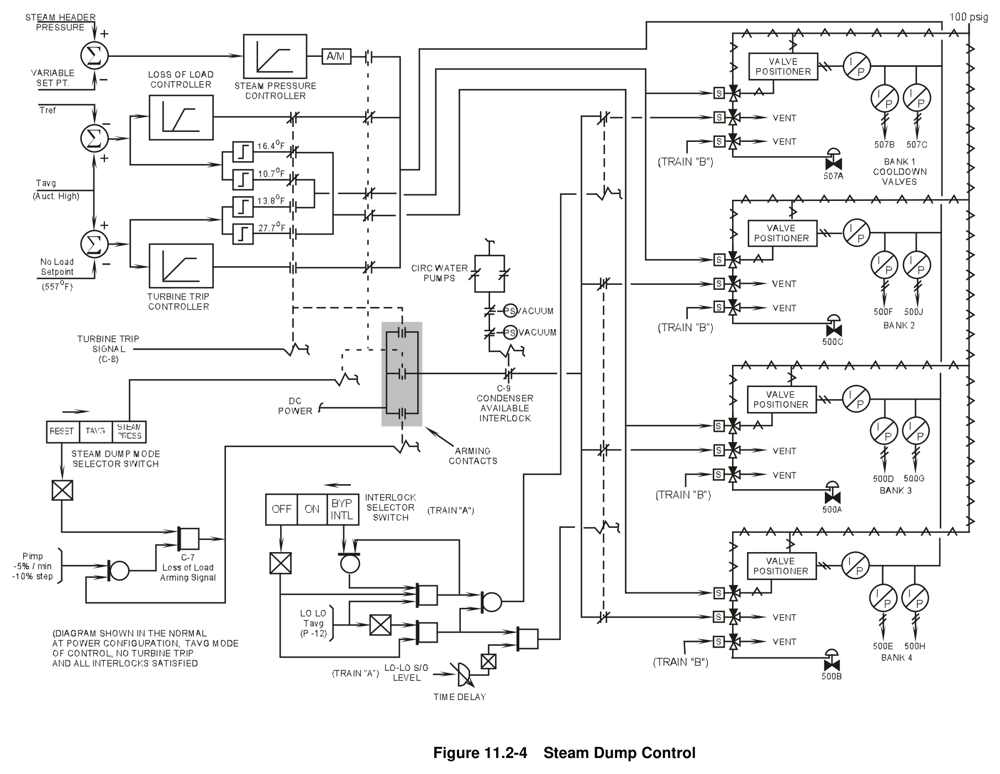

# 11.2 Steam Dump

> Pages 870–884 of `ML20057E160.pdf`
> Westinghouse Technology Systems Manual — USNRC HRTD (PWR)

---
<!-- p.870 -->
#### Westinghouse Technology Systems Manual
#### Section 11.2
#### Steam Dump Control System
<!-- p.871 -->
#### Figure 11.2-1

*.............................................................. Steam Pressure Control Mode*

<!-- labels/text on this figure page -->
TABLE OF CONTENTS
11.2 Steam Dump Control System ................................................................ 11.2-1
11.2.1 Introduction ........................................................................................... 11.2-1
11.2.2 System Description ............................................................................... 11.2-2
11.2.2.1 Steam Pressure Mode .......................................................... 11.2-3
11.2.2.2 Tavg Mode .............................................................................. 11.2-4
11.2.2.3 Arming Signals ...................................................................... 11.2-5
11.2.2.4 Interlocks .............................................................................. 11.2-6
11.2.2.5 Steam Dump Trip-Open Bistables and Valves...................... 11.2-7
11.2.3 Summary ............................................................................................... 11.2-8
LIST OF FIGURES
Figure 11.2-1 ............................................................... Steam Pressure Control Mode
Figure 11.2-2 ................................................................................... Tavg Control Mode
Figure 11.2-3 ................................................................. Steam Dump Control System
Figure 11.2-4 .............................................................................. Steam Dump Control
USNRC HRTD 11.2-i Rev 0403

<!-- p.872 -->
### 11.2 STEAM DUMP CONTROL SYSTEM
#### Learning Objectives:
1. List the purposes of the steam dump control system.

2. Briefly describe how each of the purposes is accomplished.

3. Discuss the inputs to the steam dump control system.

4. List and explain the purposes of the steam dump control arming signals and interlocks.

#### 11.2.1 Introduction
The function of the steam dump system is to remove excess energy from the reactor coolant system. The plant’s rod control system in the automatic mode is designed to handle a 5%/min ramp or 10% step decrease in power, from steady-state conditions, without a resultant reactor trip or pressurizer relief valve actuation. However, during a turbine load reduction in excess of these design load changes, the automatic rod control system cannot reduce reactor power as fast as the secondary power is decreasing. Under these conditions, a power imbalance results, with reactor power greater than the secondary system load (i.e., more heat is being added to the reactor coolant than that removed by the secondary via the steam generators). This power imbalance causes the temperature of the reactor coolant to increase. The steam dump system is designed to limit this unwanted temperature increase.

Following a reduction in load, the steam dump system limits the temperature rise of the reactor coolant and aids the rod control system in reducing the temperature of the reactor coolant to the programmed Tavg for the new turbine load. During operation of the steam dump system, steam from the main steam system bypasses the main turbine and flows directly to the main condenser. The increased steam flow from the steam generators dissipates the excess energy of the reactor coolant until the power in the reactor is reduced to the same value as the secondary load.

The capacity of the steam dump system depends on the individual plant’s load rejection capability. In most Westinghouse units the capacity of the steam dump system is 40%.

In a 40% steam dump system, the steam dump valves are designed to pass 40% of the full-power steam flow at some maximum defined steam pressure. This steam dump capacity allows for a 50% turbine load reduction without a reactor trip. The 50% loss of load is accommodated by the steam dump capacity of 40% and by the 10% step change capability of the rod control system. In addition, this dump capacity avoids the lifting of steam generator safety valves following a turbine trip and reactor trip from 100% power.

This section discusses the control system for a 40% steam dump system, which consists of 12 steam dump valves and the associated piping between the main steam system and the main condenser. For accident analysis considerations with

USNRC HRTD 11.2-1 Rev 0403

<!-- p.873 -->
regard to an accidental overcooling of the reactor coolant due to a small steam break, the opening of any single steam dump valve is designed to pass not more than 895,000 lbm/hr of steam at 1106 psia. The steam dump system is a controlgrade system and is not required for the safe shutdown of the reactor.

The modes of operation of the steam dump system and the purposes of each mode are as follows:

1. Tavg mode: Enables the nuclear steam supply system to accept a 50% loss of load without incurring a reactor trip.

2. Tavg mode: Removes stored energy and decay heat from the reactor coolant following a turbine trip and returns the plant to no-load conditions without actuation of the steam generator safety valves.

3. Steam pressure mode: Controls steam pressure at low- or no-load conditions and provides for a manually controlled cooldown of the reactor coolant system.

4. Steam pressure mode: Provides a constant steam flow during turbine startup and synchronization to facilitate manual feedwater control.

#### 11.2.2 System Description
Figures 11.2-1, -2, and -3 are simplified diagrams of the steam dump control system.
They are intended as “building blocks” for the more complete system diagram of Figure 11.2-4.

There are two modes of steam dump control, selectable by the control room operator. One mode is the Tavg mode, which includes both the loss-of-load controller and the turbine-trip controller. The other mode of control is the steam pressure mode, which involves the steam pressure controller. The position of the mode selector switch and the plant conditions determine which of the three controllers is in service. These controllers are described in detail in sections 11.2.2.1 and 11.2.2.2.

The 12 steam dump valves are air operated and divided into four different valve groups. Each valve group consists of three valves; each valve within a group discharges to a different condenser shell. The groups are operated sequentially.
The first group (which contains the three cooldown valves) modulates to the fully open position before the second group of valves begins to open. After the second group has fully opened, the third group begins to open, and the fourth group begins to open after the third group has fully opened. When the valves close, they do so in the reverse order; that is, the group four valves close fully before the group three valves begin to close, etc.

As shown in Figure 11.2-1, each steam dump valve has a valve positioner which regulates the control air pressure, through two solenoid valves in series, to a diaphragm operator located on the valve. The diaphragm varies the position of the steam dump valve based on the control air pressure developed by its valve positioner. The valve positioner varies the control air pressure in accordance with a variable instrument air signal from its associated current-to-pneumatic (I/P)

USNRC HRTD 11.2-2 Rev 0403

<!-- p.874 -->
converter. The I/P converter (one for each steam dump valve) receives an electrical current input from one of three electronic controllers.

In addition to the features already mentioned, the steam dump control system incorporates (1) arming signals, which align the steam dumps for operation during the appropriate plant operating conditions, and (2) interlocks, which prevent or halt operation of the steam dumps when they are not needed or desired. The arming signals are discussed in the next three sections, while the individual interlocks are explained in section 11.2.2.4.

##### 11.2.2.1 Steam Pressure Mode
During a plant startup or cooldown, the steam dump system is operated in the steam pressure mode. As shown in Figure 11.2-1, when the steam dump mode selector switch is placed in the steam pressure position, the relay associated with the mode selector switch energizes and closes two contacts. Closing the contact shown to the right of the steam pressure controller places the steam pressure controller in service, while closing the middle contact in the set of three parallel contacts completes the electrical circuit which "arms" the steam dumps. This arming contact, once closed, allows dc power to be applied to the two solenoid valves in series. The inputs to the steam pressure controller are steam header pressure (measured at the main steam bypass header) and a variable setpoint which is selected by the control room operator. The steam pressure controller is a proportional-plus-integral controller.

The steam pressure mode is selected during hot standby operation, reactor startup, and initial loading of the turbine. The steam dump valves act as a load on the primary system by removing heat from the reactor coolant. As the steam press is maintained by the steam dumps at the selected setpoint, the temp of the main steam header is maintained at a value corresponding to the saturation temp for the setpoint press. For example, if the steam press setpoint is selected to 1092 psig, the temperature of the steam header will be maintained at approximately 557°F. The RCS temperature will be a function of Q=UAΔT where the ΔT is equal to Tavg minus Tsteam. At zero load, since Q (power) is only RCP pump heat, the ΔT is almost zero and Tavg and Tstm are about the same (557°F). As reactor power is increased, if steam header pressure and temperature is maintained constant by the Steam Dump Pressure Mode Controller, then Tavg has to increase to transfer the increased heat energy from the RCS to the SG. The full load primary to secondary ΔT is approximately 50°F. Since the ΔT for heat transfer is linearly related to reactor power (Q), when reactor power is 10%, the primary to secondary ΔT is approximately 5°F, and Tavg is 562°F (557°F [Tstm] plus 5°F [ΔT ]).

At the end of a plant heat-up, the heat added to the reactor coolant by the reactor coolant pumps is transferred to the steam generators and removed by the steam dump system to maintain the reactor coolant at 557°F (no-load Tavg). During the subsequent reactor startup and low power operation, withdrawing the control rods causes reactor power to increase, which in turn causes the reactor coolant temperature and the pressure in the steam system to increase. The increasing steam pressure inputs an error signal (the actual steam pressure is greater than the setpoint) into the steam pressure controller. The controller converts this error signal into a valve positioning demand that, once converted to control air pressures by the

USNRC HRTD 11.2-3 Rev 0403

<!-- p.875 -->
individual valve positioners, modulates open the steam dump valves. The integral action of the controller will increase the valve opening demand if the steam pressure error persists for an extended period. The number of open valves and the degree of modulation are determined by the magnitude of the controller output. A steam pressure error, after integration, equivalent to 100 psid results in the full opening of all four valve groups.

When the reactor power is approximately 10 - 15%, the turbine is placed in service.
The steam dump system is still selected to the steam pressure mode, and the dump valves are passing approximately 10 - 15% of full-power steam flow. During the initial turbine startup, the steam dump system maintains a relatively constant total steam flow in the main steam system. The steam dump valves are open and dumping steam to the main condenser to maintain the desired pressure in the main steam system.

As the turbine governor valves open, steam is admitted to the high pressure turbine, which causes the steam pressure in the main steam header to decrease. This reduces the magnitude of the pressure error generated by the steam pressure controller, and the controller’s decreasing output causes the steam dump valves to modulate closed. The net result of this evolution is that the total steam flow remains relatively constant. This process of transferring the main steam flow from the steam dumps to the turbine governor valves continues as the turbine generator is loaded until the steam dump valves are fully closed and the turbine governor valves are passing the entire 10 - 15% main steam flow.

Since the total steam flow is not affected (i.e., the heat removal from the reactor coolant does not change), the temperature of the reactor coolant does not change significantly, which reduces the need to move control rods. Also, the heat transfer in the steam generators remains unchanged, which allows for a constant feed flow rate to the steam generators, making feedwater control easier for the feed station operator.

After a reactor trip or a controlled reactor shutdown, the steam dump system may be placed in the steam pressure mode of control to perform a plant cooldown. With the steam pressure controller in automatic, the control room operator can lower the steam pressure setpoint to cause the steam dump valves to open, which lowers the steam pressure and Tavg. With the controller in manual, the operator inputs a signal to modulate the steam dump valves open to maintain the desired cooldown rate.

##### 11.2.2.2 Tavg Mode
During normal power operations, generally greater than 15% of rated thermal power, the steam dump system is placed in the Tavg mode. As shown in Figure 11.2-2, there are two controllers in the Tavg mode of control. The upper controller, the lossof-load controller, is provided with auctioneered high Tavg and Tref as inputs. Tref which is generated from turbine impulse pressure, is the desired Tavg. The lower controller, the turbine-trip controller, is provided with auctioneered high Tavg and noload Tavg as inputs. These two controllers differ according to their functions.

USNRC HRTD 11.2-4 Rev 0403

<!-- p.876 -->
(Note: Unless stated otherwise, the relay and contact locations indicated in the following paragraphs of this section refer to their locations in Figure 11.2-2.)
When the control room operator places the steam dump mode selector switch in the Tavg position, as shown in Figure 11.2-2, the relay associated with the mode selector switch de-energizes. De-energizing this relay causes the following:

1. The contact directly to the right of the steam pressure controller opens (this contact is shown in Figure 11.2-1 and is not shown in Figure 11.2-2),
2. The second contact to the right of the loss-of-load controller closes,
3. The second contact to the right of the turbine-trip controller closes, and 4. The middle contact in the set of three parallel contacts opens and disarms the steam dumps.

With the turbine-trip signal relay de-energized as shown, the contact directly to the right of the loss-of-load controller is closed, while the contact directly to the right of the turbine-trip controller is open. Therefore, if no turbine-trip signal is present, the loss-of-load controller is automatically selected whenever the mode selector switch is placed in the Tavg mode of control.

In accordance with this relay/contact arrangement, if a turbine trip occurs, the turbine-trip signal relay energizes, causing the contact at the output of the loss-ofload controller to open and the contact at the output of the turbine-trip controller to close. The actuation of this relay also arms the steam dumps by closing the top contact in the set of three parallel contacts. The turbine-trip controller is thus automatically selected when a turbine-trip signal is present.

The loss-of-load controller has a 5°F dead band to allow the rod control system to respond to a Tavg / Tref difference first. If a difference greater than 5°F between Tavg and Tref exists, then the loss of load is in excess of the designed capability of the rod control system. The output of the loss-of-load controller (valve opening demand) is proportional to the portion of the Tavg / Tref difference in excess of 5°F. The steam dump valves will open in response to this demand provided that the dumps are armed by a loss-of-load signal (the bottom contact in the set of three parallel contacts is closed). Therefore, for any load reduction that is greater than the design limitations of the rod control system, the steam dumps act as an alternate heat sink
(load) until the rod control system returns Tavg to within 5°F of Tref.

With a turbine trip, the function of the steam dump system is different. When a turbine trip occurs, the turbine-trip controller is automatically placed in service and the steam dumps are armed, as previously described. The output of the turbine-trip controller (valve opening demand) is proportional to the difference between Tavg and the no-load Tavg setpoint. The steam dump system thus actuates to remove stored energy and decay heat to return Tavg to its no-load value (normally selected to 557°F). There is no dead band associated with the turbine-trip controller.

##### 11.2.2.3 Arming Signals
To ensure that the steam dumps operate only during specific plant conditions, arming signals are provided. A control signal opens the steam dump valves only if an arming signal has energized their associated arming solenoid valves. The

USNRC HRTD 11.2-5 Rev 0403

<!-- p.877 -->
solenoid valves for each steam dump valve are positioned in series in the air line between the valve positioner and the dump valve. Control power is required to energize the solenoids to port air to the dump valves. The arming signal allows dc power to reach these solenoids by closing a contact in the power supply to the solenoids. There are three arming signals: one for the steam pressure mode of control and two for the Tavg mode of control. The arming signals and their relationships with the three steam dump controllers are illustrated in Figure 11.2-3.

When the steam dump mode selector switch is placed in the steam pressure mode of control, the steam dumps are armed. The two Tavg mode arming signals are the loss-of-load signal and the turbine-trip signal. The loss-of-load signal (C-7 interlock)
is generated by either of the following: a ramp load decrease at a rate greater than 5%/min, or a step load decrease of greater than 10%. Either of these load reduction indications is sensed from turbine impulse pressure. The turbine-trip signal
(C-8 interlock) is generated whenever all four turbine stop valves are shut or low pressure is indicated by at least two out of three pressure switches located on the emergency trip system header. (The turbine trip input from the emergency trip system header applies to plants with General Electric turbines and electrohydraulic control [EHC] systems. For plants with Westinghouse turbines and EHC systems, a turbine trip signal is generated when low pressure is indicated by at least two out of three pressure switches located in the auto-stop oil system. See Sections 11.3 and 11.5.)

If the steam dump system is armed by a loss of load, the system remains armed until the loss-of-load signal is manually reset by a control room operator. As shown in Figure 11.2-4, this reset is accomplished by placing the mode selector switch to the reset position and then allowing it to spring return to the Tavg position. If the steam dump system is armed by a turbine trip, it remains armed until the turbine is latched.

##### 11.2.2.4 Interlocks
As previously mentioned, dc control power must be supplied to the solenoid valves to allow actuation of the steam dumps. An arming signal is required to shut one of three parallel contacts which supply this dc power. In addition, three interlocks must be satisfied to allow operation of the steam dump system. The failure to satisfy any of these interlocks interrupts dc control power, via an open contact, to the series solenoid valves in the air supplies to the dump valves.

The first interlock, the condenser available (C-9) interlock, is provided for condenser protection. As shown in Figure 11.2-4, a sufficient vacuum in the condenser (as sensed by each of two condenser pressure detectors) and at least one operating condenser circulating water pump (for steam condensing) are required to satisfy this interlock and thereby allow the steam dump valves to actuate.

The second interlock, the low-low Tavg (P-12) interlock, is provided to prevent an inadvertent cooldown of the reactor coolant due to an instrument failure. If Tavg is less than 553°F in two of the four reactor coolant loops, the steam dumps will be interlocked off.

USNRC HRTD 11.2-6 Rev 0403

<!-- p.878 -->
To use the steam dumps for a normal cooldown below 553°F, it is necessary to bypass the low-low Tavg interlock. As illustrated in Figure 11.2-4, bypassing this interlock allows the operator to use the first group of three steam dump valves, the cooldown valves, to cool down the plant. The other three groups remain shut below the P-12 interlock setpoint. Since this interlock signal is generated in the reactor protection system, there are actually two signals, one from each protection system train. Therefore, there are two bypass interlock switches located on the main control board. Each bypass interlock switch (only one switch is shown in Figure 11.2-4) has three positions: off/reset, on, and bypass interlock. Bypassing the P-12 interlock is accomplished by placing the switch in the bypass interlock position and allowing the switch to spring return to the on position. Placing the switch in the off/reset position disables the dumps by de-energizing the solenoid valves in the air supplies to the steam dump valves.

The third interlock, the low-low steam generator water level interlock, is provided to conserve secondary inventory for steaming the turbine-driven auxiliary feedwater pump following a reactor trip from a high power level. If any of the steam generator levels falls below the low-low level setpoint of 10.7% in two of three channels, dc control power will be interrupted to nine steam dump valves (all except the cooldown valve group). The interlock has a time delay of five minutes to allow for transient conditions.

In summary, all of the following conditions must be satisfied to complete the dc arming circuits for the steam dump solenoid valves:

1. One of the three arming signals discussed in section 11.2.2.3 has been developed,
2. The condenser available interlock logic is satisfied,
3. The reactor coolant temperature is greater than the low-low Tavg setpoint, or the operator has bypassed this interlock (three cooldown valves only), and 4. All four steam generator levels exceed the low-low level setpoint (all steam dump valves except the cooldown group).

##### 11.2.2.5 Steam Dump Trip-Open Bistables and Valves
As shown in Figure 11.2-4, in addition to the solenoid valves which are energized by the arming signals, there is a third solenoid valve associated with each steam dump valve. This solenoid valve, located upstream of the arming solenoid valves, is actuated by one of the bistables known as the trip-open or blast-open bistables.
These bistables are effective only in the Tavg mode of control. When energized, this trip-open solenoid valve directs high pressure air around its associated valve positioner.

Normally, 100-psig air is routed from the service air header through each valve positioner, which regulates the air pressure to its associated steam dump valve.
Each valve positioner varies the control air pressure based on a variable instrument air signal from its associated I/P converter. The flow of control air from the valve positioner, now at a reduced pressure, passes into the right-hand port and out the bottom port of the three-way trip-open solenoid valve. (The valve port orientation discussed here corresponds to that shown in Figure 11.2-4.) This control air passes

USNRC HRTD 11.2-7 Rev 0403

<!-- p.879 -->
through the two series arming solenoid valves to the diaphragm operator located on the steam dump valve. As the control air pressure from the valve positioner varies, the steam dump valve position will change (i.e., modulate open or closed).
However, if the trip-open solenoid is energized, the solenoid valve is repositioned so that the top and bottom ports are open and the right-hand port is closed. With the solenoid valve in this position, 100-psig control air is immediately applied to the valve actuator of the associated steam dump valve. This action allows quick opening of the steam dump valve for large load rejections.

The four trip-open bistables and their associated contacts are shown in Figure 11.2- 4 between and to the right of the loss-of-load and turbine-trip controllers. The input to two of the bistables is the temperature error (Tavg - Tref) supplied to the loss-ofload controller, and the input to the other two bistables is the temperature error (Tavg
- [no-load Tavg]) supplied to the turbine-trip controller. When the steam dump mode selector switch is selected to the Tavg mode of control (as shown in the figure), the contacts in the circuits from the two upper (loss-of-load) bistables are closed. If a turbine trip occurs, then the contacts directly to the right of the two upper bistables open, and the contacts directly to the right of the two lower (turbine-trip) bistables close. (The locations of the bistables and contacts discussed above refer to their locations in Figure 11.2-4.)

The normal setpoints for these bistables are as follows. For the loss-of-load bistables, the high bistable setpoint is 10.7°F (Tavg - Tref), and the high-high bistable setpoint is 16.4°F. For the turbine-trip bistables, the high bistable setpoint is 13.8°F
(Tavg - [no-load Tavg]), and the high-high bistable setpoint is 27.7°F. The large temperature errors are indicative of the large imbalances between primary and secondary power that would result from large load rejections.

When a high bistable setpoint is exceeded, the trip-open solenoid valves for the first two groups of valves (six valves total) reposition to supply 100-psig air directly to the steam dump valve operators. The steam dump valves then open fully within two to three seconds. When the bistable resets, the solenoid valves are de-energized and repositioned so that the air signals from the valve positioners will modulate the steam dump valves closed. A high-high bistable, if actuated, opens the remaining two groups of three valves (six valves total).

#### 11.2.3 Summary
The steam dump system provides:

1. A heat sink for the primary system on a load reduction to prevent a reactor trip,
2. A method of returning the plant to no-load conditions following a turbine trip, and
3. A method of maintaining and varying reactor coolant temperature during startups and cooldowns.

The control system for the steam dumps accomplishes the first two functions by automatically opening the steam dump valves in response to temperature errors resulting from load rejections (loss of load or turbine trip). The control system accomplishes the third function by controlling steam pressure and thus reactor coolant Tavg at a selected setpoint.

USNRC HRTD 11.2-8 Rev 0403

<!-- p.880 -->
The steam dump control system is provided with arming signals and interlocks. The purpose of the arming signals is to ensure that plant conditions requiring steam dump actuation actually exist. The purpose of the interlocks is to provide equipment protection and, in the event of an instrument failure after the steam dumps have been armed, to prevent the reactor coolant system from being overcooled.

In the event of a large loss of load or a turbine trip, trip-open bistables rapidly open the steam dump valves. This action helps limit the increase in Tavg for these transients and returns the temperature of the reactor coolant to program faster than if the transients were handled only by the rod control system.

The steam dump system is not a safety-related system, it is supplied with nonvital power, and its operation is not considered by the plant’s FSAR for mitigation of any accident. In addition, the operation of the steam dump system is not required for the safe shutdown of the reactor.

USNRC HRTD 11.2-9 Rev 0403

<!-- p.881 -->
#### Figure 11.2-1

*Steam Pressure Control Mode*

[Vector original (SVG, lossless): fig_11.2-1_3.svg](../figures/fig_11.2-1_3.svg)

<!-- p.882 -->
#### Figure 11.2-2

*TAVG Control Mode*

[Vector original (SVG, lossless): fig_11.2-2.svg](../figures/fig_11.2-2.svg)

<!-- p.883 -->
#### Figure 11.2-3

*Steam Dump Control System*

[Vector original (SVG, lossless): fig_11.2-3.svg](../figures/fig_11.2-3.svg)

<!-- p.884 -->
#### Figure 11.2-4

*Steam Dump Control*

[Vector original (SVG, lossless): fig_11.2-4.svg](../figures/fig_11.2-4.svg)

