# 11.5 GE EHC

> Pages 885–914 of `ML20057E160.pdf`
> Westinghouse Technology Systems Manual — USNRC HRTD (PWR)

---
<!-- p.885 -->
#### Westinghouse Technology Systems Manual
#### Section 11.5
#### General Electric Electrohydraulic Control System
<!-- p.886 -->
TABLE OF CONTENTS

11.5 GE EHC ................................................................................................. 11.5-1

11.5.1 Introduction ............................................................................................ 11.5-1

11.5.2 System Description ............................................................................... 11.5-1

11.5.2.1 EHC Fluid System ................................................................. 11.5-2

11.5.2.2 Emergency Trip System ........................................................ 11.5-3

11.5.2.3 Electrical Control System ...................................................... 11.5-7

11.5.3 System Operation ................................................................................ 11.5-15

11.5.4 Summary ............................................................................................. 11.5-16

LIST OF FIGURES

Figure 11.5-1 ............................................................................................ Simplified EHC System

Figure 11.5-2 ..................................................................................................... EHC Fluid System

Figure 11.5-3 .......................................................................................... Emergency Trip System

Figure 11.5-4 ........................................................................ Turbine Electrical Control System

Figure 11.5-5 .................................................................................................... Speed Control Unit

Figure 11.5-6 .......................................................... Speed Control Operating Characteristics

Figure 11.5-7 .............................................................. Control and Intercept Valve Regulation

Figure 11.5-8 ......................................................................Load Reference Signal Generation

Figure 11.5-9 ............................................................................... Typical Valve Positioning Unit

Figure 11.5-10 .......................................................................................... Chest / Shell Warming

Figure 11.5-11 ........................................................................................... Turbine Control Panel

Figure 11.5-12 ..................................................................................... Turbine Instrument Panel

USNRC HRTD 11.5-i Rev 1013

<!-- p.887 -->
### 11.5 GENERAL ELECTRIC ELECTROHYDRAULIC CONTROL SYSTEM
#### Learning Objectives:
1. State the purposes of the turbine electrohydraulic control (EHC) system.

2. Describe the sequence of events that results when a turbine trip is initiated mechanically or electrically.

3. Explain the functions of the following emergency trip system components:

a. Mechanical trip valve, b. Lockout valve, c. Master trip solenoid valve, d. Relay trip valve, and e. Extraction relay dump valve.

4. Describe the generation of turbine valve positioning signals in the following components of the electrical control system:

a. Speed control unit, b. Load control unit, and c. Flow control unit.

#### 11.5.1 Introduction
The purposes of the EHC system are as follows:

1. To govern the warming of the turbine steam chest and high pressure turbine shell,
2. To control the speed of the turbine-generator from turning gear operation to synchronous speed (60 Hz),
3. To control the load of the turbine-generator during normal and abnormal operations, and 4. To provide a rapid shutdown capability (trip) for the protection of the turbinegenerator.

The EHC system uses high pressure hydraulic fluid to open and position the steam inlet valves to the high and low pressure turbines in response to commands from an electrical controller. High pressure hydraulic fluid is also supplied to the emergency trip system, which maintains shut the disk dump valves incorporated within the steam inlet valve operators. When the hydraulic pressure in the emergency trip system is relieved, the disk dump valves open, allowing springs to close all steam inlet valves and thereby trip the turbine. A simplified diagram of the EHC system is shown in Figure 11.5-1.

#### 11.5.2 System Description
The EHC system can be divided into three subsystems:

USNRC HRTD 11.5-1 Rev 0105

<!-- p.888 -->
a. The EHC fluid system (high pressure hydraulic fluid), b. The emergency trip system, and c. The electrical control system.

##### 11.5.2.1 EHC Fluid System
The valves that admit and control the steam to the high and low pressure turbines are opened by high pressure hydraulic fluid acting on the valves’ actuators or operators, which are mechanically linked to the valve stems. This high pressure fluid is supplied by the EHC fluid system, as shown in Figure 11.5-2. Each valve has an operator and a disk dump valve. The application of EHC fluid pressure to the piston in a steam inlet valve’s operator overcomes the force exerted by the operator’s spring assembly and opens the valve. When a valve operator’s disk dump valve opens, EHC fluid is dumped to the EHC fluid reservoir, allowing the spring force to rapidly close the valve. Each disk dump valve is normally maintained in the closed position by the hydraulic fluid pressure applied by the emergency trip system. The means by which emergency trip system pressure is removed are discussed in section 11.5.2.2. When all disk dump valves have opened and the valve operator springs have closed all steam inlet valves to the high and low pressure turbines, the turbine is said to be tripped.

EHC fluid at 1600 psig is supplied to the turbine valve operators by an operating EHC pump, which takes suction on the EHC fluid reservoir. The second (standby)
EHC pump starts if the EHC fluid pressure falls to 1300 psig. The system contains relief valves for overpressure protection, nitrogen-charged accumulators for dampening system pressure variations, and strainers and filters for the removal of contaminants. EHC fluid from the turbine valve operators and from the emergency trip system is returned to the EHC fluid reservoir via two EHC fluid coolers, which are cooled by the bearing cooling water system. The EHC fluid is a synthetic, fireretardant phosphate ester.

EHC fluid is supplied through servo valves to the operators for the control valves and the #2 stop valve of the high pressure turbine and for three of the six intercept valves of the low pressure turbines. Within a servo valve, commands from the electrical control system result in the movement of an internal spool, which ports more or less EHC fluid to the associated turbine valve operator and thereby causes the turbine valve to open or close further. Once the turbine valve has attained the desired new position, the internal spool returns to its neutral position, which bottles up the EHC fluid between the servo valve and the valve operator in a “hydraulic lock” and maintains the valve position. The turbine valve operators equipped with servo valves are thus capable of modulation.

The remaining turbine valves (high pressure turbine stop valves #1, #3, and #4;
three of the six intercept valves; and all six of the intermediate stop valves) are either completely open or completely shut, not modulated. The operator for each of these valves is supplied with EHC fluid through a solenoid-operated valve. With the solenoid de-energized, an internal spool is positioned to admit EHC fluid to the associated valve operator; with the solenoid energized, the spool is positioned to bleed fluid from the operator. Information concerning the positioning of turbine valves during operation is provided in section 11.5.2.3.

USNRC HRTD 11.5-2 Rev 0105

<!-- p.889 -->
##### 11.5.2.2 Emergency Trip System
The EHC pumps supply high pressure EHC fluid to the emergency trip system as well as the turbine valve operators. The emergency trip system, shown in Figure 11.5-3, supplies EHC fluid to the disk dump valves associated with all 20 turbine valves, the relay trip valve, and the extraction relay dump valve (the disk dump valves associated with the control valves and intercept valves are supplied via the relay trip valve). All of the valves listed above are supplied through the mechanical trip valve, the lockout valve, and the master trip solenoid valve. Turbine trip signals act through these latter three valves to dump EHC fluid from the turbine valve operators.

The mechanical trip valve, as its name implies, provides a means of mechanically tripping the turbine. Under normal operating conditions (i.e., a trip condition is not present), the valve aligns the emergency trip system fluid to the lockout valve. In the tripped position, the valve blocks the incoming supply of emergency trip system fluid and opens a drain to the EHC fluid reservoir, allowing emergency trip system fluid to drain from the lockout valve and all downstream components. The mechanical trip valve’s incoming and outgoing paths for hydraulic fluid are controlled by the position of an internal spool, which in turn is controlled through mechanical linkages by the overspeed trip device, the manual trip lever, and the mechanical trip solenoid.

The overspeed trip device is an unbalanced ring attached to the turbine shaft; the ring is maintained concentric with the shaft at normal turbine speeds by spring force.
At 110% of rated turbine speed (1980 rpm), the ring moves to an eccentric position and strikes the trip finger, which through mechanical linkages places the mechanical trip valve in the tripped position. The overspeed trip device can be tested at normal operating speeds by admitting main turbine lubricating oil inside the ring and thereby causing it to assume its eccentric position (the lockout valve must first be placed in the locked out position; see below).

Pulling the manual trip lever, located on the turbine front standard, to the trip position results in a mechanical linkage striking the overspeed trip finger. From that point, the development of a mechanical trip is identical to that caused by an overspeed condition. Energizing the mechanical trip solenoid causes the same linkage to strike the overspeed trip finger and also results in a mechanical trip. The mechanical trip solenoid is energized when the turbine trip pushbutton in the control room is depressed or when any electrical trip signal is present. The mechanical trip solenoid thus serves as a redundant tripping device to the master trip solenoid valve.

The lockout valve is a three-way solenoid valve located on the turbine front standard. It does not process turbine trips but allows testing of the overspeed trip device (described above) without tripping the turbine. Under normal conditions (i.e., an overspeed trip test is not being conducted), the valve aligns the emergency trip system fluid from the mechanical trip valve to the master trip solenoid valve. In the locked out position, the valve blocks the fluid supply from the mechanical trip valve and aligns a separate emergency trip system fluid supply to the master trip solenoid valve. The lockout valve’s alignment is controlled by the position of an internal spool, which is controlled by the lockout solenoid. Energizing the lockout solenoid places the valve in the locked out position.

USNRC HRTD 11.5-3 Rev 0105

<!-- p.890 -->
To conduct a test of the mechanical overspeed trip device, the lockout solenoid is energized. Placing the lockout valve in the locked out position satisfies an interlock which permits the operator to supply lubricating oil to the overspeed trip device.
When the overspeed trip is developed, the mechanical trip valve will realign to drain emergency trip system fluid to the EHC fluid reservoir, but the lockout valve will maintain a supply of emergency trip system fluid to the master trip solenoid valve and all downstream components. Pulling the manual trip lever or energizing the mechanical trip solenoid opens an interlock switch through mechanical linkages; the switch in turn de-energizes the lockout solenoid and places the lockout valve in its normal position. Thus, the lockout valve remains in the locked out position only for a mechanical overspeed trip (testing-induced or actual) and allows normal functioning of the emergency trip system for all other turbine trips.

The last of the three valves in the emergency trip system supply line is the master trip solenoid valve. Under normal operating conditions, the valve aligns the emergency trip system fluid from the lockout valve to the downstream emergency trip system components (disk dump valves, relay trip valve, and extraction relay dump valve). In the tripped position, the valve blocks the fluid supply from the lockout valve and opens a drain to the EHC fluid reservoir, allowing fluid to drain from all downstream components. The master trip solenoid valve’s alignment is controlled by the position of an internal spool, which in turn is controlled by two solenoids. De-energizing both solenoids places the valve in the tripped position.
The valve maintains the fluid supply to the downstream components if either solenoid remains energized; this feature allows either solenoid to be tested (i.e., deenergized) during turbine operation.

When a turbine trip setpoint is reached, a contact or contacts close in the power supply to the master trip bus. The master trip bus then energizes the master trip relays, which open contacts in the power supply to the solenoids of the master trip solenoid valve. De-energizing the solenoids of the master trip solenoid valve causes the valve to assume its tripped position and thereby dump hydraulic fluid from the emergency trip system, causing a turbine trip. The following conditions will cause the master trip bus to be energized:

 Excessive thrust bearing wear and low bearing oil pressure,  Low EHC fluid pressure,  High moisture separator reheater (MSR) water level,  High turbine shaft vibration,  Loss of stator cooling water,  Low shaft-driven lubricating oil pump discharge pressure,  Loss of EHC system power,  Loss of turbine speed signal feedback,  High turbine exhaust hood temperature,  Loss of condenser vacuum,  Backup overspeed (111.5% of rated speed, as sensed by a speed transducer),  Generator trip,  Reactor trip,

USNRC HRTD 11.5-4 Rev 0105

<!-- p.891 -->
 Safety injection actuation,  High steam generator water level,  Low generator output frequency, and  Satisfaction of ATWS (anticipated transient without scram) mitigation system actuation circuitry (AMSAC) logic.

Any of the above conditions redundantly initiates a turbine trip through the mechanical trip solenoid and the mechanical trip valve. When the master trip bus is energized, the master trip relays also close contacts in the power supply to the mechanical trip solenoid. As explained above, energizing this solenoid causes the mechanical trip valve to assume its tripped position.

Downstream of the master trip solenoid valve in the emergency trip system are the disk dump valves for the high pressure turbine stop valves and for the intermediate stop valves, the relay trip valve, and the extraction relay dump valve. Under normal operating conditions, the relay trip valve aligns a separate hydraulic fluid supply (not from the main emergency trip system header) to the disk dump valves for the control valves and for the intercept valves. Emergency trip system fluid pressure is applied to the relay trip valve’s internal spool to maintain the valve in its normal position.
When the fluid pressure is removed from the spool, the new (tripped) valve alignment blocks the incoming fluid supply and opens a drain to the EHC fluid reservoir, allowing fluid to drain from the downstream disk dump valves.

The extraction relay dump valve serves a purpose similar to that of the relay trip valve. Under normal operating conditions, the extraction relay dump valve aligns the incoming air supply to the operators for the extraction steam bleeder trip valves and for the extraction drain valves. This alignment keeps the bleeder trip valves open
(supplying extraction steam to the feedwater heaters) and the extraction drain valves closed (isolating the extraction steam drain lines to the main condenser).
Emergency trip system fluid pressure is applied to the relay dump valve’s piston to maintain the valve in its normal position. When the fluid pressure is removed from the piston, the new (tripped) valve alignment blocks the incoming air supply and opens an exhaust port which vents the operators of the extraction steam system valves. The loss of air pressure closes the bleeder trip valves and opens the extraction drain valves. Closing the bleeder trip valves prevents the reverse flow of steam from the feedwater heaters to the turbine and possible turbine overspeeding
(a great deal of energy remains stored in the extraction steam system immediately following a turbine trip). Opening the extraction drain valves allows the extraction steam to exhaust to the main condenser.

Five pressure switches, physically located on the turbine front standard, are connected to the emergency trip system header downstream of the master trip solenoid valve. The pressure in the header will drop rapidly when either the mechanical trip valve or the master trip solenoid valve dumps hydraulic fluid in response to a turbine trip condition. These pressure switches, set to close at 800 psig, thus indicate whether the turbine has tripped.

Three of the pressure switches supply the reactor protection system logic. A reactor trip is initiated when at least two of these switches are closed with plant power greater than the P-7 permissive setpoint (10%). The remaining two pressure

USNRC HRTD 11.5-5 Rev 0105

<!-- p.892 -->
switches provide turbine trip inputs to the turbine electrical control system. When closed, the pressure switches (1) lock in the CLOSE VALVES turbine speed reference and SLOW acceleration setpoint (in this chapter, capitalized terms refer to indications, pushbuttons, and switches on the turbine control panel), and (2) close contacts which apply large closing inputs to the control valve and intercept valve positioning circuits (see section 11.5.2.3 for a detailed discussion of the electrical control system). These last two pressure switches also serve to lock in a turbine trip by closing contacts in series with the master trip reset pushbutton in the power supply to the master trip bus.

To summarize the action of the emergency trip system, consider the following sequence of events initiated by high turbine shaft vibration:

1. The initiating condition closes contacts in the power supply to the master trip bus, thereby energizing the master trip relays.

2. The energized master trip relays close contacts in the power supply to the mechanical trip solenoid and open contacts in the power supply to both solenoids of the master trip solenoid valve.

3. The mechanical trip valve and the master trip solenoid valve assume their tripped positions, opening drain ports which dump hydraulic fluid from the emergency trip system.

4. With the decreasing emergency trip system header pressure:

a. The disk dump valves for the high pressure turbine stop valves and for the intermediate stop valves are no longer held in the closed position. EHC fluid is dumped from the turbine valves’ operators, allowing springs to close the valves.

b. The relay trip valve assumes its tripped position, opening a drain port which dumps hydraulic fluid from the disk dump valves for the high pressure turbine control valves and for the intercept valves. The disk dump valves open. EHC fluid is dumped from the turbine valves’ operators, allowing springs to close the valves.

c. The extraction relay dump valve assumes its tripped position, opening an exhaust port which vents air from the operators for the bleeder trip valves and for the extraction drain valves. The bleeder trip valves close, and the extraction drain valves open.

d. The pressure switches connected to the emergency trip system header close when the header pressure decreases to 800 psig. They provide turbine trip inputs to the reactor protection system and to the turbine electrical control system.

USNRC HRTD 11.5-6 Rev 0105

<!-- p.893 -->
##### 11.5.2.3 Electrical Control System
The major components of the turbine electrical control system are the speed control unit, the load control unit, and the flow control unit. These units are illustrated in Figure 11.5-4. The speed control unit controls turbine speed in response to operator commands or maintains the normal rated speed of the turbine-generator. In the load control unit, electrical signals are generated to position the turbine steam valves to maintain the desired load. The flow control unit receives the valve positioning signals, accounts for the steam flow control characteristics of the valves, and positions the valves accordingly. The flow control unit supplies valve positioning signals only to the servo valves associated with the control valves and with intercept valves #1, #2, and #3. The turbine chest and shell warming circuits supply positioning signals to the servo valve associated with stop valve #2. The remaining turbine valves are not modulated. They are either completely open or completely shut in accordance with the turbine operating status and the positions of limit switches associated with the modulated valves.

#### Speed Control Unit
In the speed control unit, the actual turbine speed is compared to the reference speed, and the actual turbine acceleration is compared to the acceleration setpoint.
Either the speed error or the integrated acceleration error is chosen as the unit output and supplied to the load control unit. Normally, the speed error dominates the circuit, but when the reference speed is changed, the integrated acceleration error dominates until the turbine nears the new reference speed. During steadystate operation, the turbine speed is maintained constant at rated speed, and the output of the speed control unit is zero. Refer to Figure 11.5-5.

Turbine speed signals from two speed transducers are provided to separate circuits for redundancy and reliability. In each circuit, the actual speed signal is subtracted from the reference speed to produce a speed error. In addition, each speed signal is provided to a differentiator, which converts the speed signal into an acceleration signal. In each circuit of the speed control unit, the acceleration signal is subtracted from the acceleration setpoint to produce an acceleration error; the error is then integrated. The integrated acceleration error and speed error of each circuit are provided to a low value gate, which selects the signal of lowest value. The outputs of the low value gates of both circuits are provided to another low value gate, which again selects the lowest signal and provides it as the speed control unit output to the load control unit.

The reference speed is selected by the operator at the turbine control panel. The available setpoints are CLOSE VALVES, 100 RPM, 800 RPM, 1500 RPM, 1800 RPM, and OVERSPEED TEST. The normal turbine speed is 1800 rpm; the other discrete speed setpoints can be selected as intermediate stopping points when the turbine is being accelerated to synchronous speed. The CLOSE VALVES reference can be selected to stop a turbine startup in lieu of a manual turbine trip. The OVERSPEED TEST reference is used to develop actual overspeed conditions during overspeed trip testing. The CLOSE VALVES reference is automatically selected when the turbine trips.

USNRC HRTD 11.5-7 Rev 0105

<!-- p.894 -->
The available acceleration setpoints are SLOW (60 rpm/min), MEDIUM (90 rpm/min), and FAST (180 rpm/min). The selected setpoint is governed by the turbine first-stage shell temperature during a turbine acceleration to synchronous speed if shell warming has not been performed first (the higher the temperature, the greater the allowable acceleration). The SLOW reference is automatically selected when the turbine trips.

The relative effects of the speed and integrated acceleration errors are illustrated in Figure 11.5-6 for a turbine speed increase. When the new speed reference is first selected, the speed error is large. The relatively smaller integrated acceleration error dominates initially as the turbine speed increases. Once the turbine has accelerated to the acceleration setpoint, the integrated acceleration error stops increasing and remains constant (at a lower value than the speed error) during much of the remaining speed increase. As the turbine speed approaches the reference speed, the speed error decreases until it becomes smaller than the integrated acceleration error. The speed error is then selected by the low value gates. Hence, the integrated acceleration error ensures that the turbine accelerates at the selected rate during a speed change, and the small or negligible speed error ensures that the steady-state turbine speed matches the selected reference speed.

#### Load Control Unit
The output of the speed control unit is supplied to the control valve and intercept valve amplifiers in the load control unit, shown in the center portion of Figure 11.5-4.
This signal is first conditioned by the control valve and intercept valve regulation circuits. The regulation circuits ensure that the affected valves are modulated closed in response to turbine overspeed conditions.

In the control valve regulation circuit, any incoming speed error from the speed control unit is multiplied by an adjustable gain and then supplied to the control valve amplifier (summer), where it is added to the load reference signal. The gain is adjusted in the EHC control cabinets and usually selected such that the degree of valve regulation is 5%. What this term denotes is that an overspeed condition of 5% greater than normal rated speed (1890 rpm) is required to cause the control valves to close fully from their initial full-open positions when the turbine reference load is 100%. In other words, a 5% speed error (actual greater than reference) is multiplied by a gain of 20 (divided by 0.05 or 5%) in the control valve regulation circuit and supplied as a -100% input to the control valve amplifier, where it completely negates a 100% load reference signal and results in a 0% (close completely) signal to the control valves. Note that with a load reference of 100%, the control valves will receive partial-close signals for degrees of overspeed less than 5%, and that lesser degrees of overspeed are required to close the control valves fully for reference loads of less than 100%.

In the intercept valve regulation circuit, the incoming speed error is similarly multiplied by an adjustable gain, except that the selected degree of valve regulation is typically 2% (i.e., a gain of 50). However, the intercept valves do not fully close with a 2% overspeed condition (and a reference load of 100%) because of the “C.V.
Reg./I.V. Reg.” conditioning applied to the load reference signal. The load reference signal is multiplied by a gain equivalent to the ratio of the control valve and intercept

USNRC HRTD 11.5-8 Rev 0105

<!-- p.895 -->
valve regulations (in this case, 5% divided by 2%, or 2.5) and supplied as an additional positive signal to the intercept valve amplifier. A 100% load reference signal is thus supplied as a 250% input to the intercept valve amplifier, where it is added to the always present 100% opening bias (the intercept valves are fully open during turbine operation except for overspeed conditions). To completely overcome this 350% valve opening input to the intercept valve amplifier (i.e., to fully close the intercept valves), a -350% input from the intercept valve regulation circuit, or a 7% overspeed condition (1926 rpm), is required. Also, with these values for intercept valve regulation and load reference conditioning and with a 100% reference load, any overspeed condition between 5% and 7% above rated speed causes partial closing of the intercept valves.

The conditioned load reference signal supplied to the intercept valve amplifier ensures that the amount of overspeed that causes the control valves to close completely also causes the intercept valves to begin to close. The higher turbine speed required to close the intercept valves enables them to continue blowing down the MSR steam inventory after the control valves have closed. Figure 11.5-7 illustrates the relationship between control valve and intercept valve regulation for overspeed conditions with reference loads of 50% and 100%.

In addition to the regulated speed control unit output, the load reference signal is supplied to the control valve amplifier. The operator varies the load reference signal to control the turbine-generator load once the generator output breakers have been closed. This signal is developed by the bi-directional load reference drive motor, which drives a differential transformer. The output of the transformer is provided via the load reference amplifier. Refer to Figure 11.5-8.

Normally, the load reference drive motor is operated by the INCREASE and DECREASE pushbuttons on the turbine control panel. Depressing one of these pushbuttons changes the reference load at a rate of 133%/min, which is reflected on the LOAD SET meter. For an increasing reference load, the rate of change of the reference signal is limited by the load reference amplifier in accordance with the loading rate selected by the operator. The available rates are 0.5%/MIN, 1%/MIN, 3%/MIN, and 5%/MIN. There is no rate-limiting capability for a decreasing reference load.

The load reference drive motor can also be operated by the following inputs:

1. Line speed matcher
2. Runbacks

a. Overpower ΔT (OPΔT)
b. Overtemperature ΔT (OTΔT)
c. Loss of stator cooling water
3. Power-to-load unbalance circuit.

The line speed matcher can both increase and decrease the reference load, while the other inputs can only decrease it.

USNRC HRTD 11.5-9 Rev 0105

<!-- p.896 -->
The line speed matcher is used to automatically match the turbine speed with the grid frequency during the synchronization process. The line speed matcher is removed from the load reference circuit whenever the generator output breakers are closed.

The turbine runback signals reduce the reference load in response to abnormal conditions. An OPΔT or OTΔT runback signal is generated whenever the reactor coolant loop ΔT is within three percent of the respective reactor trip setpoint (see Section 12.2). Either of these runback signals is applied to the load reference drive motor in an on/off cycle such that the reference load is decreased at the rate of 133%/min for 2.3 sec and then held constant for the next 27.7 sec. This cycle imposes an overall 10.2%/min runback rate. The runback initiated by the loss of stator cooling water (indicated by low stator cooling water flow, low pressure, or high outlet temperature) is provided in a one-sec-on, five-sec-off cycle, for an overall runback rate of 22%/min. For any runback, the on/off cycle repeats as long as the runback condition persists and ends when the condition has cleared. The loss-ofstator-cooling-water runback is effective for loads greater than 23%.

The last input to the load reference circuit, the power-to-load unbalance circuit, is designed to prevent an overspeed condition in response to a sudden load rejection by immediately closing the control valves and by rapidly reducing the load reference signal. The power-to-load unbalance setpoint is a mismatch of 40% between turbine power (measured in terms of high pressure turbine exhaust pressure) and generator load (measured in terms of generator output current). When the unbalance condition is sensed, the reference load is driven toward zero, and the output of the load reference circuit is removed from the control valve and intercept valve amplifiers. Outside the load reference circuit, the power-to-load unbalance circuit energizes solenoid-operated valves (not shown in any figure in this section) which dump the hydraulic fluid from the control valve disk dump valves, causing the control valves to shut. When the unbalance condition clears, the control valves reopen, the load reference circuit output is restored, and the new reference load corresponds to the endpoint of the reference load decrease which occurred while the unbalance condition was in effect.

The last input to the control valve amplifier is first-stage pressure feedback. This input is provided only during control valve testing; it compensates for the closure of one control valve by providing an additional opening signal to the other three. The first-stage pressure feedback circuit provides a signal proportional to the difference between the desired load and turbine power (as derived from first-stage pressure in the high pressure turbine). As the first-stage pressure drops in response to the closure of the tested control valve, the feedback circuit provides an additional opening signal to the other three control valves in order to maintain the desired load.
(Note: At some plants the first-stage pressure feedback circuit provides true load feedback in the load control unit.)

The output of the control valve amplifier is supplied to a low value gate. The other potential input to the gate is a minimum signal supplied from the emergency trip system header pressure switches. This input provides a large closing signal to the control valves when the turbine trips. This closing signal is a backup to the mechanical tripping of the valves initiated by the emergency trip system.

USNRC HRTD 11.5-10 Rev 0105

<!-- p.897 -->
The output of the low value gate proceeds to the throttle pressure compensator.
Throttle pressure compensation is necessary because of the inherent decrease in steam pressure that accompanies an increasing steaming rate from a U-tube steam generator. The compensator corrects for the variation of throttle pressure with load to maintain a nearly linear relationship between steam flow and turbine load demand. The compensator multiplies the input signal by a gain equal to the ratio between the throttle pressure at rated load and actual throttle pressure (measured from the steam chest between the stop and control valves). During power changes where Tavg is kept on program, the action of throttle pressure compensation is transparent to the operator. However, if TAVG deviates from program but remains in the operating band, the resulting change in steam pressure will cause the control valves to move in a way that maintains generator load fairly constant. For example, a 5°F cooldown with the plant at 50% power will result in very little change in generator load because throttle pressure compensation will open turbine control valves in response to the drop in throttle pressure. But if the same 5°F cooldown occurs with the plant at 100% power, generator load will noticeably drop because the control valves will not open to respond to the drop in throttle pressure. When the plant is at 100% power, throttle pressure is already at the bottom of the operating band of throttle pressure compensation. The output of the throttle pressure compensator is supplied to another low value gate. The other inputs to the gate are the initial pressure limiter and the load limit circuit.

The initial pressure limiter compares the actual throttle pressure (measured by a different instrument from the one that supplies the throttle pressure compensator) to an adjustable setpoint. The operator selects the setpoint with a potentiometer on the turbine control panel. The range of the potentiometer is 0 to 100% of rated throttle pressure; it is normally adjusted to 90%. If the throttle pressure decreases below the setpoint, the initial pressure limit begins to drop. There is usually some margin between the initial pressure limit and current valve position, so the initial action of the initial pressure limiter is transparent. However, if throttle pressure drops enough, the initial pressure limit becomes limiting (is selected by the low value gate) and begins to close the control valves. The control valves close completely if the throttle pressure drops to 10% below the setpoint. The limiter protects the turbine against an excessive decrease in inlet steam pressure (and potential moisture carryover)
when the steam generation rate of the steam generators falls below the turbine steam demand.

USNRC HRTD 11.5-11 Rev 0105

<!-- p.898 -->
In summary, the throttle pressure No-load Throttle Pressure compensation circuit acts between no-load and full-load throttle pressure to maintain generator load fairly constant over changing Throttle Pressure Compensation steam pressure conditions. Throttle pressure compensation can act to either open or close control valves within this range. For this Full-load Throttle Pressure scenario, assume that the initial pressure limiter is set at 90%. The initial pressure 90% of Full-load Throttle Pressure limiter only acts if throttle pressure drops to less than 90% of full-load throttle pressure, and then will move control valves in the Initial Pressure Limiter closed direction as pressure drops. If a cooldown begins with the plant at 50% power, the control valves would initially open because of the action of the throttle pressure compensation. When throttle pressure drops to full-load throttle pressure, throttle pressure compensation has reached the end of its program band and cannot act further. As throttle pressure drops below < 90% of full-load throttle pressure, the control valves will eventually begin to close. At about 80% of full-load throttle pressure, the control valves will be fully closed.

The load limit input to the low value gate is supplied by a potentiometer on the turbine control panel. The potentiometer setting, acting through the low value gate, acts as a clamp on valve opening; that is, the valves cannot respond to an opening signal larger than that called for by the potentiometer. Adjusting the load limit potentiometer allows the operator to prevent inadvertent load increases above some limit associated with equipment operation. For instance, if the plant is limited to 60% power with one operating main feed pump, a load limit setting of 60% prevents load increases above this value. In addition, at some plants setback signals are generated through the load limit circuit. A turbine setback automatically inserts a control valve opening limit into the load limit circuit in response to the loss of some necessary power conversion system component, such as a main feed pump or circulating water pump. If the reference load demand exceeds the limit when the setback condition arises, the low value gate accepts the setback input, and an immediate reduction in control valve position results.

To summarize, the last low value gate in the control valve load control circuitry is supplied with a reference load input from the control valve amplifier (via the throttle pressure compensator) and with inputs from the initial pressure limiter and the load limit circuit. The reference load is selected unless some limit is imposed by the other two inputs. The output of the low value gate is supplied to the control valve positioning units in the flow control unit.
The intercept valve amplifier receives the following inputs: the regulated output of the speed control unit (described previously in this section), the modified output of the load reference circuit (also described previously), and a 100% opening bias.
During normal operation the opening bias provides a fully open signal to the intercept valves. The intercept valve amplifier would provide a less-than-full-open demand only during an overspeed event of sufficient severity. The output of the intercept valve amplifier is supplied to a low value gate. The other potential input to

USNRC HRTD 11.5-12 Rev 0105

<!-- p.899 -->
the gate is a minimum signal supplied from the emergency trip system header pressure switches. This input provides a large closing signal to the intercept valves when the turbine trips. This closing signal is a backup to the mechanical tripping of the valves initiated by the emergency trip system. The output of the low value gate is supplied to the valve positioning units for intercept valves #1, #2, and #3 in the flow control unit. These are the intercept valves capable of modulation; the other three intercept valves are slaved to the modulated valves.

#### Flow Control Unit
The flow control unit receives the valve positioning signals for the control valves and for three of the intercept valves from the load control unit and positions the valves accordingly. The flow control unit contains seven valve positioning units, one for each of the modulated turbine valves. A typical valve positioning unit is illustrated in Figure 11.5-9.

The output from the load control unit (control valve or intercept valve position demand) is supplied to a summing amplifier, along with the actual valve position from the feedback circuit. For a control valve, a sequencing bias would also be applied to the summing amplifier if the control valves do not open and close in concert. The output from the summing amplifier is supplied via a servo amplifier to the servo valve, which controls the position of the associated turbine valve.

When a new valve position is demanded by the load control unit, the servo amplifier at first receives a large (in magnitude) signal from the summing amplifier due to the large error between demanded and actual valve position, and then a gradually decreasing (in magnitude) signal as the actual position approaches the demanded position. When the valve has attained the desired new position, zero current is applied to the servo valve, the servo valve’s internal spool is again in the neutral position, and the hydraulic lock applied to the valve operator maintains the valve position until the next new position demand is received.

Actual valve position is relayed to the feedback circuit by a linear variable differential transformer mounted on the valve. The transformer’s output is varied by a stroke transducer which follows the motion of the valve’s operating piston. A diode function generator compensates the actual valve signal in the feedback circuit to account for the nonlinear relationship between valve position and steam flow. What has been termed a “valve positioning signal” in this section might be better described as a “steam flow demand signal”; the function generator ensures that the valve is positioned such that the demanded steam flow is obtained.

#### Chest and Shell Warming
Prior to rolling the turbine, the steam valve chests (the chambers between the stop and control valves) and the high pressure turbine shell must be heated slowly to minimize the development of thermal stresses. In addition, shell warming minimizes differential expansion between the turbine rotor and the high pressure turbine casing. A slow heatup capability for these turbine regions is provided by the internal bypass valve of stop valve #2 (see Section 7.4) and its associated control circuit.
Refer to Figure 11.5-10.

USNRC HRTD 11.5-13 Rev 0105

<!-- p.900 -->
To initiate chest warming, the turbine must be reset and the CLOSE VALVES reference speed must be selected. The operator depresses the CHEST WARM pushbutton and adjusts the position of the #2 stop valve internal bypass by manipulating a potentiometer on the turbine control panel. The potentiometer output and valve position feedback signal are supplied as inputs to a summing amplifier;
the amplifier’s output is supplied to the #2 stop valve’s servo valve. This positioning circuit is similar to the control valve and intercept valve positioning units described above. A maximum limit is incorporated in the positioning circuit to ensure that the main disk of the #2 stop valve is not lifted.

The operator adjusts the potentiometer to obtain the desired warming rate in accordance with the steam chest temperature limits. The steam chests associated with all stop and control valve pairs are warmed through the steam chest crossconnections. The steam chest warming process also equalizes the pressures across the stop valve main disks in preparation for subsequent opening.

Turbine shell warming is conducted in a similar fashion. (Note: At some plants, a separate shell warming procedure is not implemented, and the turbine shell is warmed as the turbine is accelerated to synchronous speed.) To initiate shell warming, the operator depresses the SHELL WARM pushbutton and again manipulates the potentiometer to obtain the desired heating rate. The initiation of shell warming automatically opens the control valves and closes the intermediate stop valves. Heating steam is admitted to the high pressure turbine shell via the #2 stop valve internal bypass and the open control valves. The steam condenses within the shell and exits the turbine via the shell drains.

#### Positioning of Unmodulated Turbine Valves
The unmodulated turbine valves are operated in accordance with the turbine operating status or the positions of limit switches associated with the modulated valves.

The #2 stop valve receives a full-open signal whenever a reference speed other than CLOSE VALVES is selected. The #1, #3, and #4 stop valves receive full-open signals when the #2 stop valve open limit switch opens; they receive full-close signals when the limit switch closes (indicating that the #2 stop valve is not fully open). The limit switch is operated by a rod mechanically linked to the #2 stop valve’s operator piston. Hence, the other three stop valves are slaved to the #2 stop valve.

The #1, #2, and #3 intercept valves also receive a full-open signal whenever a reference speed other than CLOSE VALVES is selected. Each of the #4, #5, and #6 intercept valves is slaved to one of the modulated intercept valves. The slaved valves open or close in accordance with the positions of limit switches associated with the modulated valves. When a modulated valve is opened and reaches the fullopen position, the associated slaved valve opens. When a modulated valve reaches the 50% open position as it closes, the associated slaved valve closes.

USNRC HRTD 11.5-14 Rev 0105

<!-- p.901 -->
All intermediate stop valves open when the master trip reset pushbutton is depressed. They are open for all turbine operations except for shell warming.

#### 11.5.3 System Operation
The following paragraphs describe the warming, acceleration, and loading of the turbine in terms of operator actions at the turbine control panel. Refer to Figures 11.5-11 and 11.5-12 for the locations of panel indications and pushbuttons.

Prior to a turbine startup, the operator verifies the following EHC system indications at the turbine control panel:

 The turbine is tripped, as indicated by the illuminated mechanical trip TRIPPED light and emergency trip system TRIPPED light.
 The SLOW starting rate and CLOSE VALVES speed set pushbuttons are backlit.
 The chest/shell warming OFF pushbutton is backlit and the chest/shell warming potentiometer is set at zero.
 The load set megawatt meter is set at zero and the load limit set potentiometer is set at 10%. The LOAD LIMIT LIMITING light is extinguished.
 The initial pressure limit ON pushbutton is backlit and the limiting pressure potentiometer is set at 90%.
 The throttle pressure indicator reads zero.
 All servo valve current indications are negative.

To initiate the turbine startup, the operator depresses and holds the RESET pushbutton. The mechanical trip RESETTING light is illuminated until the mechanical trip valve is reset, at which time the RESETTING and TRIPPED lights extinguish and the RESET light illuminates. When the master trip solenoid valve resets, the emergency trip system TRIPPED light extinguishes and the RESET light illuminates. Now that the turbine has been reset, the intermediate stop valves open fully.

Next, the chest warming controls are used to warm the turbine steam chests. The operator depresses the CHEST WARM pushbutton and uses the chest/shell warming potentiometer to admit steam to the chests via the #2 stop valve bypass.
When the chest metal temperature is within 50°F of main steam temperature, chest warming is terminated by closing the #2 stop valve bypass with the potentiometer.

Following chest warming, the turbine is rolled to synchronous speed (assume that shell warming is conducted in conjunction with turbine acceleration). The operator selects the 100 RPM speed set. The #2 stop valve opens fully, after which the remaining three stop valves open fully. Also, the modulated intercept valves open fully, after which the slaved intercept valves open fully. The speed control unit controls the turbine acceleration in accordance with the starting rate (SLOW, MEDIUM, or FAST) selected by the operator. As the turbine accelerates, the SPEED INCREASING light is illuminated. When the turbine speed reaches 100 rpm, the SPEED INCREASING light extinguishes, and the AT SET SPEED light illuminates.

USNRC HRTD 11.5-15 Rev 0105

<!-- p.902 -->
At 100 rpm, proper turbine operation and control are verified. The operator then selects the 1800 RPM speed set and accelerates the turbine to synchronous speed.
With the SLOW starting rate selected, the turbine takes about 30 min to reach 1800 rpm. At 1800 rpm, the AT SET SPEED light is again illuminated. If an abnormal condition develops during the turbine speed increase, the CLOSE VALVES speed set may be selected to interrupt steam admission to the turbine. If turbine control is erratic, or if excessive rotor/casing differential expansion or vibration develops, the operator trips the turbine by depressing the TRIP pushbutton.

With a turbine speed of 1800 rpm, the generator is ready for synchronization with the electrical grid. (At this point, the reactor will have been made critical, and reactor power will have been increased to 10-15%. The steam dump system is in operation.) The load selector INCREASE and DECREASE pushbuttons or the line speed matcher are used to match generator and grid frequencies. Once the generator output breakers are closed, the operator immediately increases the load setpoint with the INCREASE pushbutton to a value high enough to clear any potential generator motoring alarms.

During the power ascension, load setpoints and loading rates are selected in accordance with applicable turbine temperature limits, the status of other plant equipment, and load dispatcher instructions.

#### 11.5.4 Summary
The EHC system is made up of three main subsystems:

a. The EHC fluid system, b. The emergency trip system, and c. The electrical control system.

The EHC fluid system supplies high pressure hydraulic fluid to the operators of the steam inlet valves of the high and low pressure turbines. The emergency trip system provides the means by which the hydraulic fluid is dumped from the valve operators, allowing springs in the operator assemblies to rapidly close the valves.
The electrical control system provides signals for turbine valve positioning to control the turbine-generator’s speed and loading in accordance with operator commands.

USNRC HRTD 11.5-16 Rev 0105

<!-- p.903 -->
#### Figure 11.5-1

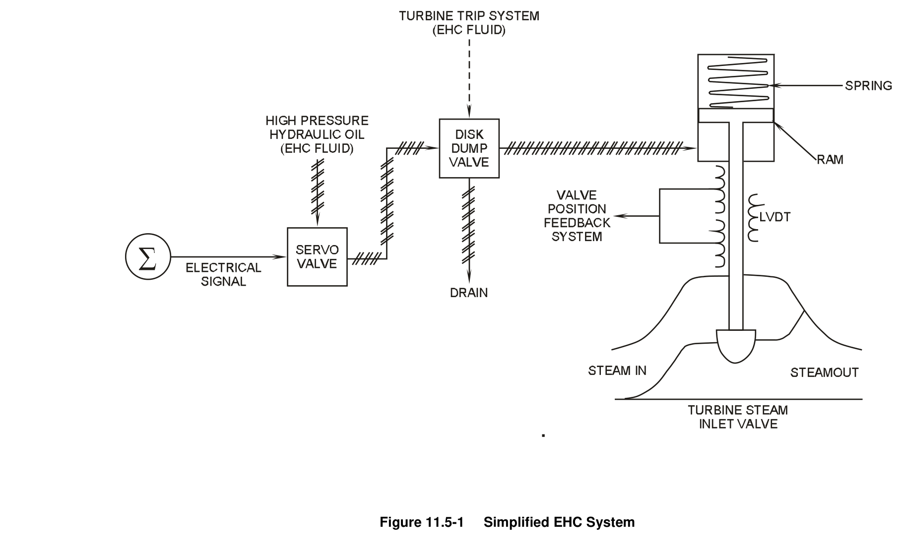

*Simplified EHC System*

[Vector original (SVG, lossless): fig_11.5-1.svg](../figures/fig_11.5-1.svg)

<!-- p.904 -->
#### Figure 11.5-2

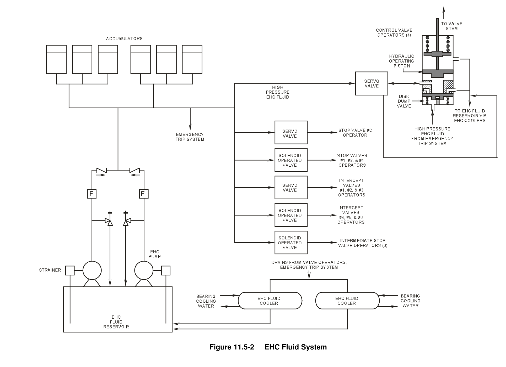

*EHC Fluid System*

[Vector original (SVG, lossless): fig_11.5-2.svg](../figures/fig_11.5-2.svg)

<!-- p.905 -->
#### Figure 11.5-3

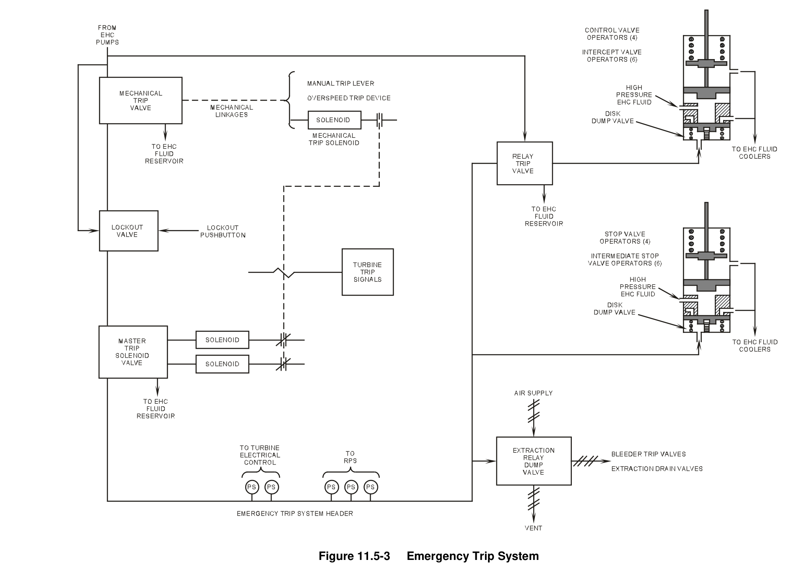

*Emergency Trip System*

[Vector original (SVG, lossless): fig_11.5-3.svg](../figures/fig_11.5-3.svg)

<!-- p.906 -->
#### Figure 11.5-4

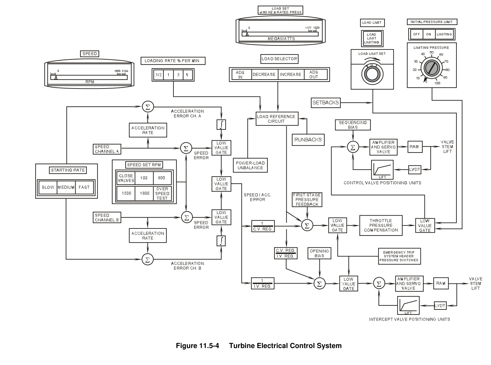

*Turbine Electrical Control System*

[Vector original (SVG, lossless): fig_11.5-4.svg](../figures/fig_11.5-4.svg)

<!-- p.907 -->
#### Figure 11.5-5

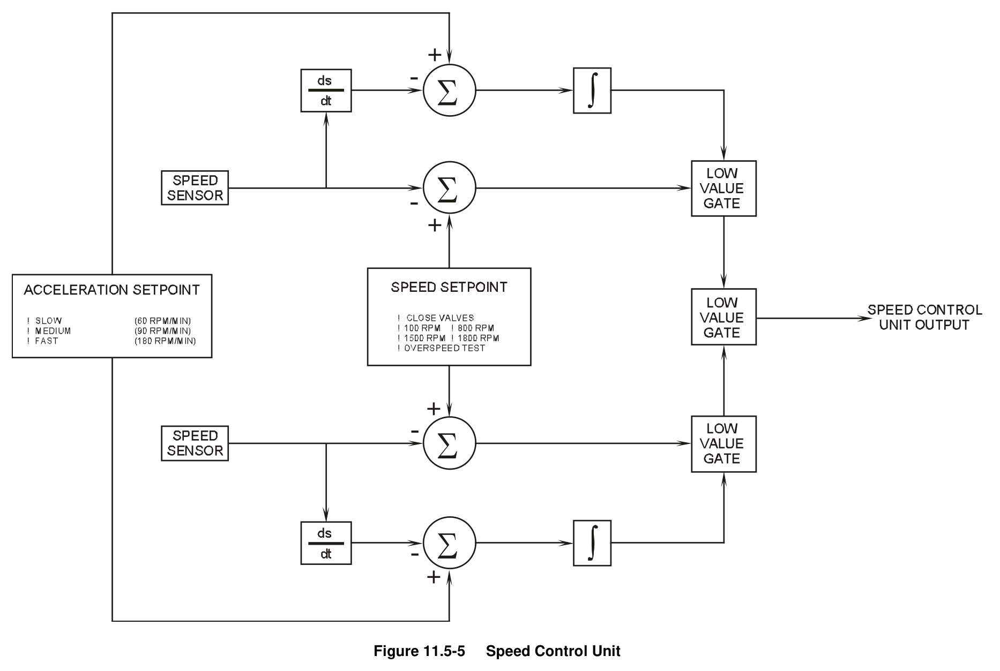

*Speed Control Unit*

[Vector original (SVG, lossless): fig_11.5-5.svg](../figures/fig_11.5-5.svg)

<!-- p.908 -->
#### Figure 11.5-6

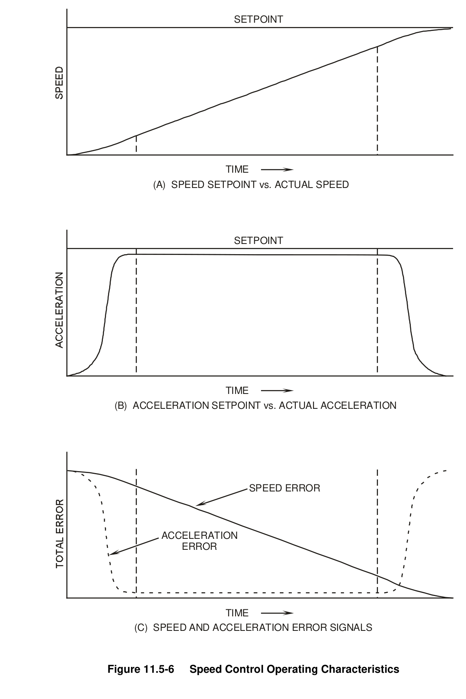

*Speed Control Operating Characteristics*

[Vector original (SVG, lossless): fig_11.5-6.svg](../figures/fig_11.5-6.svg)

<!-- labels/text on this figure page -->
SETPOINT
TIME
(A) SPEED SETPOINT vs. ACTUAL SPEED
SETPOINT
TIME
(B) ACCELERATION SETPOINT vs. ACTUAL ACCELERATION
SPEED ERROR
ACCELERATION ERROR
TIME
(C) SPEED AND ACCELERATION ERROR SIGNALS
Figure 11.5-6 Speed Control Operating Characteristics

<!-- p.909 -->
#### Figure 11.5-7

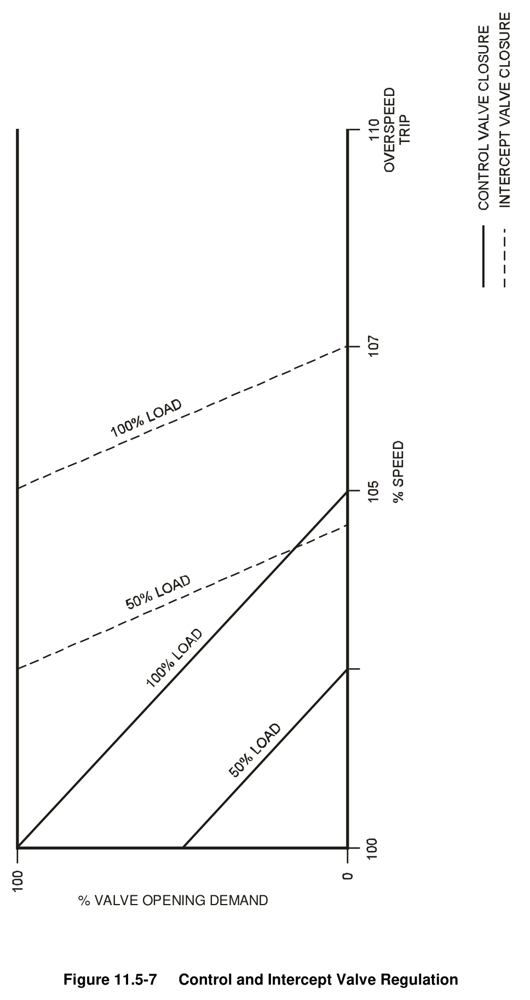

*Control and Intercept Valve Regulation*

[Vector original (SVG, lossless): fig_11.5-7.svg](../figures/fig_11.5-7.svg)

<!-- p.910 -->
#### Figure 11.5-8

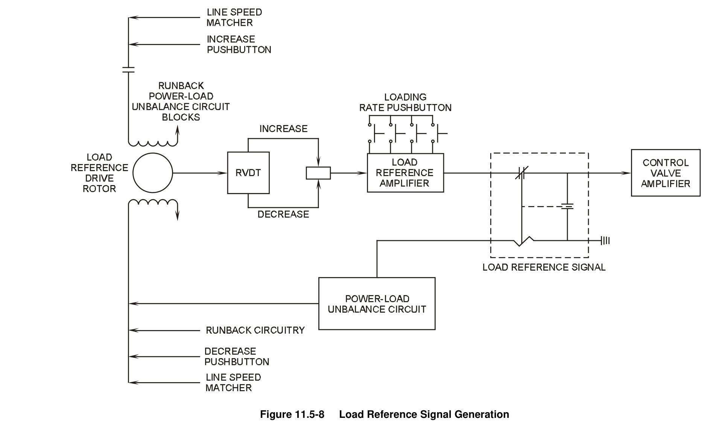

*Load Reference Signal Generation*

[Vector original (SVG, lossless): fig_11.5-8.svg](../figures/fig_11.5-8.svg)

<!-- p.911 -->
#### Figure 11.5-9

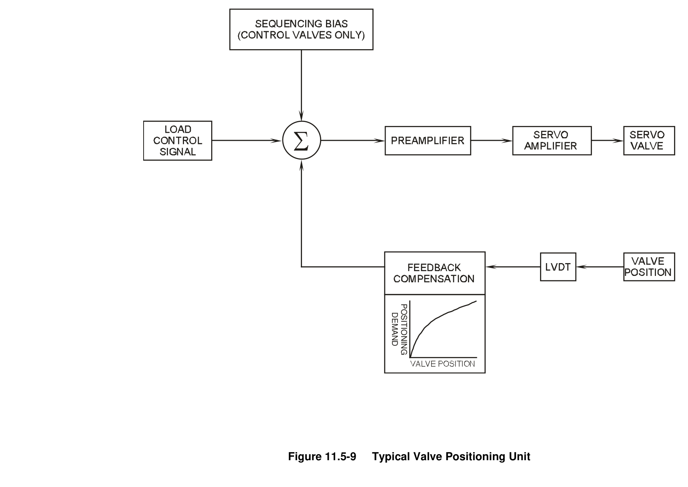

*Typical Valve Positioning Unit*

[Vector original (SVG, lossless): fig_11.5-9.svg](../figures/fig_11.5-9.svg)

<!-- p.912 -->
#### Figure 11.5-10

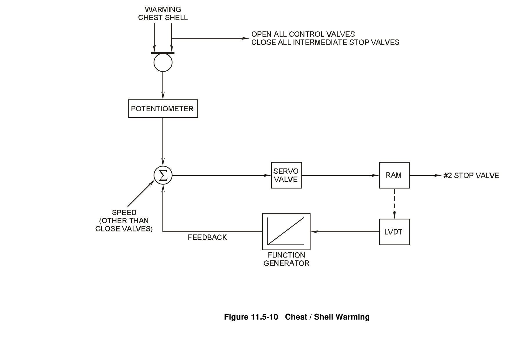

*Chest / Shell Warming*

[Vector original (SVG, lossless): fig_11.5-10.svg](../figures/fig_11.5-10.svg)

<!-- p.913 -->
#### Figure 11.5-11

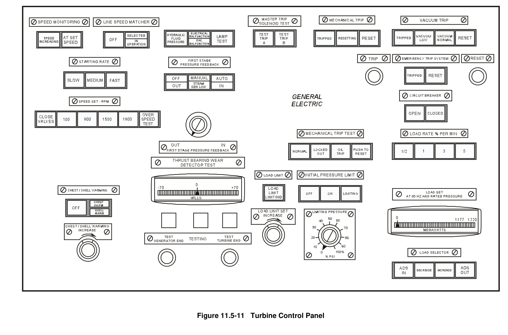

*Turbine Control Panel*

[Vector original (SVG, lossless): fig_11.5-11.svg](../figures/fig_11.5-11.svg)

<!-- p.914 -->
#### Figure 11.5-12

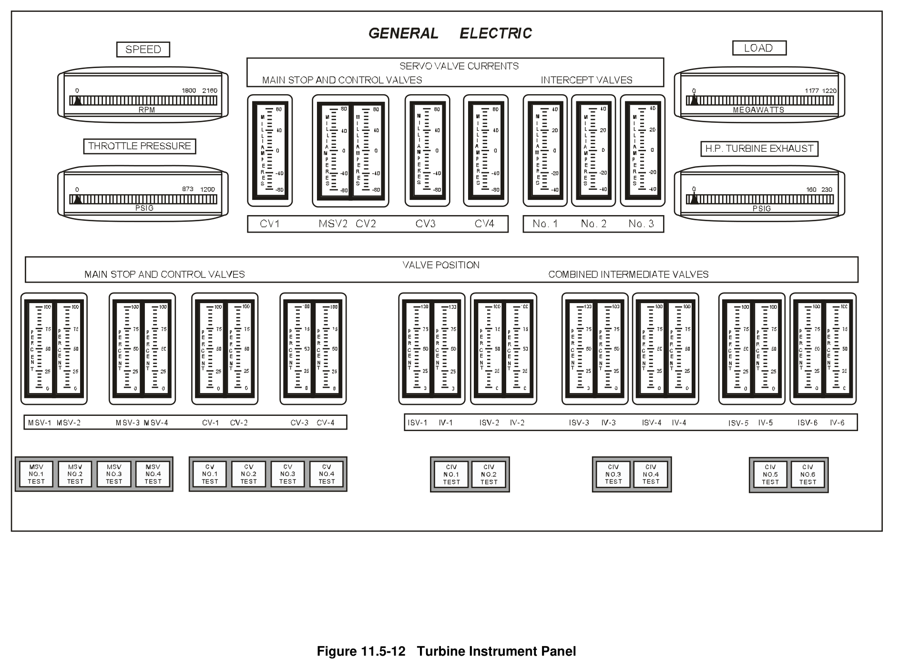

*Turbine Instrument Panel*

[Vector original (SVG, lossless): fig_11.5-12.svg](../figures/fig_11.5-12.svg)

