# 12.2 RPS Reactor Trip Signals

> Pages 932–968 of `ML20057E160.pdf`
> Westinghouse Technology Systems Manual — USNRC HRTD (PWR)

---
<!-- p.932 -->
#### Westinghouse Technology Systems Manual
#### Section 12.2
#### Reactor Protection System –
#### Reactor Trip Signals
<!-- p.933 -->
TABLE OF CONTENTS

12.2 RPS – Reactor Trip Signals .................................................................. 12.2-1

12.2.1 Introduction ........................................................................................... 12.2-1

12.2.2 Reactor Trip Functions .......................................................................... 12.2-1

12.2.3 Trip Signal Functions ............................................................................ 12.2-2

12.2.3.1 Manual Trip ........................................................................... 12.2-2

12.2.3.2 High Neutron Flux Trip - Source Range ................................ 12.2-2

12.2.3.3 High Neutron Flux Trip - Intermediate Range ....................... 12.2-3

12.2.3.4 High Neutron Flux Trip - Power Range ................................. 12.2-3

12.2.3.5 Positive Neutron Flux Rate Trip - Power Range ................... 12.2-3

12.2.3.6 Negative Neutron Flux Rate Trip - Power Range .................. 12.2-3

12.2.3.7 Overtemperature ΔT Reactor Trip ........................................ 12.2-3

12.2.3.8 Overpower ΔT Reactor Trip .................................................. 12.2-5

12.2.3.9 Pressurizer Low Pressure Trip .............................................. 12.2-6

12.2.3.10 Pressurizer High Pressure Trip ........................................... 12.2-6

12.2.3.11 Pressurizer High Water Level Trip ...................................... 12.2-6

12.2.3.12 Low Reactor Coolant Flow Trips ......................................... 12.2-6

12.2.3.13 Low-Low Steam Generator Water Level Trip ...................... 12.2-7

12.2.3.14 Safety Injection Actuation Trip ............................................ 12.2-7

12.2.3.15 Reactor Trip on Turbine Trip ............................................... 12.2-7

12.2.4 Interlocks ............................................................................................... 12.2-7

12.2.4.1 Control-Grade Interlocks ....................................................... 12.2-8

12.2.4.2 Protection-Grade Interlocks .................................................. 12.2-9

12.2.5 Summary ............................................................................................. 12.2-12

LIST OF TABLES

Table 12.2-1 Summary of Reactor Trips ......................................................... 12.2-13

Table 12.2-2 Summary of Protection-Grade Interlocks ................................... 12.2-18

Table 12.2-3 Summary of Control-Grade Interlocks ........................................ 12.2-20

USNRC HRTD 12.2-i Rev 0216

<!-- p.934 -->
#### Figure 12.2-1

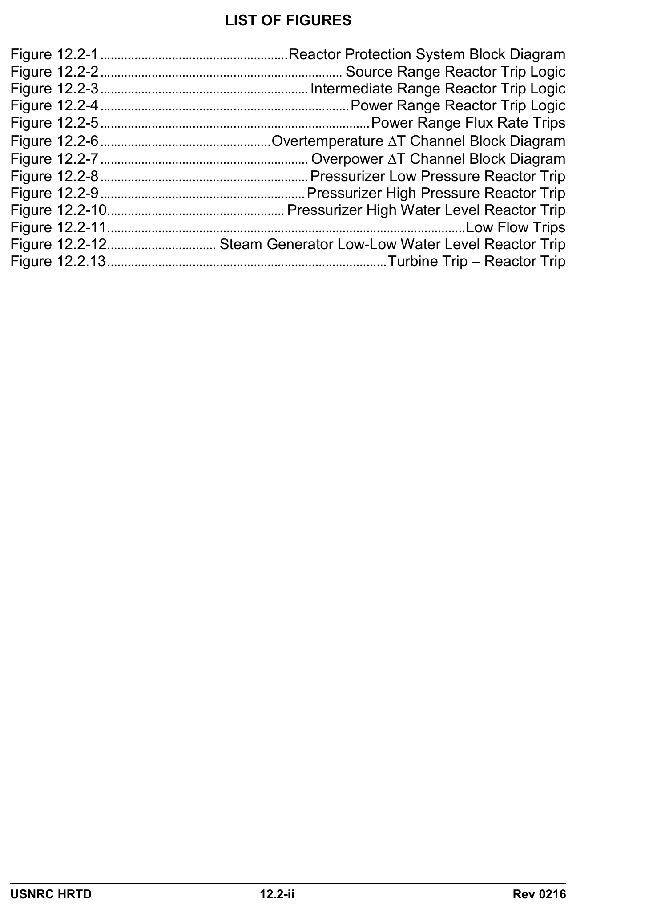

*...................................................... Reactor Protection System Block Diagram*

<!-- labels/text on this figure page -->
LIST OF FIGURES
Figure 12.2-1 ....................................................... Reactor Protection System Block Diagram
Figure 12.2-2 ....................................................................... Source Range Reactor Trip Logic
Figure 12.2-3 ............................................................. Intermediate Range Reactor Trip Logic
Figure 12.2-4 ......................................................................... Power Range Reactor Trip Logic
Figure 12.2-5 ............................................................................... Power Range Flux Rate Trips
Figure 12.2-6 .................................................. Overtemperature ∆T Channel Block Diagram
Figure 12.2-7 ............................................................. Overpower ∆T Channel Block Diagram
Figure 12.2-8 ............................................................. Pressurizer Low Pressure Reactor Trip
Figure 12.2-9 ............................................................ Pressurizer High Pressure Reactor Trip
Figure 12.2-10 .................................................... Pressurizer High Water Level Reactor Trip
Figure 12.2-11 ......................................................................................................... Low Flow Trips
Figure 12.2-12 ................................ Steam Generator Low-Low Water Level Reactor Trip
Figure 12.2.13 .................................................................................. Turbine Trip – Reactor Trip
USNRC HRTD 12.2-ii Rev 0216

<!-- p.935 -->
### 12.2 REACTOR PROTECTION SYSTEM - REACTOR TRIP SIGNALS
#### Learning Objectives:
1. Given a list of reactor trips, explain the purpose (basis) of each.

2. Given a list of Reactor Protection System (RPS) interlocks, explain the purpose of each.

3. Given a list of control-grade interlocks, explain the purpose of each.

#### 12.2.1 Introduction
The purposes of the reactor trip signals are to initiate a reactor trip if safe operating limits are exceeded. The safe operating limits bounded by these trips are monitored by sensors and are compared to preselected bistable setpoints. If a processed parameter exceeds its associated setpoint, a reactor trip occurs. The specific functions of all reactor trips are discussed in the following sections.

#### 12.2.2 Reactor Trip Functions
The philosophy of the reactor protection system is to define an area of permissible operation in terms of power, flow, axial power distribution, and primary coolant temperature and pressure, so that the reactor is tripped when the limits of a selected area of concern are approached. When the protection system receives signals indicative of an approach to an unsafe operating condition, the system actuates alarms, prevents control rod withdrawal (if applicable), initiates a turbine runback (if applicable), and/or opens the reactor trip breakers. The overpower ΔT (OPΔT) and overtemperature ΔT (OTΔT) reactor trips provide core protection for situations in which:

• The transient is slow with respect to coolant piping delays from the core to the temperature sensors, and
• Pressure is within the range between the high and low pressure reactor trips.

Other reactor trips shown in Figure 12.2-1, such as the low coolant flow and high nuclear flux trips, provide core protection for accidents in which the loop ΔT signal does not respond quickly enough. Additional reactor trips, such as the high pressurizer water level and low feedwater flow trips, are provided primarily for equipment protection. Finally, some reactor trips, such as those produced by a turbine trip or reactor coolant pump circuit breaker opening, are provided to anticipate probable plant transients and to minimize the resulting thermal transient on the reactor coolant system (RCS). Descriptions of the reactor trips are provided in section 12.2.3 and in Table 12.2-1.

Protection-grade interlocks (designated as P-n), also known as permissives, and control-grade interlocks (designated as C-n) are also described in this section. An interlock blocks certain actions and permits others. Rod withdrawal stops are examples of control-grade interlocks; they are provided to prevent abnormal

USNRC HRTD 12.2-1 Rev 0216

<!-- p.936 -->
conditions which could result in a trip in response to excessive control rod withdrawal initiated by either a control system malfunction or a violation of administrative procedures by the operator. Descriptions of interlocks are provided in sections 12.2.3 and12.2.4 and in Tables 12.2-2 and 12.2-3.

A reactor trip is initiated by interrupting power to the rod cluster control assemblies
(RCCAs). Power is delivered to the RCCAs from the rod drive motor generator sets through two series-connected trip breakers. Opening either trip breaker removes power to the rods. Each breaker is designed to trip open by spring action when a small undervoltage coil in the breaker assembly is de-energized. When this coil is de-energized, it allows a mechanical latch to move, allowing the spring to open the trip breaker. The undervoltage coil to reactor trip breaker (RTB) “A” is powered by protection train “A,” and that of RTB “B” is supplied by protection train “B.” Therefore, either protection train is capable of initiating a reactor trip, regardless of the action by the opposite train.

#### 12.2.3 Trip Signal Functions
Reactor trip signals are provided by the RPS to protect the plant during various analyzed transients or accidents. The reliability of the RPS is assured by providing more than one trip function to protect the plant against the same event. The following provides a brief description of each of the various reactor trip signals.

##### 12.2.3.1 Manual Trip
The manual actuating devices (reactor trip switches) are independent of the automatic trip circuitry, and are not subject to the types of failures which may render a portion of the automatic circuitry inoperable. Actuating either of the two manual reactor trip switches located in the control room initiates a reactor trip and a turbine trip.

##### 12.2.3.2 High Neutron Flux Trip - Source Range
This trip, Figure 12.2-2, occurs when at least one of the two source range channels indicates greater than 105 cps. The source range trip provides protection against reactivity excursions and startup accidents. This trip may be manually blocked when at least one of the two intermediate range channels exceeds the P-6 setpoint value of 10-10 amps, and the trip function is automatically reinstated when both intermediate range channels decrease below the P-6 setpoint.

When this trip is manually blocked, power is removed from the source range neutron detectors, de-energizing both channels. The operator can manually restore power to the source range detectors by momentarily placing the BLOCK-RESET switches to reset. When the P-10 permissive setpoint (10% power on the power range instruments) is exceeded, the altered reset logic prevents the operator from inadvertently energizing the source range detectors. Applying a high voltage to these detectors in the presence of a high neutron flux could damage the detectors.

USNRC HRTD 12.2-2 Rev 0216

<!-- p.937 -->
##### 12.2.3.3 High Neutron Flux Trip - Intermediate Range
This trip, Figure 12.2-3, occurs when the current output from at least one of the two intermediate range channels indicates greater than the equivalent of 25% power.
The intermediate range trip, which provides protection against reactivity excursions and startup accidents, can be manually blocked if at least two of the four power range channels exceed 10% of full power (P-10). If at least three of four (3/4) power range channels fall below the P-10 setpoint value, the trip function is automatically reinstated.

##### 12.2.3.4 High Neutron Flux Trip - Power Range
This trip, Figure 12.2-4, occurs when at least two of the four (2/4) power range channels indicate greater than the trip setpoint. Two independent trips are provided:
a high setting at 109% and a low setting at 25%. The high trip setting provides protection against overpower during normal power operations. The low setting, which provides protection against reactivity excursions and startup accidents, can be manually blocked when at least two of the four power range channels indicate greater than 10 percent of full power (P-10).

If at least three of the four power range channels drop below 10 percent power, the low power trip function is automatically reinstated. The high trip setting is always active (cannot be blocked). Before reactor power reaches the 109% trip setpoint, a signal is generated to block automatic and manual rod withdrawal. This action occurs if at least one of the four power range channels exceeds 103% power (the C- 2 interlock).

##### 12.2.3.5 Positive Neutron Flux Rate Trip - Power Range
This trip, Figure 12.2-5, occurs when an abnormal rate of increase in nuclear power
(+5% with a 2 second time constant) occurs in at least two of the four power range channels. This trip provides protection for rod ejection accidents and cannot be bypassed or blocked. A rate trip in a particular RPS channel “seals in”; it remains in effect until the operator resets the trip at the appropriate nuclear instrument drawer.

##### 12.2.3.6 Negative Neutron Flux Rate Trip - Power Range
This trip, Figure 12.2-5, occurs when an abnormal rate of decrease in nuclear power
(-5% with a 2 second time constant) occurs in at least two of the four power range channels. This trip provides protection against dropped rod accidents and cannot be bypassed or blocked. A rate trip in a particular RPS channel “seals in”; it remains in effect until the operator resets the trip at the appropriate nuclear instrument drawer.

##### 12.2.3.7 Overtemperature ΔT Reactor Trip
The OTΔT trip, Figure 12.2-6, is designed to protect against departure from nucleate boiling (DNB), which causes a large decrease in the heat transfer coefficient between the fuel rods and the reactor coolant, resulting in high fuel clad temperatures. In each of the four reactor protection channels, the calculated loop ΔT, a measure of reactor power, is compared with a continuously calculated trip setpoint. This setpoint is a function of Tavg, pressurizer pressure, and axial flux

USNRC HRTD 12.2-3 Rev 0216

<!-- p.938 -->
difference.(Separate inputs of Tavg, pressurizer pressure, and axial flux difference are used in each reactor protection channel.) If the calculated ΔT equals the calculated trip setpoint, the affected channel is tripped. If two or more channels are simultaneously tripped, the reactor is automatically tripped. The equation for the calculation of the OTΔT setpoint is:

OTΔT setpoint = ΔT0 [K1 – K2( 1 + τ1S )(T – T') + K3(P – P’) – f1(ΔI)] 1 + τ2S

where:

ΔT0 = indicated ΔT at rated thermal power, in terms of percent reactor power.
T = measured RCS average temperature (Tavg), °F.
T' = nominal Tavg at rated thermal power, 585°F.
P = pressurizer pressure, psig.
P’ = nominal RCS operating pressure, 2235 psig.
S = Laplace transform operator, sec-1.

1 + τ1S = function generated by the lead-lag controller for Tavg dynamic 1 + τ2S compensation.

τ1 = lead time constant, sec.
τ2 = lag time constant, sec.
K1 = manually adjusted preset bias that sets the steady-state trip setpoint when other parameters are at their rated values.
K2, K3 = manually adjusted preset gains.
f1(ΔI) = function of axial flux difference.

The Tavg term in the equation acts to lower the trip point when Tavg is greater than the normal full power Tavg. This correction is necessary because the increased average temperature reduces the margin to DNB. The pressure signal reduces the ΔT setpoint when pressure is lower than rated, since this condition also reduces the margin to DNB. The f1(ΔI) term reduces the value of the trip setpoint to reflect an increase in the hot channel factors which could result in localized DNB. Generally, the ΔI function does not affect the OTΔT trip setpoint (the function value is set to 0)
when core power is evenly or fairly evenly distributed axially; it dramatically reduces the OTΔT trip setpoint for very large positive or negative values of axial flux difference. This correction ensures that DNB is not approached even for highly skewed power distributions. The OTΔT trip ensures a DNBR of not less than 1.30 at the time of the reactor trip if:

• The transient is slow with respect to piping transient delays from the core to the temperature detectors and

• The reactor coolant pressure is within the bounds set by the high and low pressure trips.

Prior to the actual ΔT reaching the OTΔT trip setpoint, both automatic and manual control rod withdrawal is inhibited, and a cyclic turbine runback is initiated, as long as the overtemperature condition exists. This action occurs if the calculated ΔT

USNRC HRTD 12.2-4 Rev 0216

<!-- p.939 -->
values in at least two of the four protection channels are within 3% of the trip setpoint.

##### 12.2.3.8 Overpower ΔT Reactor Trip
The OPΔT trip, Figure 12.2-7, is designed to protect against a high fuel rod power density (excessive kw/ft) and subsequent fuel melt and fuel rod cladding failure.
Fuel melt is avoided by limiting the fuel centerline temperature to less than 4700°F, which is significantly below the actual UO2 melting temperature. In each of the four reactor protection channels, the calculated loop ΔT, a measure of reactor power, is compared with a continuously calculated trip setpoint that is automatically calculated as a function of Tavg and axial flux difference. (Separate inputs of Tavg and axial flux difference are used in each reactor protection channel.) If the ΔT signal exceeds the calculated setpoint, the affected channel is tripped. If two or more channels are simultaneously tripped, the reactor is automatically tripped. A turbine runback occurs and automatic and manual rod withdrawal is inhibited when, in at least two protection channels, the ΔT value reaches 3% below the trip setpoint. Since core thermal power is not precisely proportional to ΔT due to the effects of changes in coolant density and heat capacity, a compensating term, a function of average temperature, is used. Similarly, since the prescribed overpower limit may not be adequate for highly skewed axial power distributions, a compensating term related to ΔI is used. The setpoint equation is:

OPΔT setpoint = ΔT0 [K4 – K5( τ3S )T + K6(T – T') – f2(ΔI)] 1 + τ3S

where:

ΔT0 = indicated ΔT at rated thermal power, in terms of percent reactor power.
T = measured RCS average temperature (Tavg), °F.
T' = nominal Tavg at rated thermal power, 585°F.
S = Laplace transform operator, sec-1.

τ3S = function generated by the rate-lag controller for Tavg dynamic 1 + τ3S compensation.

τ3 = rate-lag time constant, sec.
K4 = manually adjusted preset bias that sets the steady-state trip setpoint when other parameters are at their rated values.
K5, K6 = manually adjusted preset gains.
f2(ΔI) = function of axial flux difference.

The (T - T') term effectively imposes an upper limit for the setpoint based on full power. Since it is possible for the average temperature to exceed the programmed full power average temperature, the setpoint must be reduced to take into account the increase in the heat capacity of the reactor coolant at higher temperatures. This term can only decrease the OPΔT trip setpoint from its normal full power value.

Prior to the actual ΔT reaching the OPΔT trip setpoint, both automatic and manual control rod withdrawal is inhibited, and a cyclic turbine runback is initiated, as long

USNRC HRTD 12.2-5 Rev 0216

<!-- p.940 -->
as the overpower condition exists. This action occurs if the calculated ΔT values in at least two of the four protection channels are within 3% of the trip setpoint.

##### 12.2.3.9 Pressurizer Low Pressure Trip
The pressurizer low pressure trip, Figure 12.2-8, protects against excessive core steam voids and limits the range of required protection afforded by the OTΔT trip.
The reactor trips when at least two of four pressurizer pressure signals fall below 1865 psig. This trip is automatically blocked when turbine first-stage pressure or reactor power is less than 10 percent power (P-7 permissive).

##### 12.2.3.10 Pressurizer High Pressure Trip
The pressurizer high pressure trip protects against reactor coolant system overpressure, thereby protecting the RCS pressure boundary. As shown in Figure 12.2-9, the reactor trips when two of four high pressurizer pressure signals exceed 2385 psig. This trip is always in service and cannot be bypassed or blocked.

##### 12.2.3.11 Pressurizer High Water Level Trip
The pressurizer high water level trip, shown in Figure 12.2-10, protects against overpressurization of the RCS resulting from rapid thermal expansions of reactor coolant which fill the pressurizer. In addition, if the pressurizer fills completely with water, relieving water instead of steam could be damaging to the relief and safety valves. The reactor is tripped when two of three pressurizer water level signals exceed 92%. This trip is automatically blocked below 10 percent power (P-7).

##### 12.2.3.12 Low Reactor Coolant Flow Trips
The low flow reactor coolant flow trips protect the core from DNB following a loss of coolant flow. The means of generating a low flow are shown in Figure 12.2-11 and described below:

1. Low primary coolant flow trip: A low loop flow signal is generated by two-out-ofthree low flow signals per loop. Above the P-7 setpoint (approximately 10% of full power), a low flow in two or more loops results in a reactor trip. Above the P- 8 setpoint (39% of full power) low flow in any single loop results in a direct reactor trip.

2. Reactor coolant pump breaker position trip: A contact associated with each reactor coolant pump power supply breaker supplies a signal to the logic section of the reactor protection system. The reactor trips if at least two reactor coolant pump breakers open.

3. RCP bus under-voltage trip: The RCP under-voltage trip anticipates, and improves the response of the RPS to, a complete loss of reactor coolant flow.
Each of the two RCP busses is equipped with two under-voltage sensors. An under-voltage condition, as sensed by one of two (1/2) devices on an individual bus, must exist on two of two (2/2) RCP busses to produce a reactor trip.

USNRC HRTD 12.2-6 Rev 0216

<!-- p.941 -->
4. RCP bus under-frequency trip: An under-frequency condition on the RCP busses reduces the speed of the pumps (with a subsequent reduction in flow). This is undesirable because it reduces the coastdown time of the pumps if power is lost to the busses. Each of the two RCP busses is equipped with two underfrequency sensors. An under-frequency condition, as sensed by one of two devices on an individual bus, must exist on two of two RCP busses to produce a reactor trip. In addition to tripping the reactor, satisfaction of the under-frequency trip logic also trips the RCPs.

All the reactor coolant low flow trips are automatically blocked below the P-7 setpoint
(10% power).

##### 12.2.3.13 Low-Low Steam Generator Water Level Trip
This trip (Figure 12.2-12) protects the reactor against a loss of heat sink. The setpoint of this trip is 11.5%, as indicated by the narrow-range steam generator level instruments. The trip logic is satisfied by two of three (2/3) levels below the low-low setpoint in at least one steam generator.

##### 12.2.3.14 Safety Injection Actuation Trip
If a reactor trip has not already been generated by any other trip signal, the safety injection (SI) actuation signal initiates a trip when the RPS senses any condition which initiates safety injection. The SI actuation trip protects the core in the event of a loss of coolant accident or a steam line break accident.

The safety injection actuation signals are discussed in Section 12.3.

##### 12.2.3.15 Reactor Trip on Turbine Trip
The turbine trip - reactor trip signal, Figure 12.2-13, protects the reactor coolant system from a thermal transient (overpressure or overtemperature) when the energy removal from the coolant abruptly diminishes. This trip occurs for power levels greater than 10% (P-7), or in plants with the P-9 permissive, for levels greater than 50%. The signals used to sense that the turbine has tripped are:

1. Four of four (4/4) turbine throttle (stop) valves fully closed, or
2. Two of three low turbine electrohydraulic control system trip header fluid pressures (setpoint: 800 psig) for a General Electric turbine, or two of three low auto-stop oil pressures (setpoint: 45 psig) for a Westinghouse turbine.

See Sections 11.3 and 11.5 for additional details.

#### 12.2.4 Interlocks
Various signals are generated throughout the plant for the purpose of:

1. Automatically prohibiting and/or allowing the actuation of certain protective functions and the operation of certain control systems, and
2. Allowing the operator to manually prohibit certain protective actions.

USNRC HRTD 12.2-7 Rev 0216

<!-- p.942 -->
The interlocks are divided into two broad categories, designated as protection-grade
(P) interlocks (permissives) and control-grade (C) interlocks. Protection-grade interlocks are developed within the solid-state protection system. Control-grade interlocks are developed within the process instrumentation racks (with the exception of C-8). Although not part of the protection system, the control-grade interlocks are discussed here for the sake of completeness.

##### 12.2.4.1 Control-Grade Interlocks
An interlock is a signal or equipment status that prevents or allows an action or a function when a certain set of conditions exist. Listed below are the control-grade interlocks (designated by the C-n convention) employed in most Westinghouse reactor plants. The “C” designation differentiates them from RPS permissives (“P” designation), as previously discussed.

#### C-1: High Neutron Flux Rod Stop Interlock
At least one of two intermediate range detector currents exceeding the equivalent of 20% power generates a rod withdrawal stop for both automatic and manual rod control. The rod stop may be blocked with reactor power (power range) at or above the P-10 setpoint (2/4 coincidence), but it is automatically reinstated when power drops below the P-10 setpoint (3/4 coincidence).

#### C-2: Overpower Rod Stop Interlock
If at least one of the four excore power range flux detectors indicates a power output of greater than 103%, an automatic and manual rod withdrawal stop is actuated.
This interlock may be bypassed by the operator to allow for continued operation with one inoperable power range channel.

#### C-3: OTΔT Rod Stop and Turbine Runback Interlock
When the calculated loop ΔT in at least two of four protection channels is within three percent of the OTΔT trip setpoint, automatic and manual rod withdrawal is blocked, and a turbine runback is initiated.

#### C-4: OPΔT Rod Stop and Turbine Runback Interlock
When the calculated loop ΔT in at least two of four protection channels is within three percent of the OPΔT trip setpoint, automatic and manual rod withdrawal is blocked, and a turbine runback is initiated.

#### C-5: Low Power Interlock
The setpoint for this interlock is 15% load, as sensed by turbine impulse pressure. If load drops below 15%, automatic rod withdrawal is inhibited. The C-5 interlock is supplied by a particular turbine impulse pressure sensor that cannot be changed by the operator.

#### C-7: Loss of Load Interlock
USNRC HRTD 12.2-8 Rev 0216

<!-- p.943 -->
This interlock is actuated by a reduction in turbine load of sufficient severity; it arms the steam dump control system (allows steam dump valves to open if an open demand exists). C-7 senses must be manually reset. It is actuated by a turbine load decrease larger in magnitude than a 10% step drop or a 5%/min ramp decrease.

#### C-8: Turbine Tripped Interlock
When the C-8 interlock is actuated, the steam dump control system (if in the Tavg mode of control) shifts from the load-rejection controller to the turbine-trip controller.
Permissive C-8 requires:

1. Four of four (4/4) turbine throttle (stop) valves fully closed, or
2. Two of three low turbine electrohydraulic control system trip header fluid pressures (setpoint: 800 psig) for a General Electric turbine, or two of three low auto-stop oil pressures (setpoint: 45 psig) for a Westinghouse turbine.

In addition, C-8 arms the steam dumps. The C-8 interlock is not installed in Westinghouse-designed units that have the P-9 permissive.

#### C-9: Condenser Available Interlock
The condenser must be available in order to allow steam dump operation. To actuate C-9, one of two (1/2) circulating water pump breakers must be shut AND two of two condenser vacuum switches must be shut (< 5 in. Hg backpressure). If backpressure in the condenser increases to 7.6 in. Hg, then the C-9 interlock is removed.

#### C-11: Control Bank D Rod Withdrawal Limit Interlock
This signal prevents misalignment of rod position step counters by blocking automatic withdrawal of control bank D when the bank D position has reached 223 steps.

##### 12.2.4.2 Protection-Grade Interlocks
During controlled plant evolutions, certain protection signals are not required for plant safety and may be blocked to prevent inadvertent reactor trips or engineered safety features (ESF) actuations. These signals are disabled automatically by the RPS or manually by the operator. The mechanisms for blocking these trips are the protection-grade interlocks, or permissives. The protection system is designed so that any signal which had been blocked is automatically reinstated whenever the conditions allowing that block (a satisfied permissive) are no longer met (This design convention is required by IEEE Std. 279-1971). The following provides brief descriptions of the various permissives.

#### P-4: Reactor Trip Permissive
This permissive is derived from the status of "b" contacts on the reactor trip breakers
(RTBs). (Each contact is closed when the associated RTB is open, and open when

USNRC HRTD 12.2-9 Rev 0216

<!-- p.944 -->
the RTB is closed). The permissive is satisfied whenever an RTB is open. It performs the following functions:

1. Actuates a turbine trip,
2. Initiates main feedwater isolation with RCS temperature below 564°F,
3. Inputs to the SI actuation block-reset logic, and 4. Prevents opening of the main feedwater isolation valves which had been closed by an SI actuation signal or high-high steam generator level (P-14).

Permissive P-4 (and P-14, as discussed below) is not a permissive signal in the classic sense, in that it does not enable or reinstate some switch or function. It does not have associated status lights on protection system bistable status panels in the control room.

#### P-6: Source Range Block Permissive
Permissive P-6 enables the source range block-reset switches on the main control board. The operator can then place the switches in the “block” position to remove power from the source range detectors, thereby blocking the source range high flux trip. During a power increase when at least one of two intermediate range channels is greater than 10-10 amps, permissive P-6 is in effect. During a power decrease when BOTH intermediate range channel outputs drop below 10-10 amps, permissive P-6 is removed.

#### P-7: At-Power Permissive
At-power permissive P-7 is in effect below 10% power and automatically blocks the at-power trips listed below:

• Two-loop low reactor coolant flow trip,
• RCP power supply breaker trip,
• RCP bus under-voltage trip,
• RCP bus under-frequency trip,
• Pressurizer low pressure trip,
• Pressurizer high level trip, and
• Reactor trip on turbine trip (except at plants with P-9).

During a power increase, when either the turbine load (P-13) or the reactor power
(P-10) is greater than 10%, permissive P-7 is removed, and the at-power trips are automatically enabled. During a power decrease, both the turbine load (2/2) and the reactor power (3/4, power range) must be below 10% to enable permissive P-7 and disable the at-power trips.

#### P-8: Three Loop Flow Permissive
Permissive P-8 is in effect below 39% reactor power. The permissive allows the loss of flow in one reactor coolant loop without generating a direct reactor trip signal.
When at least two of four power range channels indicate that reactor power is

USNRC HRTD 12.2-10 Rev 0216

<!-- p.945 -->
greater than 39%, a loss-of-flow signal in any single loop initiates a reactor trip signal.

#### P-9: Turbine Trip/Reactor Trip Permissive
Permissive P-9 is in effect below 50% power (note: not all Westinghouse units use this permissive). This permissive allows the reactor to remain in operation if the turbine trips. Facilities with this permissive have demonstrated that, for turbine trips from 50% power or less, sufficient steam dump capacity is available for excess energy removal until the plant is brought to no-load conditions.

#### P-10: Nuclear At-Power Permissive
Inputs to the P-10 permissive circuit are from each of the four power range channels.
The P-10 setpoint is 10%. When at least two of the channels indicate greater than or equal to this setpoint, the operator may block the intermediate high flux trip, the power range low setpoint high flux trip, and the high neutron flux rod stop (C-1).
When 3/4 power range channels drop below the P-10 setpoint, the functions previously mentioned are automatically reinstated. The following is a list of functions provided by P-10:

1. Allows the operator to manually block the intermediate range high flux trip and the C-1 rod stop,
2. Allows the operator to manually block the low setpoint power range high flux trip,
3. Automatically restores intermediate range trip and C-1 rod stop when power falls below the P-10 setpoint, 4. Automatically restores the low setpoint power range high flux trip when power falls below the P-10 setpoint, 5. Provides an input to the P-7 circuit, and 6. Serves as a backup to P-6 by preventing the operator from inadvertently reenergizing the source range high voltage.

#### P-11: Low Pressurizer Pressure SI Block Permissive
Permissive P-11 is in effect below 1915 psig. When two of three pressurizer pressure channels indicate less than 1915 psig, the block switches for the low pressurizer pressure safety injection actuation signal are enabled, and the operator may block the actuation signal before the low pressure SI setpoint of 1807 psig is reached.

With pressure increasing, when two of three channels indicate greater than 1915 psig, the block is automatically removed. In addition, the removal of this permissive
(pressurizer pressure greater than the permissive setpoint) provides a confirmatory open signal to all cold-leg accumulator motor-driven isolation valves. (The accumulator isolation valves are unlikely to open automatically; power to the valves is removed except when operators are manually opening or closing them.)

#### P-12: High Steam Flow SI Block Permissive
USNRC HRTD 12.2-11 Rev 0216

<!-- p.946 -->
Permissive P-12 is in effect below 553°F. If two of four loop Tavg signals are below the low-low Tavg value of 553°F, the block switches for the high steam line flow safety injection actuation is enabled, and the operator can block this signal. This signal is blocked during a controlled plant cooldown to prevent an automatic initiation of the ESF equipment. Permissive P-12 also automatically blocks steam dump operation and thereby prevents an uncontrolled cooldown caused by an instrumentation malfunction. Operators can bypass the block for only one bank of three steam dump valves. This permissive is automatically removed when three of four (3/4) Tavg channels indicate greater than 553°F. The removal automatically makes the remaining nine steam dump valves available for operation and removes the block of the high steam line flow SI actuation signal.

#### P-13: Turbine At-Power Permissive
Permissive P-13 is enabled when both turbine impulse chamber pressures indicate that turbine load is less than 10%. P-13 and P-10 are the two inputs to at-power permissive P-7.

#### P-14: Steam Generator High Level Override
The P-14 setpoint is enabled when at least two of three steam generator narrowrange levels exceed 69% for at least one steam generator. When this permissive is actuated the following actions occur:

1. The turbine trips,
2. All main feedwater pumps trip,
3. All main feedwater regulating and bypass valves shut, and 4. All main feedwater isolation valves shut.

Permissive P-14, like P-4, is not a permissive signal in the classic sense, in that it does not enable or reinstate some switch or function. Individual bistable lights for the high-high level turbine trip function are on the reactor trip bistable status panel.

#### 12.2.5 Summary
Many reactor trip signals are generated to ensure that the reactor is operated within safe limits. Some trip functions are enabled or blocked in accordance with the status of associated permissives (protection-grade interlocks). Control-grade interlocks, discussed in this section for completeness, are also provided for certain plant control functions.

USNRC HRTD 12.2-12 Rev 0216

<!-- p.947 -->
#### Table 12.2-1 Summary of Reactor Trips
Trip Coinc. Setpoint Interlocks Purpose Accident/Event

1. Source 1/2 105 cps Manual block Prevents an Reactivity addition Range High permitted by inadvertent accidents such as:
Neutron P-6; power to power rise Flux source range (excursion). A a. Uncontrolled rod detectors is trip will occur withdrawal from removed unless the subcritical or low when manual operator power condition, block is deliberately b. Inadvertent boron initiated. blocks the trip. dilution, or Power to c. Excessive heat detectors removal caused by cannot be steamline break or turned on feedwater addition when power accident is above P- 10.

2. Intermediate 1/2 Current Manual block Prevents an Reactivity addition Range High equiva- permitted by inadvertent accidents such as:
Neutron lent to P-10. power rise Flux 25%
(excursion). A a. Uncontrolled rod power trip will occur withdrawal from level unless the subcritical or low operator power condition, deliberately b. Inadvertent boron blocks the trip. dilution, or c. Excessive heat removal caused by steamline break or feedwater addition accident

3. Power 2/4 25% Manual block Prevents an Reactivity addition Range High permitted by inadvertent accidents such as:
Neutron Flux P-10. power rise
- low setpoint
(excursion). A a. Uncontrolled rod trip will occur withdrawal from unless the subcritical or low operator power condition, deliberately b. Inadvertent boron blocks the trip. dilution, or c. Excessive heat removal caused by steamline break or feedwater addition accident

USNRC HRTD 12.2-13 Rev 0216

<!-- p.948 -->
#### Table 12.2-1 (cont’d)
#### Summary of Reactor Trips
Trip Coinc. Setpoint Interlocks Purpose Accident/Event

4. Power 2/4 109% No Interlocks Limits maximum Inadvertent power power level to excursions such as:
Range High prevent damage Flux - high to fuel clad and a. Excessive load setpoint to protect increase, against b. Excessive heat centerline removal, melting. c. Boron dilution accident, d. Inadvertent rod withdrawal, or e. Rod ejection accident

5. High 2/4 +5% No Interlocks Limits power Rod Ejection Accident Positive change excursions.
Rate with a 2- Prevents Neutron sec time unacceptable Flux constant power distribution.

6. High 2/4 -5% No Interlocks Prevents Dropped Rod Negative change unacceptable Rate with a 2power Neutron sec time distribution.
Flux constant Limits power overshoot from rod withdrawal in response to a dropped rod.

7. OTΔΤ 2/4 Variable No Interlocks Prevents Relatively slow transients
(caloperation with such as:
culated)
DNBR <1.30.
a. Uncontrolled rod withdrawal at power, b. Uncontrolled boron dilution, c. Excessive load increase, or d. Depressurization of the RCS

USNRC HRTD 12.2-14 Rev 0216

<!-- p.949 -->
#### Table 12.2-1 (cont’d)
#### Summary of Reactor Trips
Trip Coinc. Setpoint Interlocks Purpose Accident/Event

8. OPΔΤ 2/4 Variable No Interlocks Prevents Relatively slow transients
(calexcessive such as:
culated)
power density
(kw/ft). a. Uncontrolled rod withdrawal at power, b. Uncontrolled boron dilution, c. Excessive load increase, or d. Steamline break

9. Pressurizer 2/4 1865 psig Disabled Prevents Depressurization of RCS Low
(rate below P-7 operation with due to:
Pressure compen- (10%) DNBR <1.30.
sated)
Limits required a. LOCA, range of OTΔT b. Steamline break, or trip.
c. SG tube rupture

10. Pressurizer 2/4 2385 psig No Interlocks Protects Uncontrolled rod High integrity of RCS withdrawal at power, loss Pressure pressure of electrical load, or boundary. turbine trip

11. Pressurizer 2/3 92% Disabled Prevents “solid- Uncontrolled rod High Water below P-7 water” withdrawal at power, loss Level
(10%) operations, of electrical load, or prevents turbine trip discharge of high energy water through relief and safety valves.

12. Low 2/3 per <90% of <P-8 (39%): Ensures Loss of coolant flow Reactor loop rated flow loss of flow adequate loop events such as:
Coolant in one loop, flow to remove a. Partial loss of RCS Flow no direct trip. core heat. flow, <P-7 (10%): DNBR b. Complete loss of loss of flow considerations. forced RCS flow, or in two or c. Loss of off-site power more loops, to station auxiliaries.
no direct trip.

13. Reactor 1/2 68.6% of Disabled Redundant to Redundant to low flow trip Coolant on nominal below P-7 low flow trip Pump Bus 2/2 bus (10%)
Under- buses voltage Voltage

USNRC HRTD 12.2-15 Rev 0216

<!-- p.950 -->
#### Table 12.2-1 (cont’d)
#### Summary of Reactor Trips
Trip Coinc. Setpoint Interlocks Purpose Accident/Event

14. Reactor 1/2 57.7 Hz Disabled Redundant to Redundant to low flow trip Coolant on below P-7 low flow trip Pump Bus 2/2
(10%); trips Under- buses open the Frequency pump motor breakers when actuated to preserve pump coastdown time.

15. Reactor 1/1 Breaker Disabled Redundant to Redundant to low flow trip Coolant on 2/4 open below P-7 low flow trip Pump RCPs
(10%)
Breaker

16. Steam 2/3 on 11.5% No Interlocks Prevents loss of Loss of normal feedwater Generator 1/4 heat sink.
Low-Low SGs Level

17. Turbine Trip 2/3 low Westing- Disabled Removes heat Turbine trip, loss of load pres- house: below P-7 source if steam sure or 45 psig (10%) load is lost to 4/4 auto-stop SGs.
throttle oil press.
valves GE: 800 closed psig trip header press.

USNRC HRTD 12.2-16 Rev 0216

<!-- p.951 -->
#### Table 12.2-1 (cont’d)
#### Summary of Reactor Trips
Trip Coinc. Setpoint Interlocks Purpose Accident/Event

18. SI Actuation 1/2 No Interlocks Any accident requiring a trains safety injection actuation signal

19. Manual 1/2 No Interlocks Operator Any condition requiring a manual initiated backup reactor trip pushto all trips buttons

20. SSPS 2/2 General The SSPS has General Warning a self-check Warning feature that will trip the reactor if both protection trains develop trouble.

USNRC HRTD 12.2-17 Rev 0216

<!-- p.952 -->
#### Table 12.2-2 Summary of Protection-Grade Interlocks
Number Name Setpoint Coincidence Functions

P-4 Reactor Trip Open if trip breaker is Trip breaker 1. Trips main turbine.
Breaker closed.
and its bypass 2. Isolates main feedwater Contact Closed if trip breaker is breaker both with Tavg <564°F in 2/4 loops.
open.
open
3. Input to SI block and reset logic.
4. If main feed regulating and bypass valves are closed by SI or SG high level, P-4 seals in the isolation.

P-6 Source Range Intermediate range 1/2 Enables BLOCK/RESET Block power switches to allow the Permissive > 10-10 amps.
operator to block SR high flux trip.

P-7 At-Power Power < 10% Power range Automatically blocks the “at- Permissive power <10% power” trips:
(P-10 cleared)
and turbine 1. Pressurizer low power (impulse pressure, pressure) <10% 2. Pressurizer high level,
(P-13) 3. All RCS low flow, and 4. Turbine tripped

P-8 3-Loop Flow Power range power < 3/4 Automatically blocks the Permissive 39% single loop low flow reactor trip.

P-9 Turbine Power range power < 3/4 Blocks reactor trip on
(Not on Trip/Reactor 50% turbine trip below 50%.
all Trip plants) Permissive

P-10 Nuclear At- Power range power > 2/4
1. Opens contacts to SR Power Block 10% high voltage power Permissive supply.
2. Enables BLOCK switches to allow the operator to block IR high flux trip and rod stop.
3. Enables BLOCK switches to allow the operator to block PR high flux - low setpoint trip.
4. Input to P-7.

USNRC HRTD 12.2-18 Rev 0216

<!-- p.953 -->
#### Table 12.2-2 (cont’d)
#### Summary of Protection-Grade Interlocks
Number Name Setpoint Coincidence Functions

P-11 Low Pressurizer pressure < 2/3 Enables BLOCK switches to Pressurizer 1915 psig allow the operator to block Pressure SI low pressurizer pressure Block ESF actuation.
Permissive Removal of permissive provides open signal to accumulator isolation valves.

P-12 High Steam Tavg < 553°F 2/4
1. Enables BLOCK Flow SI switches to allow the Permissive operator to block high steam flow ESF actuation.
2. Input to high steam flow ESF actuation logic.
3. Removes arming signal for steam dump operation. Operator may bypass the interlock on the three cooldown valves.

P-13 Turbine At- Turbine power (impulse 2/2 Input to P-7 Power pressure) < 10% Permissive

P-14 SG High Steam generator 2/3 per SG on 1. Closes main feedwater Level narrow-range level > 1/4 SGs regulating and bypass Override 69% valves.
2. Trips all main feed pumps.
3. Trips main turbine.
4. Closes all main feedwater isolation valves.

USNRC HRTD 12.2-19 Rev 0216

<!-- p.954 -->
#### Table 12.2-3 Summary of Control-Grade Interlocks
Number Name Setpoint Coincidence Interlocks Functions

C-1 Intermediate Intermediate range 1/2 Blocked when Stops control rod Range High power > current IR trip is outward motion Flux Rod equivalent to 20% blocked. (manual & Stop power Bypassed automatic).
when IR trip is bypassed.

C-2 Power Range Power range power 1/4 Individual Stops control rod High Flux > 103% channel can be outward motion Rod Stop bypassed at (manual & local cabinet. automatic).

C-3 OTΔΤ Rod Loop ΔT > (OTΔΤ 2/4 None Stops control rod Stop & reactor trip setpoint outward motion Runback - 3%)
(manual & automatic) and initiates a turbine runback.

C-4 OPΔΤ Rod Loop ΔT > (OPΔΤ 2/4 None Stops control rod Stop & reactor trip setpoint outward motion Runback - 3%)
(manual & automatic) and initiates a turbine runback.

C-5 Low Power Turbine power 1/1 (one None Stops control rod Interlock (impulse pressure) channel outward motion in < 15% assigned)
automatic only.

C-7 Loss of Load Turbine power 1/1 (one Seals in. Must Arms steam dumps
(impulse pressure) channel be reset. in Tavg mode (lossof-load controller).
reduction > 10% assigned)
step or 5%/min ramp

C-8 Turbine 1. Throttle valves 1. 4/4 Reactor trip 1. Arms steam
(Plant Tripped closed, or
(see function dumps in Tavg with P-9 2) disabled if mode (turbinedoes not
2.a Westinghouse: 2.a, b 2/3 P-7 satisfied. trip controller).
2. Trips reactor.
have)
auto-stop oil pressure <45 psig
2.b GE: trip header pressure < 800 psig

USNRC HRTD 12.2-20 Rev 0216

<!-- p.955 -->
#### Table 12.2-3 (cont’d)
#### Summary of Control-Grade Interlocks
Number Name Setpoint Coincidence Interlocks Functions

C-9 Condenser 1. Condenser 1. 2/2 None Ensures condenser Available vacuum > 22 is available for Interlock in. Hg, and steam dump operation.
2. Condenser 2. 1/2 circulating water pump breaker closed

C-11 Control Bank Control bank D 1/1 None Stops outward rod D Withdrawal pulse-to-analog motion in automatic Interlock converter output only.
>223 steps

USNRC HRTD 12.2-21 Rev 0216

<!-- p.956 -->
#### Figure 12.2-1

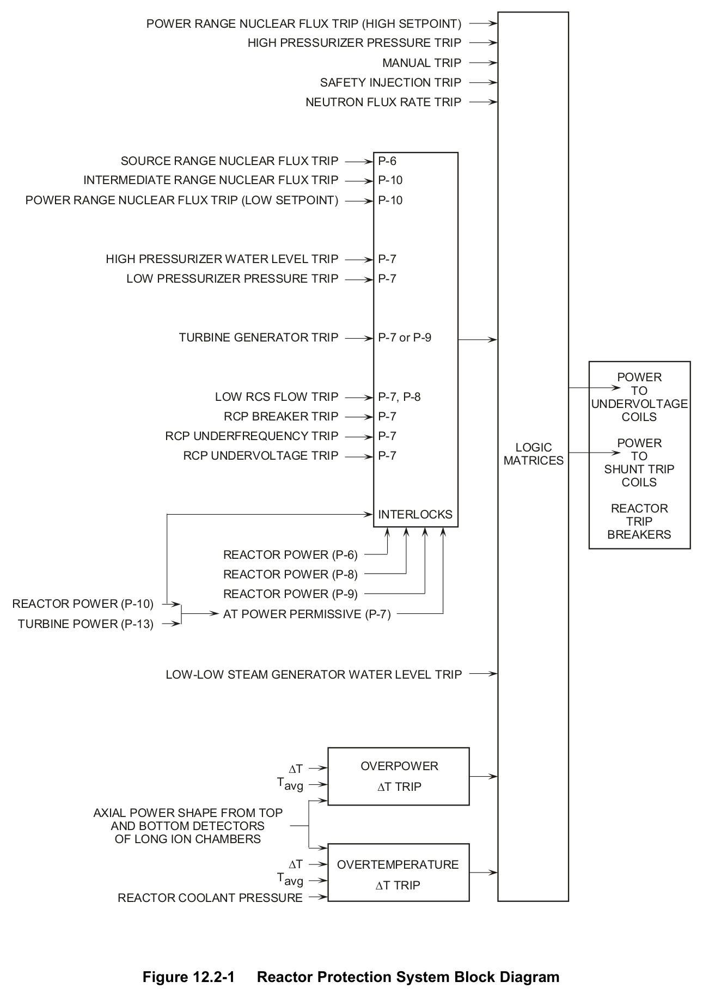

*Reactor Protection System Block Diagram*

[Vector original (SVG, lossless): fig_12.2-1_2.svg](../figures/fig_12.2-1_2.svg)

<!-- labels/text on this figure page -->
POWER RANGE NUCLEAR FLUX TRIP (HIGH SETPOINT)
HIGH PRESSURIZER PRESSURE TRIP MANUAL TRIP SAFETY INJECTION TRIP NEUTRON FLUX RATE TRIP
SOURCE RANGE NUCLEAR FLUX TRIP P-6 INTERMEDIATE RANGE NUCLEAR FLUX TRIP P-10 POWER RANGE NUCLEAR FLUX TRIP (LOW SETPOINT) P-10
HIGH PRESSURIZER WATER LEVEL TRIP P-7 LOW PRESSURIZER PRESSURE TRIP P-7
TURBINE GENERATOR TRIP P-7 or P-9
POWER TO LOW RCS FLOW TRIP P-7, P-8 UNDERVOLTAGE RCP BREAKER TRIP P-7 COILS RCP UNDERFREQUENCY TRIP P-7 POWER LOGIC RCP UNDERVOLTAGE TRIP P-7 TO MATRICES SHUNT TRIP COILS
REACTOR INTERLOCKS TRIP BREAKERS REACTOR POWER (P-6)
REACTOR POWER (P-8)
REACTOR POWER (P-9)
REACTOR POWER (P-10)
AT POWER PERMISSIVE (P-7)
TURBINE POWER (P-13)
LOW-LOW STEAM GENERATOR WATER LEVEL TRIP
OVERPOWER ∆T Tavg ∆T TRIP
AXIAL POWER SHAPE FROM TOP AND BOTTOM DETECTORS OF LONG ION CHAMBERS
∆T OVERTEMPERATURE Tavg ∆T TRIP REACTOR COOLANT PRESSURE
Figure 12.2-1 Reactor Protection System Block Diagram

<!-- p.957 -->
#### Figure 12.2-2

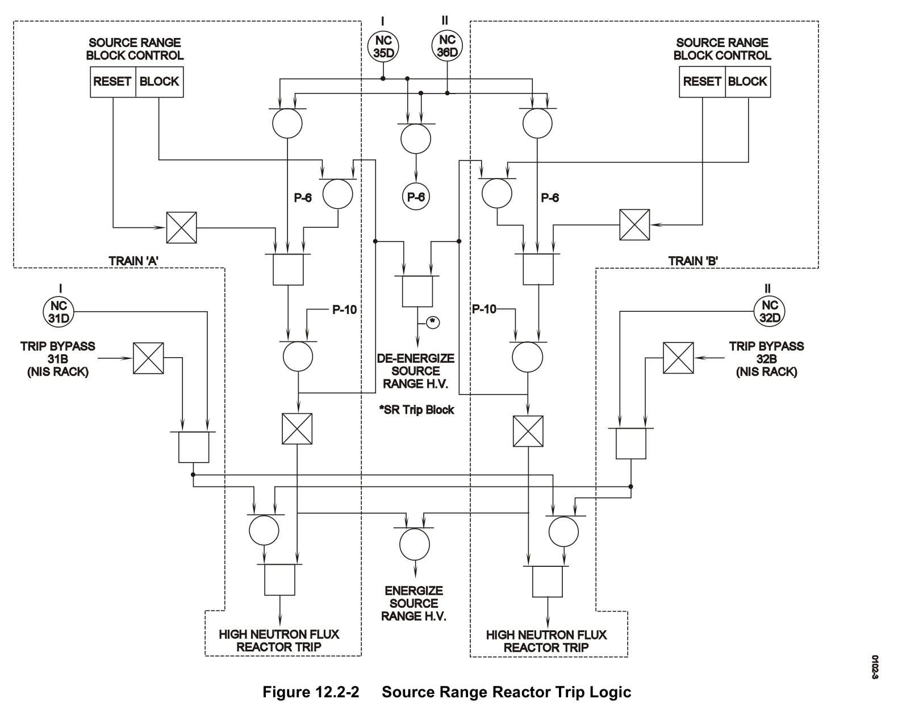

*Source Range Reactor Trip Logic*

[Vector original (SVG, lossless): fig_12.2-2.svg](../figures/fig_12.2-2.svg)

<!-- p.958 -->
#### Figure 12.2-3

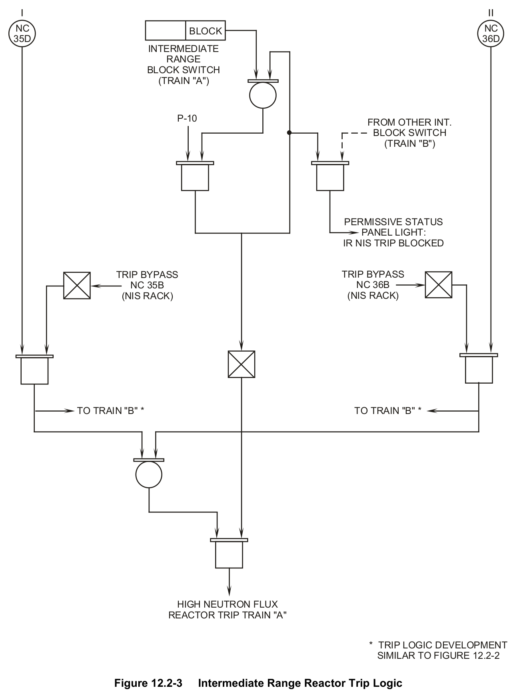

*Intermediate Range Reactor Trip Logic*

[Vector original (SVG, lossless): fig_12.2-3.svg](../figures/fig_12.2-3.svg)

<!-- labels/text on this figure page -->
NC NC BLOCK 35D 36D INTERMEDIATE RANGE BLOCK SWITCH
(TRAIN "A")
P-10 FROM OTHER INT.
BLOCK SWITCH
(TRAIN "B")
PERMISSIVE STATUS PANEL LIGHT:
IR NIS TRIP BLOCKED
TRIP BYPASS TRIP BYPASS NC 36B NC 35B
(NIS RACK)
(NIS RACK)
TO TRAIN "B" * TO TRAIN "B" *
HIGH NEUTRON FLUX REACTOR TRIP TRAIN "A"
* TRIP LOGIC DEVELOPMENT SIMILAR TO FIGURE 12.2-2
Figure 12.2-3 Intermediate Range Reactor Trip Logic

<!-- p.959 -->
#### Figure 12.2-4

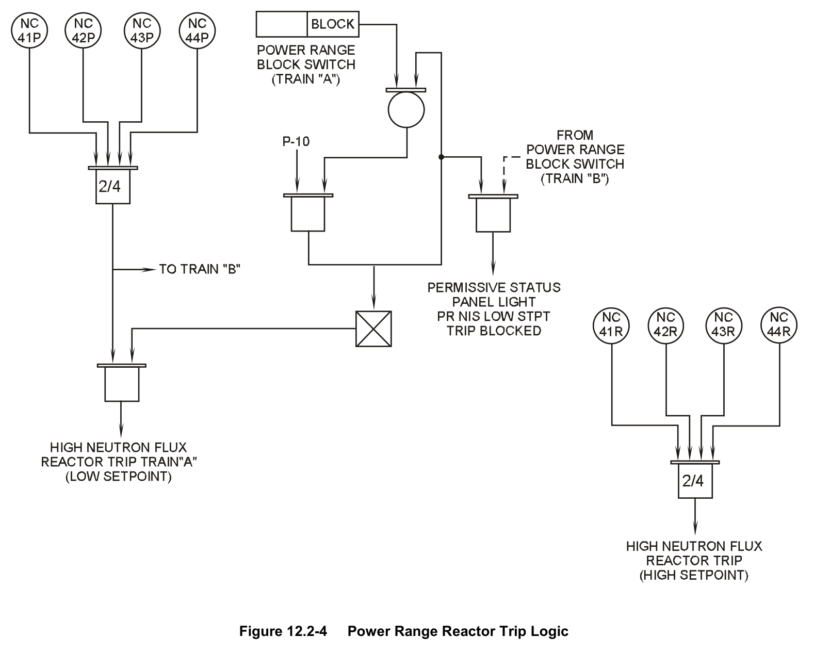

*Power Range Reactor Trip Logic*

[Vector original (SVG, lossless): fig_12.2-4.svg](../figures/fig_12.2-4.svg)

<!-- p.960 -->
#### Figure 12.2-5

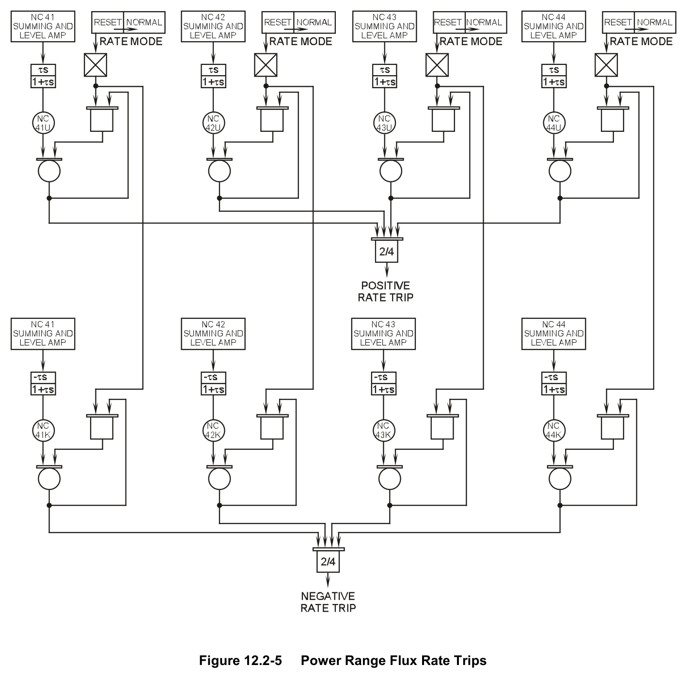

*Power Range Flux Rate Trips*

[Vector original (SVG, lossless): fig_12.2-5.svg](../figures/fig_12.2-5.svg)

<!-- p.961 -->
#### Figure 12.2-6

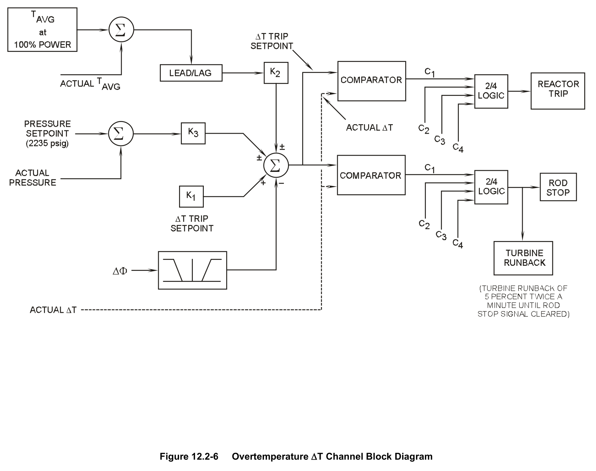

*Overtemperature ∆T Channel Block Diagram*

[Vector original (SVG, lossless): fig_12.2-6.svg](../figures/fig_12.2-6.svg)

<!-- p.962 -->
#### Figure 12.2-7

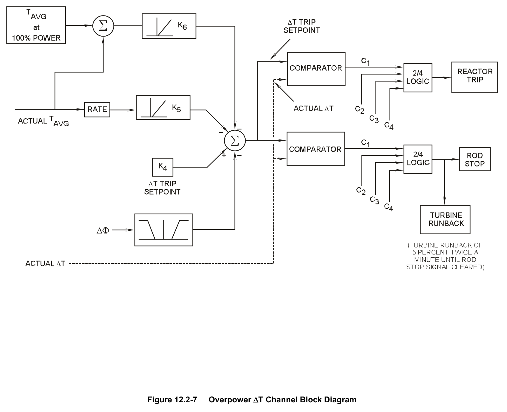

*Overpower ∆T Channel Block Diagram*

[Vector original (SVG, lossless): fig_12.2-7.svg](../figures/fig_12.2-7.svg)

<!-- p.963 -->
#### Figure 12.2-8

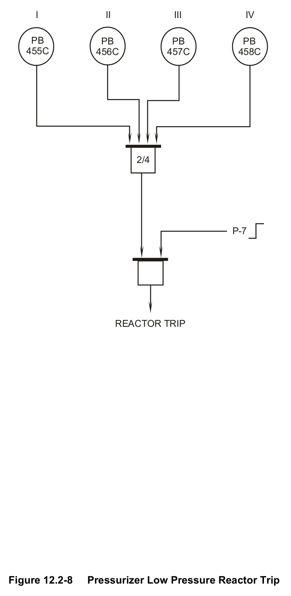

*Pressurizer Low Pressure Reactor Trip*

[Vector original (SVG, lossless): fig_12.2-8.svg](../figures/fig_12.2-8.svg)

<!-- labels/text on this figure page -->
II III IV I
PB PB PB PB 455C 456C 457C 458C
2/4
P-7
REACTOR TRIP
Figure 12.2-8 Pressurizer Low Pressure Reactor Trip

<!-- p.964 -->
#### Figure 12.2-9

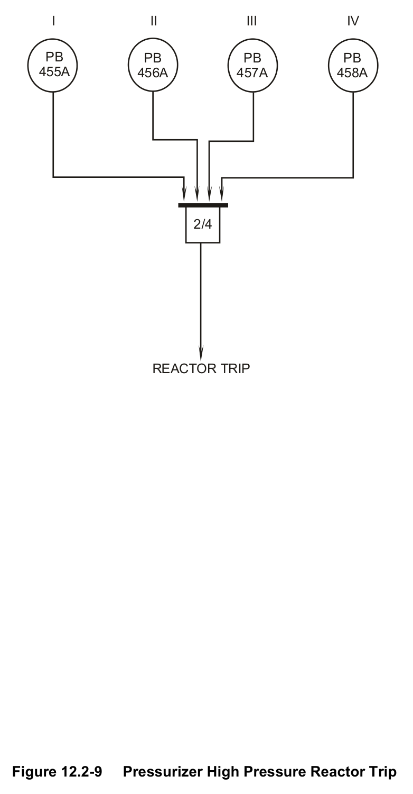

*Pressurizer High Pressure Reactor Trip*

[Vector original (SVG, lossless): fig_12.2-9.svg](../figures/fig_12.2-9.svg)

<!-- labels/text on this figure page -->
I II III IV
PB PB PB PB 455A 456A 457A 458A
2/4
REACTOR TRIP
Figure 12.2-9 Pressurizer High Pressure Reactor Trip

<!-- p.965 -->
#### Figure 12.2-10

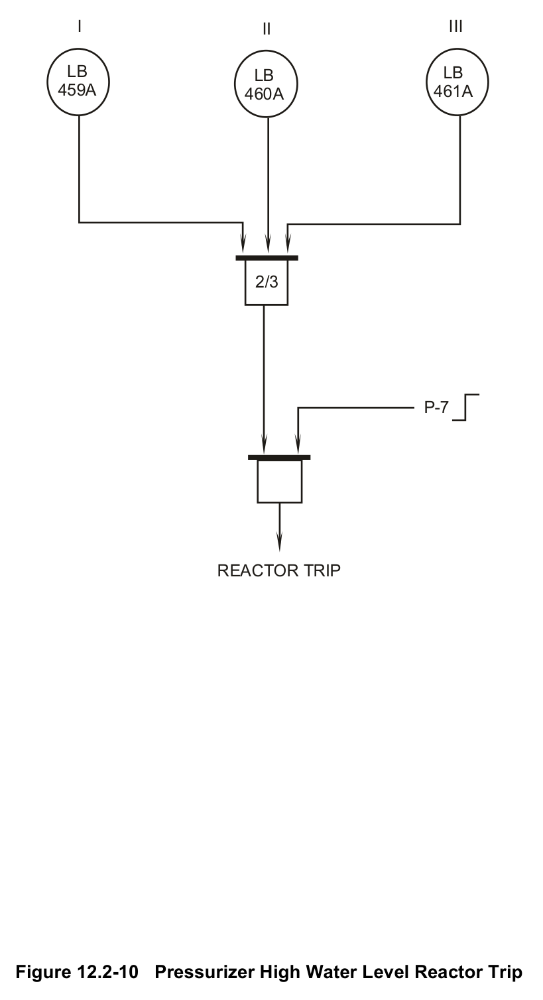

*Pressurizer High Water Level Reactor Trip*

[Vector original (SVG, lossless): fig_12.2-10.svg](../figures/fig_12.2-10.svg)

<!-- labels/text on this figure page -->
I III II
LB LB LB 459A 461A 460A
2/3
P-7
REACTOR TRIP
Figure 12.2-10 Pressurizer High Water Level Reactor Trip

<!-- p.966 -->
#### Figure 12.2-11

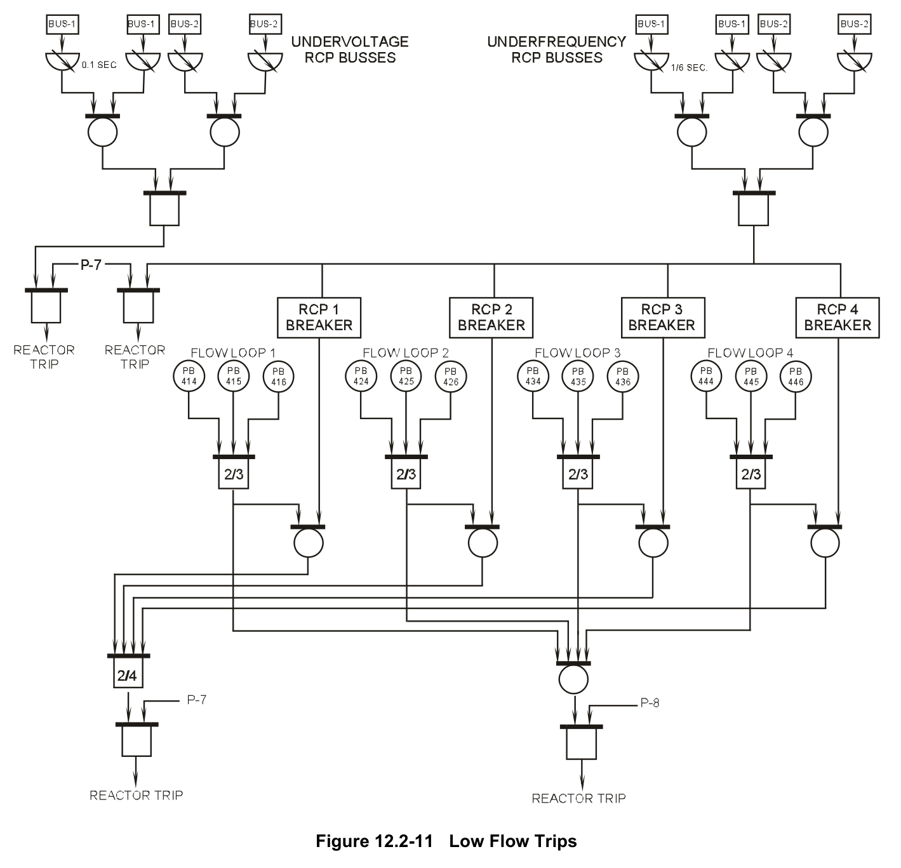

*Low Flow Trips*

[Vector original (SVG, lossless): fig_12.2-11.svg](../figures/fig_12.2-11.svg)

<!-- p.967 -->
#### Figure 12.2-12

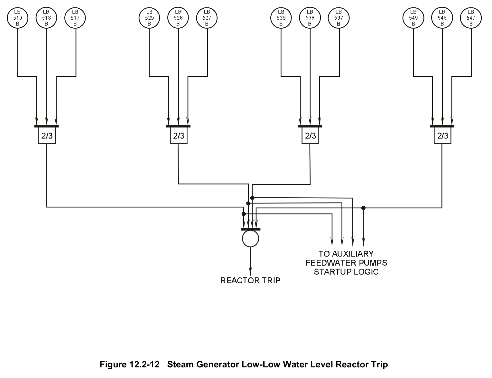

*Steam Generator Low-Low Water Level Reactor Trip*

[Vector original (SVG, lossless): fig_12.2-12.svg](../figures/fig_12.2-12.svg)

<!-- p.968 -->
#### Figure 12.2.13

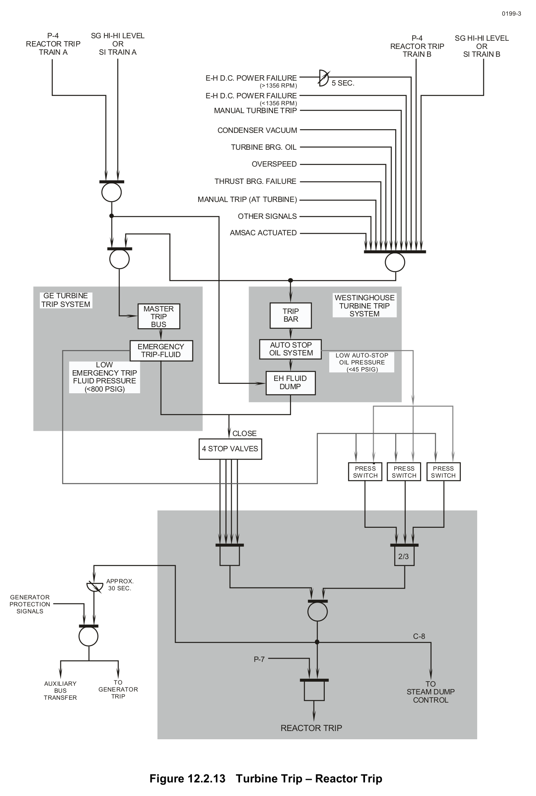

*Turbine Trip – Reactor Trip*

[Vector original (SVG, lossless): fig_12.2.13.svg](../figures/fig_12.2.13.svg)

<!-- labels/text on this figure page -->
0199-3
P-4 SG HI-HI LEVEL P-4 SG HI-HI LEVEL REACTOR TRIP OR REACTOR TRIP OR TRAIN A SI TRAIN A TRAIN B SI TRAIN B
E-H D.C. POWER FAILURE 5 SEC.
(>1356 RPM)
E-H D.C. POWER FAILURE
(<1356 RPM)
MANUAL TURBINE TRIP
CONDENSER VACUUM
TURBINE BRG. OIL
OVERSPEED
THRUST BRG. FAILURE
MANUAL TRIP (AT TURBINE)
OTHER SIGNALS
AMSAC ACTUATED
GE TURBINE WESTINGHOUSE TRIP SYSTEM TURBINE TRIP MASTER TRIP SYSTEM TRIP BAR BUS
AUTO STOP EMERGENCY OIL SYSTEM TRIP-FLUID LOW AUTO-STOP OIL PRESSURE LOW
(<45 PSIG) EMERGENCY TRIP EH FLUID FLUID PRESSURE DUMP (<800 PSIG)
CLOSE
4 STOP VALVES
PRESS PRESS PRESS SWITCH SWITCH SWITCH
2/3
APPROX.
30 SEC.
GENERATOR PROTECTION SIGNALS
C-8
P-7
TO AUXILIARY TO BUS GENERATOR STEAM DUMP TRIP TRANSFER CONTROL
REACTOR TRIP
Figure 12.2.13 Turbine Trip – Reactor Trip

