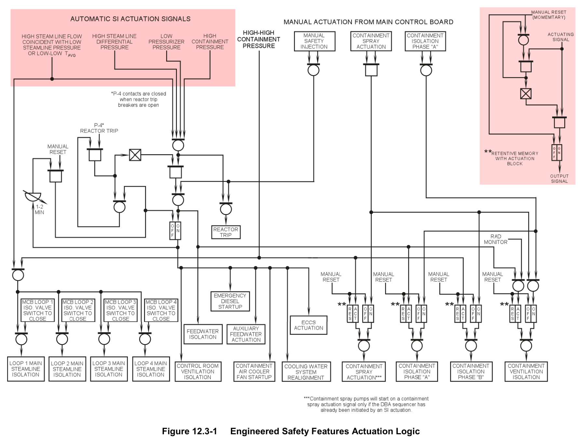
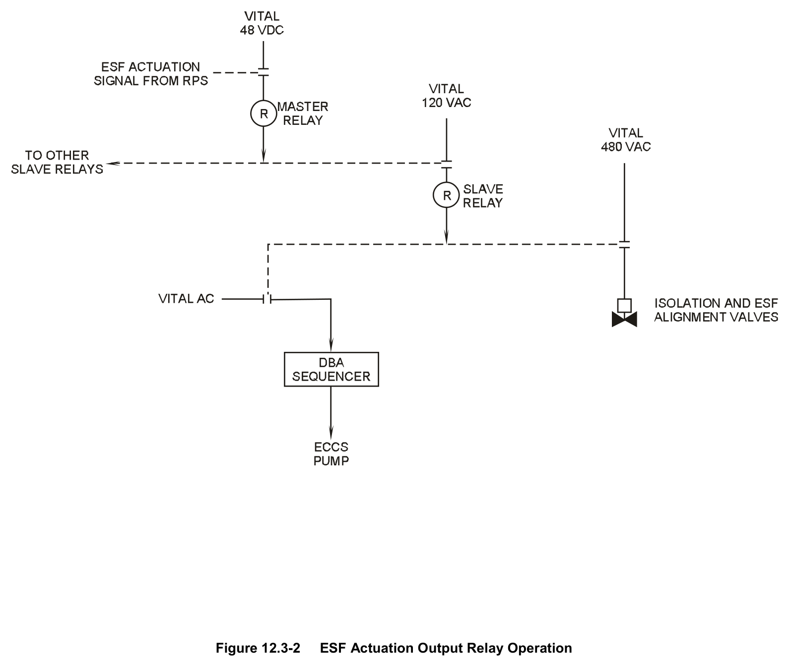
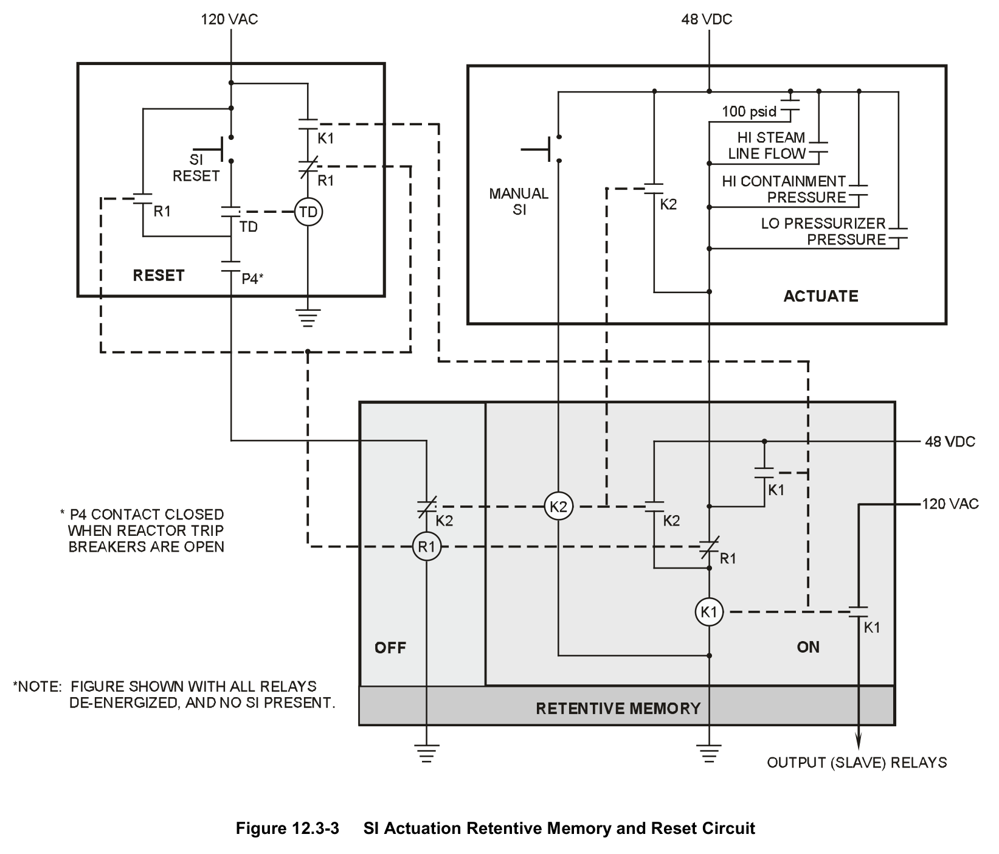
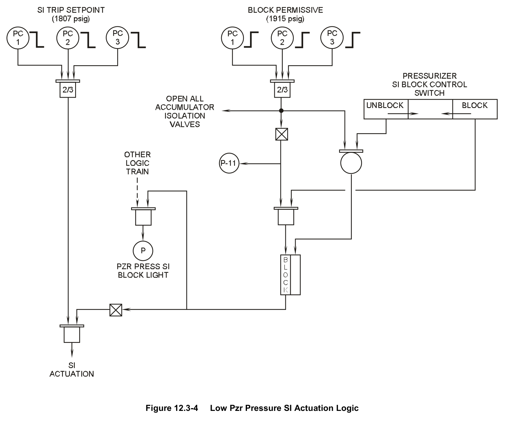
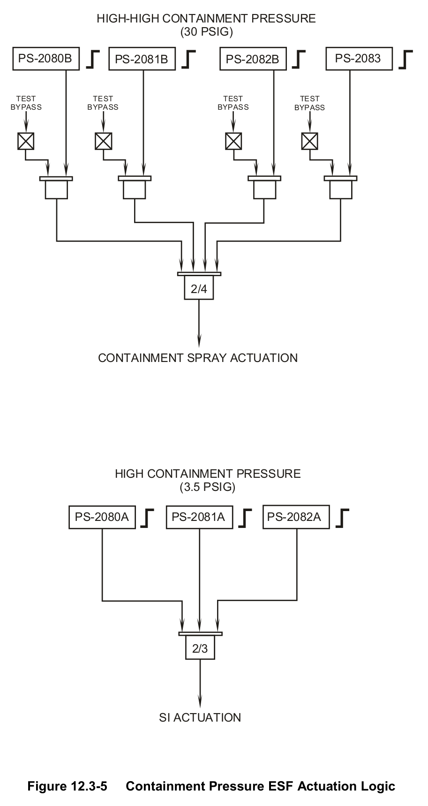
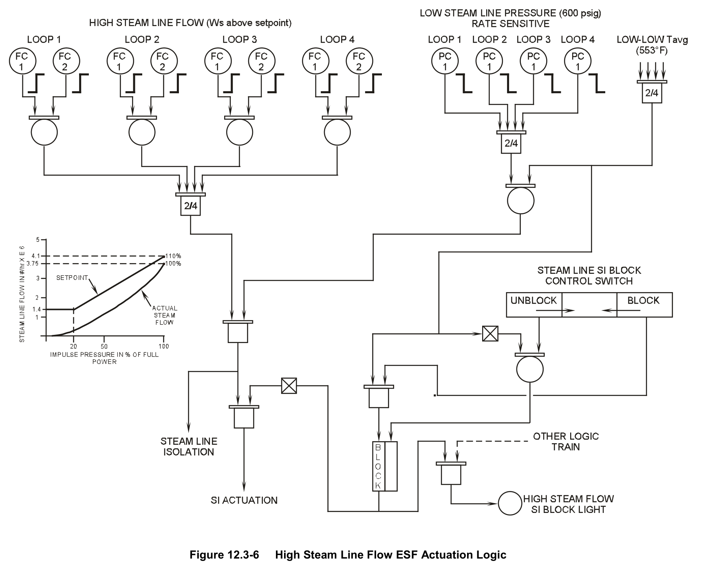
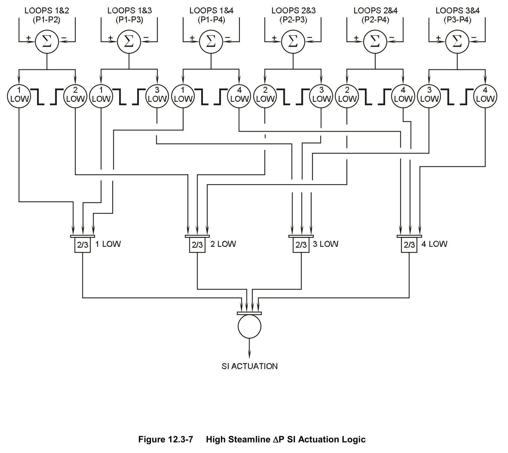
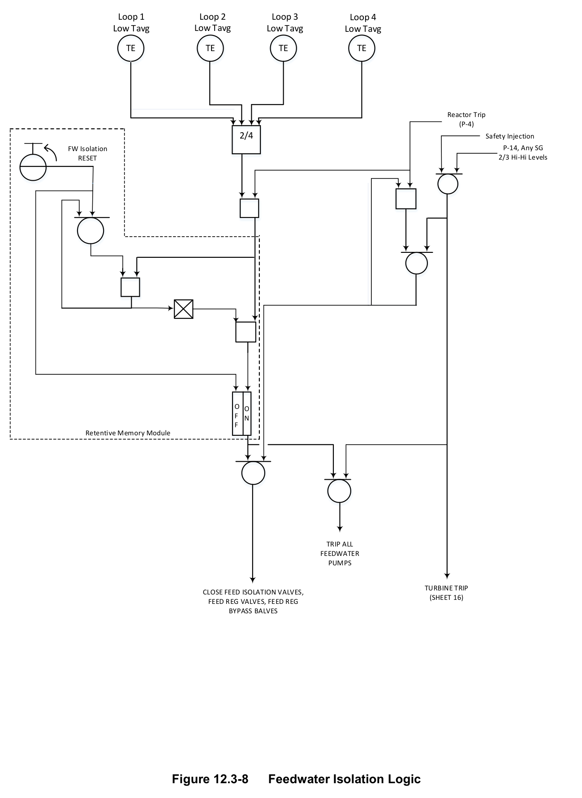

# 12.3 RPS - ESFAS

> Pages 969–991 of `ML20057E160.pdf`
> Westinghouse Technology Systems Manual — USNRC HRTD (PWR)

---
<!-- p.969 -->
#### Westinghouse Technology Systems Manual
#### Section 12.3
#### Reactor Protection System –
#### Engineered Safety Features Actuation Signals
<!-- p.970 -->
TABLE OF CONTENTS

12.3 RPS – ESFAS ....................................................................................... 12.3-1

12.3.1 Introduction ................................................................................................... 1

12.3.2 Safety Injection Actuation .............................................................................. 2

12.3.2.1 Safety Injection Actuation Signals ................................................. 2

12.3.2.2 Safety Injection Functions ............................................................. 4

12.3.2.3 SI Actuation Reset ........................................................................ 5

12.3.3 Containment Spray Actuation ....................................................................... 6

12.3.3.1 Containment Spray Actuation Signals........................................... 6

12.3.3.2 Containment Spray Actuation Functions ....................................... 6

12.3.4 Containment Isolation ................................................................................... 6

12.3.4.1 Containment Isolation Phase A ..................................................... 6

12.3.4.2 Containment Isolation Phase B ..................................................... 7

12.3.5 Steam Line Isolation...................................................................................... 7

12.3.5.1 Steam Line Isolation Actuation Signals ......................................... 7

12.3.5.2 Steam Line Isolation Functions ..................................................... 8

12.3.6 Feedwater Isolation ....................................................................................... 8

12.3.6.1 Feedwater Isolation Actuation Signals .......................................... 8

12.3.6.2 Feedwater Isolation Functions ...................................................... 9

12.3.7 Auxiliary Feedwater Actuation ....................................................................... 9

12.3.7.1 Auxiliary Feedwater Actuation Signals .......................................... 9

12.3.7.2 Auxiliary Feedwater Actuation Functions ...................................... 9

12.3.8 Summary ....................................................................................................... 9

LIST OF TABLES

TABLE 12.3-1 SUMMARY OF ESF ACTUATION SIGNALS .......................... 12.3-10

USNRC HRTD 12.3-i Rev 0216

<!-- p.971 -->
#### Figure 12.3-1

*Engineered Safety Features Actuation Logic Figure 12.3-2 ESF Actuation Output Relay Operation Figure 12.3-3 SI Actuation Retentive Memory and Reset Circuit Figure 12.3-4 Low Pzr Pressure SI Actuation Logic Figure 12.3-5 Containment Pressure ESF Actuation Logic Figure 12.3-6 High Steam Line Flow ESF Actuation Logic Figure 12.3-7 High Steamline ∆P SI Actuation Logic Figure 12.3-8 Feedwater Isolation Logic*

<!-- labels/text on this figure page -->
LIST OF FIGURES
Figure 12.3-1 Engineered Safety Features Actuation Logic Figure 12.3-2 ESF Actuation Output Relay Operation Figure 12.3-3 SI Actuation Retentive Memory and Reset Circuit Figure 12.3-4 Low Pzr Pressure SI Actuation Logic Figure 12.3-5 Containment Pressure ESF Actuation Logic Figure 12.3-6 High Steam Line Flow ESF Actuation Logic Figure 12.3-7 High Steamline ∆P SI Actuation Logic Figure 12.3-8 Feedwater Isolation Logic
USNRC HRTD 12.3-ii Rev 0216

<!-- p.972 -->
### 12.3 REACTOR PROTECTION SYSTEM - ENGINEERED SAFETY FEATURES
#### ACTUATION SIGNALS
#### Learning Objectives:
1. List the engineered safety features (ESF) actuation signals and the accident(s)
or conditions which will initiate each one.

2. List the systems or components that are actuated or realigned by each engineered safety features actuation signal.

3. Describe the effects of resetting a safety injection actuation signal and how the reset signal is removed.

#### 12.3.1 Introduction
In response to accidents, the engineered safety features actuation signals actuate or realign safety-related systems, equipment, and/or components and to isolate nonsafety-related systems. Various parameters are monitored by plant instrumentation to determine whether an accident or other condition requiring protective action has occurred. In the reactor protection system (RPS), multiple analog signals for each monitored parameter are compared to bistable setpoints.
When enough signals in an appropriate combination have exceeded their respective setpoints, the RPS generates the necessary protective actions.

Each ESF protective function discussed in this section has a set of actuating signals and a set of plant equipment responses. The ESF functions include:

• Safety injection actuation,
• Containment spray actuation,
• Containment isolation,
• Steam line isolation,
• Feedwater isolation, and
• Auxiliary feedwater actuation.

When the RPS senses a condition requiring an ESF actuation, it energizes the appropriate master relay(s), as shown in Figure 12.3-2. Each ESF protective function has an associated master relay or set of master relays. Each master relay operates contacts which energize up to four slave relays. The slave relays actuate ESF equipment through control devices such as valve positioners and motor controllers.

An important feature of the ESF actuation circuitry is the maintenance of independence and redundancy. These features are accomplished by having each separate, independent protection train actuate only those systems and components associated with that train. That is, protection train “A” controls the “A” train ESF equipment such as the “A” train diesel generator, the “A” train residual heat removal
(RHR) pump, the “A” train safety injection (SI) pump, and the “A” train isolation and flow control valves. Protection train “B” controls all the train “B” equipment. Since all the safety equipment is fully redundant, a single operable train is required to mitigate

USNRC HRTD 12.3-1 Rev 0216

<!-- p.973 -->
the consequences of an accident and to provide protection for the public health and safety. Either protection train may operate a component when it is not assigned to either train.

#### 12.3.2 Safety Injection Actuation
The RPS automatically initiates a safety injection (SI) actuation to limit the consequences of infrequent faults (Condition III events) and limiting faults (Condition IV events) to reduce the potential for a significant release of radioactive material to the environment.

The SI actuation functions to shut down the reactor if it is still operating, to maintain the reactor in a shutdown condition, to provide sufficient core cooling to limit possible cladding and fuel damage, to ensure the integrity of the containment, and to place plant support systems in appropriate post-accident alignments. Figure 12.3-1 illustrates the SI actuation signals and the ESF systems affected by the SI actuation.
Each actuation signal and the accidents to which each signal is designed to respond are discussed in section 12.3.2.1.

If the RPS senses conditions associated with either a loss of coolant accident
(LOCA) or a secondary system (steam line or feed line) break, it initiates an SI actuation. Either of these accidents requires the operation of various safety features to ensure the safety of the public and to limit core damage. Regardless of the accident, the response of plant equipment to the SI actuation includes:

1. Placing the plant in a safe shutdown configuration, including tripping the reactor and injecting borated water into the reactor coolant system,

2. Providing cool, borated water at a rate sufficient to prevent excessive core damage following a LOCA,

3. Isolating the containment from the outside environment to limit the amount of radioactive effluent releases.

4. Providing a heat sink to remove the residual heat of the reactor core during the injection phase of the accident and to remove decay heat for the long term, and

5. Providing a reliable source of emergency power (running diesel generators) in the event that the preferred source of power is lost.

##### 12.3.2.1 Safety Injection Actuation Signals
The SI actuation signals are discussed in the following paragraphs. The signals are summarized in Table 12.3-1.

#### Low Pressurizer Pressure
The logic for the low pressurizer pressure SI actuation is shown in Figure 12.3-4.
The actuation setpoint is 1807 psig, with a coincidence of two-out-of-three channels.
This SI actuation signal is designed to respond to the drop in reactor coolant

USNRC HRTD 12.3-2 Rev 0216

<!-- p.974 -->
pressure which accompanies inventory loss during a LOCA. A steam line break could also trigger this actuation signal due to the decrease in primary pressure resulting from coolant contraction. During a normal cooldown and depressurization of the plant, this signal is manually blocked when pressurizer pressure drops below 1915 psig on two-out-of-three channels (the P-11 permissive).

#### High Containment Pressure
The high containment pressure SI actuation signal, shown in Figure 12.3-5, is designed to serve as a backup protection signal in response to any high energy line break, primary or secondary, inside the containment. Also, the high containment pressure signal would initiate an SI actuation if the break is large enough to cause a sufficient increase in containment pressure, but not large enough to trigger an SI actuation from any other signal. The setpoint for this protection signal is 3.5 psig.
This SI actuation signal cannot be blocked by the operator.

#### High Steam Line Flow Coincident with Either Low Steam Line Pressure or
#### Low-Low Tavg
The combination of high steam line flow in conjunction with either low steam pressure or low-low Tavg arises when a steam line break occurs downstream of the main steam line isolation valves (MSIVs) and check valves. A steam line break at this location is common to all steam generators. It causes a steam flow increase and a steam pressure decrease in each main steam line. The increased steam flow increases the heat removal from the reactor coolant and thus reduces the reactor coolant temperature (Tavg). As shown in Figure 12.3-6, the high steam flow setpoint is a function of turbine impulse pressure, allowing it to vary with plant power. In addition to initiating an SI actuation, this signal initiates isolation of the steam lines
(see section 12.3.5).

The control room operator may manually block this actuation signal, as shown in Figure 12.3-6. Permissive P-12 (Tavg < 553°F) provides an input into the logic that allows the control room operator to block this signal. Bypassing this signal allows the operating staff to cool down and depressurize the plant without inadvertently actuating an SI or initiating steam line isolation on high steam flow.

#### High Steam Line Differential Pressure
This actuation signal is indicative of a steam line break upstream of the MSIVs and main steam check valves. With this break location, the pressure in the affected steam line pressure drops to a value significantly lower than the pressures of the other steam lines when the affected steam line’s check valve seats. If the pressure in the affected steam line is 100 psi lower than the pressure in at least two of the remaining three steam lines, as shown in Figure 12.3-7, the necessary coincidence for this actuating signal is satisfied. This SI actuation signal cannot be blocked by the operator.

#### Manual
USNRC HRTD 12.3-3 Rev 0216

<!-- p.975 -->
The manual function allows the operator to initiate an SI actuation (from either of two main control board locations) at any time.

##### 12.3.2.2 Safety Injection Functions
When an SI actuation is initiated, as shown in Figure 12.3-1, by any of the previously described signals, various actions are completed to place the plant in a safe shutdown configuration. The specific actions that occur are as follows:

1. Reactor trip: A trip shuts down the reactor if one has not already occurred.

2. Emergency core cooling system actuation: The discharge of the centrifugal charging pumps is realigned from the normal charging path of the chemical and volume control system to the high head cold-leg injection path. The suctions of the charging pumps are realigned from the volume control tank to the refueling water storage tank (RWST). In addition, the SI actuation starts the centrifugal charging pumps (one may already have been running), the safety injection pumps, and the residual heat removal (RHR) pumps. The RHR and SI systems are normally aligned to inject borated water from the RWST into the reactor coolant system cold legs. Refer to Section 5.2 for detailed descriptions of these systems.

3. Containment isolation Phase A: Refer to section 12.3.4.1.

4. Auxiliary feedwater (AFW) actuation: The AFW system provides a reliable, safety-grade source of water to the steam generators to ensure that a reactor heat sink is available.

5. Main feedwater (MFW) isolation: Refer to section 12.3.6.

6. Emergency diesel generator startup: The diesel generators are the emergency power source for the engineered safety features. They are started by any SI actuation, regardless of the status of offsite power. The diesel generators run unloaded if offsite power is maintained. If the preferred power source (offsite power) is lost, the diesel generator output breakers automatically close onto the dead class IE buses.

7. Auxiliary cooling system alignment: The service water system (SWS) and the component cooling water (CCW) system automatically realign to their emergency configurations. In addition, start signals are sent to pumps in each system.

8. Control room ventilation isolation: The normal ventilation supply to the control room is isolated to prevent the entry of smoke or radioactivity from the auxiliary building. In addition, the control room emergency ventilation system, which recirculates control room air through filters and charcoal adsorbers, is actuated.
9. Containment ventilation isolation: The containment purge supply and exhaust systems and the hydrogen vent system, if operating, are isolated by the SI actuation as part of isolating the containment from the environment.

USNRC HRTD 12.3-4 Rev 0216

<!-- p.976 -->
##### 12.3.2.3 SI Actuation Reset
As shown in Figure 12.3-3, an automatic SI actuation places a retentive memory device in the “ON” position. In the “ON” position, energized relay K1 closes two K1 contacts in the retentive memory circuit. One K1 contact provides power to the output relays, and the other K1 contact completes an alternate power-supply circuit for relay K1. This means that the protective functions described above continue to receive an actuation signal even if the original SI signal clears.

The control room operator cannot interrupt any of the SI-initiated functions until the reset logic is satisfied. This “locking out” of the operator prevents the interruption of a valid SI actuation. Additionally, the design basis accident (DBA) sequencers initiate many of the SI functions; interrupting the start sequence before it is finished could leave some systems incorrectly aligned.

To prevent the interruption of any SI actuation, the reset logic must be satisfied before the reactor operator can manually reset (turn off) the SI actuation signal.
When the retentive memory is turned on (relay K1 in Figure 12.3-3 energizes), the K1 contact in the reset circuit closes, thus starting the energizing sequence for the time delay relay (relay TD). The time delay relay produces an output (energizes)
some time after it is started (usually 45 - 60 sec). After the time delay relay times out, it energizes and closes the TD contact in the reset circuit. This action, along with the P4 contact being closed by the reactor trip (permissive P-4 is described in Section 12.2), allows the operator to reset (turn off) the SI actuation signal by depressing the control room reset pushbutton. The time delay ensures that all system and component realignments are complete prior to the SI reset.

As shown in Figure 12.3-3, closing the TD contact and depressing the reset pushbutton energize relay R1 and thus close an “a” contact (labeled R1), which is located in the reset circuit in parallel with the reset pushbutton. After this contact closes, the control room operator can release the reset pushbutton without deenergizing the R1 relay. The reset signal is thus maintained.

Relay R1 also opens two “b” contacts. One of these “b” contacts is located in the time delay circuit. Opening this contact (labeled R1) de-energizes the TD relay.
Simultaneously opening the other “b” contact (also labeled R1) in the retentive memory portion of the circuit de-energizes relay K1, thereby removing power from the output relays. As long as the R1 relay remains energized, the retentive memory is in the “OFF” position, and all automatic SI actuation signals are blocked.

As described in the preceding paragraphs, resetting the SI actuation places the retentive memory device in the “OFF” position. Removing the “ON” signal from the SI actuation circuitry does not turn off any ESF equipment, realign any valves, or change any functions initiated by the SI actuation. When the operator depresses the reset pushbutton, the only response is the removal of the start signal. However, after turning off the actuation circuitry the control room operators can change system alignments, start or stop equipment as needed, and control the plant as required by the plant’s emergency operating procedures to recover from the accident (or SI actuation conditions).

USNRC HRTD 12.3-5 Rev 0216

<!-- p.977 -->
As mentioned above, a significant feature of the SI actuation reset is that the reset blocks any further automatic SI actuations. However, a manual SI actuation is still available. If the control room operator depresses either of the two manual SI actuation pushbuttons located in the main control room, relay K2 energizes. When this relay energizes, it closes contact K2 in the “ON” side of the retentive memory and thus energizes relay K1. This action provides power to the output relays
(actuates the ESF loads). Meanwhile, “b” contact K2 opens in the “OFF” side of the retentive memory. When it opens, it de-energizes relay R1, which closes “b” contact R1 in the “ON” side of the retentive memory. With this contact closed, relay K1 remains energized after the operator releases the manual SI actuation pushbutton.

De-energizing the R1 relay also simultaneously opens the R1 contact in parallel with the reset pushbutton and closes the R1 contact in the time delay relay circuit. The operator is again prevented from resetting the actuation until the time delay relay times out.

After the control room operator resets the SI actuation, all automatic SI actuation signals are disabled until the control room operator manually initiates an SI actuation or until the reactor trip input to the reset circuit (permissive P-4) is cleared by closing the reactor trip breakers. Before closing the reactor trip breakers, the operator should ensure that all SI actuation signals have cleared. Otherwise, when the control room operator closes the reactor trip breakers and removes the reset signal, the actuation sequence restarts.

#### 12.3.3 Containment Spray Actuation
##### 12.3.3.1 Containment Spray Actuation Signals
The containment spray system is automatically actuated by a high-high containment pressure signal, as shown in Figure 12.3-5. The setpoint is 30 psig. A very high containment pressure is indicative of a large line break; operation of the containment spray system is needed to reduce the containment temperature and pressure. The containment spray system can also be manually actuated. The actuation signals are summarized in Table 12.3-1.

##### 12.3.3.2 Containment Spray Actuation Functions
A containment spray actuation signal starts the containment spray pumps, opens the spray header isolation valves, and aligns the spray additive tank to the suctions of the pumps. Starting the spray pumps also requires initiation of the DBA sequencers by an SI actuation. Refer to Section 5.4 for additional details concerning the containment spray system.

#### 12.3.4 Containment Isolation
##### 12.3.4.1 Containment Isolation Phase A
USNRC HRTD 12.3-6 Rev 0216

<!-- p.978 -->
#### Phase A Actuation Signals
Containment isolation Phase A is automatically actuated by a safety injection actuation. Most containment penetrations are thus isolated when there is evidence of an accident in progress, so that the potential release of radioactivity to the environment is minimized. A Phase A isolation can also be manually actuated. The actuation signals are summarized in Table 12.3-1.

#### Phase A Functions
Redundant isolation valves and dampers (one inside containment, one outside containment) are shut in all non-essential lines which penetrate the containment.
The containment penetrations which remain unisolated are the CCW supply and return lines for the reactor coolant pumps (RCPs) and the main steam lines.

Continued forced circulation of coolant by the RCPs, although not essential for safe shutdown of the plant, is the preferred method of decay heat removal. CCW flow to the RCP heat exchangers is thus maintained even during an accident, unless the CCW isolation valves are closed by a containment isolation Phase B signal (see Section 12.3.4.2).

The MSIVs are not closed by a Phase A isolation so that steam flow to the steam dump system is available for core decay heat removal. The MSIVs are automatically closed by a steam line isolation actuation (see Section 12.3.5).

##### 12.3.4.2 Containment Isolation Phase B
#### Phase B Actuation Signals
Containment isolation Phase B is automatically actuated by a high-high containment pressure signal. Phase B isolation should be simultaneous with containment spray actuation. Phase B isolation is manually actuated when containment spray is manually actuated. The actuation signals are summarized in Table 12.3-1.

#### Phase B Functions
A Phase B isolation shuts the isolation valves in the CCW supply and return lines to the RCPs. Together with isolation of the main steam lines (see Section 12.3.5), a Phase B isolation completes isolation of containment penetrations when there is a large break inside containment.

#### 12.3.5 Steam Line Isolation
##### 12.3.5.1 Steam Line Isolation Actuation Signals
The main steam lines are isolated by (1) a high-high containment pressure signal or
(2) high steam flow coincident with low-low Tavg or low steam pressure. Together with a containment isolation Phase B (see Section 12.3.4.2), the first main steam line isolation signal completes isolation of containment penetrations when there is a large break inside containment. The second signal isolates the steam lines when there is evidence of a steam line break downstream of the MSIVs; this action should

USNRC HRTD 12.3-7 Rev 0216

<!-- p.979 -->
isolate the break from the steam generators and end its effects on the plant. Note that, as shown in Figure 12.3-6, manually blocking the high steam flow SI actuation does not block the high steam flow steam line isolation. The actuation signals are summarized in Table 12.3-1.

##### 12.3.5.2 Steam Line Isolation Functions
A steam line isolation actuation closes all MSIVs, all MSIV bypass valves, and all steam line high pressure drain valves.

#### 12.3.6 Feedwater Isolation
##### 12.3.6.1 Feedwater Isolation Actuation Signals
Main feedwater to the steam generators is automatically isolated by each of the following signals:

• Low Tavg (564°F) coincident with a reactor trip (permissive P-4),
• High steam generator water level (permissive P-14) in any generator, and
• SI actuation.

Isolating MFW in response to these signals provides the following benefits:

1. Overcooling of the reactor coolant by excessive MFW to the steam generators should be avoided. In response to the large prolonged “shrink” in steam generator levels following a reactor trip, the steam generator water level control system develops large feed flow demands; without MFW isolation the main feedwater regulating valves would supply relatively cold feedwater to the generators at a very high rate.

2. Completely filling the steam generators and introducing water into the steam piping should be avoided.

3. The non-Seismic Category I portion of the feedwater piping is isolated from seismically qualified equipment needed for decay heat removal during an accident.

The actuation signals are summarized in Table 12.3-1.

Figure 12.3-8, Feedwater Isolation Signal Logic, shows the signals which will initiate a Feedwater Isolation. Note that the FW Isolation signal can be reset as long no SI signal is present or SI is blocked (SI Reset and P4, Figure 12.3-1) and no Hi/Hi SG level is present. If a Reactor Trip (P4) and Low Tavg Signal are present, depressing the FW Isolation Reset Pushbutton will reset the retentive memory, block the P4 and Low Tavg Signal, and seal in the reset circuit. If the Reactor Trip Breakers are closed (even momentarily), then the seal-in circuit will clear and the P4 and Low Tavg Signal can cause a subsequent isolation of feedwater.

USNRC HRTD 12.3-8 Rev 0216

<!-- p.980 -->
##### 12.3.6.2 Feedwater Isolation Functions
Any feedwater isolation signal trips both MFPs, closes all four main feedwater regulating valves, all four bypass regulating valves, and all eight feedwater isolation valves. The high steam generator water level and SI actuation signals also directly trip the main turbine.

#### 12.3.7 Auxiliary Feedwater Actuation
##### 12.3.7.1 Auxiliary Feedwater Actuation Signals
The AFW system is automatically actuated by the following signals:

• SI actuation,
• Low-low steam generator water level in any generator,
• ESF bus undervoltage (train dependent - undervoltage on bus A1 starts the “A” train AFW pump; undervoltage on bus A2 starts the “B” train pump), and
• Trip of all main feed pumps.

(Note: Automatic AFW actuation by the ATWS mitigation system actuation circuitry is not listed here because that actuation signal is not generated by the RPS.) The above list indicates that the AFW system is actuated when the MFW system is not available or is not maintaining a sufficient heat sink, and to provide a safety-grade source of water for heat sink maintenance during an accident. The actuation signals are summarized in Table 12.3-1.

##### 12.3.7.2 Auxiliary Feedwater Actuation Functions
An actuation signal to the “A” train (steam-driven) AFW pump opens all four steam supply valves (one from each main steam line) to the pump turbine and opens the turbine trip and throttle valve. An actuation signal to the “B” train (diesel-driven)
pump starts the diesel engine and unisolates the service water line which provides cooling for several engine and pump heat loads. Any actuation signal to either AFW train closes all isolation valves in the steam generator blowdown and sampling lines.

#### 12.3.8 Summary
The reactor protection system acts to limit the consequences of postulated accidents by actuating engineered safety features. These systems and components are actuated to place the plant in the most stable, safe shutdown condition possible following an accident. The ESF functions discussed in this section are safety injection actuation, containment spray actuation, containment isolation, steam line isolation, feedwater isolation, and AFW actuation.

USNRC HRTD 12.3-9 Rev 0216

<!-- p.981 -->
#### TABLE 12.3-1 SUMMARY OF ESF ACTUATION SIGNALS
Signal Coincidence Setpoint Interlocks Accident/Condition Safety Injection Actuation Low 2/3 1807 psig Manual block; Loss-of-coolant Pressurizer block enabled accident (LOCA)
Pressure when pressurizer pressure < 1915 psig (P-11)
High Any steam line 100 100 psi ∆P No Interlocks Steam line break
(SLB) upstream of Differential psi lower than at the main steam line Pressure least two of the isolation valves Between remaining three
(MSIVs)
Steam lines steam lines High Steam 1/2 flows on 2/4 Setpoint varies Manual block; SLB downstream of Flow steam lines with turbine load block enabled the MSIVs (common
(impulse when Tavg < 553°F to all steam COINCIDENT pressure) (P-12) generators)
WITH

Low Steam 2/4 steam lines 600 psig Pressure
(Rate sensitive)
OR Low-Low Tavg 2/4 RCS loops 553°F High 2/3
3.5 psig No Interlocks High energy line Containment break inside Pressure containment (LOCA or secondary pipe break)
Manual 1/2 actuation No Interlocks Operator backup to switches on main automatic actuation control board

USNRC HRTD 12.3-10 Rev 0216

<!-- p.982 -->
#### TABLE 12.3-1 (cont’d)
#### SUMMARY OF ENGINEERED SAFETY FEATURES ACTUATION SIGNALS
Signal Coincidence Setpoint Interlocks Accident/Condition Containment Spray Actuation High-High 2/4 30 psig No Interlocks Large high energy Containment line break inside Pressure containment (LOCA or secondary pipe break)
Manual Simultaneous 2/2 No Interlocks Operator backup to actuation switches automatic actuation on main control board Containment Isolation Phase A Any Safety Refer to Safety Injection Actuation portion of this table.
Injection Actuation Manual 1/2 actuation No Interlocks Operator backup to switches on main automatic actuation control board Containment Isolation Phase B High-High 2/4 30 psig No Interlocks Large high energy Containment line break inside Pressure containment (LOCA or secondary pipe break)
Manual Actuated with No Interlocks Operator backup to manual actuation automatic actuation of containment spray

USNRC HRTD 12.3-11 Rev 0216

<!-- p.983 -->
#### TABLE 12.3-1 (cont’d)
#### SUMMARY OF ENGINEERED SAFETY FEATURES ACTUATION SIGNALS
Signal Coincidence Setpoint Interlocks Accident/Condition Steam Line Isolation High-High 2/4 30 psig No Interlocks Large high energy containment line break inside pressure containment (LOCA or secondary pipe break)
High Steam 1/2 flows on 2/4 Setpoint varies No interlocks SLB downstream of Flow steam lines with turbine load the MSIVs (common
(impulse to all steam COINCIDENT pressure)
generators)
WITH 600 psig Low Steam 2/4 steam lines Pressure OR 553°F Low-Low Tavg 2/4 RCS loops Feedwater Isolation Low Tavg 2/4 RCS loops 564°F Overcooling of reactor coolant COINCIDENT following a reactor WITH trip

Reactor Trip P-4 High SG Water 2/3 levels on 1/4 69% No Interlocks SG overfill Level SGs Any Safety Refer to Safety Injection Actuation portion of this table.
Injection Actuation Auxiliary Feedwater Actuation Low-Low SG 2/3 levels on 1/4 11.5% Can be defeated Loss of heat sink Water Level SGs at RPS cabinets Trip of All Main 2/2 Can be defeated Loss of heat sink Feed Pumps using switches on main control board ESF Bus 1/2 taken twice on 2560 V with No Interlocks Need for decay Undervoltage either ESF bus heat removal
1.1-sec delay without offsite power Any Safety Refer to Safety Injection Actuation portion of this table.
Injection Actuation

USNRC HRTD 12.3-12 Rev 0216

<!-- p.984 -->
#### Figure 12.3-1

*Engineered Safety Features Actuation Logic*

<!-- p.985 -->
#### Figure 12.3-2

*ESF Actuation Output Relay Operation*

[Vector original (SVG, lossless): fig_12.3-2.svg](../figures/fig_12.3-2.svg)

<!-- p.986 -->
#### Figure 12.3-3

*SI Actuation Retentive Memory and Reset Circuit*

[Vector original (SVG, lossless): fig_12.3-3.svg](../figures/fig_12.3-3.svg)

<!-- p.987 -->
#### Figure 12.3-4

*Low Pzr Pressure SI Actuation Logic*

[Vector original (SVG, lossless): fig_12.3-4.svg](../figures/fig_12.3-4.svg)

<!-- p.988 -->
#### Figure 12.3-5

*Containment Pressure ESF Actuation Logic*

[Vector original (SVG, lossless): fig_12.3-5.svg](../figures/fig_12.3-5.svg)

<!-- labels/text on this figure page -->
HIGH-HIGH CONTAINMENT PRESSURE
(30 PSIG)
PS-2080B PS-2083 PS-2081B PS-2082B
TEST TEST TEST TEST BYPASS BYPASS BYPASS BYPASS
2/4
CONTAINMENT SPRAY ACTUATION
HIGH CONTAINMENT PRESSURE
(3.5 PSIG)
PS-2080A PS-2081A PS-2082A
2/3
SI ACTUATION
Figure 12.3-5 Containment Pressure ESF Actuation Logic

<!-- p.989 -->
#### Figure 12.3-6

*High Steam Line Flow ESF Actuation Logic*

[Vector original (SVG, lossless): fig_12.3-6.svg](../figures/fig_12.3-6.svg)

<!-- p.990 -->
#### Figure 12.3-7

*High Steamline ∆P SI Actuation Logic*

[Vector original (SVG, lossless): fig_12.3-7.svg](../figures/fig_12.3-7.svg)

<!-- p.991 -->
#### Figure 12.3-8

*Feedwater Isolation Logic*

[Vector original (SVG, lossless): fig_12.3-8.svg](../figures/fig_12.3-8.svg)

<!-- labels/text on this figure page -->
Loop 1 Loop 2 Loop 3 Loop 4 Low Tavg Low Tavg Low Tavg Low Tavg
TE TE TE TE
Reactor Trip
(P-4)
2/4 Safety Injection P-14, Any SG FW Isolation 2/3 Hi-Hi Levels RESET
O O F N F Retentive Memory Module
TRIP ALL FEEDWATER PUMPS
TURBINE TRIP CLOSE FEED ISOLATION VALVES,
(SHEET 16)
FEED REG VALVES, FEED REG BYPASS BALVES
Figure 12.3-8 Feedwater Isolation Logic

