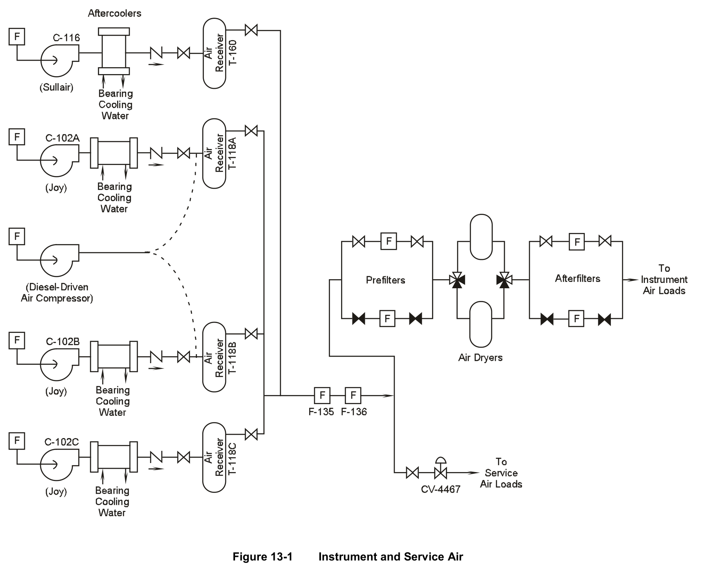
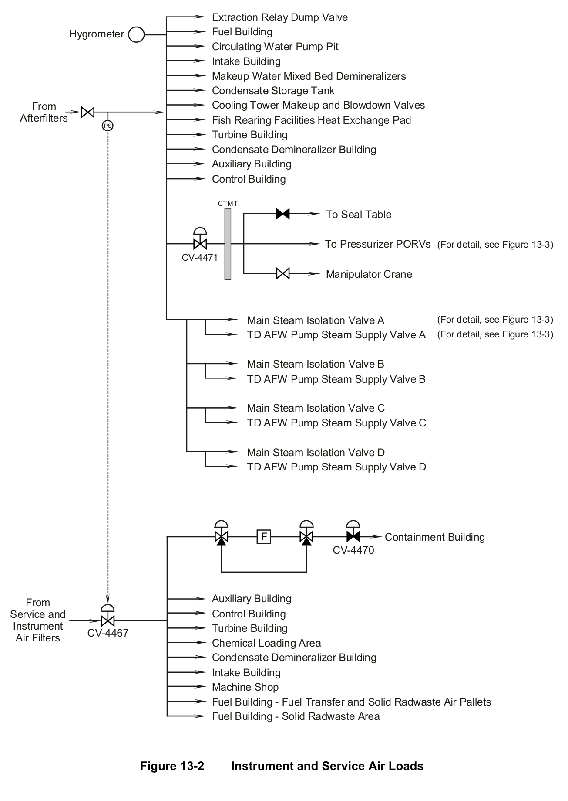
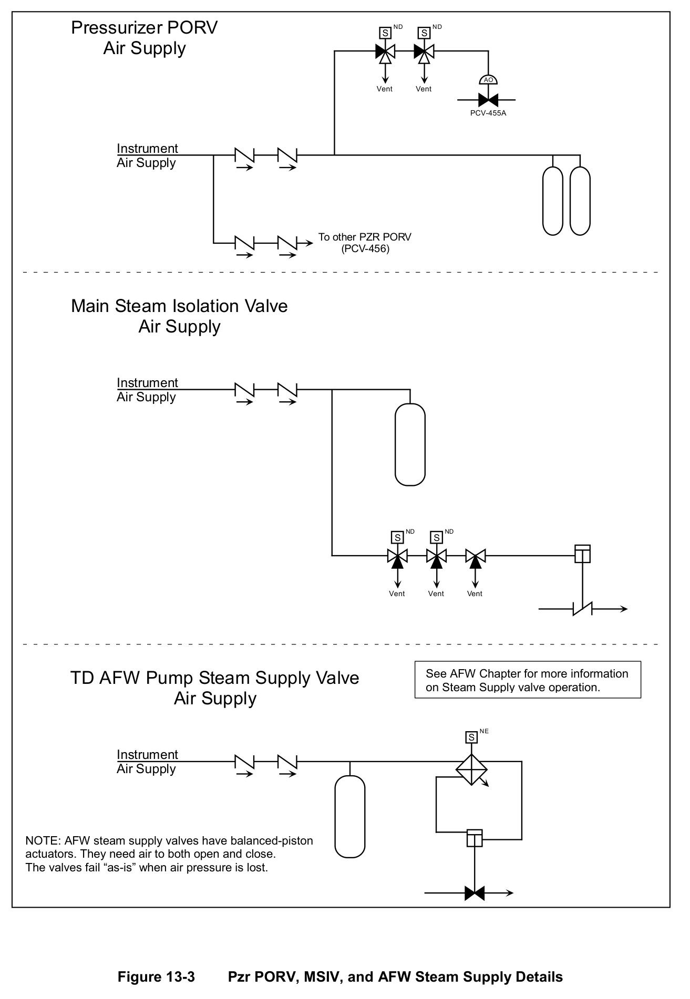

# 13.0 Inst Air

> Pages 992–1005 of `ML20057E160.pdf`
> Westinghouse Technology Systems Manual — USNRC HRTD (PWR)

---
<!-- p.992 -->
#### Westinghouse Technology Systems Manual
#### Section 13.0
#### Instrument and Service Air System
<!-- p.994 -->
TABLE OF CONTENTS

13.0 Instrument and Service Air System ............................................................ 13-1

13.1 Introduction ................................................................................................ 13-1

13.2 System Description .................................................................................... 13-1

13.3 Component Descriptions ............................................................................ 13-2

13.3.1 Air Compressors ........................................................................... 13-2

13.3.2 Aftercoolers ................................................................................... 13-3

13.3.3 Air Receivers ................................................................................ 13-3

13.3.4 Service and Instrument Air Filters ................................................. 13-3

13.3.5 Dryer/Filter Trains ......................................................................... 13-3

13.3.6 Accumulators ................................................................................ 13-4

13.3.7 Containment Isolation Valves ....................................................... 13-4

13.4 System Operation ...................................................................................... 13-4

13.5 System Importance .................................................................................... 13-5

13.6 Summary .................................................................................................... 13-6

LIST OF FIGURES

Figure 13-1 ........................................................................ Instrument and Service Air

Figure 13-2 ............................................................. Instrument and Service Air Loads

Figure 13-3 ................................... Pzr PORV, MSIV, and AFW Steam Supply Details

USNRC HRTD 13-i Rev 1013

<!-- p.996 -->
### 13.0 INSTRUMENT AND SERVICE AIR SYSTEM
#### Learning Objectives:
1. Explain the purpose of the instrument and service air system.

2. Describe the normal operation of the instrument and service air system.

3. Describe the plant response to, and how certain pneumatic components remain operable following, a loss of instrument air.

4. Describe the consequences of a loss of offsite power on the instrument and service air system.

### 13.1 Introduction
The instrument and service air system supplies compressed air for pneumatic instruments, valves, and service air outlets throughout the plant. The availability of compressed air is necessary for plant startup and normal operations at power, but following a loss of air pressure, pneumatically operated components should assume fail-safe positions which ensure the safe shutdown of the plant. Because the system supplies compressed air to many plant systems, a loss-of-air event can have severe consequences. Therefore, the system is designed with a high degree of reliability.

The instrument and service air system consists of three sections: air supply, instrument air distribution, and service air distribution. See Figure 13-1. In the air supply section of the system, the air compressors supply compressed air via aftercoolers to air receivers, where the air is stored before it is filtered and distributed throughout the plant. In the instrument air distribution section, the compressed air is filtered, dried, and supplied to the instrument air header, from which the dried air is provided to various loads throughout the plant. As illustrated in Figure 13-1, there are two trains of filters and air dryers; the in-service train continually dries the instrument air supply simultaneous with regeneration of the other train’s dryer desiccant media. In the service air distribution section, the compressed air from the air supply section is supplied to the service air header, from which it is distributed to the service air loads throughout the plant.

### 13.2 System Description
The instrument and service air system takes air at atmospheric pressure and compresses it to 125 psig. The air is filtered and then supplied to the instrument and service air headers, from which it is directed to the plant loads.

The air supply section includes four air compressors, their associated aftercoolers and air receivers, and two outlet filters. Each air compressor takes suction on the turbine building atmosphere through its intake filter and compresses the air to 125 psig. The 100% capacity Sullair compressor is normally in service, with the three 50% capacity Joy air compressors in standby. The Joy air compressors start automatically on lowering air pressure, as measured by pressure switches

USNRC HRTD 13-1 Rev 1013

<!-- p.997 -->
downstream of the air receivers. Each operating compressor supplies air through an aftercooler, where the compressed air is cooled and entrained moisture is condensed and removed, to its associated air receiver. The air receiver acts as a storage tank for the air. As air is required by the loads, the air flows through the two filters. These filters remove particulates and aerosols entrained in the air. The filtered high pressure air is available for use by the instrument air and service air distribution sections.

The air supply section of the system also includes a diesel-driven air compressor, which serves as a backup to the motor-driven Sullair and Joy air compressors in the event of a loss of offsite power. The diesel-driven compressor can be manually aligned to two of the four air receivers.

Due to the delicate nature of the pneumatic devices supplied by the instrument air header, instrument air must be of a higher quality than that supplied to the service air loads. The instrument air distribution section thus provides additional filtering and drying of the compressed air via redundant trains of prefilters, air dryers, and afterfilters. A single train consisting of one prefilter, air dryer, and afterfilter is capable of handling the maximum air demand.

The loads supplied by the service air distribution section (such as breathing air) are not as delicate as those supplied by the instrument air header, so service air does not require additional filtering and drying. High pressure air is supplied to the service air header through an inlet control valve (CV-4467), which automatically closes on a decrease in instrument air header pressure to 80 psig to maintain the instrument air header pressure. Isolation of the service air header is desirable because instrument air loads are of greater importance to plant operation than service air loads.

Plant areas and components supplied by the instrument and service air headers are listed in Figure 13-2.

### 13.3 Component Descriptions
#### 13.3.1 Air Compressors
The four motor-driven air compressors are located in the turbine building. The normally in-service Sullair compressor (C-116) is a rotary, positive displacement compressor rated at 650 cfm (full capacity). It normally maintains air pressure between 110 and 125 psig. Lubricating oil is supplied to the compressor to lubricate the rotors and cool the compressed air. The oil is cooled by bearing cooling water in a heat exchanger. (The bearing cooling water system is a closed-cycle system that cools several loads in the turbine building and is itself cooled by service water.) This compressor is driven by a 150-hp motor powered from a 480-V nonvital bus.

The three half-capacity (315 cfm at 125 psig) Joy air compressors (C-102A, B, and C) automatically operate as needed to maintain air pressure. These compressors are double-acting, positive displacement, reciprocating compressors. The heat generated by each compressor is removed by bearing cooling water in a water jacket that surrounds the unit. The compressors are driven by 100-hp motors

USNRC HRTD 13-2 Rev 1013

<!-- p.998 -->
powered from 480-V nonvital busses for compressors C-102A and C-102C, and a 480-V vital bus for compressor C-102B. Compressor C-102B is the only compressor of the four that is powered from a Class 1E source, thus providing some flexibility during an emergency condition in which nonvital load centers are de-energized.
However, the dependence of this compressor on bearing cooling water (powered from nonvital sources) means that cooling water from a fire main must be supplied when only vital power is available.

#### 13.3.2 Aftercoolers
Associated with each motor-driven compressor is an aftercooler. The aftercoolers are heat exchangers in which bearing cooling water cools the compressed air. The cooling of the air helps to condense any moisture that could cause equipment damage and aids in the removal of entrained oil by cooling and coalescing it.
Condensed moisture and coalesced oil are removed from each aftercooler by a moisture separator and automatic condensate drain trap.

#### 13.3.3 Air Receivers
Compressed air from the outlet of each after-cooler flows into its associated air receiver. The air receivers reduce pressure pulsations from the compressor discharge lines and serve as storage volumes. They supply a limited amount of compressed air following a compressor failure. The Sullair compressor’s receiver has a capacity of 96 ft3, and each of the other three receivers has a capacity of 57 ft3.

#### 13.3.4 Service and Instrument Air Filters
After leaving the air receivers, the air passes through the service and instrument air filters. The first filter (F-135) removes particles larger than 0.3 microns. This filter also handles water carryover if an aftercooler drain trap fails. The second filter (F- 136) removes particulates and aerosols larger than 0.01 microns. This second step of filtration is necessary because air going to the service air header receives no further drying or filtration.

#### 13.3.5 Dryer/Filter Trains
To reduce the possibility of damage to instrument air components caused by moisture, the instrument air distribution system includes a dual train arrangement of prefilters, air dryers, and afterfilters. The parallel arrangement of each pair of components allows one to be in service while the other is undergoing maintenance such as filter media replacement or air dryer regeneration.

The in-service prefilter removes most of any moisture present as air passes through a bed of absorbent material. The air handling capacity of each prefilter is 600 cfm.
The prefilter is equipped with an automatic drain trap to remove any liquid that accumulates in the bottom of the unit. To change the lineup, the prefilters are valved in and out manually (normally when the differential pressure across the in-service filter reaches 6 psid). An alarm actuates at 10 psid on the local control panel to indicate the need to shift filters.

USNRC HRTD 13-3 Rev 1013

<!-- p.999 -->
From the prefilter, the air passes through an air dryer, in which any excess moisture is absorbed by desiccant. A motor-driven timer automatically switches the in-service dryer every four hours. The dryer removed from service enters into a regeneration mode, in which an electrical heater in the dryer is energized and a small flow of dry air is passed through the dryer in order to dry the desiccant. This practice ensures that a continuous supply of dry air is available for the instrument air loads.

The dried air then passes through the in-service 0.3-micron afterfilter, where a final filtration removes entrained desiccant. The air exiting this arrangement is very pure and dry. The moisture content of the instrument air is monitored with a hygrometer.
A lineup change for the afterfilters is accomplished as described above for the prefilters.

#### 13.3.6 Accumulators
Several air-operated valves in the plant are vital to plant safety. To ensure extended operation of these valves upon a loss of instrument air, the valve operators are provided with accumulators. See Figure 13-3. Each pressurizer power-operated relief valve (PORV) is provided with two Seismic Category I accumulators, which are designed to accommodate 32 cycles of the PORV during the 10-minute period following a loss of instrument air. Each steam supply valve to the turbine-driven auxiliary feedwater (AFW) pump also has a Seismic Category I accumulator designed to allow three movements of the valve (open-closed-open) 20 minutes after a loss of instrument air. Each main steam isolation valve has a Seismic Category II accumulator designed to maintain the valve open for 10 to 15 minutes following a loss of instrument air.

In addition, components in several fire protection system water spray systems have Seismic Category II accumulators designed to provide sufficient air pressure for operation for a minimum of one hour following a loss of instrument air.

#### 13.3.7 Containment Isolation Valves
Since the instrument and service air headers penetrate the containment, automatic isolation of the lines is provided (Figure 13-2). The instrument air header isolation valve (CV-4471) is normally open and automatically shuts on a containment isolation phase A signal from protection train B. The service air header containment isolation valve (CV-4470) is normally shut and receives a containment isolation phase A signal from protection train A.

### 13.4 System Operation
Service air is supplied throughout the plant for service and maintenance operation.
Instrument air is provided throughout the plant to operate diaphragm valves and control devices. The instrument air system is physically connected to every major system in the plant. The following are air-operated valves which rely on instrument air for proper operation during normal at-power operation: main feed regulating valves, main steam isolation valves, letdown and orifice isolation vales, the charging flow control valve, and the pressurizer spray valves. Air-operated valves that can be

USNRC HRTD 13-4 Rev 1013

<!-- p.1000 -->
important for decay heat removal during shutdown and emergency conditions are the steam dump valves, secondary PORVs, steam supply valves to the turbinedriven AFW pump, and the pressurizer PORVs.

During normal at-power operation, the Sullair air compressor is available for service at all times. The other air compressors are placed in the standby mode, with one compressor selected as the lead (it starts first on low air pressure). In the event of a loss of the operating compressor or during heavy load demands, the lead compressor automatically starts when the header pressure decreases to 105 psig. If the pressure continues to drop, the second standby compressor starts at a header pressure of 103 psig. The third standby compressor automatically starts at a header pressure of 100 psig. The control system for any operating compressor regulates the compressor air intake to match the amount of compressed air used, thereby minimizing the amount of compressor starts and stops required to maintain pressure. The selection of the lead standby compressor can be varied to permit equal operating time for the three reciprocating air compressors.

The discharge lines from the air receivers are connected in parallel to a common header. The discharge from the air receivers passes through the service and instrument air filters before entering the service and instrument air headers. The service air header directs the distribution of service air to various outlets throughout the plant. The instrument air header directs the air from the filter outlet to the inservice instrument air filter/dryer train. The filter/dryer train processes the air to the required cleanliness and dryness and supplies it to the instrument air header, which distributes air throughout the plant to air-operated devices. For components with associated accumulators, the instrument air header pressurizes the accumulators via in-series check valves.

### 13.5 System Importance
As mentioned above, instrument air is supplied to many important components in many major plant systems. Accordingly, the loss of instrument air pressure with the plant operating at power results in a severe plant transient. The loss of air pressure causes the main feed regulating valves to close completely, and the reactor trips on the loss of heat sink. The steam dump valves and secondary PORVs remain closed during and following the reactor trip, leaving only the steam generator safety valves available for decay heat removal from the steam generators. AFW flow to the steam generators is available for heat sink restoration, with accumulators ensuring the opening of the steam supply valves to the turbine-driven pump.

Even though the loss of instrument air prevents the normal post-trip alignment of plant components, all pneumatically operated devices in the plant that are essential for the safe shutdown of the reactor are designed to assume their fail-safe positions upon a loss of air pressure. Components that are required to operate following the loss of air are supplied with accumulators. Even without air pressure, the following conditions should be achieved and maintained:

1. The reactor is subcritical in a stable configuration.

USNRC HRTD 13-5 Rev 1013

<!-- p.1001 -->
2. The reactor coolant system is in a controlled condition with pressure, temperature, reactor coolant inventory, and the cooldown rate within acceptable limits.

3. Reactor decay heat and system sensible heat are being removed at a controlled rate.

A loss of instrument and service air pressure results from a loss of offsite power, as ac power is lost to three of the four motor-driven air compressors, and no bearing cooling water flow is available to any of the four. System air pressure can be restored by (1) operating the “B” (vital-powered) Joy air compressor with fire main cooling aligned to it, (2) restoring power to at least one other motor-driven air compressor and one bearing cooling water pump by cross-tying a nonvital bus to a vital bus, or (3) starting the diesel-driven air compressor and aligning it to one of the air receivers.

In addition to an abrupt, complete loss of system air pressure, difficult-to-control transients can result from (1) a loss of air pressure in a portion of the system, (2) a slow degradation of air pressure, and (3) the failure or unpredictable operation of pneumatic components caused by the introduction of contaminants from the air system.

### 13.6 Summary
The instrument and service air system supplies low pressure air (125 psig) for several functions around the plant. Service air is for general plant use. Instrument air is used to operate pneumatic valves and instruments. Four motor-driven air compressors, with one usually in service and the others in standby, can supply both the service and instrument air distribution portions of the system. A diesel-driven air compressor is available as a manually initiated backup to the other compressors.
The instrument air distribution section includes parallel prefilters, air dryer units, and afterfilters to supply it with clean, dry air.

A loss of instrument air pressure results in a severe plant transient, including a reactor trip and the unavailability of normal decay heat removal methods. However, pneumatically operated devices that are essential for the safe shutdown of the reactor assume fail-safe positions upon a loss of air pressure. Components that are required to operate following the loss of air are supplied with accumulators.

A loss of offsite power results in the loss of instrument and service air pressure, as ac power is lost to air compressors and components which support compressor operation. Operator action is required to restore air pressure following this event.

USNRC HRTD 13-6 Rev 1013

<!-- p.1002 -->
#### Figure 13-1

*Instrument and Service Air*

[Vector original (SVG, lossless): fig_13-1.svg](../figures/fig_13-1.svg)

<!-- p.1004 -->
#### Figure 13-2

*Instrument and Service Air Loads*

[Vector original (SVG, lossless): fig_13-2.svg](../figures/fig_13-2.svg)

<!-- labels/text on this figure page -->
Extraction Relay Dump Valve Fuel Building Hygrometer Circulating Water Pump Pit Intake Building Makeup Water Mixed Bed Demineralizers Condensate Storage Tank Cooling Tower Makeup and Blowdown Valves From Afterfilters Fish Rearing Facilities Heat Exchange Pad PS Turbine Building Condensate Demineralizer Building Auxiliary Building Control Building
CTMT To Seal Table
To Pressurizer PORVs (For detail, see Figure 13-3)
CV-4471 Manipulator Crane
Main Steam Isolation Valve A (For detail, see Figure 13-3)
TD AFW Pump Steam Supply Valve A (For detail, see Figure 13-3)
Main Steam Isolation Valve B TD AFW Pump Steam Supply Valve B
Main Steam Isolation Valve C TD AFW Pump Steam Supply Valve C
Main Steam Isolation Valve D TD AFW Pump Steam Supply Valve D
F Containment Building CV-4470
Auxiliary Building From Control Building Service and Instrument Turbine Building CV-4467 Air Filters Chemical Loading Area Condensate Demineralizer Building Intake Building Machine Shop Fuel Building - Fuel Transfer and Solid Radwaste Air Pallets Fuel Building - Solid Radwaste Area
Figure 13-2 Instrument and Service Air Loads

<!-- p.1005 -->
#### Figure 13-3

*Pzr PORV, MSIV, and AFW Steam Supply Details*

[Vector original (SVG, lossless): fig_13-3.svg](../figures/fig_13-3.svg)

<!-- labels/text on this figure page -->
Pressurizer PORV ND ND S S Air Supply
AO Vent Vent
PCV-455A
Instrument Air Supply
To other PZR PORV
(PCV-456)
Main Steam Isolation Valve Air Supply
Instrument Air Supply
ND ND S S
Vent Vent Vent
TD AFW Pump Steam Supply Valve See AFW Chapter for more information on Steam Supply valve operation.
Air Supply
NE S Instrument Air Supply
NOTE: AFW steam supply valves have balanced-piston actuators. They need air to both open and close.
The valves fail “as-is” when air pressure is lost.
Figure 13-3 Pzr PORV, MSIV, and AFW Steam Supply Details

