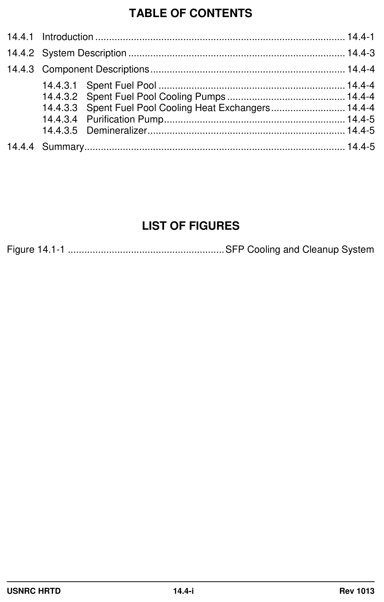
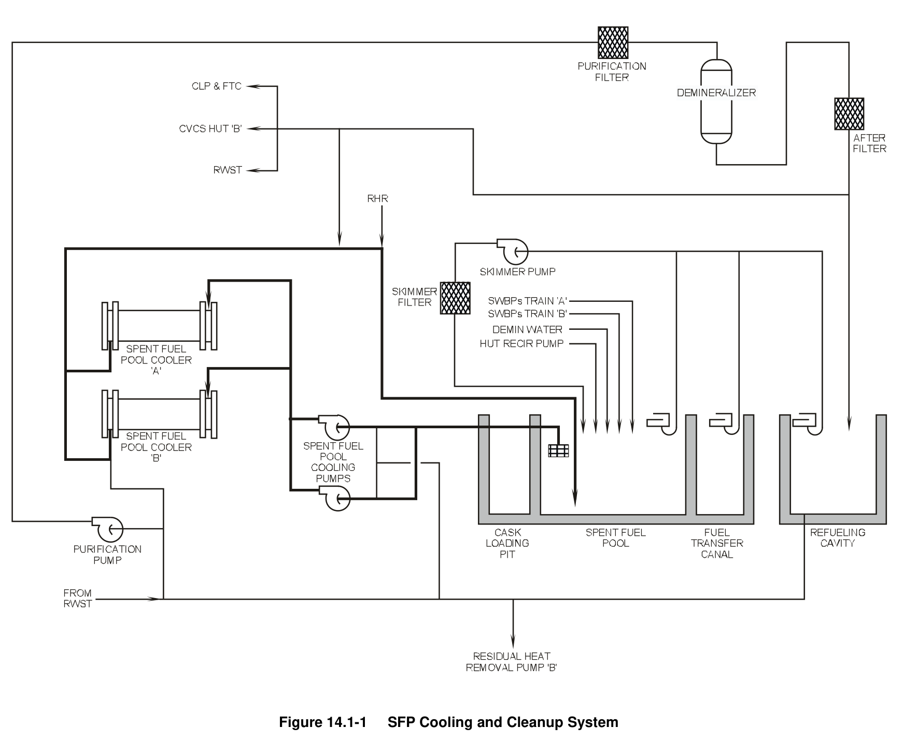

# 14.4 Spent Fuel Cooling

> Pages 1006–1013 of `ML20057E160.pdf`
> Westinghouse Technology Systems Manual — USNRC HRTD (PWR)

---
<!-- p.1006 -->
#### Westinghouse Technology Systems Manual
#### Section 14.4
#### Spent Fuel Pool Cooling and Cleanup System
<!-- p.1007 -->
#### Figure 14.1-1

*........................................................ SFP Cooling and Cleanup System*

<!-- labels/text on this figure page -->
TABLE OF CONTENTS
14.4.1 Introduction ........................................................................................... 14.4-1
14.4.2 System Description ............................................................................... 14.4-3
14.4.3 Component Descriptions ....................................................................... 14.4-4
14.4.3.1 Spent Fuel Pool .................................................................... 14.4-4
14.4.3.2 Spent Fuel Pool Cooling Pumps ........................................... 14.4-4
14.4.3.3 Spent Fuel Pool Cooling Heat Exchangers ........................... 14.4-4
14.4.3.4 Purification Pump .................................................................. 14.4-5
14.4.3.5 Demineralizer ........................................................................ 14.4-5
14.4.4 Summary ............................................................................................... 14.4-5
LIST OF FIGURES
Figure 14.1-1 ......................................................... SFP Cooling and Cleanup System
USNRC HRTD 14.4-i Rev 1013

<!-- p.1008 -->
### 14.4 SPENT FUEL POOL COOLING AND CLEANUP SYSTEM
#### Learning Objectives:
1. State the purposes of the spent fuel pool cooling and cleanup system.

2. Describe the design features of the spent fuel pool cooling and cleanup system which prevent inadvertently lowering the water level in the spent fuel pool.

#### 14.4.1 Introduction
The spent fuel pool cooling and cleanup system is a closed-loop system consisting of three subsystems: the cooling, purification, and skimmer subsystems. The major purpose of the cooling and cleanup system is to remove decay heat generated by the stored spent fuel and to transfer this heat to the component cooling water system. This system continuously purifies, filters, and maintains the optical clarity of the water in the spent fuel pool, fuel transfer canal and the spent fuel cask loading pit. Finally, this system maintains the water inventory in the spent fuel pool.

All nuclear reactor plants include a spent fuel pool for the wet storage of spent fuel assemblies. The methods used to provide cooling for the removal of decay heat from the stored assemblies vary from plant to plant depending upon the individual design. The safety function in all cases is the same; that is, the spent fuel assemblies must be cooled and remain covered with water during all storage conditions. Other functions performed by the system, but not related to safety, include water cleanup for the spent fuel pool, refueling canal, refueling water storage tank, and other equipment storage pools; and a means for filling and draining the refueling canal and the other storage pools. In addition, surface skimming is incorporated into the design to provide optically clear water in the storage pool.

To meet the above considerations, the spent fuel pool, the surrounding structure, the building in which it is housed, and the cooling and cleanup system must meet, in part, the following 10 CFR Part 50, Appendix A, General Design Criteria (GDC):

 GDC 2, “Design bases for protection against natural phenomena,”  GDC 4, “Environmental and dynamic effects design bases,”  GDC 61, “Fuel storage and handling and radioactivity control,” and  GDC 63, “Monitoring fuel and waste storage.”

Meeting the requirements of GDC 2 and GDC 4 provides assurance that the components and systems necessary for spent fuel cooling are designed to withstand the effects of expected natural phenomena (earthquakes, floods, etc.) and to accommodate the effects of normal operation, maintenance, testing, and postulated accidents, including loss-of-coolant accidents. Meeting the requirements of GDC 61 provides assurance that fuel storage and handling systems are inspected and tested, provided with shielding for radiation protection, designed with appropriate containment, confinement, and filtering systems, designed with a reliable and testable residual heat removal capability, and designed to prevent significant losses of fuel storage coolant inventory. Finally, GDC 63 ensures that fuel storage systems

USNRC HRTD 14.4-1 Rev 1013

<!-- p.1009 -->
are provided with monitoring capabilities that can detect conditions that could result in the loss of residual heat removal capability.

To meet the above criteria, the entire spent fuel pool cooling and cleanup system need not be designed to Seismic Category I requirements, provided that the makeup system and the building ventilation and filtration systems are designed to Seismic Category I specifications. Also, to satisfy the shielding requirement of GDC 61, the spent fuel pool and connected systems must be designed so that, in the event of a failure of the inlets, outlets, or any piping or drain lines inserted into the pool; the level in the pool cannot be inadvertently drained below a point approximately 3 m
(10 ft) above the top of the active fuel. Therefore, piping extending into the pool must be equipped with siphon breakers, check valves, or other devices to prevent draining the spent fuel pool. Finally a Seismic Category I makeup system and an appropriate backup method to add coolant to the spent fuel pool must be provided.
The backup system need not be a permanently installed system, nor designed to seismic Category I specifications, but it must take water from a Seismic Category I source.

The cooling and cleanup system described in this chapter is designed to perform the following functions:

1. Maintaining the spent fuel pool water temperature < 60°C (140°F) by removing the decay heat input from the maximum number of fuel assemblies less a fullcore off-load (a total of 1215 assemblies), including the assemblies from the last refueling discharged 100 hours after shutdown. The decay heat load under these conditions is calculated at 20.1 x 106 BTU/hr. After 11 days the decay heat output drops to 13 x 106 BTU/hr, which is within the capacity of the spent fuel pool cooling heat exchangers.

2. Maintaining the spent fuel pool water temperature below 60°C (140°F) with the assistance of the residual heat removal system in the event that the pool contains the maximum number of fuel assemblies (1408 assemblies), including a complete core unloaded 150 hours following shutdown. The heat load under these conditions is calculated at 44.3 x 106 BTU/hr.

3. Maintaining cladding integrity if all forced cooling is lost.

4. Maintaining the purity and clarity of borated water in the spent fuel pool, the fuel transfer canal, the refueling cavity, and the refueling water storage tank.

5. Supplying normal and emergency makeup to the spent fuel pool.

6. Maintaining sufficient cooling if a fuel assembly or other object is dropped in the spent fuel pool.

The spent fuel pool, the emergency makeup supply lines, and the lines connecting to the residual heat removal system are designed to Seismic Category I requirements.
The remaining components and piping of the cooling and cleanup system are designed to applicable industry codes and standards.

USNRC HRTD 14.4-2 Rev 1013

<!-- p.1010 -->
#### 14.4.2 System Description
The basic flow path of the cooling system is shown in Figure 14.4-1. The system consists of two half-capacity pumps which take suction on the spent fuel pool through a common strainer located approximately 15 feet below the surface of the pool, and discharge back to the pool through two half-capacity heat exchangers.
The cooling loop return line discharges directly above the fuel assembly storage racks (about 27 feet below the normal level of the pool surface). The downward momentum and negative buoyancy of the cool discharged water carries the flow downward. The coolant flows beneath the storage racks and begins the process of natural circulation as it heats up and rises up through the stored spent fuel toward the suction strainer. The cooling loop is completed by natural circulation flow within the spent fuel pool. The cooling loop return line has a siphon breaker hole machined into the discharge line about seven feet below the normal level of the pool. This hole
(siphon break) prevents inadvertent siphoning of the pool and ensures that at least 10 ft of water (actually 17 ft in this particular design) are retained above the top of the active fuel.

The cooling loop contains connections to the residual heat removal system in the suction piping between the spent fuel pool and the cooling pumps, and in the return piping to the pool from the spent fuel pool heat exchangers. These connections make possible the substitution of a residual heat removal pump and its associated heat exchanger in place of the spent fuel pool cooling pumps and heat exchangers when the heat load exceeds the capacity of the spent fuel cooling system. During refueling the entire core is off-loaded to the spent fuel pool. The spent fuel cooling system by itself does not have sufficient capacity for decay heat removal under these conditions. Therefore, the system is aligned so that the “B” train of the residual heat removal system aids in the cooling of the spent fuel pool.

The purification subsystem consists of a branch line containing a pump, filter, demineralizer, and afterfilter, as shown in Figure 14.4-1. The purification line branches from the outlet of the spent fuel pool cooling heat exchangers. The purification pump diverts a small amount of coolant flow (~150 gpm) from the heat exchanger outlet through the purification filter and/or demineralizer before returning the coolant to the pool. The demineralizer is 90 ft3 in size and contains about 50 ft3 of HOH resin. The purification subsystem is designed to remove fission products and other contaminants from the coolant by chemical ion exchange. The purification loop also contains connections to the refueling water storage tank. This feature enables the purification subsystem to circulate and purify the contents of the refueling water storage tank if required.

Makeup water to the spent fuel pool from the demineralized water makeup system compensates for the loss of coolant from the spent fuel pool due to evaporation.
The normal makeup line has a siphon breaker hole machined into the supply line approximately seven feet below the level of the normal water surface in the spent fuel pool. Under worst-case conditions, a loss of all forced cooling flow to the spent fuel pool with an initial pool water temperature of 60°C (140°F), the water in the spent fuel pool would reach the boiling point in about 3.5 hours. The integrity of the spent fuel is assured under these conditions, as the maximum calculated peak centerline temperature of the fuel would be 135°C (275°F). Under these conditions

USNRC HRTD 14.4-3 Rev 1013

<!-- p.1011 -->
the evaporation rate from a boiling pool would be approximately 90 gpm. If makeup water from the normal supply source is not available, inventory in the spent fuel pool could be recovered from an emergency source of water (the service water system)
which has the capability of supplying 200 gpm.

The skimmer subsystem improves water clarity and maintains the transparency of the spent fuel pool water for underwater fuel handling. It consists of portable floating skimmers, a skimmer suction header, one skimmer pump and filter, and a return line to the spent fuel pool. Floating skimmers can be placed in the spent fuel pool, the cask loading pit, the fuel transfer canal, or the refueling cavity. The skimmer pump takes suction from the pool surfaces through a floating screen and discharges water through the skimmer filter back into the pool. At some facilities the 5 micron filter elements have been removed from the filter unit due to ALARA concerns. At these units there is no filtration of the pool fluids. However, the skimmer screen does provide removal of debris or floating particulates from the pool surface.

#### 14.4.3 Component Descriptions
##### 14.4.3.1 Spent Fuel Pool
The spent fuel pool is a reinforced concrete structure with a seam-welded stainless steel plate liner. It is designed and built to Seismic Category I specifications. The pool contains about 390,000 gallons of coolant, measures 39 ft by 24 ft, and is 40 ft deep. The depth of the pool is selected to maintain at least 23 feet of water above the tops of spent fuel assemblies in the storage ranks, and at least 9.5 feet above the top of the active fuel during fuel transfer operations. This water barrier serves as a radiation shield, limiting the gamma dose rate at the surface of the pool to a maximum of 2.5 mrem/hr.

##### 14.4.3.2 Spent Fuel Pool Cooling Pumps
Each spent fuel pool cooling pump is a half-capacity pump rated for 1500 gpm at a discharge pressure of 43 psig. Its function is to circulate spent fuel pool water through the heat exchangers and the pool. Each pump is a horizontal, single-stage, centrifugal pump driven by a horizontal, 1770-rpm, induction motor rated for 60 hp, 480 vac, and 60 hz. The pump casing, impeller, and shaft are constructed of stainless steel. Each pump is equipped with a vent to atmosphere and a casing drain to the clean waste receiver tank. Sealing water supply for the shaft seal is taken from pump discharge, and seal leakoff is returned to the pump suction.

##### 14.4.3.3 Spent Fuel Pool Cooling Heat Exchangers
Each spent fuel pool heat exchanger is a shell-and-straight-tube-type heat exchanger with a design heat transfer capacity of 6.5 x 106 BTU/hr. This heat removal capacity is based on a maximum service water temperature of 75°F.
However, since the average service water temperature is 53°F, these heat exchangers are capable of removing more heat than designed. The tube-side fluid is spent fuel pool coolant, and the shell-side fluid is component cooling water. Both sides of this heat exchanger are single pass. The inlet for the tube side is equipped with a vent to atmosphere. The tube side inlet and outlet are equipped with drains to the clean waste receiver tank. Both the tube and shell sides are designed for 1500

USNRC HRTD 14.4-4 Rev 1013

<!-- p.1012 -->
gpm, 150 psig, and 100°C (212°F). The tubes are constructed of stainless steel; the shell of carbon steel. The heat exchangers are half capacity and arranged in parallel.

##### 14.4.3.4 Purification Pump
The spent fuel pool purification pump develops the pressure head required to force flow through the purification demineralizer and filters. It is a horizontal, single-stage, centrifugal pump driven by a 480-vac induction motor. Its capacity is 132 gpm with maximum backpressure and 232 gpm with minimum backpressure.

##### 14.4.3.5 Demineralizer
The spent fuel pool demineralizer removes fission products and other contaminants from the coolant by chemical ion exchange. The demineralizer is designed for 150 psig, 93°C (200°F), and a maximum flow rate of 250 gpm. Piping and valving is supplied to allow removal of spent resin. The demineralizer can be back-flushed to remove suspended particulates. In addition, back-flushing fluffs the resin, removing any channels that may have formed and thereby increasing the efficiency the demineralizer.

#### 14.4.4 Summary
The purpose of the spent fuel pool cooling and cleanup system is to remove decay heat from fuel stored in the spent fuel pool. The system is provided with a demineralizer and filters to maintain the chemical purity and optical clarity of coolant in the refueling cavity, transfer canal, spent fuel pool, and refueling water storage tank. The spent fuel pool heat exchangers are cooled by component cooling water.

In order to prevent a single component failure from draining the pool and removing the shielding provided by the coolant; the pool is designed with:

1. No drains in the bottom of the pool (hence the pool cannot be inadvertently drained).

2. The cooling pumps taking suction fifteen feet below the surface of the pool. An antisiphon hole in the suction piping maintains a minimum of 12 feet of water above the fuel assemblies.

3. The return line terminating near the top of the fuel racks. The return line, also has an antisiphon hole. The suction and return antisiphon holes are machined into their respective pipes at the same elevation.

USNRC HRTD 14.4-5 Rev 1013

<!-- p.1013 -->
#### Figure 14.1-1

*SFP Cooling and Cleanup System*

[Vector original (SVG, lossless): fig_14.1-1_2.svg](../figures/fig_14.1-1_2.svg)

