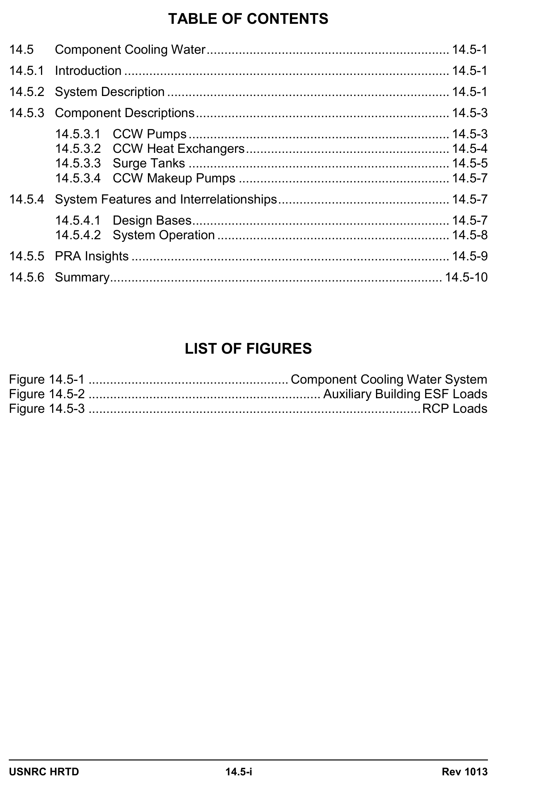
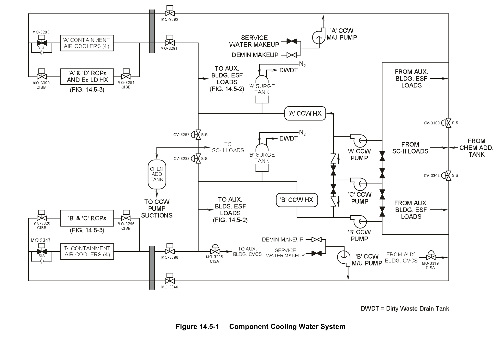
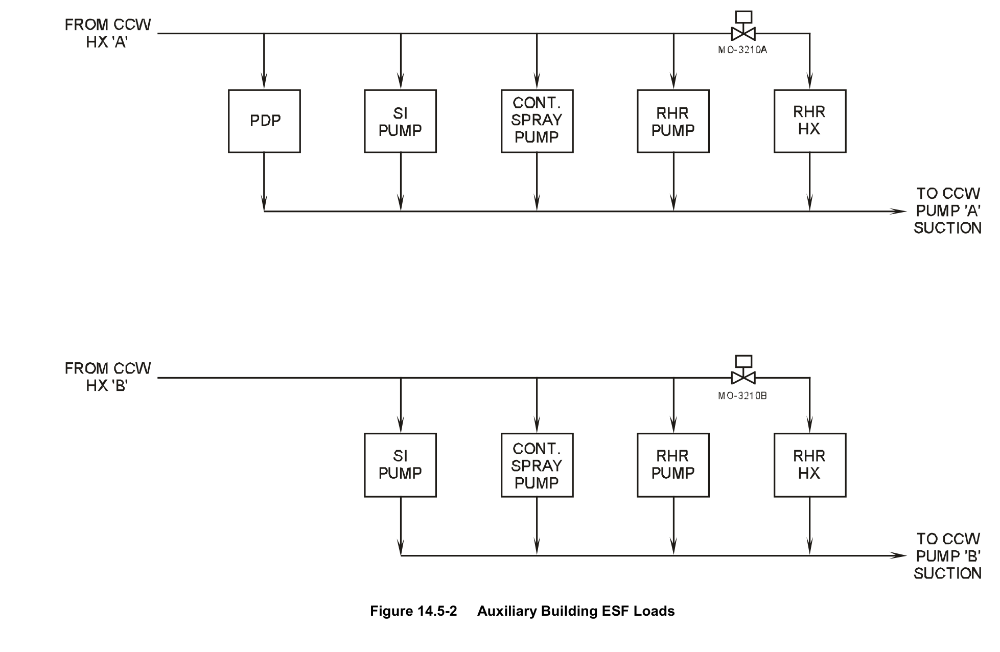
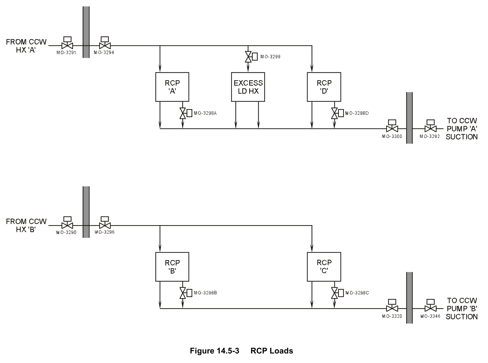

# 14.5 CCW

> Pages 1014–1030 of `ML20057E160.pdf`
> Westinghouse Technology Systems Manual — USNRC HRTD (PWR)

---
<!-- p.1014 -->
#### Westinghouse Technology Systems Manual
#### Section 14.5
#### Component Cooling Water System
<!-- p.1016 -->
#### Figure 14.5-1

*....................................................... Component Cooling Water System*

<!-- labels/text on this figure page -->
TABLE OF CONTENTS
14.5 Component Cooling Water .................................................................... 14.5-1
14.5.1 Introduction ........................................................................................... 14.5-1
14.5.2 System Description ............................................................................... 14.5-1
14.5.3 Component Descriptions ....................................................................... 14.5-3
14.5.3.1 CCW Pumps ......................................................................... 14.5-3
14.5.3.2 CCW Heat Exchangers ......................................................... 14.5-4
14.5.3.3 Surge Tanks ......................................................................... 14.5-5
14.5.3.4 CCW Makeup Pumps ........................................................... 14.5-7
14.5.4 System Features and Interrelationships ................................................ 14.5-7
14.5.4.1 Design Bases ........................................................................ 14.5-7
14.5.4.2 System Operation ................................................................. 14.5-8
14.5.5 PRA Insights ......................................................................................... 14.5-9
14.5.6 Summary ............................................................................................. 14.5-10
LIST OF FIGURES
Figure 14.5-1 ........................................................ Component Cooling Water System
Figure 14.5-2 ................................................................. Auxiliary Building ESF Loads
Figure 14.5-3 ............................................................................................. RCP Loads
USNRC HRTD 14.5-i Rev 1013

<!-- p.1018 -->
### 14.5 COMPONENT COOLING WATER SYSTEM
#### Learning Objectives:
1. State the purposes of the Component Cooling Water (CCW) System.

2. List the loads served by the CCW system.

3. Explain how the design of the CCW system prevents the release of radioactivity to the environment.

4. Describe both methods of detecting leakage into the CCW system.

5. Describe how the CCW system is protected against leakage in the thermal barrier heat exchangers.

#### 14.5.1 Introduction
During the course of normal operation, many of the processes fundamental to power production produce heat. To successfully achieve useful power production at the plant, the heat from various components must be removed. Many of these same components also contain radioactive fluids. Removing the heat produced by various plant systems while limiting the release of radioactive fluids to the environment to an absolute minimum is the function of the component cooling water (CCW) System.

By virtue of their status as part of the emergency core cooling systems, some of the components cooled by CCW are more important than others. These include the residual heat removal pumps and heat exchangers, the charging, safety injection, and spray pumps, and the containment air coolers. They are needed by the plant during emergency conditions to remove heat. These components, as well as several others, are part of the Seismic Category I loops. The rest of the loads cooled by CCW are not critical to the successful outcome of any major emergency situations. These loads are part of the Seismic Category II loop.

As component cooling water flows through both these loops, it picks up thermal energy and rejects it, but not directly to the environment. CCW is a closed system which transfers heat to the service water system for ultimate disposal. As such, it provides a monitored intermediate barrier to the release of radioactive fluids which might leak from the components it cools. The service water system transfers heat absorbed from the CCW system to the ultimate heat sink.

#### 14.5.2 System Description
As shown in Figure 14.5-1, the CCW system is a closed-loop system. There are three CCW pumps, one for the A train, one for the B train, and a swing pump that can be valved in to supply either train. During normal operation, the system operates in a split-train configuration, with one pump in each train running to supply that train’s essential loads, and with suitable suction and discharge isolation so that only one train supplies nonessential loads.

USNRC HRTD 14.5-1 Rev 1013

<!-- p.1019 -->
The CCW pumps discharge to a main header that delivers flow through two heat exchangers, one per train. The component heat load of the CCW system is rejected to the service water system, which flows through the tube side of the heat exchangers. Freshly cooled water from the outlets of the heat exchangers is delivered to the various cooling loops. Because the service water system is more subject to fouling, its use on the tube side reduces the opportunity to foul.

Two Seismic Category I trains supply water to various engineered safety feature
(ESF) loads. These trains also provide flow to other plant loads in the containment and auxiliary building. Several branches from the main header are needed to supply all loads.

The first branch in each Seismic Category I train, as shown in Figure 14.5-2, delivers flow to the following ESF loads located in the auxiliary building:

1. Safety injection pump seal cooler,
2. Containment spray pump seal cooler,
3. Residual heat removal pump mechanical seal cooler, 4. Residual heat removal heat exchanger, and 5. Positive displacement charging pump lube oil cooler (Not ESF).

A second branch in each Seismic Category I train supplies cooling water to four containment air coolers.

There is a third branch in each Seismic Category I train. The loads supplied by this branch, as shown in Figure 14.5-3, are automatically isolated by a Phase B containment isolation signal or by a Phase A containment isolation signal coincident with a low CCW surge tank level. In the A train, CCW is supplied to two reactor coolant pumps (RCPs) and the excess letdown heat exchanger. In the B train, CCW is supplied to the other two reactor coolant pumps. A motor-operated valve in the return line from the thermal barrier heat exchanger of each reactor coolant pump automatically closes on high flow (100 gpm); such high flow would result from a leak in the heat exchanger. This feature protects the CCW system against the high pressure of the reactor coolant system.

A fourth branch in the B train, also isolated during by a Phase A containment isolation signal, supplies the seal water and letdown heat exchangers.

During a safety injection actuation sequence, valves in the suction and discharge lines of both trains close to provide train isolation. When these valves close, they also remove the flow to the Seismic Category II loop, which is supplied by a common header supplied from both trains. The loads on the Seismic Category II
(nonessential) loop are as follows:

1. Spent fuel pool heat exchangers,
2. Boric acid evaporator packages,
3. Waste gas compressor and compressor aftercooler, 4. Primary sample conditioning panel, and 5. Fill and flushing supply to the chemical addition tank.

USNRC HRTD 14.5-2 Rev 1013

<!-- p.1020 -->
Return flows from the various loads combine in the main suction header from which the CCW pumps receive their supply. It is to this suction header that system makeup water is delivered from the demineralized water storage tank. Two CCW makeup pumps (one per train) supply makeup water. An emergency makeup supply to each makeup pump from the service water system is also provided for when the demineralized water storage tank is not available.

The CCW system is equipped with a surge tank in each train to absorb system volume changes. A single chemical addition tank services both trains. The chemical addition tank is used to add corrosion-inhibiting chemicals to maintain system integrity.

#### 14.5.3 Component Descriptions
##### 14.5.3.1 CCW Pumps
The CCW pumps are horizontally mounted, single-stage, double-suction, centrifugal pumps, each capable of delivering up to 11,500 gpm with a head of 140 ft. Electrical power is supplied from 4.16-kv vital buses A1 and A2. Each pump is designed to provide 100 percent of water requirements during normal operation and 100 percent of requirements for each train during abnormal conditions or plant cooldowns.

One pump (A) is aligned directly to train A, and the other (B) is aligned directly to train B. The third pump (C) can be lined up to either train by opening normally locked-closed cross-connect valves. During normal plant operations, one pump and heat exchanger are in operation in each train, with one train supplying cooling to Category II loads. The C pump is isolated and serves as an installed spare. Power to the C pump can be supplied from either bus A1 or A2 through a manually operated transfer switch. To maintain the required train separation and independence, the transfer switch is constructed so that the two power supply sources can never be connected in parallel. Controls for the switchgear breakers feeding the C pump are interlocked such that when the A pump is running, the C pump breaker from bus A1 cannot be closed; it can only be closed when the A pump breaker is in the disconnected or test position, and the transfer switch is in the channel A position. Similarly, the C pump can be run from bus A2 only when the B pump breaker is racked out in the disconnected or test position, and the transfer switch is in the channel B position. If the C pump is running in place of either the A or B pump and that pump’s breaker is racked in to the connected position, the C pump breaker trips open, unless it is operated in local mode with its remote control switch in “pull to lock”. The transfer switch position does not affect breaker closure, but it will determine whether the pump is aligned to the breaker and receives power when the breaker is closed. This arrangement minimizes the chances that the normally operating pump and the standby pump are supplied from the same bus, and maintains electrical separation. This arrangement also helps prevent supplying two CCW pumps from one emergency diesel generator after losses of normal and preferred power sources.

The following signals start the pumps automatically:

1. CCW surge tank level low-low,

USNRC HRTD 14.5-3 Rev 1013

<!-- p.1021 -->
2. Low service water system pressure (from the opposite train),
3. Low differential pressure across the opposite train’s CCW pump, 4. Low service water booster pump header pressure (from the opposite train), 5. Design-basis-accident (DBA) sequencer (20 seconds after initiation), or 6. Normal shutdown sequencer (6.5 seconds after initiation).

Of these automatic starts, only those by the DBA and normal shutdown sequencers activate if the lockout relay has tripped.

The following conditions activate the pump control circuit lockout relay and stop the CCW pumps:

1. Pump motor phase overcurrent,
2. Pump motor ground overcurrent,
3. Bus undervoltage, or 4. Standby (C) pump breaker will trip if the preferred pump (A or B) breaker is racked in to the connected position on the same bus.

Each of the A and B CCW pumps discharges through a 24-in. header that leads to the respective heat exchanger. The C pump discharges to a similar header that spans the discharge of the other two pumps and is isolated by a single lockedclosed valve and check valve in series in the piping to either train. A temperature element in each train provides indication of CCW heat exchanger inlet temperature on control board recorders.

##### 14.5.3.2 CCW Heat Exchangers
The two identical CCW heat exchangers are horizontal, counter-flow, shell-andstraight-tube-type heat exchangers. Cooling flow from the service water system circulates through the tube sides to minimize fouling of the heat transfer surfaces.
The design inlet and outlet temperatures of the service water are 75°F and 95°F, respectively, at a design flowrate of 17,500 gpm. The component cooling water on the shell side is oriented in counter-flow to the service water. It is designed to enter at 153.3°F and exit at 120.0°F at a design flowrate of 10,500 gpm. Each heat exchanger has a heat transfer rating of 175 x 106 Btu/hr.

The normal maximum heat exchanger outlet temperature of 120°F supports the design criteria of maintaining the spent fuel pool temperature and the containment operating temperature no greater than 125°F and 120°F, respectively. To ensure that the above temperatures are not exceeded, CCW flow to the residual heat removal heat exchangers might need to be reduced by throttling the inlet valves.

Despite the fact that both trains are normally operating, the CCW system is designed to operate with one CCW heat exchanger in use during normal full-power operation.
The remaining heat exchanger provides for 100% standby capacity should the operating heat exchanger become inoperable. The provision of two heat exchangers allows for maintenance on one heat exchanger while the other is in service.

USNRC HRTD 14.5-4 Rev 1013

<!-- p.1022 -->
A continuously operating automatic radiation detection system is provided in each train of the system. Each radiation detector is installed at the outlet of a CCW heat exchanger by a "strap-on" external mount. This system detects any ingress of radioactive material before the levels become potentially dangerous. The normal monitor readings should be equivalent to background radiation levels, since contaminated leakage into the CCW system is not expected. Each monitor provides an alert alarm when the radiation level reaches 1.5 times background, positive indication of contaminated leakage into the system. An additional high alarm set at 430 cpm above background is provided to indicate large-magnitude leakage.
Radioactive fluids leaking into the CCW system would also be indicated by a rising surge tank level.

CCW flow from the outlets of both heat exchangers enters an 18-inch cross-connect header from which all loads receive their cooling flows. This header is divided into three sections by air-operated isolation valves CV-3287 and CV-3288. The two sections nearest the heat exchanger piping carry flow to the Seismic Category I loads. The piping between the isolation valves is where the Seismic Category II and the chemical addition tank piping attach. The air-operated return header isolation valves, CV-3303 and CV-3304, similarly separate the Category I and Category II piping. Flow returns to the suctions of the CCW pumps. Normally, one set of valves
(e.g., CV-3304 and CV-3288) is closed to isolate the trains. Additionally, valves CV- 3287, -3288, -3303, and -3304 automatically close in response to low-low level in the corresponding surge tank or a safety injection actuation signal.

##### 14.5.3.3 Surge Tanks
The two identical surge tanks are vertically mounted, carbon steel cylinders with hemispherical top and bottom heads. The tanks are connected to the Seismic Category I loops downstream of the CCW heat exchangers via four-inch lines. The functions of each CCW surge tank are as follows:

1. Provide system net positive suction head (NPSH),
2. Prevent boiling in the system high points by keeping the system full and pressurized at the containment air cooler outlets,
3. Dampen pressure transients due to load changes or pump startup or shutdown, 4. Act as an expansion volume due to changes in the CCW temperature, 5. Monitor fluid system volume via level instrumentation, and 6. Provide pressure relief through the safety relief valves.

Each surge tank has a capacity of 2000 gallons, and the normal operating level is maintained between 45% and 60%. Water levels in the tanks are monitored by level transmitters. Each level transmitter also inputs a signal to a level switch which, in combination with its paired pressure switch, operates solenoid valves that supply and vent the nitrogen cover gas for that surge tank.

Pressurized cover gas maintains the NPSH of the CCW system. The plant nitrogen supply delivers gas to each surge tank through its pressure regulating valve to maintain pressure at 113 psig. A second pressure regulating valve in the vent line from each tank also helps to regulate pressure by venting excess nitrogen to the dirty waste drain tank at 125 psig.

USNRC HRTD 14.5-5 Rev 1013

<!-- p.1023 -->
To achieve adequate pressure control in the surge tanks, each pressure regulating valve comes equipped with a solenoid-operated bypass valve that is normally closed. Each of these valves is operated by an OPEN-RESET switch that springreturn to an unlabeled mid-position. With the switches in the mid-position, the solenoid valves control pressure between 115 psig and 125 psig. This control is accomplished through inputs from the level transmitter and pressure transmitter on each tank. Control of the solenoid-operated valves is as follows:

1. Supply bypass valves:

a. Each opens automatically if its associated tank level is greater than 65% and its tank pressure is less than 115 psig.

b. Each closes automatically if its associated tank pressure is greater than 120 psig.

2. Vent bypass valves:

a. Each opens automatically if its associated tank level is less than 54% and its pressure is greater than 130 psig.

b. Each closes automatically if its associated tank level is greater than 56% or pressure is less than 125 psig.

The valves can be opened manually at any time, provided that a safety injection (SI)
actuation signal is not present. A safety injection actuation signal either closes the valves or prevents them from opening. Following the reset of the SI actuation signal, the solenoid valve switches must be reset to permit their operation.

Overpressure protection for each tank is provided by two relief valves installed in a line off the tank vent. Both pressure relief valves lift at 130 psig.

The level instrumentation for the CCW surge tanks provide several functions in addition to the role they play in maintaining tank pressure. Functions of the level instrumentation are listed below:

1. A surge tank B level switch starts the B CCW makeup pump when the B CCW surge tank level drops below 40%, and stops the pump when level rises to 56.6%.

2. A surge tank A level switch starts the A CCW makeup pump when the A CCW surge tank level drops below 40%, and stops the pump when level rises to 56.6%.

3. A second surge tank B level switch starts the B CCW and B service water pumps when the B CCW surge tank level is < 8.3%. Note that this instrument starts the C CCW and/or C service water pumps if these pumps are in the standby mode.

USNRC HRTD 14.5-6 Rev 1013

<!-- p.1024 -->
4. A second surge tank A level switch starts the A CCW and A service water pumps when the A CCW surge tank level is < 8.3%. Note that this instrument starts the C CCW and/or C service water pumps if these pumps are in the standby mode.

5. A third surge tank B level switch closes the B train CCW seismic category I/II isolation valves when the B CCW surge tank level drops below 8.3%.

6. A third surge tank A level switch closes the A train CCW seismic category I/II isolation valves when the A CCW surge tank level drops below 8.3%.

7. The surge tank B level transmitter opens and closes the nitrogen supply and vent solenoid-operated bypass valves for the B CCW surge tank. It also provides a signal to a B CCW surge tank level indicator and high level alarm in the control room.

8. The surge tank A level transmitter opens and closes the nitrogen supply and vent solenoid-operated bypass valves for the A CCW surge tank. It also provides a signal to an A CCW surge tank level indicator and high level alarm in the control room.

##### 14.5.3.4 CCW Makeup Pumps
The CCW makeup pumps are single-stage, horizontal, centrifugal pumps. Each has a maximum operating flow rate of 110 gpm at a maximum operating head of 250 ft.
The pumps are powered from 480-vac ESF buses. Each train’s makeup pump is automatically started and stopped by level switches at its associated surge tank.

The CCW makeup pumps normally take suction from the Seismic Category II demineralized water storage tank. A Seismic Category I source of makeup water from the service water system is available for emergency use.

#### 14.5.4 System Features and Interrelationships
##### 14.5.4.1 Design Bases
The CCW system is designed to provide the required heat removal rates while maintaining system temperatures within the following limits:

1. CCW temperatures at the inlets to the residual heat removal heat exchangers do not exceed 120°F and 95°F, respectively, at the beginning and end of a normal cooldown of the reactor coolant system from 350°F to 140°F, as required to provide the 20-hour cooldown capability.

2. CCW heat exchanger outlet temperatures under design basis accident conditions do not exceed 140°F to protect against degradation of the pumps served by the system.

3. Temperatures remain less than the boiling point corresponding to the minimum pressure that occurs in the system at the outlets of the containment air coolers under design-basis accident conditions.

USNRC HRTD 14.5-7 Rev 1013

<!-- p.1025 -->
Maintaining the minimum required cooling water flow to the ESF equipment served by the CCW system is essential for ensuring the safe operation and safe shutdown of the plant. The ESF components of the CCW system are designed to meet Seismic Category I requirements and the single-failure criterion. The components of the CCW system which serve the reactor coolant pumps, the excess letdown heat exchanger, the letdown heat exchanger, and the seal water heat exchanger are also designed to meet Seismic Category I requirements to assure the integrity of these components under the postulated maximum seismic loading conditions.

Water chemistry control of the CCW system is accomplished by addition of a corrosion inhibitor via the chemical addition tank. The corrosion inhibitor protects the piping from corrosion to a degree sufficient to prevent long-term degradation of system capability. A slightly elevated pH is also desirable for corrosion control.

##### 14.5.4.2 System Operation
Due to the pump design, the mechanical seals on the CCW pumps are pressure and temperature sensitive. To ensure the design life span of the seals, the CCW pumps must have adequate flow to ensure a minimal heatup of the fluid in the pump casing and to limit the pressure. Therefore, a minimum flow limit of 3,000 gpm per pump is required. During normal operations with all equipment aligned, this is not a direct concern. However, during Modes 4, 5, and 6, equipment may be secured or tagged out, thereby reducing the total flow in the system. Since there is no direct flow indication for CCW, the CCW system aligned to supply flow to the residual heat removal system heat exchangers (5,000 gpm each) ensures adequate flow.

The controls of the CCW pumps are interlocked with the service water pumps, so that the automatic start of a CCW pump on low-low surge tank level causes the automatic start of the service water pump in the same train in which the CCW system is operating.

During the plant cooldown phase following initiation of a normal plant shutdown, two CCW pumps are required to be in operation, and flow through both residual heat removal heat exchangers at > 5000 gpm is required to provide the 20-hour cooldown capability. The plant can be brought safely to the cold shutdown condition with one residual heat removal heat exchanger in operation, but that evolution require approximately 100 hours.

An SI actuation signal causes actuation of ESF equipment as a result of postulated accident conditions. An SI actuation signal causes the following to occur:

1. Automatic start of both CCW system trains and service water system trains by the DBA sequencer. (Running pumps receive confirmatory start signals; standby pumps are started.)
2. Separation of the two Seismic Category I trains and isolation of the Seismic Category II part of the system by automatic closure of valves CV-3287, CV-3288, CV-3303, and CV-3304.

3. Automatic opening of flow control valves MO-3293 and MO-3347 in the return headers to provide full flow through the containment air coolers.

USNRC HRTD 14.5-8 Rev 1013

<!-- p.1026 -->
4. Removal of power from the solenoid-operated surge tank nitrogen supply and vent bypass valves. The valves must be reset following the reset of the SI actuation signal to enable the solenoids to function.

An SI actuation signal also causes a containment isolation phase A signal.
Automatic or manual initiation of a containment isolation signal causes automatic closure of isolation valves MO-3295 and MO-3319, which isolates CCW flow to the letdown heat exchanger and the seal water heat exchanger. A containment isolation phase B signal, or a CCW surge tank low level (less than 18.3%) alarm concurrent with a containment isolation phase A signal, causes the automatic closure of isolation valves MO-3294, -3300, -3296, and -3320. This action isolates CCW to the RCPs and to the excess letdown heat exchanger, and requires the shutdown of all running RCPs until CCW cooling is restored.

Operator action is not required for the CCW system to perform its required functions during the injection phase of an accident. When the recirculation phase is initiated, the operator must open the motor-operated valves at the inlets to the residual heat removal system heat exchangers.

#### 14.5.5 PRA Insights
The component cooling water system of some plants is a major contributor to core damage frequency (79% at Zion, and 31% at Sequoyah). This is due to its role in Reactor Coolant Pump (RCP) seal cooling and cooling of equipment in the emergency core cooling systems (ECCSs). RCP seal cooling is provided by the thermal barrier heat exchanger and the normal charging seal injection from Chemical and Volume Control System (CVCS). Both of these heat removal mechanisms can be dependent on CCW for pump seal cooling.

However, many Westinghouse plants modified their Centrifugal Charging Pumps
(CCPs) to an improved design that provided for self-cooling CCP seals. In this configuration, a loss of CCW does not result in a coincident failure of both thermal barrier heat exchanger flow and seal cooling flow to the RCPs. Accordingly, this modification significantly reduced the contribution of the CCW System to core damage frequency. The Trojan plant incorporated this modification and the Westinghouse Simulator reflects the improved design CCPs.

For plants which did not adopt this modification, a loss of CCW would result in a failure of the RCP seal as both the thermal barrier heat exchanger and CCPs would be lost due to a lack of cooling water flow. This would result in an RCP seal loss-ofcoolant accident (LOCA). The charging pumps and safety Injection pumps are needed to supply injection to the core to make up for the loss of inventory. Without CCW, they would fail due to overheating. The resultant unrecoverable inventory from the reactor coolant system would lead to core damage. Probable causes of failure of the CCW system are as follows:

1. Human error - At those sites such as Zion and Sequoyah where the CCW system is shared between units, failure to manually align the standby train after failure of the operating loop.

USNRC HRTD 14.5-9 Rev 1013

<!-- p.1027 -->
2. Loss of CCW pumps - The pumps fail to start, or fail to continue to run after starting, due to some common-mode failure, such as loss of power.

3. Valve failure - Local fault of the heat exchanger outlet or bypass valves, or on some designs, a local fault of the header isolation valve to the ECCS pump coolers.

4. Piping failure - At Zion, the most significant failure is a rupture of the CCW piping.
A review of the Probabilistic Safety Study identified 30 pipe sections whose failure would lead to a loss of CCW.

PRA studies (Reactor Risk Reference Document NuReg-1150) on importance measures have shown that the CCW system can be a major contributor to both risk reduction and risk achievement (Sequoyah - risk reduction factor of 450, risk achievement factor of 120-630).

#### 14.5.6 Summary
The CCW system removes heat from various plant components during normal plant operation, plant cooldowns, and post-accident conditions. This system serves as a monitored intermediate barrier between radioactive fluid systems and the ultimate heat sink. The CCW system has two surge tanks, three pumps, and two heat exchangers. It consists of two Seismic Category I, safety-related trains and a common Seismic Category II non-safety-related loop. This system is an ESF system with two 100% capable trains to mitigate accident conditions. Makeup water to the system is available normally from the demineralized water system; it is supplied from the service water system during emergency conditions.

USNRC HRTD 14.5-10 Rev 1013

<!-- p.1028 -->
#### Figure 14.5-1

*Component Cooling Water System*

[Vector original (SVG, lossless): fig_14.5-1_2.svg](../figures/fig_14.5-1_2.svg)

<!-- p.1029 -->
#### Figure 14.5-2

*Auxiliary Building ESF Loads*

[Vector original (SVG, lossless): fig_14.5-2.svg](../figures/fig_14.5-2.svg)

<!-- p.1030 -->
#### Figure 14.5-3

*RCP Loads*

[Vector original (SVG, lossless): fig_14.5-3.svg](../figures/fig_14.5-3.svg)

