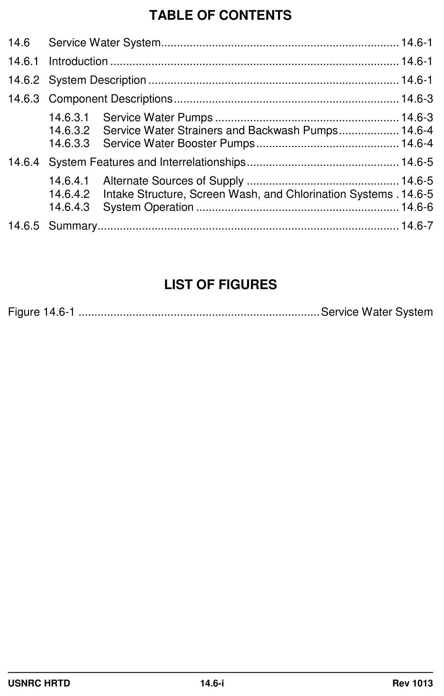
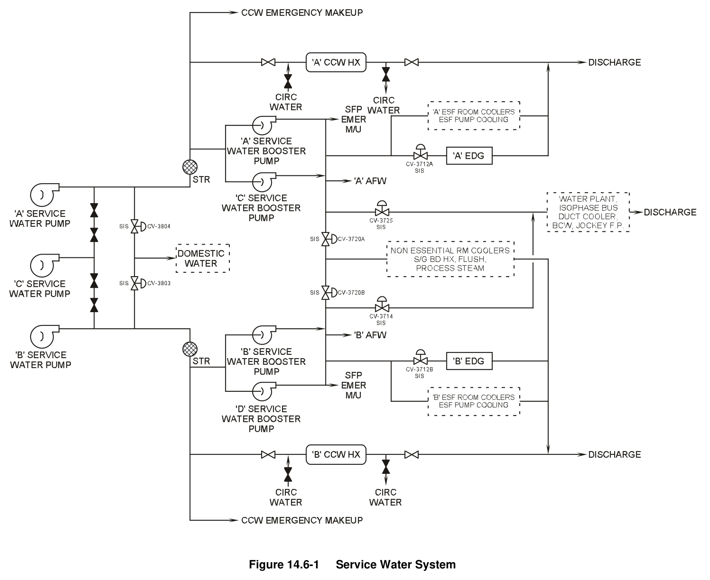

# 14.6 Service Water

> Pages 1031–1040 of `ML20057E160.pdf`
> Westinghouse Technology Systems Manual — USNRC HRTD (PWR)

---
<!-- p.1031 -->
#### Westinghouse Technology Systems Manual
#### Section 14.6
#### Service Water System
<!-- p.1032 -->
#### Figure 14.6-1

*........................................................................... Service Water System*

<!-- labels/text on this figure page -->
TABLE OF CONTENTS
14.6 Service Water System ........................................................................... 14.6-1
14.6.1 Introduction ........................................................................................... 14.6-1
14.6.2 System Description ............................................................................... 14.6-1
14.6.3 Component Descriptions ....................................................................... 14.6-3
14.6.3.1 Service Water Pumps .......................................................... 14.6-3
14.6.3.2 Service Water Strainers and Backwash Pumps ................... 14.6-4
14.6.3.3 Service Water Booster Pumps ............................................. 14.6-4
14.6.4 System Features and Interrelationships ................................................ 14.6-5
14.6.4.1 Alternate Sources of Supply ................................................ 14.6-5
14.6.4.2 Intake Structure, Screen Wash, and Chlorination Systems . 14.6-5
14.6.4.3 System Operation ................................................................ 14.6-6
14.6.5 Summary ............................................................................................... 14.6-7
LIST OF FIGURES
Figure 14.6-1 ............................................................................ Service Water System
USNRC HRTD 14.6-i Rev 1013

<!-- p.1033 -->
### 14.6 SERVICE WATER SYSTEM
#### Learning Objectives:
1. State the purposes of the Service Water System (SWS).

2. Identify the nonsafety-related loads supplied by the SWS.

3. Identify the safety-related loads supplied by the SWS.

#### 14.6.1 Introduction
The Service Water System (SWS), shown in Figure 14.6-1, is an engineered safety features (ESF) support system which supplies continuous cooling water to the power plant. It is used to cool safety- and nonsafety-related components. The SWS serves two identical trains of ESF equipment, each consisting of one component cooling water heat exchanger, one emergency diesel generator, one train of room and pump coolers for ESF equipment, one auxiliary feed pump, and one component cooling water makeup pump, and spent fuel pool emergency makeup. Only one train of these components is required for safe shutdown of the plant following any of the postulated accident conditions. During accident or emergency conditions, flow to nonsafety-related components is isolated.

#### 14.6.2 System Description
Three service water pumps take suction from the river at the intake structure. Trash racks, traveling screens, and a chlorination system protect the pump suctions from debris and marine growth. There is a pump for each of the A and B trains, and a spare swing pump that can be used to supply either train. The discharge of the service water pumps supplies the suction of the bearing lube water booster pumps.
During normal operation, the bearing lube water booster pumps provide bearing cooling flow to the service water pumps. If necessary, the service water pumps can supply their own bearing cooling water.

The discharge of the service water pumps goes through two independent Seismic Category I (safety-related) flow paths (trains A and B). The trains supply water to redundant safety-related components. The service water pumps themselves supply a backup source of makeup water to the component cooling water system (makeup pump suction) and provide the normal source of cooling to the component cooling water heat exchangers. They also supply the suction of four service water booster pumps, two in each train. The service water booster pumps supply the rest of the Seismic Category I loads, which consist of the following:

 Emergency diesel combustion air and jacket coolers,  Emergency makeup to spent fuel pool,  Emergency supply to the auxiliary feed pumps suction,  Essential room coolers,  Charging pumps bearing and gear oil coolers, and  Safety injection pumps bearing oil coolers.

USNRC HRTD 14.6-1 Rev 1013

<!-- p.1034 -->
The service water piping at the discharge of the booster pumps is divided into two trains by isolation valves that close on a safety injection actuation signal or an emergency diesel generator load signal from the associated train. During normal operation, the piping downstream of these valves supplies the Seismic Category II
(nonsafety-related) loads. The nonsafety-related loads consist of the following:

 Bearing cooling water heat exchangers,  Isophase bus duct coolers,  Jockey fire pump suction,  Positive displacement charging pump room cooler,  Tank area cooler,  Reactor auxiliary building chillers,  Control building chillers,  Computer room air-conditioning condenser,  Electrical auxiliary room coolers,  Blowdown radiation monitor flush,  Steam generator blowdown heat exchanger,  Control building and maintenance shop chillers,  Water treatment system, and  Heater drain pump gland seal quenching water.

Another nonsafety-related load supplied by service water is the domestic water system. This load is supplied directly from the discharge of the service water pumps.

Both trains are required during normal operation, normal cooldowns, and emergency diesel generator loading. Both trains available will allow a plant cooldown within 20 hours. One train is required during cold shutdown, for a safety injection actuation, and for safe shutdown and cooldown.

In the event the intake structure fails, water can be supplied to either train from the circulating water system or from portable pumping units via hose connections. The circulating water system supply can be returned to the cooling tower, or aligned to the discharge and dilution structure.

The river is used as the ultimate heat sink for the plant. The ultimate heat sink's principal safety function is to dissipate residual heat after a normal reactor shutdown or following an accident that results in emergency shutdown conditions. In the event that the intake structure is lost, the cooling tower basin becomes the ultimate heat sink.

The design basis of the SWS is to provide sufficient heat removal capacity and reliability to safely operate, shut down, and cool down the plant and to maintain it in a cold shutdown condition. Continuation of the minimum required cooling water flow to the safety-related equipment, auxiliary feedwater system, spent fuel pool emergency makeup, and component cooling water emergency makeup is essential to assure safe operation and safe shutdown of the plant.

USNRC HRTD 14.6-2 Rev 1013

<!-- p.1035 -->
#### 14.6.3 Component Descriptions
##### 14.6.3.1 Service Water Pumps
The service water pumps are vertical, centrifugal, wet-pit pumps, each with a design flow rate of 21,750 gpm at a design head of 76 feet. Each pump is capable of delivering 20,000 gpm at 84 feet. The pump bearings are water lubricated with the exception of the grease-packed suction bell bearings. Bearing lubrication is normally provided by the bearing lube water supply booster pumps. The pump impellers are made of stainless steel to resist corrosion.

The service water pumps take suction from the river through the traveling water screens at the intake structure. Each pump is designed to supply 100 percent of the system flow requirements during each operating condition. Pump A is aligned directly to train A and pump B is aligned directly to train B. Pump C can be lined up to either train to replace either pump A or pump B by opening normally lockedclosed valves. During periods of single-pump operation, one of the other two nonoperating pumps is lined up to the opposite train discharge header in standby.
The third pump, not lined up to the system, serves as an installed spare.

Power is supplied to pump A from 4.16-kv safeguards bus Al and to pump B from 4.16-kv safeguards bus A2. Pump C can be supplied from either bus A1 or A2 through a manually operated transfer switch that transfers the motor feeders between the two buses. To maintain the required channel separation and independence, the transfer switch is constructed so that the two power supply sources can never be connected in parallel. Controls for the switchgear breakers feeding pump C are interlocked such that when pump A is running, the pump C breaker, racked in to the connected position on bus A1, cannot be closed. It can only be closed when the pump A breaker is in the disconnect or test position.
Similarly, pump C can be run from bus A2 only when the pump B breaker is racked out to the disconnect or test position. Note that if pump C were operating on bus A1
(i.e., with its breaker shut) and the breaker for pump A were racked in to the connected position, the pump C breaker would trip, unless it is operating in local mode with its remote control switch in “pull to lock.” The same holds for pumps B and C operating on bus A2. The transfer switch position does not affect breaker closure, but it will determine if the pump runs when the breaker is closed. This arrangement ensures that electrical channel separation is maintained at all times, and also minimizes the chances of powering two service water pumps from one emergency diesel generator during loss of normal power conditions.

Listed below are the six automatic start features for each service water pump. The first two auto start features require only that the pump’s remote control switch be in auto. Given that the circuit breaker closing spring is charged, the pump will then start upon activation of either the DBA or the normal shutdown sequencer.
However, the four remaining auto start features listed below (3 through 6) require the pump selector switch to be in REMOTE, the control switch in AUTO, and the breaker lockouts reset to start service water pump A:

1. DBA sequencer - channel A,
2. Normal shutdown sequencer - channel A

USNRC HRTD 14.6-3 Rev 1013

<!-- p.1036 -->
3. Train A CCW low surge tank level (< 8.3%), 4. Train B service water system pressure low (< 15 psig), 5. Train B CCW pump differential pressure low (< 40 psid), or 6. Service water booster pumps B&D discharge header pressure low (< 40 psig).

Start signals for the B and C service water pumps are similar to those described for the A pump.

The discharge of the A and B service water pumps goes to the respective service water system trains through 30-inch supply piping. A 30-inch header which crossconnects the two trains accepts the discharge from the C pump and directs it to the appropriate train. Normally locked-closed isolation valves are repositioned to allow pump C to supply either train.

Several SWS loads are supplied directly from the discharge of the service water pumps. The domestic water system is one of those loads. Its supply comes from the Seismic Category II piping between valves CV-3804 and CV-3803. The other major loads supplied directly include strainer backwash flow, the CCW heat exchangers, and the CCW emergency makeup supply. The rest of the flow from the service water pumps goes to the suctions of the service water booster pumps.

##### 14.6.3.2 Service Water Strainers and Backwash Pumps
Just downstream of where the system pressure is sensed, there is a service water strainer in each train. Each strainer is sized for a maximum flow rate of 30,000 gpm and a design rate of 20,000 gpm. The strainers are of the automatic self-cleaning, multiple element type. They are designed to trap particles larger than 62.5 mil (1/16 in.). The normal SW strainer flow path is through the inlet, around the filter tube sheet, into the ends of the filter, and flow through the sides of the filter to the outlet.

Each strainer has a revolving dual backwash arm and drain valve that can be activated by a timer, high differential pressure across the strainer assembly, or manual (continuous) control. The backwash flow path is from the outlet, through the sides of the filter, out the rotating dual backwash arm, and to the backwash pump or bypass valve to the discharge and dilution structure. The backwash arm is driven by a motor mounted on top of the service water strainer.

The service water strainer backwash pumps are located in the service water strainer pits. They are designed to increase backwash flow to 600 gpm vice 350 gpm bypass flow. The “start” position continuously runs the backwash pump and is the normal position. In the “auto” position, the backwash pump would receive start and stop signals from strainer differential pressure or from a timer.

##### 14.6.3.3 Service Water Booster Pumps
Two service water booster pumps in each train take suction on the discharge of that train’s service water pump. The service water booster pumps are horizontal centrifugal pumps with a design flow of 2500 gpm at the design head of 120 feet.
The service water booster pumps are powered from vital 480-vac motor control centers.

USNRC HRTD 14.6-4 Rev 1013

<!-- p.1037 -->
For any service water booster pump to be started either manually or automatically, the permissive of service water pump discharge header pressure greater than 10 psig must be met. The automatic starts and permissives for the A and B pumps are different from those for the C and D pumps:

1. Each of the A and B pumps automatically starts on any related-train service water pump auto start. Each also auto starts if the related-train pump discharge decreases to less than 50 psig and its remote control switch is in “auto after stop”
(green flagged).

2. Each of the C and D pumps automatically starts on any related-train service water pump auto start only if the related-train booster (A or B) pump is in the pullto-lock position. If the C or D pump’s remote control switch is in “auto after stop”
(green flagged), it auto starts if the related-train pump control switch is in “auto after start” (red flagged) and that pump’s discharge pressure decreases to less than 50 psig for greater than 3 seconds. Also, the C or D pump auto starts if any related-train service water pump auto starts, the related-train pump discharge is less than 50 psig for greater than 3 seconds, and its remote control switch is in auto after stop (green flagged).

Two service water booster pumps are connected in parallel in each train to provide flexibility in meeting the system flow requirements of the various operating conditions. Each of these trains is designed to provide 100 percent of the design requirements during normal operation.

#### 14.6.4 System Features and Interrelationships
##### 14.6.4.1 Alternate Sources of Supply
There are two alternate methods of supplying water to the service water system in the event of failure of the intake structure. A single 30-inch line from the circulating water system connects to each train of the service water system at the inlet and outlet of the component cooling water heat exchanger. The return flow from the heat exchanger outlet(s) goes to the cooling tower or to the discharge and dilution structure. Water can also be supplied through six 4-inch hose connections in each train that can be cross-connected and supplied from the installed fire pumps. These connections are just upstream of the service water strainer in each train.

##### 14.6.4.2 Intake Structure, Screen Wash, and Chlorination Systems
Each of the three service water pumps is contained within its own concrete cubicle in the intake structure. The intake structure sits on the bank of the river. The intake structure design and a trash rack between the river and the suctions of the wet-pit type service water pumps keep large debris out of the pump suctions.

Between the intake trash rack and the pump suctions are traveling screens. The traveling screens are designed to keep smaller debris and marine life out of the suctions of the service water pumps. The screens are kept clean by the screen wash system. This system employs two vertical pumps which take clean water that has already passed through the traveling screens and spray it through high velocity spray nozzles. The stationary spray nozzles wash the debris from the screens as

USNRC HRTD 14.6-5 Rev 1013

<!-- p.1038 -->
they travel past. This cycle is automatically controlled by an adjustable timer that can provide up to 48 wash operations per day. There are also differential level controllers which start a screen-wash cycle whenever the levels on either side of the screen differ by more than six inches. It should be noted that no more than one service water pump may be in operation with one intake bay out of service.

Sodium hypochlorite, used for biofouling control of both the service water and the circulating water systems, is supplied from a portable storage tank, through a metering valve, to the chlorine injectors. Sodium sulfite from the sodium bisulfate tank is used to neutralize the sodium hypochlorite at the discharge and dilution structure.

##### 14.6.4.3 System Operation
During normal SWS operation both trains of service water are in operation. The intake structure screen wash and chlorination system and one bearing lube water pump are placed in operation. Each train of service water has one service water pump and one service water booster pump running, with both trains aligned to Seismic Category II loads.

During normal single-pump operation, the system automatically shifts to operation on the other pump under the following conditions:

1. Loss of pressure in the operating service water pump discharge header,
2. Loss of pressure in the associated booster pumps' discharge header, or
3. Low differential pressure across the operating component cooling water pump.

The loads cooled by service water can normally receive flow from either train via the normally open (train A and B) isolation valves. Thus, during normal operations, both trains of service water are cross-connected at their cooling loads.

Pressure switches at the discharge header of the associated service water pump prevent a manual or automatic start of a booster pump until sufficient pressure exists to prevent damage to the booster pump. However, it should be noted that the pressure switches are upstream of the service water strainer. If the strainers become clogged, the pressure switches would see adequate discharge pressure from the operating service water pump. The booster pumps would then start with inadequate suction pressure.

The service water booster pumps are electrically interlocked with the associated service water pump such that, for instance, the automatic start of the train A service water pump causes the automatic start of the A booster pump. If the A booster pump fails to start automatically, as indicated by inadequate booster pump discharge header pressure, the C booster pump starts following a three second time delay.
The B train pumps are similarly interlocked.

During the plant cooldown phase following initiation of a normal plant shutdown, two service water pumps are required to be in operation. Full flow through both component cooling water heat exchangers is required for 20-hour cooldown capability. The plant can be safely cooled down by one heat exchanger, but this will require a time period considerably longer than 20 hours.

USNRC HRTD 14.6-6 Rev 1013

<!-- p.1039 -->
During periods of cold shutdown for maintenance and/or refueling, one train of the SWS remains in operation. Flow through one component cooling water heat exchanger is required at all times during plant shutdown for removal of residual heat from the reactor coolant system. Two booster pumps may be required, depending on the operating equipment requiring cooling. During cold shutdown, the reactor coolant system is aligned to the residual heat removal system for decay heat removal. Flow through the in-service residual heat removal heat exchanger is cooled by component cooling water, which is cooled by the service water system.

A safety injection actuation signal initiates the automatic start of both emergency diesel generators. The safety injection actuation signal causes the following to occur:

1. Automatic start of the standby service water train;

2. Separation of the two safety-related trains and isolation of the nonsafety-related parts of the system by automatic closure of valves CV-3720A and B, CV-3714 and CV-3725, and CV-3803 and CV-3804; and

3. Initiation of flow to the emergency diesel generator heat exchangers by automatic opening of valves CV-3712A and B.

A loss of off-site power, with normal on-site power sources unavailable, causes automatic starts of the emergency diesel generators. When the emergency diesel generators are the sole sources of power to the 4160-vac emergency buses (A1 and A2), service water realigns the same as after a safety injection actuation signal.

#### 14.6.5 Summary
The service water system is an ESF support system essential to maintaining safe operation and shutdown of the plant. During normal plant operation it supplies safety- and nonsafety-related components. During emergency conditions, the nonsafety-related portions of the system are isolated from the safety-related portions to ensure that plant integrity is maintained.

USNRC HRTD 14.6-7 Rev 1013

<!-- p.1040 -->
#### Figure 14.6-1

*Service Water System*

[Vector original (SVG, lossless): fig_14.6-1_2.svg](../figures/fig_14.6-1_2.svg)

