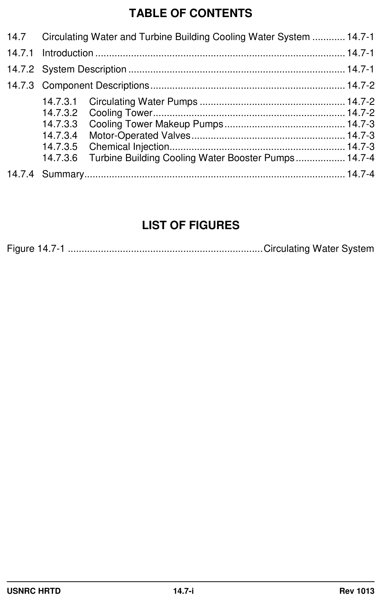
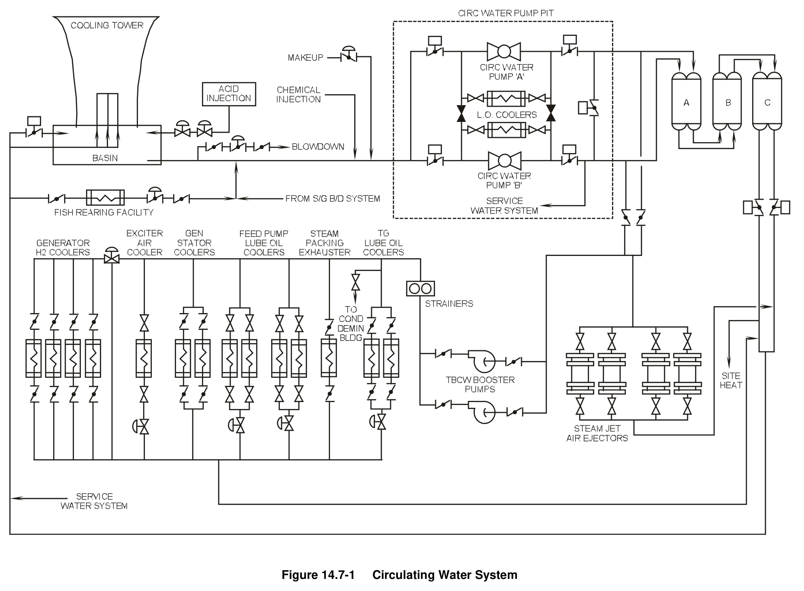

# 14.7 CW and TBCW

> Pages 1041–1047 of `ML20057E160.pdf`
> Westinghouse Technology Systems Manual — USNRC HRTD (PWR)

---
<!-- p.1041 -->
#### Westinghouse Technology Systems Manual
#### Section 14.7
#### Circulating Water System
#### and Turbine Building Cooling Water System
<!-- p.1042 -->
#### Figure 14.7-1

*...................................................................... Circulating Water System*

<!-- labels/text on this figure page -->
TABLE OF CONTENTS
14.7 Circulating Water and Turbine Building Cooling Water System ............ 14.7-1
14.7.1 Introduction ........................................................................................... 14.7-1
14.7.2 System Description ............................................................................... 14.7-1
14.7.3 Component Descriptions ....................................................................... 14.7-2
14.7.3.1 Circulating Water Pumps ..................................................... 14.7-2
14.7.3.2 Cooling Tower ...................................................................... 14.7-2
14.7.3.3 Cooling Tower Makeup Pumps ............................................ 14.7-3
14.7.3.4 Motor-Operated Valves ........................................................ 14.7-3
14.7.3.5 Chemical Injection ................................................................ 14.7-3
14.7.3.6 Turbine Building Cooling Water Booster Pumps .................. 14.7-4
14.7.4 Summary ............................................................................................... 14.7-4
LIST OF FIGURES
Figure 14.7-1 ....................................................................... Circulating Water System
USNRC HRTD 14.7-i Rev 1013

<!-- p.1043 -->
### 14.7 CIRCULATING WATER SYSTEM AND TURBINE BUILDING COOLING
#### WATER SYSTEM
#### Learning Objective:
1. State the purposes of the circulating water system and the turbine building cooling water system.

#### 14.7.1 Introduction
The circulating water system (CWS), as shown in Figure 14.7-1, provides cooling water for heat removal from the main condenser, the air ejector condensers, the turbine-generator auxiliary coolers, and the feedwater pump turbine lube oil coolers.
The CWS serves as the normal heat sink for the secondary plant and can also supply water in an emergency to the service water system. The CWS supplies water to the turbine building cooling water (TBCW) system.

#### 14.7.2 System Description
The CWS is designed to dissipate 7.92 x 109 btu/hr, which equals the total heat load from the main condenser and other components served by the system. The CWS supplies:

 Cooling water for the main condensers,  Cooling water for the steam jet air ejector inter and after condensers,  Emergency water supply to the service water system,  Emergency water supply to the fire main,  Water supply to the turbine building cooling water system,  Return point for service water flow from the steam generator blowdown heat exchangers,  Water for the administration building and the shop and warehouse heating systems,  Cooling water for the circulating water pump lube oil coolers, and  Heating water for the fish rearing facility.

The TBCW system supplies cooling water to:

 Turbine-generator lube oil coolers,  Steam packing exhauster,  Steam generator turbine feed pump lube oil coolers,  Generator stator coolers,  Exciter air cooler,  Generator hydrogen gas coolers, and  Condensate demineralizer building.

The circulating water system and the turbine building cooling water system consist of two circulating water pumps, a cooling tower, two turbine building cooling water booster pumps, two cooling tower makeup pumps and various component heat exchangers. Since the CWS requires the addition of sulfuric acid to minimize scale buildup, a pH-controlling acid addition system is provided.

USNRC HRTD 14.7-1 Rev 1013

<!-- p.1044 -->
The circulating water pumps circulate the water from the cooling tower basin through the main condenser and back to the cooling tower. The pumps also supply water to the steam jet air ejector inter- and aftercondensers, the turbine building cooling water system, and the fish rearing facility system.

The turbine building cooling water booster pumps take suction on the circulating water pump discharge lines and deliver cooling water to the two turbine-generator lube oil coolers, the steam packing exhauster, the main generator exciter air cooler, the four main generator hydrogen coolers, the two main generator stator coolers, the four turbine feed pump lube oil coolers, and miscellaneous loads in the condensate demineralizer building. The cooling water then rejoins the circulating water at the main condenser discharge.

The cooling tower cools the circulating water using a counter-flow, natural-draft arrangement. Due to system impurities, a continuous blowdown is performed on the circulating water system. This inventory loss, combined with losses due to evaporation and drift, requires two cooling tower makeup pumps, which take water from the cooling tower makeup reservoir section of the discharge and dilution structure and deliver it to the suction of the circulating water pumps.

#### 14.7.3 Component Descriptions
##### 14.7.3.1 Circulating Water Pumps
The two circulating water pumps are single-stage, horizontally split, centrifugal pumps which supply the necessary head for system flow. Each pump can supply 210,000 gpm at a design head of 100 feet. The pumps are powered from 12.47-kv buses H1 and H2. Each pump shaft is sealed at each casing exit point by a selfsupplied stuffing box (gland) that has filters, heat tracing, throttle valves, and flow sight glasses. The pumps are located outside, in the circulating water pump pit. A common lubricating oil system is shared by the two pumps.

##### 14.7.3.2 Cooling Tower
The cooling tower cools the circulating water returning from the various components served by the CWS and TBCW systems. The hyperbolic tower, designed for strength alone, is evaporative in design and contains no fans. The air flow within the shell is created by the density difference between atmospheric air and the hotter air inside the tower. The counter-flow design provides a highly efficient heat transfer mechanism since the coolest air contacts the coolest water initially. The heat transfer process occurs in the fill section of the tower.

The cooled water falls into the cooling tower basin, passes through a set of double screens in the basin outlet, and then circulates to the suction of the circulating water pumps. The cooling tower basin has a capacity of 5.2 x 106 gallons.
The spray header can be bypassed to allow warmup of the CWS on startup or to maintain the proper temperature during cold weather operation. Bypass flow is controlled by a 72-inch, motor-operated, butterfly valve located near the tower basin.
There are no interlocks associated with this valve, though only one CWS pump should be in operation with the valve open.

USNRC HRTD 14.7-2 Rev 1013

<!-- p.1045 -->
##### 14.7.3.3 Cooling Tower Makeup Pumps
The cooling tower makeup system uses two makeup pumps in conjunction with a flow control valve to supply water to the CWS pump suction header to makeup for losses. Water is lost from the system due to evaporation, blowdown, and drift. The makeup pumps take suction on the makeup section reservoir of the discharge and dilution structure. This bay receives water from the discharge of the service water pumps after passing through the component cooling water heat exchangers, and is ultimately derived from the river.

The makeup pumps are 450-horsepower, turbine-type pumps rated at 18,000 gpm at a design head of 75 feet. They are powered by 4.16-kv buses A5 and A6.

##### 14.7.3.4 Motor-Operated Valves
The valves discussed herein are the CWS pump suction and discharge valves, the discharge cross-connect valve, and the condenser outlet valves. These valves are all 96-inch, motor-operated, butterfly valves.

Each pump suction valve is interlocked with the associated CWS pump. The suction valve must be fully open to start the pump, and the pump will trip if the suction valve is not fully open. When a pump is energized, the respective pump suction valve cannot be closed.

The CWS pump discharge valve does not have its own control switch. Starting a CWS pump sends a signal to open the pump discharge valve. If the discharge valve is not fully open within two minutes, the pump will trip. Stopping the pump will send a closing signal to the discharge valve motor operator. The pump will stop when the discharge valve reaches the fully closed position. An auto trip of the pump will also initiate discharge valve closure.

The cross-connect valve is interlocked to prevent the valve from being opened with both pumps in operation. If one discharge valve and the discharge cross-connect valve are open, opening the other discharge valve will cause the cross-connect to close. If either discharge valve is open, then the cross-connect valve cannot be opened. This interlock prevents excessive circulating water pump reverse rotation, which would occur during one-pump operation with the cross-connect and both discharge valves open.

The condenser outlet valves are interlocked with the CWS pumps such that the associated condenser outlet valve must be at least 48° open any time a pump is running. A valve position of less than 48° will prevent the pump from starting and will trip the pump if it is running. Each of these valves is also prevented from closing any time the associated CWS pump is running. This interlock prevents condenser tube overpressurization.

##### 14.7.3.5 Chemical Injection
Chemicals are manually added to the circulating water on a routine basis to help eliminate algae buildup in the system. The system taps into the pump suction header through six-inch piping. The chemicals pass through a diffuser section to

USNRC HRTD 14.7-3 Rev 1013

<!-- p.1046 -->
ensure good mixing and dilution prior to injection. Chemical injection is automatically blocked whenever the CWS pumps are de-energized.

##### 14.7.3.6 Turbine Building Cooling Water Booster Pumps
Two centrifugal booster pumps supply the turbine building cooling water system.
Each booster pump is rated at 9100 gpm at a head of 50 feet. Each pump shaft is sealed at each end by a gland, which is supplied with sealing water from the pump’s discharge. The booster pumps are powered from 480-vac nonvital load centers.

#### 14.7.4 Summary
The CWS provides cooling water for heat removal from the main condenser, the air ejector condensers, the turbine-generator auxiliary coolers, and the feedwater pump turbine lube oil coolers. The CWS serves as the normal heat sink for the secondary plant and can also supply water in an emergency to the service water system. The CWS supplies water to the turbine building cooling water system.

USNRC HRTD 14.7-4 Rev 1013

<!-- p.1047 -->
#### Figure 14.7-1

*Circulating Water System*

[Vector original (SVG, lossless): fig_14.7-1_2.svg](../figures/fig_14.7-1_2.svg)

