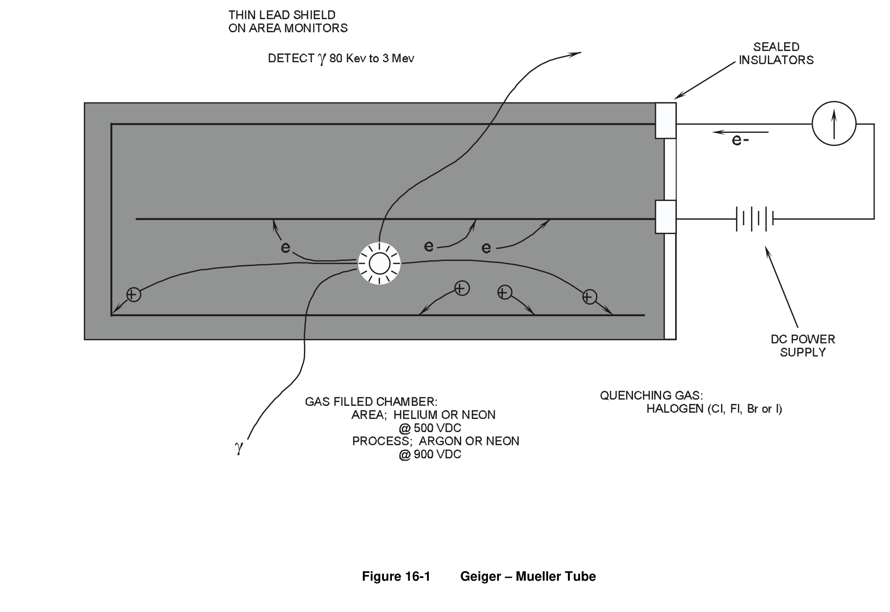
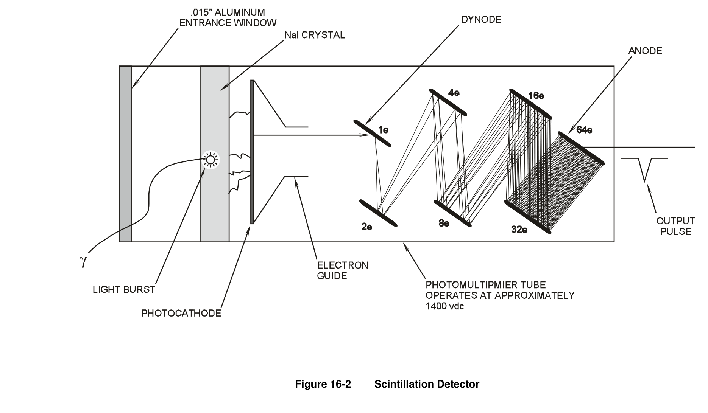
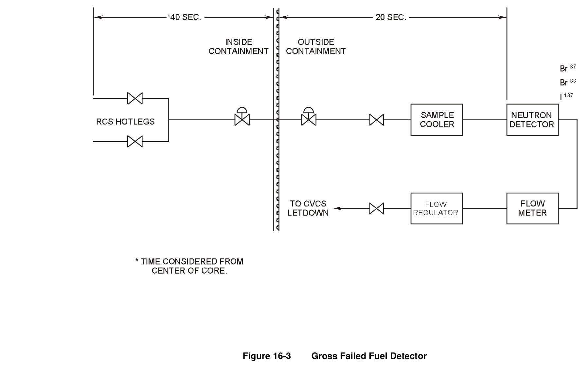
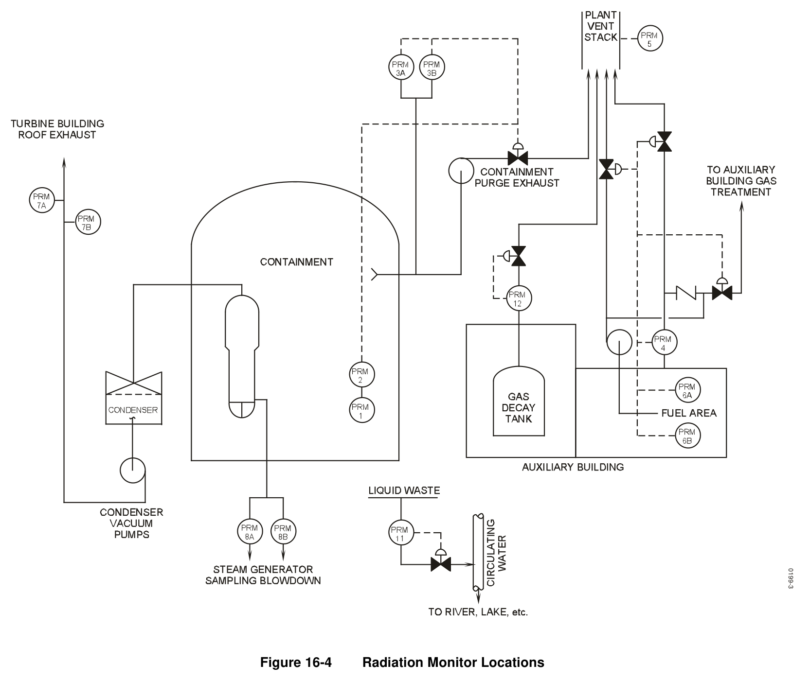

# 16.0 Rad Monitoring

> Pages 1048–1065 of `ML20057E160.pdf`
> Westinghouse Technology Systems Manual — USNRC HRTD (PWR)

---
<!-- p.1048 -->
#### Westinghouse Technology Systems Manual
#### Section 16.0
#### Radiation Monitoring System
<!-- p.1049 -->
TABLE OF CONTENTS

16 Radiation Monitoring System ..................................................................... 16-1

16.1 Introduction ................................................................................................ 16-1

16.2 System Description .................................................................................... 16-1

16.2.1 Process Radiation Monitoring System .......................................... 16-1

16.2.2 Area Radiation Monitoring System ............................................... 16-2

16.3 Component Descriptions ............................................................................ 16-2

16.3.1 Radiation Detectors ...................................................................... 16-2

16.3.2 Plant Radiation Monitors ............................................................... 16-4

16.4 System Interrelationships ........................................................................... 16-9

16.4.1 Gross Failed Fuel Detector ........................................................... 16-9

16.5 Summary .................................................................................................. 16-10

LIST OF TABLES

Table 16-1 Process Radiation Monitors ............................................................. 16-11

Table 16-2 Area Radiation Monitors .................................................................. 16-12

LIST OF FIGURES

Figure 16-1 ................................................................................................. Geiger – Mueller Tube

Figure 16-2 .................................................................................................... Scintillation Detector

Figure 16-3 ........................................................................................ Gross Failed Fuel Detector

Figure 16-4 ...................................................................................... Radiation Monitor Locations

USNRC HRTD 16-i Rev 0202

<!-- p.1050 -->
## 16 RADIATION MONITORING SYSTEM
#### Learning Objectives:
1. State the purposes of the radiation monitoring system.

2. List the two classes of radiation monitors.

3. Identify radiation monitors that provide automatic actions (other than alarms), and briefly describe the actions provided.

4. List and briefly describe the two types of failed fuel monitors.

5. List the radiation monitors which identify the following:

a. Primary-to-secondary leakage, and b. Primary-to-containment leakage.

### 16.1 Introduction
The purposes of the radiation monitoring system (RMS) are as follows:

1. To continuously monitor radiation levels of various plant areas, processes and effluents, and

2. To provide alarms and/or automatic actions if preset limits are exceeded.

The radiation monitoring system is divided into the following: process radiation monitoring (PRM), described in section 16.2.1, and area radiation monitoring (ARM), described in section 16.2.2.

### 16.2 System Description
#### 16.2.1 Process Radiation Monitoring System
The PRM system monitors the radiation level of various process liquid and gas streams that may serve as discharge routes for radioactive materials. These monitors are provided to indicate the radioactivity of the process stream and to alert operating personnel when operational limits are approached for the normal release of radioactive material to the environment.

On process streams that do not discharge to the environs, such as the component cooling water system (Section 14.1), process monitors are provided to indicate process stream malfunctions. This is accomplished by detecting the normal background radiation of the system and by alerting the operator with an annunciator if an accumulation of radioactive material occurs in the system. In addition to providing continuous indication and alarms, the PRM may provide various automatic functions, such as the closing of vent valves, discharge valves, etc.
If the activity level in the process stream reaches a predetermined setpoint, the system will perform its automatic function, which ensures that the discharge of radioactive material to the environs is limited. The PRM system can monitor a

USNRC HRTD 16-1 Rev 0202

<!-- p.1051 -->
process stream with one of two types of monitors: in-line monitors and off-line monitors.

#### IN-LINE monitor
An in-line monitor has the detector probe directly immersed in the process stream.
The advantage of this type of monitoring is that the detector probe will be provided a representative sample of the process and responds rapidly to activity changes. The disadvantages of this monitor are that if the process has a turbulent flow the detector probe must be protected by placing it in a well, which lowers the sensitivity of the probe, and if the probe fails, the system must either be secured or a means of bypassing flow around the probe must be provided (only for directly immersed probes).

#### OFF-LINE monitor
An off-line monitor contains piping, valves, detector probes (usually two in parallel), and a motive force device, such as a pump or a fan. This monitor will take suction on the process stream, pass the flow to the detector, and then return the sample to the process stream. The advantages of this monitor are that with lower flow rates, the detector probe can be directly immersed into the sample stream without a protection well, therefore increasing probe sensitivity, and if a detector fails, it can be isolated (by inlet and outlet valves), and the process stream is not affected.

The disadvantages of this monitor are that it may not be receiving a representative sample of the process stream and may not be as responsive to rapid changes of activity in the process. At the time of this writing there is no preferred method of process monitoring. Both types, IN-LINE and OFF-LINE monitors, are found throughout the industry.

#### 16.2.2 Area Radiation Monitoring System
The area radiation monitors are located in selected areas of the plant, such as the control room, the containment building, and various areas or rooms in the auxiliary building. The purposes of the area monitors are to give continuous indication of background radiation and to alert plant personnel to high radiation. The alarms associated with area radiation monitors include annunciators in the control room area and local alarms. The local alarms are at the radiation detectors and provide indication of high radiation both visually (flashing light) and audibly (horn or buzzer).

### 16.3 Component Descriptions
#### 16.3.1 Radiation Detectors
There are various types of detectors used in both the process and area radiation monitoring systems. Some of the most commonly used detectors are explained in this section.

#### Geiger-Mueller Tube
USNRC HRTD 16-2 Rev 0202

<!-- p.1052 -->
The Geiger-Mueller (G-M) tube is a gas filled chamber with a center electrode as shown in Figure 16-1. The G-M tube operates by sensing an incident particle, such as a beta or gamma, interacting with the gas inside the chamber to produce a few ion pairs. As the ion pairs are accelerated towards the wall and electrode, they will produce more ions pairs until there are millions of ion pairs produced inside the chamber.

The effect of this mass production of ions is called avalanching and results from the high voltage potential between the chamber and the center electrode. When avalanching occurs, the millions of ions, both positive and negative, are collected on the chamber wall and center electrode. When this happens, a pulse is produced.
The pulse is always the same size. Therefore, it is not possible to tell the type or energy of the incident particle from the pulse, but only that radiation is present.

This instrument will use a gas that is easily ionized, such as argon. However, when the positive ions are collected on the center electrode, secondary photons, in the form of ultraviolet light, are produced. These photons will then travel across the gas volume and interact with the walls of the chamber. This interaction produces electrons which starts the avalanche all over again. To prevent this undesired secondary avalanche, another gas is normally added to the chamber and mixed with the ionizing gas. This second gas is called a quenching gas and is normally a halogen, such as bromine or chlorine.

Once the avalanche occurs, the detector will be saturated with ions, and another incident particle entering the detector will not be seen. After the quenching takes place, the detector will be able to sense another incoming particle. Due to this time between avalanches and quenching, a G-M tube will only be useful in certain radiation fields. The problem with high radiation areas is that there are so many incident particles that the detector will stay saturated. When this occurs the output from the detector will go to zero, and the meter reading would be full downscale. To overcome this effect, the circuitry is designed so that the meter reading will read full scale if the detector becomes saturated.

#### Scintillation Detector
The scintillation detector consists of a crystal, window, and a photomultiplier tube, as shown in Figure 16-2.

The scintillation detector works on the principle that when a radioactive particle interacts with certain materials (crystal), light is produced. By measuring the light that is emitted, the energy and amount of the original radioactive particle can be determined. Scintillation detectors can accurately measure different types of radiation, such as alphas, betas, or gammas. This is accomplished by using different types of materials (crystals) for each type of radiation.

A scintillation detector is constructed such that it is sensitive to only one type of radiation; i.e., if beta and gamma radiation levels are to be measured in a process, both a beta scintillation and a gamma scintillation detector must be provided. The scintillation detector operates by a radioactive particle interacting with the crystal, which causes ionization of some of the atoms. These ionized atoms now have

USNRC HRTD 16-3 Rev 0202

<!-- p.1053 -->
electrons in the excited state, but the excitation is not great enough for the electron to escape. Since these atoms are now in an excited state, they will radiate this excess energy in the form of photons (light rays).

The photons are transmitted from the sensing crystal to the photomultiplier tube via a quartz window. Quartz is used to transmit the light produced in the crystal because it will not distort the photons emitted from the crystal.

The photomultiplier tube consists of a photocathode, dynodes, anode, and outer chamber wall. The light produced by the crystal interacts with the photocathode which then produces electrons. These electrons are then attracted to the first positively charged dynode. When an electron strikes the dynode several electrons will be produced (typically for each electron striking a dynode, two to four electrons will be produced).

The electrons produced by the dynode will then be directed to the next dynode for further multiplication. The result of this multiplication process is that generally about one million electrons are produced from each electron produced by the photo cathode. This large electron flow is then collected by the anode, and an electrical current is produced and measured by the circuitry. This circuitry can be setup so that the detectors output can be in counts per minute or as a dose rate in mrem/hr or rem/hr.

The scintillation detector is useful not only in detecting radiation, but also in laboratory work, since this detector can also measure the energy of the incident radiation. The energy can be measured because the pulse of electrons at the anode is proportional to the energy of the original incident radiation, i.e. the more energy the radioactive particle has, the more light that will be emitted from the crystal. This will in turn cause more electrons to be produced by the photo cathode, which, after the electron multiplication, causes a larger pulse at the anode.

#### 16.3.2 Plant Radiation Monitors
Table 16-1 lists the process radiation monitors described in this section. For each monitored location, the table indicates the type of detector used and the automatic actions provided by the monitor.

#### Containment Air Particulate Detector
The containment air particulate detector (Figure 16-4) is sufficiently sensitive for detection of reactor coolant leakage into the containment. This instrument is capable of detecting leakage rates of 5 cc/min within minutes after the leak occurs.

Continuous air samples are taken from the containment atmosphere near the reactor containment fan cooler inlet, drawn outside the containment in a closed, sealed system, and monitored by a scintillation counter and movable filter paper detector assembly. The air sample is passed through a filter paper which collects 99% of all particulate matter greater than 0.3 microns in size. The constantly moving filter paper is viewed by the scintillation detector, which then transmits the activity level to the main control room.

USNRC HRTD 16-4 Rev 0202

<!-- p.1054 -->
The activity level is then indicated on a meter and on a recorder. The air sample, after passing through the detector, is returned to the containment. The detector is used principally to detect the following radioactive isotopes in the containment atmosphere: I-131, I-133, CS-134 and CS-137. Receipt of a high activity level in the containment will be annunciated in the control room. In addition to the annunciator, the following automatic actions will occur:

 The containment purge supply and exhaust dampers will close,  The pressure and vacuum relief valves will close (if they are open), and  The containment fan cooler dampers shift to the accident mode (the fans, however, remain in fast speed).

#### Containment Noble Gas Monitor
The containment gas monitor (Figure 16-4) is provided in order to supply the operator with information pertaining to the noble gas activity in the containment.
This activity is due to neutron activation of the primary shield cooling air and from leaks in the reactor coolant system when operating with cladding defects in the fuel.
Continuous samples are taken from the containment atmosphere. After the sample passes through the previously described air particulate monitor, it flows through a closed sealed system to the gas monitor assembly. The samples flow continuously to a fixed, shielded volume, where the activity is measured by a Geiger-Mueller tube or beta scintillation detector. The air sample is then returned to the containment.
The activity level is sent to the main control room, where the level is indicated on a meter and on a recorder. The detector is used principally to detect the following noble gases: Kr-85, Ar-41, Xe-133 and Xe-135. Receipt of high activity will annunciate in the main control room. In addition to the annunciator, the following automatic actions occur:

 The containment purge and exhaust dampers will close,  The pressure and vacuum relief valves will close (if they are open), and  The containment fan cooler dampers shift to the accident mode (the fans, however, remain in fast speed).

The radio gas detector supplements the information obtained from the air particulate monitor regarding the occurrence of leakage from the primary system.

#### Containment Purge Exhaust Monitor
This channel (Figure 16-4) monitors the effluent from the containment purge for gaseous activity, iodine, and particulate activity whenever the purge system is in operation. The system consists of three separate channels, one of which is a fixed filter air particulate monitor with a beta scintillation detector, the second is a Geiger- Mueller detector for monitoring gaseous activity, and the third is a spectrometer grade gamma scintillation detector for iodine monitoring.

Detector outputs are transmitted to the main control room where they provide indication on meters and recorders. High radioactivity during the containment purge

USNRC HRTD 16-5 Rev 0202

<!-- p.1055 -->
operations will be annunciated in the control room. In addition to the alarm, the purge supply and exhaust dampers will automatically close.

#### Auxiliary Building Ventilation System Monitor
This channel (Figure 16-4) continuously monitors the ventilation system exhaust air from all the potentially contaminated equipment cubicles in the auxiliary building.
This system uses one moving filter monitor for particulates and a fixed filter unit for iodine. The detector for particulates uses a moving filter paper and monitors this filter with a beta scintillation detector. For iodine monitoring, a spectrometer grade gamma scintillation detector is used.

The outputs from these detectors are transmitted to the main control room for indication on meters and recorders. High radioactivity from either detector will be annunciated in the main control room. Detection of high radioactivity from the iodine monitor will automatically realign the auxiliary building ventilation system so that the exhausts from the equipment cubicles will be routed through charcoal filter banks prior to exhausting to the atmosphere.

#### Plant Vent Stack Monitor
This channel (Figure 16-4) monitors the ventilation system air discharging from the auxiliary building ventilation system to the plant ventilation stack. The sample gas is returned to the suction of the auxiliary building exhaust fans. The channel utilizes four Geiger-Mueller tubes connected in parallel. The radioactivity is indicated by a meter and recorder located in the main control room. High radiation at this monitor will actuate an annunciator in the main control room. There are no automatic functions associated with this channel. This monitor is used principally to detect Kr- 85, Ar-41, Xe-133, and Xe-135.

#### Control Room Intake Air Monitor
This channel continuously monitors the outside air intake to the control room. Two monitors, one for particulates and one for iodine, are provided. The particulate monitor uses moving filter paper and a beta scintillation detector, and the iodine monitor employs a fixed filter and gamma scintillation detector. The detector outputs are transmitted to the control room, where the radioactivity levels are indicated by meters and recorders. High radiation conditions are annunciated in the main control room. In addition to the annunciators, an alarm in either channel will cause the ventilation system air inlet to close, and makeup air, for maintaining a slightly pressurized control room, will be introduced from the turbine building.

#### Condenser Air Discharge Gas Monitor
This channel (Figure 16-4) receives a continuous air sample from the air ejector exhaust header, monitors it for gaseous radioactivity, and provides the plant operator with a rapid indication of a primary to secondary leak. The sample gas is returned to the gas effluent. This channel uses a G-M detector whose output is transmitted to the main control room for indication on meters and recorders. A high radiation condition will be annunciated in the main control room. There is no

USNRC HRTD 16-6 Rev 0202

<!-- p.1056 -->
automatic function associated with this channel. This monitor is used principally to detect noble gases such as Kr-85, Xe-133, and Xe-135.

#### Steam Generator Blowdown Liquid Monitor
This channel (Figure 16-4) monitors the liquid phase of the secondary side of the steam generator for radioactivity, which would indicate a primary to secondary system leak, providing backup information to that of the condenser air ejector gas monitor. Samples from each of the four steam generator bottoms are mixed in a common header and the common sample is continuously monitored by a scintillation counter and holdup tank assembly. Upon indication of high radioactivity, each steam generator is individually sampled in order to determine which unit is leaking.
The detector output is transmitted to the main control room where indication is provided by both a meter and a recorder. A high radiation condition will be annunciated in the control room. There are no automatic functions associated with this channel. This monitor is used principally to detect Co-60.

#### Component Cooling Water System Monitor
This channel continuously monitors the component cooling water system (Section 14.1) for activity which would be indicative of a leak from one of the components that this system is cooling. A gamma scintillation detector is used for this monitor, and its output is transmitted to the control room. The activity level is indicated on a meter and a recorder. A high radiation condition will be annunciated in the control room.
After receiving this alarm, the operator will isolate the affected component to stop the radioactive in-leakage. In addition to the annunciator, the component cooling water surge tank vent valves automatically close. The sensitivity range of this monitor is based on Co-60.

#### Service Water Effluent Discharge Monitor
This channel continuously monitors the service water system (Sections 14.2, 14.6)
discharge to the ultimate heat sink. An increase in activity would be indicative of radioactive in-leakage to this system. A gamma scintillation detector is used for this monitor, and its output is transmitted to the control room. The activity level of this system is indicated on a meter and a recorder. A high radiation level in this system will be annunciated in the control room. There is no automatic function associated with this channel. The sensitivity of this monitor is based on Co-60.

#### Waste Disposal System Liquid Effluent Monitor
This channel (Figure 16-4) continuously monitors all waste disposal system liquid releases from the waste monitor tanks (Section 15.1).

A Geiger-Mueller detector monitors all effluent discharges. The signal from this monitor is transmitted to the control room for indication on a meter and a recorder. A high radiation level on this discharge line will annunciate in the control room. In addition to the annunciator, the discharge valve located on the discharge line automatically closes. The discharge valve is located far enough downstream of the monitor to allow for the closure of this valve prior to any unplanned radioactive

USNRC HRTD 16-7 Rev 0202

<!-- p.1057 -->
release. A single monitor is provided on each discharge line and is considered adequate since the monitor tanks are sampled and analyzed prior to any allowable discharge flow. The release of liquid waste is under administrative control, and this monitor is provided to maintain surveillance over the release.

#### Gas Decay Tank Effluent Gas Monitor
This channel (Figure 16-4) monitors the radioactivity released through the plant vent, especially during the venting of the gas decay tanks (Section 15.3). The detector is either a G-M tube or a beta scintillation detector. The detector output is transmitted to the control room for indication on a meter and a recorder. A high radioactivity condition will be annunciated in the control room. In addition to the annunciator, the isolation valve on the gas decay tank’s vent line automatically closes. This will terminate the release and will initiate operator action to establish and correct the cause of this alarm. This monitor principally is used to detect Kr-85, Xe-133, and Xe-135, and its sensitivity is based on Kr-85.

#### Main Steam Line Radiation Monitor
This channel uses four GM detectors, one on each steam line, located directly on the steam lines upstream of the MSIVs. These detectors are designed to monitor the release path of steam through the steam generator PORVs and safety valves.

#### Main Steam Line Nitrogen-16 Monitor
This system uses four scintillation detectors, located downstream of the MSIVs to determine the presence of N16 gamma radiation in the main steam pipe. The amount of N16 in this flow is proportional to the size of steam generator tube leakage and reactor power level.

#### Area Radiation Monitoring System
This system consists of channels which monitor and indicate the radiation levels in various physical areas of the plant. Table 16-2 lists the most common locations of area monitors. The detectors most generally used for area monitors are G-M tubes, beta or gamma scintillation detectors, and in some cases, air particulate with fixed filter collectors may be used. The detector output is transmitted to the control room where the radioactivity level is indicated and recorded. If the radiation level in a particular area exceeds a preselected setpoint, an annunciator will alarm in the control room.

The area radiation monitoring system normally supplies indication and alarms, both in the control room and locally, and provides no automatic functions. However, there is one channel which normally provides an automatic function. If the fuel handling building pool area monitor (Figure 16-4) should alarm, it causes the fuel handling ventilation exhaust to be routed from its normal exhaust to a special exhaust system, comprised of booster fans and activated charcoal filters.

USNRC HRTD 16-8 Rev 0202

<!-- p.1058 -->
### 16.4 System Interrelationships
#### 16.4.1 Gross Failed Fuel Detector
There are several different methods used to detect failed fuel, of which only two methods are explained below.

The first method is to monitor the radiation level in the chemical and volume control system volume control tank room. In the event of a failure of a fuel assembly or fuel element, the radioactive noble gas inventory in the volume control tank increases, resulting in a higher radiation level inside the volume control tank room and thereby alerting the operator to the failure of a fuel assembly. The expected or predicted radiation levels in the volume control tank room are as follows:

 Reactor shutdown ~ 1 millirem per hour  Reactor operating ~ 100 millirem per hour  1% failed fuel ~ 1000 rem per hour

The problem with this type of system is that with increasing reactor power, a phenomenon called “iodine spiking” occurs. This iodine spiking will cause the radiation level in the volume control tank room to increase to high levels, giving this system a false indication.

A second method used to detect failed fuel is with a neutron detector, as shown in Figure 16-3. This system continuously monitors the reactor coolant system via a sample line from the hot legs, through two containment isolation valves, a sample cooler, neutron detector, then through a flow control device where the sample is discharged to the chemical and volume control system letdown line.

The sample is supplied to the neutron detector (BF3 proportional counter) via two containment isolation valves. These valves will automatically isolate on a containment isolation phase B isolation signal. The detector samples for delayed neutrons from short-lived fission products, namely bromine-87, iodine-137, and bromine-88.

The 40-second delay prior to the exit of containment is for N-16 gamma considerations, and the remaining 20 seconds is to ensure that the detector is sampling these particular fission products. The time delay is established with the length of the sample line and the flow control device. Normally, the flow rate through this system will be set at approximately one gallon per minute.

The detector is a calibrated BF3 proportional counter whose indication ranges from 101 counts per minute (cpm) to 106 cpm on a logarithmic scale. Generally, there are two alarms associated with this system. The high alarm is normally set at 2 x 104 cpm above a preselected level. When this alarm actuates, a chemistry sample is required of the reactor coolant system. This alarm is indicative of the possibility of some fuel damage.

The other alarm is the high-high alarm, which is set at 1 x 105 cpm above a preselected level. Upon the receipt of this alarm, an immediate sample of the

USNRC HRTD 16-9 Rev 0202

<!-- p.1059 -->
reactor coolant system is required, and reactor power is to be reduced 25 percent.
This alarm is an indication of excessive fuel defects or failures.

#### 16.4.2 Leakage detection
Primary-to-secondary leakage is indicated by the following monitors:

 Condenser air discharge gas  Steam Generator Blowdown Liquid Sample  Main Steam Line  Main Steam Line Nitrogen-16

Primary-to-containment leakage is indicated by the following monitors:

 Containment air particulate  Containment noble gas  Containment area

### 16.5 Summary
The radiation monitoring system measures the radiation or activity levels in various process streams and areas. It provides information to the operator in the control room via indicating meters, recorders, and alarms, both audible and visual. The radiation monitoring system is comprised of two subsystems, process monitors and area monitors. Tables 16-1 and 16-2 list some of the processes and areas that are generally monitored. In addition to the detector locations, these tables list the most commonly used detectors for those locations and the automatic functions, if any, that those channels may provide. In addition to these monitors, each facility has some type of system or component to detect a gross failure of the fuel.

USNRC HRTD 16-10 Rev 0202

<!-- p.1060 -->
#### Table 16-1 Process Radiation Monitors
Location Detector Type Automatic Action a. Containment Air Gamma scint. Isolates containment purge and Particulate Detector exhaust if running.
b. Containment Noble Beta scint. Same as above Gas Monitor

c. Purge Exhaust Monitor APD, G-M tube, Isolate containment purge supply gamma scint. and exhaust valves if running

d. Auxiliary Building Beta scint., Initiates auxiliary building Ventilation Monitor Gamma scint. isolation Diverts to gas treatment system

e. Plant Vent Stack G-M tube Alarm function only Monitor

f. Main Control Room Beta scint., Isolates main control room Intake Air Particulate Gamma scint. ventilation Monitor

g. Condenser Air Ejector G-M tube Alarm function only Gas Monitor

h. Steam Generator Gamma scint. Alarm function only Blowdown Liquid Sample

i. CCW - Downstream of Gamma scint. Closes CCW surge tank vent Heat Exchanger

j. Service Water Effluent Gamma scint. Alarm function only Discharge

k. Waste Disposal Gamma scint. or G- Closes the effluent discharge to System Liquid M tube the environment Discharge to the Environment

l. Gas Decay Tank Beta scint. or G-M Closes the effluent discharge to Effluent Discharge tube the environment Monitor m. Main Steam Line G-M tube Alarm function only

n. Main Steam Line N-16 Gamma Scint. Alarm function only

USNRC HRTD 16-11 Rev 0202

<!-- p.1061 -->
#### Table 16-2 Area Radiation Monitors
Location Detector Type Automatic Action
1. Main Control Room G-M tube Alarm function only*

2. Containment Alarm function only

a. Operating deck G-M tube or gamma scint.
b. Seal table area G-M tube c. Dome monitor Ion Chamber

3. Radio Chemistry G-M tube Alarm function only Lab

4. Charging Pump G-M tube Alarm function only Room

5. Drumming Station G-M tube or gamma scint. Alarm function only 6. Sampling Room G-M tube Alarm function only

7. Spent Fuel Building G-M tube or gamma scint. Isolates auxiliary building exhaust to gas treatment system.

8. Dry Active Waste Air particulate beta scint. Alarm function only Storage Area

9. Gas Decay Tank Air sample beta scint. Alarm function only Rooms

10. Radwaste Air sample beta scint. Alarm function only Evaporator Room

*At some facilities, this detector may provide an automatic isolation of the normal control room ventilation system.

USNRC HRTD 16-12 Rev 0202

<!-- p.1062 -->
#### Figure 16-1

*Geiger – Mueller Tube*

[Vector original (SVG, lossless): fig_16-1.svg](../figures/fig_16-1.svg)

<!-- p.1063 -->
#### Figure 16-2

*Scintillation Detector*

[Vector original (SVG, lossless): fig_16-2.svg](../figures/fig_16-2.svg)

<!-- p.1064 -->
#### Figure 16-3

*Gross Failed Fuel Detector*

[Vector original (SVG, lossless): fig_16-3.svg](../figures/fig_16-3.svg)

<!-- p.1065 -->
#### Figure 16-4

*Radiation Monitor Locations*

[Vector original (SVG, lossless): fig_16-4.svg](../figures/fig_16-4.svg)

