# 17.1 Fuel Handling

> Pages 1066–1100 of `ML20057E160.pdf`
> Westinghouse Technology Systems Manual — USNRC HRTD (PWR)

---
<!-- p.1066 -->
#### Westinghouse Technology Systems Manual
#### Section 17.1
#### Fuel Handling and Storage
<!-- p.1067 -->
TABLE OF CONTENTS

17.1 Fuel Handling and Storage ................................................................... 17.1-1

17.1.1 Introduction ........................................................................................... 17.1-1

17.1.2 Fuel Storage Building ............................................................................ 17.1-2

17.1.2.1 System Description ................................................................ 17.1-2

17.1.2.2 Component Descriptions ........................................................ 17.1-5

17.1.2.3 New Fuel Receipt and Storage .............................................. 17.1-7

17.1.3 Containment .......................................................................................... 17.1-8

17.1.3.1 System Description ................................................................ 17.1-8

17.1.3.2 Component Descriptions ........................................................ 17.1-8

17.1.4 Fuel Transfer System .......................................................................... 17.1-12

17.1.4.1 System Description .............................................................. 17.1-12

17.1.4.2 Component Descriptions ...................................................... 17.1-12

17.1.5 Summary ............................................................................................. 17.1-13

LIST OF FIGURES

Figure 17.1-1 ....................................................... Containment – Fuel Handling Area Layout

Figure 17.1-2 .................................................................................... Fuel Storage and Handling

Figure 17.1-3 ............................................................................................... Spent Fuel Pit Bridge

Figure 17.1-4 .................................................................................................... New Fuel Elevator

Figure 17.1-5 ................................................................................................. Fuel Handling Tools

Figure 17.1-6 .......................................................................................... New Fuel Handling Tool

Figure 17.1-7 ................................................................................... Loaded Shipping Container

Figure 17.1-8 .................................................................... Preparation for Uprighting Internals

Figure 17.1-9 .................................................................................................... Overload Indicator

Figure 17.1-10 ............................................................................................ Fuel Transfer System

Figure 17.1-11 .................................................................................................. Manipulator Crane

Figure 17.1-12 ............................................................................... Manipulator Control Console

Figure 17.1-13 ................................................................................................... Gripper Assembly

Figure 17.1-14 ........................................................................ Manipulator Crane Travel Limits

Figure 17.1-15 ........................................................................................... RCCA Change Fixture

Figure 17.1-16 .................................................................. Reactor Vessel Head Lifting Device

Figure 17.1-17 .......................................................................... Reactor Internals Lifting Device

Figure 17.1-18 .......................................................................... Reactor Vessel Stud Tensioner

Figure 17.1-19 ........................................................................ Rod Drive Shaft Unlatching Tool

USNRC HRTD 17.1-i Rev 1013

<!-- p.1068 -->
### 17.1 FUEL HANDLING AND STORAGE
#### Learning Objectives:
1. State the purposes of the fuel handling and storage systems.

2. State the functions of the following fuel handling system equipment:

a. Spent fuel pool bridge crane, b. New fuel elevator, c. Fuel transfer canal, d. Polar crane, e. Manipulator crane, f. RCCA change fixture, g. Reactor vessel stud tensioner, h. Conveyor car, and i. Upenders.

3. State the reasons for handling spent fuel under water.

#### 17.1.1 Introduction
The purposes of the fuel handling and storage systems are to receive, store, and transfer new and spent fuel. The fuel handling system has been designed to minimize the possibility of mishandling or operational errors that could cause fuel damage and result in a potential fission product release. The system is also designed to expedite the refueling operation while maintaining safe fuel handling practices. To facilitate this procedure, the reactor is refueled with equipment designed to handle the spent fuel under water from the time it leaves the reactor vessel until it is placed in a cask for shipment from the site. This practice allows the operator to view the refueling operation while the water acts as a shield and coolant.
In addition, the boron concentration of the water ensures that the core remains subcritical, with a sufficient margin of safety, during fuel handling operations.

The fuel handling system consists of three areas of operation which contain various systems and equipment. These areas are as follows:

1. Fuel Storage Building - where new and spent fuel is received, stored and shipped.

2. Containment - where the reactor is located and most of the handling of the fuel assemblies occurs during refueling operations.

3. Fuel Transfer System – the space which connects the fuel storage building to the containment and provides a means of transferring fuel assemblies between the two.

USNRC HRTD 17.1-1 Rev 1013

<!-- p.1069 -->
#### 17.1.2 Fuel Storage Building
##### 17.1.2.1 System Description
New fuel assemblies are received and stored in racks in the new fuel storage area
(Figure 17.1-1). New fuel is delivered to the reactor by retrieving it from the new fuel storage area, transferring it to the new fuel elevator where it is lowered into the spent fuel pool, and taken through the transfer system into the containment. When inside the containment, the fuel is transferred to the reactor vessel where it is lowered into place. The transfer of fuel is done with the spent fuel pool, the fuel transfer canal, and the refueling cavity flooded for shielding requirements. The equipment used is designed to handle the spent fuel underwater.

The refueling operation is divided into five major phases:

1. Preparation,
2. Reactor disassembly,
3. Fuel handling, 4. Reactor assembly, and 5. Spent fuel cask loading.

A general description of a typical refueling operation through the five phases is given below:

#### Phase I - Preparation
In order to minimize the radiation exposure during the refueling, the reactor coolant system is cleaned up and decontaminated as much as possible. This is accomplished by maximizing reactor coolant system cleanup using the chemical and volume control system prior to shutdown and after the reactor is shutdown.
Hydrogen peroxide is added to remove deposited crud, which is then removed from the coolant by the chemical and volume control system. The containment atmosphere is cleaned up using the purge and filtration systems.

The reactor is shutdown and cooled to cold shutdown conditions with a final effective multiplication factor (Keff) less than 0.95 (all rods in) and reactor coolant system temperature less than 140°F (MODE 6). Following a radiation survey, the containment structure is entered. At this time, the coolant level in the reactor vessel is lowered to a point slightly below the reactor vessel flange. Then the fuel transfer equipment and manipulator crane are checked for proper operation.

#### Phase II - Reactor Disassembly
The disassembly of the reactor vessel begins with the removal of the missile shield.
All cables, air ducts, and insulation are then removed from the vessel head. The thermocouple conoseals are removed and protective covers are installed over the top of the thermocouple support columns. The incore instrumentation thimbles are disconnected from the transfer device, and the seals are broken at the seal table.
The thimbles are then pulled back 24 feet through the bottom of the vessel. The reactor vessel stud tensioners are used to detension the vessel studs, and after

USNRC HRTD 17.1-2 Rev 1013

<!-- p.1070 -->
removal of the studs, stud hole plugs are installed to protect the threads. Three stud holes are left unplugged and are fitted with threaded guide studs which help to position the various lifting rigs.

The refueling cavity is then prepared for flooding by sealing off the reactor cavity;
checking the underwater lights, tools, and fuel transfer system; closing the refueling canal drain valves; and removing the blind flange from the fuel transfer tube. With the refueling cavity prepared for flooding, the vessel head is unseated and raised approximately one foot above the vessel flange. Water from the refueling water storage tank is pumped into the reactor coolant system by the residual heat removal pumps causing the water to overflow into the refueling cavity.

The vessel head and the water level in the refueling cavity are raised simultaneously, keeping the water level just below the head. When the water reaches a safe shielding depth, the vessel head is taken to its storage pedestal. The control rod drive shafts are then disconnected and, with the upper internals, are removed from the vessel. The fuel assemblies and rod cluster control assemblies are now free from obstructions and the core is ready for refueling.

#### Phase III - Fuel Handling
Fuel handling can start after the reactor has been subcritical for 100 hours
(Technical Specification requirement). This allows time for the short-lived fission products to decay. The refueling sequence is started with the manipulator crane. As determined in the refueling guide, which is prepared before each refueling, spent fuel assemblies are removed from the core. The positions of partially spent assemblies are changed (fuel shuffle) and new assemblies are added to the core.

The fuel handling sequence proceeds as follows:

1. The manipulator crane is positioned over a fuel assembly in the most depleted region of the core.

2. The fuel assembly is lifted by the manipulator crane to a predetermined height sufficient to clear the reactor vessel and still leave sufficient water covering to eliminate any radiation hazard to the operating personnel (minimum of 9.5 feet).

3. If the removed fuel assembly contains a rod cluster control assembly (RCCA), the fuel assembly will be placed in the RCCA change fixture by the manipulator crane. The rod cluster control assembly is then removed from the spent fuel assembly and placed into a new or partially spent fuel assembly also located in the change fixture.

4. The fuel transfer (conveyer) car is moved into position in the transfer canal in the containment near the upender.

5. The fuel assembly container section is pivoted to the vertical position by the upender.

USNRC HRTD 17.1-3 Rev 1013

<!-- p.1071 -->
6. The manipulator crane is moved to line up the fuel assembly with the fuel transfer system.

7. The manipulator crane loads a fuel assembly into the container section of the conveyor car.

8. The container is pivoted to the horizontal position by the upender.

9. The fuel assembly is moved through the fuel transfer tube to the spent fuel pool by the conveyor car.

10. The fuel assembly container is raised to the vertical position by the upender. The fuel assembly is unloaded by the spent fuel pool bridge crane.

11. The fuel assembly is placed in the spent fuel storage rack.

12. A new fuel assembly is brought from dry storage, lowered into the transfer canal by the new fuel elevator, and loaded into the fuel assembly container of the conveyer car by the spent fuel pool bridge crane.

13. The fuel assembly container is pivoted to the horizontal position and the conveyor car is moved back into the containment.

14. Partially spent fuel assemblies are relocated (shuffled) in the reactor core, and new fuel assemblies are added to the core.

15. Any new fuel assembly or shuffled fuel assembly that will be placed in a control position is first placed in the rod cluster control assembly change fixture to receive a rod cluster control assembly from a spent fuel assembly.

16. This procedure is continued until refueling is completed.

#### Phase IV - Reactor Assembly
Reactor assembly, following refueling, is essentially achieved by reversing the operations given in Phase II, Reactor Disassembly.

#### Phase V - Spent Fuel Cask Loading
Spent fuel cask handling is as follows:

1. The fuel cask shipping conveyance is parked inside the fuel storage building.

2. The outside door is closed.

3. The shipping cask is picked up by the fuel storage building crane and is moved to an open area on the operating floor. If it is necessary to disengage the crane hook to free the crane for those uses, the cask is lowered to the cask decontamination facility or into the cask loading area of the spent fuel pool. In either of these locations, a seismic event would not overturn the cask.

USNRC HRTD 17.1-4 Rev 1013

<!-- p.1072 -->
4. The gate is placed in the slot between the spent fuel pool and the cask loading area.

5. The cask is picked up by the crane and is lowered onto the shelf in the loading area. The crane hook is disengaged from the cask, and an extension link is inserted between hook and cask. The cask then is lowered into the deep portion of the pit.

6. The cask lid is removed and placed in the cask set down area.

7. The gate is removed from the slot.

8. Using the spent fuel bridge and hoist, fuel assemblies are transferred, one at a time, from the spent fuel storage racks to the cask.

9. The gate is placed in the slot, and the cask lid is replaced.

10. The cask is lifted onto the shelf, the extension link is removed, and the cask is removed from the loading area. It is then placed in the cask decontamination room for washdown.

11. The cask is moved to the cask set down area, and tie down devices are affixed while the cask undergoes preshipment tests.

12. The cask is placed on the shipping conveyance with the fuel storage building outer door closed.

13. The conveyance is then moved out of the building.

##### 17.1.2.2 Component Descriptions
The components of the fuel storage building are discussed individually. The functions of each of the components will be described as the “component’s overall function” or role in the fuel handling system.

#### New Fuel Storage Area
The new fuel is stored in vertical storage racks in the new fuel storage area (Figure 17.1-2). This area is constructed of reinforced concrete designed in accordance with the Seismic Category I requirements, except that the storage racks are not seismically qualified since there is no radiological hazard associated with their failure.

The new fuel storage area is sized for storage of fuel assemblies associated with the replacement of one-third of the core (76 assemblies). The center-to-center spacing
(21 inches) is sufficient to ensure a Keff  0.95 assuming the storage area is flooded with unborated water.

USNRC HRTD 17.1-5 Rev 1013

<!-- p.1073 -->
#### Spent Fuel Pool
The construction of the spent fuel pool and storage area is of reinforced concrete with a seam welded, 1/4-inch thick, stainless steel liner (Figure 17.1-2). The spent fuel pool structure includes a storage area, a spent fuel cask loading area and a transfer canal which is connected with the refueling cavity in the containment. The pool is designed to accommodate 1,408 fuel assemblies (approximately 7.3 cores).
The normal depth of borated water in the spent fuel storage pool is approximately 39 feet. The requirement for a water shield of 23 feet (Technical Specifications requirement) above the fuel assemblies must always be met. A high/low level alarm is annunciated in the control room when the water level rises to 1.5 inches above normal level or drops to 6 inches below normal level. The hoist on the spent fuel pool bridge crane has a mechanical stop which prohibits lifting a fuel assembly higher than a level at which its top is 9.5 feet (radiation shielding requirement) below the low level alarm point.

Located at one end of the spent fuel pool is the fuel transfer canal. This area is separated from the pool and contains an upender (fuel lifting mechanism), the transfer tube gate valve and rails for the transfer canal, a gate has been provided for isolation of one area from the other. With the gate closed the refueling cavity and fuel transfer canal can be drained and maintenance performed. The gate swings on hinges and is kept closed by a series of wedges along its length. Leak tightness is provided by a rubber seal.

The spent fuel storage racks are designed with sufficient center-to-center spacing
(10.5 inches) between the assemblies and a fixed neutron absorber in the fuel cell walls to maintain Keff less than 0.95 even if unborated water were used to fill the pool.

#### Fuel Storage Building Crane
An overhead crane has been provided for handling equipment in the fuel storage building. The crane will normally be used for the following operations:

1. Unloading of new fuel shipping containers,
2. Movement of fuel assemblies from the shipping containers to the new fuel storage area and from the new fuel storage area to the spent fuel pool for placement in the new fuel elevator,
3. Transfer of spent fuel casks, and 4. Loading of spent fuel casks.

The crane is restricted from moving heavy loads over the spent fuel pool, the spent fuel cooling system, and engineered safety feature systems by electrical limit switches, which will de-energize the bridge drive, and mechanical stops which are installed on the rails. The purpose of the interlocks and stops is to protect the equipment from the damage that could be caused by a dropped load.

#### Spent Fuel Pool Bridge Crane
USNRC HRTD 17.1-6 Rev 1013

<!-- p.1074 -->
The spent fuel pool bridge crane is a wheel-mounted walkway, spanning the spent fuel pool and fuel transfer canal, Figure 17.1-3, which carries an electric monorail hoist on an overhead structure. The fuel assemblies are moved within the spent fuel pool and to and from the fuel transfer upender by means of the spent fuel handling tool. The tool’s length is designed to limit the maximum lift of a fuel assembly to ensure a safe shielding depth and protect against lowering the hook into the pool water. Pointers located on the bridge and hoist when aligned with index marks on the side of the pool and bridge crane monorail provide the operator with proper location information of the various storage positions.

#### New Fuel Elevator
The transferring of new fuel from the new fuel storage area to the spent fuel pool is accomplished by the use of the fuel storage building crane and the new fuel elevator Figure 17.1-4. The new fuel elevator lowers the assembly from the surface of the spent fuel pool to the level of the spent fuel racks. There it can be latched by the spent fuel handling tool and transported to fuel transfer canal by the spent fuel pool bridge crane. This design eliminates lowering the fuel storage building crane hook and the new fuel handling tool into the spent fuel pool borated water.

#### New Fuel Assembly Handling Tool
This tool, commonly called the short-handled tool (25 inches long and weighing 75 pounds), is used to handle new fuel on the operating deck of the fuel storage building (Figures 17.1-5 and 17.1-6), to remove the new fuel from the shipping container, to facilitate inspection and storage of the new fuel and loading of new fuel into the new fuel elevator. These operations are performed with the new fuel handling tool attached to the hook of the fuel storage building crane.

#### Spent Fuel Handling Tool
This tool, Figure 17.1-5, is used to handle new and spent fuel in the spent fuel pool.
It is a manually actuated tool on the end of a long pole suspended from the spent fuel pool bridge crane. An operator on the spent fuel pool bridge guides and operates the tool.

##### 17.1.2.3 New Fuel Receipt and Storage
New fuel arrives on site in metal shipping containers, Figure 17.1-7. These containers hold two fuel assemblies, with rod cluster control assemblies or burnable poison rod assemblies inserted, if needed. The total weight, with fuel assemblies, is approximately 4800 pounds. Each shipping container is pressurized to 5 psig with air.

Several checks are made during fuel receipt to verify the shipping containers were not mishandled during shipment, mishandling could cause damage to the fuel assemblies. The first check is to verify that the container is pressurized. This is accomplished by opening a relief valve located at the end of the container, Figure 17.1-8.

USNRC HRTD 17.1-7 Rev 1013

<!-- p.1075 -->
The top of the container is then removed. The fuel assemblies are supported on a shock absorber mounted platform which is attached to the sides of the container.
This platform must be raised to the vertical position for fuel assembly removal. Prior to raising the platform, a second check for mishandling is made by inspecting the overload indicators, Figure 17.1-9, which are mounted on the platform. Any excessive lateral motion will bend the indicators. Also located on the platform are accelerometer balls. These are steel balls held in position by spring pressure; any sudden jolt received by the container will cause the balls to move from under the springs. After all checks have been completed, the platform is raised to the vertical position using the fuel storage building crane.

Next, the new fuel handling tool is connected to the fuel storage building crane and then attached to the new fuel assembly. The fuel assembly is then removed from the platform. The fuel assembly is transported, in the vertical position using the fuel storage building crane, to the new fuel storage area. A visual inspection is made as a last check for damage and the new fuel assembly is lowered into its storage in the new fuel storage racks.

#### 17.1.3 Containment
##### 17.1.3.1 System Description
The containment building, Figures 17.1-1 and 17.1-10, contains the reactor, the refueling cavity, equipment storage areas and part of the fuel transfer system. In the refueling cavity, fuel is removed from the reactor vessel, and transferred by a manipulator crane to the fuel transfer system for movement into the fuel storage building.

##### 17.1.3.2 Component Descriptions
The components of the fuel handling system inside the containment are discussed individually. In each case the component description, purpose and function is provided.

#### Refueling Cavity
The refueling cavity, Figures 17.1-1 and 17.1-10, is a stainless steel lined, reinforced concrete structure that forms a pool above the reactor when it is filled with borated water during refueling. The borated water is pumped from the refueling water storage tank (RWST) into the cavity by the residual heat removal system. Radiation at the surface of the water is designed to be < 2.5 mr/hr during fuel assembly transfer. (At all times during transfer the irradiated fuel is handled underwater.)

#### Vessel Area of Refueling Cavity
Prior to refueling operations, and after reactor cooldown, the reactor vessel flange is sealed to the bottom of the reactor cavity, Figure 17.1-10, by a clamped, gasketed seal. This seal ring prevents leakage of refueling water from the cavity into ventilation wells and the area beneath the reactor vessel. Special covers also are installed to seal off the excore detector wells. The floor and sides of the reactor

USNRC HRTD 17.1-8 Rev 1013

<!-- p.1076 -->
cavity are lined with stainless steel to insure against leakage and to prevent contact of the coolant with the reinforced concrete walls of the cavity.

#### Fuel Transfer Canal
The canal is formed by two concrete shield walls, which extend upward to the same elevation as the refueling cavity. The floor of the fuel transfer canal and a portion of the refueling cavity are at a lower elevation than the reactor flange to provide the greater depth required for operation of the fuel transfer system upenders and the rod cluster control assembly change fixture. The fuel transfer tube enters the reactor containment and protrudes through the end of the fuel transfer canal. The fuel transfer tube is a 20 inch stainless steel pipe which connects the fuel transfer canal in the containment with the fuel canal in the fuel storage building.

#### Polar Crane
A large overhead crane has been provided to handle equipment inside containment.
It is used to lift the reactor vessel head and the reactor internals during the refueling sequence.

#### Manipulator Crane
The manipulator crane, Figure 17.1-11, is used to remove, replace and position fuel assemblies within the core. The manipulator consists of a rectilinear bridge and trolley with a vertical mast which extends into the refueling water. The controls for the following components, which are located on the manipulator crane, are shown on Figure 17.1-12. The bridge, which spans the reactor cavity, runs on rails set into the operating deck of the containment along the edge of the refueling cavity and transfer canal. The trolley runs on the bridge and positions the operator’s platform and mast assembly across the width of the refueling cavity.

#### Gripper Mast Assembly
The gripper assembly, Figure 17.1-13, is mounted on the bottom of the gripper tube.
The gripper tube telescopes into and out of the mast. A hoist on the manipulator crane trolley raises and lowers this gripper tube. Movement of the gripper tube within the mast is guided by seven sets of three roller bearings. The three rollers in each set are spaced evenly at 120-degree intervals and prevent the gripper tube from hanging up or swinging freely in the mast. The gripper assembly is air operated with air pressure needed to disengage the fingers. Raising and lowering of the gripper tube and gripper assembly is accomplished by the gripper tube hoist.
The gripper tube is long enough so that the upper end is still contained in the mast when the gripper assembly contacts the fuel, yet short enough so that when the fuel is raised it is entirely contained within the mast to provide protection for the fuel assembly while being transported in the refueling cavity. Thus, fuel assembly protection and some additional shielding from the fuel assembly are provided. The mast is normally held stationary but may be rotated 300 degrees manually by retracting a position stop button and turning the outer mast with a turning bar.

USNRC HRTD 17.1-9 Rev 1013

<!-- p.1077 -->
Safety interlocks associated with manipulator crane travel and gripper tube hoist movement are designed to prevent damage to the fuel assembly being moved and the fuel remaining in the vessel. Figure 17.1-14 shows typical travel limits for the bridge and trolley positions. In an emergency, and for fine adjustments in position the bridge, trolley and hoist can be operated manually using hand wheels on the individual motor shafts.

#### Rod Cluster Control Assembly (RCCA) Change Fixture
The RCCA change fixture, Figure 17.1-15, is mounted on the transfer canal wall and is used in removing rod cluster control and spider mounted secondary source assemblies from spent fuel assemblies and inserting them into new or partially spent fuel assemblies. The fixture consists of two main components: a guide tube mounted to the wall for containing and guiding the withdrawn RCCAs, and a mounted carriage for holding the fuel assemblies under the guide tube.

A rod cluster control assembly can be removed by the RCCA change fixture gripper and hoist. The rod cluster control assembly can be aligned with the other fuel assembly’s guide tubes for insertion into the new fuel assembly. The RCCA change fixture gripper is raised and lowered in the guide tube by a cable driven from a hoist.

The RCCA change fixture gripper is pneumatically operated to latch and unlatch the RCCA assemblies. The wheel mounted carriage support is anchored to the floor of the refueling cavity. The carriage contains compartments for two fuel assemblies and one RCC element with each one capable of being positioned by a chain and cable assembly operated by a hand winch from the operating floor. This winch has a lock or shaft clamp on it to prevent movement. Two stationary stops have been attached to the extremes of the support frame. These stops will prevent the carriage from rolling off the ends of the tracks. Positioning stops are also provided on both the carriage and frame to locate each of the three carriage compartments directly below the guide tube.

#### Reactor Vessel Head Lifting Device
The reactor vessel head lifting device, Figure 17.1-16, consists of a welded and bolted structural steel frame with suitable rigging to enable the polar crane operator to lift the head and store it during refueling operations. The lifting device is permanently attached to the reactor vessel head. Attached to the head lifting device are the monorail and hoists for the reactor vessel stud tensioners.

#### Reactor Internals Lifting Device
The reactor internals lifting device, Figure 17.1-17, is a structural frame suspended from the polar crane. The frame is lowered onto the guide tube support plate of the internals, and is manually bolted to the support plate by three bolts. Bushings on the frame engage guide studs in the vessel flange to provide guidance during removal and replacement of the internals package. The reactor internals lifting device is used to lift the upper internals package as well as the lower reactor internals package.

USNRC HRTD 17.1-10 Rev 1013

<!-- p.1078 -->
#### Reactor Vessel Stud Tensioner
Stud tensioners, Figure 17.1-18, are employed to secure the head closure joint at every refueling. The stud tensioner is a hydraulically operated device that uses oil as the working fluid. Stud tensioners minimize the time required for the tensioning or unloading operations of the reactor vessel head bolts. Three tensioners are provided and are applied simultaneously to three studs located 120 degrees apart.
A single hydraulic pumping unit operates the tensioners, which are hydraulically connected in series. The studs are tensioned to their operational load in two steps to prevent high stresses in the flange region and unequal loadings in the studs.
Relief valves on each tensioner prevent overtensioning of the studs due to excessive pressure.

#### Special Refueling Tools
#### Control Rod Drive Shaft Unlatching Tool
The control rod drive shafts are unlatched and latched to the full length rod cluster assembly spiders using the control rod drive shaft unlatching tool, Figures 17.1-5 and 17.1-19. This tool is suspended from the auxiliary hoist on the manipulator crane and is operated from the bridge. The latching mechanism is pneumatically operated. All full length RCCA drive shafts are removed as a unit with the reactor vessel upper internals.

#### Burnable Poison Rod Assembly (BPRA) Handling Tool
The burnable poison rod assembly handling tool, Figure 17.1-5, is a long handled tool used in the spent fuel pool and fuel transfer canal to transfer irradiated burnable poison rod assemblies between two fuel assemblies or between a fuel assembly and a special insert temporarily placed on selected spent fuel assembly storage racks.
The tool is suspended from the hoist on the spent fuel pool bridge. An operator standing on the bridge guides the tool and manually actuates the engagement and handling mechanisms.

#### Irradiation Sample Handling Tool
The irradiation sample handling tool, Figure 17.1-5, is a long handled tool used to remove the irradiation specimens from their holders located on the outer surface of either the thermal shield or the neutron pads inside the reactor vessel. The tool is suspended from the polar crane and operated from the manipulator crane bridge.

#### Rod Cluster Control Thimble Plug Tool
The rod cluster control thimble plug tool is a manually operated tool, Figure 17.1-5, that is used in the transfer canal to remove or insert the thimble plug in a fuel assembly. When transferring an RCCA from one fuel assembly to another, a thimble plug is inserted in the fuel assembly from which the RCCA was removed.

USNRC HRTD 17.1-11 Rev 1013

<!-- p.1079 -->
#### 17.1.4 Fuel Transfer System
##### 17.1.4.1 System Description
The fuel transfer system is located in the fuel transfer canal area of the containment and fuel storage building, and utilizes an underwater conveyor to move fuel between these two areas, Figure 17.1-10. The underwater air-motor driven conveyor system runs on tracks extending from the containment through the transfer tube and into the fuel storage building. The container section of the conveyor car receives a fuel assembly is then lowered by the upender to a horizontal position for passage through the tube. Following that operation it is raised to a vertical position by a second upender in the fuel transfer canal (in the spent fuel pool side). The spent fuel pool bridge hoist then removes the assembly from the conveyor and places it in storage. A blind flange supplied with containment penetration pressurization air is bolted on the transfer tube inside the containment to seal the reactor containment.

##### 17.1.4.2 Component Descriptions
#### Conveyor Car Assembly
The conveyor car assembly is made up of two parts: the conveyor car frame and the fuel assembly container. The conveyor car frame is built out of a long stainless steel pipe. Mounted on and welded to the pipe at eight locations are wheel assemblies. The wheels ride on tracks which extend from the containment to the fuel storage building. Located on the bottom of the car frame along its entire length is welded a roller chain. Two gears located on the drive frame assembly engage the chain and provide the driving force.

The fuel assembly container is pinioned at one end to the conveyor car and is capable of being rotated to the vertical position about this point. The container is provided with locating guides which mate with pins on the upender. It is through the pins that the upender attaches itself to the fuel assembly container. During normal operation the car travels without any difficulty; if the car were to become stuck in the tube or the transfer canal, the car can be retrieved by pulling on its attached emergency cable with the fuel storage building crane.

#### Drive Frame Assembly
The drive frame assembly consists of a two speed reversible air driven motor which turns two gears that are connected to the motor by a roller chain. The two gears engage the chain welded to the bottom of the conveyor car frame. By rotating the gears with the drive motor, the car is propelled along the track. The air to the drive motor is turned on and off through the operation of solenoid valves. The solenoid valves are controlled from the reactor side control panel.

#### Upenders (Lifting Mechanisms)
Each upender is made up of an “I” beam that pivots about a support which mates with guides located on the fuel assembly container support structure. The upender

USNRC HRTD 17.1-12 Rev 1013

<!-- p.1080 -->
is raised and lowered with a cable driven by an electrically operated winch. A hand wheel has been provided to manually operate the winch.

#### Gate Valve
A wedge type gate valve is installed at the fuel storage building side of the fuel transfer tube to provide a means of isolating the fuel transfer tube. The valve is large enough to allow the conveyor car to pass freely.

#### Fuel Transfer Control System
The fuel transfer control system is located on two panels. The conveyor car and reactor side upender are operated from the panel located inside containment while the fuel storage building upender is controlled from the panel located in the fuel storage building. Various procedural requirements and an interlock system between the two control points provide adequate fuel, equipment, and personnel protection during the operation of the fuel transfer system.

#### 17.1.5 Summary
The maximum design stress for the structures and for all parts involved in gripping, supporting, or hoisting the fuel assemblies is 1/5 of the ultimate strength of the material. This requirement applies to normal working load and emergency pullout loads, when specified, but not the earthquake loading. To resist safe shutdown earthquake forces, the equipment is designed to limit the stress for a combination of normal working forces plus safe shutdown earthquake forces.

The fuel handling building crane is provided to move new fuel and spent fuel casks in the fuel handling building. Movement of these loads by the fuel building crane is allowed in all areas of crane travel except directly over the spent fuel storage racks.
These interlocks (mechanical stops) will help to eliminate the possibility of accidentally damaging the spent fuel.

The fuel transfer tube connecting the fuel transfer canal inside the containment and the fuel transfer canal in the fuel storage building is closed on the containment side by a blind flange at all times except during refueling operations. Two seals are located around the periphery of the blind flange with leak check provisions between them. The fuel transfer tube is isolated on the fuel storage buildings side by the gate valve.

During all phases of spent fuel transfer, the gamma dose rate, 3 feet above the surface of the water, is < 2.5 mr/hr or less. This is accomplished by maintaining a minimum of 9.5 feet of water above the top of an active fuel assembly during all handling operations.

The two cranes used to lift spent fuel assemblies are the manipulator crane and the spent fuel pool bridge hoist. The manipulator crane contains positive stops which prevent the top of a fuel assembly from being raised to within of 10 feet the normal water level in the refueling cavity. The hoist on the spent fuel pool bridge crane

USNRC HRTD 17.1-13 Rev 1013

<!-- p.1081 -->
moves spent fuel assemblies with a long handled tool. Hoist travel and tool length limit the maximum height to which an assembly is lifted in the spent fuel pool.

As part of normal plant operations, the fuel handling equipment is inspected for operating conditions prior to each refueling operations. During the operational testing of this equipment, procedures are followed that will verify the correct performance of the fuel handling system interlocks.

USNRC HRTD 17.1-14 Rev 1013

<!-- p.1082 -->
#### Figure 17.1-1

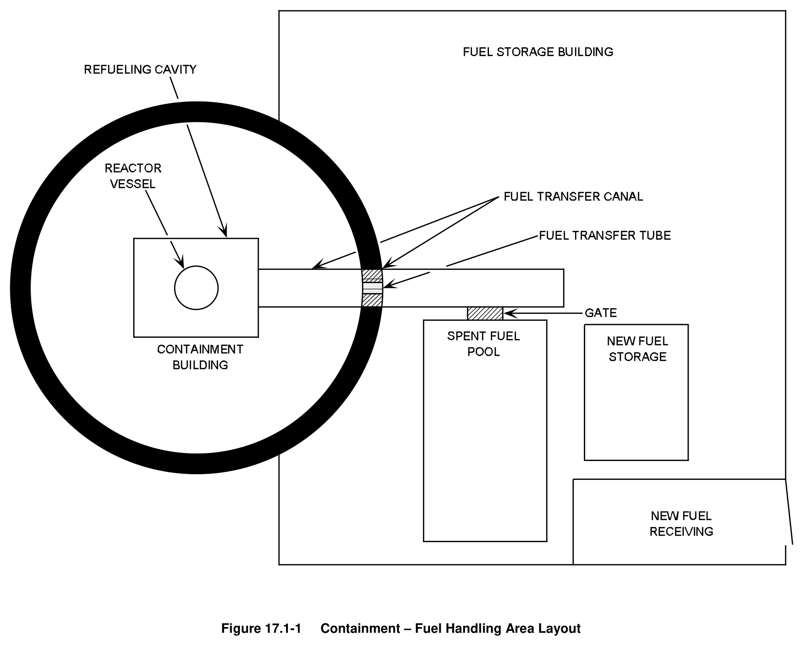

*Containment – Fuel Handling Area Layout*

[Vector original (SVG, lossless): fig_17.1-1.svg](../figures/fig_17.1-1.svg)

<!-- p.1083 -->
#### Figure 17.1-2

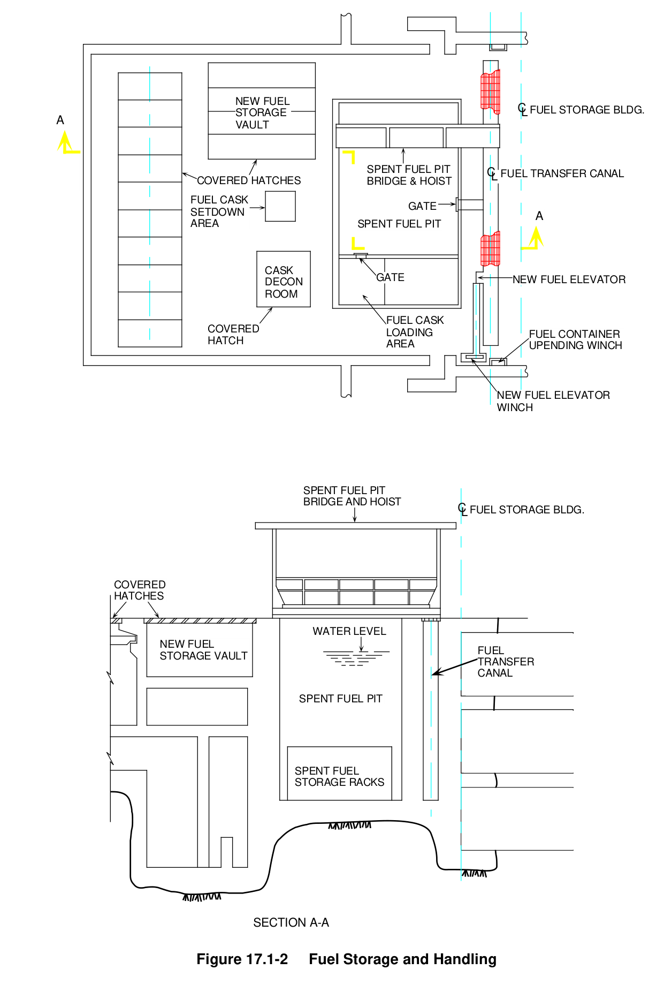

*Fuel Storage and Handling*

[Vector original (SVG, lossless): fig_17.1-2.svg](../figures/fig_17.1-2.svg)

<!-- labels/text on this figure page -->
NEW FUEL CL FUEL STORAGE BLDG.
STORAGE A VAULT
SPENT FUEL PIT C FUEL TRANSFER CANAL L COVERED HATCHES BRIDGE & HOIST
FUEL CASK GATE SETDOWN A AREA SPENT FUEL PIT
CASK GATE NEW FUEL ELEVATOR DECON ROOM
FUEL CASK COVERED LOADING FUEL CONTAINER HATCH AREA UPENDING WINCH
NEW FUEL ELEVATOR WINCH
SPENT FUEL PIT BRIDGE AND HOIST CL FUEL STORAGE BLDG.
COVERED HATCHES
WATER LEVEL NEW FUEL FUEL STORAGE VAULT TRANSFER CANAL
SPENT FUEL PIT
SPENT FUEL STORAGE RACKS
SECTION A-A
Figure 17.1-2 Fuel Storage and Handling

<!-- p.1084 -->
#### Figure 17.1-3

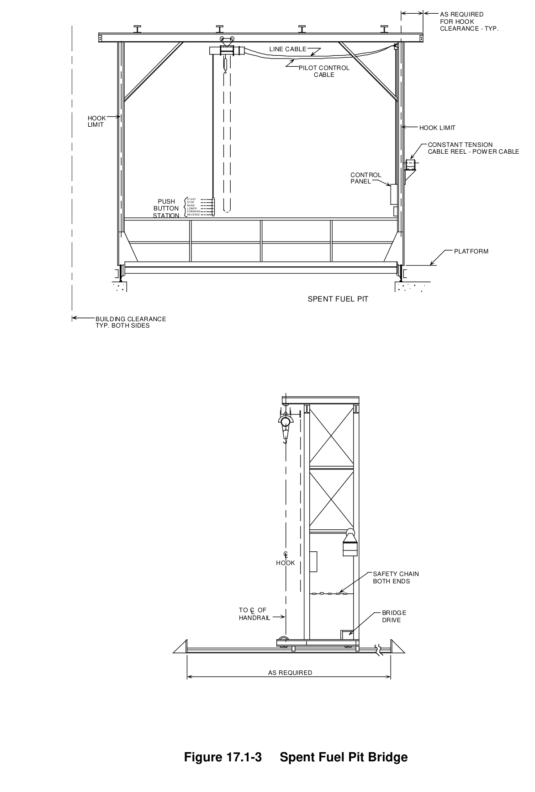

*Spent Fuel Pit Bridge*

[Vector original (SVG, lossless): fig_17.1-3.svg](../figures/fig_17.1-3.svg)

<!-- labels/text on this figure page -->
AS REQUIRED FOR HOOK CLEARANCE - TYP.
LINE CABLE
PILOT CONTROL CABLE
HOOK LIMIT HOOK LIMIT
CONSTANT TENSION CABLE REEL - POW ER CABLE
CONTROL PANEL
PUSH START STOP BUTTON RAISE L OWER FORWARD STATION REVERSE
PLATFORM
SPENT FUEL PIT
BUILDING CLEARANCE TYP. BOTH SIDES
CL HOOK
SAFETY CHAIN BOTH ENDS
TO C OF L BRIDGE HANDRAIL DRIVE
AS REQUIRED
Figure 17.1-3 Spent Fuel Pit Bridge

<!-- p.1085 -->
#### Figure 17.1-4

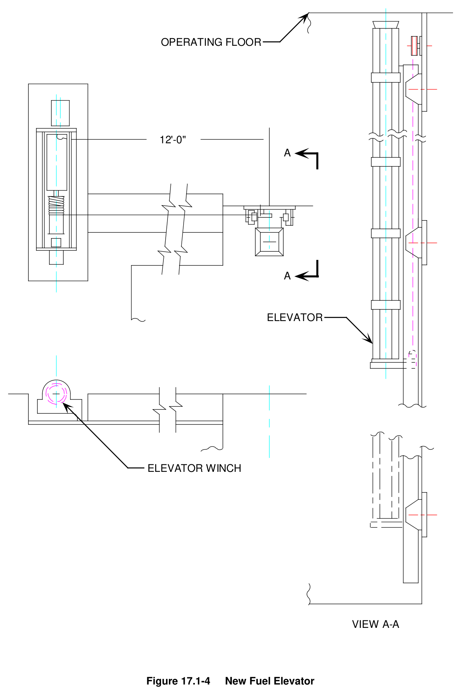

*New Fuel Elevator*

[Vector original (SVG, lossless): fig_17.1-4.svg](../figures/fig_17.1-4.svg)

<!-- labels/text on this figure page -->
OPERATING FLOOR
12'-0" A
A
ELEVATOR
ELEVATOR WINCH
VIEW A-A
Figure 17.1-4 New Fuel Elevator

<!-- p.1086 -->
#### Figure 17.1-5

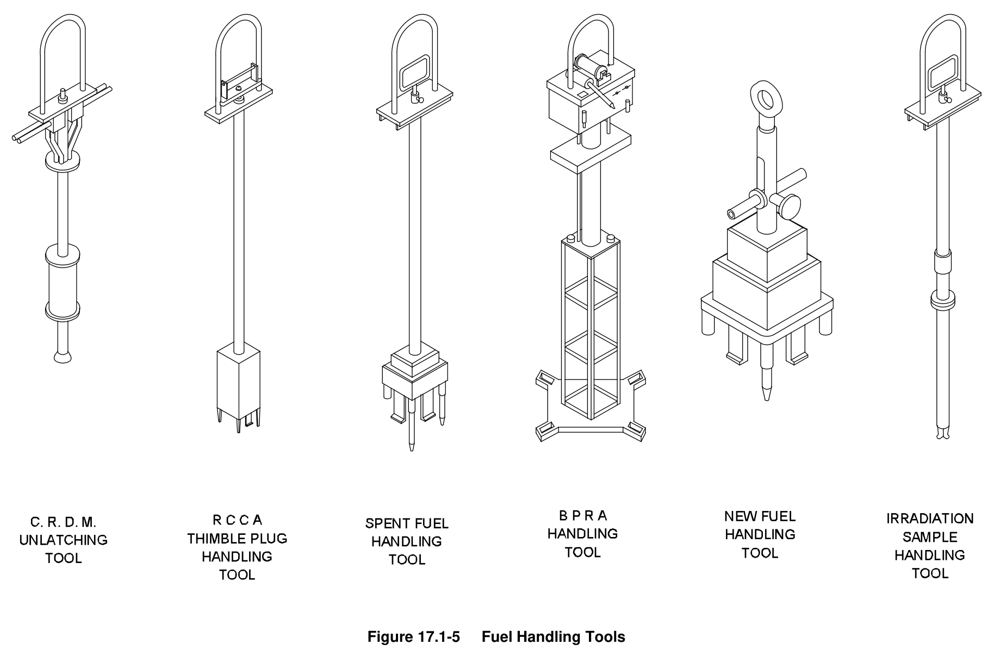

*Fuel Handling Tools*

[Vector original (SVG, lossless): fig_17.1-5.svg](../figures/fig_17.1-5.svg)

<!-- p.1087 -->
#### Figure 17.1-6

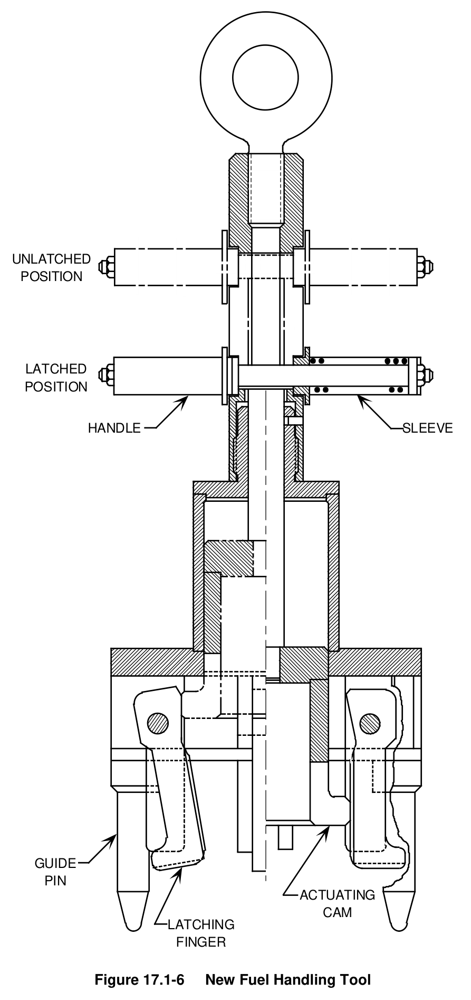

*New Fuel Handling Tool*

[Vector original (SVG, lossless): fig_17.1-6.svg](../figures/fig_17.1-6.svg)

<!-- labels/text on this figure page -->
UNLATCHED POSITION
LATCHED POSITION
HANDLE SLEEVE
GUIDE PIN ACTUATING CAM LATCHING FINGER
Figure 17.1-6 New Fuel Handling Tool

<!-- p.1088 -->
#### Figure 17.1-7

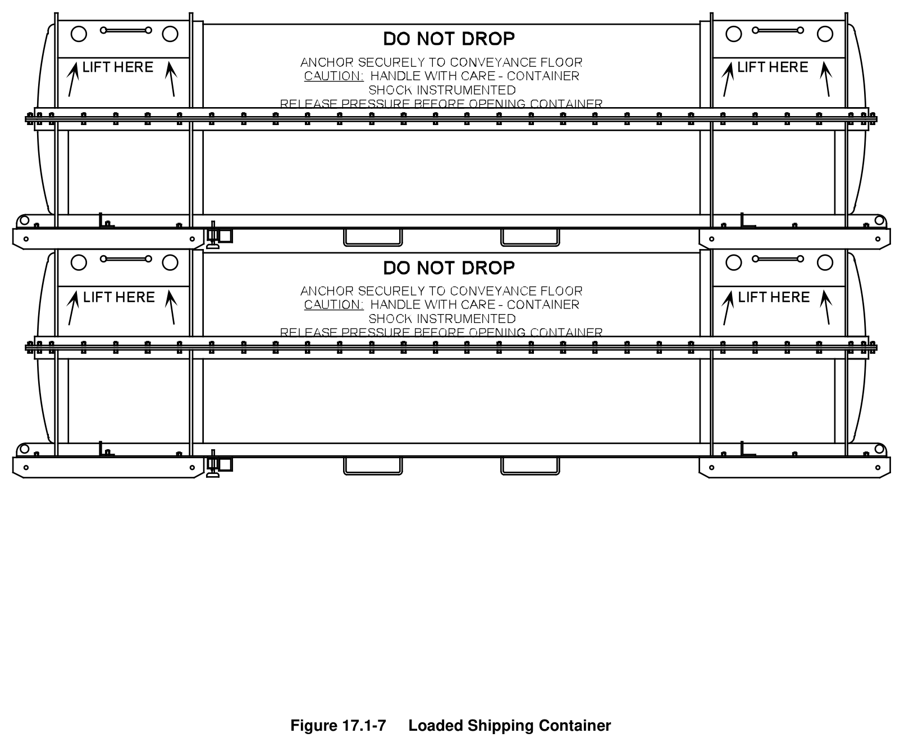

*Loaded Shipping Container*

[Vector original (SVG, lossless): fig_17.1-7.svg](../figures/fig_17.1-7.svg)

<!-- p.1089 -->
#### Figure 17.1-8

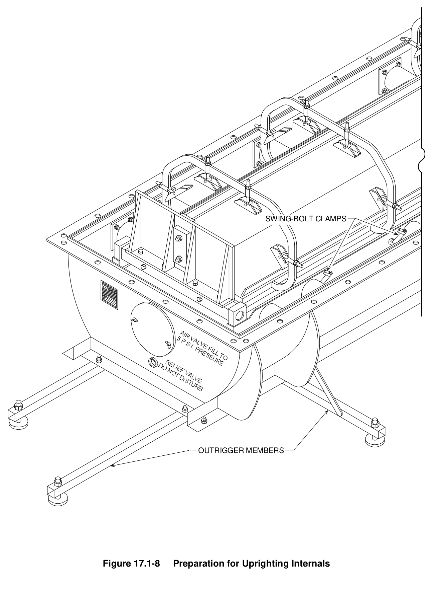

*Preparation for Uprighting Internals*

[Vector original (SVG, lossless): fig_17.1-8.svg](../figures/fig_17.1-8.svg)

<!-- labels/text on this figure page -->
SWING-BOLT CLAMPS
OUTRIGGER MEMBERS
Figure 17.1-8 Preparation for Uprighting Internals

<!-- p.1090 -->
#### Figure 17.1-9

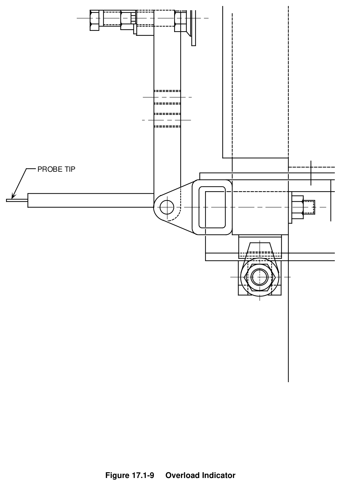

*Overload Indicator*

[Vector original (SVG, lossless): fig_17.1-9.svg](../figures/fig_17.1-9.svg)

<!-- p.1091 -->
#### Figure 17.1-10

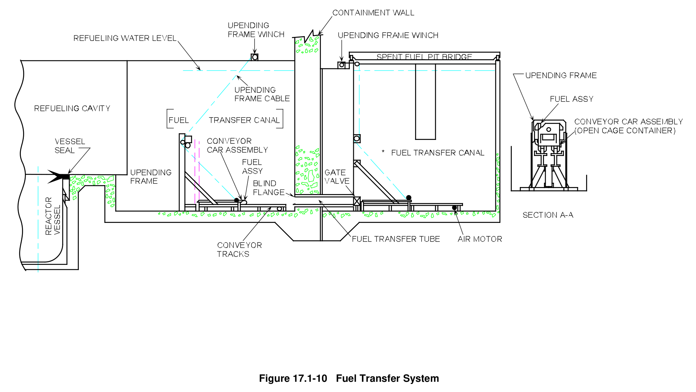

*Fuel Transfer System*

[Vector original (SVG, lossless): fig_17.1-10.svg](../figures/fig_17.1-10.svg)

<!-- p.1092 -->
#### Figure 17.1-11

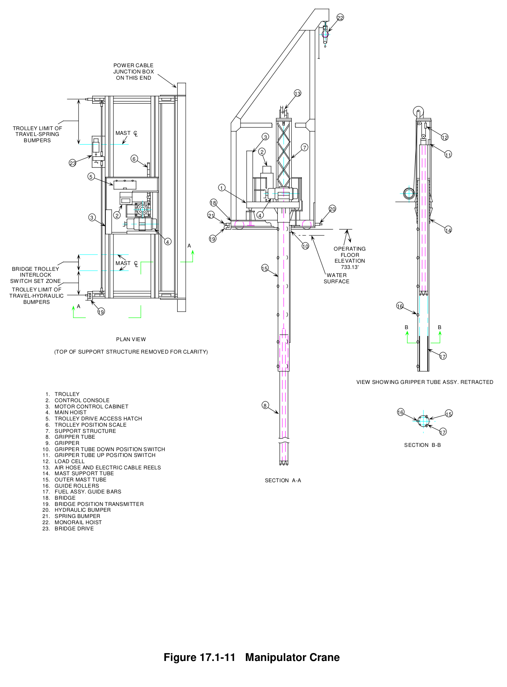

*Manipulator Crane*

[Vector original (SVG, lossless): fig_17.1-11.svg](../figures/fig_17.1-11.svg)

<!-- labels/text on this figure page -->
22
POWER CABLE JUNCTION BOX ON THIS END
13
TROLLEY LIMIT OF TRAVEL-SPRING MAST CL 3
12 BUMPERS
7 2 11 6 23
5
1
18 20 2 21 4 3
14 19 4 A
10 OPERATING
FLOOR ELEVATION MAST CL 733.13' BRIDGE TROLLEY 15 INTERLOCK WATER SWITCH SET ZONE SURFACE TROLLEY LIMIT OF TRAVEL-HYDRAULIC BUMPERS A 16 19
B B
PLAN VIEW
(TOP OF SUPPORT STRUCTURE REMOVED FOR CLARITY)
17
VIEW SHOWING GRIPPER TUBE ASSY. RETRACTED
1. TROLLEY
2. CONTROL CONSOLE 8
3. MOTOR CONTROL CABINET 4. MAIN HOIST 16 15 5. TROLLEY DRIVE ACCESS HATCH 6. TROLLEY POSITION SCALE 7. SUPPORT STRUCTURE 17 8. GRIPPER TUBE 9. GRIPPER SECTION B-B 10. GRIPPER TUBE DOWN POSITION SWITCH 11. GRIPPER TUBE UP POSITION SWITCH 12. LOAD CELL 13. AIR HOSE AND ELECTRIC CABLE REELS 14. MAST SUPPORT TUBE 15. OUTER MAST TUBE SECTION A-A 16. GUIDE ROLLERS 17. FUEL ASSY. GUIDE BARS 18. BRIDGE 19. BRIDGE POSITION TRANSMITTER 20. HYDRAULIC BUMPER 21. SPRING BUMPER 22. MONORAIL HOIST 23. BRIDGE DRIVE
Figure 17.1-11 Manipulator Crane

<!-- p.1093 -->
#### Figure 17.1-12

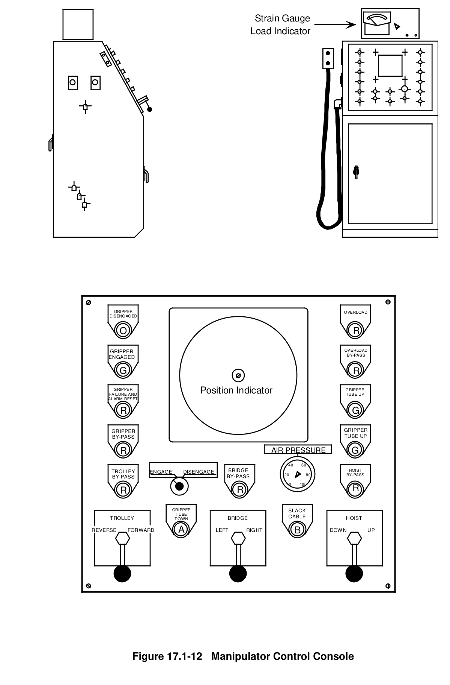

*Manipulator Control Console*

[Vector original (SVG, lossless): fig_17.1-12.svg](../figures/fig_17.1-12.svg)

<!-- labels/text on this figure page -->
Strain Gauge Load Indicator
GRIPPER OVERLOAD DISENGAGED
O R
OVERLOAD GRIPPER BY-PASS ENGAGED
G R
Position Indicator GRIPPER GRIPPER FAILURE AND TUBE UP ALARM RESET R G
GRIPPER GRIPPER TUBE UP BY-PASS
R AIR PRESSURE G
40 60 BRIDGE TROLLEY ENGAGE DISENGAGE HOIST BY-PASS 20 80 BY-PASS BY-PASS 0 100 R R R
GRIPPER SLACK TUBE TROLLEY BRIDGE CABLE HOIST DOWN A B REVERSE FORWARD LEFT RIGHT DOW N UP
Figure 17.1-12 Manipulator Control Console

<!-- p.1094 -->
#### Figure 17.1-13

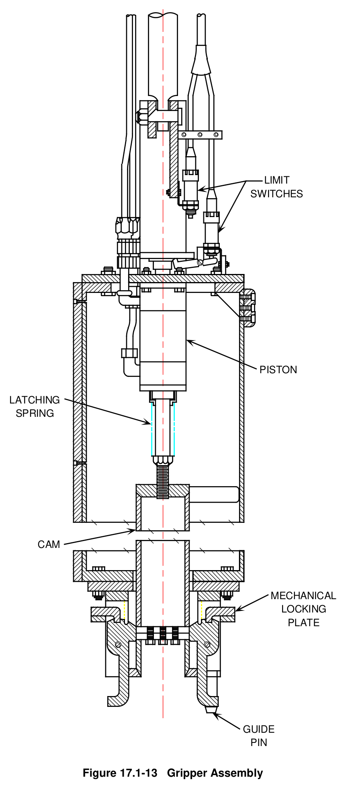

*Gripper Assembly*

[Vector original (SVG, lossless): fig_17.1-13.svg](../figures/fig_17.1-13.svg)

<!-- labels/text on this figure page -->
LIMIT SWITCHES
PISTON
LATCHING SPRING
CAM
MECHANICAL LOCKING PLATE
GUIDE PIN
Figure 17.1-13 Gripper Assembly

<!-- p.1095 -->
#### Figure 17.1-14

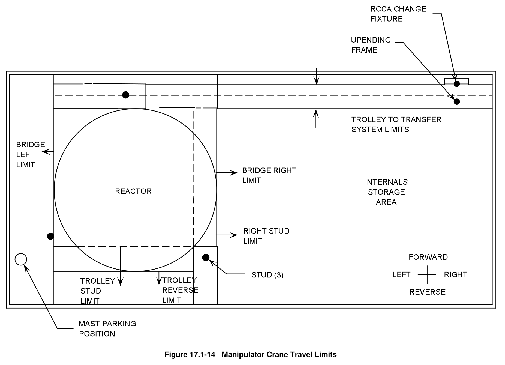

*Manipulator Crane Travel Limits*

[Vector original (SVG, lossless): fig_17.1-14.svg](../figures/fig_17.1-14.svg)

<!-- p.1096 -->
#### Figure 17.1-15

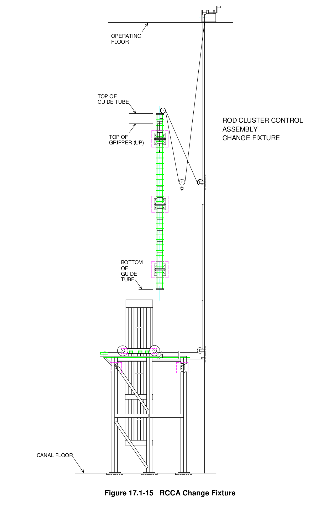

*RCCA Change Fixture*

[Vector original (SVG, lossless): fig_17.1-15.svg](../figures/fig_17.1-15.svg)

<!-- labels/text on this figure page -->
OPERATING FLOOR
TOP OF GUIDE TUBE
ROD CLUSTER CONTROL ASSEMBLY TOP OF CHANGE FIXTURE GRIPPER (UP)
BOTTOM OF GUIDE TUBE
CANAL FLOOR
Figure 17.1-15 RCCA Change Fixture

<!-- p.1097 -->
#### Figure 17.1-16

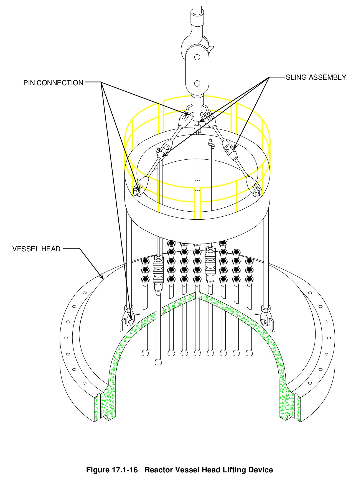

*Reactor Vessel Head Lifting Device*

[Vector original (SVG, lossless): fig_17.1-16.svg](../figures/fig_17.1-16.svg)

<!-- labels/text on this figure page -->
SLING ASSEMBLY PIN CONNECTION
VESSEL HEAD
Figure 17.1-16 Reactor Vessel Head Lifting Device

<!-- p.1098 -->
#### Figure 17.1-17

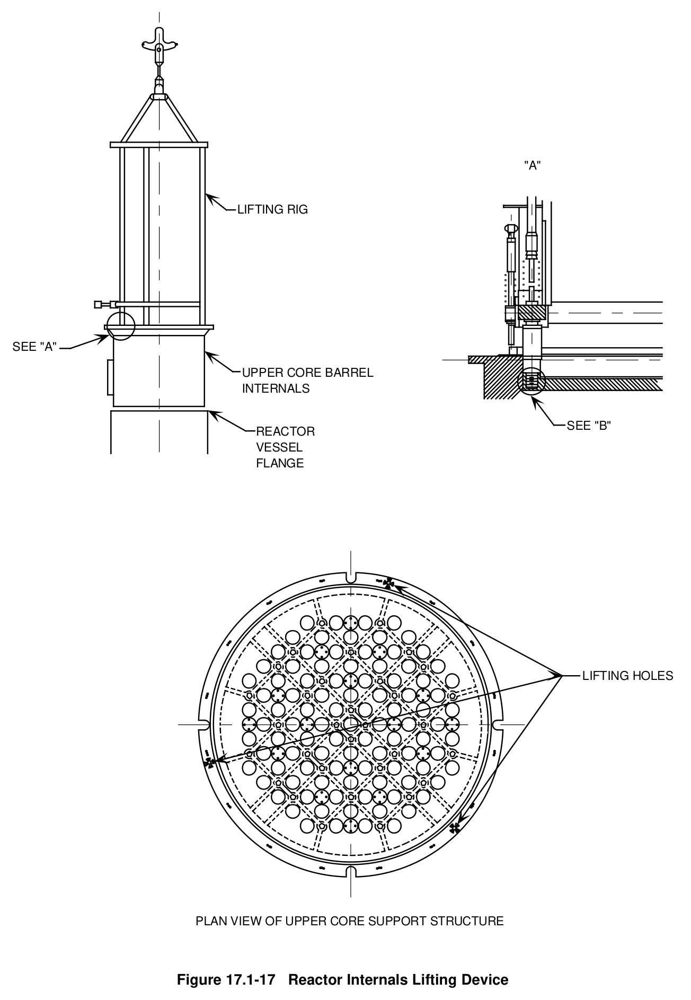

*Reactor Internals Lifting Device*

[Vector original (SVG, lossless): fig_17.1-17.svg](../figures/fig_17.1-17.svg)

<!-- labels/text on this figure page -->
"A"
LIFTING RIG
SEE "A"
UPPER CORE BARREL INTERNALS
SEE "B" REACTOR VESSEL FLANGE
LIFTING HOLES
PLAN VIEW OF UPPER CORE SUPPORT STRUCTURE
Figure 17.1-17 Reactor Internals Lifting Device

<!-- p.1099 -->
#### Figure 17.1-18

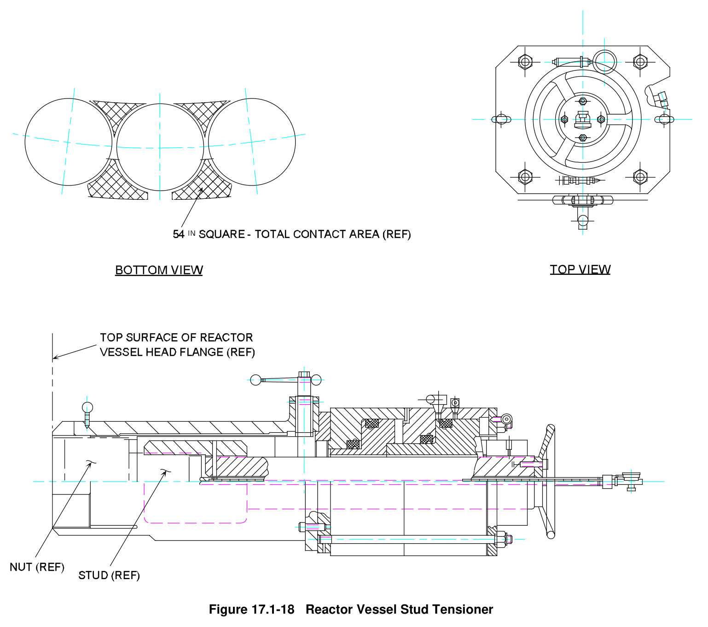

*Reactor Vessel Stud Tensioner*

[Vector original (SVG, lossless): fig_17.1-18.svg](../figures/fig_17.1-18.svg)

<!-- p.1100 -->
#### Figure 17.1-19

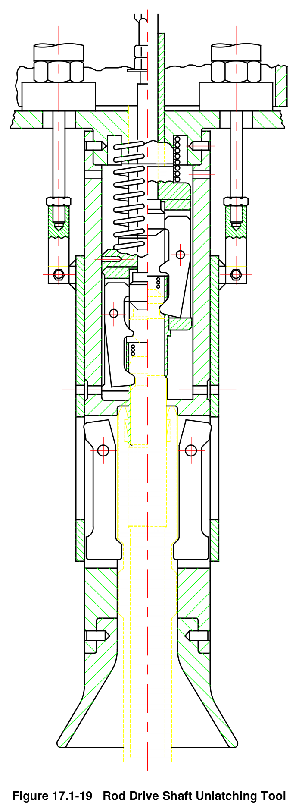

*Rod Drive Shaft Unlatching Tool*

[Vector original (SVG, lossless): fig_17.1-19.svg](../figures/fig_17.1-19.svg)

