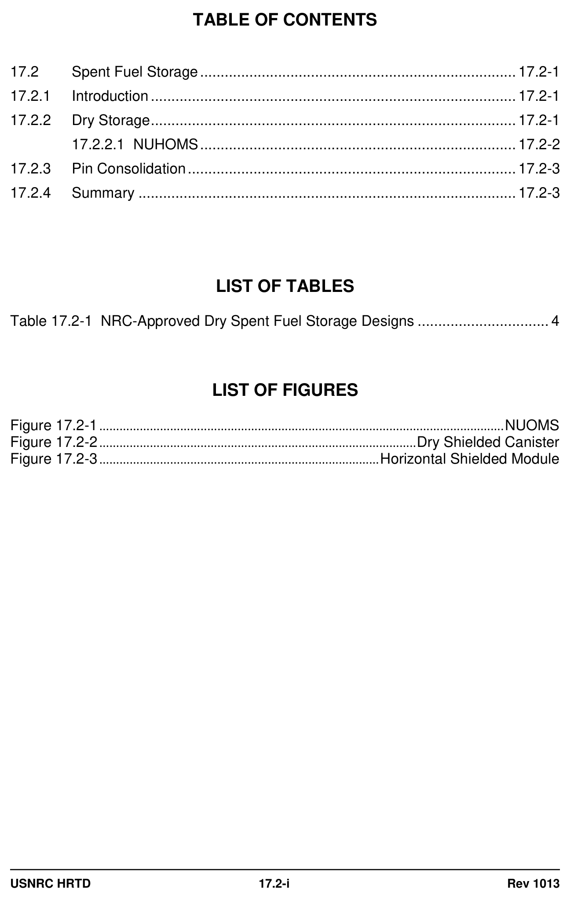
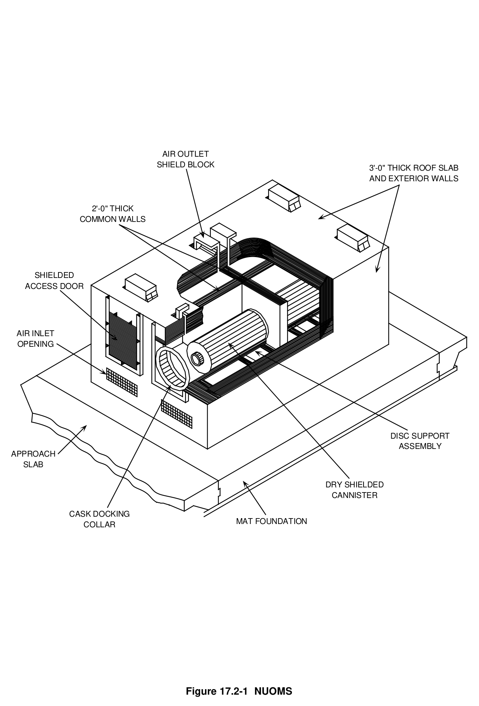
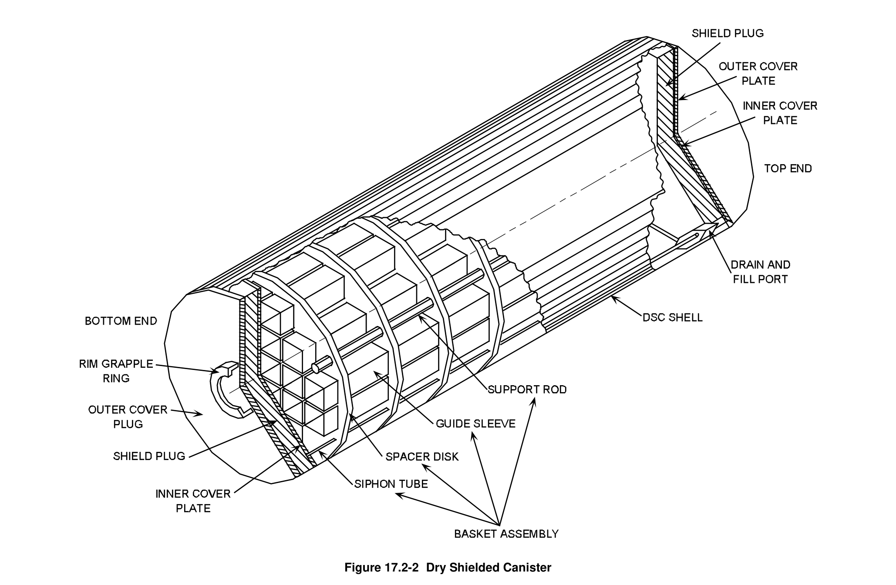
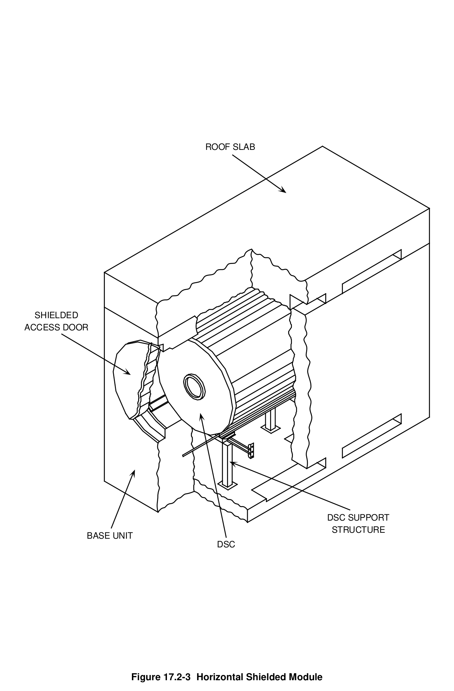

# 17.2 Spent Fuel Storage

> Pages 1101–1109 of `ML20057E160.pdf`
> Westinghouse Technology Systems Manual — USNRC HRTD (PWR)

---
<!-- p.1101 -->
#### Westinghouse Technology Systems Manual
#### Section 17.2
#### Spent Fuel Storage
<!-- p.1102 -->
#### Figure 17.2-1

*....................................................................................................................... NUOMS*

<!-- labels/text on this figure page -->
TABLE OF CONTENTS
17.2 Spent Fuel Storage ............................................................................. 17.2-1
17.2.1 Introduction ......................................................................................... 17.2-1
17.2.2 Dry Storage ......................................................................................... 17.2-1
17.2.2.1 NUHOMS ............................................................................. 17.2-2
17.2.3 Pin Consolidation ................................................................................ 17.2-3
17.2.4 Summary ............................................................................................ 17.2-3
LIST OF TABLES
Table 17.2-1 NRC-Approved Dry Spent Fuel Storage Designs ................................ 4
LIST OF FIGURES
Figure 17.2-1 ........................................................................................................................ NUOMS
Figure 17.2-2 .............................................................................................. Dry Shielded Canister
Figure 17.2-3 ................................................................................... Horizontal Shielded Module
USNRC HRTD 17.2-i Rev 1013

<!-- p.1103 -->
### 17.2 SPENT FUEL STORAGE
#### 17.2.1 Introduction
Originally, the core was designed to be refueled with fuel assemblies containing recycled plutonium from spent fuel assemblies. Fuel assemblies would be sent to a facility where the plutonium and unused uranium would be chemically separated from the spent fuel and used in the manufacture of new assemblies. A demonstration plutonium extraction facility was designed and built, but fears associated with nuclear proliferation prevented the operation of the facility. The concern over the availability of relatively large quantities of weapons grade plutonium resulted in the U.S. government adopting policies which prohibited spent fuel assembly recycling. These policies forced the nuclear utilities to change spent fuel pool storage designs.

The original spent fuel pool storage design capacity was 4/3 core; i.e., if the core contained 200 fuel assemblies, the spent fuel pool storage could hold 266 spent fuel assemblies. This capacity would be sufficient for the 1/3 of the core’s fuel assemblies that were changed out during a refueling plus a full core off load resulting from an unforeseen plant problem. Since spent fuel assemblies were to be recycled, this capacity was satisfactory. Also, the original spent fuel pool storage design had a 21-inch distance between the center lines of adjacent storage rack locations. This distance was required to prevent spent fuel pool criticality under postulated worst case reactivity conditions. The 21-inch distance allowed the utilities to redesign the spent fuel racks. The large center line to center line distance was eliminated, and metal plates containing boron were added to prevent criticality. The second iteration of spent fuel pool storage racks was called high density fuel racks and more than doubled the spent fuel pool storage capacity. The change-out of a spent fuel pool storage rack's design is called “re-racking.”

The increase in spent fuel pool capacities, combined with increases in core life, delayed the spent fuel storage problem. The arithmetic associated with spent fuel is not very complex. If 66 fuel assemblies are removed during each refueling, after 10 refuelings, the high density storage racks would be full. Many U.S. utilities have already re-racked twice.

#### 17.2.2 Dry Storage
Another option open to utilities to provide extra storage is dry storage. This allows spent fuel assemblies to be removed from the spent fuel pool and stored on-site in metal or concrete canisters on a concrete base.

Spent fuel assemblies are placed in the canisters while in the spent fuel pool, and then the canisters are sealed. Because the oldest spent fuel would be placed in these canisters, the radioactivity and decay heat would be diminished, allowing the assemblies to be cooled by natural airflow around the outside of the canisters.
Radiation from the canisters would be very low. At the boundary of the concrete base, there may be no detectable levels of radioactivity.

USNRC HRTD 17.2-1 Rev 1013

<!-- p.1104 -->
Dry storage entails the least amount of worker handling and therefore would result in less worker exposure to radioactivity. Canisters can hold between 7 and 24 PWR assemblies each. Dry storage could open enough space in the spent fuel pool to accommodate plant needs into the twenty-first century. Since the NRC has licensed dry storage canisters (10CFR72), utilities would only need an additional license amendment from the agency. The NRC has licensed many designs from different manufacturers. Table 17.2-1 lists some of the licensed manufacturers. The major features of the one of the designs will be discussed in the following paragraphs.

##### 17.2.2.1 NUHOMS
The Pacific Nuclear Fuel Services, Incorporated dry storage system is called NUHOMS and is of the concrete modular design. As shown in Figure 17.2-1, the design consists of a dry shielded canister (DSC) and a reinforced concrete horizontal storage module. The DSC serves as the containment pressure boundary for the confinement of radioactive materials and provides a leak tight, inert atmosphere to ensure that the integrity of the fuel cladding is maintained.

The DSC is composed of two basic components: the basket and the shell. The DSC basket is designed to accommodate 24 fuel assemblies (Figure 17.2-2) in separate rectangular boxes. The 24 boxes are placed into spacer disks separated by support rods. The spacer disks allow the rectangular boxes to be placed into the circular shell.

The DSC shell assembly is a stainless steel, welded pressure vessel that provides a leak tight confinement barrier for all radioactive material and envelopes the spent fuel assemblies in an inert helium atmosphere. The DSC cylindrical shell and cover plates encapsulate the basket assembly holding the spent fuel. The DSC is placed in a transfer cask for loading, and it will remain in the cask until it is transferred into the horizontal storage module (HSM).

The ventilated reinforced concrete HSM is the principal structure that is located on each Independent Spent Fuel Storage Installation (ISFSI) site. Each HSM (Figure 17.2-3) is a free-standing prefabricated unit placed on a non-safety related basemat.
Each HSM is designed to provide storage for one DSC. Ports in the bottom of the HSM allow for the passage of air into the vicinity of the DSC for cooling purposes.
Heated air passes from the inside of the HSM to the environment via ports in the top of the HSM. HSMs are placed side by side until the desired number of fuel assemblies is stored.

The basic steps in the transfer of spent fuel from the spent fuel pool to the HSM are:

1. Clean and load the DSC into the transfer cask.
2. Fill the DSC and cask with water and install the cask/DSC annulus seal.
3. Place the transfer cask containing the DSC in the spent fuel pool.
4. Load the spent fuel assemblies into the DSC.
5. Place the top shield plug on the DSC.
6. Remove the loaded cask from the spent fuel pool and place it in the decontamination area.
7. Lower the water level in the DSC below the shield plug.

USNRC HRTD 17.2-2 Rev 1013

<!-- p.1105 -->
8. Place and weld the inner top cover to the DSC shell and perform NDE.
9. Drain the water from the cask/DSC annulus.
10. Drain the water from the DSC.
11. Evacuate and dry the DSC.
12. Fill the DSC with helium.
13. Perform a helium leak test on the seal weld.
14. Seal weld the siphon and vent port plugs and perform NDE.
15. Fit -up the outer top cover plate with the DSC shell.
16. Weld the top cover plate to the DSC shell and perform NDE.
17. Install the transfer cask top cover plate.
18. Lift and downend the transfer cask onto the transport trailer.
19. Ready the HSM to receive the DSC.
20. Ready the cask for transport and to the transport trailer to the HSM.
21. Position the transfer cask with the HSM access opening.
22. Remove the transfer cask top cover plate.
23. Align and secure the transfer cask to the HSM.
24. Set up for the DSC transfer.
25. Place the DSC into the HSM.
26. Disengage the transfer cask from the HSM.
27. Install the HSM door.

#### 17.2.3 Pin Consolidation
The capacity of the spent fuel pool could also be expanded by pin consolidation, in which the fuel rods (or pins) within each fuel assembly are reconfigured to reduce the amount of space required for storage. The fuel pins in the assemblies are removed and placed in new "consolidation" cages which allow the rods to be stored closer together. The original end caps and grids are sheared to reduce their volume and are also stored in the spent fuel pool.

Several U.S. nuclear plants have performed pin consolidation demonstration projects while completing their own study of options for storage expansion. Because pin consolidation is very labor intensive, worker exposure to radioactivity must be taken into account when considering this storage option. There are ways to reduce exposure, such as consolidating older fuel first, since this fuel is less radioactive.
With pin consolidation, all spent fuel generated during the remainder of the plant's licensed operating life could be safely stored within the spent fuel pool. Pin consolidation would require license amendments from the NRC.

#### 17.2.4 Summary
The initial design of the spent fuel pool provided limited storage capacity. Political decisions dealing with fuel recycling forced the utilities to face the dilemma of storing fuel on site. Storage capacity has been increased by two methods: re-racking and dry storage. Re-racking involves using fuel storage racks with reduced distances between adjacent fuel assemblies. Dry storage involves transferring spent fuel to a shielded cask and placing the shielded cask in a concrete vault located on the plant site. The feasibility of pin consolidation has been demonstrated but is not currently being used.

USNRC HRTD 17.2-3 Rev 1013

<!-- p.1106 -->
#### Table 17.2-1 NRC-Approved Dry Spent Fuel Storage Designs
#### Vendor
#### Design Model
#### Capacity
General Nuclear Metal Cask CASTOR 21 PWR Fuel Assemblies Systems, Inc.
V/21

Pacific Nuclear Fuel Concrete Module 7 PWR Fuel Assemblies Services, Inc.
NUHOMS-7

Pacific Nuclear Fuel Concrete Module 24 PWR Fuel Assemblies Services, Inc.
NUHOMS-24P

Foster Wheeler Energy Concrete Vault, Module 83 PWR or 150 BWR Fuel Applications, Inc. Vault Dry Stone Assemblies

Nuclear Assurance Metal Cask NAC-STC 26 PWR Fuel Assemblies Corporation

Nuclear Assurance Metal Cask NAC- 28 PWR Fuel Assemblies Corporation 128/ST

Nuclear Assurance Metal Cask NAC-C28T 28 Canisters (fuel rods from Corporation

## 56 PWR assemblies)
Transnuclear Metal Cask TN-24 24 PWR Fuel Assemblies Incorporated

Pacific Sierra Concrete Cask VSC-24 24 PWR Fuel Assemblies

Westinghouse Electric Metal Cask MC-10 24 PWR Fuel Assemblies

USNRC HRTD 17.2-4 Rev 1013

<!-- p.1107 -->
#### Figure 17.2-1

*NUOMS*

[Vector original (SVG, lossless): fig_17.2-1_2.svg](../figures/fig_17.2-1_2.svg)

<!-- labels/text on this figure page -->
AIR OUTLET SHIELD BLOCK 3'-0" THICK ROOF SLAB AND EXTERIOR WALLS
2'-0" THICK COMMON WALLS
SHIELDED ACCESS DOOR
AIR INLET OPENING
DISC SUPPORT ASSEMBLY APPROACH SLAB
DRY SHIELDED CANNISTER
CASK DOCKING MAT FOUNDATION COLLAR
Figure 17.2-1 NUOMS

<!-- p.1108 -->
#### Figure 17.2-2

*Dry Shielded Canister*

[Vector original (SVG, lossless): fig_17.2-2.svg](../figures/fig_17.2-2.svg)

<!-- p.1109 -->
#### Figure 17.2-3

*Horizontal Shielded Module*

[Vector original (SVG, lossless): fig_17.2-3.svg](../figures/fig_17.2-3.svg)

<!-- labels/text on this figure page -->
ROOF SLAB
SHIELDED ACCESS DOOR
DSC SUPPORT STRUCTURE BASE UNIT DSC
Figure 17.2-3 Horizontal Shielded Module

