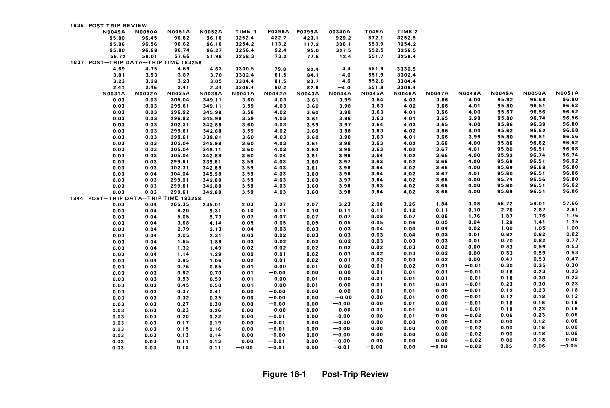
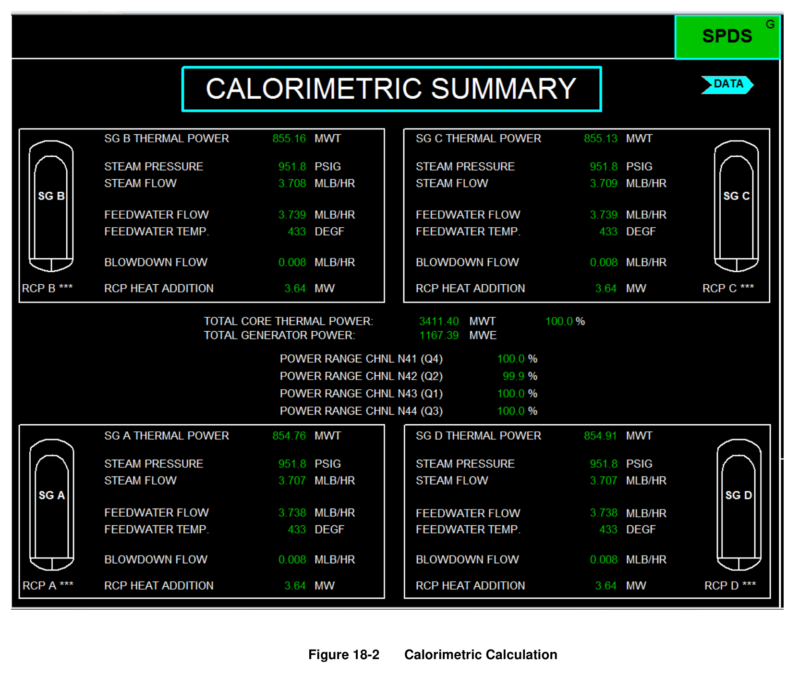
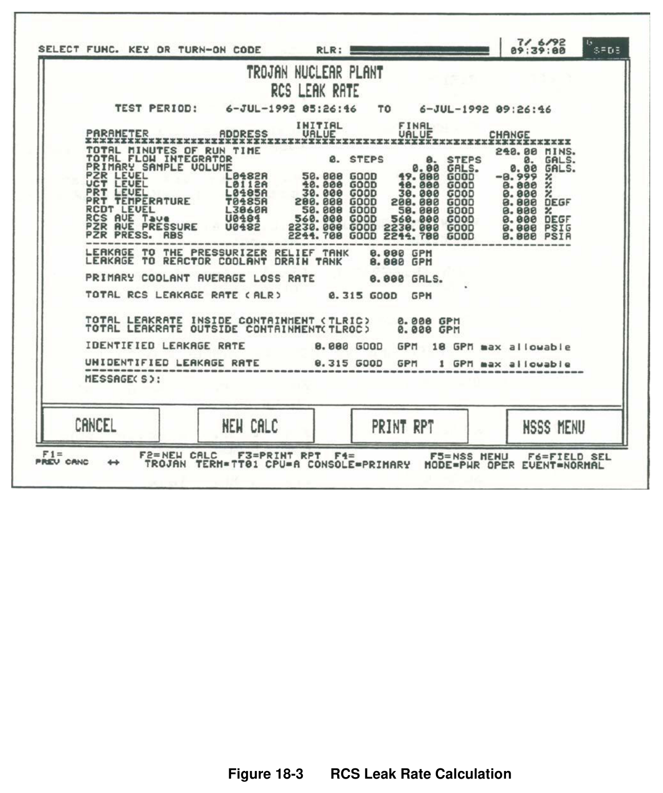
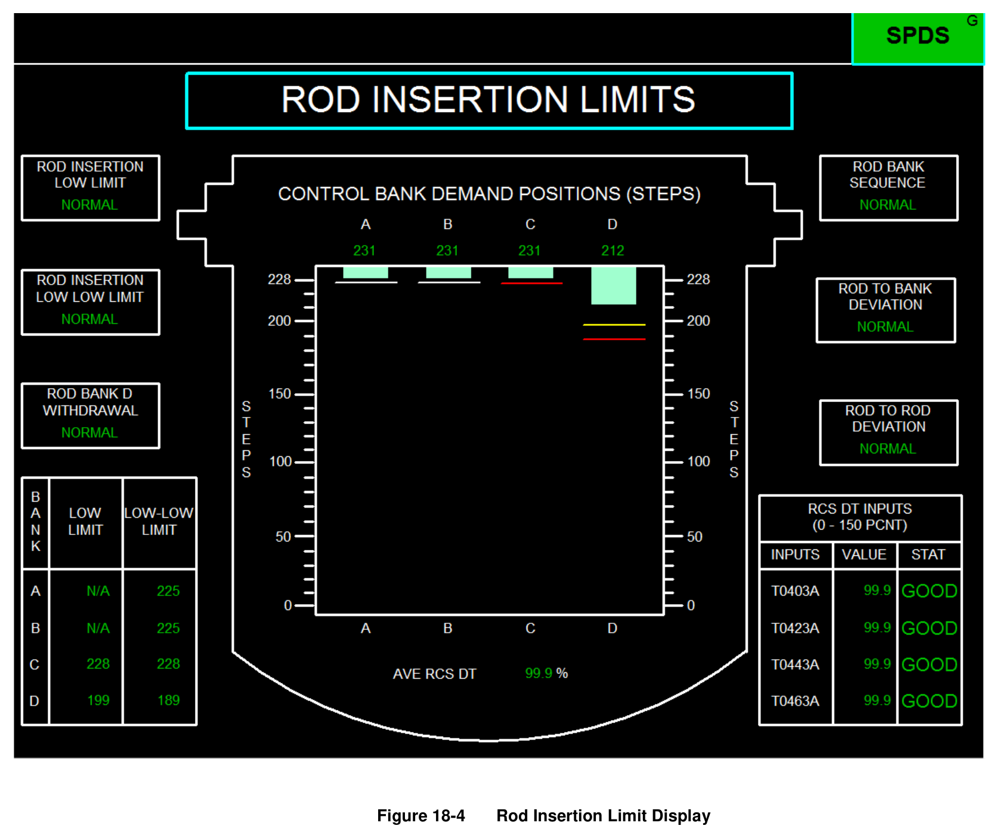
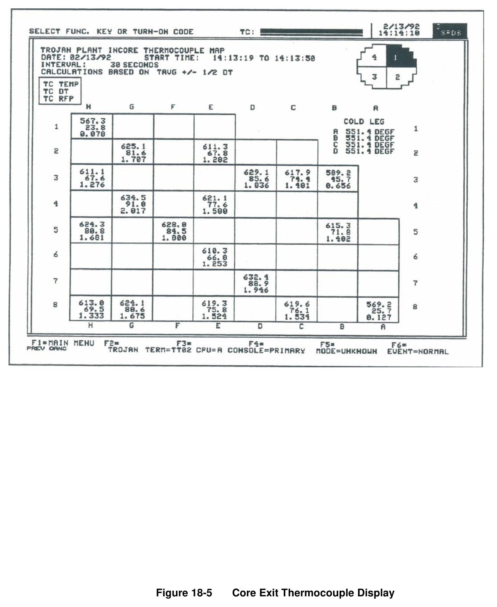
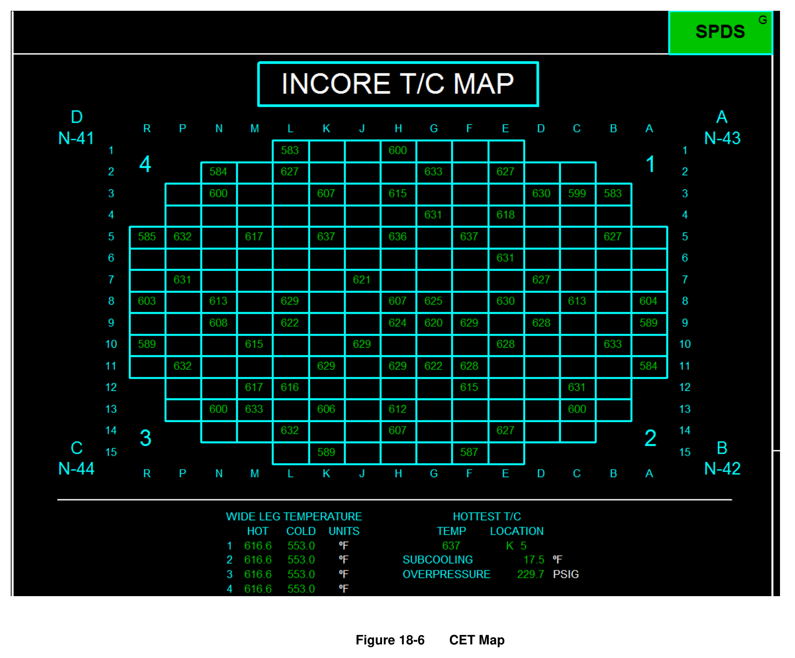
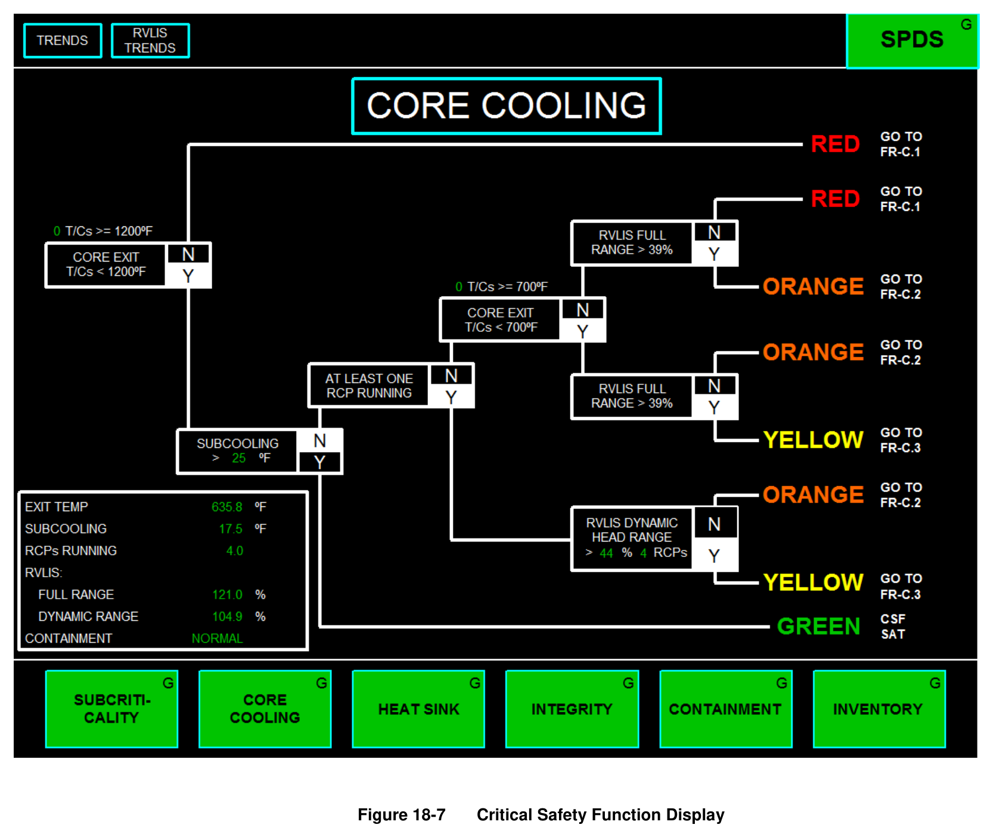
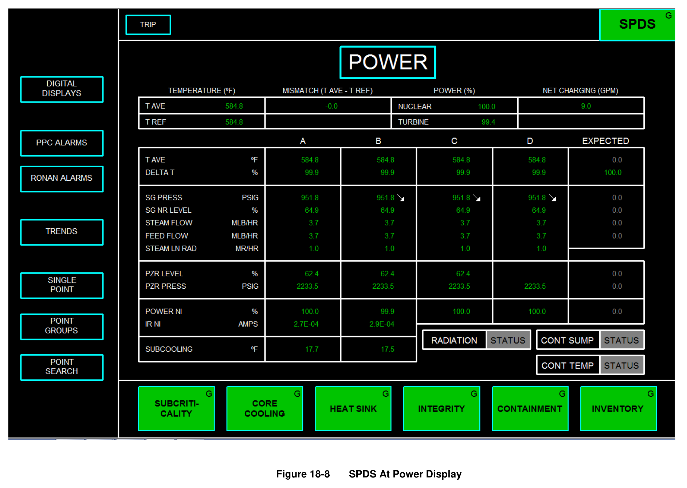

# 18.0 Computer

> Pages 1110–1127 of `ML20057E160.pdf`
> Westinghouse Technology Systems Manual — USNRC HRTD (PWR)

---
<!-- p.1110 -->
#### Westinghouse Technology Systems Manual
#### Section 18.0
#### Plant Computer
<!-- p.1111 -->
TABLE OF CONTENTS

18 Plant Computer ........................................................................................... 18-1

18.1 Introduction ................................................................................................. 18-1

18.2 Data Acquisition .......................................................................................... 18-1

18.3 Computer Applications ............................................................................... 18-1

18.3.1 Alarm Processing ......................................................................... 18-2

18.3.2 Post-Trip Review ......................................................................... 18-2

18.3.3 Sequence-of-Events Monitoring ................................................... 18-2

18.3.4 Calorimetric Calculation ............................................................... 18-3

18.3.5 RCS Leak Rate Monitor ............................................................... 18-3

18.3.6 Rod Insertion Limits ..................................................................... 18-3

18.3.7 Core Reactivity ............................................................................ 18-4

18.3.8 Incore Thermocouple Package .................................................... 18-4

18.3.9 Point/Group Trending .................................................................. 18-5

18.4 Safety Parameter Display System (SPDS) ................................................. 18-5

18.4.1 SPDS Introduction ....................................................................... 18-5

18.4.2 Regulatory History ....................................................................... 18-5

18.4.3 SPDS Implementation ................................................................. 18-6

18.5 Regulatory Use of Computer Data .............................................................. 18-7

18.6 Summary .................................................................................................... 18-7

LIST OF FIGURES

Figure 18-1 .......................................................................................................... Post-Trip Review

Figure 18-2 .............................................................................................. Calorimetric Calculation

Figure 18-3 .......................................................................................RCS Leak Rate Calculation

Figure 18-4 ........................................................................................ Rod Insertion Limit Display

Figure 18-5 ............................................................................. Core Exit Thermocouple Display

Figure 18-6 ......................................................................................................................... CET Map

Figure 18-7 ............................................................................... Critical Safety Function Display

Figure 18-8 ............................................................................................. SPDS At Power Display

USNRC HRTD 18-ii Rev 1013

<!-- p.1112 -->
### 18.0 PLANT COMPUTER
#### Learning Objectives:
1. State the purpose of the plant computer.

2. Given a list of application programs, state the purpose of each application.

3. State the purpose of the safety parameter display system (SPDS).

4. List the critical safety functions monitored by the SPDS.

### 18.1 Introduction
One of the most effective aids available to the operator of a nuclear unit is the plant computer. The plant computer performs real-time, on-line data acquisition, alarm monitoring, data manipulation, and performance calculations to provide the plant operator with accurate and reliable information. It has no direct control of any processes related to the operation of the unit. The operator interfaces with the plant computer are similar to the interfaces with a personal computer and likely include some combination of keyboards, printers, and CRT displays. This chapter discusses some of the major functions typically provided by the plant computer.

### 18.2 Data Acquisition
One of the primary functions of the plant computer is the processing of plant input signals for availability to the operator and for use in computer calculations and programs. Input information is stored in the computer’s data base for use by other parts of the computer system.

Input signals may be analog or digital in nature. Analog inputs are electrical representations (voltages, currents, or resistances) of plant process variables such as pressure, temperature, and level. The inputs are provided by instrumentation such as thermocouples, resistance temperature detector bridges, and differential pressure cells. Analog inputs are digitized, checked for quality (e.g., flagged if determined to be bad inputs), and converted to engineering units by the computer.
Some inputs may be further processed as averages, integrals, or rates of change.

Digital inputs have only two possible states. Digital inputs are typically sensed by the computer as electrical contacts that are open or closed. Such contacts indicate that motors are running or idle, that circuit breakers are open or closed, or that valves are open or shut.

### 18.3 Computer Applications
Plant computers were originally supplied by the nuclear steam supply system
(NSSS) vendors. As computer hardware and software improved, the original plant computer designs were replaced with designs from computer companies (as opposed to NSSS suppliers). As a result, computer applications are quite diverse.
This section describes the most common applications. Specific values contained in this section apply to the Trojan plant computer.

USNRC HRTD 18-1 Rev 1013

<!-- p.1113 -->
#### 18.3.1 Alarm Processing
The alarm processor collects and routes all computer-detected events defined as alarm conditions (limit violations, hardware malfunctions, etc.). Alarm conditions may be indicated via CRT displays, audible annunciation, and/or printouts. The alarm processor typically maintains a directory which lists the following information for each alarm condition: the time the alarm condition was detected, an alphanumeric point identifier, a point description, the value or state of the point, and the appropriate engineering units. The alarm processor likely provides a means for the operator to page through the alarm directory and to acknowledge or clear alarms.

The alarm processor supplements the control room annunciator system. However, unlike the control room annunciator system, the plant computer alarm processor gives the plant staff the ability to quickly trend the alarm condition. The control room annunciators are generally associated with bistable inputs, and other instrumentation must be used to determine trends. Also, with proper controls, alarms may be deleted from the alarm processor.

#### 18.3.2 Post-Trip Review
The post-trip review (Figure 18-1) is a special-purpose 40-minute log. The log automatically collects selected plant data when triggered by a reactor trip. Once triggered, the post-trip review documents the time of the trip and records the values of 150 plant parameters at 10 second intervals for 20-minute periods before and after the trip. The operator is informed when the post-trip review is completed and ready for printout.

The data for the post-trip review is continuously collected and written to a buffer.
Under normal operating conditions, the data is overwritten, but when a trip occurs, overwriting is terminated. This feature allows both pre- and post-trip parameter values (20 minutes before the trip and 20 minutes after the trip) to be compiled. The post-trip review allows the plant staff to verify proper plant response to the initiator, and it is also used for event re-creation, if desired.

#### 18.3.3 Sequence-of-Events Monitoring
The sequence-of-events monitor produces a log which records the exact sequence and timing of contact status changes in order to document the causes of trips and equipment malfunctions. The log is initiated with the first change of state of any of the monitored contacts (a typical set includes 64 contacts). The monitor then logs sequential contact status changes until a fixed number of changes have been recorded or until a predefined time period has elapsed.

The sequence-of-events monitor is capable of resolving the time of a contact status change to within a small fraction of a second (one millisecond). The operator is notified when the sequence-of-events log is ready for printout.

The sequence-of-events log is used along with the post-trip review to help the plant staff determine the plant response to an initiator.

USNRC HRTD 18-2 Rev 1013

<!-- p.1114 -->
It should be noted that the sequence-of-events log maybe triggered by events other than a reactor trip. For example, the opening of bistable contacts during reactor protection system testing may also trigger the sequence-of-events log.

#### 18.3.4 Calorimetric Calculation
Real-time calorimetric calculations are performed by the computer at one-minute intervals. The one-minute average plant input data are used by the calorimetric program to calculate reactor power output. The value of reactor core thermal power is determined as the product of loop feedwater flow values and the change in enthalpy of the feedwater as it is heated to saturated steam. Additional correction factors are included to account for the transfer of reactor coolant pump heat to the secondary fluid and for heat transfer to the blowdown flow from the steam generators. See Figure 18-2.

The real-time calorimetric program results are also used to monitor excore powerrange calibration accuracy. The differences between the current power, as computed by the calorimetric program, and the powers indicated by the four powerrange instruments are provided for calibration purposes.

#### 18.3.5 RCS Leak Rate Monitor
The leak rate monitor application provides on-demand calculations of the identified, unidentified, and total leakages. The inventory mass balance used in determining leakage includes the coolant mass in the reactor coolant system (RCS), pressurizer, and volume control tank, as well as the mass flow rates entering and exiting the RCS via the RCS sample lines and the letdown and charging lines. In addition, the RCS leakage paths to the pressurizer relief tank and the reactor coolant drain tank are monitored to enable operators to distinguish between identified and unidentified leakage. See Figure 18-3.

The calculations may be performed automatically or manually; in manual, the operator designates the time period during which leakage is monitored and can enter data for tank levels and coolant temperatures. Other inputs needed for the calculation (such as conversion factors) are read from the computer files.

After the leakage rate has been calculated, the total is displayed on the screen and can be printed out. The periodic calculation of RCS leakage is a technical specification requirement, and the printout provides documentation of the completion of the requirement.

#### 18.3.6 Rod Insertion Limits
Rod insertion limits (Figure 18-4) are computed for each control rod bank by the rod package program. These limit values reflect current plant technical specification limits for rod insertion and are computed as a function of core ΔT. The rod package program also receives rod bank position information from the pulse counting circuitry of the rod control system. The program provides inputs to computer alarms at two rod position setpoints: the rod insertion limit itself (the rod insertion LO-LO limit

USNRC HRTD 18-3 Rev 1013

<!-- p.1115 -->
alarm), and 10 steps higher than the rod insertion limit (the rod insertion LO limit).
The latter alarm provides an early warning concerning the approach to licensed rod insertion limit values.

Additional rod position alarms are provided to alert the operator to an abnormal state of any of the following rod position attributes:

 Bank D withdrawal,  Rod bank sequence,  Rod-to-bank deviation, and  Rod-to-rod deviation.

#### 18.3.7 Core Reactivity
The core reactivity calculations package provides automatic estimations of the current core reactivity and axial offsets for power, iodine, and xenon. The calculations are based on one-dimensional (axial) diffusion theory. Using the provided interface, the operator can modify the calculated results to reflect known values and can perform on-demand calculations of shutdown margin, estimated critical position, and core reactivity for operator-specified conditions.

#### 18.3.8 Incore Thermocouple Package
The incore thermocouple software allows the operator to obtain reactor core power distribution information. The relative distribution of power within the reactor core is determined using several available sources of reactor thermal/hydraulic data.

The incore thermocouple program calculations are performed at 10-second intervals.
Input data is averaged every 80 seconds and used to perform the power distribution calculations.

The calculations performed are based primarily on the temperature rise from the core inlet conditions to the fuel assembly exit conditions at each individual core exit thermocouple location. Several sources of data are available for determining the value of the core inlet temperature used to calculate the fuel assembly ΔT.

A measure of the relative local power at each thermocouple-equipped fuel assembly can be calculated based on the enthalpy rise associated with the known ΔT value.
This relative local power is defined as the ratio of the local enthalpy rise to the core average value. See Figure 18-5.

Thermocouple tilts are computed based on the distribution of calculated relative local power data within the core. The tilts are a measure of the difference from quadrant to quadrant for the computed local power values.

A dynamic display (Figure 18-6) of core exit thermocouple readings is also provided.
In addition to providing temperature indication, this display includes the value of the RCS subcooling margin. The dynamic display is used during emergencies to determine the adequacy of core cooling.

USNRC HRTD 18-4 Rev 1013

<!-- p.1116 -->
#### 18.3.9 Point/Group Trending
Almost any computer input can be selected for trending on computer-driven recorders or CRTs. This feature may be used when historical parameter data is needed to assess component or system operability.

Additionally, groups of inputs can be built to assess performance. For example, suppose a systems engineer wants to monitor the performance of a reactor coolant pump seal package. A computer data group consisting of seal injection flow, pressurizer pressure, #1 seal leak-off flow, and component cooling water flow to the pump could be created. The group could be displayed on a CRT or periodically printed out for examination.

### 18.4 Safety Parameter Display System (SPDS)
#### 18.4.1 SPDS Introduction
The accident at Three Mile Island led to studies performed both within and outside the NRC which identified the need for extensive improvements in the response of management and operating personnel to accidents at nuclear power plants. One of the identified improvements entailed providing better information for the assessment of conditions at a plant and its environs prior to, during, and following an accident.
The system developed to satisfy the need for improved plant information is the computer-based safety parameter display system (SPDS). The SPDS provides a display of plant parameters from which the safety status of the plant may be assessed by operators in the control room and by other licensee personnel in the utility’s emergency response facilities.

#### 18.4.2 Regulatory History
The initial requirement for each power plant licensee to install an SPDS was included in NUREG-0660, “NRC Action Plan Developed as a Result of the TMI-2 Accident,” published in May 1980. This document specified a system that would display “a minimum set of parameters … which define the safety status of the plant.” NUREG-0737, “Clarification of TMI Action Plan Requirements,” issued six months later, referenced NUREG-0696, “Functional Criteria for Emergency Response Facilities” for more detailed requirements related to the design and capabilities of the SPDS.

In January 1983, the NRC published Supplement 1 to NUREG-0737, “Requirements for Emergency Response Capability,” to provide a distillation of basic requirements for emergency response facilities and systems from several guidance documents previously issued by the NRC. This document provides the following guidance concerning the SPDS:

1. The SPDS should provide a concise display of critical plant variables to control room operators to aid them in rapidly and reliably determining the safety status of the plant.

2. Each operating reactor shall be provided with an SPDS that is located

USNRC HRTD 18-5 Rev 1013

<!-- p.1117 -->
convenient to the control room operators. This system will continuously display information from which the plant safety status can readily and reliably be assessed by control room personnel, who are responsible for the avoidance of degraded and damaged core events.

3. The SPDS is used in addition to the basic control room instrumentation and serves to aid and augment this instrumentation. Thus, requirements applicable to control room instrumentation are not needed for this augmentation. The SPDS need not satisfy single-failure criteria, and it need not be qualified to class 1E requirements. The SPDS shall be suitably isolated from equipment and sensors of safety systems. The SPDS need not be seismically qualified. Operators should be trained to respond to accident conditions both with and without the SPDS available.

4. Prompt implementation of the SPDS can provide an important contribution to plant safety. The selection of specific information that should be provided for a particular plant shall be based on the engineering judgment of the licensee, taking into account the importance of prompt implementation.

5. The SPDS display shall be designed to incorporate accepted human-factors principles so that the displayed information can be readily perceived and comprehended by SPDS users.

6. The minimum information shall be sufficient to provide information to plant operators about (1) reactivity control, (2) reactor core cooling and heat removal, (3) RCS integrity, (4) radioactivity control, and (5) containment conditions.

#### 18.4.3 SPDS Implementation
The SPDS generates information necessary for rapid detection of abnormal or emergency operating conditions and also for monitoring the plant’s response to corrective action. The SPDS performs this function in part by monitoring the status of the plant’s critical safety functions (CSFs). By monitoring these functions on a continuous basis, the SPDS provides an indication of plant safety status during normal, abnormal, and emergency conditions. The critical safety functions are:

 Subcriticality,  Core cooling,  Heat sink,  RCS integrity,  Containment integrity, and  RCS inventory.

The SPDS determines the status of each CSF by examining the values of parameters that are relevant to the particular safety function. The determination of CSF status will be in the form of a color, which reflects whether the CSF is satisfied or challenged, and thus characterizes the priority of the required response. The scheme of color coding used to identify CSF status is:

USNRC HRTD 18-6 Rev 1013

<!-- p.1118 -->
 GREEN - The critical safety function is satisfied; no operator action is required.
 YELLOW - The critical safety function is not fully satisfied; operator action may eventually be needed.
 ORANGE - The critical safety function is under severe challenge;
prompt operator action is necessary.
 RED - The critical safety function is extremely challenged; immediate operator action is required.

The SPDS displays CSF status on control room CRTs via six indicator boxes, one for each CSF listed above; each is filled with the color indicative of that CSF’s current status. These CSF boxes appear at the bottom of SPDS displays. Plant emergency procedures contain critical safety function restoration guidance.

Because there are a number of parameters of importance to each CSF, status trees are used. Each tree contains several logic branches and paths. The end point of each path defines a unique set of plant conditions, expressed as a combination of current values of parameters. Each set of conditions reflects whether the CSF is satisfied or challenged, and thus indicates the priority of the necessary operator response. Figure 18-7 shows a typical CSF status tree display.

The SPDS also provides displays of plant conditions during normal operation. A typical at-power display is shown in Figure 18-8. As shown in the figure, the display consists of a simplified RCS diagram, values of RCS and steam generator parameters, and summaries of the containment, radiation monitoring, and RCS status.

### 18.5 Regulatory Use of Computer Data
Plant computer data, like any other plant record, may be used by the NRC in its inspection efforts. Post-trip reviews, sequence-of-events logs, and alarm printouts are often used by agency inspectors in event re-creation. Such data provides the Commission with detailed event information and helps agency management to determine the necessary response.

Plant data may be supplied to the NRC as events are occurring. Real-time data from the plant’s computer system is transmitted to NRC headquarters via an interface called the emergency response data system (ERDS). The ERDS is used only during emergencies and is activated by licensees during events classified as alerts, site area emergencies, or general emergencies. ERDS data is received by the NRC’s Reactor Safety Team, Protective Measures Team, and Operations Duty Officer. The transmitted data includes the plant status information from the SPDS as well as meteorological data.

### 18.6 Summary
The plant computer receives analog and digital inputs that are used in its application programs. Application programs aid the operating staff in correctly monitoring and operating the plant. The safety parameter display system provides information relevant to determining the safety status of the plant, including the status of the

USNRC HRTD 18-7 Rev 1013

<!-- p.1119 -->
critical safety functions. Plant computer data is used by the regulator/inspector in the inspection effort. The ERDS transmits data from the plant computer to NRC headquarters during emergencies.

USNRC HRTD 18-8 Rev 1013

<!-- p.1120 -->
#### Figure 18-1

*Post-Trip Review*

<!-- p.1121 -->
#### Figure 18-2

*Calorimetric Calculation*

<!-- p.1122 -->
#### Figure 18-3

*RCS Leak Rate Calculation*

<!-- p.1123 -->
#### Figure 18-4

*Rod Insertion Limit Display*

<!-- p.1124 -->
#### Figure 18-5

*Core Exit Thermocouple Display*

<!-- p.1125 -->
#### Figure 18-6

*CET Map*

<!-- p.1126 -->
#### Figure 18-7

*Critical Safety Function Display*

<!-- p.1127 -->
#### Figure 18-8

*SPDS At Power Display*

